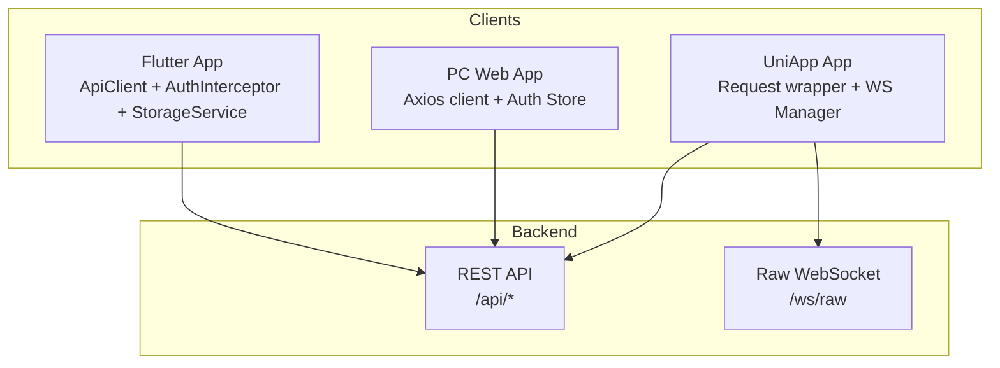
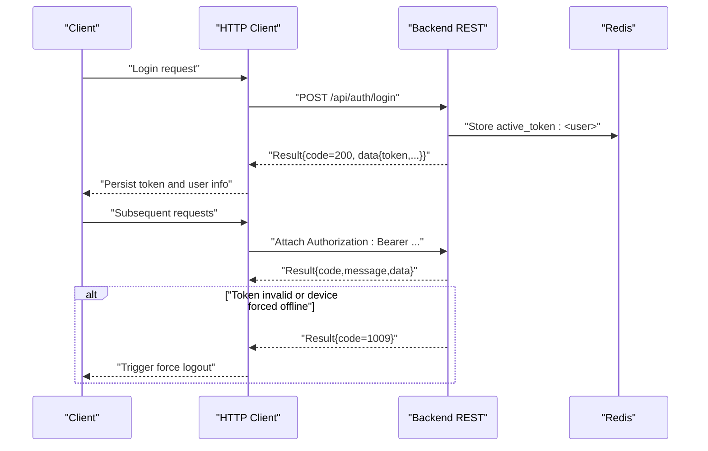
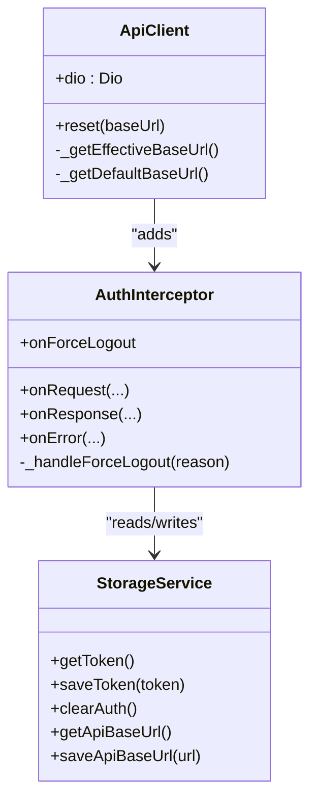
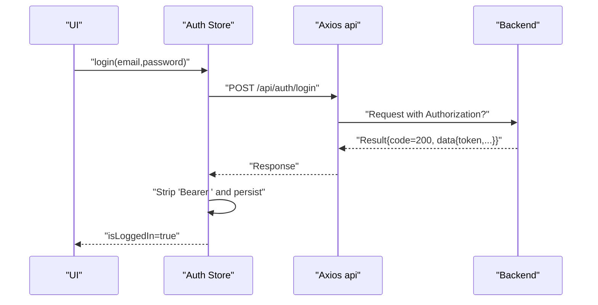
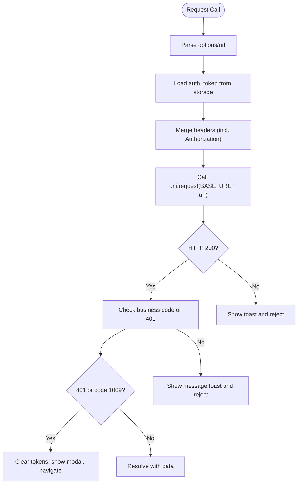
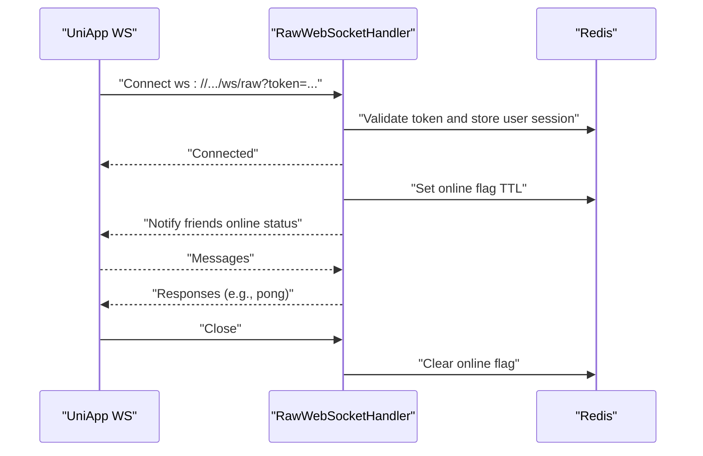
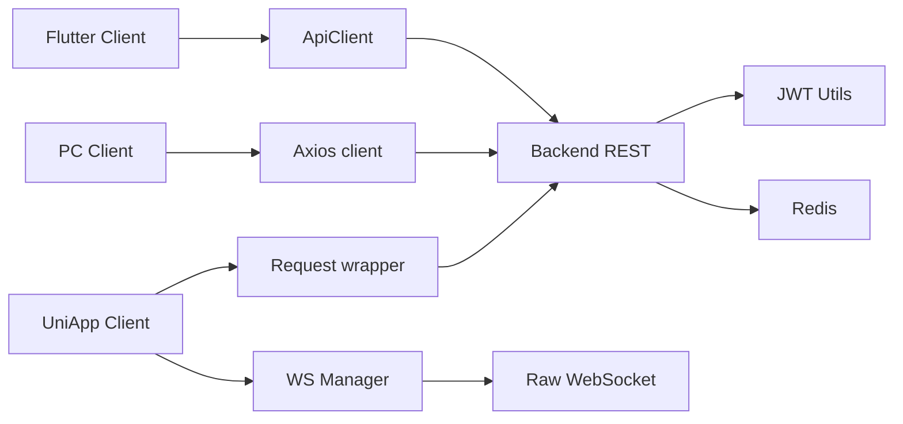

# API Integration Layer

<cite>
**Referenced Files in This Document**
- [main.dart](file://camp-channel-client-flutter/lib/main.dart)
- [api_client.dart](file://camp-channel-client-flutter/lib/core/network/api_client.dart)
- [auth_interceptor.dart](file://camp-channel-client-flutter/lib/core/network/auth_interceptor.dart)
- [storage_service.dart](file://camp-channel-client-flutter/lib/core/services/storage_service.dart)
- [user_provider.dart](file://camp-channel-client-flutter/lib/core/services/user_provider.dart)
- [client.ts](file://camp-channel-client-pc/src/api/client.ts)
- [auth.ts](file://camp-channel-client-pc/src/stores/auth.ts)
- [request.ts](file://camp-channel-client-uniapp/src/utils/request.ts)
- [websocket.ts](file://camp-channel-client-uniapp/src/utils/websocket.ts)
- [auth.ts](file://camp-channel-client-uniapp/src/stores/auth.ts)
- [AuthController.java](file://camp-channel-server/src/main/java/com/gdmec/campchannel/controller/AuthController.java)
- [Result.java](file://camp-channel-server/src/main/java/com/gdmec/campchannel/common/api/Result.java)
- [ErrorCode.java](file://camp-channel-server/src/main/java/com/gdmec/campchannel/common/api/ErrorCode.java)
- [application.yml](file://camp-channel-server/src/main/resources/application.yml)
- [RawWebSocketConfig.java](file://camp-channel-server/src/main/java/com/gdmec/campchannel/config/RawWebSocketConfig.java)
- [RawWebSocketHandler.java](file://camp-channel-server/src/main/java/com/gdmec/campchannel/config/RawWebSocketHandler.java)
- [WebSocketEventListener.java](file://camp-channel-server/src/main/java/com/gdmec/campchannel/config/WebSocketEventListener.java)
</cite>

## Table of Contents
1. [Introduction](#introduction)
2. [Project Structure](#project-structure)
3. [Core Components](#core-components)
4. [Architecture Overview](#architecture-overview)
5. [Detailed Component Analysis](#detailed-component-analysis)
6. [Dependency Analysis](#dependency-analysis)
7. [Performance Considerations](#performance-considerations)
8. [Troubleshooting Guide](#troubleshooting-guide)
9. [Conclusion](#conclusion)
10. [Appendices](#appendices)

## Introduction
This document describes the API integration layer across all client platforms (Flutter, PC web, and UniApp). It explains HTTP client configuration, authentication token management, error handling and retry logic, request/response transformation patterns, and platform-specific adaptations. It also documents the relationship with backend REST endpoints and WebSocket connections, and provides best practices for reliability, testing, and performance.

## Project Structure
The API integration spans three client applications and a Spring Boot backend:
- Flutter client: centralized HTTP client, authentication interceptor, and storage service.
- PC web client: Axios-based HTTP client with interceptors and Pinia auth store.
- UniApp client: request wrapper with token injection, image URL processing, and WebSocket manager.
- Backend server: REST API with unified response envelope, JWT-based authentication, and raw WebSocket endpoint.

**Diagram sources**
- [api_client.dart:1-52](file://camp-channel-client-flutter/lib/core/network/api_client.dart#L1-L52)
- [auth_interceptor.dart:1-66](file://camp-channel-client-flutter/lib/core/network/auth_interceptor.dart#L1-L66)
- [storage_service.dart:1-124](file://camp-channel-client-flutter/lib/core/services/storage_service.dart#L1-L124)
- [client.ts:1-35](file://camp-channel-client-pc/src/api/client.ts#L1-L35)
- [auth.ts:1-61](file://camp-channel-client-pc/src/stores/auth.ts#L1-L61)
- [request.ts:1-112](file://camp-channel-client-uniapp/src/utils/request.ts#L1-L112)
- [websocket.ts:1-268](file://camp-channel-client-uniapp/src/utils/websocket.ts#L1-L268)
- [application.yml:1-119](file://camp-channel-server/src/main/resources/application.yml#L1-L119)
- [RawWebSocketConfig.java:1-23](file://camp-channel-server/src/main/java/com/gdmec/campchannel/config/RawWebSocketConfig.java#L1-L23)
- [RawWebSocketHandler.java:1-171](file://camp-channel-server/src/main/java/com/gdmec/campchannel/config/RawWebSocketHandler.java#L1-L171)

**Section sources**
- [main.dart:1-122](file://camp-channel-client-flutter/lib/main.dart#L1-L122)
- [api_client.dart:1-52](file://camp-channel-client-flutter/lib/core/network/api_client.dart#L1-L52)
- [client.ts:1-35](file://camp-channel-client-pc/src/api/client.ts#L1-L35)
- [request.ts:1-112](file://camp-channel-client-uniapp/src/utils/request.ts#L1-L112)
- [application.yml:1-119](file://camp-channel-server/src/main/resources/application.yml#L1-L119)

## Core Components
- Unified HTTP client with platform-specific defaults and interceptors.
- Authentication token management via secure storage and automatic header injection.
- Consistent error handling and force-logout logic across clients.
- Request/response transformation and image URL normalization.
- WebSocket connectivity with reconnection and message routing.

**Section sources**
- [api_client.dart:1-52](file://camp-channel-client-flutter/lib/core/network/api_client.dart#L1-L52)
- [auth_interceptor.dart:1-66](file://camp-channel-client-flutter/lib/core/network/auth_interceptor.dart#L1-L66)
- [storage_service.dart:1-124](file://camp-channel-client-flutter/lib/core/services/storage_service.dart#L1-L124)
- [client.ts:1-35](file://camp-channel-client-pc/src/api/client.ts#L1-L35)
- [auth.ts:1-61](file://camp-channel-client-pc/src/stores/auth.ts#L1-L61)
- [request.ts:1-112](file://camp-channel-client-uniapp/src/utils/request.ts#L1-L112)
- [websocket.ts:1-268](file://camp-channel-client-uniapp/src/utils/websocket.ts#L1-L268)

## Architecture Overview
The clients communicate with the backend REST API under the /api context path. Authentication uses JWT tokens returned by the backend. Clients attach Authorization headers automatically. The backend enforces single-device login by storing the latest active token per user and returning a specific error code when a device is forced offline. WebSocket support is provided via a raw WebSocket endpoint (/ws/raw) for real-time notifications.

**Diagram sources**
- [AuthController.java:124-207](file://camp-channel-server/src/main/java/com/gdmec/campchannel/controller/AuthController.java#L124-L207)
- [Result.java:1-88](file://camp-channel-server/src/main/java/com/gdmec/campchannel/common/api/Result.java#L1-L88)
- [ErrorCode.java:1-60](file://camp-channel-server/src/main/java/com/gdmec/campchannel/common/api/ErrorCode.java#L1-L60)
- [api_client.dart:1-52](file://camp-channel-client-flutter/lib/core/network/api_client.dart#L1-L52)
- [auth_interceptor.dart:1-66](file://camp-channel-client-flutter/lib/core/network/auth_interceptor.dart#L1-L66)
- [client.ts:1-35](file://camp-channel-client-pc/src/api/client.ts#L1-L35)
- [request.ts:1-112](file://camp-channel-client-uniapp/src/utils/request.ts#L1-L112)

## Detailed Component Analysis

### Flutter API Client and Interceptors
- Base URL resolution: reads stored base URL, falls back to platform-specific default.
- Timeout configuration: connect/receive timeouts set to 10 seconds.
- Interceptors:
  - AuthInterceptor injects Authorization header from storage.
  - Logs requests/responses for debugging.
- Force logout: handles 401 and backend-defined code 1009 to clear credentials and notify UI.

**Diagram sources**
- [api_client.dart:1-52](file://camp-channel-client-flutter/lib/core/network/api_client.dart#L1-L52)
- [auth_interceptor.dart:1-66](file://camp-channel-client-flutter/lib/core/network/auth_interceptor.dart#L1-L66)
- [storage_service.dart:1-124](file://camp-channel-client-flutter/lib/core/services/storage_service.dart#L1-L124)

**Section sources**
- [api_client.dart:1-52](file://camp-channel-client-flutter/lib/core/network/api_client.dart#L1-L52)
- [auth_interceptor.dart:1-66](file://camp-channel-client-flutter/lib/core/network/auth_interceptor.dart#L1-L66)
- [storage_service.dart:1-124](file://camp-channel-client-flutter/lib/core/services/storage_service.dart#L1-L124)
- [main.dart:34-82](file://camp-channel-client-flutter/lib/main.dart#L34-L82)

### PC Web Axios Client and Auth Store
- Axios instance configured with base URL, timeout, and JSON content type.
- Request interceptor attaches Authorization header from localStorage.
- Response interceptor handles 401 by clearing tokens and redirecting to login.
- Auth store persists token and user info in localStorage and exposes computed properties.

**Diagram sources**
- [client.ts:1-35](file://camp-channel-client-pc/src/api/client.ts#L1-L35)
- [auth.ts:1-61](file://camp-channel-client-pc/src/stores/auth.ts#L1-L61)
- [AuthController.java:124-207](file://camp-channel-server/src/main/java/com/gdmec/campchannel/controller/AuthController.java#L124-L207)

**Section sources**
- [client.ts:1-35](file://camp-channel-client-pc/src/api/client.ts#L1-L35)
- [auth.ts:1-61](file://camp-channel-client-pc/src/stores/auth.ts#L1-L61)

### UniApp Request Wrapper and WebSocket Manager
- Request wrapper:
  - Supports both string URL and options signature.
  - Injects Authorization header from storage.
  - Normalizes image URLs to absolute using stored base URL.
  - Handles 401 and backend code 1009 by force logout and navigation.
- WebSocket manager:
  - Singleton with connection lifecycle control.
  - Adds JWT token as query parameter (?token=...) to raw WS endpoint.
  - Implements exponential backoff reconnection with a cap.
  - Dispatches messages to registered handlers by type or wildcard.

**Diagram sources**
- [request.ts:1-112](file://camp-channel-client-uniapp/src/utils/request.ts#L1-L112)

**Section sources**
- [request.ts:1-112](file://camp-channel-client-uniapp/src/utils/request.ts#L1-L112)
- [websocket.ts:1-268](file://camp-channel-client-uniapp/src/utils/websocket.ts#L1-L268)

### Backend REST API and WebSocket
- REST endpoints:
  - Context path: /api
  - Unified response envelope with code/message/data/timestamp
  - Single-device login enforcement via active token storage and error code 1009
- WebSocket:
  - Raw WebSocket endpoint /ws/raw
  - Authentication via query parameter token validated with JWT
  - Online status broadcasting to friends

**Diagram sources**
- [RawWebSocketHandler.java:1-171](file://camp-channel-server/src/main/java/com/gdmec/campchannel/config/RawWebSocketHandler.java#L1-L171)
- [RawWebSocketConfig.java:1-23](file://camp-channel-server/src/main/java/com/gdmec/campchannel/config/RawWebSocketConfig.java#L1-L23)
- [application.yml:1-119](file://camp-channel-server/src/main/resources/application.yml#L1-L119)

**Section sources**
- [application.yml:1-119](file://camp-channel-server/src/main/resources/application.yml#L1-L119)
- [Result.java:1-88](file://camp-channel-server/src/main/java/com/gdmec/campchannel/common/api/Result.java#L1-L88)
- [ErrorCode.java:1-60](file://camp-channel-server/src/main/java/com/gdmec/campchannel/common/api/ErrorCode.java#L1-L60)
- [AuthController.java:124-207](file://camp-channel-server/src/main/java/com/gdmec/campchannel/controller/AuthController.java#L124-L207)
- [RawWebSocketHandler.java:1-171](file://camp-channel-server/src/main/java/com/gdmec/campchannel/config/RawWebSocketHandler.java#L1-L171)

## Dependency Analysis
- Client to Backend:
  - REST: Axios/Dio clients depend on base URL and token storage.
  - WebSocket: UniApp uses raw WS with token query param; Flutter connects to the same endpoint via its own service.
- Backend to Infrastructure:
  - REST: Uses Spring MVC, JWT utilities, Redis for rate limiting and active token storage.
  - WebSocket: Raw handler validates token and maintains user sessions.

**Diagram sources**
- [api_client.dart:1-52](file://camp-channel-client-flutter/lib/core/network/api_client.dart#L1-L52)
- [client.ts:1-35](file://camp-channel-client-pc/src/api/client.ts#L1-L35)
- [request.ts:1-112](file://camp-channel-client-uniapp/src/utils/request.ts#L1-L112)
- [websocket.ts:1-268](file://camp-channel-client-uniapp/src/utils/websocket.ts#L1-L268)
- [application.yml:1-119](file://camp-channel-server/src/main/resources/application.yml#L1-L119)

**Section sources**
- [api_client.dart:1-52](file://camp-channel-client-flutter/lib/core/network/api_client.dart#L1-L52)
- [client.ts:1-35](file://camp-channel-client-pc/src/api/client.ts#L1-L35)
- [request.ts:1-112](file://camp-channel-client-uniapp/src/utils/request.ts#L1-L112)
- [websocket.ts:1-268](file://camp-channel-client-uniapp/src/utils/websocket.ts#L1-L268)
- [application.yml:1-119](file://camp-channel-server/src/main/resources/application.yml#L1-L119)

## Performance Considerations
- Timeouts: Configure connect/receive timeouts per client to avoid hanging requests.
- Retry strategy: Implement exponential backoff for transient failures; avoid retrying non-transient errors like 401.
- Caching: Cache immutable data (e.g., categories, static lists) with ETags or last-modified headers when supported.
- Compression: Enable gzip/deflate on the backend to reduce payload sizes.
- Offline-first: Persist critical data locally and queue mutations; sync on reconnect.
- Image optimization: Normalize image URLs and leverage CDN or backend resizing.

[No sources needed since this section provides general guidance]

## Troubleshooting Guide
Common issues and resolutions:
- 401 Unauthorized:
  - Clients remove stored tokens and redirect to login.
  - Verify Authorization header presence and token validity.
- Device forced offline (code 1009):
  - Trigger UI warning and force logout across platforms.
  - Ensure token storage is cleared and navigation occurs.
- Network errors:
  - Show user-friendly messages and suggest checking backend availability.
  - Implement retry with backoff for transient errors.
- WebSocket disconnections:
  - Use exponential backoff and reconnect timers.
  - Validate token query parameter and endpoint URL.

**Section sources**
- [auth_interceptor.dart:1-66](file://camp-channel-client-flutter/lib/core/network/auth_interceptor.dart#L1-L66)
- [client.ts:1-35](file://camp-channel-client-pc/src/api/client.ts#L1-L35)
- [request.ts:1-112](file://camp-channel-client-uniapp/src/utils/request.ts#L1-L112)
- [websocket.ts:232-253](file://camp-channel-client-uniapp/src/utils/websocket.ts#L232-L253)

## Conclusion
The API integration layer provides a consistent, secure, and resilient communication model across platforms. By centralizing HTTP configuration, authentication, and error handling, and by aligning with backend REST and WebSocket contracts, the system ensures predictable behavior and maintainable code. Adopting the recommended practices will improve reliability, performance, and user experience.

[No sources needed since this section summarizes without analyzing specific files]

## Appendices

### Configuration Options and Patterns
- Base URLs:
  - Flutter: stored in preferences, default varies by platform.
  - PC: default to /api; can be overridden.
  - UniApp: stored in storage; default to localhost.
- Authentication headers:
  - Axios/Dio: Authorization: Bearer <token>
  - UniApp: Authorization: <token> (no prefix)
- API versioning:
  - Use context path /api; keep stable endpoints for backward compatibility.
- Error handling:
  - 401: clear tokens and redirect to login.
  - Business code 1009: force logout with notification.
- WebSocket:
  - Endpoint: /ws/raw
  - Auth: query parameter token
  - Reconnect: exponential backoff with max attempts

**Section sources**
- [api_client.dart:36-50](file://camp-channel-client-flutter/lib/core/network/api_client.dart#L36-L50)
- [client.ts:4-8](file://camp-channel-client-pc/src/api/client.ts#L4-L8)
- [request.ts:3-4](file://camp-channel-client-uniapp/src/utils/request.ts#L3-L4)
- [websocket.ts:44-50](file://camp-channel-client-uniapp/src/utils/websocket.ts#L44-L50)
- [application.yml:1-119](file://camp-channel-server/src/main/resources/application.yml#L1-L119)