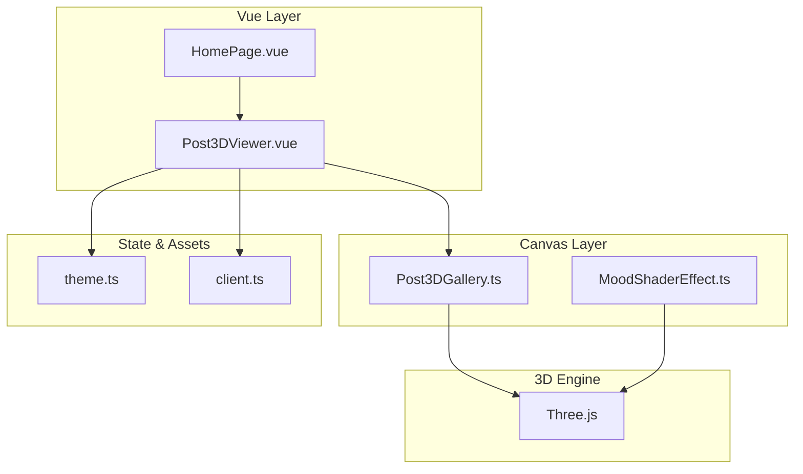
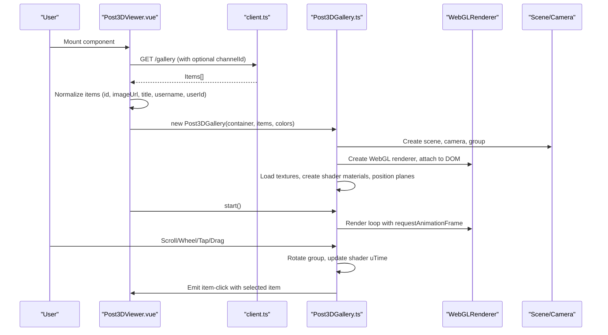
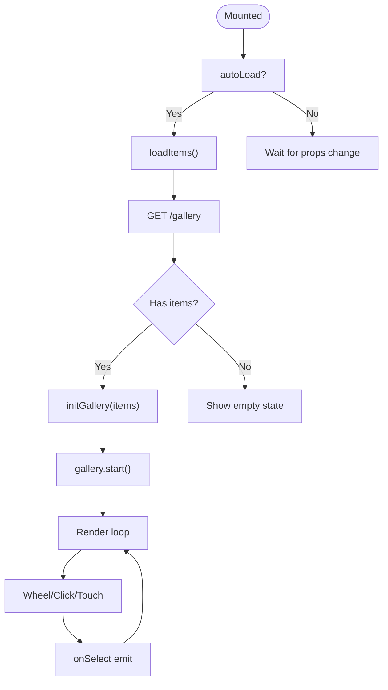
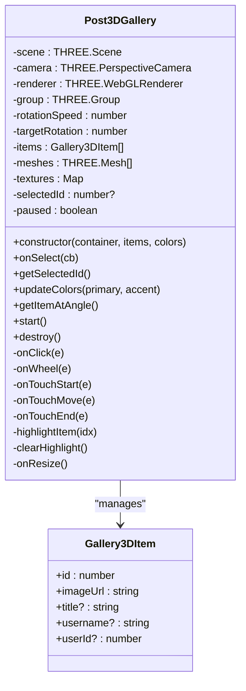
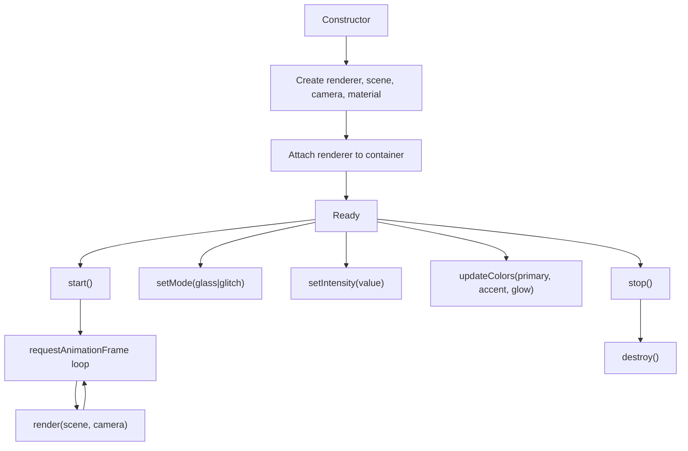
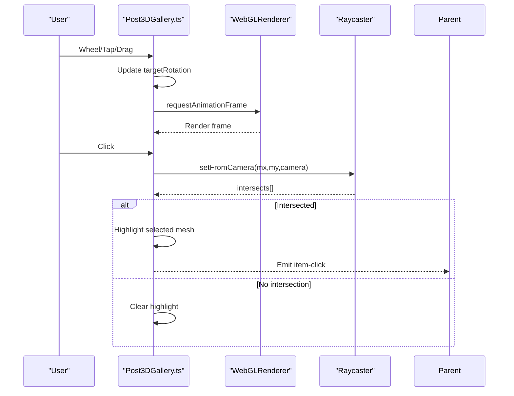
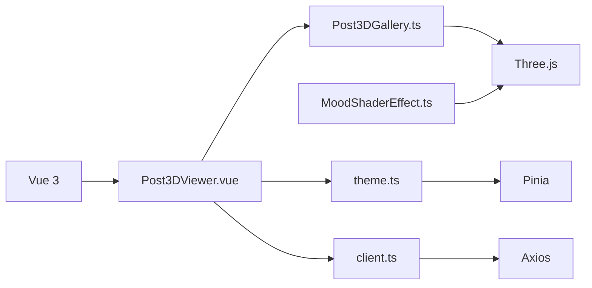

# 3D Post Viewer and WebGL Integration

<cite>
**Referenced Files in This Document**
- [Post3DViewer.vue](file://camp-channel-client-pc/src/components/Post3DViewer.vue)
- [Post3DGallery.ts](file://camp-channel-client-pc/src/canvas/Post3DGallery.ts)
- [MoodShaderEffect.ts](file://camp-channel-client-pc/src/canvas/MoodShaderEffect.ts)
- [theme.ts](file://camp-channel-client-pc/src/stores/theme.ts)
- [client.ts](file://camp-channel-client-pc/src/api/client.ts)
- [HomePage.vue](file://camp-channel-client-pc/src/pages/HomePage.vue)
- [package.json](file://camp-channel-client-pc/package.json)
</cite>

## Table of Contents
1. [Introduction](#introduction)
2. [Project Structure](#project-structure)
3. [Core Components](#core-components)
4. [Architecture Overview](#architecture-overview)
5. [Detailed Component Analysis](#detailed-component-analysis)
6. [Dependency Analysis](#dependency-analysis)
7. [Performance Considerations](#performance-considerations)
8. [Troubleshooting Guide](#troubleshooting-guide)
9. [Conclusion](#conclusion)
10. [Appendices](#appendices)

## Introduction
This document explains the 3D post viewer component and WebGL integration used to render a gallery of 2D image tiles in a circular 3D arrangement. It covers the Three.js implementation for model rendering, shader effects, and interactive controls. It documents the Post3DViewer component architecture, including scene setup, lighting configuration, and camera controls. It also provides concrete examples of 3D model loading, texture mapping, and user interaction handling, along with the mood shader effect for dynamic visual enhancement. Performance optimization techniques such as level-of-detail scaling, frustum culling, and GPU memory management are discussed. Finally, it explains integration with the Vue.js component lifecycle, responsive design considerations, accessibility features, browser compatibility, fallback strategies, and progressive enhancement approaches.

## Project Structure
The 3D post viewer is implemented in the PC client (Vue 3 + TypeScript) and relies on Three.js for WebGL rendering. The key files are:
- Post3DViewer.vue: Vue component that loads gallery items and initializes the 3D gallery.
- Post3DGallery.ts: Core WebGL renderer that positions planes in a circle, applies shader materials, and handles user interactions.
- MoodShaderEffect.ts: A secondary WebGL overlay that renders animated shader effects behind the gallery.
- theme.ts: Theme store providing primary/accent/glow colors used by shaders.
- client.ts: API client for fetching gallery items.
- HomePage.vue: Example page that triggers gallery refresh events.
- package.json: Dependencies including Three.js.

**Diagram sources**
- [Post3DViewer.vue:1-96](file://camp-channel-client-pc/src/components/Post3DViewer.vue#L1-L96)
- [Post3DGallery.ts:1-285](file://camp-channel-client-pc/src/canvas/Post3DGallery.ts#L1-L285)
- [MoodShaderEffect.ts:1-146](file://camp-channel-client-pc/src/canvas/MoodShaderEffect.ts#L1-L146)
- [theme.ts:1-295](file://camp-channel-client-pc/src/stores/theme.ts#L1-L295)
- [client.ts:1-35](file://camp-channel-client-pc/src/api/client.ts#L1-L35)
- [HomePage.vue:135-159](file://camp-channel-client-pc/src/pages/HomePage.vue#L135-L159)

**Section sources**
- [Post3DViewer.vue:1-96](file://camp-channel-client-pc/src/components/Post3DViewer.vue#L1-L96)
- [Post3DGallery.ts:1-285](file://camp-channel-client-pc/src/canvas/Post3DGallery.ts#L1-L285)
- [MoodShaderEffect.ts:1-146](file://camp-channel-client-pc/src/canvas/MoodShaderEffect.ts#L1-L146)
- [theme.ts:1-295](file://camp-channel-client-pc/src/stores/theme.ts#L1-L295)
- [client.ts:1-35](file://camp-channel-client-pc/src/api/client.ts#L1-L35)
- [HomePage.vue:135-159](file://camp-channel-client-pc/src/pages/HomePage.vue#L135-L159)
- [package.json:10-19](file://camp-channel-client-pc/package.json#L10-L19)

## Core Components
- Post3DViewer.vue: Manages loading gallery items from the backend, initializing the 3D gallery, emitting item selection events, and responding to theme/color changes and refresh events.
- Post3DGallery.ts: Creates a Three.js scene with a perspective camera and WebGL renderer, arranges plane geometries in a circle, loads textures per item, applies shader materials, and handles click/touch/scroll interactions.
- MoodShaderEffect.ts: Renders a full-bleed orthographic shader quad with animated uniforms to produce mood effects (glass or glitch modes).
- theme.ts: Provides theme colors (primary, accent, glow) consumed by both the gallery and mood effect.
- client.ts: Axios-based API client with token injection and 401 handling.

Key responsibilities:
- Scene setup: Perspective camera, renderer with alpha and antialias, pixel ratio clamped to a safe cap.
- Lighting: Minimal ambient-style effect via shader math; no explicit lights.
- Camera controls: Auto-spin with damping; user input via wheel and touch drags; click-to-select with raycasting.
- Shader materials: Custom vertex/fragment shaders for border glow, vignetting, and pulsing.
- Interaction: Raycast selection, highlighting, and emitting item-click events.

**Section sources**
- [Post3DViewer.vue:10-96](file://camp-channel-client-pc/src/components/Post3DViewer.vue#L10-L96)
- [Post3DGallery.ts:32-128](file://camp-channel-client-pc/src/canvas/Post3DGallery.ts#L32-L128)
- [MoodShaderEffect.ts:18-98](file://camp-channel-client-pc/src/canvas/MoodShaderEffect.ts#L18-L98)
- [theme.ts:261-295](file://camp-channel-client-pc/src/stores/theme.ts#L261-L295)
- [client.ts:4-35](file://camp-channel-client-pc/src/api/client.ts#L4-L35)

## Architecture Overview
The Post3DViewer component orchestrates data loading and initialization of the Post3DGallery. The gallery manages the Three.js scene and user interactions. A separate MoodShaderEffect can optionally render behind the gallery for atmospheric effects.

**Diagram sources**
- [Post3DViewer.vue:25-63](file://camp-channel-client-pc/src/components/Post3DViewer.vue#L25-L63)
- [client.ts:4-35](file://camp-channel-client-pc/src/api/client.ts#L4-L35)
- [Post3DGallery.ts:32-128](file://camp-channel-client-pc/src/canvas/Post3DGallery.ts#L32-L128)
- [Post3DGallery.ts:241-258](file://camp-channel-client-pc/src/canvas/Post3DGallery.ts#L241-L258)

## Detailed Component Analysis

### Post3DViewer.vue
- Props and emits: Accepts autoLoad and channelId; emits item-click with selected Gallery3DItem.
- Lifecycle:
  - onMounted: Optionally loads items and listens for a custom gallery-refresh event.
  - onUnmounted: Destroys the gallery and removes event listeners.
- Loading and initialization:
  - loadItems: Fetches items from /gallery, maps to Gallery3DItem, and initializes the gallery after DOM readiness.
  - initGallery: Creates Post3DGallery with container, items, and theme colors; registers onSelect callback; starts rendering.
- Theming:
  - Watch themeIndex: Updates gallery colors when theme changes.
- Refresh events:
  - Listens for window.gallery-refresh and reloads items.

**Diagram sources**
- [Post3DViewer.vue:79-89](file://camp-channel-client-pc/src/components/Post3DViewer.vue#L79-L89)
- [Post3DViewer.vue:25-63](file://camp-channel-client-pc/src/components/Post3DViewer.vue#L25-L63)

**Section sources**
- [Post3DViewer.vue:10-96](file://camp-channel-client-pc/src/components/Post3DViewer.vue#L10-L96)

### Post3DGallery.ts
- Scene and camera:
  - Perspective camera at position (0, 0, 12) with aspect from container size.
  - WebGL renderer with alpha and antialias; pixel ratio capped to 2.
- Geometry and materials:
  - Plane geometry for each item; ShaderMaterial with uniforms: uTexture, uBorderColor, uTime, uGlow.
  - Borders via LineSegments around edges; DoubleSide for visibility from both sides.
- Layout:
  - Items positioned evenly around a circle (radius ~4.5) and oriented toward the center.
- Interactions:
  - Wheel: adjusts target rotation based on deltaY.
  - Touch: drag updates target rotation; prevents default scrolling during move.
  - Click: raycast against meshes to select nearest item; highlight/unhighlight on selection.
- Animation:
  - requestAnimationFrame loop: apply spring-like rotation damping, increment uTime for shader animations.
- Theming:
  - updateColors: updates border colors and edge colors reactively.
- Cleanup:
  - destroy: cancels animation frame, removes event listeners, disposes textures/renderer/group/scene.

**Diagram sources**
- [Post3DGallery.ts:11-285](file://camp-channel-client-pc/src/canvas/Post3DGallery.ts#L11-L285)

**Section sources**
- [Post3DGallery.ts:32-128](file://camp-channel-client-pc/src/canvas/Post3DGallery.ts#L32-L128)
- [Post3DGallery.ts:145-180](file://camp-channel-client-pc/src/canvas/Post3DGallery.ts#L145-L180)
- [Post3DGallery.ts:241-258](file://camp-channel-client-pc/src/canvas/Post3DGallery.ts#L241-L258)
- [Post3DGallery.ts:260-283](file://camp-channel-client-pc/src/canvas/Post3DGallery.ts#L260-L283)

### MoodShaderEffect.ts
- Purpose: Full-viewport orthographic shader quad rendered behind content for dynamic mood effects.
- Features:
  - Modes: glass (subtle breathing/wave ripple) and glitch (scanlines, color shifts).
  - Controls: setMode, setIntensity, updateColors, start/stop, destroy.
  - Rendering: single PlaneGeometry covering [-1,1] in clip space; OrthographicCamera; continuous time-based animation.
- Color pipeline:
  - Uses theme-provided primary/accent/glow colors via hex-to-vec3 conversion.

**Diagram sources**
- [MoodShaderEffect.ts:18-137](file://camp-channel-client-pc/src/canvas/MoodShaderEffect.ts#L18-L137)

**Section sources**
- [MoodShaderEffect.ts:9-146](file://camp-channel-client-pc/src/canvas/MoodShaderEffect.ts#L9-L146)

### Shader Effects and Visual Enhancements
- Gallery shader (per-plane):
  - Border glow controlled by uBorderColor and uGlow.
  - Pulsing effect via uTime to simulate breathing/vignetting.
  - Vignette falloff for depth perception.
- Mood shader (full-viewport):
  - Two modes: glass (ripple + wave) and glitch (bar/flicker/glitch).
  - Intensity and color modulation via uniforms.

Practical usage:
- To add a new effect, extend the shader material’s uniforms and vertex/fragment logic similarly to the existing implementations.
- For performance, keep fragment computations minimal and avoid redundant recalculations.

**Section sources**
- [Post3DGallery.ts:61-101](file://camp-channel-client-pc/src/canvas/Post3DGallery.ts#L61-L101)
- [MoodShaderEffect.ts:33-98](file://camp-channel-client-pc/src/canvas/MoodShaderEffect.ts#L33-L98)

### User Interaction Handling
- Mouse wheel: Adjusts target rotation to smoothly rotate the gallery.
- Touch gestures: Touchstart records initial X; Touchmove computes delta to adjust target rotation; Touchend lets inertia continue.
- Click selection: Raycasting against visible meshes; highlights selected item and emits item-click.
- Highlighting: Scales selected mesh and switches border color; clears highlight when clicking empty space.

**Diagram sources**
- [Post3DGallery.ts:145-180](file://camp-channel-client-pc/src/canvas/Post3DGallery.ts#L145-L180)
- [Post3DGallery.ts:241-258](file://camp-channel-client-pc/src/canvas/Post3DGallery.ts#L241-L258)

**Section sources**
- [Post3DGallery.ts:130-180](file://camp-channel-client-pc/src/canvas/Post3DGallery.ts#L130-L180)

### Example Workflows

#### Loading and Rendering a 3D Gallery
- Fetch items from the backend using the API client.
- Initialize Post3DGallery with the container element and items.
- Start the render loop; the gallery automatically rotates and updates shader times.

References:
- [Post3DViewer.vue:25-63](file://camp-channel-client-pc/src/components/Post3DViewer.vue#L25-L63)
- [client.ts:4-35](file://camp-channel-client-pc/src/api/client.ts#L4-L35)
- [Post3DGallery.ts:32-128](file://camp-channel-client-pc/src/canvas/Post3DGallery.ts#L32-L128)

#### Texture Mapping and Material Updates
- Textures are loaded per item and cached in a map keyed by item ID.
- Shader materials receive uTexture and color uniforms; updating theme colors propagates to materials and edges.

References:
- [Post3DGallery.ts:58-115](file://camp-channel-client-pc/src/canvas/Post3DGallery.ts#L58-L115)
- [Post3DGallery.ts:217-228](file://camp-channel-client-pc/src/canvas/Post3DGallery.ts#L217-L228)

#### User Interaction: Selection and Preview
- On item-click, the parent component receives the selected item and can open a preview dialog or route.

References:
- [Post3DViewer.vue:56-58](file://camp-channel-client-pc/src/components/Post3DViewer.vue#L56-L58)
- [HomePage.vue:156-159](file://camp-channel-client-pc/src/pages/HomePage.vue#L156-L159)

## Dependency Analysis
- Vue 3 + TypeScript: Component composition, reactivity, and lifecycle hooks.
- Three.js: Core 3D engine for scenes, cameras, renderers, materials, and geometry.
- Axios: HTTP client for API requests.
- Pinia: State management for themes.

**Diagram sources**
- [package.json:10-19](file://camp-channel-client-pc/package.json#L10-L19)
- [Post3DViewer.vue:10-14](file://camp-channel-client-pc/src/components/Post3DViewer.vue#L10-L14)
- [Post3DGallery.ts:1](file://camp-channel-client-pc/src/canvas/Post3DGallery.ts#L1)
- [MoodShaderEffect.ts:1](file://camp-channel-client-pc/src/canvas/MoodShaderEffect.ts#L1)
- [theme.ts:1-3](file://camp-channel-client-pc/src/stores/theme.ts#L1-L3)
- [client.ts:1](file://camp-channel-client-pc/src/api/client.ts#L1)

**Section sources**
- [package.json:10-19](file://camp-channel-client-pc/package.json#L10-L19)
- [Post3DViewer.vue:10-14](file://camp-channel-client-pc/src/components/Post3DViewer.vue#L10-L14)
- [Post3DGallery.ts:1](file://camp-channel-client-pc/src/canvas/Post3DGallery.ts#L1)
- [MoodShaderEffect.ts:1](file://camp-channel-client-pc/src/canvas/MoodShaderEffect.ts#L1)
- [theme.ts:1-3](file://camp-channel-client-pc/src/stores/theme.ts#L1-L3)
- [client.ts:1](file://camp-channel-client-pc/src/api/client.ts#L1)

## Performance Considerations
- Level-of-detail scaling:
  - Clamp devicePixelRatio to a safe cap to reduce render target size on high-DPI displays.
  - References: [Post3DGallery.ts:42](file://camp-channel-client-pc/src/canvas/Post3DGallery.ts#L42), [MoodShaderEffect.ts:20](file://camp-channel-client-pc/src/canvas/MoodShaderEffect.ts#L20)
- Frustum culling:
  - Current implementation does not apply custom frustum culling; consider adding bounding sphere checks or using a camera frustum to skip off-screen items.
- GPU memory management:
  - Dispose textures and renderer on destroy to prevent leaks.
  - References: [Post3DGallery.ts:279-283](file://camp-channel-client-pc/src/canvas/Post3DGallery.ts#L279-L283)
- Animation efficiency:
  - Use requestAnimationFrame consistently; avoid unnecessary re-renders by batching updates to shader uniforms.
- Shader complexity:
  - Keep fragment shaders lightweight; cache expensive computations where possible.
- Interaction responsiveness:
  - Debounce resize handlers; throttle wheel/touch deltas to smooth motion.

[No sources needed since this section provides general guidance]

## Troubleshooting Guide
- WebGL not supported or disabled:
  - Symptoms: Blank gallery, errors in console.
  - Actions: Detect WebGL availability before instantiating Three.js; provide a fallback UI and disable 3D features.
- Low FPS on mobile:
  - Reduce pixel ratio cap, simplify shaders, or lower the number of items.
- Clicks not registering:
  - Ensure the renderer’s domElement is above other overlays and pointer-events are enabled.
  - Verify raycasting bounds and camera/projection updates on resize.
- Memory leaks:
  - Confirm destroy() is called on unmount and all event listeners removed.
- Theme color mismatches:
  - Ensure theme store is applied before initializing the gallery and that updateColors is invoked on theme changes.

**Section sources**
- [Post3DViewer.vue:50-62](file://camp-channel-client-pc/src/components/Post3DViewer.vue#L50-L62)
- [Post3DGallery.ts:260-283](file://camp-channel-client-pc/src/canvas/Post3DGallery.ts#L260-L283)

## Conclusion
The 3D post viewer integrates Vue.js with Three.js to deliver an immersive, interactive gallery of 2D images arranged in 3D space. It leverages custom shader materials for visual polish, supports intuitive user interactions, and adapts to theme-driven colors. With careful attention to performance and robust cleanup, the system provides a smooth experience across devices while remaining extensible for future enhancements.

[No sources needed since this section summarizes without analyzing specific files]

## Appendices

### Browser Compatibility and Progressive Enhancement
- WebGL requirement: The gallery requires WebGL; detect support and degrade gracefully by disabling the component or showing static thumbnails.
- Fallback strategy: On unsupported devices, render a simple horizontal scroll of static images and hide the 3D controls.
- Progressive enhancement: Start with basic rendering, then add shaders and interactivity progressively based on device capabilities.

[No sources needed since this section provides general guidance]

### Accessibility Considerations
- Keyboard navigation: Allow arrow keys to rotate the gallery and Enter/Space to select items.
- Screen reader labels: Provide aria-labels for the container and items; announce selected item details.
- Focus management: Ensure focus moves to the selected item and remains within the gallery area.
- Motion sensitivity: Offer reduced-motion preferences by lowering animation speed or disabling shader pulsing.

[No sources needed since this section provides general guidance]