# Advanced UI Components and Effects

<cite>
**Referenced Files in This Document**
- [main.ts](file://camp-channel-client-pc/src/main.ts)
- [App.vue](file://camp-channel-client-pc/src/App.vue)
- [CanvasEngine.ts](file://camp-channel-client-pc/src/canvas/CanvasEngine.ts)
- [FluidBackground.ts](file://camp-channel-client-pc/src/canvas/FluidBackground.ts)
- [GlassEffect.ts](file://camp-channel-client-pc/src/canvas/GlassEffect.ts)
- [ParticleSystem.ts](file://camp-channel-client-pc/src/canvas/ParticleSystem.ts)
- [ParticleBurst.ts](file://camp-channel-client-pc/src/canvas/ParticleBurst.ts)
- [Post3DGallery.ts](file://camp-channel-client-pc/src/canvas/Post3DGallery.ts)
- [MoodShaderEffect.ts](file://camp-channel-client-pc/src/canvas/MoodShaderEffect.ts)
- [ThemeRenderer.ts](file://camp-channel-client-pc/src/canvas/ThemeRenderer.ts)
- [cursorRenderer.ts](file://camp-channel-client-pc/src/utils/cursorRenderer.ts)
- [hybridTransitionManager.ts](file://camp-channel-client-pc/src/utils/hybridTransitionManager.ts)
- [pageTransitionManager.ts](file://camp-channel-client-pc/src/utils/pageTransitionManager.ts)
- [canvasTransitionRenderer.ts](file://camp-channel-client-pc/src/utils/canvasTransitionRenderer.ts)
- [WebGLBackground.vue](file://camp-channel-client-pc/src/components/WebGLBackground.vue)
- [CanvasBackground.vue](file://camp-channel-client-pc/src/components/CanvasBackground.vue)
- [ParticleBurstOverlay.vue](file://camp-channel-client-pc/src/components/ParticleBurstOverlay.vue)
- [Post3DViewer.vue](file://camp-channel-client-pc/src/components/Post3DViewer.vue)
- [GlassCard.vue](file://camp-channel-client-pc/src/components/GlassCard.vue)
- [ShaderPostCard.vue](file://camp-channel-client-pc/src/components/ShaderPostCard.vue)
</cite>

## Table of Contents
1. [Introduction](#introduction)
2. [Project Structure](#project-structure)
3. [Core Components](#core-components)
4. [Architecture Overview](#architecture-overview)
5. [Detailed Component Analysis](#detailed-component-analysis)
6. [Dependency Analysis](#dependency-analysis)
7. [Performance Considerations](#performance-considerations)
8. [Troubleshooting Guide](#troubleshooting-guide)
9. [Conclusion](#conclusion)
10. [Appendices](#appendices)

## Introduction
This document explains the advanced UI components and visual effects system built on top of a canvas-based rendering engine and Three.js. It covers:
- Canvas engine orchestration and animation loops
- Fluid background animations powered by WebGL shaders
- Glass morphism effects using 2D canvas gradients
- Particle systems for interactive and aesthetic overlays
- Three.js integration for 3D post galleries and custom shader effects
- Page transition systems combining CSS and Canvas
- Vue.js component integration and lifecycle management
- Performance tuning, browser compatibility, and responsive design strategies

## Project Structure
The visual effects are implemented primarily under the PC client’s source tree. Key areas:
- Canvas engine and effects: src/canvas/*
- Vue components for backgrounds and overlays: src/components/*
- Application bootstrap and integrations: src/main.ts, src/App.vue
- Page transition utilities: src/utils/*

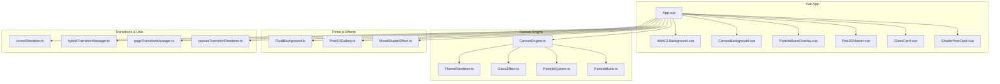

**Diagram sources**
- [App.vue:1-85](file://camp-channel-client-pc/src/App.vue#L1-L85)
- [CanvasEngine.ts:19-103](file://camp-channel-client-pc/src/canvas/CanvasEngine.ts#L19-L103)
- [FluidBackground.ts:9-150](file://camp-channel-client-pc/src/canvas/FluidBackground.ts#L9-L150)
- [GlassEffect.ts:3-40](file://camp-channel-client-pc/src/canvas/GlassEffect.ts#L3-L40)
- [ParticleSystem.ts:13-93](file://camp-channel-client-pc/src/canvas/ParticleSystem.ts#L13-L93)
- [ParticleBurst.ts:9-102](file://camp-channel-client-pc/src/canvas/ParticleBurst.ts#L9-L102)
- [Post3DGallery.ts:11-285](file://camp-channel-client-pc/src/canvas/Post3DGallery.ts#L11-L285)
- [MoodShaderEffect.ts:9-146](file://camp-channel-client-pc/src/canvas/MoodShaderEffect.ts#L9-L146)
- [ThemeRenderer.ts:3-43](file://camp-channel-client-pc/src/canvas/ThemeRenderer.ts#L3-L43)
- [WebGLBackground.vue](file://camp-channel-client-pc/src/components/WebGLBackground.vue)
- [CanvasBackground.vue](file://camp-channel-client-pc/src/components/CanvasBackground.vue)
- [ParticleBurstOverlay.vue](file://camp-channel-client-pc/src/components/ParticleBurstOverlay.vue)
- [Post3DViewer.vue](file://camp-channel-client-pc/src/components/Post3DViewer.vue)
- [GlassCard.vue](file://camp-channel-client-pc/src/components/GlassCard.vue)
- [ShaderPostCard.vue](file://camp-channel-client-pc/src/components/ShaderPostCard.vue)
- [hybridTransitionManager.ts](file://camp-channel-client-pc/src/utils/hybridTransitionManager.ts)
- [pageTransitionManager.ts](file://camp-channel-client-pc/src/utils/pageTransitionManager.ts)
- [canvasTransitionRenderer.ts](file://camp-channel-client-pc/src/utils/canvasTransitionRenderer.ts)
- [cursorRenderer.ts](file://camp-channel-client-pc/src/utils/cursorRenderer.ts)

**Section sources**
- [main.ts:1-19](file://camp-channel-client-pc/src/main.ts#L1-L19)
- [App.vue:1-85](file://camp-channel-client-pc/src/App.vue#L1-L85)

## Core Components
This section introduces the foundational building blocks of the visual system.

- CanvasEngine orchestrates a 2D canvas pipeline: theme background, glass morphism, and particle systems. It initializes the canvas, registers resize/mouse handlers, and runs a requestAnimationFrame loop to render layered effects.
- ThemeRenderer draws a dynamic linear gradient background based on theme color tokens.
- GlassEffect composes radial gradients around the mouse to simulate light trails and ambient glows.
- ParticleSystem simulates lightweight particles with proximity-based repulsion and subtle pulsing, rendering connections between nearby particles.
- ParticleBurstSystem provides transient particle explosions at coordinates with configurable color and count, using per-particle gravity and exponential decay.
- FluidBackground renders a WebGL shader background with animated waveforms, mouse interaction, and color uniforms.
- Post3DGallery creates a 3D gallery of posts arranged in a circle, supports mouse/touch interaction, raycasting selection, and custom shader materials with border glow and vignetting.
- MoodShaderEffect overlays a shader-based mood layer supporting “glass” and “glitch” modes with adjustable intensity and color blending.
- Vue components integrate these engines into the app layout and page transitions.

**Section sources**
- [CanvasEngine.ts:19-103](file://camp-channel-client-pc/src/canvas/CanvasEngine.ts#L19-L103)
- [ThemeRenderer.ts:3-43](file://camp-channel-client-pc/src/canvas/ThemeRenderer.ts#L3-L43)
- [GlassEffect.ts:3-40](file://camp-channel-client-pc/src/canvas/GlassEffect.ts#L3-L40)
- [ParticleSystem.ts:13-93](file://camp-channel-client-pc/src/canvas/ParticleSystem.ts#L13-L93)
- [ParticleBurst.ts:9-102](file://camp-channel-client-pc/src/canvas/ParticleBurst.ts#L9-L102)
- [FluidBackground.ts:9-150](file://camp-channel-client-pc/src/canvas/FluidBackground.ts#L9-L150)
- [Post3DGallery.ts:11-285](file://camp-channel-client-pc/src/canvas/Post3DGallery.ts#L11-L285)
- [MoodShaderEffect.ts:9-146](file://camp-channel-client-pc/src/canvas/MoodShaderEffect.ts#L9-L146)

## Architecture Overview
The visual system blends 2D canvas rendering with Three.js for rich, interactive experiences. Vue components host these engines and manage lifecycle hooks and transitions.

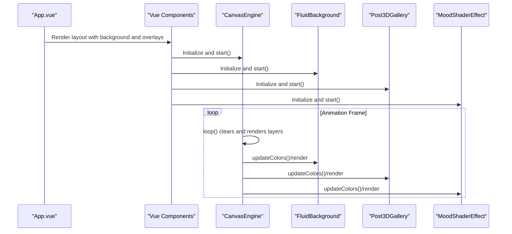

**Diagram sources**
- [App.vue:1-85](file://camp-channel-client-pc/src/App.vue#L1-L85)
- [CanvasEngine.ts:79-93](file://camp-channel-client-pc/src/canvas/CanvasEngine.ts#L79-L93)
- [FluidBackground.ts:131-140](file://camp-channel-client-pc/src/canvas/FluidBackground.ts#L131-L140)
- [Post3DGallery.ts:241-258](file://camp-channel-client-pc/src/canvas/Post3DGallery.ts#L241-L258)
- [MoodShaderEffect.ts:114-125](file://camp-channel-client-pc/src/canvas/MoodShaderEffect.ts#L114-L125)

## Detailed Component Analysis

### CanvasEngine: 2D Orchestration and Animation Loop
CanvasEngine is the central coordinator for 2D effects. It:
- Initializes canvas context and registers resize/mouse move events
- Resizes internal particle system and canvas dimensions
- Runs a continuous loop that clears the canvas, renders theme background, glass effect, and particle system, then schedules the next frame

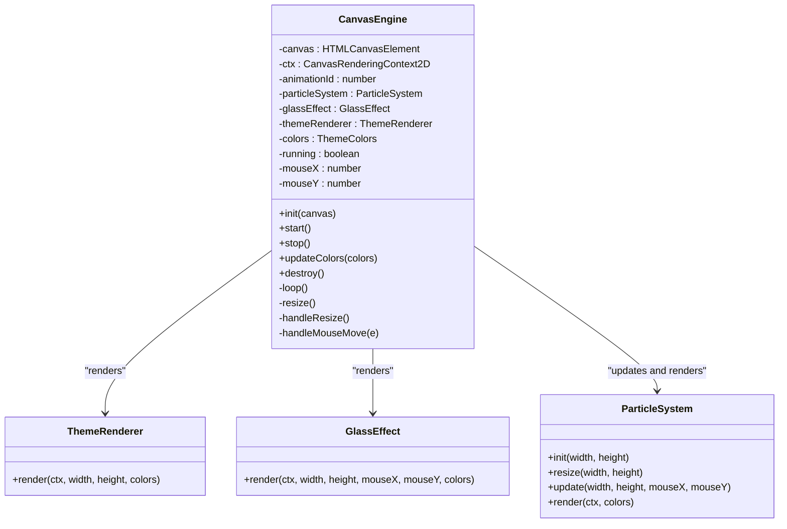

**Diagram sources**
- [CanvasEngine.ts:19-103](file://camp-channel-client-pc/src/canvas/CanvasEngine.ts#L19-L103)
- [ThemeRenderer.ts:3-43](file://camp-channel-client-pc/src/canvas/ThemeRenderer.ts#L3-L43)
- [GlassEffect.ts:3-40](file://camp-channel-client-pc/src/canvas/GlassEffect.ts#L3-L40)
- [ParticleSystem.ts:13-93](file://camp-channel-client-pc/src/canvas/ParticleSystem.ts#L13-L93)

**Section sources**
- [CanvasEngine.ts:38-101](file://camp-channel-client-pc/src/canvas/CanvasEngine.ts#L38-L101)

### Fluid Background: WebGL Shader Animation
FluidBackground creates a shader-based animated background:
- Uses an orthographic camera and a full-screen plane
- Exposes uniforms for time, mouse position, resolution, and three colors
- Implements wave-based flow, Voronoi-like patterns, mouse interaction, glow pulses, and vignette
- Updates uniforms each frame and renders continuously

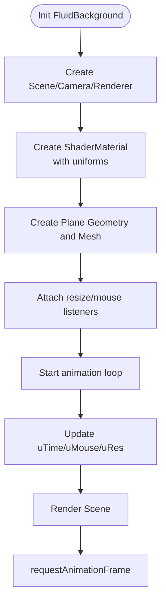

**Diagram sources**
- [FluidBackground.ts:18-102](file://camp-channel-client-pc/src/canvas/FluidBackground.ts#L18-L102)
- [FluidBackground.ts:131-140](file://camp-channel-client-pc/src/canvas/FluidBackground.ts#L131-L140)

**Section sources**
- [FluidBackground.ts:18-150](file://camp-channel-client-pc/src/canvas/FluidBackground.ts#L18-L150)

### Glass Morphism Effect: Radial Gradients and Glow
GlassEffect renders radial gradients centered around the mouse pointer and secondary ambient points to simulate a soft, luminous glass overlay. It converts hex colors to RGBA for transparency.

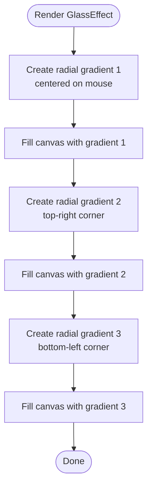

**Diagram sources**
- [GlassEffect.ts:4-29](file://camp-channel-client-pc/src/canvas/GlassEffect.ts#L4-L29)

**Section sources**
- [GlassEffect.ts:3-40](file://camp-channel-client-pc/src/canvas/GlassEffect.ts#L3-L40)

### Particle System: Interactive Particles and Connections
ParticleSystem simulates small particles with:
- Random initial positions, velocities, sizes, and alpha
- Mouse proximity-based repulsion within a threshold
- Natural boundary bounce
- Pulsing alpha for a breathing effect
- Rendering connections between close particles with fading alpha

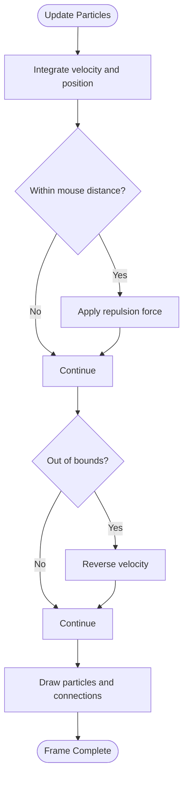

**Diagram sources**
- [ParticleSystem.ts:44-91](file://camp-channel-client-pc/src/canvas/ParticleSystem.ts#L44-L91)

**Section sources**
- [ParticleSystem.ts:13-93](file://camp-channel-client-pc/src/canvas/ParticleSystem.ts#L13-L93)

### Particle Burst: Transient Explosions
ParticleBurstSystem creates localized bursts of particles radiating from a point:
- Spawns a configurable number of particles with random angles and speeds
- Applies gravity and exponential damping
- Renders shadowed circles with per-particle lifetimes
- Clears the canvas between frames and stops when all particles expire

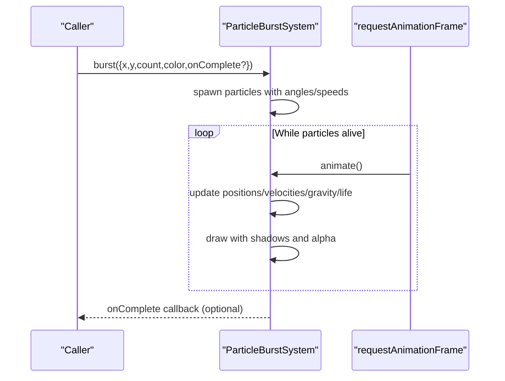

**Diagram sources**
- [ParticleBurst.ts:28-82](file://camp-channel-client-pc/src/canvas/ParticleBurst.ts#L28-L82)

**Section sources**
- [ParticleBurst.ts:9-102](file://camp-channel-client-pc/src/canvas/ParticleBurst.ts#L9-L102)

### Three.js Post 3D Gallery: Interactive 3D Viewer
Post3DGallery arranges post thumbnails in a circular 3D formation:
- Creates a group of planes with custom shader materials
- Supports mouse wheel and touch gestures for rotation
- Implements raycasting for item selection
- Highlights selected items and triggers callbacks
- Updates materials with time-based animations and color uniforms

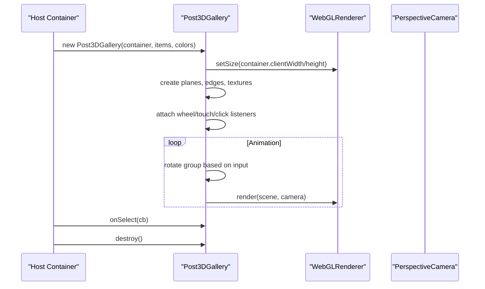

**Diagram sources**
- [Post3DGallery.ts:32-128](file://camp-channel-client-pc/src/canvas/Post3DGallery.ts#L32-L128)
- [Post3DGallery.ts:241-258](file://camp-channel-client-pc/src/canvas/Post3DGallery.ts#L241-L258)

**Section sources**
- [Post3DGallery.ts:11-285](file://camp-channel-client-pc/src/canvas/Post3DGallery.ts#L11-L285)

### Mood Shader Effect: Overlay Modes and Intensity
MoodShaderEffect overlays a shader layer with two modes:
- Glass mode: breathing ripples and wave interference with glow blending
- Glitch mode: scanlines, color shifts, and flickering artifacts
- Provides setters for mode, intensity, and color updates

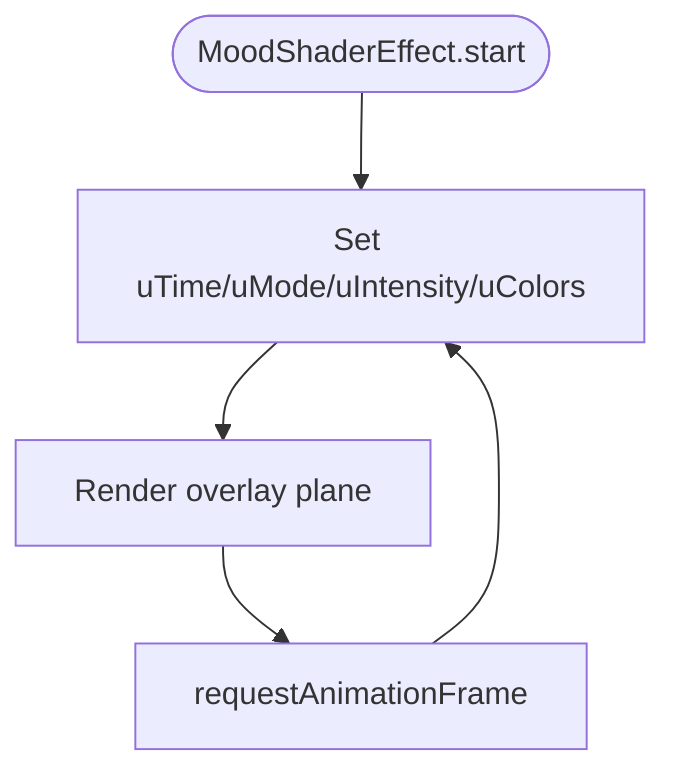

**Diagram sources**
- [MoodShaderEffect.ts:114-125](file://camp-channel-client-pc/src/canvas/MoodShaderEffect.ts#L114-L125)

**Section sources**
- [MoodShaderEffect.ts:9-146](file://camp-channel-client-pc/src/canvas/MoodShaderEffect.ts#L9-L146)

### Vue Integration and Page Transitions
The Vue application integrates visual effects through:
- App.vue mounting background and overlay components
- main.ts initializing cursor effects and hybrid page transitions after mount
- Transition utilities coordinating CSS and Canvas-based page changes

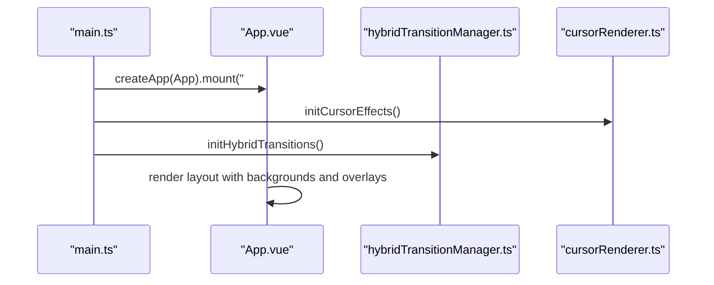

**Diagram sources**
- [main.ts:9-18](file://camp-channel-client-pc/src/main.ts#L9-L18)
- [App.vue:1-85](file://camp-channel-client-pc/src/App.vue#L1-L85)

**Section sources**
- [main.ts:1-19](file://camp-channel-client-pc/src/main.ts#L1-L19)
- [App.vue:1-85](file://camp-channel-client-pc/src/App.vue#L1-L85)

## Dependency Analysis
The system exhibits clear separation of concerns:
- CanvasEngine depends on ThemeRenderer, GlassEffect, and ParticleSystem
- Vue components depend on these engines and manage lifecycle and transitions
- Three.js-based effects (FluidBackground, Post3DGallery, MoodShaderEffect) are self-contained but share similar patterns: uniforms, animation loops, and cleanup

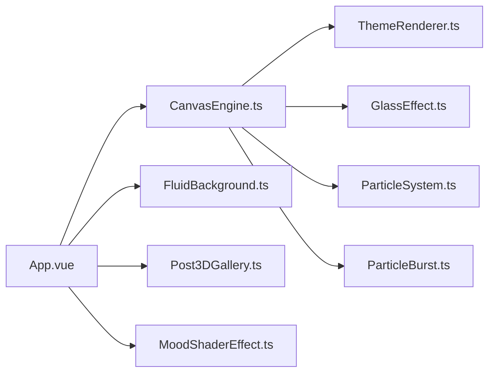

**Diagram sources**
- [App.vue:1-85](file://camp-channel-client-pc/src/App.vue#L1-L85)
- [CanvasEngine.ts:19-103](file://camp-channel-client-pc/src/canvas/CanvasEngine.ts#L19-L103)
- [FluidBackground.ts:9-150](file://camp-channel-client-pc/src/canvas/FluidBackground.ts#L9-L150)
- [Post3DGallery.ts:11-285](file://camp-channel-client-pc/src/canvas/Post3DGallery.ts#L11-L285)
- [MoodShaderEffect.ts:9-146](file://camp-channel-client-pc/src/canvas/MoodShaderEffect.ts#L9-L146)
- [ThemeRenderer.ts:3-43](file://camp-channel-client-pc/src/canvas/ThemeRenderer.ts#L3-L43)
- [GlassEffect.ts:3-40](file://camp-channel-client-pc/src/canvas/GlassEffect.ts#L3-L40)
- [ParticleSystem.ts:13-93](file://camp-channel-client-pc/src/canvas/ParticleSystem.ts#L13-L93)
- [ParticleBurst.ts:9-102](file://camp-channel-client-pc/src/canvas/ParticleBurst.ts#L9-L102)

**Section sources**
- [CanvasEngine.ts:19-103](file://camp-channel-client-pc/src/canvas/CanvasEngine.ts#L19-L103)

## Performance Considerations
- Frame budgeting
  - Use requestAnimationFrame consistently and avoid synchronous heavy work inside the loop
  - Limit particle counts and connection checks to reduce O(n^2) complexity
- Resolution scaling
  - Clamp device pixel ratio to a cap to balance quality and performance
- Event handling
  - Debounce or throttle expensive handlers (e.g., resize)
  - Prefer passive listeners for scroll/wheel when possible
- Memory and disposal
  - Dispose of textures, geometries, and materials on destroy
  - Cancel animation frames and remove event listeners
- Rendering strategies
  - Prefer offscreen canvases or layered canvases for complex overlays
  - Minimize globalAlpha and shadow blur usage when unnecessary
- Browser compatibility
  - Ensure WebGL support and fallbacks for older devices
  - Validate Three.js polyfills and vendor prefixes as needed

[No sources needed since this section provides general guidance]

## Troubleshooting Guide
Common issues and remedies:
- Canvas not resizing properly
  - Verify resize handlers are attached and invoked on window resize
  - Ensure particle system and engines are notified of dimension changes
- WebGL context lost
  - Reinitialize renderer and materials after context loss
  - Recreate textures and rebind uniforms
- Excessive CPU/GPU usage
  - Reduce particle counts and connection thresholds
  - Lower animation frequency or disable non-essential effects on low-end devices
- Interaction feels sluggish
  - Use requestAnimationFrame for smooth updates
  - Avoid layout thrashing; batch DOM reads/writes
- Visual artifacts
  - Validate shader uniforms and precision qualifiers
  - Confirm aspect ratio and resolution uniforms are updated on resize

**Section sources**
- [CanvasEngine.ts:48-58](file://camp-channel-client-pc/src/canvas/CanvasEngine.ts#L48-L58)
- [FluidBackground.ts:121-124](file://camp-channel-client-pc/src/canvas/FluidBackground.ts#L121-L124)
- [Post3DGallery.ts:260-283](file://camp-channel-client-pc/src/canvas/Post3DGallery.ts#L260-L283)

## Conclusion
The visual system combines a robust 2D canvas engine with Three.js-powered WebGL effects to deliver immersive, interactive UI. By structuring engines as reusable modules, integrating them cleanly with Vue components, and applying performance-conscious patterns, teams can scale advanced visual effects across pages and interactions while maintaining responsiveness and compatibility.

[No sources needed since this section summarizes without analyzing specific files]

## Appendices

### Configuration Options and Tunables
- CanvasEngine
  - ThemeColors: primary, primaryLight, accent, bg, card, text, textSecondary, border, gradientStart, gradientEnd, glowColor
  - updateColors(colors): hot-reload theme colors
- FluidBackground
  - FluidColors: primary, accent, glowColor
  - updateColors(colors): update shader color uniforms
  - Resolution and mouse uniforms updated automatically
- ParticleSystem
  - Constructor count: total particle count
  - Interactions: proximity threshold and repulsion strength
  - Visual: alpha range, pulse period, connection distance
- ParticleBurstSystem
  - BurstConfig: x, y, count, color, onComplete
  - Gravity and decay per particle
- Post3DGallery
  - Colors: primary, accent
  - Rotation sensitivity and inertia
  - Raycasting selection behavior
- MoodShaderEffect
  - Mode: "glass" or "glitch"
  - Intensity: overall effect strength
  - Colors: primary, accent, glowColor

**Section sources**
- [CanvasEngine.ts:5-17](file://camp-channel-client-pc/src/canvas/CanvasEngine.ts#L5-L17)
- [FluidBackground.ts:3-7](file://camp-channel-client-pc/src/canvas/FluidBackground.ts#L3-L7)
- [ParticleSystem.ts:17-18](file://camp-channel-client-pc/src/canvas/ParticleSystem.ts#L17-L18)
- [ParticleBurst.ts:1-7](file://camp-channel-client-pc/src/canvas/ParticleBurst.ts#L1-L7)
- [Post3DGallery.ts:32-31](file://camp-channel-client-pc/src/canvas/Post3DGallery.ts#L32-L31)
- [MoodShaderEffect.ts:100-106](file://camp-channel-client-pc/src/canvas/MoodShaderEffect.ts#L100-L106)

### Integration Patterns with Vue and Transitions
- Component mounting
  - Initialize cursor effects and hybrid transitions after app mount
- Layout composition
  - Place background and overlay components at the root level for proper z-index stacking
- Lifecycle management
  - Destroy engines and cancel animation frames on unmount or route change
- Page transitions
  - Coordinate CSS transitions with Canvas-based fade or wipe effects for seamless navigation

**Section sources**
- [main.ts:14-18](file://camp-channel-client-pc/src/main.ts#L14-L18)
- [App.vue:1-85](file://camp-channel-client-pc/src/App.vue#L1-L85)
- [hybridTransitionManager.ts](file://camp-channel-client-pc/src/utils/hybridTransitionManager.ts)
- [pageTransitionManager.ts](file://camp-channel-client-pc/src/utils/pageTransitionManager.ts)
- [canvasTransitionRenderer.ts](file://camp-channel-client-pc/src/utils/canvasTransitionRenderer.ts)