# Canvas Rendering Engine

<cite>
**Referenced Files in This Document**
- [CanvasEngine.ts](file://camp-channel-client-pc/src/canvas/CanvasEngine.ts)
- [ParticleSystem.ts](file://camp-channel-client-pc/src/canvas/ParticleSystem.ts)
- [GlassEffect.ts](file://camp-channel-client-pc/src/canvas/GlassEffect.ts)
- [ThemeRenderer.ts](file://camp-channel-client-pc/src/canvas/ThemeRenderer.ts)
- [FluidBackground.ts](file://camp-channel-client-pc/src/canvas/FluidBackground.ts)
- [MoodShaderEffect.ts](file://camp-channel-client-pc/src/canvas/MoodShaderEffect.ts)
- [Post3DGallery.ts](file://camp-channel-client-pc/src/canvas/Post3DGallery.ts)
- [ParticleBurst.ts](file://camp-channel-client-pc/src/canvas/ParticleBurst.ts)
- [WebGLBackground.vue](file://camp-channel-client-pc/src/components/WebGLBackground.vue)
- [CanvasBackground.vue](file://camp-channel-client-pc/src/components/CanvasBackground.vue)
- [theme.ts](file://camp-channel-client-pc/src/stores/theme.ts)
- [main.ts](file://camp-channel-client-pc/src/main.ts)
- [App.vue](file://camp-channel-client-pc/src/App.vue)
- [canvasTransitionRenderer.ts](file://camp-channel-client-pc/src/utils/canvasTransitionRenderer.ts)
- [hybridTransitionManager.ts](file://camp-channel-client-pc/src/utils/hybridTransitionManager.ts)
</cite>

## Table of Contents
1. [Introduction](#introduction)
2. [Project Structure](#project-structure)
3. [Core Components](#core-components)
4. [Architecture Overview](#architecture-overview)
5. [Detailed Component Analysis](#detailed-component-analysis)
6. [Dependency Analysis](#dependency-analysis)
7. [Performance Considerations](#performance-considerations)
8. [Troubleshooting Guide](#troubleshooting-guide)
9. [Conclusion](#conclusion)
10. [Appendices](#appendices)

## Introduction
This document explains the canvas rendering engine system used in the PC client. It focuses on the CanvasEngine class architecture, initialization, animation loop management, and lifecycle (initialization, resizing, mouse interaction, cleanup). It also documents how the engine integrates with particle systems and glass effects through the render pipeline, and how color themes are managed and applied. Practical guidance is included for animation frame scheduling, memory management, browser compatibility, coordinating multiple rendering components, and handling common issues such as canvas clearing, coordinate transformations, and cross-browser rendering differences.

## Project Structure
The rendering system spans TypeScript canvas engines and Vue components:
- Canvas engines: CanvasEngine (2D), ParticleSystem, GlassEffect, ThemeRenderer, FluidBackground (WebGL), MoodShaderEffect (WebGL), Post3DGallery (WebGL), ParticleBurst (2D overlay).
- Vue integration: WebGLBackground.vue, CanvasBackground.vue, App.vue, theme store.
- Utilities: hybrid transition manager and canvas transition renderer.

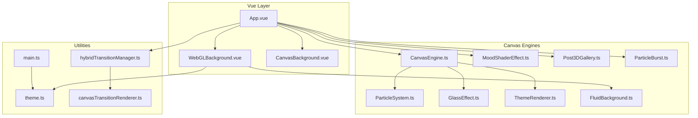

**Diagram sources**
- [App.vue:1-85](file://camp-channel-client-pc/src/App.vue#L1-L85)
- [WebGLBackground.vue:1-56](file://camp-channel-client-pc/src/components/WebGLBackground.vue#L1-L56)
- [CanvasBackground.vue:1-68](file://camp-channel-client-pc/src/components/CanvasBackground.vue#L1-L68)
- [CanvasEngine.ts:1-103](file://camp-channel-client-pc/src/canvas/CanvasEngine.ts#L1-L103)
- [ParticleSystem.ts:1-93](file://camp-channel-client-pc/src/canvas/ParticleSystem.ts#L1-L93)
- [GlassEffect.ts:1-40](file://camp-channel-client-pc/src/canvas/GlassEffect.ts#L1-L40)
- [ThemeRenderer.ts:1-43](file://camp-channel-client-pc/src/canvas/ThemeRenderer.ts#L1-L43)
- [FluidBackground.ts:1-150](file://camp-channel-client-pc/src/canvas/FluidBackground.ts#L1-L150)
- [MoodShaderEffect.ts:1-146](file://camp-channel-client-pc/src/canvas/MoodShaderEffect.ts#L1-L146)
- [Post3DGallery.ts:1-285](file://camp-channel-client-pc/src/canvas/Post3DGallery.ts#L1-L285)
- [ParticleBurst.ts:1-102](file://camp-channel-client-pc/src/canvas/ParticleBurst.ts#L1-L102)
- [theme.ts:1-295](file://camp-channel-client-pc/src/stores/theme.ts#L1-L295)
- [main.ts:1-19](file://camp-channel-client-pc/src/main.ts#L1-L19)
- [hybridTransitionManager.ts:43-90](file://camp-channel-client-pc/src/utils/hybridTransitionManager.ts#L43-L90)
- [canvasTransitionRenderer.ts:329-664](file://camp-channel-client-pc/src/utils/canvasTransitionRenderer.ts#L329-L664)

**Section sources**
- [App.vue:1-85](file://camp-channel-client-pc/src/App.vue#L1-L85)
- [WebGLBackground.vue:1-56](file://camp-channel-client-pc/src/components/WebGLBackground.vue#L1-L56)
- [CanvasBackground.vue:1-68](file://camp-channel-client-pc/src/components/CanvasBackground.vue#L1-L68)
- [CanvasEngine.ts:1-103](file://camp-channel-client-pc/src/canvas/CanvasEngine.ts#L1-L103)
- [ParticleSystem.ts:1-93](file://camp-channel-client-pc/src/canvas/ParticleSystem.ts#L1-L93)
- [GlassEffect.ts:1-40](file://camp-channel-client-pc/src/canvas/GlassEffect.ts#L1-L40)
- [ThemeRenderer.ts:1-43](file://camp-channel-client-pc/src/canvas/ThemeRenderer.ts#L1-L43)
- [FluidBackground.ts:1-150](file://camp-channel-client-pc/src/canvas/FluidBackground.ts#L1-L150)
- [MoodShaderEffect.ts:1-146](file://camp-channel-client-pc/src/canvas/MoodShaderEffect.ts#L1-L146)
- [Post3DGallery.ts:1-285](file://camp-channel-client-pc/src/canvas/Post3DGallery.ts#L1-L285)
- [ParticleBurst.ts:1-102](file://camp-channel-client-pc/src/canvas/ParticleBurst.ts#L1-L102)
- [theme.ts:1-295](file://camp-channel-client-pc/src/stores/theme.ts#L1-L295)
- [main.ts:1-19](file://camp-channel-client-pc/src/main.ts#L1-L19)
- [hybridTransitionManager.ts:43-90](file://camp-channel-client-pc/src/utils/hybridTransitionManager.ts#L43-L90)
- [canvasTransitionRenderer.ts:329-664](file://camp-channel-client-pc/src/utils/canvasTransitionRenderer.ts#L329-L664)

## Core Components
- CanvasEngine: orchestrates 2D rendering pipeline, manages animation loop, mouse tracking, and lifecycle events.
- ParticleSystem: generates and animates particles with proximity avoidance and inter-particle connections.
- GlassEffect: draws radial gradients around the mouse and strategic screen positions.
- ThemeRenderer: paints a linear gradient background based on theme colors.
- FluidBackground: WebGL fluid shader background with mouse/time-driven effects.
- MoodShaderEffect: WebGL mood overlay with animated modes (glass/glitch).
- Post3DGallery: interactive 3D gallery with raycasting selection and touch/scroll controls.
- ParticleBurst: 2D particle burst overlay for interactive effects.
- Theme store: manages theme definitions and applies CSS variables.
- Vue components: integrate engines into the app lifecycle.

Key responsibilities:
- Initialization: attach event listeners, set canvas size, initialize subsystems.
- Animation loop: schedule frames, clear canvas, render layers in order.
- Interaction: track mouse position, propagate to effects.
- Cleanup: cancel animation frames, remove event listeners, dispose WebGL resources.

**Section sources**
- [CanvasEngine.ts:19-103](file://camp-channel-client-pc/src/canvas/CanvasEngine.ts#L19-L103)
- [ParticleSystem.ts:13-93](file://camp-channel-client-pc/src/canvas/ParticleSystem.ts#L13-L93)
- [GlassEffect.ts:3-40](file://camp-channel-client-pc/src/canvas/GlassEffect.ts#L3-L40)
- [ThemeRenderer.ts:3-43](file://camp-channel-client-pc/src/canvas/ThemeRenderer.ts#L3-L43)
- [FluidBackground.ts:9-150](file://camp-channel-client-pc/src/canvas/FluidBackground.ts#L9-L150)
- [MoodShaderEffect.ts:9-146](file://camp-channel-client-pc/src/canvas/MoodShaderEffect.ts#L9-L146)
- [Post3DGallery.ts:11-285](file://camp-channel-client-pc/src/canvas/Post3DGallery.ts#L11-L285)
- [ParticleBurst.ts:9-102](file://camp-channel-client-pc/src/canvas/ParticleBurst.ts#L9-L102)
- [theme.ts:261-295](file://camp-channel-client-pc/src/stores/theme.ts#L261-L295)

## Architecture Overview
The system composes multiple rendering engines layered under the Vue application:
- App.vue renders background components and content.
- WebGLBackground.vue initializes FluidBackground and falls back to CSS if WebGL fails.
- CanvasEngine runs a 2D animation loop, rendering ThemeRenderer, GlassEffect, and ParticleSystem.
- ParticleBurst provides transient 2D effects overlaid on the app.
- MoodShaderEffect and Post3DGallery add WebGL overlays and interactive galleries.
- Theme store supplies color tokens applied to engines and CSS variables.

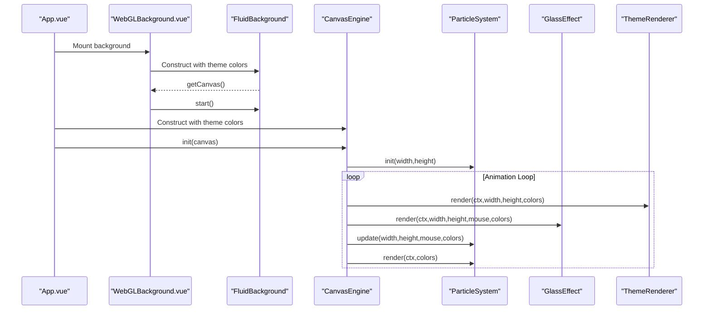

**Diagram sources**
- [App.vue:1-85](file://camp-channel-client-pc/src/App.vue#L1-L85)
- [WebGLBackground.vue:19-42](file://camp-channel-client-pc/src/components/WebGLBackground.vue#L19-L42)
- [FluidBackground.ts:18-140](file://camp-channel-client-pc/src/canvas/FluidBackground.ts#L18-L140)
- [CanvasEngine.ts:38-93](file://camp-channel-client-pc/src/canvas/CanvasEngine.ts#L38-L93)
- [ThemeRenderer.ts:4-21](file://camp-channel-client-pc/src/canvas/ThemeRenderer.ts#L4-L21)
- [GlassEffect.ts:4-29](file://camp-channel-client-pc/src/canvas/GlassEffect.ts#L4-L29)
- [ParticleSystem.ts:44-91](file://camp-channel-client-pc/src/canvas/ParticleSystem.ts#L44-L91)

## Detailed Component Analysis

### CanvasEngine
CanvasEngine is the central coordinator for 2D rendering. It maintains references to the canvas, context, animation frame ID, and subsystems. It exposes lifecycle methods and a render loop.

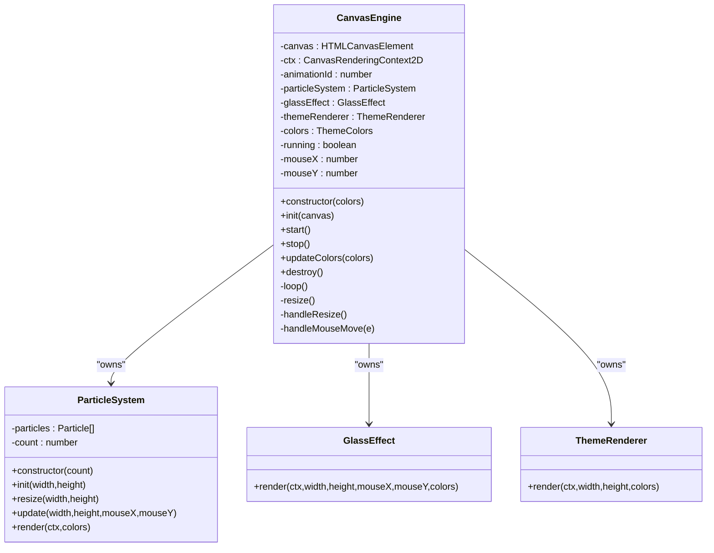

**Diagram sources**
- [CanvasEngine.ts:19-103](file://camp-channel-client-pc/src/canvas/CanvasEngine.ts#L19-L103)
- [ParticleSystem.ts:13-93](file://camp-channel-client-pc/src/canvas/ParticleSystem.ts#L13-L93)
- [GlassEffect.ts:3-40](file://camp-channel-client-pc/src/canvas/GlassEffect.ts#L3-L40)
- [ThemeRenderer.ts:3-43](file://camp-channel-client-pc/src/canvas/ThemeRenderer.ts#L3-L43)

Key behaviors:
- Initialization attaches resize and mousemove listeners, sets canvas size, and initializes the particle system.
- Animation loop clears the canvas and renders layers in order: theme background, glass glow, particles.
- Mouse position is captured and propagated to effects.
- Lifecycle methods stop animation, cancel frames, and detach event listeners.

**Section sources**
- [CanvasEngine.ts:38-101](file://camp-channel-client-pc/src/canvas/CanvasEngine.ts#L38-L101)

### ParticleSystem
ParticleSystem creates and animates a fixed number of particles with velocity, pulsing, and proximity avoidance. It draws inter-particle connection lines when within a threshold distance.

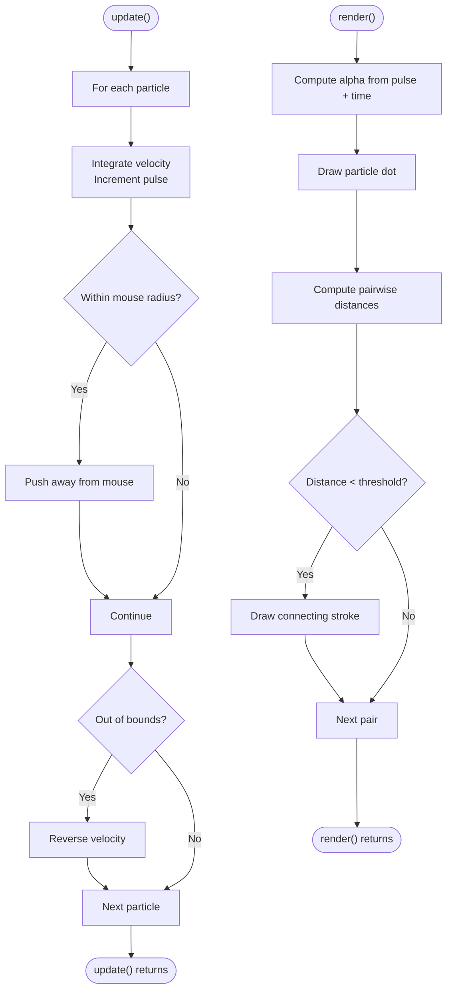

**Diagram sources**
- [ParticleSystem.ts:44-91](file://camp-channel-client-pc/src/canvas/ParticleSystem.ts#L44-L91)

**Section sources**
- [ParticleSystem.ts:13-93](file://camp-channel-client-pc/src/canvas/ParticleSystem.ts#L13-L93)

### GlassEffect
GlassEffect renders three radial gradients centered on the mouse and strategic screen positions, using theme colors for glow.

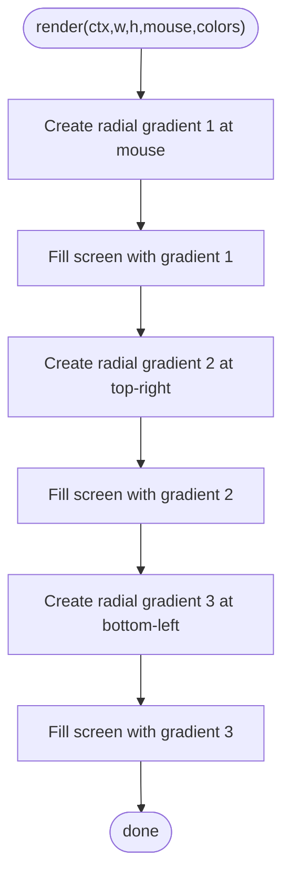

**Diagram sources**
- [GlassEffect.ts:4-29](file://camp-channel-client-pc/src/canvas/GlassEffect.ts#L4-L29)

**Section sources**
- [GlassEffect.ts:3-40](file://camp-channel-client-pc/src/canvas/GlassEffect.ts#L3-L40)

### ThemeRenderer
ThemeRenderer paints a linear gradient background using theme-defined gradientStart and gradientEnd colors.

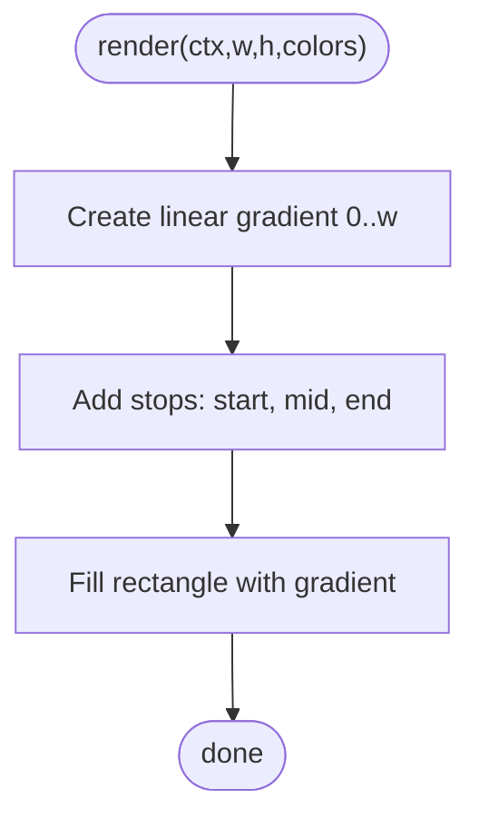

**Diagram sources**
- [ThemeRenderer.ts:4-21](file://camp-channel-client-pc/src/canvas/ThemeRenderer.ts#L4-L21)

**Section sources**
- [ThemeRenderer.ts:3-43](file://camp-channel-client-pc/src/canvas/ThemeRenderer.ts#L3-L43)

### FluidBackground (WebGL)
FluidBackground creates a WebGL fluid shader background with Three.js, updating uniforms for time, mouse, resolution, and colors.

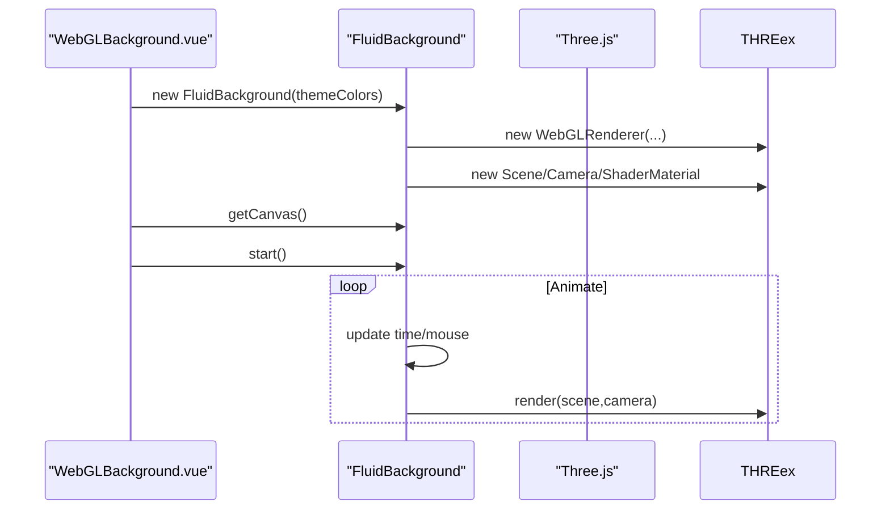

**Diagram sources**
- [WebGLBackground.vue:19-42](file://camp-channel-client-pc/src/components/WebGLBackground.vue#L19-L42)
- [FluidBackground.ts:18-140](file://camp-channel-client-pc/src/canvas/FluidBackground.ts#L18-L140)

**Section sources**
- [FluidBackground.ts:9-150](file://camp-channel-client-pc/src/canvas/FluidBackground.ts#L9-L150)
- [WebGLBackground.vue:1-56](file://camp-channel-client-pc/src/components/WebGLBackground.vue#L1-L56)

### MoodShaderEffect (WebGL)
MoodShaderEffect overlays a shader plane with two modes (glass and glitch), driven by time and colors.

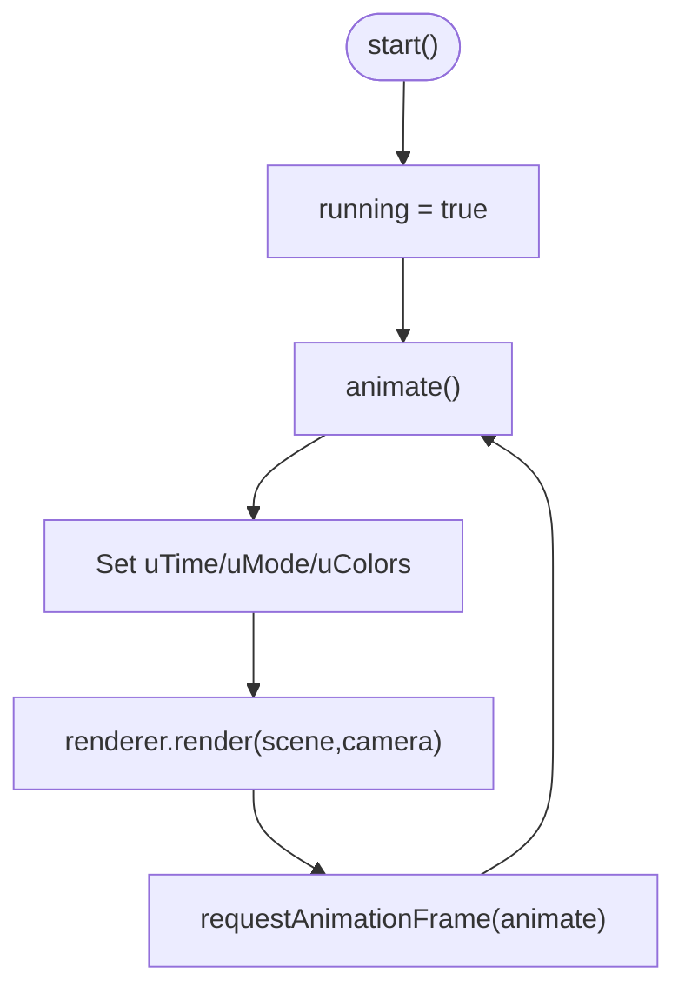

**Diagram sources**
- [MoodShaderEffect.ts:114-130](file://camp-channel-client-pc/src/canvas/MoodShaderEffect.ts#L114-L130)

**Section sources**
- [MoodShaderEffect.ts:9-146](file://camp-channel-client-pc/src/canvas/MoodShaderEffect.ts#L9-L146)

### Post3DGallery (WebGL)
Post3DGallery arranges items in a circle, supports wheel/touch interactions, and selection via raycasting.

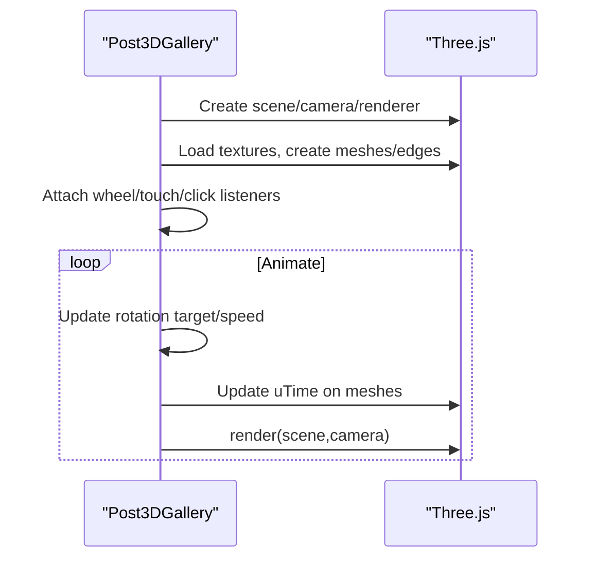

**Diagram sources**
- [Post3DGallery.ts:32-258](file://camp-channel-client-pc/src/canvas/Post3DGallery.ts#L32-L258)

**Section sources**
- [Post3DGallery.ts:11-285](file://camp-channel-client-pc/src/canvas/Post3DGallery.ts#L11-L285)

### ParticleBurst (2D Overlay)
ParticleBurst renders transient particle bursts at coordinates with gravity and fade.

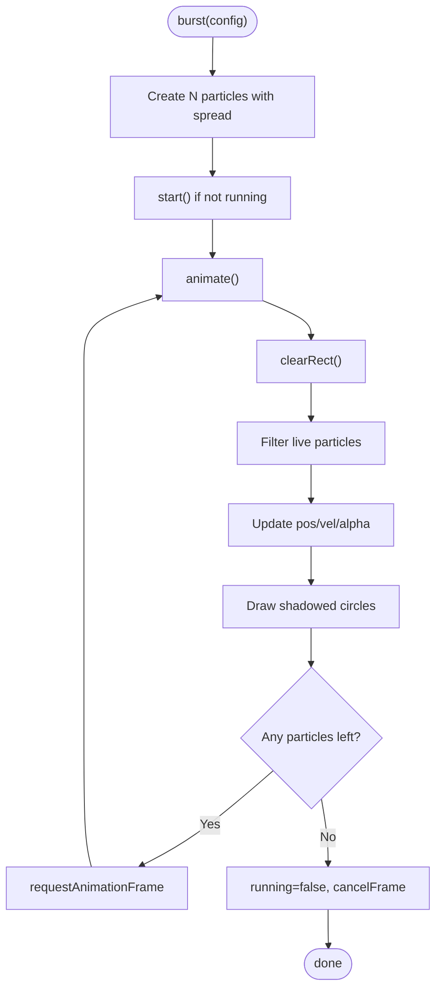

**Diagram sources**
- [ParticleBurst.ts:28-82](file://camp-channel-client-pc/src/canvas/ParticleBurst.ts#L28-L82)

**Section sources**
- [ParticleBurst.ts:9-102](file://camp-channel-client-pc/src/canvas/ParticleBurst.ts#L9-L102)

## Dependency Analysis
- CanvasEngine depends on ParticleSystem, GlassEffect, and ThemeRenderer.
- Vue components depend on theme store and instantiate engines.
- FluidBackground and MoodShaderEffect are independent WebGL engines.
- Post3DGallery is a self-contained WebGL gallery.
- ParticleBurst is a standalone 2D overlay.
- Transition utilities coordinate CSS and canvas overlays.

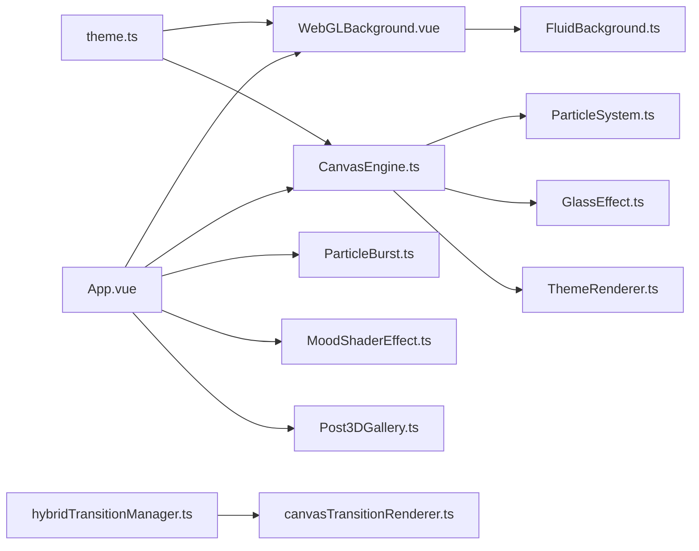

**Diagram sources**
- [theme.ts:261-295](file://camp-channel-client-pc/src/stores/theme.ts#L261-L295)
- [WebGLBackground.vue:19-42](file://camp-channel-client-pc/src/components/WebGLBackground.vue#L19-L42)
- [CanvasEngine.ts:31-36](file://camp-channel-client-pc/src/canvas/CanvasEngine.ts#L31-L36)
- [FluidBackground.ts:18-106](file://camp-channel-client-pc/src/canvas/FluidBackground.ts#L18-L106)
- [ParticleSystem.ts:17-23](file://camp-channel-client-pc/src/canvas/ParticleSystem.ts#L17-L23)
- [GlassEffect.ts:3-11](file://camp-channel-client-pc/src/canvas/GlassEffect.ts#L3-L11)
- [ThemeRenderer.ts:3-9](file://camp-channel-client-pc/src/canvas/ThemeRenderer.ts#L3-L9)
- [App.vue:1-14](file://camp-channel-client-pc/src/App.vue#L1-L14)
- [ParticleBurst.ts:16-22](file://camp-channel-client-pc/src/canvas/ParticleBurst.ts#L16-L22)
- [MoodShaderEffect.ts:18-29](file://camp-channel-client-pc/src/canvas/MoodShaderEffect.ts#L18-L29)
- [Post3DGallery.ts:32-44](file://camp-channel-client-pc/src/canvas/Post3DGallery.ts#L32-L44)
- [hybridTransitionManager.ts:48-76](file://camp-channel-client-pc/src/utils/hybridTransitionManager.ts#L48-L76)
- [canvasTransitionRenderer.ts:653-664](file://camp-channel-client-pc/src/utils/canvasTransitionRenderer.ts#L653-L664)

**Section sources**
- [theme.ts:261-295](file://camp-channel-client-pc/src/stores/theme.ts#L261-L295)
- [CanvasEngine.ts:1-36](file://camp-channel-client-pc/src/canvas/CanvasEngine.ts#L1-L36)
- [WebGLBackground.vue:1-56](file://camp-channel-client-pc/src/components/WebGLBackground.vue#L1-L56)
- [App.vue:1-14](file://camp-channel-client-pc/src/App.vue#L1-L14)
- [hybridTransitionManager.ts:43-90](file://camp-channel-client-pc/src/utils/hybridTransitionManager.ts#L43-L90)
- [canvasTransitionRenderer.ts:329-664](file://camp-channel-client-pc/src/utils/canvasTransitionRenderer.ts#L329-L664)

## Performance Considerations
- Frame scheduling
  - CanvasEngine uses requestAnimationFrame for the main loop and cancels on stop.
  - FluidBackground and MoodShaderEffect similarly use requestAnimationFrame with cancellation.
  - ParticleBurst uses requestAnimationFrame only while particles exist.
- Clearing and compositing
  - CanvasEngine clears the canvas each frame before drawing layers.
  - ParticleSystem draws translucent dots and thin strokes; keep particle counts reasonable.
- Memory management
  - WebGL engines dispose renderers and scenes on destroy.
  - Texture maps are disposed in Post3DGallery.
  - Event listeners are removed during destroy/teardown.
- Browser compatibility
  - devicePixelRatio capped to 2 in WebGL engines to balance quality/performance.
  - Canvas 2D fallbacks are present; WebGLBackground falls back to CSS if initialization fails.
- Coordinate transformations
  - Mouse coordinates are normalized in WebGL engines; 2D engines use raw client coordinates.
  - Post3DGallery converts mouse to normalized device coordinates for raycasting.
- Optimization tips
  - Limit particle counts and avoid per-frame allocations.
  - Prefer offscreen canvases for heavy precomputations if needed.
  - Debounce resize handlers to avoid frequent layout thrashing.
  - Use CSS pointer-events:none for overlay canvases to reduce pointer events overhead.

[No sources needed since this section provides general guidance]

## Troubleshooting Guide
Common issues and resolutions:
- Canvas not clearing between frames
  - Ensure CanvasEngine clears the canvas at the start of each loop.
  - Verify no overlapping transparent overlays are drawn before clearing.
- Mouse interaction not affecting effects
  - Confirm mousemove listener is attached and mouse coordinates are updated.
  - For WebGL, ensure uniforms are updated each frame.
- Cross-browser rendering differences
  - WebGL initialization failures fall back to CSS backgrounds.
  - devicePixelRatio adjustments prevent blurry rendering on high-DPI displays.
- Excessive memory usage
  - Dispose WebGL resources in destroy methods.
  - Cancel animation frames and remove event listeners.
- Coordinate mismatch (mouse vs. visuals)
  - Normalize mouse coordinates for WebGL (divide by width/height).
  - For 2D, ensure canvas sizing matches viewport.

**Section sources**
- [CanvasEngine.ts:79-93](file://camp-channel-client-pc/src/canvas/CanvasEngine.ts#L79-L93)
- [GlassEffect.ts:4-29](file://camp-channel-client-pc/src/canvas/GlassEffect.ts#L4-L29)
- [FluidBackground.ts:121-130](file://camp-channel-client-pc/src/canvas/FluidBackground.ts#L121-L130)
- [Post3DGallery.ts:145-160](file://camp-channel-client-pc/src/canvas/Post3DGallery.ts#L145-L160)
- [WebGLBackground.vue:28-33](file://camp-channel-client-pc/src/components/WebGLBackground.vue#L28-L33)

## Conclusion
The canvas rendering engine system combines a 2D CanvasEngine with specialized effects (particles, glass glow, theme background) and complementary WebGL engines for immersive experiences. It follows a robust lifecycle with initialization, animation loops, interaction handling, and cleanup. Color themes are centrally managed and applied across engines and CSS. The system balances performance with visual richness and provides fallbacks and cleanup routines for safe operation across browsers.

[No sources needed since this section summarizes without analyzing specific files]

## Appendices

### Canvas Setup Examples
- Initialize CanvasEngine with theme colors and attach to a canvas element.
- Instantiate ParticleBurst overlay to enable burst effects.
- Use WebGLBackground.vue to add a fluid background with automatic fallback.

**Section sources**
- [CanvasEngine.ts:31-46](file://camp-channel-client-pc/src/canvas/CanvasEngine.ts#L31-L46)
- [ParticleBurst.ts:16-22](file://camp-channel-client-pc/src/canvas/ParticleBurst.ts#L16-L22)
- [WebGLBackground.vue:19-34](file://camp-channel-client-pc/src/components/WebGLBackground.vue#L19-L34)

### Color Theme Management
- Define and switch themes via the theme store; CSS variables are applied globally.
- Engines consume theme colors to paint gradients, glows, and borders.

**Section sources**
- [theme.ts:261-295](file://camp-channel-client-pc/src/stores/theme.ts#L261-L295)
- [ThemeRenderer.ts:10-21](file://camp-channel-client-pc/src/canvas/ThemeRenderer.ts#L10-L21)
- [GlassEffect.ts:12-28](file://camp-channel-client-pc/src/canvas/GlassEffect.ts#L12-L28)

### Animation Frame Scheduling and Lifecycle
- requestAnimationFrame is used consistently across engines.
- start/stop toggles the running flag and cancels frames.
- destroy removes listeners and disposes resources.

**Section sources**
- [CanvasEngine.ts:65-101](file://camp-channel-client-pc/src/canvas/CanvasEngine.ts#L65-L101)
- [FluidBackground.ts:131-148](file://camp-channel-client-pc/src/canvas/FluidBackground.ts#L131-L148)
- [MoodShaderEffect.ts:114-137](file://camp-channel-client-pc/src/canvas/MoodShaderEffect.ts#L114-L137)
- [Post3DGallery.ts:241-283](file://camp-channel-client-pc/src/canvas/Post3DGallery.ts#L241-L283)
- [ParticleBurst.ts:49-88](file://camp-channel-client-pc/src/canvas/ParticleBurst.ts#L49-L88)

### Browser Compatibility Notes
- WebGL initialization failure gracefully falls back to CSS background.
- devicePixelRatio capped to 2 to maintain performance on high-DPI screens.
- Pointer events disabled on background canvases to avoid interfering with UI.

**Section sources**
- [WebGLBackground.vue:28-33](file://camp-channel-client-pc/src/components/WebGLBackground.vue#L28-L33)
- [FluidBackground.ts:22-24](file://camp-channel-client-pc/src/canvas/FluidBackground.ts#L22-L24)
- [MoodShaderEffect.ts:19-28](file://camp-channel-client-pc/src/canvas/MoodShaderEffect.ts#L19-L28)