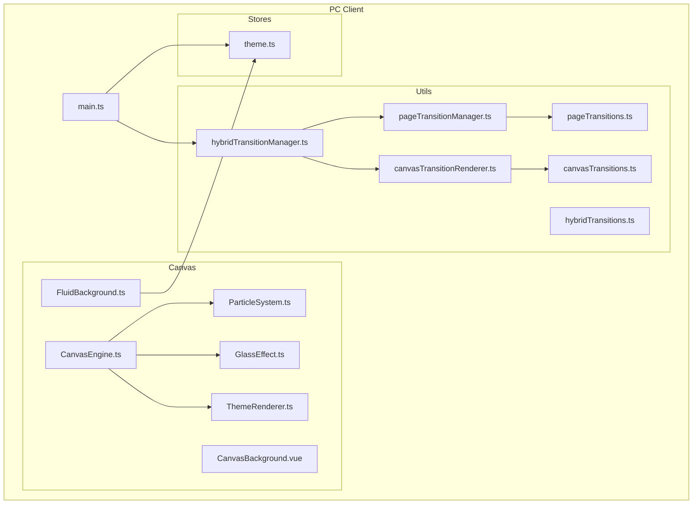
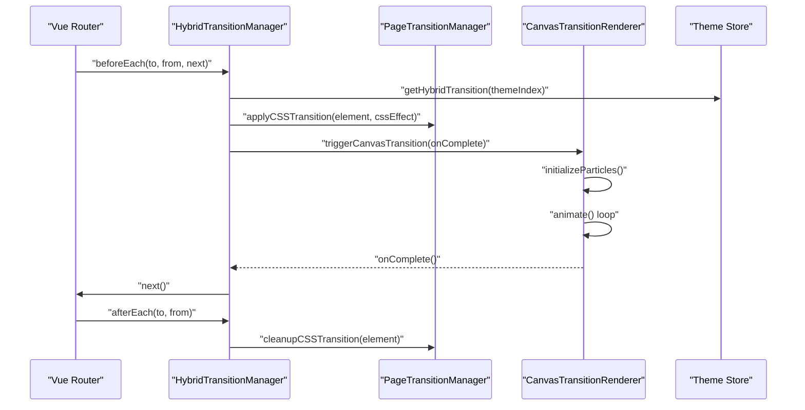
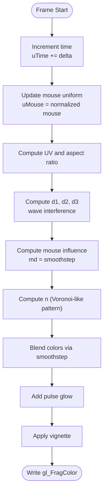
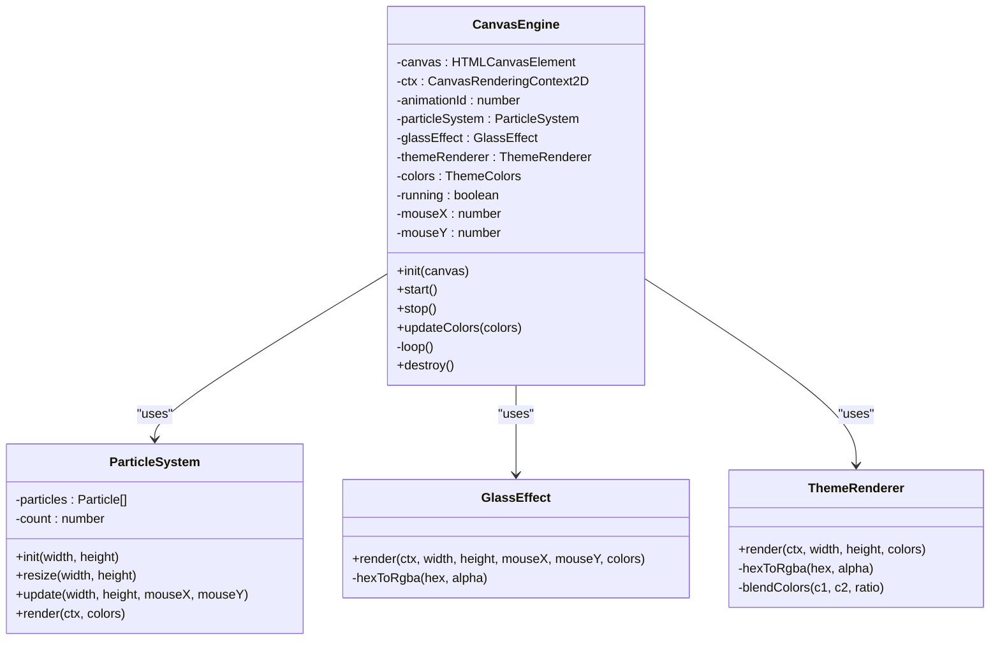
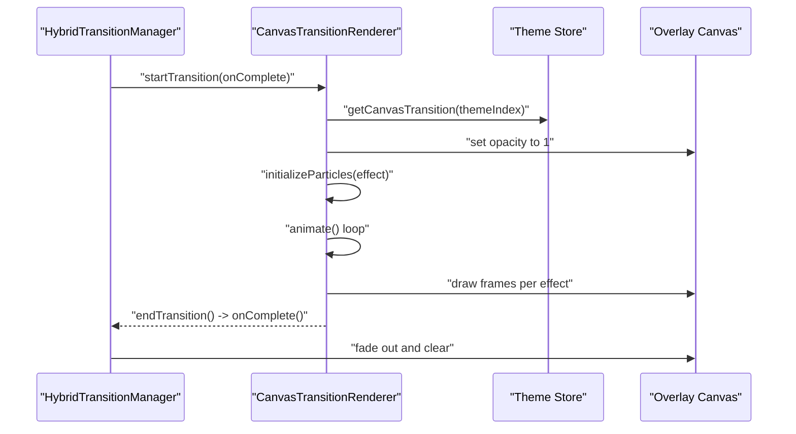
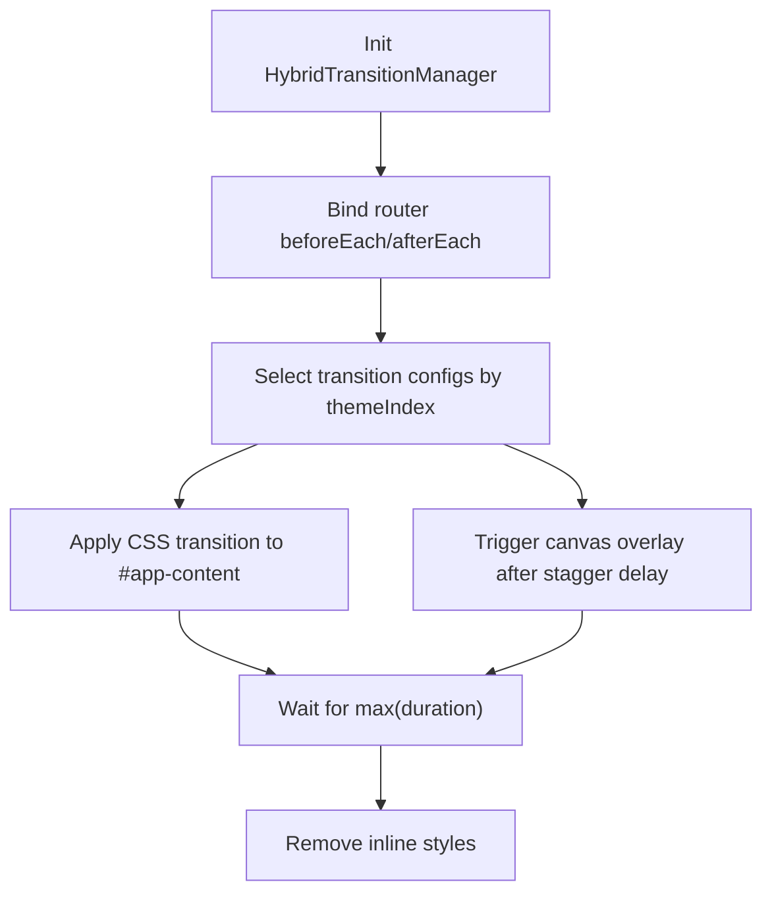
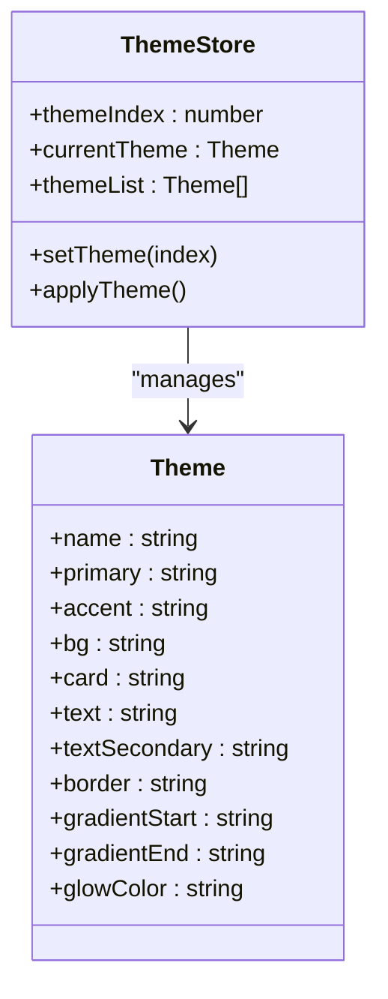
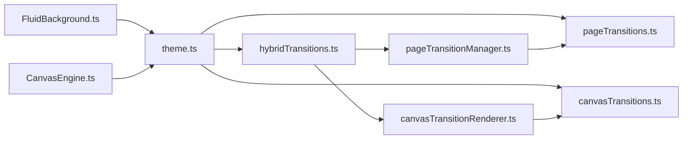

# Fluid Background and Dynamic Animations

<cite>
**Referenced Files in This Document**
- [FluidBackground.ts](file://camp-channel-client-pc/src/canvas/FluidBackground.ts)
- [CanvasEngine.ts](file://camp-channel-client-pc/src/canvas/CanvasEngine.ts)
- [ParticleSystem.ts](file://camp-channel-client-pc/src/canvas/ParticleSystem.ts)
- [GlassEffect.ts](file://camp-channel-client-pc/src/canvas/GlassEffect.ts)
- [ThemeRenderer.ts](file://camp-channel-client-pc/src/canvas/ThemeRenderer.ts)
- [CanvasBackground.vue](file://camp-channel-client-pc/src/components/CanvasBackground.vue)
- [canvasTransitionRenderer.ts](file://camp-channel-client-pc/src/utils/canvasTransitionRenderer.ts)
- [canvasTransitions.ts](file://camp-channel-client-pc/src/utils/canvasTransitions.ts)
- [pageTransitionManager.ts](file://camp-channel-client-pc/src/utils/pageTransitionManager.ts)
- [pageTransitions.ts](file://camp-channel-client-pc/src/utils/pageTransitions.ts)
- [hybridTransitionManager.ts](file://camp-channel-client-pc/src/utils/hybridTransitionManager.ts)
- [hybridTransitions.ts](file://camp-channel-client-pc/src/utils/hybridTransitions.ts)
- [theme.ts](file://camp-channel-client-pc/src/stores/theme.ts)
- [main.ts](file://camp-channel-client-pc/src/main.ts)
</cite>

## Table of Contents
1. [Introduction](#introduction)
2. [Project Structure](#project-structure)
3. [Core Components](#core-components)
4. [Architecture Overview](#architecture-overview)
5. [Detailed Component Analysis](#detailed-component-analysis)
6. [Dependency Analysis](#dependency-analysis)
7. [Performance Considerations](#performance-considerations)
8. [Troubleshooting Guide](#troubleshooting-guide)
9. [Conclusion](#conclusion)
10. [Appendices](#appendices)

## Introduction
This document explains the fluid background animation system and dynamic transition effects implemented in the PC client. It covers:
- The fluid wave simulation and color interpolation used in the WebGL-based fluid background
- The HTML Canvas-based page transition system for navigation and component switching
- Integration with the theme system and responsive design
- Mathematical foundations of wave functions and timing curves
- Browser compatibility, hardware acceleration, and graceful degradation strategies

## Project Structure
The fluid and transition systems are primarily located under the PC client’s canvas and utils modules. The main initialization wires theme and transition managers into the Vue application.

**Diagram sources**
- [main.ts:1-19](file://camp-channel-client-pc/src/main.ts#L1-L19)
- [hybridTransitionManager.ts:1-236](file://camp-channel-client-pc/src/utils/hybridTransitionManager.ts#L1-L236)
- [pageTransitionManager.ts:1-332](file://camp-channel-client-pc/src/utils/pageTransitionManager.ts#L1-L332)
- [canvasTransitionRenderer.ts:1-665](file://camp-channel-client-pc/src/utils/canvasTransitionRenderer.ts#L1-L665)
- [canvasTransitions.ts:1-245](file://camp-channel-client-pc/src/utils/canvasTransitions.ts#L1-L245)
- [pageTransitions.ts:1-205](file://camp-channel-client-pc/src/utils/pageTransitions.ts#L1-L205)
- [hybridTransitions.ts:1-26](file://camp-channel-client-pc/src/utils/hybridTransitions.ts#L1-L26)
- [CanvasEngine.ts:1-103](file://camp-channel-client-pc/src/canvas/CanvasEngine.ts#L1-L103)
- [ParticleSystem.ts:1-93](file://camp-channel-client-pc/src/canvas/ParticleSystem.ts#L1-L93)
- [GlassEffect.ts:1-40](file://camp-channel-client-pc/src/canvas/GlassEffect.ts#L1-L40)
- [ThemeRenderer.ts:1-43](file://camp-channel-client-pc/src/canvas/ThemeRenderer.ts#L1-L43)
- [FluidBackground.ts:1-150](file://camp-channel-client-pc/src/canvas/FluidBackground.ts#L1-L150)
- [CanvasBackground.vue:1-68](file://camp-channel-client-pc/src/components/CanvasBackground.vue#L1-L68)
- [theme.ts:1-295](file://camp-channel-client-pc/src/stores/theme.ts#L1-L295)

**Section sources**
- [main.ts:1-19](file://camp-channel-client-pc/src/main.ts#L1-L19)

## Core Components
- FluidBackground: A WebGL shader-based fluid simulation with wave interference, mouse interaction, and color blending.
- CanvasEngine: A 2D canvas engine rendering gradients, glass lighting, and particle systems with mouse influence.
- CanvasTransitionRenderer: An HTML Canvas overlay renderer for page transitions with multiple effect types.
- PageTransitionManager and HybridTransitionManager: Coordinators for CSS page transitions and hybrid CSS+Canvas transitions.
- Theme system: Centralized theme store driving colors and transition configurations.

**Section sources**
- [FluidBackground.ts:9-149](file://camp-channel-client-pc/src/canvas/FluidBackground.ts#L9-L149)
- [CanvasEngine.ts:19-102](file://camp-channel-client-pc/src/canvas/CanvasEngine.ts#L19-L102)
- [canvasTransitionRenderer.ts:22-648](file://camp-channel-client-pc/src/utils/canvasTransitionRenderer.ts#L22-L648)
- [pageTransitionManager.ts:9-332](file://camp-channel-client-pc/src/utils/pageTransitionManager.ts#L9-L332)
- [hybridTransitionManager.ts:10-236](file://camp-channel-client-pc/src/utils/hybridTransitionManager.ts#L10-L236)
- [theme.ts:261-295](file://camp-channel-client-pc/src/stores/theme.ts#L261-L295)

## Architecture Overview
The system integrates three layers:
- Theme-driven configuration: Themes define colors and transition metadata.
- Page transitions: CSS transitions orchestrate content movement; hybrid manager optionally adds a canvas overlay.
- Canvas overlays: A transparent HTML canvas renders animated effects during transitions.

**Diagram sources**
- [hybridTransitionManager.ts:18-76](file://camp-channel-client-pc/src/utils/hybridTransitionManager.ts#L18-L76)
- [pageTransitionManager.ts:17-48](file://camp-channel-client-pc/src/utils/pageTransitionManager.ts#L17-L48)
- [canvasTransitionRenderer.ts:64-88](file://camp-channel-client-pc/src/utils/canvasTransitionRenderer.ts#L64-L88)
- [hybridTransitions.ts:16-25](file://camp-channel-client-pc/src/utils/hybridTransitions.ts#L16-L25)
- [theme.ts:261-295](file://camp-channel-client-pc/src/stores/theme.ts#L261-L295)

## Detailed Component Analysis

### FluidBackground: Wave Simulation, Color Interpolation, and Smooth Animation
- Wave simulation: Uses summed sine and cosine waves to create interference patterns that propagate over time.
- Mouse interaction: A proximity field influences the wave pattern near the cursor.
- Color interpolation: Three base colors are mixed using smoothstep functions to produce layered blends.
- Smooth animation: requestAnimationFrame advances time and updates shader uniforms.

**Diagram sources**
- [FluidBackground.ts:39-93](file://camp-channel-client-pc/src/canvas/FluidBackground.ts#L39-L93)

Key implementation highlights:
- Uniforms passed to shaders include time, mouse position, resolution, and three color vectors.
- Fragment shader computes spatial coordinates, applies wave functions, and mixes colors with glow and vignette.
- Animation loop updates uTime and uMouse each frame.

**Section sources**
- [FluidBackground.ts:18-102](file://camp-channel-client-pc/src/canvas/FluidBackground.ts#L18-L102)
- [FluidBackground.ts:131-140](file://camp-channel-client-pc/src/canvas/FluidBackground.ts#L131-L140)

### CanvasEngine: 2D Canvas Rendering Pipeline
- Renders a gradient background, radial glow effects, and a particle system.
- Mouse position influences glow placement and repulsion forces on particles.
- Uses requestAnimationFrame for continuous rendering.

**Diagram sources**
- [CanvasEngine.ts:19-102](file://camp-channel-client-pc/src/canvas/CanvasEngine.ts#L19-L102)
- [ParticleSystem.ts:13-93](file://camp-channel-client-pc/src/canvas/ParticleSystem.ts#L13-L93)
- [GlassEffect.ts:3-40](file://camp-channel-client-pc/src/canvas/GlassEffect.ts#L3-L40)
- [ThemeRenderer.ts:3-43](file://camp-channel-client-pc/src/canvas/ThemeRenderer.ts#L3-L43)

**Section sources**
- [CanvasEngine.ts:38-93](file://camp-channel-client-pc/src/canvas/CanvasEngine.ts#L38-L93)
- [ParticleSystem.ts:44-91](file://camp-channel-client-pc/src/canvas/ParticleSystem.ts#L44-L91)
- [GlassEffect.ts:12-28](file://camp-channel-client-pc/src/canvas/GlassEffect.ts#L12-L28)
- [ThemeRenderer.ts:10-21](file://camp-channel-client-pc/src/canvas/ThemeRenderer.ts#L10-L21)

### CanvasTransitionRenderer: HTML Canvas Overlay Transitions
- Creates a full-screen overlay canvas and animates particle-based effects synchronized with theme indices.
- Supports multiple effects: particles, waves, pixelate, shatter, fireworks, spiral, matrix, snow, rain, crystal, and more.
- Uses requestAnimationFrame and performance.now for smooth timing.

**Diagram sources**
- [canvasTransitionRenderer.ts:64-88](file://camp-channel-client-pc/src/utils/canvasTransitionRenderer.ts#L64-L88)
- [canvasTransitions.ts:242-245](file://camp-channel-client-pc/src/utils/canvasTransitions.ts#L242-L245)
- [hybridTransitions.ts:16-25](file://camp-channel-client-pc/src/utils/hybridTransitions.ts#L16-L25)

**Section sources**
- [canvasTransitionRenderer.ts:22-648](file://camp-channel-client-pc/src/utils/canvasTransitionRenderer.ts#L22-L648)
- [canvasTransitions.ts:13-245](file://camp-channel-client-pc/src/utils/canvasTransitions.ts#L13-L245)

### Page and Hybrid Transition Managers
- PageTransitionManager applies CSS-based transitions to the page content during navigation.
- HybridTransitionManager coordinates CSS transitions with a delayed canvas overlay for enhanced impact.
- Both rely on theme indices to select matching transition configurations.

**Diagram sources**
- [hybridTransitionManager.ts:18-76](file://camp-channel-client-pc/src/utils/hybridTransitionManager.ts#L18-L76)
- [pageTransitionManager.ts:17-48](file://camp-channel-client-pc/src/utils/pageTransitionManager.ts#L17-L48)
- [hybridTransitions.ts:16-25](file://camp-channel-client-pc/src/utils/hybridTransitions.ts#L16-L25)
- [pageTransitions.ts:202-205](file://camp-channel-client-pc/src/utils/pageTransitions.ts#L202-L205)
- [canvasTransitions.ts:242-245](file://camp-channel-client-pc/src/utils/canvasTransitions.ts#L242-L245)

**Section sources**
- [pageTransitionManager.ts:50-108](file://camp-channel-client-pc/src/utils/pageTransitionManager.ts#L50-L108)
- [hybridTransitionManager.ts:48-76](file://camp-channel-client-pc/src/utils/hybridTransitionManager.ts#L48-L76)

### Theme System Integration
- Themes define primary/accent/glow colors and gradient stops.
- Theme store applies CSS variables and persists user-selected theme.
- Transitions and backgrounds consume theme colors to maintain visual consistency.

**Diagram sources**
- [theme.ts:5-18](file://camp-channel-client-pc/src/stores/theme.ts#L5-L18)
- [theme.ts:261-295](file://camp-channel-client-pc/src/stores/theme.ts#L261-L295)

**Section sources**
- [theme.ts:20-259](file://camp-channel-client-pc/src/stores/theme.ts#L20-L259)
- [CanvasEngine.ts:75-77](file://camp-channel-client-pc/src/canvas/CanvasEngine.ts#L75-L77)
- [FluidBackground.ts:115-119](file://camp-channel-client-pc/src/canvas/FluidBackground.ts#L115-L119)

### Responsive Design and Initialization
- FluidBackground and CanvasEngine adjust to window size and clamp devicePixelRatio for performance.
- CanvasBackground.vue provides a lightweight CSS-based gradient backdrop with animated blurred circles.
- main.ts initializes hybrid transitions and cursor effects after app mount.

**Section sources**
- [FluidBackground.ts:22-24](file://camp-channel-client-pc/src/canvas/FluidBackground.ts#L22-L24)
- [CanvasEngine.ts:48-58](file://camp-channel-client-pc/src/canvas/CanvasEngine.ts#L48-L58)
- [CanvasBackground.vue:12-68](file://camp-channel-client-pc/src/components/CanvasBackground.vue#L12-L68)
- [main.ts:14-19](file://camp-channel-client-pc/src/main.ts#L14-L19)

## Dependency Analysis
- Theme store drives both page and canvas transition selections.
- Hybrid manager depends on page transitions and canvas transitions.
- Canvas overlay renderer depends on canvas transitions and theme index.
- FluidBackground and CanvasEngine depend on theme colors for consistent visuals.

**Diagram sources**
- [theme.ts:261-295](file://camp-channel-client-pc/src/stores/theme.ts#L261-L295)
- [hybridTransitions.ts:16-25](file://camp-channel-client-pc/src/utils/hybridTransitions.ts#L16-L25)
- [pageTransitions.ts:202-205](file://camp-channel-client-pc/src/utils/pageTransitions.ts#L202-L205)
- [canvasTransitions.ts:242-245](file://camp-channel-client-pc/src/utils/canvasTransitions.ts#L242-L245)
- [pageTransitionManager.ts:32-33](file://camp-channel-client-pc/src/utils/pageTransitionManager.ts#L32-L33)
- [canvasTransitionRenderer.ts:67-68](file://camp-channel-client-pc/src/utils/canvasTransitionRenderer.ts#L67-L68)
- [FluidBackground.ts:18-38](file://camp-channel-client-pc/src/canvas/FluidBackground.ts#L18-L38)
- [CanvasEngine.ts:31-36](file://camp-channel-client-pc/src/canvas/CanvasEngine.ts#L31-L36)

**Section sources**
- [hybridTransitions.ts:16-25](file://camp-channel-client-pc/src/utils/hybridTransitions.ts#L16-L25)
- [pageTransitions.ts:13-245](file://camp-channel-client-pc/src/utils/pageTransitions.ts#L13-L245)
- [canvasTransitions.ts:13-245](file://camp-channel-client-pc/src/utils/canvasTransitions.ts#L13-L245)

## Performance Considerations
- Hardware acceleration:
  - WebGL FluidBackground leverages GPU-accelerated shaders for wave computations and color blending.
  - CanvasEngine uses 2D canvas rendering optimized with requestAnimationFrame.
- Frame pacing:
  - FluidBackground advances time by a constant delta; consider variable-time stepping for strict frame rates.
  - CanvasTransitionRenderer uses performance.now for progress calculation and requestAnimationFrame for smoothness.
- Resolution and pixel ratio:
  - FluidBackground caps devicePixelRatio to reduce memory bandwidth and GPU pressure.
- Particle counts:
  - CanvasEngine particle count is bounded; CanvasTransitionRenderer effect configs include particle counts and sizes.
- Degradation strategies:
  - Disable or simplify effects on lower-end devices by reducing particle counts, lowering resolution, or switching to simpler transitions.
  - Fallback to CSS-only transitions when canvas effects are disabled.

[No sources needed since this section provides general guidance]

## Troubleshooting Guide
- Transitions not triggering:
  - Verify Vue Router availability; both managers log warnings when router is missing.
- Canvas overlay not appearing:
  - Ensure overlay canvas is appended to body and opacity transitions are applied.
- Performance drops:
  - Reduce particle counts in effect configs; cap devicePixelRatio; disable glow or complex wave patterns.
- Colors mismatch:
  - Confirm themeIndex persistence and CSS variable application; verify theme store updates.

**Section sources**
- [pageTransitionManager.ts:17-23](file://camp-channel-client-pc/src/utils/pageTransitionManager.ts#L17-L23)
- [hybridTransitionManager.ts:18-23](file://camp-channel-client-pc/src/utils/hybridTransitionManager.ts#L18-L23)
- [canvasTransitionRenderer.ts:36-62](file://camp-channel-client-pc/src/utils/canvasTransitionRenderer.ts#L36-L62)
- [theme.ts:268-276](file://camp-channel-client-pc/src/stores/theme.ts#L268-L276)

## Conclusion
The system combines a WebGL fluid simulation with a robust HTML Canvas overlay and theme-driven transitions. By coordinating CSS and canvas effects, it delivers immersive, responsive page navigation while maintaining performance through careful resource management and graceful fallbacks.

[No sources needed since this section summarizes without analyzing specific files]

## Appendices

### Mathematical Foundations
- Wave simulation:
  - Summed sine/cosine waves create interference patterns; parameters control frequency, phase, and amplitude.
  - Mouse proximity introduces a localized disturbance via smoothstep falloff.
- Color interpolation:
  - smoothstep maps scalar fields to color blends; layered mixing produces depth and glow.
- Timing functions:
  - Cubic bezier curves define easing profiles for CSS transitions; durations are theme-dependent.

**Section sources**
- [FluidBackground.ts:64-89](file://camp-channel-client-pc/src/canvas/FluidBackground.ts#L64-L89)
- [pageTransitions.ts:15-205](file://camp-channel-client-pc/src/utils/pageTransitions.ts#L15-L205)

### Integration Examples and Tuning
- Background initialization:
  - Initialize theme store and hybrid transitions in main.ts; ensure theme variables are applied before rendering.
- Animation parameter tuning:
  - Adjust wave amplitudes/frequencies and color weights in the fluid shader.
  - Modify particle counts and sizes in canvas transitions for performance vs. visual fidelity.
- Performance optimization:
  - Cap devicePixelRatio; reduce particle counts; simplify wave patterns; throttle mouse influence strength.

**Section sources**
- [main.ts:14-19](file://camp-channel-client-pc/src/main.ts#L14-L19)
- [FluidBackground.ts:22-24](file://camp-channel-client-pc/src/canvas/FluidBackground.ts#L22-L24)
- [canvasTransitions.ts:13-245](file://camp-channel-client-pc/src/utils/canvasTransitions.ts#L13-L245)