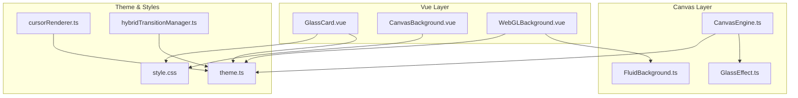
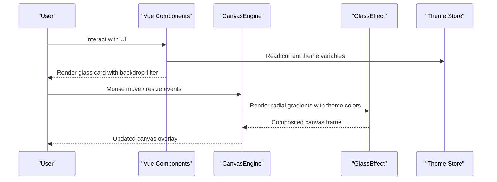
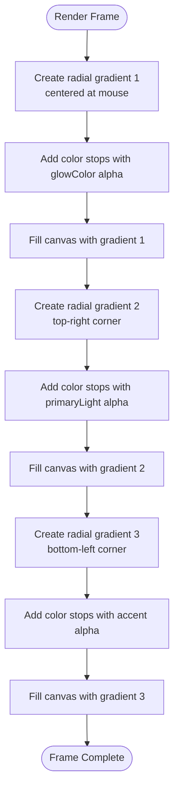
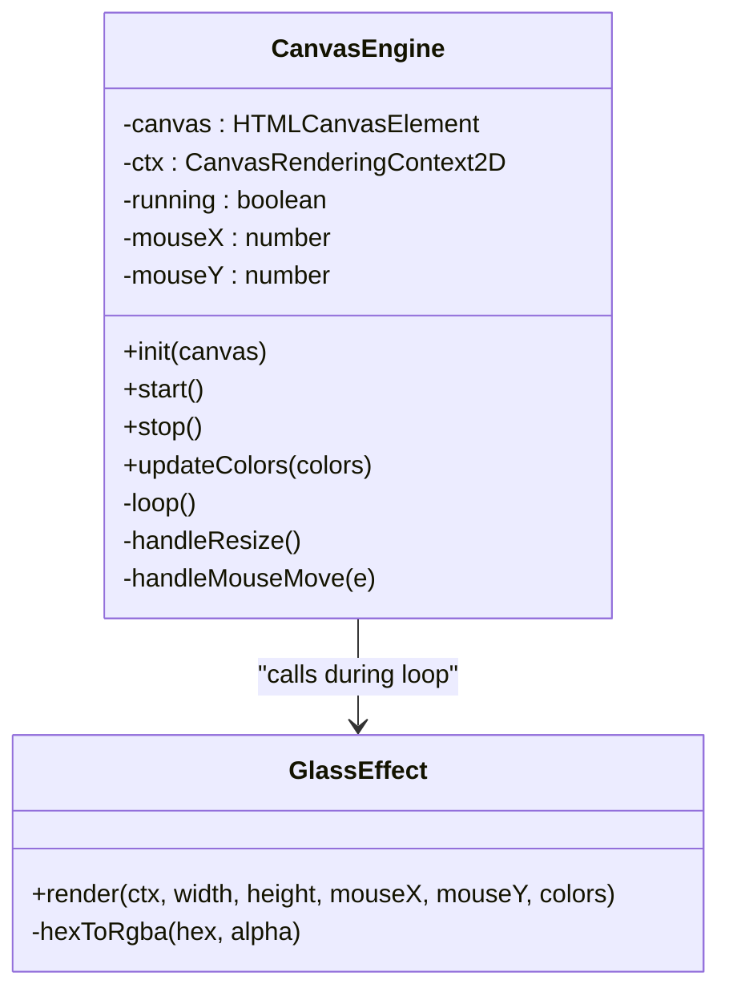
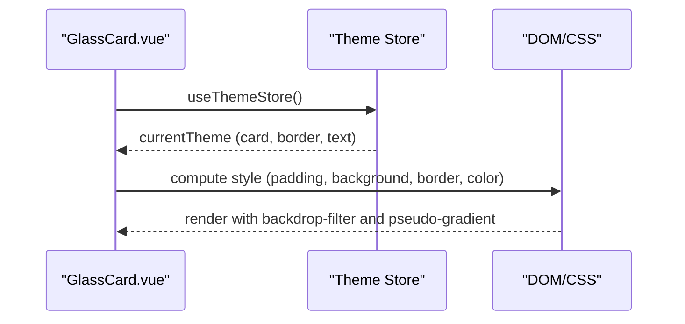
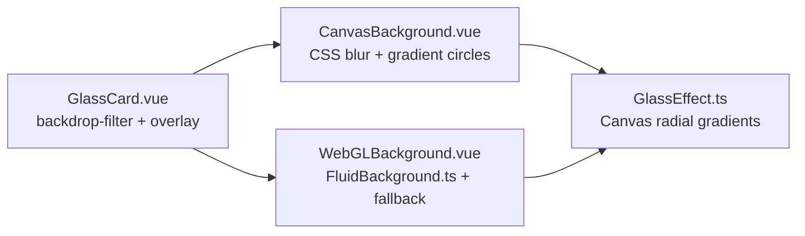
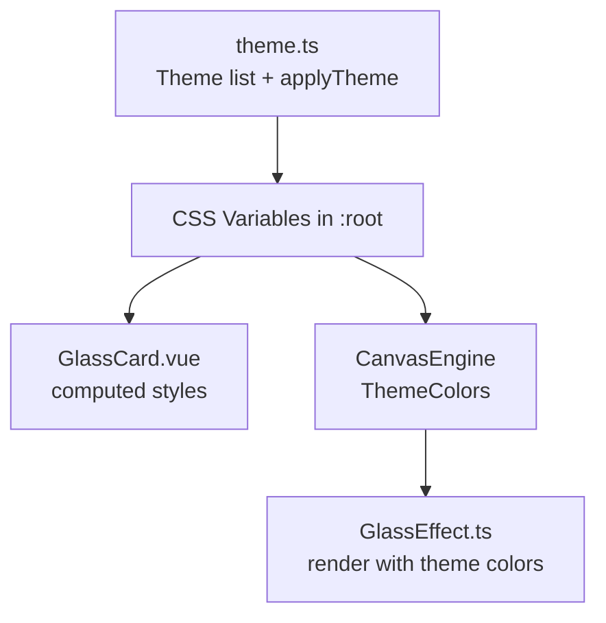
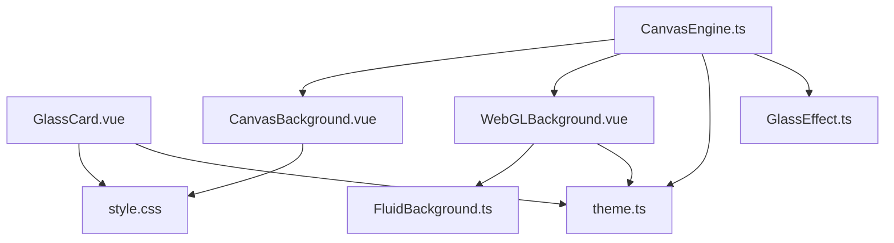

# Glass Morphism and Transparency Effects

<cite>
**Referenced Files in This Document**
- [GlassEffect.ts](file://camp-channel-client-pc/src/canvas/GlassEffect.ts)
- [CanvasEngine.ts](file://camp-channel-client-pc/src/canvas/CanvasEngine.ts)
- [GlassCard.vue](file://camp-channel-client-pc/src/components/GlassCard.vue)
- [CanvasBackground.vue](file://camp-channel-client-pc/src/components/CanvasBackground.vue)
- [WebGLBackground.vue](file://camp-channel-client-pc/src/components/WebGLBackground.vue)
- [FluidBackground.ts](file://camp-channel-client-pc/src/canvas/FluidBackground.ts)
- [theme.ts](file://camp-channel-client-pc/src/stores/theme.ts)
- [style.css](file://camp-channel-client-pc/src/style.css)
- [cursorRenderer.ts](file://camp-channel-client-pc/src/utils/cursorRenderer.ts)
- [hybridTransitionManager.ts](file://camp-channel-client-pc/src/utils/hybridTransitionManager.ts)
- [main.ts](file://camp-channel-client-pc/src/main.ts)
</cite>

## Table of Contents
1. [Introduction](#introduction)
2. [Project Structure](#project-structure)
3. [Core Components](#core-components)
4. [Architecture Overview](#architecture-overview)
5. [Detailed Component Analysis](#detailed-component-analysis)
6. [Dependency Analysis](#dependency-analysis)
7. [Performance Considerations](#performance-considerations)
8. [Troubleshooting Guide](#troubleshooting-guide)
9. [Conclusion](#conclusion)
10. [Appendices](#appendices)

## Introduction
This document explains the glass morphism design system and transparency effects implemented in the PC client. It covers the GlassEffect canvas rendering pipeline, Vue.js integration via scoped CSS and CSS-in-JS computed styles, theme-driven color systems, and the relationship between glass effects and background layers. It also provides guidance on dynamic transparency, responsive behavior, accessibility, fallbacks, and performance optimization—especially for mobile devices.

## Project Structure
The glass morphism system spans canvas-based rendering, Vue components, and a centralized theme store. Backgrounds are layered to support the glass effect, while Vue components provide UI elements with glass-like styling.

**Diagram sources**
- [GlassCard.vue:1-61](file://camp-channel-client-pc/src/components/GlassCard.vue#L1-L61)
- [CanvasBackground.vue:1-68](file://camp-channel-client-pc/src/components/CanvasBackground.vue#L1-L68)
- [WebGLBackground.vue:1-56](file://camp-channel-client-pc/src/components/WebGLBackground.vue#L1-L56)
- [CanvasEngine.ts:19-103](file://camp-channel-client-pc/src/canvas/CanvasEngine.ts#L19-L103)
- [GlassEffect.ts:3-39](file://camp-channel-client-pc/src/canvas/GlassEffect.ts#L3-L39)
- [FluidBackground.ts:9-150](file://camp-channel-client-pc/src/canvas/FluidBackground.ts#L9-L150)
- [theme.ts:261-295](file://camp-channel-client-pc/src/stores/theme.ts#L261-L295)
- [style.css:1-35](file://camp-channel-client-pc/src/style.css#L1-L35)
- [cursorRenderer.ts:20-464](file://camp-channel-client-pc/src/utils/cursorRenderer.ts#L20-L464)
- [hybridTransitionManager.ts:10-235](file://camp-channel-client-pc/src/utils/hybridTransitionManager.ts#L10-L235)

**Section sources**
- [GlassCard.vue:1-61](file://camp-channel-client-pc/src/components/GlassCard.vue#L1-L61)
- [CanvasBackground.vue:1-68](file://camp-channel-client-pc/src/components/CanvasBackground.vue#L1-L68)
- [WebGLBackground.vue:1-56](file://camp-channel-client-pc/src/components/WebGLBackground.vue#L1-L56)
- [CanvasEngine.ts:19-103](file://camp-channel-client-pc/src/canvas/CanvasEngine.ts#L19-L103)
- [GlassEffect.ts:3-39](file://camp-channel-client-pc/src/canvas/GlassEffect.ts#L3-L39)
- [FluidBackground.ts:9-150](file://camp-channel-client-pc/src/canvas/FluidBackground.ts#L9-L150)
- [theme.ts:261-295](file://camp-channel-client-pc/src/stores/theme.ts#L261-L295)
- [style.css:1-35](file://camp-channel-client-pc/src/style.css#L1-L35)
- [cursorRenderer.ts:20-464](file://camp-channel-client-pc/src/utils/cursorRenderer.ts#L20-L464)
- [hybridTransitionManager.ts:10-235](file://camp-channel-client-pc/src/utils/hybridTransitionManager.ts#L10-L235)

## Core Components
- GlassEffect: Renders radial gradients around the mouse to simulate a glowing, translucent spotlight on the canvas.
- CanvasEngine: Orchestrates canvas initialization, resize handling, mouse tracking, and frame loop to composite background, glass effect, and particles.
- GlassCard.vue: Vue component that applies glass-like styling (backdrop blur, border radius, overlay gradient) using theme-driven CSS variables.
- Background components: CanvasBackground.vue provides soft blurred circles; WebGLBackground.vue provides a fluid animated background with fallback to CSS.
- Theme store: Provides theme-aware colors and CSS variable injection for consistent color across components.
- Cursor and transitions: Cursor effects and hybrid page transitions integrate with theme colors for cohesive visuals.

**Section sources**
- [GlassEffect.ts:3-39](file://camp-channel-client-pc/src/canvas/GlassEffect.ts#L3-L39)
- [CanvasEngine.ts:19-103](file://camp-channel-client-pc/src/canvas/CanvasEngine.ts#L19-L103)
- [GlassCard.vue:1-61](file://camp-channel-client-pc/src/components/GlassCard.vue#L1-L61)
- [CanvasBackground.vue:1-68](file://camp-channel-client-pc/src/components/CanvasBackground.vue#L1-L68)
- [WebGLBackground.vue:1-56](file://camp-channel-client-pc/src/components/WebGLBackground.vue#L1-L56)
- [theme.ts:261-295](file://camp-channel-client-pc/src/stores/theme.ts#L261-L295)

## Architecture Overview
The system composes a layered visual stack:
- Background layer: Either a fluid WebGL background or a CSS gradient/circle composition.
- Glass effect layer: Canvas-based radial gradients that react to mouse movement.
- UI layer: Vue components styled with backdrop-filter and themed CSS variables.

**Diagram sources**
- [CanvasEngine.ts:65-93](file://camp-channel-client-pc/src/canvas/CanvasEngine.ts#L65-L93)
- [GlassEffect.ts:4-29](file://camp-channel-client-pc/src/canvas/GlassEffect.ts#L4-L29)
- [GlassCard.vue:21-26](file://camp-channel-client-pc/src/components/GlassCard.vue#L21-L26)
- [theme.ts:278-291](file://camp-channel-client-pc/src/stores/theme.ts#L278-L291)

## Detailed Component Analysis

### GlassEffect Implementation
GlassEffect renders three radial gradients to simulate a luminous, frosted-glass appearance:
- A central glow near the mouse position using the theme’s glow color.
- Soft accents using primary light and accent colors at off-screen positions.
- Alpha-blended transparency to achieve depth and soft edges.

**Diagram sources**
- [GlassEffect.ts:4-29](file://camp-channel-client-pc/src/canvas/GlassEffect.ts#L4-L29)

**Section sources**
- [GlassEffect.ts:3-39](file://camp-channel-client-pc/src/canvas/GlassEffect.ts#L3-L39)

### CanvasEngine Composition
CanvasEngine initializes the canvas, manages resize/mouse events, and runs the animation loop. It composites:
- ThemeRenderer (background)
- GlassEffect (transparency overlays)
- ParticleSystem (optional)

**Diagram sources**
- [CanvasEngine.ts:19-103](file://camp-channel-client-pc/src/canvas/CanvasEngine.ts#L19-L103)
- [GlassEffect.ts:3-39](file://camp-channel-client-pc/src/canvas/GlassEffect.ts#L3-L39)

**Section sources**
- [CanvasEngine.ts:19-103](file://camp-channel-client-pc/src/canvas/CanvasEngine.ts#L19-L103)

### GlassCard.vue: Vue.js Glass Card
GlassCard.vue applies:
- Backdrop blur and border radius for the frosted-glass look.
- An overlay gradient pseudo-element for subtle surface reflection.
- Computed inline styles driven by the theme store for background, border, and text colors.

**Diagram sources**
- [GlassCard.vue:7-26](file://camp-channel-client-pc/src/components/GlassCard.vue#L7-L26)
- [theme.ts:261-295](file://camp-channel-client-pc/src/stores/theme.ts#L261-L295)

**Section sources**
- [GlassCard.vue:1-61](file://camp-channel-client-pc/src/components/GlassCard.vue#L1-L61)
- [theme.ts:261-295](file://camp-channel-client-pc/src/stores/theme.ts#L261-L295)

### Background Layering and Underlying Canvas
Two background strategies coexist:
- CanvasBackground.vue: Soft blurred circles with low opacity and floating animations.
- WebGLBackground.vue: Fluid animated shader background with automatic fallback to a CSS background if WebGL fails.

**Diagram sources**
- [CanvasBackground.vue:12-66](file://camp-channel-client-pc/src/components/CanvasBackground.vue#L12-L66)
- [WebGLBackground.vue:19-34](file://camp-channel-client-pc/src/components/WebGLBackground.vue#L19-L34)
- [FluidBackground.ts:18-102](file://camp-channel-client-pc/src/canvas/FluidBackground.ts#L18-L102)
- [GlassEffect.ts:4-29](file://camp-channel-client-pc/src/canvas/GlassEffect.ts#L4-L29)

**Section sources**
- [CanvasBackground.vue:1-68](file://camp-channel-client-pc/src/components/CanvasBackground.vue#L1-L68)
- [WebGLBackground.vue:1-56](file://camp-channel-client-pc/src/components/WebGLBackground.vue#L1-L56)
- [FluidBackground.ts:9-150](file://camp-channel-client-pc/src/canvas/FluidBackground.ts#L9-L150)

### Theme Integration and Dynamic Transparency
- The theme store defines card, border, and glow colors, plus CSS variables applied to :root.
- Vue components read currentTheme to compute inline styles for cards.
- CanvasEngine receives theme colors to drive GlassEffect rendering.

**Diagram sources**
- [theme.ts:261-295](file://camp-channel-client-pc/src/stores/theme.ts#L261-L295)
- [style.css:3-13](file://camp-channel-client-pc/src/style.css#L3-L13)
- [GlassCard.vue:19-26](file://camp-channel-client-pc/src/components/GlassCard.vue#L19-L26)
- [CanvasEngine.ts:31-36](file://camp-channel-client-pc/src/canvas/CanvasEngine.ts#L31-L36)
- [GlassEffect.ts:10-10](file://camp-channel-client-pc/src/canvas/GlassEffect.ts#L10-L10)

**Section sources**
- [theme.ts:261-295](file://camp-channel-client-pc/src/stores/theme.ts#L261-L295)
- [style.css:1-35](file://camp-channel-client-pc/src/style.css#L1-L35)
- [GlassCard.vue:7-26](file://camp-channel-client-pc/src/components/GlassCard.vue#L7-L26)
- [CanvasEngine.ts:31-36](file://camp-channel-client-pc/src/canvas/CanvasEngine.ts#L31-L36)
- [GlassEffect.ts:10-10](file://camp-channel-client-pc/src/canvas/GlassEffect.ts#L10-L10)

### Responsive Design Considerations
- CanvasEngine listens to window resize to adjust canvas pixel dimensions and particle systems.
- WebGLBackground limits device pixel ratio for performance on lower-end devices.
- GlassCard.vue uses relative units and transitions for hover states; ensure padding and font scaling remain consistent across breakpoints.

**Section sources**
- [CanvasEngine.ts:48-58](file://camp-channel-client-pc/src/canvas/CanvasEngine.ts#L48-L58)
- [FluidBackground.ts:22-24](file://camp-channel-client-pc/src/canvas/FluidBackground.ts#L22-L24)
- [GlassCard.vue:29-61](file://camp-channel-client-pc/src/components/GlassCard.vue#L29-L61)

### Accessibility Considerations
- Contrast: Ensure text contrast against glass surfaces remains readable. The theme provides text and secondary text colors; verify readability with backdrop-filter enabled.
- Motion: Respect reduced motion preferences; consider disabling or reducing blur and animated backgrounds for users who prefer reduced motion.
- Focus indicators: Ensure interactive elements within glass cards remain clearly focused against the blurred background.

[No sources needed since this section provides general guidance]

### Fallback Mechanisms
- WebGLBackground.vue falls back to a CSS background if WebGL initialization fails.
- CanvasBackground.vue provides a pure-CSS alternative with soft blur and animated circles.

**Section sources**
- [WebGLBackground.vue:28-33](file://camp-channel-client-pc/src/components/WebGLBackground.vue#L28-L33)
- [CanvasBackground.vue:12-66](file://camp-channel-client-pc/src/components/CanvasBackground.vue#L12-L66)

### Relationship Between Glass Effects and Underlying Canvas Backgrounds
- GlassEffect draws translucent overlays on top of the background canvas.
- CanvasBackground.vue and WebGLBackground.vue provide the base layer; the choice affects perceived depth and blur quality.
- For best results, choose a background that complements the glowColor and accent colors from the theme.

**Section sources**
- [CanvasEngine.ts:85-90](file://camp-channel-client-pc/src/canvas/CanvasEngine.ts#L85-L90)
- [GlassEffect.ts:12-28](file://camp-channel-client-pc/src/canvas/GlassEffect.ts#L12-L28)
- [WebGLBackground.vue:19-34](file://camp-channel-client-pc/src/components/WebGLBackground.vue#L19-L34)
- [CanvasBackground.vue:12-66](file://camp-channel-client-pc/src/components/CanvasBackground.vue#L12-L66)

## Dependency Analysis
The system exhibits clear separation of concerns:
- Vue components depend on the theme store for styling.
- CanvasEngine depends on GlassEffect and theme colors.
- Background components are independent but compose under the same viewport.

**Diagram sources**
- [GlassCard.vue:7-26](file://camp-channel-client-pc/src/components/GlassCard.vue#L7-L26)
- [theme.ts:261-295](file://camp-channel-client-pc/src/stores/theme.ts#L261-L295)
- [style.css:1-35](file://camp-channel-client-pc/src/style.css#L1-L35)
- [CanvasBackground.vue:12-66](file://camp-channel-client-pc/src/components/CanvasBackground.vue#L12-L66)
- [WebGLBackground.vue:19-34](file://camp-channel-client-pc/src/components/WebGLBackground.vue#L19-L34)
- [FluidBackground.ts:18-102](file://camp-channel-client-pc/src/canvas/FluidBackground.ts#L18-L102)
- [CanvasEngine.ts:19-103](file://camp-channel-client-pc/src/canvas/CanvasEngine.ts#L19-L103)
- [GlassEffect.ts:3-39](file://camp-channel-client-pc/src/canvas/GlassEffect.ts#L3-L39)

**Section sources**
- [GlassCard.vue:7-26](file://camp-channel-client-pc/src/components/GlassCard.vue#L7-L26)
- [theme.ts:261-295](file://camp-channel-client-pc/src/stores/theme.ts#L261-L295)
- [CanvasEngine.ts:19-103](file://camp-channel-client-pc/src/canvas/CanvasEngine.ts#L19-L103)
- [GlassEffect.ts:3-39](file://camp-channel-client-pc/src/canvas/GlassEffect.ts#L3-L39)
- [WebGLBackground.vue:19-34](file://camp-channel-client-pc/src/components/WebGLBackground.vue#L19-L34)
- [CanvasBackground.vue:12-66](file://camp-channel-client-pc/src/components/CanvasBackground.vue#L12-L66)
- [FluidBackground.ts:18-102](file://camp-channel-client-pc/src/canvas/FluidBackground.ts#L18-L102)

## Performance Considerations
- Canvas rendering cost: GlassEffect draws full-canvas fills each frame; keep gradients modest and avoid excessive updates.
- Mouse tracking: CanvasEngine tracks mouse position; throttle if needed for very high-DPI displays.
- WebGL pixel ratio: FluidBackground caps devicePixelRatio to balance quality and performance.
- Backdrop-filter: Expensive on some devices; test on mobile and consider disabling or reducing blur for low-power devices.
- Transitions and animations: Hybrid transitions and cursor effects add overhead; disable or simplify for mobile.

[No sources needed since this section provides general guidance]

## Troubleshooting Guide
- Glass card not visible:
  - Verify theme variables are applied to :root and that GlassCard reads currentTheme.
  - Confirm backdrop-filter support and that the background beneath the card is sufficiently distinct.
- Canvas not updating:
  - Ensure CanvasEngine.start() is called and loop() continues running.
  - Check resize handlers and mousemove event bindings.
- WebGL fallback:
  - If WebGL fails, WebGLBackground.vue sets a CSS background; confirm fallback styles are applied.
- Cursor and transition issues:
  - Initialize cursor effects after app mount and ensure theme index is applied before rendering.

**Section sources**
- [theme.ts:278-291](file://camp-channel-client-pc/src/stores/theme.ts#L278-L291)
- [CanvasEngine.ts:65-93](file://camp-channel-client-pc/src/canvas/CanvasEngine.ts#L65-L93)
- [WebGLBackground.vue:28-33](file://camp-channel-client-pc/src/components/WebGLBackground.vue#L28-L33)
- [main.ts:14-18](file://camp-channel-client-pc/src/main.ts#L14-L18)

## Conclusion
The glass morphism system blends Vue-styled UI elements with canvas-based transparency overlays and layered backgrounds. Theme-driven colors unify the look across components, while fallbacks and performance-conscious defaults ensure broad compatibility. For production, validate contrast and motion preferences, and optimize canvas and blur usage on mobile devices.

[No sources needed since this section summarizes without analyzing specific files]

## Appendices

### Example Workflows

#### Creating a Glass Card
- Use GlassCard.vue with optional padding and hover behavior.
- Ensure theme variables are applied so the card background and border reflect the current theme.

**Section sources**
- [GlassCard.vue:11-26](file://camp-channel-client-pc/src/components/GlassCard.vue#L11-L26)
- [theme.ts:278-291](file://camp-channel-client-pc/src/stores/theme.ts#L278-L291)

#### Dynamically Adjusting Transparency
- Modify theme colors to change glowColor and accent values; CanvasEngine passes ThemeColors to GlassEffect.
- For runtime tweaks, update themeIndex and watch for reactive changes in components.

**Section sources**
- [CanvasEngine.ts:75-77](file://camp-channel-client-pc/src/canvas/CanvasEngine.ts#L75-L77)
- [GlassEffect.ts:12-28](file://camp-channel-client-pc/src/canvas/GlassEffect.ts#L12-L28)
- [theme.ts:268-276](file://camp-channel-client-pc/src/stores/theme.ts#L268-L276)

#### Responsive Behavior
- On resize, CanvasEngine resizes the canvas and particle system; FluidBackground caps pixel ratio.
- GlassCard.vue relies on CSS transitions and relative units for responsive hover states.

**Section sources**
- [CanvasEngine.ts:48-58](file://camp-channel-client-pc/src/canvas/CanvasEngine.ts#L48-L58)
- [FluidBackground.ts:22-24](file://camp-channel-client-pc/src/canvas/FluidBackground.ts#L22-L24)
- [GlassCard.vue:39-42](file://camp-channel-client-pc/src/components/GlassCard.vue#L39-L42)