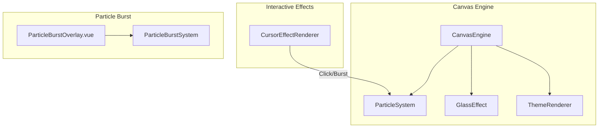
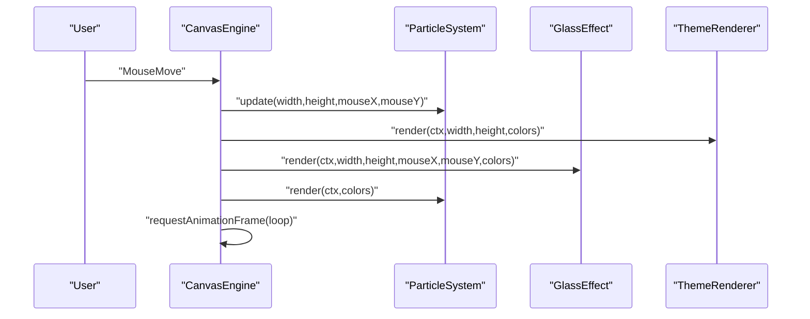
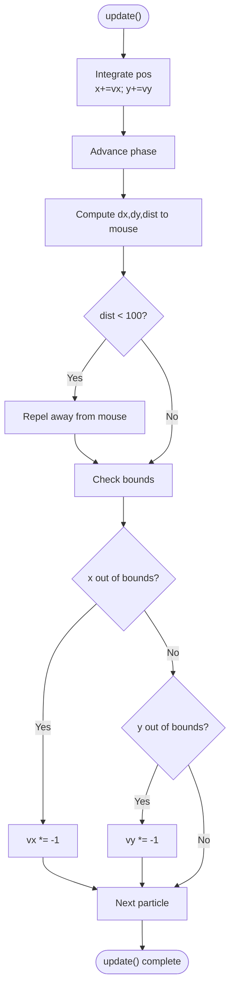
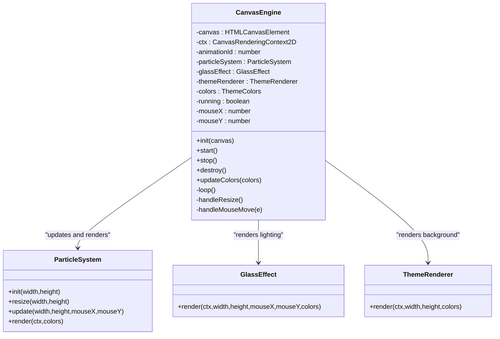
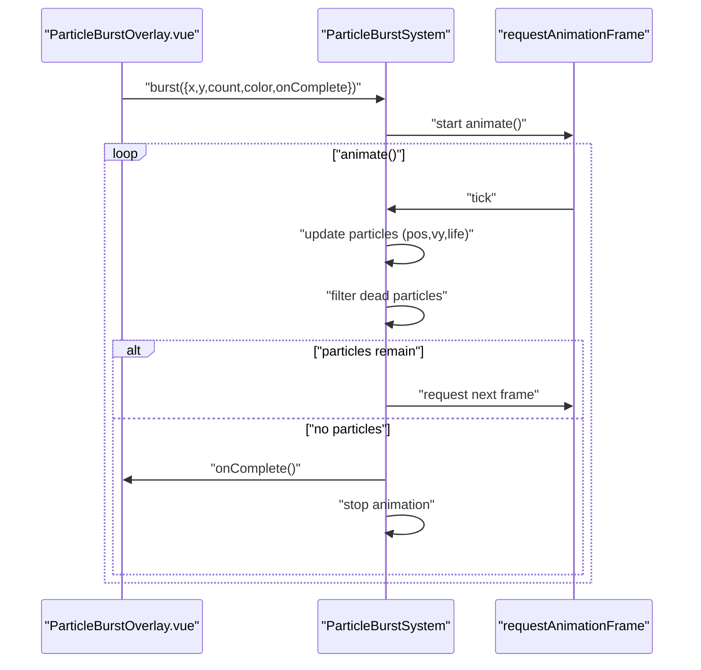
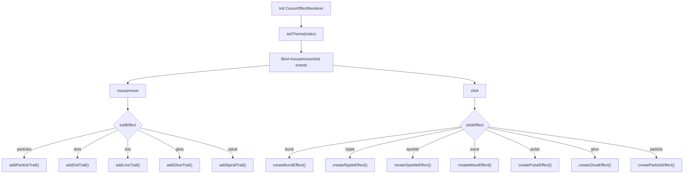
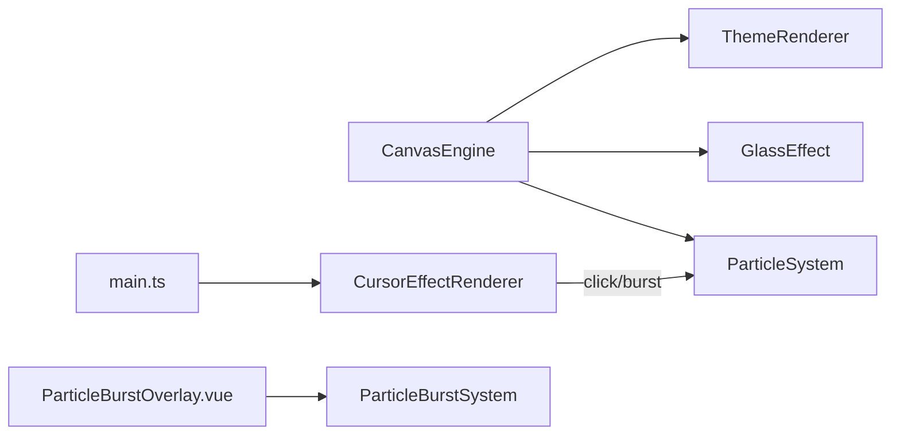

# Particle System and Visual Effects

<cite>
**Referenced Files in This Document**
- [ParticleSystem.ts](file://camp-channel-client-pc/src/canvas/ParticleSystem.ts)
- [ParticleBurst.ts](file://camp-channel-client-pc/src/canvas/ParticleBurst.ts)
- [ParticleBurstOverlay.vue](file://camp-channel-client-pc/src/components/ParticleBurstOverlay.vue)
- [CanvasEngine.ts](file://camp-channel-client-pc/src/canvas/CanvasEngine.ts)
- [GlassEffect.ts](file://camp-channel-client-pc/src/canvas/GlassEffect.ts)
- [ThemeRenderer.ts](file://camp-channel-client-pc/src/canvas/ThemeRenderer.ts)
- [cursorEffects.ts](file://camp-channel-client-pc/src/utils/cursorEffects.ts)
- [cursorRenderer.ts](file://camp-channel-client-pc/src/utils/cursorRenderer.ts)
- [main.ts](file://camp-channel-client-pc/src/main.ts)
</cite>

## Table of Contents
1. [Introduction](#introduction)
2. [Project Structure](#project-structure)
3. [Core Components](#core-components)
4. [Architecture Overview](#architecture-overview)
5. [Detailed Component Analysis](#detailed-component-analysis)
6. [Dependency Analysis](#dependency-analysis)
7. [Performance Considerations](#performance-considerations)
8. [Troubleshooting Guide](#troubleshooting-guide)
9. [Conclusion](#conclusion)

## Introduction
This document explains the particle system and visual effects implementations in the PC client. It covers the ParticleSystem class architecture, particle lifecycle management, rendering algorithms, and physics such as velocity updates, proximity interactions, and boundary handling. It also documents the ParticleBurst effect for special visual moments, integration with user interactions (mouse proximity and click effects), and performance optimization strategies including particle pooling, culling, and GPU acceleration considerations. Examples of particle configuration, emission patterns, and interactive behaviors are included, along with guidance on browser performance, memory management, and adaptive quality settings.

## Project Structure
The particle and visual effect subsystems are implemented in the PC client under the canvas and utils modules. The CanvasEngine orchestrates rendering order and integrates background gradients, glass lighting, and the floating particle field. The cursor effect system augments interactivity with per-theme click and trail effects, including a dedicated burst effect.

**Diagram sources**
- [CanvasEngine.ts:19-102](file://camp-channel-client-pc/src/canvas/CanvasEngine.ts#L19-L102)
- [ParticleSystem.ts:13-92](file://camp-channel-client-pc/src/canvas/ParticleSystem.ts#L13-L92)
- [GlassEffect.ts:3-39](file://camp-channel-client-pc/src/canvas/GlassEffect.ts#L3-L39)
- [ThemeRenderer.ts:3-42](file://camp-channel-client-pc/src/canvas/ThemeRenderer.ts#L3-L42)
- [cursorRenderer.ts:20-439](file://camp-channel-client-pc/src/utils/cursorRenderer.ts#L20-L439)
- [ParticleBurstOverlay.vue:1-37](file://camp-channel-client-pc/src/components/ParticleBurstOverlay.vue#L1-L37)
- [ParticleBurst.ts:9-89](file://camp-channel-client-pc/src/canvas/ParticleBurst.ts#L9-L89)

**Section sources**
- [CanvasEngine.ts:19-102](file://camp-channel-client-pc/src/canvas/CanvasEngine.ts#L19-L102)
- [ParticleSystem.ts:13-92](file://camp-channel-client-pc/src/canvas/ParticleSystem.ts#L13-L92)
- [GlassEffect.ts:3-39](file://camp-channel-client-pc/src/canvas/GlassEffect.ts#L3-L39)
- [ThemeRenderer.ts:3-42](file://camp-channel-client-pc/src/canvas/ThemeRenderer.ts#L3-L42)
- [cursorRenderer.ts:20-439](file://camp-channel-client-pc/src/utils/cursorRenderer.ts#L20-L439)
- [ParticleBurstOverlay.vue:1-37](file://camp-channel-client-pc/src/components/ParticleBurstOverlay.vue#L1-L37)
- [ParticleBurst.ts:9-89](file://camp-channel-client-pc/src/canvas/ParticleBurst.ts#L9-L89)

## Core Components
- ParticleSystem: Manages a fixed-size array of 2D particles with position, velocity, size, alpha, and pulsing animation. Implements update and render loops, mouse proximity avoidance, and neighbor-link rendering.
- CanvasEngine: Initializes canvas, manages animation loop, composes background gradients and glass lighting, and coordinates particle updates and rendering.
- GlassEffect: Radial gradient overlays that highlight mouse proximity and themed accents.
- ThemeRenderer: Linear gradient background blending themed colors.
- ParticleBurstSystem: Specialized burst effect with gravity, decay, and shadow blur for transient visual impact.
- ParticleBurstOverlay.vue: Provides a global overlay canvas and exposes a trigger function for bursts.
- CursorEffectRenderer: Adds per-theme click and trail effects, including a dedicated burst effect.
- cursorEffects.ts: Defines theme-based cursor and effect profiles.

**Section sources**
- [ParticleSystem.ts:13-92](file://camp-channel-client-pc/src/canvas/ParticleSystem.ts#L13-L92)
- [CanvasEngine.ts:19-102](file://camp-channel-client-pc/src/canvas/CanvasEngine.ts#L19-L102)
- [GlassEffect.ts:3-39](file://camp-channel-client-pc/src/canvas/GlassEffect.ts#L3-L39)
- [ThemeRenderer.ts:3-42](file://camp-channel-client-pc/src/canvas/ThemeRenderer.ts#L3-L42)
- [ParticleBurst.ts:9-89](file://camp-channel-client-pc/src/canvas/ParticleBurst.ts#L9-L89)
- [ParticleBurstOverlay.vue:1-37](file://camp-channel-client-pc/src/components/ParticleBurstOverlay.vue#L1-L37)
- [cursorRenderer.ts:20-439](file://camp-channel-client-pc/src/utils/cursorRenderer.ts#L20-L439)
- [cursorEffects.ts:6-209](file://camp-channel-client-pc/src/utils/cursorEffects.ts#L6-L209)

## Architecture Overview
The rendering pipeline is driven by CanvasEngine, which clears the canvas, renders background and lighting, updates and draws the particle field, and schedules the next frame. Mouse position is captured to influence particle motion. The cursor effect system augments interactivity with theme-aware click and trail effects, including a dedicated burst. A separate overlay canvas hosts transient bursts via ParticleBurstSystem.

**Diagram sources**
- [CanvasEngine.ts:79-93](file://camp-channel-client-pc/src/canvas/CanvasEngine.ts#L79-L93)
- [ParticleSystem.ts:44-91](file://camp-channel-client-pc/src/canvas/ParticleSystem.ts#L44-L91)
- [GlassEffect.ts:4-29](file://camp-channel-client-pc/src/canvas/GlassEffect.ts#L4-L29)
- [ThemeRenderer.ts:4-21](file://camp-channel-client-pc/src/canvas/ThemeRenderer.ts#L4-L21)

## Detailed Component Analysis

### ParticleSystem
- Data model: Each particle stores position (x, y), velocity (vx, vy), size, alpha, and a phase value for pulsing.
- Initialization: Pre-spawns N particles with random positions, velocities, sizes, alphas, and phases.
- Update loop:
  - Integrate velocities to positions.
  - Advance phase for pulsing.
  - Proximity force: If within a threshold distance from mouse, apply repulsion proportional to inverse distance.
  - Boundary handling: Reflect velocity on out-of-bounds edges.
- Rendering:
  - Pulsing alpha for each particle.
  - Draw filled circles for particles.
  - Connect nearby particles with lines when within a distance threshold, fading line alpha with distance.

**Diagram sources**
- [ParticleSystem.ts:44-61](file://camp-channel-client-pc/src/canvas/ParticleSystem.ts#L44-L61)

**Section sources**
- [ParticleSystem.ts:3-11](file://camp-channel-client-pc/src/canvas/ParticleSystem.ts#L3-L11)
- [ParticleSystem.ts:13-92](file://camp-channel-client-pc/src/canvas/ParticleSystem.ts#L13-L92)

### CanvasEngine
- Orchestrates canvas lifecycle, resize handling, mouse tracking, and animation loop.
- Renders background gradient, glass lighting, updates and renders the particle system, and schedules next frame.
- Exposes start/stop and destroy methods for lifecycle control.

**Diagram sources**
- [CanvasEngine.ts:19-102](file://camp-channel-client-pc/src/canvas/CanvasEngine.ts#L19-L102)
- [ParticleSystem.ts:13-92](file://camp-channel-client-pc/src/canvas/ParticleSystem.ts#L13-L92)
- [GlassEffect.ts:3-39](file://camp-channel-client-pc/src/canvas/GlassEffect.ts#L3-L39)
- [ThemeRenderer.ts:3-42](file://camp-channel-client-pc/src/canvas/ThemeRenderer.ts#L3-L42)

**Section sources**
- [CanvasEngine.ts:19-102](file://camp-channel-client-pc/src/canvas/CanvasEngine.ts#L19-L102)

### ParticleBurstSystem
- Transient burst effect with configurable origin, count, color, and completion callback.
- Each particle has position, velocity, life, decay, size, color, and gravity.
- Animation loop:
  - Clears canvas each frame.
  - Updates positions with gravity and damping, decays life, and draws glowing circles with radial blur.
  - Removes dead particles and stops animation when none remain.

**Diagram sources**
- [ParticleBurstOverlay.vue:12-26](file://camp-channel-client-pc/src/components/ParticleBurstOverlay.vue#L12-L26)
- [ParticleBurst.ts:28-82](file://camp-channel-client-pc/src/canvas/ParticleBurst.ts#L28-L82)

**Section sources**
- [ParticleBurst.ts:9-89](file://camp-channel-client-pc/src/canvas/ParticleBurst.ts#L9-L89)
- [ParticleBurstOverlay.vue:1-37](file://camp-channel-client-pc/src/components/ParticleBurstOverlay.vue#L1-L37)

### Cursor Effects and Interactive Behaviors
- Theme profiles define cursor styles, click effects, and trail effects. Click effect "burst" is supported and wired into the cursor renderer.
- The renderer creates temporary particles for trails and click effects, applying per-theme colors and sizes. Burst click effect emits a set of outward-moving particles with randomized angles and speeds.

**Diagram sources**
- [cursorEffects.ts:6-209](file://camp-channel-client-pc/src/utils/cursorEffects.ts#L6-L209)
- [cursorRenderer.ts:60-125](file://camp-channel-client-pc/src/utils/cursorRenderer.ts#L60-L125)
- [cursorRenderer.ts:237-255](file://camp-channel-client-pc/src/utils/cursorRenderer.ts#L237-L255)

**Section sources**
- [cursorEffects.ts:6-209](file://camp-channel-client-pc/src/utils/cursorEffects.ts#L6-L209)
- [cursorRenderer.ts:20-439](file://camp-channel-client-pc/src/utils/cursorRenderer.ts#L20-L439)

## Dependency Analysis
- CanvasEngine depends on ParticleSystem, GlassEffect, and ThemeRenderer to compose the scene.
- ParticleBurstSystem is independent and controlled via a Vue overlay component that injects a trigger function.
- CursorEffectRenderer is initialized at app startup and interacts with both the DOM and the global overlay canvas for burst effects.

**Diagram sources**
- [CanvasEngine.ts:19-102](file://camp-channel-client-pc/src/canvas/CanvasEngine.ts#L19-L102)
- [ParticleSystem.ts:13-92](file://camp-channel-client-pc/src/canvas/ParticleSystem.ts#L13-L92)
- [GlassEffect.ts:3-39](file://camp-channel-client-pc/src/canvas/GlassEffect.ts#L3-L39)
- [ThemeRenderer.ts:3-42](file://camp-channel-client-pc/src/canvas/ThemeRenderer.ts#L3-L42)
- [ParticleBurstOverlay.vue:1-37](file://camp-channel-client-pc/src/components/ParticleBurstOverlay.vue#L1-L37)
- [ParticleBurst.ts:9-89](file://camp-channel-client-pc/src/canvas/ParticleBurst.ts#L9-L89)
- [cursorRenderer.ts:20-439](file://camp-channel-client-pc/src/utils/cursorRenderer.ts#L20-L439)
- [main.ts:6-18](file://camp-channel-client-pc/src/main.ts#L6-L18)

**Section sources**
- [CanvasEngine.ts:19-102](file://camp-channel-client-pc/src/canvas/CanvasEngine.ts#L19-L102)
- [ParticleBurstOverlay.vue:1-37](file://camp-channel-client-pc/src/components/ParticleBurstOverlay.vue#L1-L37)
- [cursorRenderer.ts:20-439](file://camp-channel-client-pc/src/utils/cursorRenderer.ts#L20-L439)
- [main.ts:6-18](file://camp-channel-client-pc/src/main.ts#L6-L18)

## Performance Considerations
- Particle counts and neighbor checks:
  - ParticleSystem uses O(N) neighbor linking for drawing connections, which can degrade with large N. Consider spatial partitioning (grid/octree) for large particle counts.
- Physics and rendering:
  - Mouse proximity force and boundary reflection are constant-time per particle. Keep N moderate for smooth performance.
  - Rendering includes per-particle fills and pairwise line segments; reduce N or increase thresholds to limit line draws.
- Burst system:
  - ParticleBurstSystem uses requestAnimationFrame and filters dead particles each frame. Keep burst counts reasonable and decay rates tuned to avoid long-lived transient effects.
- Browser performance and memory:
  - Use offscreen canvases or WebGL for heavy particle workloads. Canvas 2D compositing can become expensive with many translucent shapes.
  - Minimize globalAlpha and shadowBlur usage; consider precomputing gradients or switching to shaders for glow effects.
- Adaptive quality:
  - Dynamically adjust particle count based on device capabilities (e.g., lower count on mobile). Provide runtime toggles for effects.
  - Use throttled mouse updates (e.g., sampling every N frames) to reduce CPU load during high-frequency movement.
- Lifecycle management:
  - Ensure CanvasEngine.stop() and destroy() are called on route changes or component unmounts to cancel RAF and remove event listeners.
  - For burst effects, cancelAnimationFrame and clear the overlay canvas to prevent lingering animations.

[No sources needed since this section provides general guidance]

## Troubleshooting Guide
- Particles not appearing:
  - Verify CanvasEngine initialization and that the canvas dimensions are set after resize.
  - Confirm requestAnimationFrame loop is running and that clearRect is called before drawing.
- Mouse interactions not working:
  - Ensure mousemove events are bound and that CanvasEngine updates mouseX/mouseY.
  - Check that ParticleSystem.update receives the mouse coordinates.
- Burst effect not visible:
  - Confirm the overlay canvas is appended to the DOM and sized to window.
  - Verify the trigger function is provided via Vue’s provide/inject and invoked with valid coordinates.
- Performance drops:
  - Reduce particle counts or disable neighbor line rendering.
  - Limit burst frequency and particle counts for transient effects.
  - Avoid excessive shadow blur and globalAlpha operations.

**Section sources**
- [CanvasEngine.ts:38-101](file://camp-channel-client-pc/src/canvas/CanvasEngine.ts#L38-L101)
- [ParticleSystem.ts:44-91](file://camp-channel-client-pc/src/canvas/ParticleSystem.ts#L44-L91)
- [ParticleBurstOverlay.vue:19-26](file://camp-channel-client-pc/src/components/ParticleBurstOverlay.vue#L19-L26)
- [ParticleBurst.ts:49-82](file://camp-channel-client-pc/src/canvas/ParticleBurst.ts#L49-L82)

## Conclusion
The particle system combines a lightweight, interactive 2D particle field with theme-aware background and lighting effects. The CanvasEngine coordinates rendering order and mouse-driven physics, while the cursor effect system extends interactivity with per-theme click and trail behaviors, including a dedicated burst effect. The ParticleBurstSystem provides transient, visually impactful bursts suitable for special moments. For broader scalability and performance, consider spatial partitioning, adaptive quality settings, and WebGL-based rendering pipelines. Proper lifecycle management ensures smooth operation across devices and prevents resource leaks.