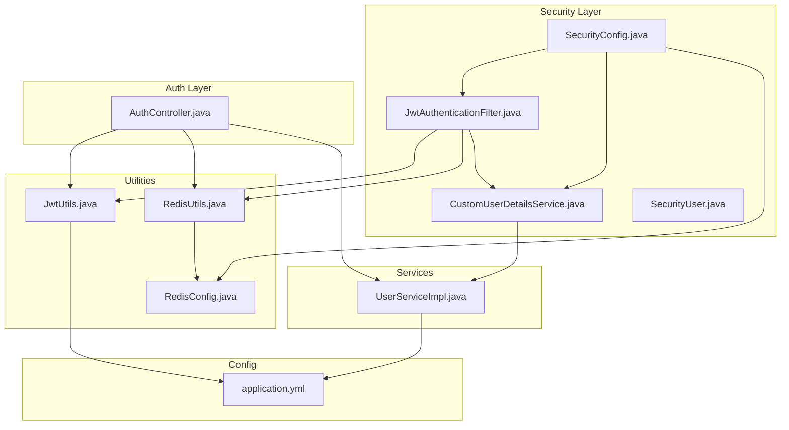
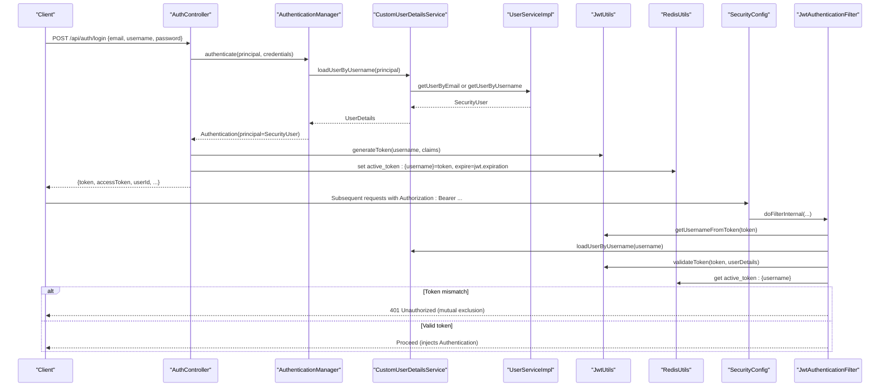
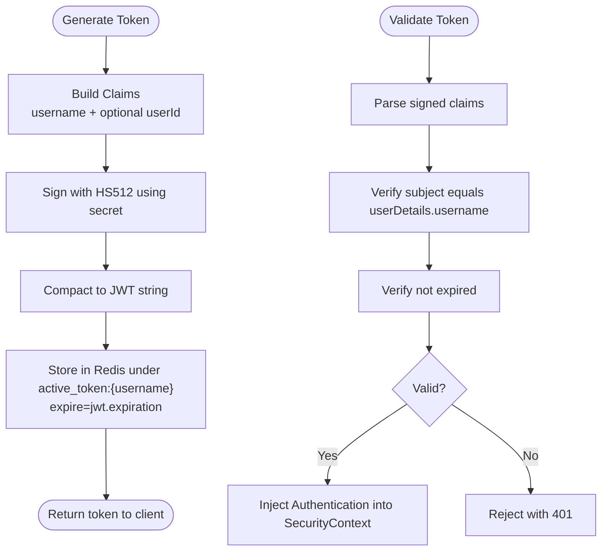
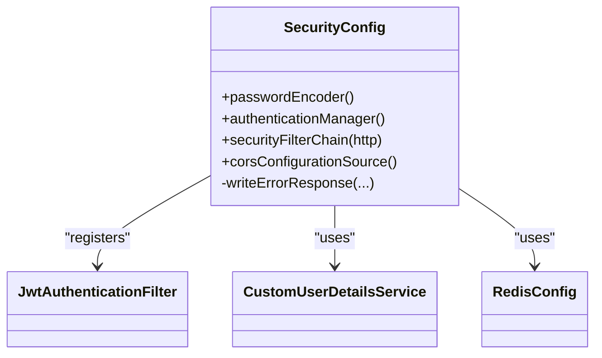
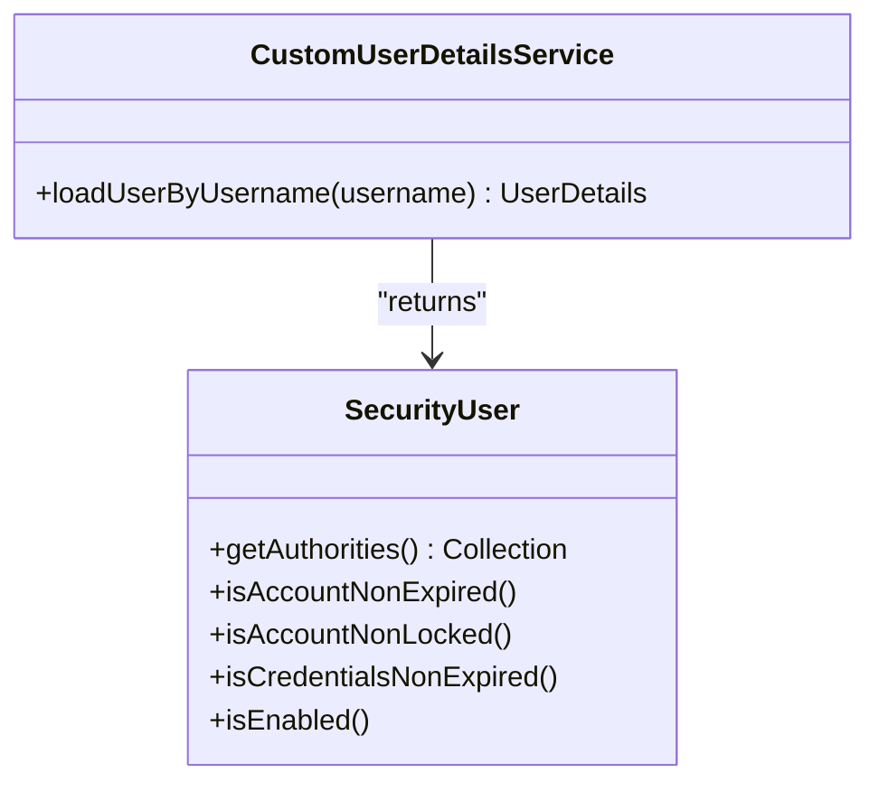
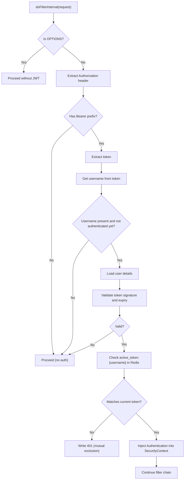
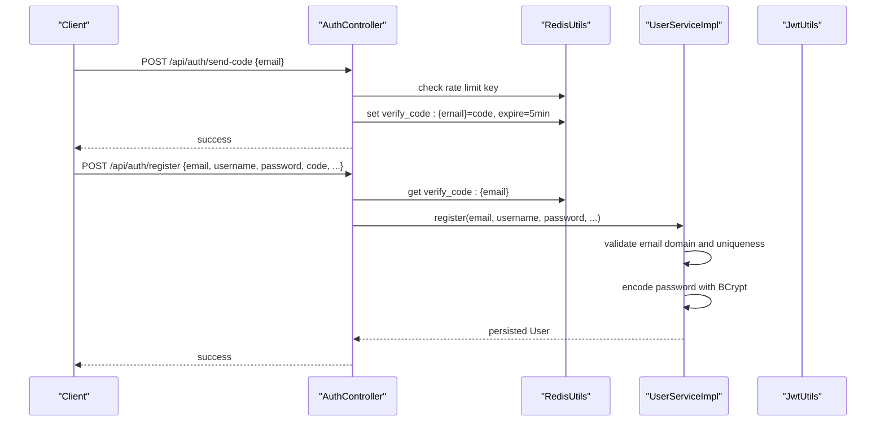
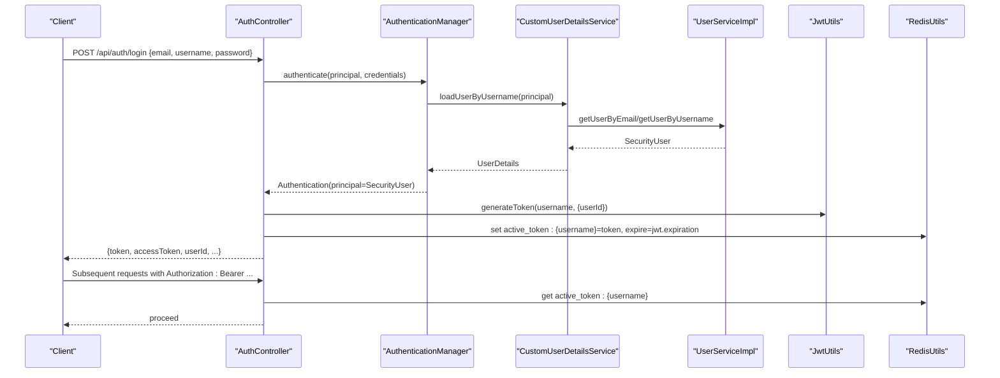
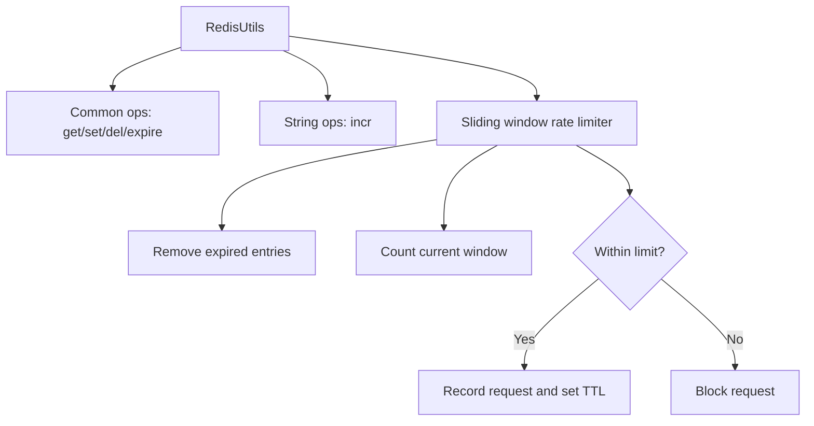
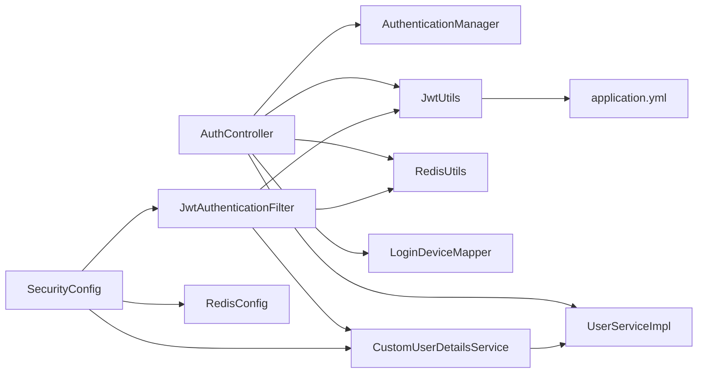

# Authentication and Security

<cite>
**Referenced Files in This Document**
- [JwtAuthenticationFilter.java](file://camp-channel-server/src/main/java/com/gdmec/campchannel/security/JwtAuthenticationFilter.java)
- [CustomUserDetailsService.java](file://camp-channel-server/src/main/java/com/gdmec/campchannel/security/CustomUserDetailsService.java)
- [SecurityUser.java](file://camp-channel-server/src/main/java/com/gdmec/campchannel/security/SecurityUser.java)
- [SecurityConfig.java](file://camp-channel-server/src/main/java/com/gdmec/campchannel/config/SecurityConfig.java)
- [JwtUtils.java](file://camp-channel-server/src/main/java/com/gdmec/campchannel/common/utils/JwtUtils.java)
- [AuthController.java](file://camp-channel-server/src/main/java/com/gdmec/campchannel/controller/AuthController.java)
- [RedisUtils.java](file://camp-channel-server/src/main/java/com/gdmec/campchannel/common/utils/RedisUtils.java)
- [RedisConfig.java](file://camp-channel-server/src/main/java/com/gdmec/campchannel/config/RedisConfig.java)
- [UserServiceImpl.java](file://camp-channel-server/src/main/java/com/gdmec/campchannel/service/impl/UserServiceImpl.java)
- [application.yml](file://camp-channel-server/src/main/resources/application.yml)
</cite>

## Table of Contents
1. [Introduction](#introduction)
2. [Project Structure](#project-structure)
3. [Core Components](#core-components)
4. [Architecture Overview](#architecture-overview)
5. [Detailed Component Analysis](#detailed-component-analysis)
6. [Dependency Analysis](#dependency-analysis)
7. [Performance Considerations](#performance-considerations)
8. [Troubleshooting Guide](#troubleshooting-guide)
9. [Conclusion](#conclusion)
10. [Appendices](#appendices)

## Introduction
This document explains the authentication and security system built with Spring Security and JWT tokens. It covers:
- JWT token-based authentication lifecycle: generation, validation, and single-device mutual exclusion
- User registration and validation with institutional email domain restrictions (@stu.gdmec.edu.cn)
- Spring Security configuration, custom user details service, and JWT filter implementation
- Redis-backed token storage and validation for mutual device logout
- Security configurations including CORS, CSRF, and session management
- Best practices for password hashing, token security, and session management

## Project Structure
The authentication system spans several packages:
- config: Spring Security configuration and Redis serialization
- security: Spring Security UserDetailsService and JWT filter
- common/utils: JWT utilities and Redis utilities
- controller: AuthController exposes login/register endpoints
- service/impl: User service implementation including password encoding and registration checks
- resources: application.yml with JWT and Redis configuration

**Diagram sources**
- [SecurityConfig.java:53-105](file://camp-channel-server/src/main/java/com/gdmec/campchannel/config/SecurityConfig.java#L53-L105)
- [JwtAuthenticationFilter.java:42-100](file://camp-channel-server/src/main/java/com/gdmec/campchannel/security/JwtAuthenticationFilter.java#L42-L100)
- [CustomUserDetailsService.java:22-45](file://camp-channel-server/src/main/java/com/gdmec/campchannel/security/CustomUserDetailsService.java#L22-L45)
- [SecurityUser.java:27-64](file://camp-channel-server/src/main/java/com/gdmec/campchannel/security/SecurityUser.java#L27-L64)
- [AuthController.java:124-207](file://camp-channel-server/src/main/java/com/gdmec/campchannel/controller/AuthController.java#L124-L207)
- [JwtUtils.java:17-84](file://camp-channel-server/src/main/java/com/gdmec/campchannel/common/utils/JwtUtils.java#L17-L84)
- [RedisUtils.java:17-170](file://camp-channel-server/src/main/java/com/gdmec/campchannel/common/utils/RedisUtils.java#L17-L170)
- [RedisConfig.java:18-46](file://camp-channel-server/src/main/java/com/gdmec/campchannel/config/RedisConfig.java#L18-L46)
- [UserServiceImpl.java:47-105](file://camp-channel-server/src/main/java/com/gdmec/campchannel/service/impl/UserServiceImpl.java#L47-L105)
- [application.yml:78-84](file://camp-channel-server/src/main/resources/application.yml#L78-L84)

**Section sources**
- [SecurityConfig.java:34-137](file://camp-channel-server/src/main/java/com/gdmec/campchannel/config/SecurityConfig.java#L34-L137)
- [application.yml:1-119](file://camp-channel-server/src/main/resources/application.yml#L1-119)

## Core Components
- Spring Security configuration disables CSRF, enables CORS, sets stateless sessions, and registers the JWT filter before the default form-based filter.
- CustomUserDetailsService loads users by email or username and wraps them into SecurityUser.
- SecurityUser implements UserDetails and maps roles to Spring Security authorities.
- JwtUtils generates and validates JWT tokens using HS512 with a configurable secret and expiration.
- AuthController handles login, registration, and verification code sending with institutional email validation and rate limiting.
- JwtAuthenticationFilter extracts the Bearer token, validates it, enforces single-device mutual exclusion via Redis, and injects authentication into Spring Security context.
- RedisUtils provides typed Redis operations and sliding window rate limiting.
- RedisConfig configures Jackson-based serialization for RedisTemplate.

**Section sources**
- [SecurityConfig.java:53-105](file://camp-channel-server/src/main/java/com/gdmec/campchannel/config/SecurityConfig.java#L53-L105)
- [CustomUserDetailsService.java:22-45](file://camp-channel-server/src/main/java/com/gdmec/campchannel/security/CustomUserDetailsService.java#L22-L45)
- [SecurityUser.java:27-64](file://camp-channel-server/src/main/java/com/gdmec/campchannel/security/SecurityUser.java#L27-L64)
- [JwtUtils.java:66-84](file://camp-channel-server/src/main/java/com/gdmec/campchannel/common/utils/JwtUtils.java#L66-L84)
- [AuthController.java:124-207](file://camp-channel-server/src/main/java/com/gdmec/campchannel/controller/AuthController.java#L124-L207)
- [JwtAuthenticationFilter.java:42-100](file://camp-channel-server/src/main/java/com/gdmec/campchannel/security/JwtAuthenticationFilter.java#L42-L100)
- [RedisUtils.java:17-170](file://camp-channel-server/src/main/java/com/gdmec/campchannel/common/utils/RedisUtils.java#L17-L170)
- [RedisConfig.java:18-46](file://camp-channel-server/src/main/java/com/gdmec/campchannel/config/RedisConfig.java#L18-L46)

## Architecture Overview
The authentication flow integrates controllers, filters, services, and utilities with Redis for token validation and rate limiting.

**Diagram sources**
- [AuthController.java:124-207](file://camp-channel-server/src/main/java/com/gdmec/campchannel/controller/AuthController.java#L124-L207)
- [JwtUtils.java:66-84](file://camp-channel-server/src/main/java/com/gdmec/campchannel/common/utils/JwtUtils.java#L66-L84)
- [RedisUtils.java:67-95](file://camp-channel-server/src/main/java/com/gdmec/campchannel/common/utils/RedisUtils.java#L67-L95)
- [SecurityConfig.java:53-105](file://camp-channel-server/src/main/java/com/gdmec/campchannel/config/SecurityConfig.java#L53-L105)
- [JwtAuthenticationFilter.java:42-100](file://camp-channel-server/src/main/java/com/gdmec/campchannel/security/JwtAuthenticationFilter.java#L42-L100)
- [CustomUserDetailsService.java:22-45](file://camp-channel-server/src/main/java/com/gdmec/campchannel/security/CustomUserDetailsService.java#L22-L45)
- [UserServiceImpl.java:47-105](file://camp-channel-server/src/main/java/com/gdmec/campchannel/service/impl/UserServiceImpl.java#L47-L105)

## Detailed Component Analysis

### JWT Utilities and Token Lifecycle
- Token generation: Uses HS512 with a configurable secret and expiration seconds. Claims include the username and optional userId.
- Token validation: Extracts subject and expiration, verifies signature, and ensures non-expired.
- Header and prefix: Configurable header name and “Bearer ” prefix.

**Diagram sources**
- [JwtUtils.java:66-84](file://camp-channel-server/src/main/java/com/gdmec/campchannel/common/utils/JwtUtils.java#L66-L84)
- [AuthController.java:171-180](file://camp-channel-server/src/main/java/com/gdmec/campchannel/controller/AuthController.java#L171-L180)
- [JwtAuthenticationFilter.java:76-96](file://camp-channel-server/src/main/java/com/gdmec/campchannel/security/JwtAuthenticationFilter.java#L76-L96)

**Section sources**
- [JwtUtils.java:17-84](file://camp-channel-server/src/main/java/com/gdmec/campchannel/common/utils/JwtUtils.java#L17-L84)
- [application.yml:78-84](file://camp-channel-server/src/main/resources/application.yml#L78-L84)

### Spring Security Configuration
- Disables CSRF for stateless JWT APIs.
- Enables CORS with permissive defaults in development.
- PermitsAll for login/register/send-code endpoints and static resources.
- Sets session creation policy to STATELESS.
- Registers JwtAuthenticationFilter before UsernamePasswordAuthenticationFilter.
- Provides custom authenticationEntryPoint and accessDeniedHandler returning unified JSON errors.

**Diagram sources**
- [SecurityConfig.java:53-105](file://camp-channel-server/src/main/java/com/gdmec/campchannel/config/SecurityConfig.java#L53-L105)
- [JwtAuthenticationFilter.java:31-40](file://camp-channel-server/src/main/java/com/gdmec/campchannel/security/JwtAuthenticationFilter.java#L31-L40)
- [CustomUserDetailsService.java:17-20](file://camp-channel-server/src/main/java/com/gdmec/campchannel/security/CustomUserDetailsService.java#L17-L20)
- [RedisConfig.java:18-46](file://camp-channel-server/src/main/java/com/gdmec/campchannel/config/RedisConfig.java#L18-L46)

**Section sources**
- [SecurityConfig.java:53-105](file://camp-channel-server/src/main/java/com/gdmec/campchannel/config/SecurityConfig.java#L53-L105)

### Custom User Details Service and SecurityUser
- Loads user by email or username, wrapping into SecurityUser.
- SecurityUser maps role to Spring Security authority with “ROLE_” prefix and enforces account status locks/enabled states.

**Diagram sources**
- [CustomUserDetailsService.java:22-45](file://camp-channel-server/src/main/java/com/gdmec/campchannel/security/CustomUserDetailsService.java#L22-L45)
- [SecurityUser.java:27-64](file://camp-channel-server/src/main/java/com/gdmec/campchannel/security/SecurityUser.java#L27-L64)

**Section sources**
- [CustomUserDetailsService.java:22-45](file://camp-channel-server/src/main/java/com/gdmec/campchannel/security/CustomUserDetailsService.java#L22-L45)
- [SecurityUser.java:27-64](file://camp-channel-server/src/main/java/com/gdmec/campchannel/security/SecurityUser.java#L27-L64)

### JWT Authentication Filter
- Extracts Authorization header, validates token, and enforces single-device mutual exclusion by comparing the incoming token with the active token stored in Redis.
- Injects Authentication into SecurityContext upon successful validation.

**Diagram sources**
- [JwtAuthenticationFilter.java:42-100](file://camp-channel-server/src/main/java/com/gdmec/campchannel/security/JwtAuthenticationFilter.java#L42-L100)

**Section sources**
- [JwtAuthenticationFilter.java:42-100](file://camp-channel-server/src/main/java/com/gdmec/campchannel/security/JwtAuthenticationFilter.java#L42-L100)

### Registration and Validation with Institutional Email Domain Restriction
- Registration endpoint requires a valid 6-digit verification code stored in Redis for the email address.
- Both AuthController and UserService enforce @stu.gdmec.edu.cn domain validation.
- Passwords are hashed using BCrypt before persistence.
- Default avatar selection and automatic joining of a public channel occur during registration.

**Diagram sources**
- [AuthController.java:61-122](file://camp-channel-server/src/main/java/com/gdmec/campchannel/controller/AuthController.java#L61-L122)
- [UserServiceImpl.java:47-105](file://camp-channel-server/src/main/java/com/gdmec/campchannel/service/impl/UserServiceImpl.java#L47-L105)
- [RedisUtils.java:67-95](file://camp-channel-server/src/main/java/com/gdmec/campchannel/common/utils/RedisUtils.java#L67-L95)

**Section sources**
- [AuthController.java:61-122](file://camp-channel-server/src/main/java/com/gdmec/campchannel/controller/AuthController.java#L61-L122)
- [UserServiceImpl.java:47-105](file://camp-channel-server/src/main/java/com/gdmec/campchannel/service/impl/UserServiceImpl.java#L47-L105)

### Login Flow and Single-Device Mutual Exclusion
- Login validates institutional email domain, enforces failed-login rate limiting, authenticates via AuthenticationManager, generates JWT with userId claim, stores active token in Redis, and records login device.
- JwtAuthenticationFilter enforces mutual exclusion by comparing the incoming token with the active token stored in Redis.

**Diagram sources**
- [AuthController.java:124-207](file://camp-channel-server/src/main/java/com/gdmec/campchannel/controller/AuthController.java#L124-L207)
- [JwtUtils.java:66-84](file://camp-channel-server/src/main/java/com/gdmec/campchannel/common/utils/JwtUtils.java#L66-L84)
- [RedisUtils.java:67-95](file://camp-channel-server/src/main/java/com/gdmec/campchannel/common/utils/RedisUtils.java#L67-L95)

**Section sources**
- [AuthController.java:124-207](file://camp-channel-server/src/main/java/com/gdmec/campchannel/controller/AuthController.java#L124-L207)

### Redis Session Management and Rate Limiting
- RedisUtils provides typed operations and a sliding window rate limiter to prevent abuse.
- Active token storage uses keys like “active_token:{username}” with TTL aligned to JWT expiration.
- Rate limiting for verification code sending prevents spam.

**Diagram sources**
- [RedisUtils.java:17-170](file://camp-channel-server/src/main/java/com/gdmec/campchannel/common/utils/RedisUtils.java#L17-L170)

**Section sources**
- [RedisUtils.java:17-170](file://camp-channel-server/src/main/java/com/gdmec/campchannel/common/utils/RedisUtils.java#L17-L170)

## Dependency Analysis
- AuthController depends on AuthenticationManager, JwtUtils, RedisUtils, UserService, and LoginDeviceMapper.
- JwtAuthenticationFilter depends on JwtUtils, RedisUtils, and CustomUserDetailsService.
- CustomUserDetailsService depends on UserService.
- SecurityConfig depends on JwtAuthenticationFilter, CustomUserDetailsService, and RedisConfig.
- JwtUtils depends on application.yml for JWT configuration.
- RedisConfig configures RedisTemplate serialization.

**Diagram sources**
- [AuthController.java:43-59](file://camp-channel-server/src/main/java/com/gdmec/campchannel/controller/AuthController.java#L43-L59)
- [JwtAuthenticationFilter.java:33-40](file://camp-channel-server/src/main/java/com/gdmec/campchannel/security/JwtAuthenticationFilter.java#L33-L40)
- [CustomUserDetailsService.java:19-20](file://camp-channel-server/src/main/java/com/gdmec/campchannel/security/CustomUserDetailsService.java#L19-L20)
- [SecurityConfig.java:39-40](file://camp-channel-server/src/main/java/com/gdmec/campchannel/config/SecurityConfig.java#L39-L40)
- [JwtUtils.java:20-33](file://camp-channel-server/src/main/java/com/gdmec/campchannel/common/utils/JwtUtils.java#L20-L33)
- [RedisConfig.java:20-45](file://camp-channel-server/src/main/java/com/gdmec/campchannel/config/RedisConfig.java#L20-L45)

**Section sources**
- [AuthController.java:43-59](file://camp-channel-server/src/main/java/com/gdmec/campchannel/controller/AuthController.java#L43-L59)
- [JwtAuthenticationFilter.java:33-40](file://camp-channel-server/src/main/java/com/gdmec/campchannel/security/JwtAuthenticationFilter.java#L33-L40)
- [CustomUserDetailsService.java:19-20](file://camp-channel-server/src/main/java/com/gdmec/campchannel/security/CustomUserDetailsService.java#L19-L20)
- [SecurityConfig.java:39-40](file://camp-channel-server/src/main/java/com/gdmec/campchannel/config/SecurityConfig.java#L39-L40)
- [JwtUtils.java:20-33](file://camp-channel-server/src/main/java/com/gdmec/campchannel/common/utils/JwtUtils.java#L20-L33)
- [RedisConfig.java:20-45](file://camp-channel-server/src/main/java/com/gdmec/campchannel/config/RedisConfig.java#L20-L45)

## Performance Considerations
- Stateless JWT eliminates server-side session storage overhead.
- Redis operations are lightweight for token validation and rate limiting.
- HS512 signing is efficient; consider rotating secrets periodically.
- Ensure Redis is tuned for high throughput and low latency.
- Avoid excessive logging in production to reduce I/O overhead.

## Troubleshooting Guide
- 401 Unauthorized on subsequent requests:
  - Verify Authorization header format “Bearer {token}”.
  - Confirm token is not expired and signature is valid.
  - Check that the active token in Redis matches the current token.
- 403 Forbidden:
  - Indicates invalid credentials or insufficient permissions; review role mapping and account status.
- Rate limit exceeded:
  - The verification code rate limit key “verify_code_rate:{email}” is active; wait for cooldown.
- CORS issues:
  - Review CORS configuration in SecurityConfig and allowed origin patterns.

**Section sources**
- [JwtAuthenticationFilter.java:61-96](file://camp-channel-server/src/main/java/com/gdmec/campchannel/security/JwtAuthenticationFilter.java#L61-L96)
- [AuthController.java:142-169](file://camp-channel-server/src/main/java/com/gdmec/campchannel/controller/AuthController.java#L142-L169)
- [SecurityConfig.java:107-136](file://camp-channel-server/src/main/java/com/gdmec/campchannel/config/SecurityConfig.java#L107-L136)

## Conclusion
The system implements a robust, stateless JWT-based authentication flow with institutional email validation, strong password hashing, and Redis-backed token management for single-device mutual exclusion. Spring Security is configured for CORS and CSRF disabled, aligning with JWT’s stateless nature. The design balances security and usability, with clear separation of concerns across controllers, filters, services, and utilities.

## Appendices

### Configuration Options
- JWT configuration in application.yml:
  - jwt.secret: HMAC secret key for HS512 signing
  - jwt.expiration: token validity in seconds
  - jwt.header: HTTP header name for token
  - jwt.token-start-with: token prefix (“Bearer ”)
- Redis configuration:
  - spring.data.redis.host/port/password/database/timeout
  - Redis serialization configured via RedisConfig

**Section sources**
- [application.yml:78-84](file://camp-channel-server/src/main/resources/application.yml#L78-L84)
- [application.yml:31-42](file://camp-channel-server/src/main/resources/application.yml#L31-L42)
- [RedisConfig.java:20-45](file://camp-channel-server/src/main/java/com/gdmec/campchannel/config/RedisConfig.java#L20-L45)

### Security Headers and Best Practices
- CSRF: Disabled because JWT is stateless; ensure tokens are transmitted securely.
- CORS: Enabled with permissive defaults in development; tighten allowed origins in production.
- Session: Stateless via SessionCreationPolicy.STATELESS.
- Password hashing: BCrypt encoder used in UserServiceImpl and SecurityConfig.
- Token storage: Redis active_token keys with TTL equal to JWT expiration.
- Secure token handling:
  - Store tokens only in memory (e.g., browser localStorage/sessionStorage) or secure cookies with HttpOnly and SameSite flags.
  - Avoid logging tokens.
  - Rotate JWT secrets periodically.
  - Enforce HTTPS in production.

**Section sources**
- [SecurityConfig.java:53-105](file://camp-channel-server/src/main/java/com/gdmec/campchannel/config/SecurityConfig.java#L53-L105)
- [UserServiceImpl.java:63](file://camp-channel-server/src/main/java/com/gdmec/campchannel/service/impl/UserServiceImpl.java#L63)
- [AuthController.java:171-180](file://camp-channel-server/src/main/java/com/gdmec/campchannel/controller/AuthController.java#L171-L180)