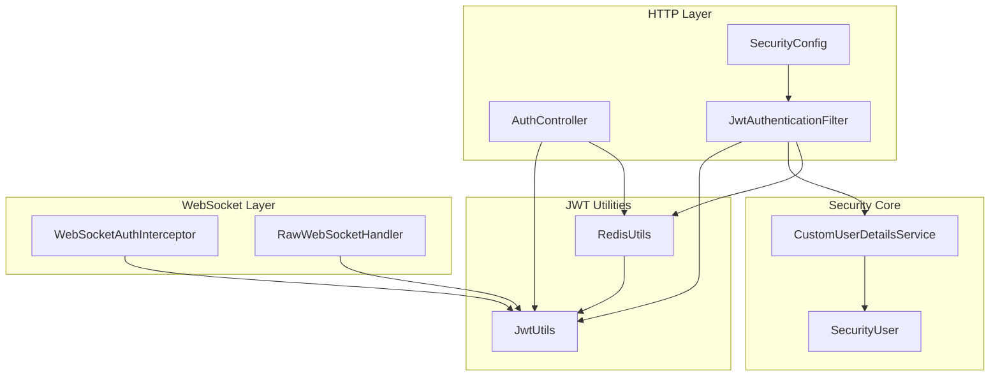
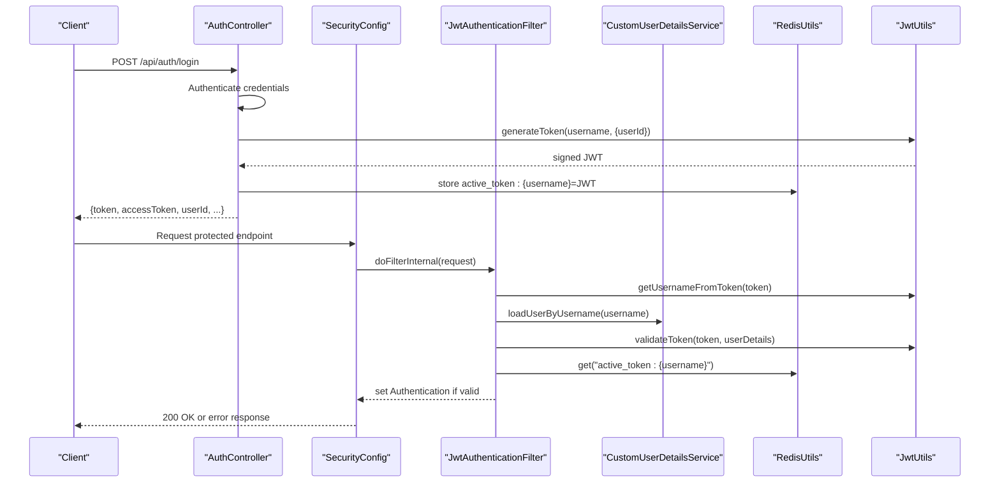
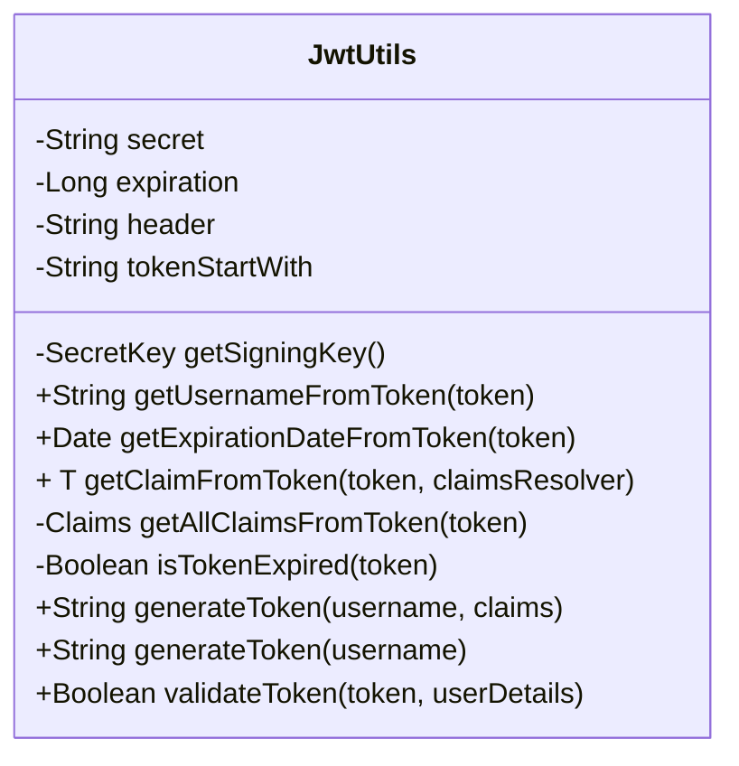
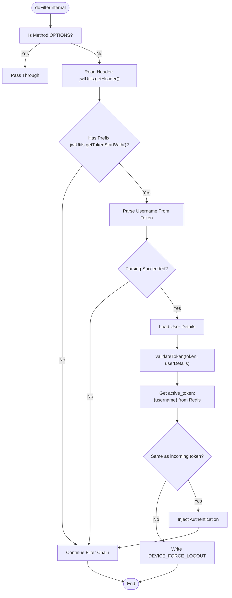
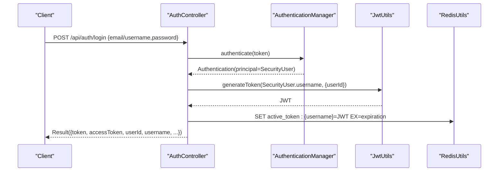
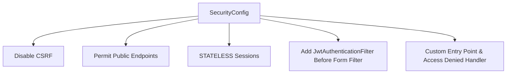
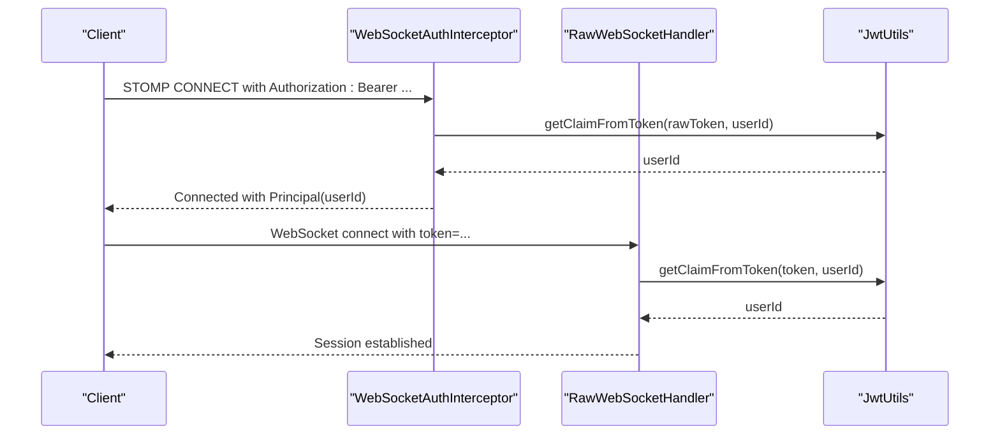
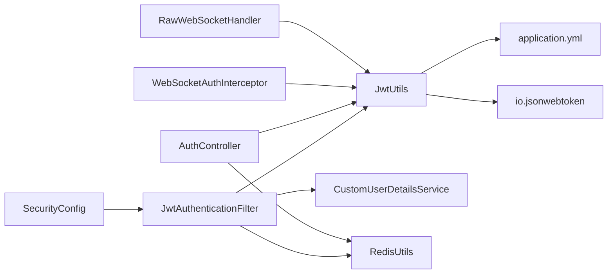

# JWT Token Management

<cite>
**Referenced Files in This Document**
- [JwtUtils.java](file://camp-channel-server/src/main/java/com/gdmec/campchannel/common/utils/JwtUtils.java)
- [JwtAuthenticationFilter.java](file://camp-channel-server/src/main/java/com/gdmec/campchannel/security/JwtAuthenticationFilter.java)
- [AuthController.java](file://camp-channel-server/src/main/java/com/gdmec/campchannel/controller/AuthController.java)
- [application.yml](file://camp-channel-server/src/main/resources/application.yml)
- [SecurityConfig.java](file://camp-channel-server/src/main/java/com/gdmec/campchannel/config/SecurityConfig.java)
- [RedisUtils.java](file://camp-channel-server/src/main/java/com/gdmec/campchannel/common/utils/RedisUtils.java)
- [CustomUserDetailsService.java](file://camp-channel-server/src/main/java/com/gdmec/campchannel/security/CustomUserDetailsService.java)
- [WebSocketAuthInterceptor.java](file://camp-channel-server/src/main/java/com/gdmec/campchannel/config/WebSocketAuthInterceptor.java)
- [RawWebSocketHandler.java](file://camp-channel-server/src/main/java/com/gdmec/campchannel/config/RawWebSocketHandler.java)
- [SecurityUser.java](file://camp-channel-server/src/main/java/com/gdmec/campchannel/security/SecurityUser.java)
- [ErrorCode.java](file://camp-channel-server/src/main/java/com/gdmec/campchannel/common/api/ErrorCode.java)
- [Result.java](file://camp-channel-server/src/main/java/com/gdmec/campchannel/common/api/Result.java)
</cite>

## Table of Contents
1. [Introduction](#introduction)
2. [Project Structure](#project-structure)
3. [Core Components](#core-components)
4. [Architecture Overview](#architecture-overview)
5. [Detailed Component Analysis](#detailed-component-analysis)
6. [Dependency Analysis](#dependency-analysis)
7. [Performance Considerations](#performance-considerations)
8. [Troubleshooting Guide](#troubleshooting-guide)
9. [Conclusion](#conclusion)
10. [Appendices](#appendices)

## Introduction
This document explains the JWT token management implementation used in the authentication system. It covers token generation, validation, and single-device login enforcement, along with the structure of JWT payloads, expiration handling, and signature verification. It documents the JwtUtils utility class, the JwtAuthenticationFilter integration with Spring Security, and demonstrates practical usage patterns for login, protected endpoint access, and WebSocket authentication. It also provides configuration options, security best practices, troubleshooting guidance, and performance considerations.

## Project Structure
The JWT implementation spans several modules:
- Utility layer: JwtUtils for token operations and RedisUtils for caching.
- Security layer: JwtAuthenticationFilter for automatic token validation on HTTP requests, SecurityConfig for Spring Security configuration, and CustomUserDetailsService for loading user details.
- Controllers: AuthController for login and registration, returning JWT tokens.
- WebSocket support: WebSocketAuthInterceptor and RawWebSocketHandler for STOMP and raw WebSocket authentication using JWT.
- API layer: ErrorCode and Result for consistent error and response formatting.

**Diagram sources**
- [AuthController.java:124-207](file://camp-channel-server/src/main/java/com/gdmec/campchannel/controller/AuthController.java#L124-L207)
- [SecurityConfig.java:52-105](file://camp-channel-server/src/main/java/com/gdmec/campchannel/config/SecurityConfig.java#L52-L105)
- [JwtAuthenticationFilter.java:42-100](file://camp-channel-server/src/main/java/com/gdmec/campchannel/security/JwtAuthenticationFilter.java#L42-L100)
- [JwtUtils.java:17-84](file://camp-channel-server/src/main/java/com/gdmec/campchannel/common/utils/JwtUtils.java#L17-L84)
- [RedisUtils.java:16-170](file://camp-channel-server/src/main/java/com/gdmec/campchannel/common/utils/RedisUtils.java#L16-L170)
- [CustomUserDetailsService.java:16-46](file://camp-channel-server/src/main/java/com/gdmec/campchannel/security/CustomUserDetailsService.java#L16-L46)
- [SecurityUser.java:15-66](file://camp-channel-server/src/main/java/com/gdmec/campchannel/security/SecurityUser.java#L15-L66)
- [WebSocketAuthInterceptor.java:15-46](file://camp-channel-server/src/main/java/com/gdmec/campchannel/config/WebSocketAuthInterceptor.java#L15-L46)
- [RawWebSocketHandler.java:23-74](file://camp-channel-server/src/main/java/com/gdmec/campchannel/config/RawWebSocketHandler.java#L23-L74)

**Section sources**
- [AuthController.java:124-207](file://camp-channel-server/src/main/java/com/gdmec/campchannel/controller/AuthController.java#L124-L207)
- [SecurityConfig.java:52-105](file://camp-channel-server/src/main/java/com/gdmec/campchannel/config/SecurityConfig.java#L52-L105)
- [JwtAuthenticationFilter.java:42-100](file://camp-channel-server/src/main/java/com/gdmec/campchannel/security/JwtAuthenticationFilter.java#L42-L100)
- [JwtUtils.java:17-84](file://camp-channel-server/src/main/java/com/gdmec/campchannel/common/utils/JwtUtils.java#L17-L84)
- [RedisUtils.java:16-170](file://camp-channel-server/src/main/java/com/gdmec/campchannel/common/utils/RedisUtils.java#L16-L170)
- [CustomUserDetailsService.java:16-46](file://camp-channel-server/src/main/java/com/gdmec/campchannel/security/CustomUserDetailsService.java#L16-L46)
- [SecurityUser.java:15-66](file://camp-channel-server/src/main/java/com/gdmec/campchannel/security/SecurityUser.java#L15-L66)
- [WebSocketAuthInterceptor.java:15-46](file://camp-channel-server/src/main/java/com/gdmec/campchannel/config/WebSocketAuthInterceptor.java#L15-L46)
- [RawWebSocketHandler.java:23-74](file://camp-channel-server/src/main/java/com/gdmec/campchannel/config/RawWebSocketHandler.java#L23-L74)

## Core Components
- JwtUtils: Provides token creation with custom claims, parsing, expiration extraction, and validation against user details. It reads configuration for secret, expiration, header name, and token prefix.
- JwtAuthenticationFilter: Extracts the token from the configured header, validates it, enforces single-device login via Redis, and injects an Authentication into Spring Security’s context.
- AuthController: Handles login, generates JWT with a custom claim (userId), stores the latest token in Redis for single-device enforcement, and returns token and user info.
- SecurityConfig: Configures Spring Security to disable CSRF, permit public endpoints, enforce stateless sessions, and register JwtAuthenticationFilter before the default form-based filter.
- CustomUserDetailsService and SecurityUser: Load user details and provide Spring Security with authorities and account status.
- RedisUtils: Provides Redis operations used for storing active tokens and enforcing single-device login.
- WebSocketAuthInterceptor and RawWebSocketHandler: Demonstrate JWT usage in WebSocket contexts for STOMP and raw WebSocket connections.

**Section sources**
- [JwtUtils.java:17-84](file://camp-channel-server/src/main/java/com/gdmec/campchannel/common/utils/JwtUtils.java#L17-L84)
- [JwtAuthenticationFilter.java:31-100](file://camp-channel-server/src/main/java/com/gdmec/campchannel/security/JwtAuthenticationFilter.java#L31-L100)
- [AuthController.java:124-207](file://camp-channel-server/src/main/java/com/gdmec/campchannel/controller/AuthController.java#L124-L207)
- [SecurityConfig.java:52-105](file://camp-channel-server/src/main/java/com/gdmec/campchannel/config/SecurityConfig.java#L52-L105)
- [CustomUserDetailsService.java:16-46](file://camp-channel-server/src/main/java/com/gdmec/campchannel/security/CustomUserDetailsService.java#L16-L46)
- [SecurityUser.java:15-66](file://camp-channel-server/src/main/java/com/gdmec/campchannel/security/SecurityUser.java#L15-L66)
- [RedisUtils.java:16-170](file://camp-channel-server/src/main/java/com/gdmec/campchannel/common/utils/RedisUtils.java#L16-L170)
- [WebSocketAuthInterceptor.java:15-46](file://camp-channel-server/src/main/java/com/gdmec/campchannel/config/WebSocketAuthInterceptor.java#L15-L46)
- [RawWebSocketHandler.java:23-74](file://camp-channel-server/src/main/java/com/gdmec/campchannel/config/RawWebSocketHandler.java#L23-L74)

## Architecture Overview
The JWT authentication pipeline integrates with Spring Security and Redis:
- On login, AuthController authenticates credentials, builds a JWT with a custom claim (userId), stores the active token in Redis, and returns the token to clients.
- JwtAuthenticationFilter intercepts incoming requests, extracts the token from the configured header, validates it, checks single-device enforcement, and sets the Authentication in the SecurityContext.
- Protected endpoints require authenticated users; unauthenticated or invalid requests receive standardized error responses.

**Diagram sources**
- [AuthController.java:124-207](file://camp-channel-server/src/main/java/com/gdmec/campchannel/controller/AuthController.java#L124-L207)
- [SecurityConfig.java:52-105](file://camp-channel-server/src/main/java/com/gdmec/campchannel/config/SecurityConfig.java#L52-L105)
- [JwtAuthenticationFilter.java:42-100](file://camp-channel-server/src/main/java/com/gdmec/campchannel/security/JwtAuthenticationFilter.java#L42-L100)
- [JwtUtils.java:40-83](file://camp-channel-server/src/main/java/com/gdmec/campchannel/common/utils/JwtUtils.java#L40-L83)
- [RedisUtils.java:67-95](file://camp-channel-server/src/main/java/com/gdmec/campchannel/common/utils/RedisUtils.java#L67-L95)
- [CustomUserDetailsService.java:22-45](file://camp-channel-server/src/main/java/com/gdmec/campchannel/security/CustomUserDetailsService.java#L22-L45)

## Detailed Component Analysis

### JwtUtils: Token Creation, Parsing, and Validation
- Configuration-driven:
  - Secret key, expiration (seconds), header name, and token prefix are injected from application.yml.
- Token creation:
  - Builds a JWT with subject (username), issued-at, expiration, and custom claims (e.g., userId).
  - Uses HMAC-SHA with HS512 signature algorithm.
- Token parsing:
  - Extracts subject and expiration from the signed token.
  - Supports extracting arbitrary claims via a resolver function.
- Validation:
  - Validates username match and non-expired condition.

**Diagram sources**
- [JwtUtils.java:17-84](file://camp-channel-server/src/main/java/com/gdmec/campchannel/common/utils/JwtUtils.java#L17-L84)

**Section sources**
- [JwtUtils.java:17-84](file://camp-channel-server/src/main/java/com/gdmec/campchannel/common/utils/JwtUtils.java#L17-L84)
- [application.yml:78-84](file://camp-channel-server/src/main/resources/application.yml#L78-L84)

### JwtAuthenticationFilter: Automatic Token Validation
- Extracts token from the configured header (default Authorization) and strips the configured prefix (default Bearer ).
- Parses username from the token and loads user details.
- Validates token against user details and checks expiration.
- Enforces single-device login by comparing the incoming token with the active token stored in Redis under a key derived from the username.
- Writes standardized JSON error responses for unauthorized or invalid tokens.

**Diagram sources**
- [JwtAuthenticationFilter.java:42-100](file://camp-channel-server/src/main/java/com/gdmec/campchannel/security/JwtAuthenticationFilter.java#L42-L100)
- [JwtUtils.java:40-83](file://camp-channel-server/src/main/java/com/gdmec/campchannel/common/utils/JwtUtils.java#L40-L83)
- [RedisUtils.java:67-95](file://camp-channel-server/src/main/java/com/gdmec/campchannel/common/utils/RedisUtils.java#L67-L95)
- [CustomUserDetailsService.java:22-45](file://camp-channel-server/src/main/java/com/gdmec/campchannel/security/CustomUserDetailsService.java#L22-L45)

**Section sources**
- [JwtAuthenticationFilter.java:31-113](file://camp-channel-server/src/main/java/com/gdmec/campchannel/security/JwtAuthenticationFilter.java#L31-L113)
- [JwtUtils.java:40-83](file://camp-channel-server/src/main/java/com/gdmec/campchannel/common/utils/JwtUtils.java#L40-L83)
- [RedisUtils.java:67-95](file://camp-channel-server/src/main/java/com/gdmec/campchannel/common/utils/RedisUtils.java#L67-L95)
- [CustomUserDetailsService.java:22-45](file://camp-channel-server/src/main/java/com/gdmec/campchannel/security/CustomUserDetailsService.java#L22-L45)

### AuthController: Login and Token Issuance
- Validates login credentials and authenticates via Spring Security.
- Generates a JWT with a custom claim (userId) and returns both token and user information.
- Stores the active token in Redis with TTL equal to JWT expiration to enforce single-device login.
- Returns standardized Result responses.

**Diagram sources**
- [AuthController.java:124-207](file://camp-channel-server/src/main/java/com/gdmec/campchannel/controller/AuthController.java#L124-L207)
- [JwtUtils.java:66-78](file://camp-channel-server/src/main/java/com/gdmec/campchannel/common/utils/JwtUtils.java#L66-L78)
- [RedisUtils.java:84-95](file://camp-channel-server/src/main/java/com/gdmec/campchannel/common/utils/RedisUtils.java#L84-L95)

**Section sources**
- [AuthController.java:124-207](file://camp-channel-server/src/main/java/com/gdmec/campchannel/controller/AuthController.java#L124-L207)
- [JwtUtils.java:66-78](file://camp-channel-server/src/main/java/com/gdmec/campchannel/common/utils/JwtUtils.java#L66-L78)
- [RedisUtils.java:84-95](file://camp-channel-server/src/main/java/com/gdmec/campchannel/common/utils/RedisUtils.java#L84-L95)

### SecurityConfig: Spring Security Integration
- Disables CSRF (stateless JWT).
- Permits public endpoints (login, register, send-code, Swagger UI, static assets).
- Sets session policy to STATELESS.
- Registers JwtAuthenticationFilter before UsernamePasswordAuthenticationFilter.
- Provides custom authenticationEntryPoint and accessDeniedHandler that return standardized JSON errors.

**Diagram sources**
- [SecurityConfig.java:52-105](file://camp-channel-server/src/main/java/com/gdmec/campchannel/config/SecurityConfig.java#L52-L105)

**Section sources**
- [SecurityConfig.java:52-105](file://camp-channel-server/src/main/java/com/gdmec/campchannel/config/SecurityConfig.java#L52-L105)

### WebSocket Authentication
- STOMP CONNECT interception: Reads Authorization header, extracts token, parses userId claim, and sets the STOMP user principal.
- Raw WebSocket: Validates token passed as a query parameter and associates the session with the parsed userId.

**Diagram sources**
- [WebSocketAuthInterceptor.java:21-44](file://camp-channel-server/src/main/java/com/gdmec/campchannel/config/WebSocketAuthInterceptor.java#L21-L44)
- [RawWebSocketHandler.java:41-74](file://camp-channel-server/src/main/java/com/gdmec/campchannel/config/RawWebSocketHandler.java#L41-L74)
- [JwtUtils.java:48-51](file://camp-channel-server/src/main/java/com/gdmec/campchannel/common/utils/JwtUtils.java#L48-L51)

**Section sources**
- [WebSocketAuthInterceptor.java:15-46](file://camp-channel-server/src/main/java/com/gdmec/campchannel/config/WebSocketAuthInterceptor.java#L15-L46)
- [RawWebSocketHandler.java:23-74](file://camp-channel-server/src/main/java/com/gdmec/campchannel/config/RawWebSocketHandler.java#L23-L74)
- [JwtUtils.java:48-51](file://camp-channel-server/src/main/java/com/gdmec/campchannel/common/utils/JwtUtils.java#L48-L51)

## Dependency Analysis
- JwtUtils depends on:
  - Configuration values from application.yml.
  - io.jsonwebtoken for token operations.
- JwtAuthenticationFilter depends on:
  - JwtUtils for token parsing/validation.
  - CustomUserDetailsService for user details.
  - RedisUtils for single-device enforcement.
- AuthController depends on:
  - JwtUtils for token generation.
  - RedisUtils for storing active tokens.
  - SecurityUser for principal representation.
- SecurityConfig depends on:
  - JwtAuthenticationFilter for request interception.
- WebSocket components depend on:
  - JwtUtils for token parsing.

**Diagram sources**
- [JwtUtils.java:17-84](file://camp-channel-server/src/main/java/com/gdmec/campchannel/common/utils/JwtUtils.java#L17-L84)
- [application.yml:78-84](file://camp-channel-server/src/main/resources/application.yml#L78-L84)
- [JwtAuthenticationFilter.java:31-100](file://camp-channel-server/src/main/java/com/gdmec/campchannel/security/JwtAuthenticationFilter.java#L31-L100)
- [AuthController.java:124-207](file://camp-channel-server/src/main/java/com/gdmec/campchannel/controller/AuthController.java#L124-L207)
- [SecurityConfig.java:52-105](file://camp-channel-server/src/main/java/com/gdmec/campchannel/config/SecurityConfig.java#L52-L105)
- [WebSocketAuthInterceptor.java:15-46](file://camp-channel-server/src/main/java/com/gdmec/campchannel/config/WebSocketAuthInterceptor.java#L15-L46)
- [RawWebSocketHandler.java:23-74](file://camp-channel-server/src/main/java/com/gdmec/campchannel/config/RawWebSocketHandler.java#L23-L74)

**Section sources**
- [JwtUtils.java:17-84](file://camp-channel-server/src/main/java/com/gdmec/campchannel/common/utils/JwtUtils.java#L17-L84)
- [JwtAuthenticationFilter.java:31-100](file://camp-channel-server/src/main/java/com/gdmec/campchannel/security/JwtAuthenticationFilter.java#L31-L100)
- [AuthController.java:124-207](file://camp-channel-server/src/main/java/com/gdmec/campchannel/controller/AuthController.java#L124-L207)
- [SecurityConfig.java:52-105](file://camp-channel-server/src/main/java/com/gdmec/campchannel/config/SecurityConfig.java#L52-L105)
- [WebSocketAuthInterceptor.java:15-46](file://camp-channel-server/src/main/java/com/gdmec/campchannel/config/WebSocketAuthInterceptor.java#L15-L46)
- [RawWebSocketHandler.java:23-74](file://camp-channel-server/src/main/java/com/gdmec/campchannel/config/RawWebSocketHandler.java#L23-L74)

## Performance Considerations
- Token parsing cost: Each request performs signature verification and claim extraction. This is lightweight compared to database lookups.
- Redis round-trips: Single GET per request for active token enforcement. Ensure Redis latency is low and connection pooling is tuned.
- Expiration handling: Clients should reuse tokens until expiration to minimize re-authentication overhead.
- Token size: Keep claims minimal; only include necessary data (e.g., userId) to reduce payload size.
- Algorithm choice: HS512 is used; it is fast and suitable for server-side signing. Avoid excessively large keys.
- Stateless design: No server-side session storage reduces memory footprint and improves scalability.

[No sources needed since this section provides general guidance]

## Troubleshooting Guide
Common issues and resolutions:
- Unauthorized (401):
  - Cause: Missing or malformed Authorization header, invalid token, expired token, or mismatched active token.
  - Resolution: Ensure the header is present and prefixed correctly, verify token validity, and confirm single-device login rules.
- Device Force Logout (401 with specific error):
  - Cause: Incoming token differs from the active token stored in Redis (new device login).
  - Resolution: Inform user and prompt re-login; the previous device will be logged out automatically.
- Malformed or Expired Token:
  - Cause: Corrupted token or expired signature.
  - Resolution: Re-authenticate the user to obtain a new token.
- CORS or Preflight Issues:
  - Cause: OPTIONS requests blocked or missing credentials.
  - Resolution: Verify SecurityConfig permits OPTIONS and allows credentials if needed.
- Standardized Error Responses:
  - The system returns JSON bodies with code, message, and timestamp. Inspect these for precise error details.

**Section sources**
- [JwtAuthenticationFilter.java:61-69](file://camp-channel-server/src/main/java/com/gdmec/campchannel/security/JwtAuthenticationFilter.java#L61-L69)
- [JwtAuthenticationFilter.java:84-89](file://camp-channel-server/src/main/java/com/gdmec/campchannel/security/JwtAuthenticationFilter.java#L84-L89)
- [SecurityConfig.java:91-100](file://camp-channel-server/src/main/java/com/gdmec/campchannel/config/SecurityConfig.java#L91-L100)
- [ErrorCode.java:12-28](file://camp-channel-server/src/main/java/com/gdmec/campchannel/common/api/ErrorCode.java#L12-L28)
- [Result.java:12-88](file://camp-channel-server/src/main/java/com/gdmec/campchannel/common/api/Result.java#L12-L88)

## Conclusion
The JWT implementation provides secure, stateless authentication with automatic validation via JwtAuthenticationFilter, single-device enforcement using Redis, and consistent error handling. Tokens carry essential claims (username and userId), are signed with HS512, and expire according to configuration. The design integrates cleanly with Spring Security and supports both HTTP and WebSocket contexts.

[No sources needed since this section summarizes without analyzing specific files]

## Appendices

### Token Structure and Claims
- Subject: username (used for user identification).
- Custom claims:
  - userId: numeric identifier used for single-device enforcement and WebSocket routing.
- Expiration: Determined by jwt.expiration (seconds).
- Signature: HS512 using the configured jwt.secret.

**Section sources**
- [JwtUtils.java:66-74](file://camp-channel-server/src/main/java/com/gdmec/campchannel/common/utils/JwtUtils.java#L66-L74)
- [AuthController.java:172-174](file://camp-channel-server/src/main/java/com/gdmec/campchannel/controller/AuthController.java#L172-L174)
- [application.yml:78-84](file://camp-channel-server/src/main/resources/application.yml#L78-L84)

### Configuration Options
- jwt.secret: Signing key for HS512.
- jwt.expiration: Token lifetime in seconds (default 604800 = 7 days).
- jwt.header: Header name containing the token (default Authorization).
- jwt.token-start-with: Token prefix (default Bearer ).

**Section sources**
- [application.yml:78-84](file://camp-channel-server/src/main/resources/application.yml#L78-L84)
- [JwtUtils.java:20-33](file://camp-channel-server/src/main/java/com/gdmec/campchannel/common/utils/JwtUtils.java#L20-L33)

### Example Usage Scenarios
- Login:
  - Request: POST /api/auth/login with email/username and password.
  - Response: Returns accessToken and user info; token is stored in Redis as active_token:{username}.
- Protected Endpoint:
  - Request: Include Authorization: Bearer <token>.
  - Behavior: Filter validates token, enforces single-device login, and injects Authentication.
- WebSocket:
  - STOMP: Authorization: Bearer <token> header during CONNECT.
  - Raw WebSocket: token=<token> query parameter.

**Section sources**
- [AuthController.java:124-207](file://camp-channel-server/src/main/java/com/gdmec/campchannel/controller/AuthController.java#L124-L207)
- [JwtAuthenticationFilter.java:53-70](file://camp-channel-server/src/main/java/com/gdmec/campchannel/security/JwtAuthenticationFilter.java#L53-L70)
- [WebSocketAuthInterceptor.java:25-36](file://camp-channel-server/src/main/java/com/gdmec/campchannel/config/WebSocketAuthInterceptor.java#L25-L36)
- [RawWebSocketHandler.java:48-63](file://camp-channel-server/src/main/java/com/gdmec/campchannel/config/RawWebSocketHandler.java#L48-L63)

### Security Best Practices
- Storage:
  - Store tokens in memory (e.g., browser localStorage/sessionStorage) or secure cookies (HttpOnly/SameSite) depending on deployment.
- Transmission:
  - Use HTTPS/TLS to prevent token interception.
- Rotation:
  - Implement short-lived access tokens with refresh mechanisms if needed; current implementation relies on re-authentication.
- Signing:
  - Keep jwt.secret secret and rotate periodically; consider environment-specific secrets.
- Scope:
  - Limit claims to only what is necessary to reduce payload size and risk exposure.

[No sources needed since this section provides general guidance]