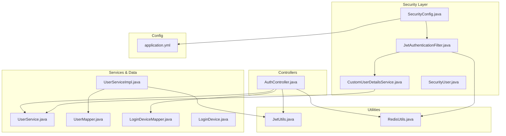
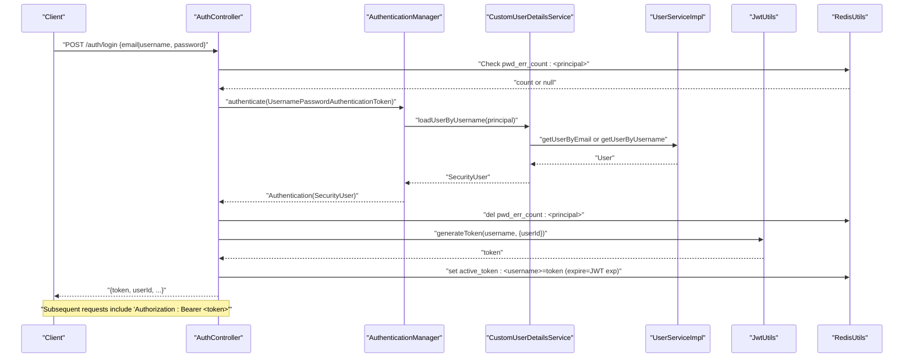
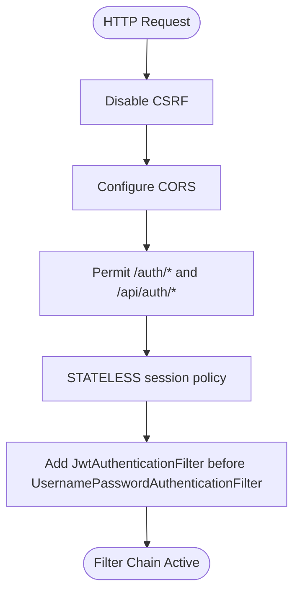
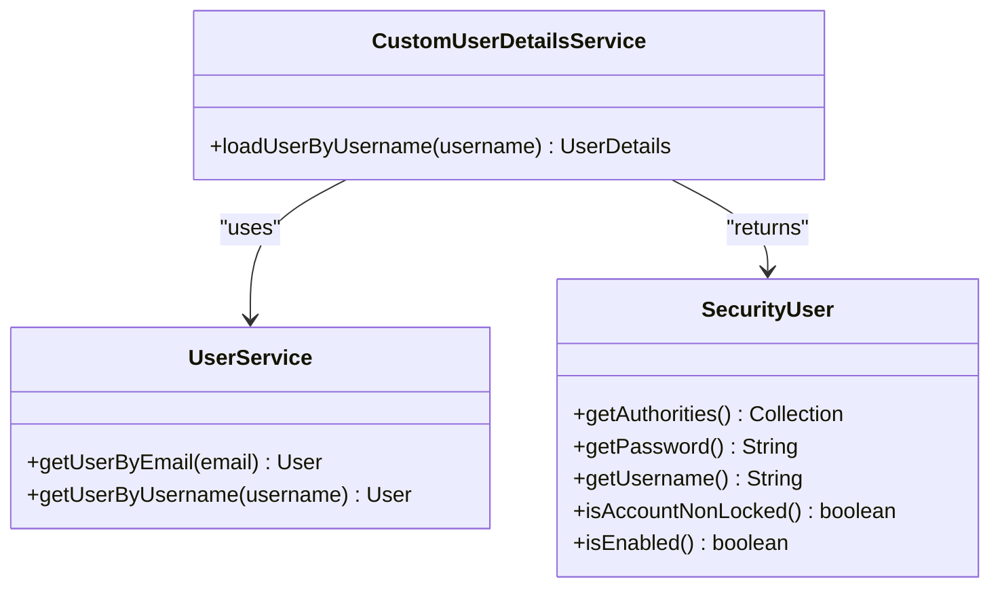
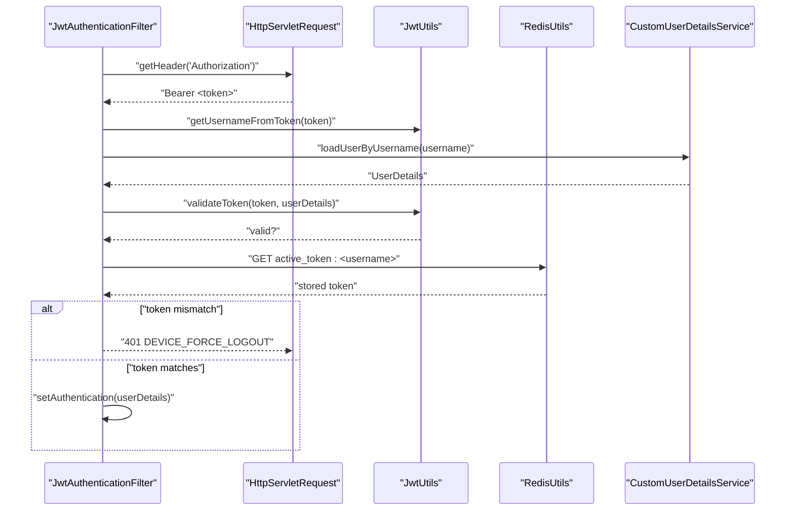
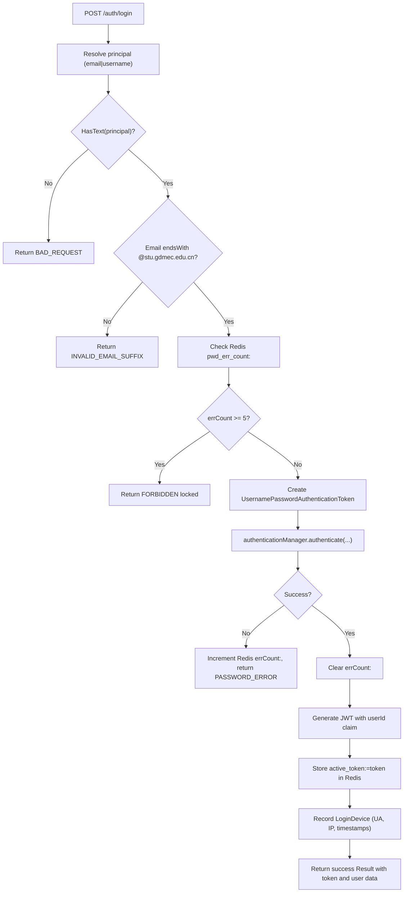
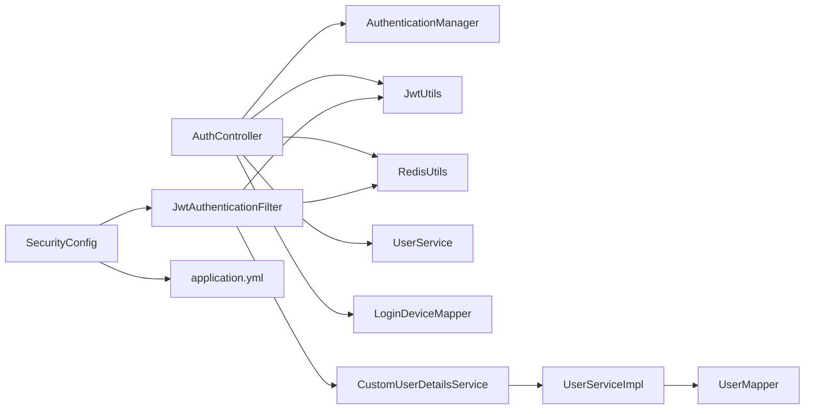

# Login Authentication System

<cite>
**Referenced Files in This Document**
- [SecurityConfig.java](file://camp-channel-server/src/main/java/com/gdmec/campchannel/config/SecurityConfig.java)
- [CustomUserDetailsService.java](file://camp-channel-server/src/main/java/com/gdmec/campchannel/security/CustomUserDetailsService.java)
- [SecurityUser.java](file://camp-channel-server/src/main/java/com/gdmec/campchannel/security/SecurityUser.java)
- [JwtAuthenticationFilter.java](file://camp-channel-server/src/main/java/com/gdmec/campchannel/security/JwtAuthenticationFilter.java)
- [AuthController.java](file://camp-channel-server/src/main/java/com/gdmec/campchannel/controller/AuthController.java)
- [JwtUtils.java](file://camp-channel-server/src/main/java/com/gdmec/campchannel/common/utils/JwtUtils.java)
- [RedisUtils.java](file://camp-channel-server/src/main/java/com/gdmec/campchannel/common/utils/RedisUtils.java)
- [UserService.java](file://camp-channel-server/src/main/java/com/gdmec/campchannel/service/UserService.java)
- [UserServiceImpl.java](file://camp-channel-server/src/main/java/com/gdmec/campchannel/service/impl/UserServiceImpl.java)
- [UserMapper.java](file://camp-channel-server/src/main/java/com/gdmec/campchannel/mapper/UserMapper.java)
- [LoginDevice.java](file://camp-channel-server/src/main/java/com/gdmec/campchannel/entity/LoginDevice.java)
- [LoginDeviceMapper.java](file://camp-channel-server/src/main/java/com/gdmec/campchannel/mapper/LoginDeviceMapper.java)
- [application.yml](file://camp-channel-server/src/main/resources/application.yml)
</cite>

## Table of Contents
1. [Introduction](#introduction)
2. [Project Structure](#project-structure)
3. [Core Components](#core-components)
4. [Architecture Overview](#architecture-overview)
5. [Detailed Component Analysis](#detailed-component-analysis)
6. [Dependency Analysis](#dependency-analysis)
7. [Performance Considerations](#performance-considerations)
8. [Troubleshooting Guide](#troubleshooting-guide)
9. [Conclusion](#conclusion)

## Introduction
This document explains the login authentication system built with Spring Security and JWT. It covers AuthenticationManager configuration, UsernamePasswordAuthenticationToken creation, custom user details service, dual credential support (email or username), institutional domain validation, password encoding, authentication success/failure handlers, session management, Redis-based account lockout, single-device login restriction with token replacement, and device/IP/User-Agent tracking. Concrete authentication flow, credential validation, and error handling scenarios are documented with references to the source files.

## Project Structure
The authentication system spans configuration, security filters, controllers, services, entities, and utilities. The server uses Spring MVC with Spring Security 6.x and JWT for stateless authentication.

**Diagram sources**
- [SecurityConfig.java:1-137](file://camp-channel-server/src/main/java/com/gdmec/campchannel/config/SecurityConfig.java#L1-L137)
- [JwtAuthenticationFilter.java:1-113](file://camp-channel-server/src/main/java/com/gdmec/campchannel/security/JwtAuthenticationFilter.java#L1-L113)
- [CustomUserDetailsService.java:1-47](file://camp-channel-server/src/main/java/com/gdmec/campchannel/security/CustomUserDetailsService.java#L1-L47)
- [SecurityUser.java:1-66](file://camp-channel-server/src/main/java/com/gdmec/campchannel/security/SecurityUser.java#L1-L66)
- [AuthController.java:1-247](file://camp-channel-server/src/main/java/com/gdmec/campchannel/controller/AuthController.java#L1-L247)
- [JwtUtils.java:1-85](file://camp-channel-server/src/main/java/com/gdmec/campchannel/common/utils/JwtUtils.java#L1-L85)
- [RedisUtils.java:1-170](file://camp-channel-server/src/main/java/com/gdmec/campchannel/common/utils/RedisUtils.java#L1-L170)
- [UserService.java:1-22](file://camp-channel-server/src/main/java/com/gdmec/campchannel/service/UserService.java#L1-L22)
- [UserServiceImpl.java:1-107](file://camp-channel-server/src/main/java/com/gdmec/campchannel/service/impl/UserServiceImpl.java#L1-L107)
- [UserMapper.java:1-9](file://camp-channel-server/src/main/java/com/gdmec/campchannel/mapper/UserMapper.java#L1-L9)
- [LoginDevice.java:1-27](file://camp-channel-server/src/main/java/com/gdmec/campchannel/entity/LoginDevice.java#L1-L27)
- [LoginDeviceMapper.java:1-10](file://camp-channel-server/src/main/java/com/gdmec/campchannel/mapper/LoginDeviceMapper.java#L1-L10)
- [application.yml:1-119](file://camp-channel-server/src/main/resources/application.yml#L1-L119)

**Section sources**
- [SecurityConfig.java:1-137](file://camp-channel-server/src/main/java/com/gdmec/campchannel/config/SecurityConfig.java#L1-L137)
- [AuthController.java:1-247](file://camp-channel-server/src/main/java/com/gdmec/campchannel/controller/AuthController.java#L1-L247)

## Core Components
- SecurityConfig: Defines stateless session policy, CORS, permit-all endpoints, and registers the JWT filter before the default form-based filter.
- JwtAuthenticationFilter: Extracts JWT from Authorization header, validates token, enforces single-device login by comparing against Redis active token, and injects Authentication into SecurityContext.
- CustomUserDetailsService: Loads user by email or username and wraps into SecurityUser.
- SecurityUser: Implements UserDetails with role authorities and account status checks.
- AuthController: Handles login with dual credential support, institutional domain validation, Redis-based lockout, token generation, and device tracking.
- JwtUtils: Encodes/decodes tokens and validates expiry and signature.
- RedisUtils: Provides Redis operations including counters and sliding window rate limiting.
- UserService/UserServiceImpl: User lookup and registration with password encoding.
- LoginDevice/LoginDeviceMapper: Tracks login devices with IP and User-Agent.

**Section sources**
- [SecurityConfig.java:34-105](file://camp-channel-server/src/main/java/com/gdmec/campchannel/config/SecurityConfig.java#L34-L105)
- [JwtAuthenticationFilter.java:29-113](file://camp-channel-server/src/main/java/com/gdmec/campchannel/security/JwtAuthenticationFilter.java#L29-L113)
- [CustomUserDetailsService.java:15-47](file://camp-channel-server/src/main/java/com/gdmec/campchannel/security/CustomUserDetailsService.java#L15-L47)
- [SecurityUser.java:15-66](file://camp-channel-server/src/main/java/com/gdmec/campchannel/security/SecurityUser.java#L15-L66)
- [AuthController.java:124-207](file://camp-channel-server/src/main/java/com/gdmec/campchannel/controller/AuthController.java#L124-L207)
- [JwtUtils.java:18-85](file://camp-channel-server/src/main/java/com/gdmec/campchannel/common/utils/JwtUtils.java#L18-L85)
- [RedisUtils.java:17-170](file://camp-channel-server/src/main/java/com/gdmec/campchannel/common/utils/RedisUtils.java#L17-L170)
- [UserService.java:6-22](file://camp-channel-server/src/main/java/com/gdmec/campchannel/service/UserService.java#L6-L22)
- [UserServiceImpl.java:25-107](file://camp-channel-server/src/main/java/com/gdmec/campchannel/service/impl/UserServiceImpl.java#L25-L107)
- [LoginDevice.java:10-27](file://camp-channel-server/src/main/java/com/gdmec/campchannel/entity/LoginDevice.java#L10-L27)
- [LoginDeviceMapper.java:1-10](file://camp-channel-server/src/main/java/com/gdmec/campchannel/mapper/LoginDeviceMapper.java#L1-L10)

## Architecture Overview
The system uses stateless JWT authentication:
- Clients send credentials to the login endpoint.
- The server validates institutional email suffix and checks Redis for lockout.
- On success, it generates a JWT and stores the active token in Redis for single-device enforcement.
- Subsequent requests include the JWT in the Authorization header.
- The filter extracts the token, validates it, ensures single-device login, and sets the Authentication in the SecurityContext.

**Diagram sources**
- [AuthController.java:124-207](file://camp-channel-server/src/main/java/com/gdmec/campchannel/controller/AuthController.java#L124-L207)
- [CustomUserDetailsService.java:22-45](file://camp-channel-server/src/main/java/com/gdmec/campchannel/security/CustomUserDetailsService.java#L22-L45)
- [UserServiceImpl.java:36-44](file://camp-channel-server/src/main/java/com/gdmec/campchannel/service/impl/UserServiceImpl.java#L36-L44)
- [JwtUtils.java:66-83](file://camp-channel-server/src/main/java/com/gdmec/campchannel/common/utils/JwtUtils.java#L66-L83)
- [RedisUtils.java:67-95](file://camp-channel-server/src/main/java/com/gdmec/campchannel/common/utils/RedisUtils.java#L67-L95)

## Detailed Component Analysis

### Security Configuration
- Stateless session management prevents server-side sessions.
- CORS allows cross-origin requests with credentials.
- Public endpoints include login, registration, and verification code endpoints.
- JWT filter is registered before the default form-based filter to intercept Authorization headers.
- Exception handling writes unified JSON responses for unauthorized and forbidden cases.

**Diagram sources**
- [SecurityConfig.java:53-105](file://camp-channel-server/src/main/java/com/gdmec/campchannel/config/SecurityConfig.java#L53-L105)

**Section sources**
- [SecurityConfig.java:34-137](file://camp-channel-server/src/main/java/com/gdmec/campchannel/config/SecurityConfig.java#L34-L137)

### Custom User Details Service
- Loads user by email first; falls back to username if email not found.
- Wraps the user into SecurityUser for Spring Security’s UserDetails contract.
- Throws UsernameNotFoundException if user not found.

**Diagram sources**
- [CustomUserDetailsService.java:17-45](file://camp-channel-server/src/main/java/com/gdmec/campchannel/security/CustomUserDetailsService.java#L17-L45)
- [UserService.java:6-22](file://camp-channel-server/src/main/java/com/gdmec/campchannel/service/UserService.java#L6-L22)
- [SecurityUser.java:17-66](file://camp-channel-server/src/main/java/com/gdmec/campchannel/security/SecurityUser.java#L17-L66)

**Section sources**
- [CustomUserDetailsService.java:15-47](file://camp-channel-server/src/main/java/com/gdmec/campchannel/security/CustomUserDetailsService.java#L15-L47)
- [SecurityUser.java:15-66](file://camp-channel-server/src/main/java/com/gdmec/campchannel/security/SecurityUser.java#L15-L66)

### JWT Authentication Filter
- Extracts Authorization header and validates token.
- Enforces single-device login by comparing current token with Redis stored active token.
- Builds UsernamePasswordAuthenticationToken and injects into SecurityContext for authenticated requests.

**Diagram sources**
- [JwtAuthenticationFilter.java:42-100](file://camp-channel-server/src/main/java/com/gdmec/campchannel/security/JwtAuthenticationFilter.java#L42-L100)
- [JwtUtils.java:40-83](file://camp-channel-server/src/main/java/com/gdmec/campchannel/common/utils/JwtUtils.java#L40-L83)
- [RedisUtils.java:67-73](file://camp-channel-server/src/main/java/com/gdmec/campchannel/common/utils/RedisUtils.java#L67-L73)
- [CustomUserDetailsService.java:22-45](file://camp-channel-server/src/main/java/com/gdmec/campchannel/security/CustomUserDetailsService.java#L22-L45)

**Section sources**
- [JwtAuthenticationFilter.java:29-113](file://camp-channel-server/src/main/java/com/gdmec/campchannel/security/JwtAuthenticationFilter.java#L29-L113)

### Authentication Controller (Login)
- Accepts either email or username; institutional domain validation enforced.
- Checks Redis for failed attempt count; locks out after threshold.
- Uses AuthenticationManager to authenticate credentials.
- On success: clears lockout counter, generates JWT, stores active token in Redis, records device info.
- Returns standardized Result payload with token and user info.

**Diagram sources**
- [AuthController.java:124-207](file://camp-channel-server/src/main/java/com/gdmec/campchannel/controller/AuthController.java#L124-L207)
- [RedisUtils.java:67-95](file://camp-channel-server/src/main/java/com/gdmec/campchannel/common/utils/RedisUtils.java#L67-L95)
- [JwtUtils.java:66-83](file://camp-channel-server/src/main/java/com/gdmec/campchannel/common/utils/JwtUtils.java#L66-L83)
- [LoginDevice.java:10-27](file://camp-channel-server/src/main/java/com/gdmec/campchannel/entity/LoginDevice.java#L10-L27)

**Section sources**
- [AuthController.java:124-207](file://camp-channel-server/src/main/java/com/gdmec/campchannel/controller/AuthController.java#L124-L207)

### Password Encoding and Validation
- PasswordEncoder bean configured as BCrypt.
- UserServiceImpl encodes passwords during registration.
- CustomUserDetailsService loads encoded passwords for comparison via Spring Security’s authentication manager.

**Section sources**
- [SecurityConfig.java:42-45](file://camp-channel-server/src/main/java/com/gdmec/campchannel/config/SecurityConfig.java#L42-L45)
- [UserServiceImpl.java:63](file://camp-channel-server/src/main/java/com/gdmec/campchannel/service/impl/UserServiceImpl.java#L63)
- [CustomUserDetailsService.java:22-45](file://camp-channel-server/src/main/java/com/gdmec/campchannel/security/CustomUserDetailsService.java#L22-L45)

### Account Lockout Mechanism (Redis-based)
- Failed attempts tracked under key pattern pwd_err_count:<principal>.
- On failure, increment counter with TTL of 1800 seconds (lockout duration).
- On success, delete the counter.
- If count reaches threshold, login is rejected with lockout message.

**Section sources**
- [AuthController.java:142-169](file://camp-channel-server/src/main/java/com/gdmec/campchannel/controller/AuthController.java#L142-L169)
- [RedisUtils.java:67-95](file://camp-channel-server/src/main/java/com/gdmec/campchannel/common/utils/RedisUtils.java#L67-L95)

### Single-Device Login Restriction
- After successful login, the server stores active_token:<username>=jwtToken in Redis with token expiration.
- On subsequent requests, the filter compares incoming token with stored token.
- If mismatch, the filter responds with device force logout error.

**Section sources**
- [AuthController.java:176-180](file://camp-channel-server/src/main/java/com/gdmec/campchannel/controller/AuthController.java#L176-L180)
- [JwtAuthenticationFilter.java:79-96](file://camp-channel-server/src/main/java/com/gdmec/campchannel/security/JwtAuthenticationFilter.java#L79-L96)
- [RedisUtils.java:67-95](file://camp-channel-server/src/main/java/com/gdmec/campchannel/common/utils/RedisUtils.java#L67-L95)

### Login Device Tracking, IP Logging, and User-Agent Detection
- On successful login, the system inserts a LoginDevice record with:
  - userId
  - deviceName (first 100 chars of User-Agent)
  - ipAddress (remote address)
  - loginTime and lastActiveTime

**Section sources**
- [AuthController.java:191-203](file://camp-channel-server/src/main/java/com/gdmec/campchannel/controller/AuthController.java#L191-L203)
- [LoginDevice.java:10-27](file://camp-channel-server/src/main/java/com/gdmec/campchannel/entity/LoginDevice.java#L10-L27)
- [LoginDeviceMapper.java:1-10](file://camp-channel-server/src/main/java/com/gdmec/campchannel/mapper/LoginDeviceMapper.java#L1-L10)

## Dependency Analysis
The authentication stack integrates tightly around Spring Security and JWT:
- AuthController depends on AuthenticationManager, JwtUtils, RedisUtils, UserService, and LoginDeviceMapper.
- JwtAuthenticationFilter depends on JwtUtils, RedisUtils, and CustomUserDetailsService.
- CustomUserDetailsService depends on UserService.
- UserServiceImpl depends on UserMapper and PasswordEncoder.
- JwtUtils and RedisUtils are utility beans injected across components.

**Diagram sources**
- [AuthController.java:43-60](file://camp-channel-server/src/main/java/com/gdmec/campchannel/controller/AuthController.java#L43-L60)
- [JwtAuthenticationFilter.java:33-41](file://camp-channel-server/src/main/java/com/gdmec/campchannel/security/JwtAuthenticationFilter.java#L33-L41)
- [CustomUserDetailsService.java:19-20](file://camp-channel-server/src/main/java/com/gdmec/campchannel/security/CustomUserDetailsService.java#L19-L20)
- [UserServiceImpl.java:27-34](file://camp-channel-server/src/main/java/com/gdmec/campchannel/service/impl/UserServiceImpl.java#L27-L34)
- [SecurityConfig.java:39-40](file://camp-channel-server/src/main/java/com/gdmec/campchannel/config/SecurityConfig.java#L39-L40)
- [application.yml:78-84](file://camp-channel-server/src/main/resources/application.yml#L78-L84)

**Section sources**
- [AuthController.java:1-247](file://camp-channel-server/src/main/java/com/gdmec/campchannel/controller/AuthController.java#L1-L247)
- [JwtAuthenticationFilter.java:1-113](file://camp-channel-server/src/main/java/com/gdmec/campchannel/security/JwtAuthenticationFilter.java#L1-L113)
- [CustomUserDetailsService.java:1-47](file://camp-channel-server/src/main/java/com/gdmec/campchannel/security/CustomUserDetailsService.java#L1-L47)
- [UserServiceImpl.java:1-107](file://camp-channel-server/src/main/java/com/gdmec/campchannel/service/impl/UserServiceImpl.java#L1-L107)
- [SecurityConfig.java:1-137](file://camp-channel-server/src/main/java/com/gdmec/campchannel/config/SecurityConfig.java#L1-L137)
- [application.yml:1-119](file://camp-channel-server/src/main/resources/application.yml#L1-L119)

## Performance Considerations
- Stateless JWT eliminates server-side session storage and improves scalability.
- Redis operations for lockout and active token are O(1) lookups and updates.
- BCrypt password hashing is CPU-intensive; avoid excessive concurrent login attempts.
- Consider rate-limiting middleware for login endpoints if needed.
- Ensure Redis persistence and network latency are acceptable for production.

## Troubleshooting Guide
- Unauthorized or expired token:
  - Verify Authorization header format and token validity.
  - Check JWT secret, expiration, and signing algorithm alignment.
  - Confirm single-device enforcement if receiving device force logout errors.
- Locked out due to repeated failures:
  - Wait for Redis TTL to expire or clear the pwd_err_count key manually.
  - Review lockout threshold and TTL configuration.
- Institutional domain validation failure:
  - Ensure email ends with the required suffix before login.
- CORS or preflight issues:
  - Confirm CORS configuration permits origin/method/header patterns.
- Session-related errors:
  - Stateless configuration is intentional; ensure clients store and send JWT properly.
- Redis connectivity:
  - Validate host/port/password/database settings and network access.
- Logging:
  - Enable debug logs for Spring Security and Redis to diagnose filter and authentication steps.

**Section sources**
- [SecurityConfig.java:91-100](file://camp-channel-server/src/main/java/com/gdmec/campchannel/config/SecurityConfig.java#L91-L100)
- [JwtUtils.java:35-83](file://camp-channel-server/src/main/java/com/gdmec/campchannel/common/utils/JwtUtils.java#L35-L83)
- [JwtAuthenticationFilter.java:61-70](file://camp-channel-server/src/main/java/com/gdmec/campchannel/security/JwtAuthenticationFilter.java#L61-L70)
- [application.yml:31-42](file://camp-channel-server/src/main/resources/application.yml#L31-L42)

## Conclusion
The authentication system combines Spring Security, JWT, and Redis to deliver secure, stateless, and robust login capabilities. Dual credential support, institutional domain validation, account lockout, and single-device enforcement are implemented cohesively. Device tracking and standardized error responses improve operational visibility and user experience.