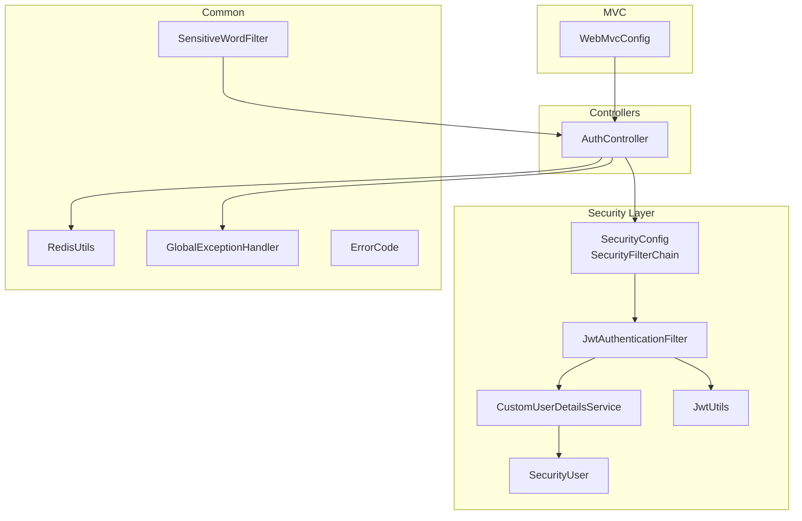
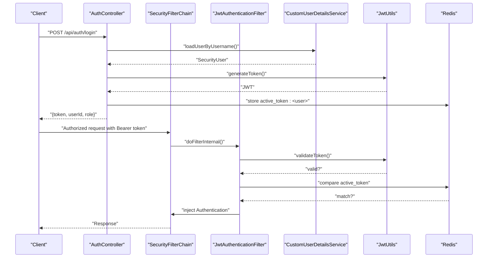
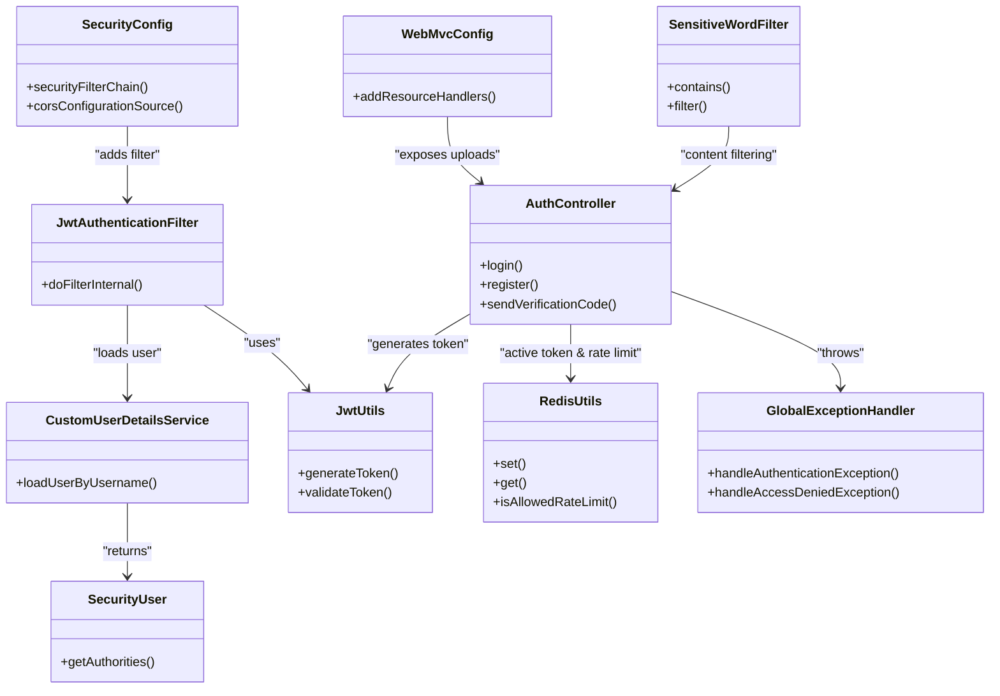

# Security Configuration and Best Practices

<cite>
**Referenced Files in This Document**
- [SecurityConfig.java](file://camp-channel-server/src/main/java/com/gdmec/campchannel/config/SecurityConfig.java)
- [JwtAuthenticationFilter.java](file://camp-channel-server/src/main/java/com/gdmec/campchannel/security/JwtAuthenticationFilter.java)
- [WebMvcConfig.java](file://camp-channel-server/src/main/java/com/gdmec/campchannel/config/WebMvcConfig.java)
- [SensitiveWordFilter.java](file://camp-channel-server/src/main/java/com/gdmec/campchannel/common/filter/SensitiveWordFilter.java)
- [CustomUserDetailsService.java](file://camp-channel-server/src/main/java/com/gdmec/campchannel/security/CustomUserDetailsService.java)
- [SecurityUser.java](file://camp-channel-server/src/main/java/com/gdmec/campchannel/security/SecurityUser.java)
- [JwtUtils.java](file://camp-channel-server/src/main/java/com/gdmec/campchannel/common/utils/JwtUtils.java)
- [AuthController.java](file://camp-channel-server/src/main/java/com/gdmec/campchannel/controller/AuthController.java)
- [application.yml](file://camp-channel-server/src/main/resources/application.yml)
- [GlobalExceptionHandler.java](file://camp-channel-server/src/main/java/com/gdmec/campchannel/common/exception/GlobalExceptionHandler.java)
- [ErrorCode.java](file://camp-channel-server/src/main/java/com/gdmec/campchannel/common/api/ErrorCode.java)
- [RedisUtils.java](file://camp-channel-server/src/main/java/com/gdmec/campchannel/common/utils/RedisUtils.java)
- [UserServiceImpl.java](file://camp-channel-server/src/main/java/com/gdmec/campchannel/service/impl/UserServiceImpl.java)
</cite>

## Table of Contents
1. [Introduction](#introduction)
2. [Project Structure](#project-structure)
3. [Core Components](#core-components)
4. [Architecture Overview](#architecture-overview)
5. [Detailed Component Analysis](#detailed-component-analysis)
6. [Dependency Analysis](#dependency-analysis)
7. [Performance Considerations](#performance-considerations)
8. [Troubleshooting Guide](#troubleshooting-guide)
9. [Conclusion](#conclusion)
10. [Appendices](#appendices)

## Introduction
This document explains the security configuration and best practices implemented in the Spring Boot backend. It covers CORS setup, CSRF protection, security header configuration, authentication and authorization via JWT, role-based access control, content negotiation for cross-origin requests, and defensive programming practices such as input validation and sensitive content filtering. It also provides guidance on HTTPS enforcement, certificate management, secure communication, integration with external services, audit logging, and security testing.

## Project Structure
Security-related components are primarily located under the config, security, controller, common, and service packages. The Spring Security configuration is centralized in a dedicated configuration class, with JWT-based authentication handled by a custom filter. Cross-origin support is configured via WebMvcConfig for static resources and via Spring Security’s CORS support for API endpoints. Sensitive content filtering is implemented as a DFA-based filter loaded at startup.

**Diagram sources**
- [SecurityConfig.java:52-105](file://camp-channel-server/src/main/java/com/gdmec/campchannel/config/SecurityConfig.java#L52-L105)
- [JwtAuthenticationFilter.java:42-100](file://camp-channel-server/src/main/java/com/gdmec/campchannel/security/JwtAuthenticationFilter.java#L42-L100)
- [CustomUserDetailsService.java:22-45](file://camp-channel-server/src/main/java/com/gdmec/campchannel/security/CustomUserDetailsService.java#L22-L45)
- [SecurityUser.java:27-34](file://camp-channel-server/src/main/java/com/gdmec/campchannel/security/SecurityUser.java#L27-L34)
- [JwtUtils.java:40-83](file://camp-channel-server/src/main/java/com/gdmec/campchannel/common/utils/JwtUtils.java#L40-L83)
- [AuthController.java:124-207](file://camp-channel-server/src/main/java/com/gdmec/campchannel/controller/AuthController.java#L124-L207)
- [WebMvcConfig.java:14-18](file://camp-channel-server/src/main/java/com/gdmec/campchannel/config/WebMvcConfig.java#L14-L18)
- [SensitiveWordFilter.java:40-64](file://camp-channel-server/src/main/java/com/gdmec/campchannel/common/filter/SensitiveWordFilter.java#L40-L64)
- [RedisUtils.java:142-168](file://camp-channel-server/src/main/java/com/gdmec/campchannel/common/utils/RedisUtils.java#L142-L168)
- [GlobalExceptionHandler.java:26-91](file://camp-channel-server/src/main/java/com/gdmec/campchannel/common/exception/GlobalExceptionHandler.java#L26-L91)

**Section sources**
- [SecurityConfig.java:34-137](file://camp-channel-server/src/main/java/com/gdmec/campchannel/config/SecurityConfig.java#L34-L137)
- [WebMvcConfig.java:8-19](file://camp-channel-server/src/main/java/com/gdmec/campchannel/config/WebMvcConfig.java#L8-L19)

## Core Components
- SecurityFilterChain: Centralizes CSRF, CORS, session management, endpoint authorization, and exception handling.
- JwtAuthenticationFilter: Extracts and validates JWT tokens, enforces single-device login, and injects authentication into Spring Security context.
- CustomUserDetailsService and SecurityUser: Load user details and define authorities with role-based prefixes.
- JwtUtils: Generates and validates JWT tokens using HMAC-SHA with configurable secret and expiration.
- AuthController: Handles login, registration, and verification code endpoints with rate limiting and device logging.
- WebMvcConfig: Exposes local file uploads as static resources for preview.
- SensitiveWordFilter: Loads a DFA dictionary and filters content during runtime.
- RedisUtils: Provides rate limiting and storage helpers used by authentication and filters.
- GlobalExceptionHandler: Normalizes security-related errors into unified API responses.

**Section sources**
- [SecurityConfig.java:52-137](file://camp-channel-server/src/main/java/com/gdmec/campchannel/config/SecurityConfig.java#L52-L137)
- [JwtAuthenticationFilter.java:42-113](file://camp-channel-server/src/main/java/com/gdmec/campchannel/security/JwtAuthenticationFilter.java#L42-L113)
- [CustomUserDetailsService.java:22-47](file://camp-channel-server/src/main/java/com/gdmec/campchannel/security/CustomUserDetailsService.java#L22-L47)
- [SecurityUser.java:27-66](file://camp-channel-server/src/main/java/com/gdmec/campchannel/security/SecurityUser.java#L27-L66)
- [JwtUtils.java:35-83](file://camp-channel-server/src/main/java/com/gdmec/campchannel/common/utils/JwtUtils.java#L35-L83)
- [AuthController.java:124-207](file://camp-channel-server/src/main/java/com/gdmec/campchannel/controller/AuthController.java#L124-L207)
- [WebMvcConfig.java:14-19](file://camp-channel-server/src/main/java/com/gdmec/campchannel/config/WebMvcConfig.java#L14-L19)
- [SensitiveWordFilter.java:40-166](file://camp-channel-server/src/main/java/com/gdmec/campchannel/common/filter/SensitiveWordFilter.java#L40-L166)
- [RedisUtils.java:142-170](file://camp-channel-server/src/main/java/com/gdmec/campchannel/common/utils/RedisUtils.java#L142-L170)
- [GlobalExceptionHandler.java:26-123](file://camp-channel-server/src/main/java/com/gdmec/campchannel/common/exception/GlobalExceptionHandler.java#L26-L123)

## Architecture Overview
The authentication flow is stateless using JWT. On successful login, a signed token is returned and must be attached to subsequent requests. The filter extracts the token, validates it, checks single-device constraints, and sets the authentication context. Authorization is enforced per endpoint and method-level annotations. CORS is configured centrally for APIs and static resources.

**Diagram sources**
- [AuthController.java:124-207](file://camp-channel-server/src/main/java/com/gdmec/campchannel/controller/AuthController.java#L124-L207)
- [SecurityConfig.java:52-105](file://camp-channel-server/src/main/java/com/gdmec/campchannel/config/SecurityConfig.java#L52-L105)
- [JwtAuthenticationFilter.java:42-100](file://camp-channel-server/src/main/java/com/gdmec/campchannel/security/JwtAuthenticationFilter.java#L42-L100)
- [CustomUserDetailsService.java:22-45](file://camp-channel-server/src/main/java/com/gdmec/campchannel/security/CustomUserDetailsService.java#L22-L45)
- [JwtUtils.java:66-83](file://camp-channel-server/src/main/java/com/gdmec/campchannel/common/utils/JwtUtils.java#L66-L83)
- [RedisUtils.java:17-95](file://camp-channel-server/src/main/java/com/gdmec/campchannel/common/utils/RedisUtils.java#L17-L95)

## Detailed Component Analysis

### Spring Security Configuration (SecurityFilterChain)
- CSRF disabled: The application uses stateless JWT; CSRF protection is intentionally disabled.
- CORS enabled: A configuration source allows credentials and defines allowed origins, methods, and headers.
- Endpoint authorization:
  - OPTIONS preflight requests permitted globally.
  - Public endpoints for authentication and Swagger UI permitted.
  - WebSocket endpoints permitted.
  - Static uploads permitted.
  - All other requests require authentication.
- Session management: Stateless sessions.
- Exception handling: Unified JSON responses for unauthorized and forbidden scenarios.

Best practices:
- In production, restrict allowed origins to specific domains and remove wildcard patterns.
- Consider enabling CSRF for stateful sessions or form-based flows; here it is disabled for JWT.

**Section sources**
- [SecurityConfig.java:52-137](file://camp-channel-server/src/main/java/com/gdmec/campchannel/config/SecurityConfig.java#L52-L137)

### JWT Authentication Filter
- Skips filtering for OPTIONS requests.
- Extracts token from configured header and validates it.
- Enforces single-device login by comparing the incoming token with the active token stored in Redis.
- Injects Authentication into SecurityContext for downstream authorization.

Security considerations:
- Token mismatch triggers immediate logout-like behavior.
- Ensure Redis connectivity and key TTL align with JWT expiration.

**Section sources**
- [JwtAuthenticationFilter.java:42-100](file://camp-channel-server/src/main/java/com/gdmec/campchannel/security/JwtAuthenticationFilter.java#L42-L100)
- [RedisUtils.java:17-95](file://camp-channel-server/src/main/java/com/gdmec/campchannel/common/utils/RedisUtils.java#L17-L95)

### Authentication and Authorization Controllers
- AuthController:
  - Validates email suffix policy.
  - Implements rate limiting for verification code sending.
  - Uses AuthenticationManager to authenticate credentials.
  - Generates JWT with user ID claim and stores active token in Redis.
  - Records login device metadata.

- Role-based access control:
  - Authorities are derived from user roles with a standardized prefix.
  - Method-level security is enabled in the configuration.

Recommendations:
- Apply method-level annotations on services/controllers for fine-grained permissions.
- Enforce role checks for administrative endpoints.

**Section sources**
- [AuthController.java:124-207](file://camp-channel-server/src/main/java/com/gdmec/campchannel/controller/AuthController.java#L124-L207)
- [SecurityUser.java:27-34](file://camp-channel-server/src/main/java/com/gdmec/campchannel/security/SecurityUser.java#L27-L34)
- [SecurityConfig.java:36-37](file://camp-channel-server/src/main/java/com/gdmec/campchannel/config/SecurityConfig.java#L36-L37)

### WebMvcConfig Integration for CORS and Content Negotiation
- Adds a resource handler for local uploads to serve static files.
- CORS is configured in SecurityConfig for API endpoints; WebMvcConfig ensures static assets are accessible.

Guidance:
- Keep CORS strict in production; avoid wildcards for allowed origins.
- Ensure upload path exists and is secured outside of this handler.

**Section sources**
- [WebMvcConfig.java:14-19](file://camp-channel-server/src/main/java/com/gdmec/campchannel/config/WebMvcConfig.java#L14-L19)
- [SecurityConfig.java:110-124](file://camp-channel-server/src/main/java/com/gdmec/campchannel/config/SecurityConfig.java#L110-L124)

### Security Headers Implementation
Current implementation:
- No explicit HTTP security headers (e.g., HSTS, X-Frame-Options, Content-Security-Policy) are configured in the provided files.

Recommendations:
- Add security headers at the reverse proxy or gateway level (e.g., Nginx, Traefik, Spring Cloud Gateway).
- Alternatively, configure a filter to set headers globally if a proxy is not used.
- Example headers to consider:
  - Strict-Transport-Security: enforce HTTPS.
  - X-Frame-Options: prevent clickjacking.
  - Content-Security-Policy: restrict script sources and frame ancestors.
  - Referrer-Policy: limit referrer leakage.

Note: Implementing headers requires environment-specific deployment controls and should be validated with security scans.

[No sources needed since this section provides general guidance]

### Input Validation and Output Encoding
- Input validation:
  - AuthController validates presence of required fields and enforces email domain policy.
  - JSR-303 validation is handled centrally by the global exception handler.
- Output encoding:
  - Not explicitly implemented in the provided files. Consider encoding dynamic content for HTML contexts and sanitizing user-generated content.

Recommendations:
- Sanitize and escape user-generated content in views/templates.
- Use libraries for HTML/JS sanitization where rendering dynamic content is required.

**Section sources**
- [AuthController.java:124-140](file://camp-channel-server/src/main/java/com/gdmec/campchannel/controller/AuthController.java#L124-L140)
- [GlobalExceptionHandler.java:37-71](file://camp-channel-server/src/main/java/com/gdmec/campchannel/common/exception/GlobalExceptionHandler.java#L37-L71)

### Protection Against Common Vulnerabilities
- XSS:
  - No explicit output encoding in controllers; sanitize and encode outputs.
- CSRF:
  - CSRF disabled because JWT is stateless; keep disabled for SPA/API usage.
- SQL Injection:
  - Uses MyBatis-Plus with parameterized queries; avoid raw SQL concatenation.

Recommendations:
- Audit all SQL builders and avoid dynamic SQL construction.
- Use least privilege for database accounts and encrypt secrets.

**Section sources**
- [UserServiceImpl.java:47-105](file://camp-channel-server/src/main/java/com/gdmec/campchannel/service/impl/UserServiceImpl.java#L47-L105)

### HTTPS Enforcement, Certificate Management, and Secure Communication
- Current configuration does not enforce HTTPS at the application level.
- Recommendations:
  - Terminate TLS at a reverse proxy or load balancer and redirect HTTP to HTTPS.
  - Configure strong cipher suites and TLS versions at the proxy.
  - Manage certificates via automated tools (e.g., ACME) and rotate secrets regularly.

[No sources needed since this section provides general guidance]

### Integration with External Services and Audit Logging
- Email service integration:
  - SMTP settings are configured in application properties.
  - Asynchronous email sending is enabled via a thread pool.
- Audit logging:
  - GlobalExceptionHandler centralizes error responses.
  - AuthController logs login attempts and device info.

Recommendations:
- Log authentication events with risk scoring.
- Integrate structured audit logs to SIEM systems.

**Section sources**
- [application.yml:49-67](file://camp-channel-server/src/main/resources/application.yml#L49-L67)
- [AsyncConfig.java:17-29](file://camp-channel-server/src/main/java/com/gdmec/campchannel/config/AsyncConfig.java#L17-L29)
- [GlobalExceptionHandler.java:26-123](file://camp-channel-server/src/main/java/com/gdmec/campchannel/common/exception/GlobalExceptionHandler.java#L26-L123)
- [AuthController.java:191-203](file://camp-channel-server/src/main/java/com/gdmec/campchannel/controller/AuthController.java#L191-L203)

### Security Testing, Vulnerability Assessment, and Compliance
- Recommended activities:
  - Static analysis: OWASP Dependency-Check, spotbugs, SonarQube.
  - Dynamic testing: OWASP ZAP, Burp Suite for authenticated flows.
  - Secrets scanning: Detect exposed secrets in code and configuration.
  - Penetration testing: Authorized third-party assessments.
- Compliance:
  - Align configurations with organizational policies (e.g., PCI DSS, GDPR).
  - Maintain audit trails for authentication and sensitive operations.

[No sources needed since this section provides general guidance]

## Dependency Analysis

**Diagram sources**
- [SecurityConfig.java:52-124](file://camp-channel-server/src/main/java/com/gdmec/campchannel/config/SecurityConfig.java#L52-L124)
- [JwtAuthenticationFilter.java:42-100](file://camp-channel-server/src/main/java/com/gdmec/campchannel/security/JwtAuthenticationFilter.java#L42-L100)
- [CustomUserDetailsService.java:22-45](file://camp-channel-server/src/main/java/com/gdmec/campchannel/security/CustomUserDetailsService.java#L22-L45)
- [SecurityUser.java:27-34](file://camp-channel-server/src/main/java/com/gdmec/campchannel/security/SecurityUser.java#L27-L34)
- [JwtUtils.java:66-83](file://camp-channel-server/src/main/java/com/gdmec/campchannel/common/utils/JwtUtils.java#L66-L83)
- [AuthController.java:124-207](file://camp-channel-server/src/main/java/com/gdmec/campchannel/controller/AuthController.java#L124-L207)
- [RedisUtils.java:142-170](file://camp-channel-server/src/main/java/com/gdmec/campchannel/common/utils/RedisUtils.java#L142-L170)
- [WebMvcConfig.java:14-19](file://camp-channel-server/src/main/java/com/gdmec/campchannel/config/WebMvcConfig.java#L14-L19)
- [SensitiveWordFilter.java:94-127](file://camp-channel-server/src/main/java/com/gdmec/campchannel/common/filter/SensitiveWordFilter.java#L94-L127)
- [GlobalExceptionHandler.java:73-91](file://camp-channel-server/src/main/java/com/gdmec/campchannel/common/exception/GlobalExceptionHandler.java#L73-L91)

**Section sources**
- [SecurityConfig.java:52-137](file://camp-channel-server/src/main/java/com/gdmec/campchannel/config/SecurityConfig.java#L52-L137)
- [JwtAuthenticationFilter.java:42-113](file://camp-channel-server/src/main/java/com/gdmec/campchannel/security/JwtAuthenticationFilter.java#L42-L113)
- [AuthController.java:124-207](file://camp-channel-server/src/main/java/com/gdmec/campchannel/controller/AuthController.java#L124-L207)

## Performance Considerations
- JWT validation occurs per request; caching decoded claims is unnecessary due to stateless design.
- Redis operations for active token and rate limiting add latency; tune connection pools and timeouts.
- CORS preflight caching reduces overhead; ensure appropriate Access-Control-Max-Age.
- Consider lazy initialization of sensitive word filter and warm up DFA structures at startup.

[No sources needed since this section provides general guidance]

## Troubleshooting Guide
Common issues and resolutions:
- Unauthorized responses:
  - Verify token presence and format in the configured header.
  - Confirm token expiration and signature validity.
  - Check Redis connectivity for active token validation.
- Forbidden responses:
  - Ensure user roles and authorities are correctly mapped.
  - Review method-level security annotations and endpoint permissions.
- CORS failures:
  - Confirm allowed origins, methods, and headers.
  - Ensure credentials are allowed only when necessary.
- Rate limiting and verification code:
  - Validate Redis keys and TTL values.
  - Check rate-limiting thresholds and window sizes.
- Global error handling:
  - Review unified error responses and log levels.

**Section sources**
- [JwtAuthenticationFilter.java:61-96](file://camp-channel-server/src/main/java/com/gdmec/campchannel/security/JwtAuthenticationFilter.java#L61-L96)
- [SecurityConfig.java:91-100](file://camp-channel-server/src/main/java/com/gdmec/campchannel/config/SecurityConfig.java#L91-L100)
- [GlobalExceptionHandler.java:73-91](file://camp-channel-server/src/main/java/com/gdmec/campchannel/common/exception/GlobalExceptionHandler.java#L73-L91)
- [RedisUtils.java:142-170](file://camp-channel-server/src/main/java/com/gdmec/campchannel/common/utils/RedisUtils.java#L142-L170)

## Conclusion
The backend implements a robust, stateless JWT-based authentication system with centralized authorization and CORS configuration. Security is enforced at the filter chain level, with method-level security enabled. Additional hardening—such as explicit security headers, output encoding, and strict HTTPS—should be applied at the deployment boundary. Operational improvements include stricter CORS, rate limiting, and comprehensive audit logging.

[No sources needed since this section summarizes without analyzing specific files]

## Appendices

### CORS Configuration Reference
- Allowed origins: Wildcard for development; replace with specific origins in production.
- Methods and headers: Allowlisted for flexibility.
- Credentials: Enabled; ensure trusted origins only.

**Section sources**
- [SecurityConfig.java:110-124](file://camp-channel-server/src/main/java/com/gdmec/campchannel/config/SecurityConfig.java#L110-L124)

### JWT Configuration Reference
- Secret and expiration: Configurable via application properties.
- Header name and token prefix: Configurable via application properties.

**Section sources**
- [application.yml:78-84](file://camp-channel-server/src/main/resources/application.yml#L78-L84)
- [JwtUtils.java:20-33](file://camp-channel-server/src/main/java/com/gdmec/campchannel/common/utils/JwtUtils.java#L20-L33)

### Error Codes Reference
- Standardized error codes for security and business scenarios.

**Section sources**
- [ErrorCode.java:9-60](file://camp-channel-server/src/main/java/com/gdmec/campchannel/common/api/ErrorCode.java#L9-L60)