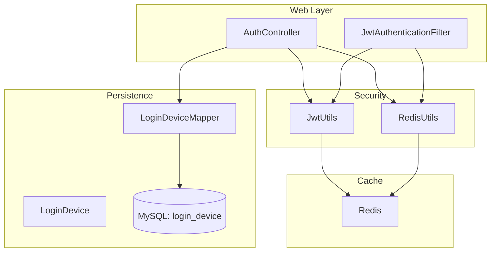
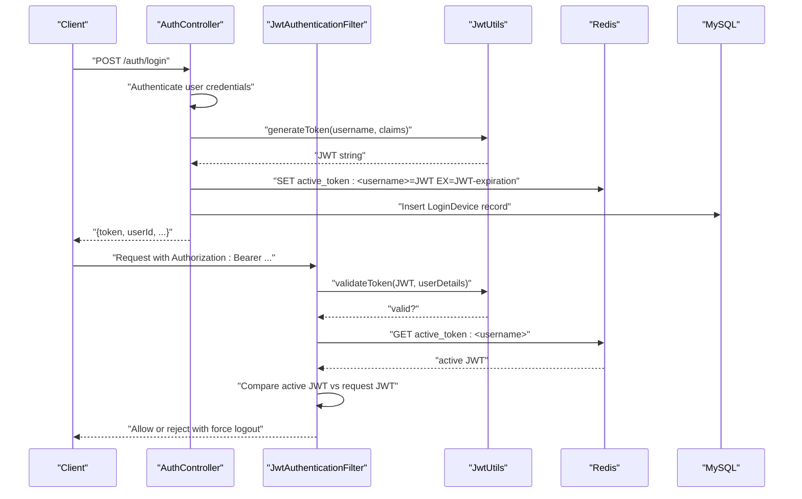
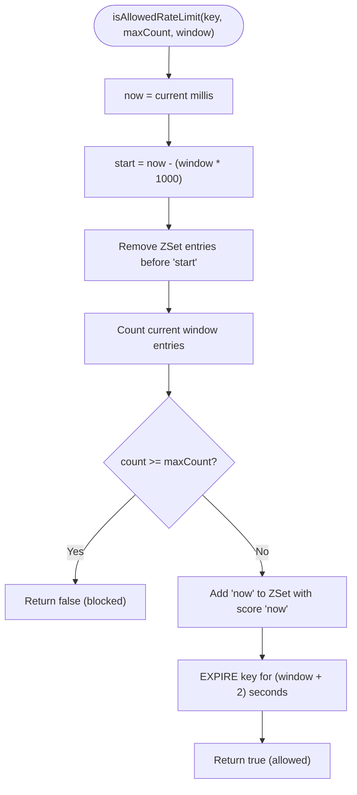
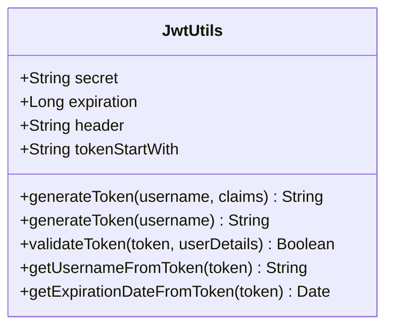
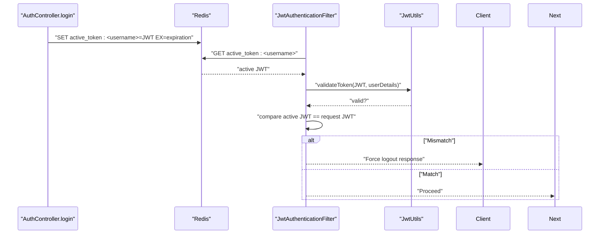
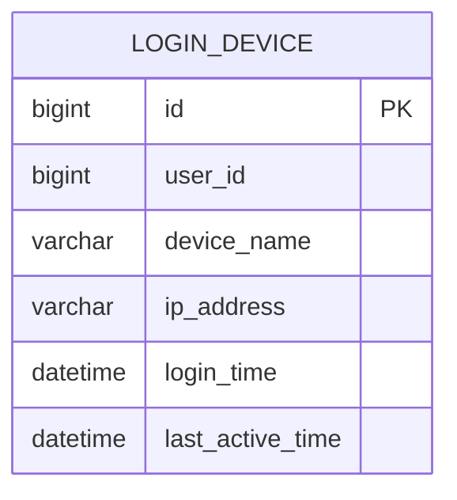
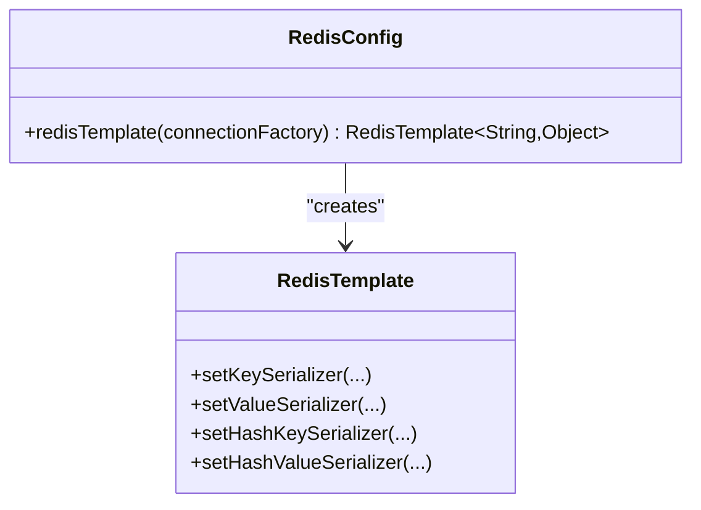
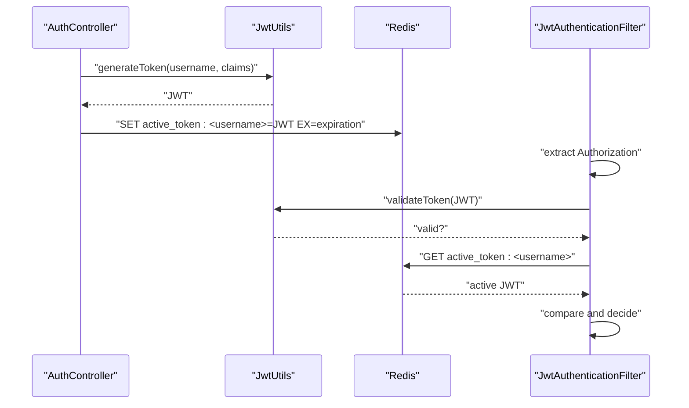
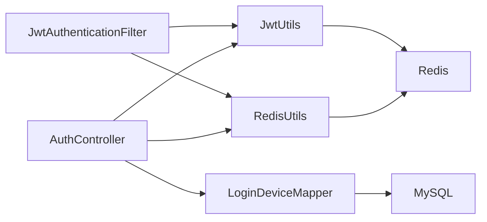

# Session Management with Redis

<cite>
**Referenced Files in This Document**
- [RedisUtils.java](file://camp-channel-server/src/main/java/com/gdmec/campchannel/common/utils/RedisUtils.java)
- [JwtUtils.java](file://camp-channel-server/src/main/java/com/gdmec/campchannel/common/utils/JwtUtils.java)
- [RedisConfig.java](file://camp-channel-server/src/main/java/com/gdmec/campchannel/config/RedisConfig.java)
- [AuthController.java](file://camp-channel-server/src/main/java/com/gdmec/campchannel/controller/AuthController.java)
- [JwtAuthenticationFilter.java](file://camp-channel-server/src/main/java/com/gdmec/campchannel/security/JwtAuthenticationFilter.java)
- [LoginDevice.java](file://camp-channel-server/src/main/java/com/gdmec/campchannel/entity/LoginDevice.java)
- [LoginDeviceMapper.java](file://camp-channel-server/src/main/java/com/gdmec/campchannel/mapper/LoginDeviceMapper.java)
- [application.yml](file://camp-channel-server/src/main/resources/application.yml)
- [schema.sql](file://camp-channel-server/src/main/resources/db/schema.sql)
</cite>

## Table of Contents
1. [Introduction](#introduction)
2. [Project Structure](#project-structure)
3. [Core Components](#core-components)
4. [Architecture Overview](#architecture-overview)
5. [Detailed Component Analysis](#detailed-component-analysis)
6. [Dependency Analysis](#dependency-analysis)
7. [Performance Considerations](#performance-considerations)
8. [Troubleshooting Guide](#troubleshooting-guide)
9. [Conclusion](#conclusion)
10. [Appendices](#appendices)

## Introduction
This document explains the Redis-based session management implementation used by the backend server. It covers token storage and validation via Redis, user session tracking, rate limiting, and single-device login enforcement. It also documents Redis key naming conventions, the LoginDevice entity and mapper, Redis configuration, integration with JWT, performance considerations, and troubleshooting guidance.

## Project Structure
The session management spans several modules:
- Redis utilities for generic operations and sliding-window rate limiting
- JWT utilities for token generation and validation
- Spring Security filter for per-request token validation and single-device enforcement
- Auth controller for login, registration, verification code sending, and active token updates
- LoginDevice entity and mapper for persisting device and IP metadata
- Application configuration for Redis connection and pooling
- Database schema for login_device table

**Diagram sources**
- [AuthController.java:124-207](file://camp-channel-server/src/main/java/com/gdmec/campchannel/controller/AuthController.java#L124-L207)
- [JwtAuthenticationFilter.java:42-99](file://camp-channel-server/src/main/java/com/gdmec/campchannel/security/JwtAuthenticationFilter.java#L42-L99)
- [JwtUtils.java:17-84](file://camp-channel-server/src/main/java/com/gdmec/campchannel/common/utils/JwtUtils.java#L17-L84)
- [RedisUtils.java:16-168](file://camp-channel-server/src/main/java/com/gdmec/campchannel/common/utils/RedisUtils.java#L16-L168)
- [LoginDevice.java:12-26](file://camp-channel-server/src/main/java/com/gdmec/campchannel/entity/LoginDevice.java#L12-L26)
- [LoginDeviceMapper.java:7-9](file://camp-channel-server/src/main/java/com/gdmec/campchannel/mapper/LoginDeviceMapper.java#L7-L9)
- [schema.sql:163-172](file://camp-channel-server/src/main/resources/db/schema.sql#L163-L172)

**Section sources**
- [AuthController.java:124-207](file://camp-channel-server/src/main/java/com/gdmec/campchannel/controller/AuthController.java#L124-L207)
- [JwtAuthenticationFilter.java:42-99](file://camp-channel-server/src/main/java/com/gdmec/campchannel/security/JwtAuthenticationFilter.java#L42-L99)
- [JwtUtils.java:17-84](file://camp-channel-server/src/main/java/com/gdmec/campchannel/common/utils/JwtUtils.java#L17-L84)
- [RedisUtils.java:16-168](file://camp-channel-server/src/main/java/com/gdmec/campchannel/common/utils/RedisUtils.java#L16-L168)
- [LoginDevice.java:12-26](file://camp-channel-server/src/main/java/com/gdmec/campchannel/entity/LoginDevice.java#L12-L26)
- [LoginDeviceMapper.java:7-9](file://camp-channel-server/src/main/java/com/gdmec/campchannel/mapper/LoginDeviceMapper.java#L7-L9)
- [application.yml:31-42](file://camp-channel-server/src/main/resources/application.yml#L31-L42)
- [schema.sql:163-172](file://camp-channel-server/src/main/resources/db/schema.sql#L163-L172)

## Core Components
- RedisUtils: Provides generic Redis operations (get/set/del/expire), hash operations, and a sliding-window rate limiter. Used for storing active tokens, verification codes, and password error counts.
- JwtUtils: Generates and validates JWT tokens, reads configuration such as secret, expiration, header name, and token prefix.
- JwtAuthenticationFilter: Extracts JWT from the Authorization header, validates signature and expiration, and enforces single-device login by comparing the request token against the active token stored in Redis.
- AuthController: Implements login, registration, and verification code endpoints. On successful login, stores the latest token under active_token:<username> with TTL matching JWT expiration. Also records device info via LoginDevice.
- LoginDevice entity and mapper: Persist device name, IP address, login time, and last active time for audit and device tracking.
- RedisConfig: Configures RedisTemplate with String key serializer and JSON value serializer for Object values.
- application.yml: Defines Redis host/port/password/database/timeout and Lettuce connection pool settings.

**Section sources**
- [RedisUtils.java:16-168](file://camp-channel-server/src/main/java/com/gdmec/campchannel/common/utils/RedisUtils.java#L16-L168)
- [JwtUtils.java:17-84](file://camp-channel-server/src/main/java/com/gdmec/campchannel/common/utils/JwtUtils.java#L17-L84)
- [JwtAuthenticationFilter.java:42-99](file://camp-channel-server/src/main/java/com/gdmec/campchannel/security/JwtAuthenticationFilter.java#L42-L99)
- [AuthController.java:124-207](file://camp-channel-server/src/main/java/com/gdmec/campchannel/controller/AuthController.java#L124-L207)
- [LoginDevice.java:12-26](file://camp-channel-server/src/main/java/com/gdmec/campchannel/entity/LoginDevice.java#L12-L26)
- [LoginDeviceMapper.java:7-9](file://camp-channel-server/src/main/java/com/gdmec/campchannel/mapper/LoginDeviceMapper.java#L7-L9)
- [RedisConfig.java:17-46](file://camp-channel-server/src/main/java/com/gdmec/campchannel/config/RedisConfig.java#L17-L46)
- [application.yml:31-42](file://camp-channel-server/src/main/resources/application.yml#L31-L42)

## Architecture Overview
The session lifecycle integrates JWT and Redis:
- On login, a JWT is generated and stored in Redis under active_token:<username> with TTL equal to JWT expiration.
- Subsequent requests carry the JWT in the Authorization header; the filter validates the token and checks that it matches the active token in Redis.
- Registration uses Redis to store verification codes and enforce rate limits.
- Password error attempts are tracked in Redis to temporarily lock accounts.

**Diagram sources**
- [AuthController.java:171-190](file://camp-channel-server/src/main/java/com/gdmec/campchannel/controller/AuthController.java#L171-L190)
- [JwtAuthenticationFilter.java:76-96](file://camp-channel-server/src/main/java/com/gdmec/campchannel/security/JwtAuthenticationFilter.java#L76-L96)
- [JwtUtils.java:66-83](file://camp-channel-server/src/main/java/com/gdmec/campchannel/common/utils/JwtUtils.java#L66-L83)
- [RedisUtils.java:75-95](file://camp-channel-server/src/main/java/com/gdmec/campchannel/common/utils/RedisUtils.java#L75-L95)
- [LoginDevice.java:19-25](file://camp-channel-server/src/main/java/com/gdmec/campchannel/entity/LoginDevice.java#L19-L25)

## Detailed Component Analysis

### RedisUtils: Token Storage, Rate Limiting, and Common Operations
- Generic operations: get, set, set with expiry, increment, delete, hasKey, expire, getExpire.
- Hash operations: hget, hmget, hmset.
- Sliding window rate limiter: isAllowedRateLimit(key, maxCount, windowSeconds) removes expired entries from a ZSet, counts current requests, adds the current timestamp, and sets an expiry slightly longer than the window to prevent cold data accumulation.

**Diagram sources**
- [RedisUtils.java:142-168](file://camp-channel-server/src/main/java/com/gdmec/campchannel/common/utils/RedisUtils.java#L142-L168)

**Section sources**
- [RedisUtils.java:24-41](file://camp-channel-server/src/main/java/com/gdmec/campchannel/common/utils/RedisUtils.java#L24-L41)
- [RedisUtils.java:75-95](file://camp-channel-server/src/main/java/com/gdmec/campchannel/common/utils/RedisUtils.java#L75-L95)
- [RedisUtils.java:107-130](file://camp-channel-server/src/main/java/com/gdmec/campchannel/common/utils/RedisUtils.java#L107-L130)
- [RedisUtils.java:142-168](file://camp-channel-server/src/main/java/com/gdmec/campchannel/common/utils/RedisUtils.java#L142-L168)

### JwtUtils: JWT Generation and Validation
- Reads configuration for secret, expiration (seconds), header name, and token prefix.
- Generates signed JWT with HS512 and sets issued/expiry times.
- Validates token by extracting subject and checking expiration against user details.

**Diagram sources**
- [JwtUtils.java:17-84](file://camp-channel-server/src/main/java/com/gdmec/campchannel/common/utils/JwtUtils.java#L17-L84)

**Section sources**
- [JwtUtils.java:20-33](file://camp-channel-server/src/main/java/com/gdmec/campchannel/common/utils/JwtUtils.java#L20-L33)
- [JwtUtils.java:66-83](file://camp-channel-server/src/main/java/com/gdmec/campchannel/common/utils/JwtUtils.java#L66-L83)

### Single-Device Login Enforcement with Redis
- On successful login, the AuthController writes the new JWT to Redis under active_token:<username> with TTL equal to JWT expiration.
- The JwtAuthenticationFilter retrieves the active token from Redis and compares it to the incoming token. If mismatched, the user is forced to log out.

**Diagram sources**
- [AuthController.java:176-180](file://camp-channel-server/src/main/java/com/gdmec/campchannel/controller/AuthController.java#L176-L180)
- [JwtAuthenticationFilter.java:79-96](file://camp-channel-server/src/main/java/com/gdmec/campchannel/security/JwtAuthenticationFilter.java#L79-L96)
- [JwtUtils.java:80-83](file://camp-channel-server/src/main/java/com/gdmec/campchannel/common/utils/JwtUtils.java#L80-L83)

**Section sources**
- [AuthController.java:176-180](file://camp-channel-server/src/main/java/com/gdmec/campchannel/controller/AuthController.java#L176-L180)
- [JwtAuthenticationFilter.java:79-96](file://camp-channel-server/src/main/java/com/gdmec/campchannel/security/JwtAuthenticationFilter.java#L79-L96)

### Session Storage Strategy and Key Naming Conventions
- active_token:<username>: Stores the latest JWT for a user. TTL equals JWT expiration. Used for single-device enforcement.
- verify_code:<email>: Stores the 6-digit verification code for registration with a short TTL.
- verify_code_rate:<email>: Enforces cooldown between verification code sends.
- pwd_err_count:<principal>: Tracks consecutive failed login attempts per user/email with a TTL to lock the account temporarily.

Examples of operations:
- Set active token: [AuthController.java:178-179](file://camp-channel-server/src/main/java/com/gdmec/campchannel/controller/AuthController.java#L178-L179)
- Get active token: [JwtAuthenticationFilter.java:81-82](file://camp-channel-server/src/main/java/com/gdmec/campchannel/security/JwtAuthenticationFilter.java#L81-L82)
- Store verification code: [AuthController.java:82-85](file://camp-channel-server/src/main/java/com/gdmec/campchannel/controller/AuthController.java#L82-L85)
- Check rate limit key: [AuthController.java:75-78](file://camp-channel-server/src/main/java/com/gdmec/campchannel/controller/AuthController.java#L75-L78)
- Track password errors: [AuthController.java:143-147](file://camp-channel-server/src/main/java/com/gdmec/campchannel/controller/AuthController.java#L143-L147), [AuthController.java:162-166](file://camp-channel-server/src/main/java/com/gdmec/campchannel/controller/AuthController.java#L162-L166)

**Section sources**
- [AuthController.java:75-91](file://camp-channel-server/src/main/java/com/gdmec/campchannel/controller/AuthController.java#L75-L91)
- [AuthController.java:142-169](file://camp-channel-server/src/main/java/com/gdmec/campchannel/controller/AuthController.java#L142-L169)
- [AuthController.java:176-180](file://camp-channel-server/src/main/java/com/gdmec/campchannel/controller/AuthController.java#L176-L180)
- [JwtAuthenticationFilter.java:80-89](file://camp-channel-server/src/main/java/com/gdmec/campchannel/security/JwtAuthenticationFilter.java#L80-L89)

### LoginDevice Entity and Mapper
- Entity fields: id, userId, deviceName (User-Agent substring), ipAddress, loginTime, lastActiveTime.
- Mapper interface extends BaseMapper to support CRUD operations.
- AuthController inserts a LoginDevice record after successful login.

**Diagram sources**
- [LoginDevice.java:12-26](file://camp-channel-server/src/main/java/com/gdmec/campchannel/entity/LoginDevice.java#L12-L26)
- [LoginDeviceMapper.java:7-9](file://camp-channel-server/src/main/java/com/gdmec/campchannel/mapper/LoginDeviceMapper.java#L7-L9)
- [schema.sql:163-172](file://camp-channel-server/src/main/resources/db/schema.sql#L163-L172)

**Section sources**
- [LoginDevice.java:12-26](file://camp-channel-server/src/main/java/com/gdmec/campchannel/entity/LoginDevice.java#L12-L26)
- [LoginDeviceMapper.java:7-9](file://camp-channel-server/src/main/java/com/gdmec/campchannel/mapper/LoginDeviceMapper.java#L7-L9)
- [AuthController.java:191-203](file://camp-channel-server/src/main/java/com/gdmec/campchannel/controller/AuthController.java#L191-L203)
- [schema.sql:163-172](file://camp-channel-server/src/main/resources/db/schema.sql#L163-L172)

### Redis Configuration, Connection Pooling, and Failover
- Redis connection settings: host, port, password, database, timeout.
- Lettuce connection pool: max-active, max-idle, min-idle, max-wait.
- RedisTemplate configured with StringRedisSerializer for keys and Jackson2JsonRedisSerializer for values.

**Diagram sources**
- [RedisConfig.java:17-46](file://camp-channel-server/src/main/java/com/gdmec/campchannel/config/RedisConfig.java#L17-L46)
- [application.yml:31-42](file://camp-channel-server/src/main/resources/application.yml#L31-L42)

**Section sources**
- [RedisConfig.java:17-46](file://camp-channel-server/src/main/java/com/gdmec/campchannel/config/RedisConfig.java#L17-L46)
- [application.yml:31-42](file://camp-channel-server/src/main/resources/application.yml#L31-L42)

### Integration Between Redis and JWT
- AuthController generates a JWT and stores it in Redis under active_token:<username>.
- JwtAuthenticationFilter extracts the token from the Authorization header, validates it, and ensures it matches the active token in Redis.
- If the token does not match, the user is forced to log out.

**Diagram sources**
- [AuthController.java:171-180](file://camp-channel-server/src/main/java/com/gdmec/campchannel/controller/AuthController.java#L171-L180)
- [JwtAuthenticationFilter.java:53-96](file://camp-channel-server/src/main/java/com/gdmec/campchannel/security/JwtAuthenticationFilter.java#L53-L96)
- [JwtUtils.java:66-83](file://camp-channel-server/src/main/java/com/gdmec/campchannel/common/utils/JwtUtils.java#L66-L83)

**Section sources**
- [AuthController.java:171-180](file://camp-channel-server/src/main/java/com/gdmec/campchannel/controller/AuthController.java#L171-L180)
- [JwtAuthenticationFilter.java:53-96](file://camp-channel-server/src/main/java/com/gdmec/campchannel/security/JwtAuthenticationFilter.java#L53-L96)
- [JwtUtils.java:66-83](file://camp-channel-server/src/main/java/com/gdmec/campchannel/common/utils/JwtUtils.java#L66-L83)

## Dependency Analysis
- AuthController depends on JwtUtils for token generation and RedisUtils for token storage and rate limiting.
- JwtAuthenticationFilter depends on JwtUtils for validation and RedisUtils for retrieving active tokens.
- LoginDeviceMapper persists LoginDevice entities to MySQL.
- RedisTemplate is configured centrally in RedisConfig and injected across components.

**Diagram sources**
- [AuthController.java:46-59](file://camp-channel-server/src/main/java/com/gdmec/campchannel/controller/AuthController.java#L46-L59)
- [JwtAuthenticationFilter.java:33-40](file://camp-channel-server/src/main/java/com/gdmec/campchannel/security/JwtAuthenticationFilter.java#L33-L40)
- [RedisUtils.java:16-20](file://camp-channel-server/src/main/java/com/gdmec/campchannel/common/utils/RedisUtils.java#L16-L20)
- [RedisConfig.java:20-45](file://camp-channel-server/src/main/java/com/gdmec/campchannel/config/RedisConfig.java#L20-L45)

**Section sources**
- [AuthController.java:46-59](file://camp-channel-server/src/main/java/com/gdmec/campchannel/controller/AuthController.java#L46-L59)
- [JwtAuthenticationFilter.java:33-40](file://camp-channel-server/src/main/java/com/gdmec/campchannel/security/JwtAuthenticationFilter.java#L33-L40)
- [RedisUtils.java:16-20](file://camp-channel-server/src/main/java/com/gdmec/campchannel/common/utils/RedisUtils.java#L16-L20)
- [RedisConfig.java:20-45](file://camp-channel-server/src/main/java/com/gdmec/campchannel/config/RedisConfig.java#L20-L45)

## Performance Considerations
- Redis operations are O(1) for string/hash operations and O(log N) for ZSet operations in rate limiting.
- TTL usage prevents memory bloat; sliding window keys expire shortly after the window ends.
- Connection pooling: tune Lettuce pool sizes according to concurrent traffic; monitor max-wait and adjust timeouts.
- Serialization overhead: JSON serialization for values is efficient but avoid storing very large objects in Redis.
- Cleanup: rely on TTLs for automatic expiration; consider periodic maintenance for stale keys if needed.

[No sources needed since this section provides general guidance]

## Troubleshooting Guide
- Redis connectivity issues:
  - Verify host/port/password/database/timeouts in application.yml.
  - Check Lettuce pool exhaustion (max-active/min-idle/max-wait) and increase if necessary.
  - Confirm Redis is reachable and credentials are correct.
- Session synchronization problems:
  - Ensure active_token:<username> is updated on each successful login.
  - Validate that the Authorization header uses the configured token prefix and header name.
- Memory management concerns:
  - Monitor key counts and TTLs for verify_code and pwd_err_count keys.
  - Confirm Redis eviction policy and memory limits are appropriate for workload.
- Force logout scenarios:
  - If a user logs in from a new device, the old token becomes invalid immediately upon login.
  - Clients should handle unauthorized responses and prompt re-authentication.

**Section sources**
- [application.yml:31-42](file://camp-channel-server/src/main/resources/application.yml#L31-L42)
- [AuthController.java:176-180](file://camp-channel-server/src/main/java/com/gdmec/campchannel/controller/AuthController.java#L176-L180)
- [JwtAuthenticationFilter.java:84-89](file://camp-channel-server/src/main/java/com/gdmec/campchannel/security/JwtAuthenticationFilter.java#L84-L89)

## Conclusion
The system combines JWT for secure identity and Redis for fast, scalable session state management. Active token storage enables single-device login enforcement, while Redis keys manage verification codes, rate limits, and temporary account locks. Proper Redis configuration and monitoring ensure reliability and performance.

[No sources needed since this section summarizes without analyzing specific files]

## Appendices

### Appendix A: Example Redis Operations for Session Lifecycle
- Create session:
  - Set active token: SET active_token:<username>=<JWT> EX=<expiration>
  - Reference: [AuthController.java:178-179](file://camp-channel-server/src/main/java/com/gdmec/campchannel/controller/AuthController.java#L178-L179)
- Validate session:
  - GET active_token:<username> and compare with request token
  - Reference: [JwtAuthenticationFilter.java:81-89](file://camp-channel-server/src/main/java/com/gdmec/campchannel/security/JwtAuthenticationFilter.java#L81-L89)
- Cleanup:
  - DEL active_token:<username> on logout or when switching devices
  - Reference: [RedisUtils.java:51-63](file://camp-channel-server/src/main/java/com/gdmec/campchannel/common/utils/RedisUtils.java#L51-L63)

**Section sources**
- [AuthController.java:176-180](file://camp-channel-server/src/main/java/com/gdmec/campchannel/controller/AuthController.java#L176-L180)
- [JwtAuthenticationFilter.java:79-96](file://camp-channel-server/src/main/java/com/gdmec/campchannel/security/JwtAuthenticationFilter.java#L79-L96)
- [RedisUtils.java:51-63](file://camp-channel-server/src/main/java/com/gdmec/campchannel/common/utils/RedisUtils.java#L51-L63)