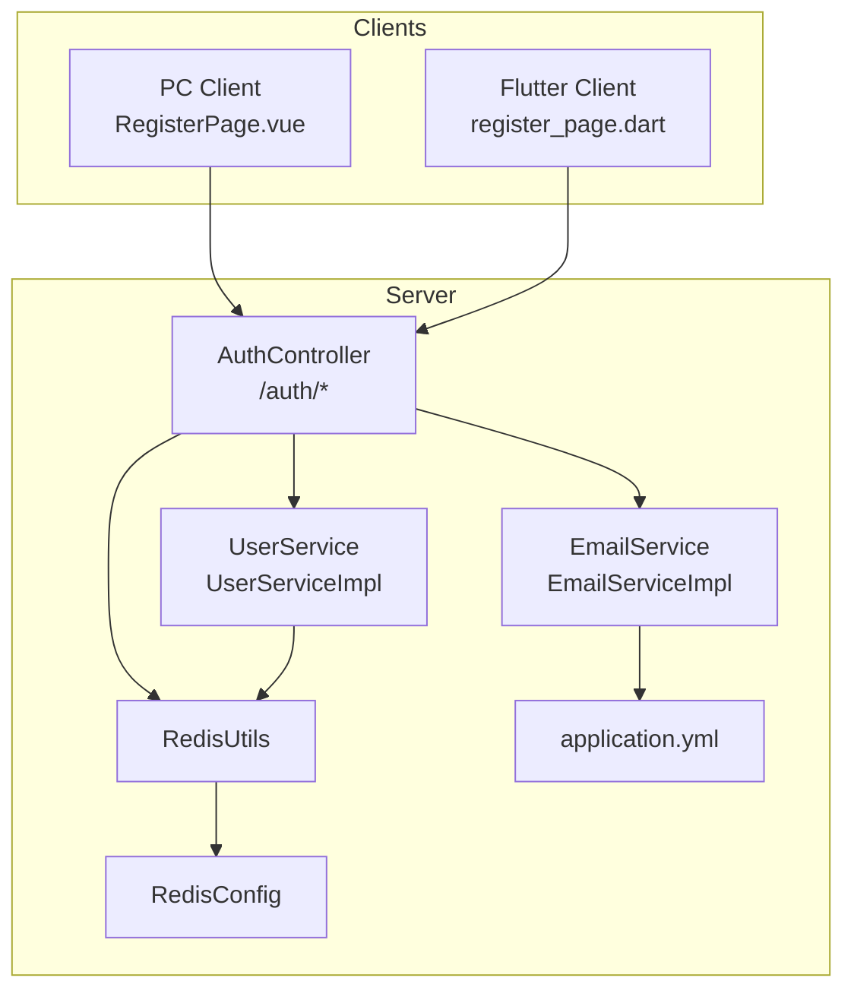
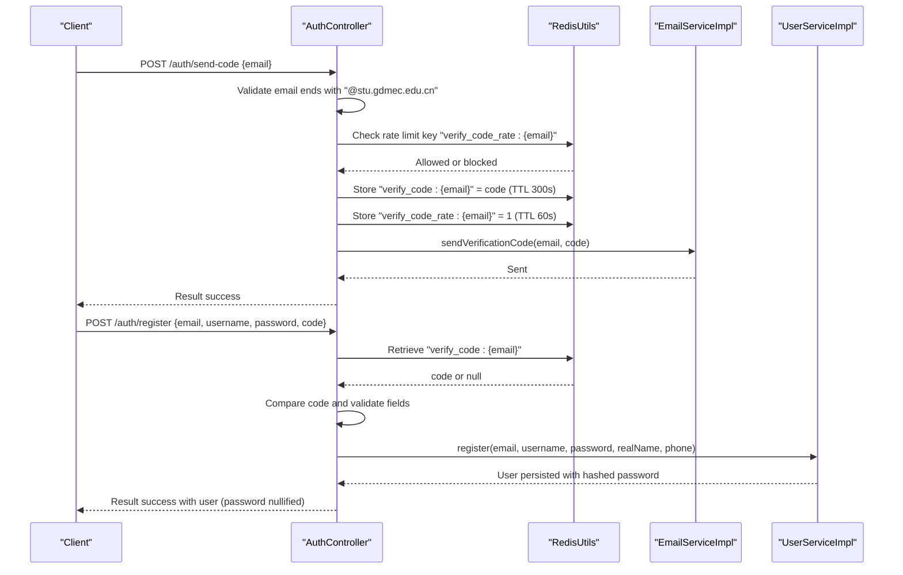
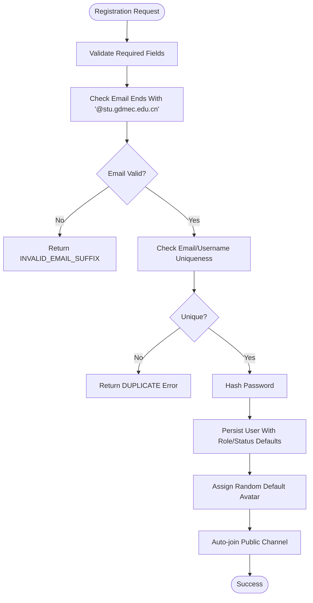
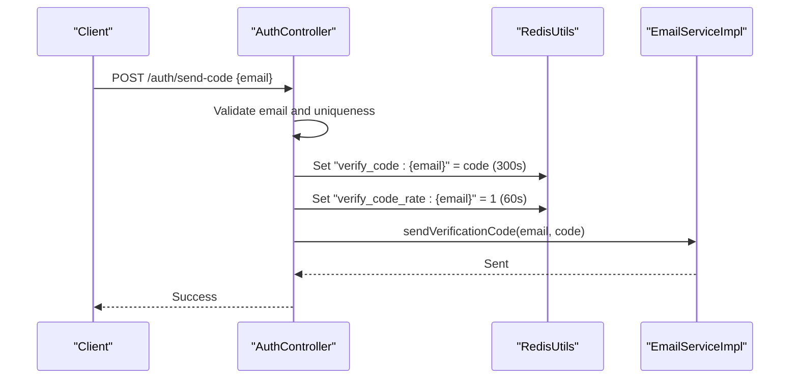
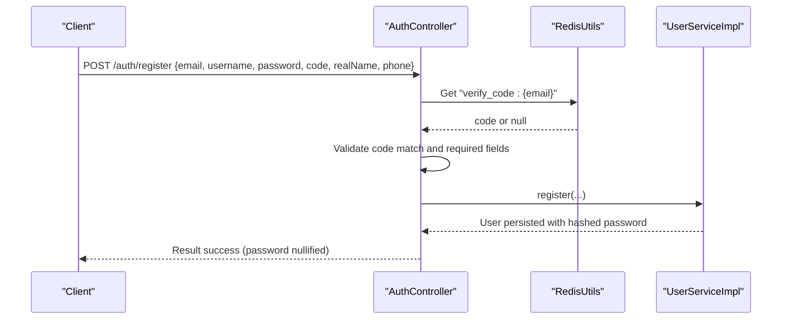
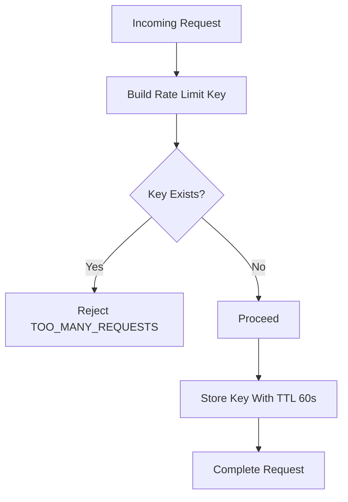
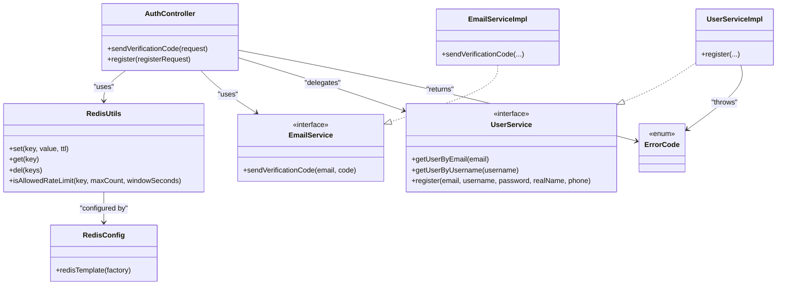

# User Registration and Validation

<cite>
**Referenced Files in This Document**
- [AuthController.java](file://camp-channel-server/src/main/java/com/gdmec/campchannel/controller/AuthController.java)
- [UserService.java](file://camp-channel-server/src/main/java/com/gdmec/campchannel/service/UserService.java)
- [UserServiceImpl.java](file://camp-channel-server/src/main/java/com/gdmec/campchannel/service/impl/UserServiceImpl.java)
- [User.java](file://camp-channel-server/src/main/java/com/gdmec/campchannel/entity/User.java)
- [EmailService.java](file://camp-channel-server/src/main/java/com/gdmec/campchannel/service/EmailService.java)
- [EmailServiceImpl.java](file://camp-channel-server/src/main/java/com/gdmec/campchannel/service/impl/EmailServiceImpl.java)
- [RedisUtils.java](file://camp-channel-server/src/main/java/com/gdmec/campchannel/common/utils/RedisUtils.java)
- [ErrorCode.java](file://camp-channel-server/src/main/java/com/gdmec/campchannel/common/api/ErrorCode.java)
- [BusinessException.java](file://camp-channel-server/src/main/java/com/gdmec/campchannel/common/exception/BusinessException.java)
- [RedisConfig.java](file://camp-channel-server/src/main/java/com/gdmec/campchannel/config/RedisConfig.java)
- [application.yml](file://camp-channel-server/src/main/resources/application.yml)
- [sensitive_words.txt](file://camp-channel-server/src/main/resources/sensitive_words.txt)
- [SensitiveWordFilter.java](file://camp-channel-server/src/main/java/com/gdmec/campchannel/common/filter/SensitiveWordFilter.java)
- [RegisterPage.vue](file://camp-channel-client-pc/src/pages/RegisterPage.vue)
- [register_page.dart](file://camp-channel-client-flutter/lib/pages/register_page.dart)
</cite>

## Table of Contents
1. [Introduction](#introduction)
2. [Project Structure](#project-structure)
3. [Core Components](#core-components)
4. [Architecture Overview](#architecture-overview)
5. [Detailed Component Analysis](#detailed-component-analysis)
6. [Dependency Analysis](#dependency-analysis)
7. [Performance Considerations](#performance-considerations)
8. [Troubleshooting Guide](#troubleshooting-guide)
9. [Conclusion](#conclusion)

## Introduction
This document explains the complete user registration and validation process, focusing on institutional email domain enforcement for @stu.gdmec.edu.cn, verification code generation and delivery, rate limiting, Redis-based temporary storage, request processing, password validation, user data sanitization, and integration with the EmailService. It also covers the sensitive word filtering system for username validation and provides concrete examples from the codebase, along with security considerations and troubleshooting guidance.

## Project Structure
The registration flow spans the backend Spring Boot server and multiple frontend clients:
- Backend: AuthController exposes /auth/send-code and /auth/register, orchestrating email verification and user creation via UserService and EmailService, with Redis-backed rate limiting and temporary storage.
- Frontend Clients: PC and Flutter clients provide form validation and submission to the backend.

**Diagram sources**
- [AuthController.java:61-122](file://camp-channel-server/src/main/java/com/gdmec/campchannel/controller/AuthController.java#L61-L122)
- [UserServiceImpl.java:47-105](file://camp-channel-server/src/main/java/com/gdmec/campchannel/service/impl/UserServiceImpl.java#L47-L105)
- [EmailServiceImpl.java:45-68](file://camp-channel-server/src/main/java/com/gdmec/campchannel/service/impl/EmailServiceImpl.java#L45-L68)
- [RedisUtils.java:132-168](file://camp-channel-server/src/main/java/com/gdmec/campchannel/common/utils/RedisUtils.java#L132-L168)
- [RedisConfig.java:20-45](file://camp-channel-server/src/main/java/com/gdmec/campchannel/config/RedisConfig.java#L20-L45)
- [application.yml:31-67](file://camp-channel-server/src/main/resources/application.yml#L31-L67)

**Section sources**
- [AuthController.java:61-122](file://camp-channel-server/src/main/java/com/gdmec/campchannel/controller/AuthController.java#L61-L122)
- [application.yml:1-119](file://camp-channel-server/src/main/resources/application.yml#L1-L119)

## Core Components
- AuthController: Handles verification code sending and user registration requests, validates institutional email domain, enforces rate limits, verifies codes, and delegates user creation to UserService.
- UserServiceImpl: Performs final institutional domain validation, checks uniqueness of email/username, hashes passwords, assigns default avatar, and auto-enrolls users into the public channel.
- EmailServiceImpl: Sends verification emails via JavaMailSender, respecting configuration and user preferences.
- RedisUtils: Provides generic Redis operations and a sliding-window rate limiter used for verification code throttling.
- ErrorCode: Centralized error codes for consistent error responses across the system.
- SensitiveWordFilter: Loads sensitive words and filters content; while primarily used for posts/comments, it demonstrates the system’s approach to content safety.

**Section sources**
- [AuthController.java:61-122](file://camp-channel-server/src/main/java/com/gdmec/campchannel/controller/AuthController.java#L61-L122)
- [UserServiceImpl.java:47-105](file://camp-channel-server/src/main/java/com/gdmec/campchannel/service/impl/UserServiceImpl.java#L47-L105)
- [EmailServiceImpl.java:45-68](file://camp-channel-server/src/main/java/com/gdmec/campchannel/service/impl/EmailServiceImpl.java#L45-L68)
- [RedisUtils.java:132-168](file://camp-channel-server/src/main/java/com/gdmec/campchannel/common/utils/RedisUtils.java#L132-L168)
- [ErrorCode.java:19-30](file://camp-channel-server/src/main/java/com/gdmec/campchannel/common/api/ErrorCode.java#L19-L30)
- [SensitiveWordFilter.java:40-64](file://camp-channel-server/src/main/java/com/gdmec/campchannel/common/filter/SensitiveWordFilter.java#L40-L64)

## Architecture Overview
The registration workflow integrates frontend forms, backend controllers, services, Redis, and email delivery.

**Diagram sources**
- [AuthController.java:61-122](file://camp-channel-server/src/main/java/com/gdmec/campchannel/controller/AuthController.java#L61-L122)
- [RedisUtils.java:67-95](file://camp-channel-server/src/main/java/com/gdmec/campchannel/common/utils/RedisUtils.java#L67-L95)
- [EmailServiceImpl.java:45-50](file://camp-channel-server/src/main/java/com/gdmec/campchannel/service/impl/EmailServiceImpl.java#L45-L50)
- [UserServiceImpl.java:47-105](file://camp-channel-server/src/main/java/com/gdmec/campchannel/service/impl/UserServiceImpl.java#L47-L105)

## Detailed Component Analysis

### Institutional Email Domain Validation (@stu.gdmec.edu.cn)
- Frontend enforcement ensures the email ends with @stu.gdmec.edu.cn before submission.
- Backend enforcement occurs twice:
  - During verification code sending: rejects non-institutional domains and duplicate registrations.
  - During registration: re-validates institutional domain and uniqueness constraints.

**Diagram sources**
- [AuthController.java:67-73](file://camp-channel-server/src/main/java/com/gdmec/campchannel/controller/AuthController.java#L67-L73)
- [UserServiceImpl.java:49-58](file://camp-channel-server/src/main/java/com/gdmec/campchannel/service/impl/UserServiceImpl.java#L49-L58)
- [UserServiceImpl.java:63](file://camp-channel-server/src/main/java/com/gdmec/campchannel/service/impl/UserServiceImpl.java#L63)
- [UserServiceImpl.java:86-102](file://camp-channel-server/src/main/java/com/gdmec/campchannel/service/impl/UserServiceImpl.java#L86-L102)

**Section sources**
- [RegisterPage.vue:27](file://camp-channel-client-pc/src/pages/RegisterPage.vue#L27)
- [register_page.dart:203](file://camp-channel-client-flutter/lib/pages/register_page.dart#L203)
- [AuthController.java:67-73](file://camp-channel-server/src/main/java/com/gdmec/campchannel/controller/AuthController.java#L67-L73)
- [UserServiceImpl.java:49-58](file://camp-channel-server/src/main/java/com/gdmec/campchannel/service/impl/UserServiceImpl.java#L49-L58)

### Verification Code Generation, Delivery, and Temporary Storage
- Code generation: Six-digit random number.
- Temporary storage:
  - "verify_code:{email}": stores the code with TTL 300 seconds.
  - "verify_code_rate:{email}": rate limit key with TTL 60 seconds.
- Email delivery: Uses EmailServiceImpl to send a subject and body containing the code.

**Diagram sources**
- [AuthController.java:80-88](file://camp-channel-server/src/main/java/com/gdmec/campchannel/controller/AuthController.java#L80-L88)
- [RedisUtils.java:84-95](file://camp-channel-server/src/main/java/com/gdmec/campchannel/common/utils/RedisUtils.java#L84-L95)
- [EmailServiceImpl.java:45-50](file://camp-channel-server/src/main/java/com/gdmec/campchannel/service/impl/EmailServiceImpl.java#L45-L50)

**Section sources**
- [AuthController.java:80-88](file://camp-channel-server/src/main/java/com/gdmec/campchannel/controller/AuthController.java#L80-L88)
- [RedisUtils.java:84-95](file://camp-channel-server/src/main/java/com/gdmec/campchannel/common/utils/RedisUtils.java#L84-L95)
- [EmailServiceImpl.java:45-50](file://camp-channel-server/src/main/java/com/gdmec/campchannel/service/impl/EmailServiceImpl.java#L45-L50)

### Registration Request Processing and Password Validation
- Request body includes email, username, password, optional realName and phone, and the verification code.
- Validation steps:
  - Ensure all required fields are present.
  - Retrieve stored code from Redis; reject if missing/expired.
  - Compare submitted code with stored code.
  - Delegate user creation to UserServiceImpl.
- Password hashing: PasswordEncoder is used to hash the password before persistence.
- Response: Returns the created user with the password field cleared for security.

**Diagram sources**
- [AuthController.java:95-122](file://camp-channel-server/src/main/java/com/gdmec/campchannel/controller/AuthController.java#L95-L122)
- [UserServiceImpl.java:47-105](file://camp-channel-server/src/main/java/com/gdmec/campchannel/service/impl/UserServiceImpl.java#L47-L105)

**Section sources**
- [AuthController.java:95-122](file://camp-channel-server/src/main/java/com/gdmec/campchannel/controller/AuthController.java#L95-L122)
- [UserServiceImpl.java:63](file://camp-channel-server/src/main/java/com/gdmec/campchannel/service/impl/UserServiceImpl.java#L63)

### Rate Limiting Implementation
- Per-email rate limiting for verification code sending:
  - Key: "verify_code_rate:{email}"
  - TTL: 60 seconds
  - Behavior: If key exists, reject with TOO_MANY_REQUESTS
- Generic sliding window rate limiter (RedisUtils.isAllowedRateLimit):
  - Used elsewhere in the system for broader throttling scenarios.
  - Removes expired entries, counts current window, and records new requests.

**Diagram sources**
- [AuthController.java:75-78](file://camp-channel-server/src/main/java/com/gdmec/campchannel/controller/AuthController.java#L75-L78)
- [RedisUtils.java:142-168](file://camp-channel-server/src/main/java/com/gdmec/campchannel/common/utils/RedisUtils.java#L142-L168)

**Section sources**
- [AuthController.java:75-78](file://camp-channel-server/src/main/java/com/gdmec/campchannel/controller/AuthController.java#L75-L78)
- [RedisUtils.java:142-168](file://camp-channel-server/src/main/java/com/gdmec/campchannel/common/utils/RedisUtils.java#L142-L168)

### Redis-Based Temporary Storage and Cleanup
- Stored keys:
  - "verify_code:{email}": verification code with 300s TTL.
  - "verify_code_rate:{email}": rate limit with 60s TTL.
- Cleanup:
  - On successful registration, the code key is deleted immediately after validation.

**Section sources**
- [AuthController.java:102-111](file://camp-channel-server/src/main/java/com/gdmec/campchannel/controller/AuthController.java#L102-L111)
- [RedisUtils.java:51-63](file://camp-channel-server/src/main/java/com/gdmec/campchannel/common/utils/RedisUtils.java#L51-L63)

### Integration with EmailService
- EmailServiceImpl sends verification emails using JavaMailSender.
- Configuration is loaded from application.yml (SMTP host, port, credentials).
- Email alerts respect user preferences (emailNotify) and presence of email address.

**Section sources**
- [EmailServiceImpl.java:27-43](file://camp-channel-server/src/main/java/com/gdmec/campchannel/service/impl/EmailServiceImpl.java#L27-L43)
- [EmailServiceImpl.java:45-68](file://camp-channel-server/src/main/java/com/gdmec/campchannel/service/impl/EmailServiceImpl.java#L45-L68)
- [application.yml:49-67](file://camp-channel-server/src/main/resources/application.yml#L49-L67)

### Sensitive Word Filtering for Username Validation
- SensitiveWordFilter loads a dictionary from sensitive_words.txt and supports:
  - contains(): checks if text contains any sensitive word.
  - filter(): replaces sensitive words with asterisks.
- While username validation is not explicitly enforced in the registration flow, the filter demonstrates the system’s approach to content safety and can be integrated into future validations.

**Section sources**
- [SensitiveWordFilter.java:40-64](file://camp-channel-server/src/main/java/com/gdmec/campchannel/common/filter/SensitiveWordFilter.java#L40-L64)
- [sensitive_words.txt:1-10](file://camp-channel-server/src/main/resources/sensitive_words.txt#L1-L10)

### User Data Model and Persistence
- User entity fields include username, realName, phone, email, password, role, status, avatar, timestamps, and emailNotify.
- UserServiceImpl sets role to "user", status to 1, and assigns a random default avatar from uploads/avatars.

**Section sources**
- [User.java:14-35](file://camp-channel-server/src/main/java/com/gdmec/campchannel/entity/User.java#L14-L35)
- [UserServiceImpl.java:66-82](file://camp-channel-server/src/main/java/com/gdmec/campchannel/service/impl/UserServiceImpl.java#L66-L82)

### Frontend Registration Forms and Validation
- PC Client (Vue): Enforces institutional email requirement and collects username, password, realName, and code.
- Flutter Client (Dart): Enforces institutional email, password length, and password confirmation before submission.

**Section sources**
- [RegisterPage.vue:27](file://camp-channel-client-pc/src/pages/RegisterPage.vue#L27)
- [register_page.dart:203](file://camp-channel-client-flutter/lib/pages/register_page.dart#L203)
- [register_page.dart:219](file://camp-channel-client-flutter/lib/pages/register_page.dart#L219)
- [register_page.dart:94-143](file://camp-channel-client-flutter/lib/pages/register_page.dart#L94-L143)

## Dependency Analysis

**Diagram sources**
- [AuthController.java:43-59](file://camp-channel-server/src/main/java/com/gdmec/campchannel/controller/AuthController.java#L43-L59)
- [UserService.java:6-21](file://camp-channel-server/src/main/java/com/gdmec/campchannel/service/UserService.java#L6-L21)
- [UserServiceImpl.java:25-105](file://camp-channel-server/src/main/java/com/gdmec/campchannel/service/impl/UserServiceImpl.java#L25-L105)
- [EmailService.java:3-10](file://camp-channel-server/src/main/java/com/gdmec/campchannel/service/EmailService.java#L3-L10)
- [EmailServiceImpl.java:15-68](file://camp-channel-server/src/main/java/com/gdmec/campchannel/service/impl/EmailServiceImpl.java#L15-L68)
- [RedisUtils.java:17-168](file://camp-channel-server/src/main/java/com/gdmec/campchannel/common/utils/RedisUtils.java#L17-L168)
- [RedisConfig.java:18-45](file://camp-channel-server/src/main/java/com/gdmec/campchannel/config/RedisConfig.java#L18-45)
- [ErrorCode.java:9-59](file://camp-channel-server/src/main/java/com/gdmec/campchannel/common/api/ErrorCode.java#L9-L59)

**Section sources**
- [AuthController.java:43-59](file://camp-channel-server/src/main/java/com/gdmec/campchannel/controller/AuthController.java#L43-L59)
- [UserServiceImpl.java:25-105](file://camp-channel-server/src/main/java/com/gdmec/campchannel/service/impl/UserServiceImpl.java#L25-L105)
- [EmailServiceImpl.java:15-68](file://camp-channel-server/src/main/java/com/gdmec/campchannel/service/impl/EmailServiceImpl.java#L15-L68)
- [RedisUtils.java:17-168](file://camp-channel-server/src/main/java/com/gdmec/campchannel/common/utils/RedisUtils.java#L17-L168)
- [RedisConfig.java:18-45](file://camp-channel-server/src/main/java/com/gdmec/campchannel/config/RedisConfig.java#L18-45)
- [ErrorCode.java:9-59](file://camp-channel-server/src/main/java/com/gdmec/campchannel/common/api/ErrorCode.java#L9-L59)

## Performance Considerations
- Redis operations are O(1) for key-value and ZSet range removal/count, ensuring low latency for rate limiting and verification code storage.
- Password hashing is handled by the framework’s PasswordEncoder; ensure appropriate strength settings are configured.
- Email sending is synchronous in EmailServiceImpl; consider asynchronous processing for high throughput.
- Auto-joining the public channel involves database writes; keep these lightweight and avoid heavy initialization logic.

## Troubleshooting Guide
Common issues and resolutions:
- Invalid email domain:
  - Symptom: Registration fails with invalid email suffix.
  - Cause: Email does not end with @stu.gdmec.edu.cn.
  - Resolution: Ensure institutional email is used; verify frontend and backend validations.
  - References: [AuthController.java:67-69](file://camp-channel-server/src/main/java/com/gdmec/campchannel/controller/AuthController.java#L67-L69), [UserServiceImpl.java:49-51](file://camp-channel-server/src/main/java/com/gdmec/campchannel/service/impl/UserServiceImpl.java#L49-L51)
- Duplicate email or username:
  - Symptom: Registration fails indicating duplicate.
  - Cause: Email or username already exists.
  - Resolution: Prompt user to choose another identifier.
  - References: [AuthController.java:71-73](file://camp-channel-server/src/main/java/com/gdmec/campchannel/controller/AuthController.java#L71-L73), [UserServiceImpl.java:53-58](file://camp-channel-server/src/main/java/com/gdmec/campchannel/service/impl/UserServiceImpl.java#L53-L58)
- Verification code errors:
  - Symptom: Registration fails due to expired or incorrect code.
  - Cause: Code missing/expired or mismatched.
  - Resolution: Re-send code; ensure client waits for delivery; verify Redis connectivity.
  - References: [AuthController.java:104-109](file://camp-channel-server/src/main/java/com/gdmec/campchannel/controller/AuthController.java#L104-L109), [AuthController.java:82-83](file://camp-channel-server/src/main/java/com/gdmec/campchannel/controller/AuthController.java#L82-L83)
- Rate limiting:
  - Symptom: "Too many requests" error.
  - Cause: Sending code too frequently per email.
  - Resolution: Wait for the cooldown period; check Redis key TTL.
  - References: [AuthController.java:75-78](file://camp-channel-server/src/main/java/com/gdmec/campchannel/controller/AuthController.java#L75-L78)
- Email delivery failures:
  - Symptom: No verification email received.
  - Cause: Mail configuration missing or SMTP failure.
  - Resolution: Verify application.yml mail settings; check logs for exceptions.
  - References: [EmailServiceImpl.java:28-42](file://camp-channel-server/src/main/java/com/gdmec/campchannel/service/impl/EmailServiceImpl.java#L28-L42), [application.yml:49-67](file://camp-channel-server/src/main/resources/application.yml#L49-L67)
- Redis connectivity issues:
  - Symptom: Rate limiting or code storage failures.
  - Cause: Redis unreachable or misconfigured.
  - Resolution: Confirm Redis host/port/password and network access; review RedisConfig.
  - References: [RedisConfig.java:20-45](file://camp-channel-server/src/main/java/com/gdmec/campchannel/config/RedisConfig.java#L20-L45), [application.yml:31-42](file://camp-channel-server/src/main/resources/application.yml#L31-L42)
- Password hashing errors:
  - Symptom: Registration unexpectedly fails during persistence.
  - Cause: PasswordEncoder misconfiguration or database constraint violation.
  - Resolution: Ensure PasswordEncoder bean is available; check database constraints.
  - References: [UserServiceImpl.java:63](file://camp-channel-server/src/main/java/com/gdmec/campchannel/service/impl/UserServiceImpl.java#L63)

## Conclusion
The registration system enforces strict institutional email validation, implements robust verification code delivery and rate limiting, and securely persists user data with password hashing. The architecture leverages Redis for temporary storage and throttling, integrates with EmailService for notifications, and provides clear error responses via centralized ErrorCode definitions. Frontend clients enforce preconditions to reduce backend load and improve UX. Extending username validation with sensitive word filtering is straightforward given the existing SensitiveWordFilter infrastructure.