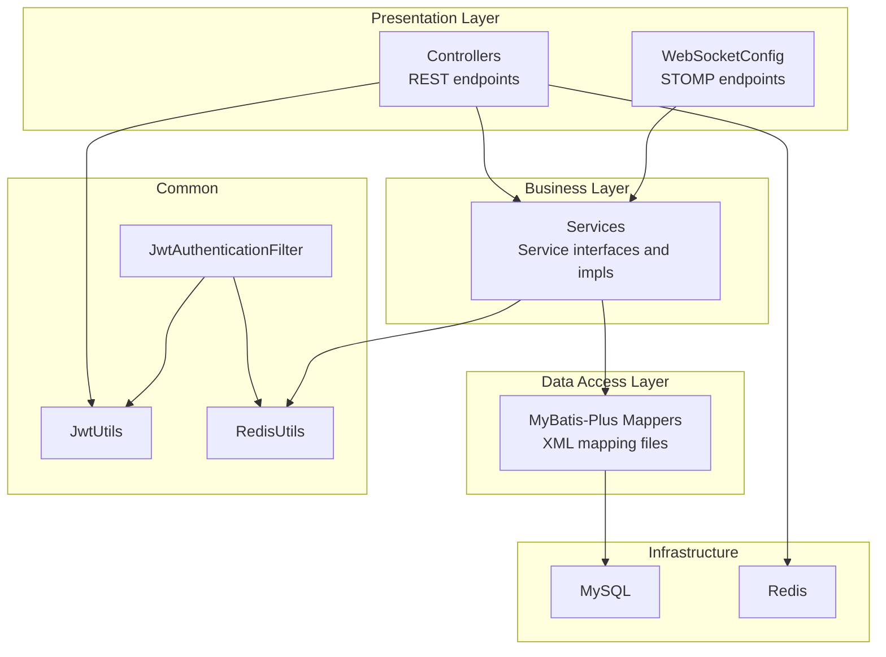
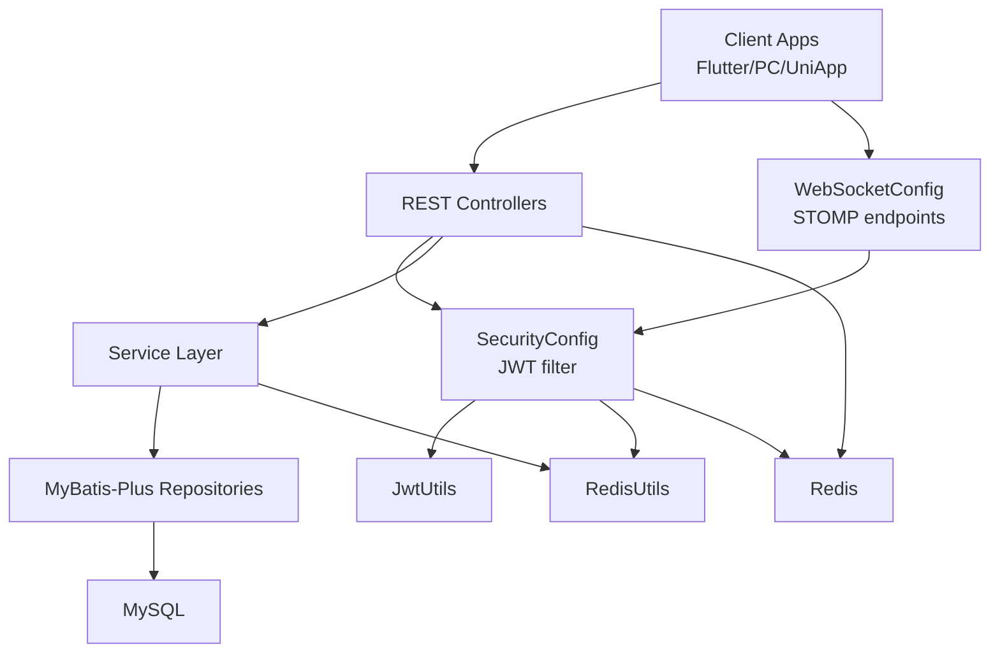
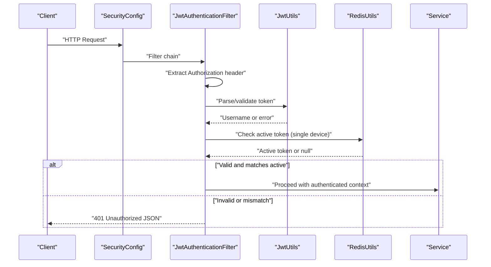
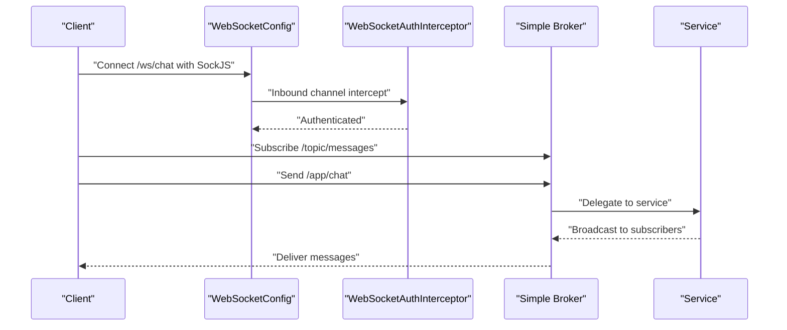
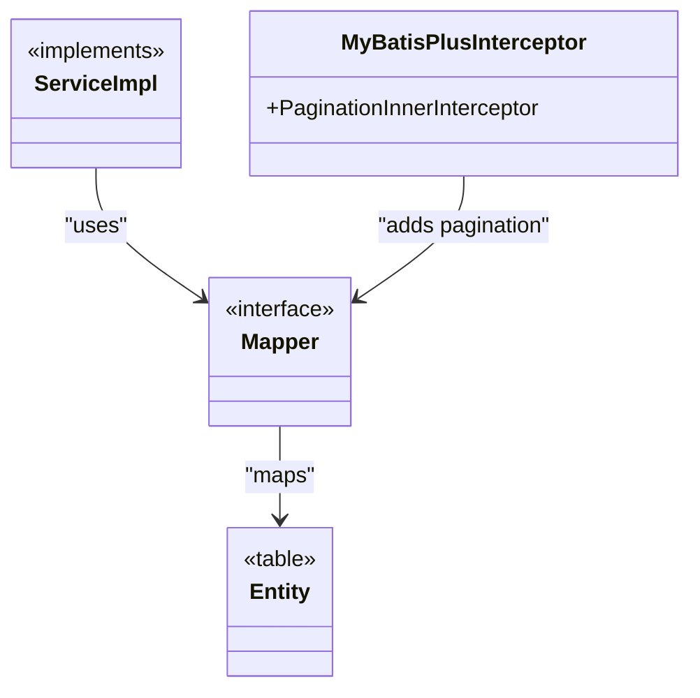
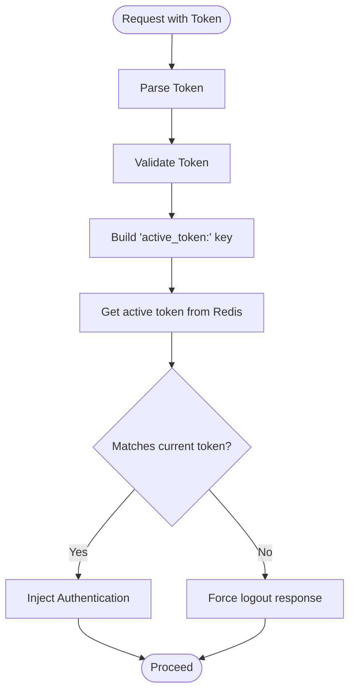
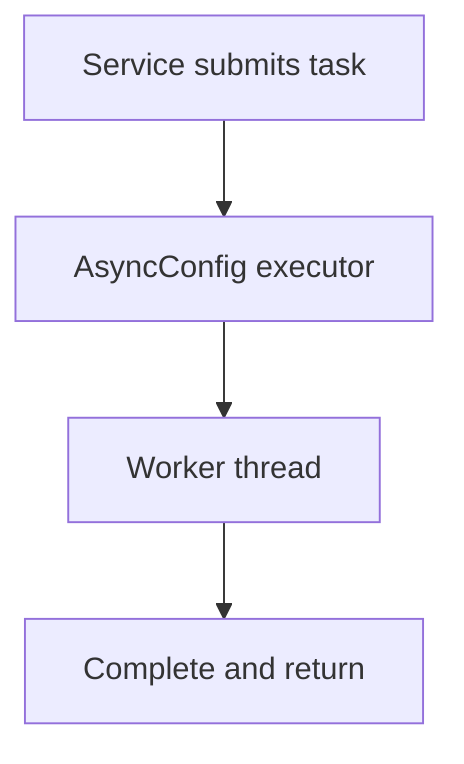
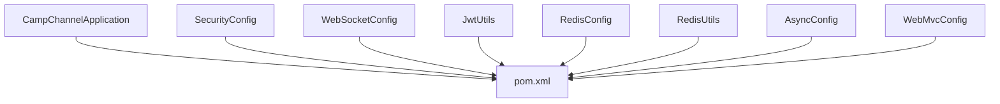

# Backend Architecture

<cite>
**Referenced Files in This Document**
- [CampChannelApplication.java](file://camp-channel-server/src/main/java/com/gdmec/campchannel/CampChannelApplication.java)
- [pom.xml](file://camp-channel-server/pom.xml)
- [application.yml](file://camp-channel-server/src/main/resources/application.yml)
- [SecurityConfig.java](file://camp-channel-server/src/main/java/com/gdmec/campchannel/config/SecurityConfig.java)
- [WebSocketConfig.java](file://camp-channel-server/src/main/java/com/gdmec/campchannel/config/WebSocketConfig.java)
- [JwtAuthenticationFilter.java](file://camp-channel-server/src/main/java/com/gdmec/campchannel/security/JwtAuthenticationFilter.java)
- [JwtUtils.java](file://camp-channel-server/src/main/java/com/gdmec/campchannel/common/utils/JwtUtils.java)
- [RedisUtils.java](file://camp-channel-server/src/main/java/com/gdmec/campchannel/common/utils/RedisUtils.java)
- [RedisConfig.java](file://camp-channel-server/src/main/java/com/gdmec/campchannel/config/RedisConfig.java)
- [AsyncConfig.java](file://camp-channel-server/src/main/java/com/gdmec/campchannel/config/AsyncConfig.java)
- [WebMvcConfig.java](file://camp-channel-server/src/main/java/com/gdmec/campchannel/config/WebMvcConfig.java)
</cite>

## Table of Contents
1. [Introduction](#introduction)
2. [Project Structure](#project-structure)
3. [Core Components](#core-components)
4. [Architecture Overview](#architecture-overview)
5. [Detailed Component Analysis](#detailed-component-analysis)
6. [Dependency Analysis](#dependency-analysis)
7. [Performance Considerations](#performance-considerations)
8. [Troubleshooting Guide](#troubleshooting-guide)
9. [Conclusion](#conclusion)
10. [Appendices](#appendices)

## Introduction
This document describes the backend architecture of the Spring Boot application using a layered architecture pattern. It covers the presentation, business, and data layers, and documents the integration of REST controllers, service layer, MyBatis-Plus repositories, and WebSocket handlers. Cross-cutting concerns include JWT-based authentication, Redis caching and rate limiting, and asynchronous processing. Infrastructure requirements and production deployment considerations are also included.

## Project Structure
The backend is organized into clear layers:
- Presentation Layer: REST controllers under the controller package and WebSocket endpoints configured via WebSocketConfig.
- Business Layer: Services under the service package (service interfaces and implementations).
- Data Access Layer: MyBatis-Plus mappers under the mapper package, with XML mapping files located under resources/mapper.
- Common Utilities: JWT utilities, Redis utilities, global exception handling, and filters.
- Configuration: Security, WebSocket, Redis, async, and MVC configurations.

**Diagram sources**
- [WebSocketConfig.java:1-36](file://camp-channel-server/src/main/java/com/gdmec/campchannel/config/WebSocketConfig.java#L1-L36)
- [SecurityConfig.java:1-137](file://camp-channel-server/src/main/java/com/gdmec/campchannel/config/SecurityConfig.java#L1-L137)
- [JwtAuthenticationFilter.java:1-113](file://camp-channel-server/src/main/java/com/gdmec/campchannel/security/JwtAuthenticationFilter.java#L1-L113)
- [JwtUtils.java:1-85](file://camp-channel-server/src/main/java/com/gdmec/campchannel/common/utils/JwtUtils.java#L1-L85)
- [RedisUtils.java:1-170](file://camp-channel-server/src/main/java/com/gdmec/campchannel/common/utils/RedisUtils.java#L1-L170)
- [application.yml:13-76](file://camp-channel-server/src/main/resources/application.yml#L13-L76)

**Section sources**
- [CampChannelApplication.java:12-30](file://camp-channel-server/src/main/java/com/gdmec/campchannel/CampChannelApplication.java#L12-L30)
- [pom.xml:32-135](file://camp-channel-server/pom.xml#L32-L135)
- [application.yml:1-119](file://camp-channel-server/src/main/resources/application.yml#L1-L119)

## Core Components
- Application bootstrap and MyBatis-Plus pagination interceptor configuration.
- Security configuration enabling stateless JWT authentication, CORS, and method-level security.
- WebSocket configuration enabling STOMP over SockJS with custom authentication interception.
- JWT utilities for token generation, parsing, and validation.
- Redis utilities for caching and sliding-window rate limiting.
- Redis configuration for JSON serialization.
- Asynchronous configuration for email tasks.
- MVC configuration for serving uploaded files from local storage.

**Section sources**
- [CampChannelApplication.java:21-30](file://camp-channel-server/src/main/java/com/gdmec/campchannel/CampChannelApplication.java#L21-L30)
- [SecurityConfig.java:52-105](file://camp-channel-server/src/main/java/com/gdmec/campchannel/config/SecurityConfig.java#L52-L105)
- [WebSocketConfig.java:18-36](file://camp-channel-server/src/main/java/com/gdmec/campchannel/config/WebSocketConfig.java#L18-L36)
- [JwtUtils.java:17-85](file://camp-channel-server/src/main/java/com/gdmec/campchannel/common/utils/JwtUtils.java#L17-L85)
- [RedisUtils.java:132-170](file://camp-channel-server/src/main/java/com/gdmec/campchannel/common/utils/RedisUtils.java#L132-L170)
- [RedisConfig.java:17-47](file://camp-channel-server/src/main/java/com/gdmec/campchannel/config/RedisConfig.java#L17-L47)
- [AsyncConfig.java:14-31](file://camp-channel-server/src/main/java/com/gdmec/campchannel/config/AsyncConfig.java#L14-L31)
- [WebMvcConfig.java:8-19](file://camp-channel-server/src/main/java/com/gdmec/campchannel/config/WebMvcConfig.java#L8-L19)

## Architecture Overview
The system follows a layered architecture:
- Presentation: REST controllers expose HTTP endpoints; WebSocket endpoints serve real-time chat.
- Business: Services encapsulate domain logic and orchestrate operations.
- Data: MyBatis-Plus handles SQL mapping and CRUD; repositories are interface-based with automatic implementation.
- Cross-cutting: Security filter validates JWT tokens and enforces single-device login; Redis supports caching and rate limiting; async executor offloads email tasks.

**Diagram sources**
- [SecurityConfig.java:52-105](file://camp-channel-server/src/main/java/com/gdmec/campchannel/config/SecurityConfig.java#L52-L105)
- [WebSocketConfig.java:18-36](file://camp-channel-server/src/main/java/com/gdmec/campchannel/config/WebSocketConfig.java#L18-L36)
- [JwtAuthenticationFilter.java:42-100](file://camp-channel-server/src/main/java/com/gdmec/campchannel/security/JwtAuthenticationFilter.java#L42-L100)
- [JwtUtils.java:17-85](file://camp-channel-server/src/main/java/com/gdmec/campchannel/common/utils/JwtUtils.java#L17-L85)
- [RedisUtils.java:132-170](file://camp-channel-server/src/main/java/com/gdmec/campchannel/common/utils/RedisUtils.java#L132-L170)
- [application.yml:13-76](file://camp-channel-server/src/main/resources/application.yml#L13-L76)

## Detailed Component Analysis

### REST Controllers and Security Flow
- Controllers receive HTTP requests and delegate to services.
- SecurityConfig permits public endpoints (login, register, send-code), static uploads, and Swagger UI, while enforcing authentication for other routes.
- JwtAuthenticationFilter extracts the Bearer token, validates it via JwtUtils, checks single-device login against Redis via RedisUtils, and injects Authentication into Spring Security context.

**Diagram sources**
- [SecurityConfig.java:52-105](file://camp-channel-server/src/main/java/com/gdmec/campchannel/config/SecurityConfig.java#L52-L105)
- [JwtAuthenticationFilter.java:42-100](file://camp-channel-server/src/main/java/com/gdmec/campchannel/security/JwtAuthenticationFilter.java#L42-L100)
- [JwtUtils.java:40-83](file://camp-channel-server/src/main/java/com/gdmec/campchannel/common/utils/JwtUtils.java#L40-L83)
- [RedisUtils.java:67-95](file://camp-channel-server/src/main/java/com/gdmec/campchannel/common/utils/RedisUtils.java#L67-L95)

**Section sources**
- [SecurityConfig.java:52-105](file://camp-channel-server/src/main/java/com/gdmec/campchannel/config/SecurityConfig.java#L52-L105)
- [JwtAuthenticationFilter.java:42-100](file://camp-channel-server/src/main/java/com/gdmec/campchannel/security/JwtAuthenticationFilter.java#L42-L100)
- [JwtUtils.java:17-85](file://camp-channel-server/src/main/java/com/gdmec/campchannel/common/utils/JwtUtils.java#L17-L85)
- [RedisUtils.java:132-170](file://camp-channel-server/src/main/java/com/gdmec/campchannel/common/utils/RedisUtils.java#L132-L170)

### WebSocket Real-Time Communication
- WebSocketConfig registers STOMP endpoint with SockJS and enables a simple broker for topics and queues.
- WebSocketAuthInterceptor integrates with the WebSocket inbound channel for authentication.
- Clients connect to /ws/chat and exchange messages over STOMP destinations.

**Diagram sources**
- [WebSocketConfig.java:18-36](file://camp-channel-server/src/main/java/com/gdmec/campchannel/config/WebSocketConfig.java#L18-L36)

**Section sources**
- [WebSocketConfig.java:11-36](file://camp-channel-server/src/main/java/com/gdmec/campchannel/config/WebSocketConfig.java#L11-L36)

### Repository Pattern with MyBatis-Plus
- MyBatis-Plus is configured with a pagination interceptor and mapper scanning.
- Entities map to database tables; mappers define CRUD and query methods resolved via XML mapping files.
- The application.yml configures MyBatis-Plus settings, including mapper locations and ID strategy.

**Diagram sources**
- [CampChannelApplication.java:24-29](file://camp-channel-server/src/main/java/com/gdmec/campchannel/CampChannelApplication.java#L24-L29)
- [application.yml:68-76](file://camp-channel-server/src/main/resources/application.yml#L68-L76)

**Section sources**
- [CampChannelApplication.java:12-30](file://camp-channel-server/src/main/java/com/gdmec/campchannel/CampChannelApplication.java#L12-L30)
- [application.yml:68-76](file://camp-channel-server/src/main/resources/application.yml#L68-L76)

### Redis Caching and Rate Limiting
- RedisConfig sets up JSON serialization for RedisTemplate.
- RedisUtils provides generic operations and implements a sliding-window rate limiter using ZSet.
- JwtAuthenticationFilter uses Redis to enforce single-device login by storing the latest active token per user.

**Diagram sources**
- [JwtAuthenticationFilter.java:77-96](file://camp-channel-server/src/main/java/com/gdmec/campchannel/security/JwtAuthenticationFilter.java#L77-L96)
- [RedisUtils.java:67-95](file://camp-channel-server/src/main/java/com/gdmec/campchannel/common/utils/RedisUtils.java#L67-L95)

**Section sources**
- [RedisConfig.java:17-47](file://camp-channel-server/src/main/java/com/gdmec/campchannel/config/RedisConfig.java#L17-L47)
- [RedisUtils.java:132-170](file://camp-channel-server/src/main/java/com/gdmec/campchannel/common/utils/RedisUtils.java#L132-L170)
- [JwtAuthenticationFilter.java:77-96](file://camp-channel-server/src/main/java/com/gdmec/campchannel/security/JwtAuthenticationFilter.java#L77-L96)

### Asynchronous Processing
- AsyncConfig defines a thread pool for asynchronous tasks (e.g., sending emails).
- Services can submit tasks to this executor to avoid blocking synchronous operations.

**Diagram sources**
- [AsyncConfig.java:17-29](file://camp-channel-server/src/main/java/com/gdmec/campchannel/config/AsyncConfig.java#L17-L29)

**Section sources**
- [AsyncConfig.java:14-31](file://camp-channel-server/src/main/java/com/gdmec/campchannel/config/AsyncConfig.java#L14-L31)

### File Upload Serving
- WebMvcConfig maps /uploads/** to a local filesystem path configured in application.yml.
- This serves as a local replacement for cloud storage during development.

**Section sources**
- [WebMvcConfig.java:8-19](file://camp-channel-server/src/main/java/com/gdmec/campchannel/config/WebMvcConfig.java#L8-L19)
- [application.yml:95-99](file://camp-channel-server/src/main/resources/application.yml#L95-L99)

## Dependency Analysis
The backend leverages Spring Boot starters and third-party libraries:
- Spring Web, Security, Data Redis, Validation, Mail, WebSocket
- MyBatis-Plus (ORM and pagination)
- JWT (jjwt-api, jjwt-impl, jjwt-jackson)
- Springdoc OpenAPI for API documentation
- Lombok for concise code

**Diagram sources**
- [pom.xml:32-135](file://camp-channel-server/pom.xml#L32-L135)
- [CampChannelApplication.java:12-30](file://camp-channel-server/src/main/java/com/gdmec/campchannel/CampChannelApplication.java#L12-L30)

**Section sources**
- [pom.xml:20-30](file://camp-channel-server/pom.xml#L20-L30)
- [pom.xml:32-135](file://camp-channel-server/pom.xml#L32-L135)

## Performance Considerations
- MyBatis-Plus pagination reduces payload sizes for large datasets.
- Redis caching minimizes database load; sliding-window rate limiting prevents abuse.
- Async executor offloads non-blocking tasks (e.g., email) to improve responsiveness.
- HikariCP connection pool settings in application.yml balance concurrency and resource usage.

[No sources needed since this section provides general guidance]

## Troubleshooting Guide
- Authentication failures:
  - Verify Authorization header format and token validity.
  - Check Redis active token entries for single-device enforcement.
- CORS errors:
  - Confirm allowed origins and credentials settings in SecurityConfig.
- WebSocket connection issues:
  - Ensure STOMP endpoint registration and SockJS compatibility.
- Redis connectivity:
  - Validate host, port, and credentials in application.yml; confirm JSON serializer configuration.
- Database initialization:
  - Confirm schema initialization settings and migration scripts location.

**Section sources**
- [SecurityConfig.java:110-124](file://camp-channel-server/src/main/java/com/gdmec/campchannel/config/SecurityConfig.java#L110-L124)
- [WebSocketConfig.java:30-35](file://camp-channel-server/src/main/java/com/gdmec/campchannel/config/WebSocketConfig.java#L30-L35)
- [RedisConfig.java:20-45](file://camp-channel-server/src/main/java/com/gdmec/campchannel/config/RedisConfig.java#L20-L45)
- [application.yml:13-43](file://camp-channel-server/src/main/resources/application.yml#L13-L43)

## Conclusion
The backend employs a clean layered architecture with strong separation of concerns. JWT-based authentication ensures secure stateless access, while Redis-backed caching and rate limiting enhance reliability and performance. MyBatis-Plus streamlines data access, and WebSocket support enables real-time communication. The configuration files centralize infrastructure settings, facilitating both development and production deployments.

[No sources needed since this section summarizes without analyzing specific files]

## Appendices

### Technology Stack and Versions
- Spring Boot: 4.0.6
- MyBatis-Plus: 3.5.16
- JWT (jjwt): 0.12.7
- Springdoc OpenAPI: 3.0.3
- Lombok: 1.18.46
- Java: 26

**Section sources**
- [pom.xml:20-30](file://camp-channel-server/pom.xml#L20-L30)

### Infrastructure Requirements
- Database: MySQL (configured via JDBC URL, credentials, and HikariCP settings)
- Cache: Redis (host, port, password, database index, timeouts, and Lettuce pool settings)
- Production deployment:
  - Set environment-specific application.yml values (datasource, redis, jwt.secret, logging).
  - Configure reverse proxy (e.g., Nginx) and SSL termination.
  - Scale Redis and MySQL appropriately; monitor slow queries and cache hit ratios.
  - Harden JWT secret management and consider rotating secrets.

**Section sources**
- [application.yml:13-43](file://camp-channel-server/src/main/resources/application.yml#L13-L43)
- [application.yml:78-84](file://camp-channel-server/src/main/resources/application.yml#L78-L84)