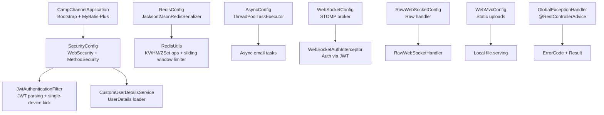
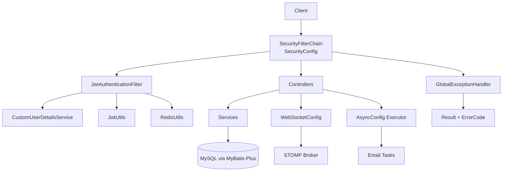
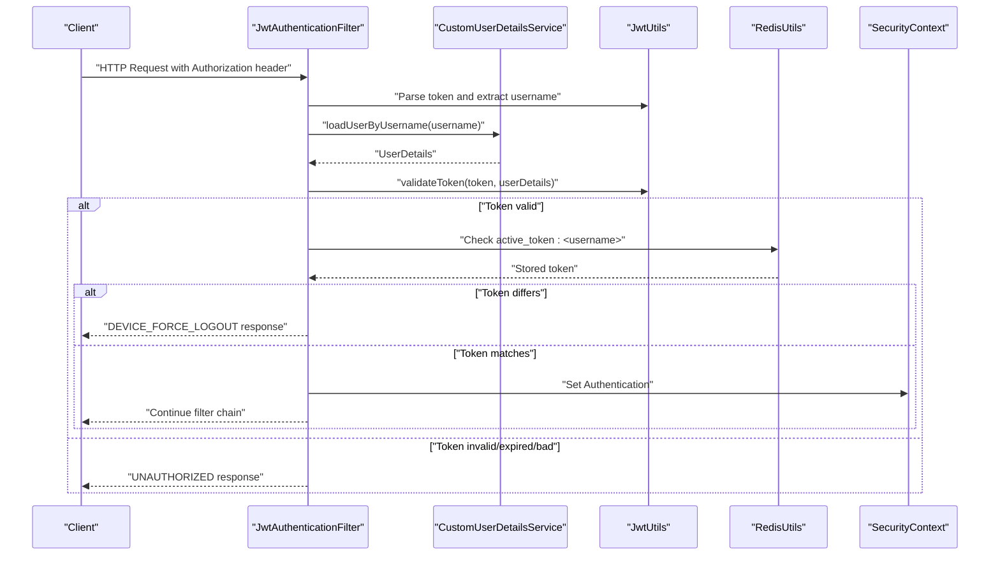
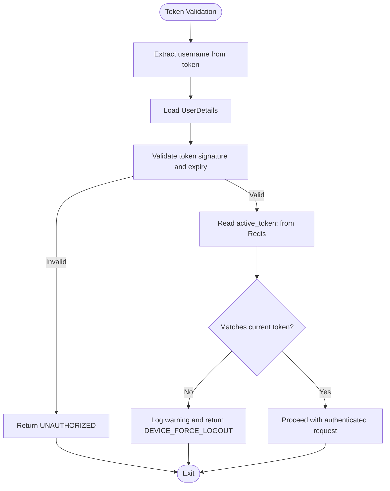
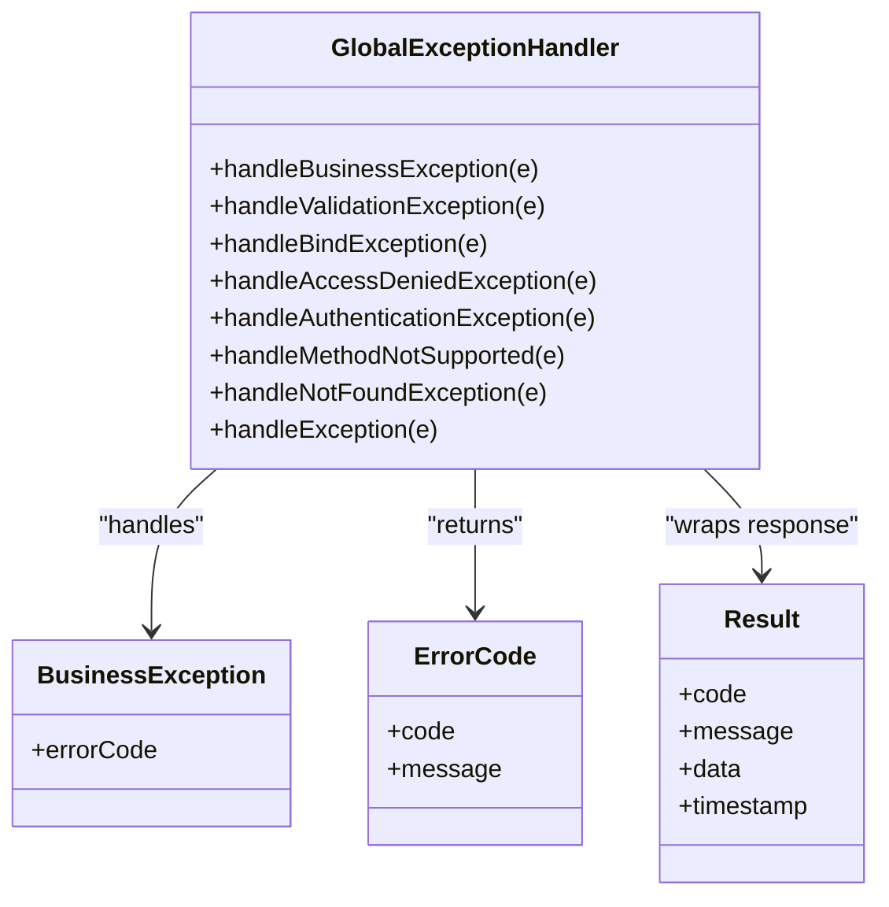
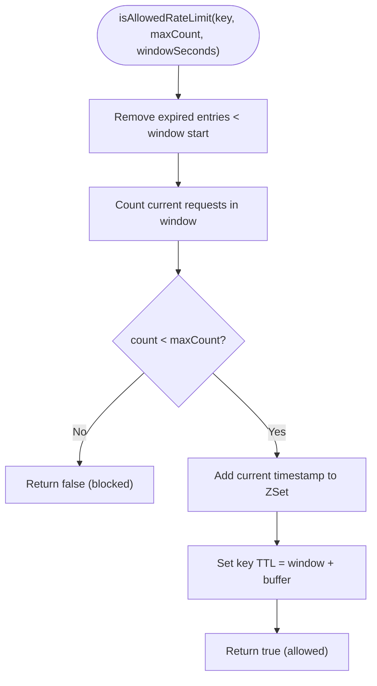
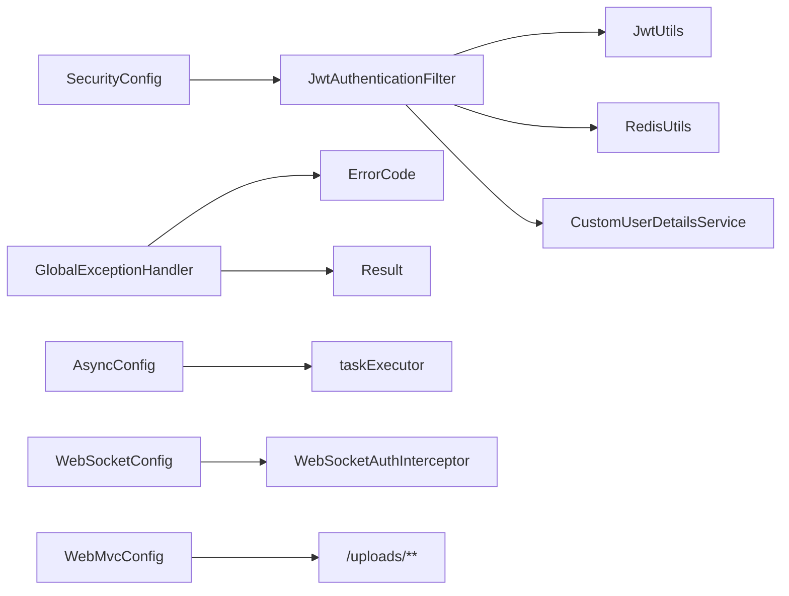

# Cross-cutting Concerns and Infrastructure

<cite>
**Referenced Files in This Document**
- [CampChannelApplication.java](file://camp-channel-server/src/main/java/com/gdmec/campchannel/CampChannelApplication.java)
- [SecurityConfig.java](file://camp-channel-server/src/main/java/com/gdmec/campchannel/config/SecurityConfig.java)
- [JwtAuthenticationFilter.java](file://camp-channel-server/src/main/java/com/gdmec/campchannel/security/JwtAuthenticationFilter.java)
- [CustomUserDetailsService.java](file://camp-channel-server/src/main/java/com/gdmec/campchannel/security/CustomUserDetailsService.java)
- [GlobalExceptionHandler.java](file://camp-channel-server/src/main/java/com/gdmec/campchannel/common/exception/GlobalExceptionHandler.java)
- [BusinessException.java](file://camp-channel-server/src/main/java/com/gdmec/campchannel/common/exception/BusinessException.java)
- [RedisConfig.java](file://camp-channel-server/src/main/java/com/gdmec/campchannel/config/RedisConfig.java)
- [RedisUtils.java](file://camp-channel-server/src/main/java/com/gdmec/campchannel/common/utils/RedisUtils.java)
- [JwtUtils.java](file://camp-channel-server/src/main/java/com/gdmec/campchannel/common/utils/JwtUtils.java)
- [AsyncConfig.java](file://camp-channel-server/src/main/java/com/gdmec/campchannel/config/AsyncConfig.java)
- [WebSocketConfig.java](file://camp-channel-server/src/main/java/com/gdmec/campchannel/config/WebSocketConfig.java)
- [RawWebSocketConfig.java](file://camp-channel-server/src/main/java/com/gdmec/campchannel/config/RawWebSocketConfig.java)
- [WebMvcConfig.java](file://camp-channel-server/src/main/java/com/gdmec/campchannel/config/WebMvcConfig.java)
- [application.yml](file://camp-channel-server/src/main/resources/application.yml)
- [ErrorCode.java](file://camp-channel-server/src/main/java/com/gdmec/campchannel/common/api/ErrorCode.java)
- [Result.java](file://camp-channel-server/src/main/java/com/gdmec/campchannel/common/api/Result.java)
</cite>

## Table of Contents
1. [Introduction](#introduction)
2. [Project Structure](#project-structure)
3. [Core Components](#core-components)
4. [Architecture Overview](#architecture-overview)
5. [Detailed Component Analysis](#detailed-component-analysis)
6. [Dependency Analysis](#dependency-analysis)
7. [Performance Considerations](#performance-considerations)
8. [Troubleshooting Guide](#troubleshooting-guide)
9. [Conclusion](#conclusion)
10. [Appendices](#appendices)

## Introduction
This document focuses on cross-cutting concerns and infrastructure components of the backend server. It covers Spring Security configuration (JWT authentication filter, custom user details service, and authorization rules), Redis configuration for caching, session management, and rate limiting, asynchronous processing configuration and thread pool management, comprehensive error handling with global exception management and custom exception types, logging configuration, and monitoring setup. Practical examples and operational concerns are included to guide secure, scalable, and maintainable deployment.

## Project Structure
The backend is a Spring Boot application with layered configuration:
- Application bootstrap and MyBatis-Plus pagination interceptor
- Security configuration (WebSecurity, method security, CORS, JWT filter)
- Redis configuration and utilities
- Asynchronous task executor
- WebSocket configurations (STOMP and raw)
- MVC resource handlers for uploads
- Global exception handling and unified API response/error codes

**Diagram sources**
- [CampChannelApplication.java:12-30](file://camp-channel-server/src/main/java/com/gdmec/campchannel/CampChannelApplication.java#L12-L30)
- [SecurityConfig.java:34-105](file://camp-channel-server/src/main/java/com/gdmec/campchannel/config/SecurityConfig.java#L34-L105)
- [JwtAuthenticationFilter.java:29-100](file://camp-channel-server/src/main/java/com/gdmec/campchannel/security/JwtAuthenticationFilter.java#L29-L100)
- [CustomUserDetailsService.java:15-46](file://camp-channel-server/src/main/java/com/gdmec/campchannel/security/CustomUserDetailsService.java#L15-L46)
- [RedisConfig.java:17-46](file://camp-channel-server/src/main/java/com/gdmec/campchannel/config/RedisConfig.java#L17-L46)
- [RedisUtils.java:16-170](file://camp-channel-server/src/main/java/com/gdmec/campchannel/common/utils/RedisUtils.java#L16-L170)
- [AsyncConfig.java:12-30](file://camp-channel-server/src/main/java/com/gdmec/campchannel/config/AsyncConfig.java#L12-L30)
- [WebSocketConfig.java:11-36](file://camp-channel-server/src/main/java/com/gdmec/campchannel/config/WebSocketConfig.java#L11-L36)
- [RawWebSocketConfig.java:8-24](file://camp-channel-server/src/main/java/com/gdmec/campchannel/config/RawWebSocketConfig.java#L8-L24)
- [WebMvcConfig.java:8-19](file://camp-channel-server/src/main/java/com/gdmec/campchannel/config/WebMvcConfig.java#L8-L19)
- [GlobalExceptionHandler.java:24-122](file://camp-channel-server/src/main/java/com/gdmec/campchannel/common/exception/GlobalExceptionHandler.java#L24-L122)
- [ErrorCode.java:8-60](file://camp-channel-server/src/main/java/com/gdmec/campchannel/common/api/ErrorCode.java#L8-L60)
- [Result.java:12-88](file://camp-channel-server/src/main/java/com/gdmec/campchannel/common/api/Result.java#L12-L88)

**Section sources**
- [CampChannelApplication.java:12-30](file://camp-channel-server/src/main/java/com/gdmec/campchannel/CampChannelApplication.java#L12-L30)
- [application.yml:1-119](file://camp-channel-server/src/main/resources/application.yml#L1-L119)

## Core Components
- Spring Security configuration with stateless session management, CORS, and JWT filter chain
- Custom user details service supporting email/username dual login
- Unified error handling via global advice and business exception types
- Redis configuration with JSON serialization and sliding window rate limiting
- Asynchronous processing with configurable thread pool and rejected execution policy
- WebSocket STOMP broker and raw WebSocket endpoint support
- Static resource serving for uploads and local file preview

**Section sources**
- [SecurityConfig.java:34-105](file://camp-channel-server/src/main/java/com/gdmec/campchannel/config/SecurityConfig.java#L34-L105)
- [CustomUserDetailsService.java:15-46](file://camp-channel-server/src/main/java/com/gdmec/campchannel/security/CustomUserDetailsService.java#L15-L46)
- [GlobalExceptionHandler.java:24-122](file://camp-channel-server/src/main/java/com/gdmec/campchannel/common/exception/GlobalExceptionHandler.java#L24-L122)
- [BusinessException.java:9-28](file://camp-channel-server/src/main/java/com/gdmec/campchannel/common/exception/BusinessException.java#L9-L28)
- [RedisConfig.java:17-46](file://camp-channel-server/src/main/java/com/gdmec/campchannel/config/RedisConfig.java#L17-L46)
- [RedisUtils.java:16-170](file://camp-channel-server/src/main/java/com/gdmec/campchannel/common/utils/RedisUtils.java#L16-L170)
- [AsyncConfig.java:12-30](file://camp-channel-server/src/main/java/com/gdmec/campchannel/config/AsyncConfig.java#L12-L30)
- [WebSocketConfig.java:11-36](file://camp-channel-server/src/main/java/com/gdmec/campchannel/config/WebSocketConfig.java#L11-L36)
- [RawWebSocketConfig.java:8-24](file://camp-channel-server/src/main/java/com/gdmec/campchannel/config/RawWebSocketConfig.java#L8-L24)
- [WebMvcConfig.java:8-19](file://camp-channel-server/src/main/java/com/gdmec/campchannel/config/WebMvcConfig.java#L8-L19)

## Architecture Overview
The system enforces JWT-based authentication at the HTTP filter level, delegates user loading to a custom service, and centralizes error handling. Redis is used for token validation, single-device login enforcement, and rate limiting. Asynchronous tasks are executed on a dedicated thread pool. WebSocket endpoints support real-time messaging with STOMP and raw protocols.

**Diagram sources**
- [SecurityConfig.java:52-105](file://camp-channel-server/src/main/java/com/gdmec/campchannel/config/SecurityConfig.java#L52-L105)
- [JwtAuthenticationFilter.java:42-100](file://camp-channel-server/src/main/java/com/gdmec/campchannel/security/JwtAuthenticationFilter.java#L42-L100)
- [CustomUserDetailsService.java:22-45](file://camp-channel-server/src/main/java/com/gdmec/campchannel/security/CustomUserDetailsService.java#L22-L45)
- [JwtUtils.java:18-85](file://camp-channel-server/src/main/java/com/gdmec/campchannel/common/utils/JwtUtils.java#L18-L85)
- [RedisUtils.java:16-170](file://camp-channel-server/src/main/java/com/gdmec/campchannel/common/utils/RedisUtils.java#L16-L170)
- [WebSocketConfig.java:13-36](file://camp-channel-server/src/main/java/com/gdmec/campchannel/config/WebSocketConfig.java#L13-L36)
- [AsyncConfig.java:14-30](file://camp-channel-server/src/main/java/com/gdmec/campchannel/config/AsyncConfig.java#L14-L30)
- [GlobalExceptionHandler.java:24-122](file://camp-channel-server/src/main/java/com/gdmec/campchannel/common/exception/GlobalExceptionHandler.java#L24-L122)
- [Result.java:12-88](file://camp-channel-server/src/main/java/com/gdmec/campchannel/common/api/Result.java#L12-L88)
- [ErrorCode.java:8-60](file://camp-channel-server/src/main/java/com/gdmec/campchannel/common/api/ErrorCode.java#L8-L60)

## Detailed Component Analysis

### Spring Security Configuration
- Stateless session management
- CORS configuration allowing credentials and broad methods
- Public endpoints for authentication, Swagger UI, and uploads
- JWT filter registered before username/password filter
- Customized unauthorized and forbidden responses using unified Result structure

**Diagram sources**
- [JwtAuthenticationFilter.java:42-100](file://camp-channel-server/src/main/java/com/gdmec/campchannel/security/JwtAuthenticationFilter.java#L42-L100)
- [CustomUserDetailsService.java:22-45](file://camp-channel-server/src/main/java/com/gdmec/campchannel/security/CustomUserDetailsService.java#L22-L45)
- [JwtUtils.java:80-83](file://camp-channel-server/src/main/java/com/gdmec/campchannel/common/utils/JwtUtils.java#L80-L83)
- [RedisUtils.java:81-89](file://camp-channel-server/src/main/java/com/gdmec/campchannel/common/utils/RedisUtils.java#L81-L89)
- [SecurityConfig.java:91-102](file://camp-channel-server/src/main/java/com/gdmec/campchannel/config/SecurityConfig.java#L91-L102)

**Section sources**
- [SecurityConfig.java:52-105](file://camp-channel-server/src/main/java/com/gdmec/campchannel/config/SecurityConfig.java#L52-L105)
- [JwtAuthenticationFilter.java:29-113](file://camp-channel-server/src/main/java/com/gdmec/campchannel/security/JwtAuthenticationFilter.java#L29-L113)
- [CustomUserDetailsService.java:15-47](file://camp-channel-server/src/main/java/com/gdmec/campchannel/security/CustomUserDetailsService.java#L15-L47)

### JWT Utilities and Single-Device Enforcement
- Token generation and validation using HMAC-SHA with configured secret and expiration
- Redis-backed enforcement of single active device per user via active token keys
- Graceful handling of expired or malformed tokens with warnings

**Diagram sources**
- [JwtUtils.java:40-83](file://camp-channel-server/src/main/java/com/gdmec/campchannel/common/utils/JwtUtils.java#L40-L83)
- [RedisUtils.java:81-89](file://camp-channel-server/src/main/java/com/gdmec/campchannel/common/utils/RedisUtils.java#L81-L89)
- [JwtAuthenticationFilter.java:76-96](file://camp-channel-server/src/main/java/com/gdmec/campchannel/security/JwtAuthenticationFilter.java#L76-L96)

**Section sources**
- [JwtUtils.java:18-85](file://camp-channel-server/src/main/java/com/gdmec/campchannel/common/utils/JwtUtils.java#L18-L85)
- [RedisUtils.java:16-170](file://camp-channel-server/src/main/java/com/gdmec/campchannel/common/utils/RedisUtils.java#L16-L170)
- [JwtAuthenticationFilter.java:76-96](file://camp-channel-server/src/main/java/com/gdmec/campchannel/security/JwtAuthenticationFilter.java#L76-L96)

### Custom User Details Service
- Loads user by email or username fallback
- Wraps into a SecurityUser-compatible UserDetails for Spring Security

**Section sources**
- [CustomUserDetailsService.java:15-47](file://camp-channel-server/src/main/java/com/gdmec/campchannel/security/CustomUserDetailsService.java#L15-L47)

### Global Exception Management and Custom Exceptions
- Centralized @RestControllerAdvice handling:
  - Business exceptions with mapped error codes
  - JSR-303 validation and binding errors
  - Spring Security authentication/access denied
  - HTTP method not supported and resource not found
  - Unknown/unhandled exceptions
- BusinessException supports custom messages and default system error mapping

**Diagram sources**
- [GlobalExceptionHandler.java:24-122](file://camp-channel-server/src/main/java/com/gdmec/campchannel/common/exception/GlobalExceptionHandler.java#L24-L122)
- [BusinessException.java:9-28](file://camp-channel-server/src/main/java/com/gdmec/campchannel/common/exception/BusinessException.java#L9-L28)
- [ErrorCode.java:8-60](file://camp-channel-server/src/main/java/com/gdmec/campchannel/common/api/ErrorCode.java#L8-L60)
- [Result.java:12-88](file://camp-channel-server/src/main/java/com/gdmec/campchannel/common/api/Result.java#L12-L88)

**Section sources**
- [GlobalExceptionHandler.java:24-122](file://camp-channel-server/src/main/java/com/gdmec/campchannel/common/exception/GlobalExceptionHandler.java#L24-L122)
- [BusinessException.java:9-28](file://camp-channel-server/src/main/java/com/gdmec/campchannel/common/exception/BusinessException.java#L9-L28)
- [ErrorCode.java:8-60](file://camp-channel-server/src/main/java/com/gdmec/campchannel/common/api/ErrorCode.java#L8-L60)
- [Result.java:12-88](file://camp-channel-server/src/main/java/com/gdmec/campchannel/common/api/Result.java#L12-L88)

### Redis Configuration and Utilities
- JSON serialization for values and hashes using Jackson2JsonRedisSerializer
- String serializer for keys and hash keys
- Comprehensive RedisUtils operations:
  - Basic KV operations with TTL
  - Hash operations
  - Sliding window rate limiter leveraging ZSet with automatic cleanup and TTL extension

**Diagram sources**
- [RedisUtils.java:142-168](file://camp-channel-server/src/main/java/com/gdmec/campchannel/common/utils/RedisUtils.java#L142-L168)

**Section sources**
- [RedisConfig.java:17-46](file://camp-channel-server/src/main/java/com/gdmec/campchannel/config/RedisConfig.java#L17-L46)
- [RedisUtils.java:16-170](file://camp-channel-server/src/main/java/com/gdmec/campchannel/common/utils/RedisUtils.java#L16-L170)

### Asynchronous Processing and Thread Pool Management
- EnableAsync globally and define a named task executor
- Core pool size, max pool size, queue capacity, and rejected execution policy configured
- Logging indicates initialization parameters

**Section sources**
- [CampChannelApplication.java:10](file://camp-channel-server/src/main/java/com/gdmec/campchannel/CampChannelApplication.java#L10)
- [AsyncConfig.java:12-30](file://camp-channel-server/src/main/java/com/gdmec/campchannel/config/AsyncConfig.java#L12-L30)

### WebSocket Messaging and Uploads
- STOMP broker with simple broker for topics/queues and user-specific destinations
- Raw WebSocket endpoint for low-level connections
- Static resource handler mapping uploads to local filesystem for preview

**Section sources**
- [WebSocketConfig.java:11-36](file://camp-channel-server/src/main/java/com/gdmec/campchannel/config/WebSocketConfig.java#L11-L36)
- [RawWebSocketConfig.java:8-24](file://camp-channel-server/src/main/java/com/gdmec/campchannel/config/RawWebSocketConfig.java#L8-L24)
- [WebMvcConfig.java:8-19](file://camp-channel-server/src/main/java/com/gdmec/campchannel/config/WebMvcConfig.java#L8-L19)

### Logging and Monitoring Setup
- Console and file logging with structured patterns
- Log levels tuned for application packages and Spring components
- Health checks and metrics are not explicitly configured in the provided files; consider adding Spring Boot Actuator for health, info, and metrics endpoints

**Section sources**
- [application.yml:101-119](file://camp-channel-server/src/main/resources/application.yml#L101-L119)

## Dependency Analysis
High-level dependencies among infrastructure components:
- SecurityConfig depends on JwtAuthenticationFilter, which depends on JwtUtils, RedisUtils, and CustomUserDetailsService
- GlobalExceptionHandler depends on ErrorCode and Result for consistent responses
- AsyncConfig provides a shared executor for asynchronous tasks
- WebSocketConfig integrates with WebSocketAuthInterceptor for STOMP authentication
- WebMvcConfig enables static resource serving for uploads

**Diagram sources**
- [SecurityConfig.java:34-105](file://camp-channel-server/src/main/java/com/gdmec/campchannel/config/SecurityConfig.java#L34-L105)
- [JwtAuthenticationFilter.java:29-113](file://camp-channel-server/src/main/java/com/gdmec/campchannel/security/JwtAuthenticationFilter.java#L29-L113)
- [JwtUtils.java:18-85](file://camp-channel-server/src/main/java/com/gdmec/campchannel/common/utils/JwtUtils.java#L18-L85)
- [RedisUtils.java:16-170](file://camp-channel-server/src/main/java/com/gdmec/campchannel/common/utils/RedisUtils.java#L16-L170)
- [CustomUserDetailsService.java:15-47](file://camp-channel-server/src/main/java/com/gdmec/campchannel/security/CustomUserDetailsService.java#L15-L47)
- [GlobalExceptionHandler.java:24-122](file://camp-channel-server/src/main/java/com/gdmec/campchannel/common/exception/GlobalExceptionHandler.java#L24-L122)
- [ErrorCode.java:8-60](file://camp-channel-server/src/main/java/com/gdmec/campchannel/common/api/ErrorCode.java#L8-L60)
- [Result.java:12-88](file://camp-channel-server/src/main/java/com/gdmec/campchannel/common/api/Result.java#L12-L88)
- [AsyncConfig.java:12-30](file://camp-channel-server/src/main/java/com/gdmec/campchannel/config/AsyncConfig.java#L12-L30)
- [WebSocketConfig.java:11-36](file://camp-channel-server/src/main/java/com/gdmec/campchannel/config/WebSocketConfig.java#L11-L36)
- [WebMvcConfig.java:8-19](file://camp-channel-server/src/main/java/com/gdmec/campchannel/config/WebMvcConfig.java#L8-L19)

**Section sources**
- [SecurityConfig.java:34-105](file://camp-channel-server/src/main/java/com/gdmec/campchannel/config/SecurityConfig.java#L34-L105)
- [JwtAuthenticationFilter.java:29-113](file://camp-channel-server/src/main/java/com/gdmec/campchannel/security/JwtAuthenticationFilter.java#L29-L113)
- [GlobalExceptionHandler.java:24-122](file://camp-channel-server/src/main/java/com/gdmec/campchannel/common/exception/GlobalExceptionHandler.java#L24-L122)

## Performance Considerations
- JWT filter performs minimal work per request; ensure Redis connectivity and latency are optimized
- Sliding window rate limiter uses ZSet operations; monitor cardinality and TTL behavior under load
- Thread pool sizing should match expected async workload; CallerRunsPolicy prevents overload but may increase caller latency
- CORS configuration allows credentials; ensure preflight caching aligns with origin policies
- Consider enabling Spring Boot Actuator for health checks and metrics exposure

[No sources needed since this section provides general guidance]

## Troubleshooting Guide
Common scenarios and resolutions:
- Authentication failures:
  - Verify JWT header configuration and token format
  - Check token expiration and signing key alignment
- Single-device logout:
  - Confirm active token key updates and Redis availability
- Rate limiting:
  - Inspect window seconds and max counts; ensure cleanup and TTL extension occur
- CORS issues:
  - Validate allowed origins and credentials settings
- Logging:
  - Adjust logging levels for targeted diagnostics

**Section sources**
- [JwtAuthenticationFilter.java:61-69](file://camp-channel-server/src/main/java/com/gdmec/campchannel/security/JwtAuthenticationFilter.java#L61-L69)
- [RedisUtils.java:142-168](file://camp-channel-server/src/main/java/com/gdmec/campchannel/common/utils/RedisUtils.java#L142-L168)
- [SecurityConfig.java:110-124](file://camp-channel-server/src/main/java/com/gdmec/campchannel/config/SecurityConfig.java#L110-L124)
- [application.yml:101-119](file://camp-channel-server/src/main/resources/application.yml#L101-L119)

## Conclusion
The backend implements robust cross-cutting concerns:
- Secure, stateless JWT authentication with single-device enforcement
- Unified error handling and consistent API responses
- Redis-backed caching, hashing, and rate limiting
- Configurable asynchronous processing
- WebSocket support for real-time communication
- Clear logging configuration suitable for development and production

[No sources needed since this section summarizes without analyzing specific files]

## Appendices

### Practical Examples Index
- Security implementation:
  - Configure public endpoints and authorize others using method security
  - Use JwtAuthenticationFilter for stateless authentication
  - Enforce single-device login via Redis active token keys
- Caching strategies:
  - Use RedisTemplate with JSON serialization for typed caching
  - Apply sliding window rate limiting for API throttling
- Error handling patterns:
  - Throw BusinessException with appropriate error codes
  - Handle validation and binding errors centrally
  - Return standardized Result structures

[No sources needed since this section indexes examples conceptually]