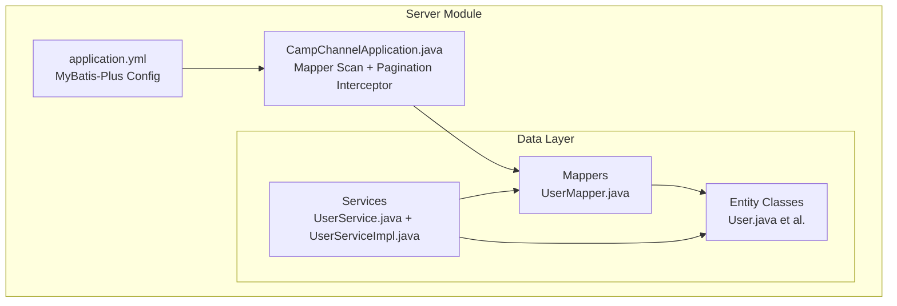
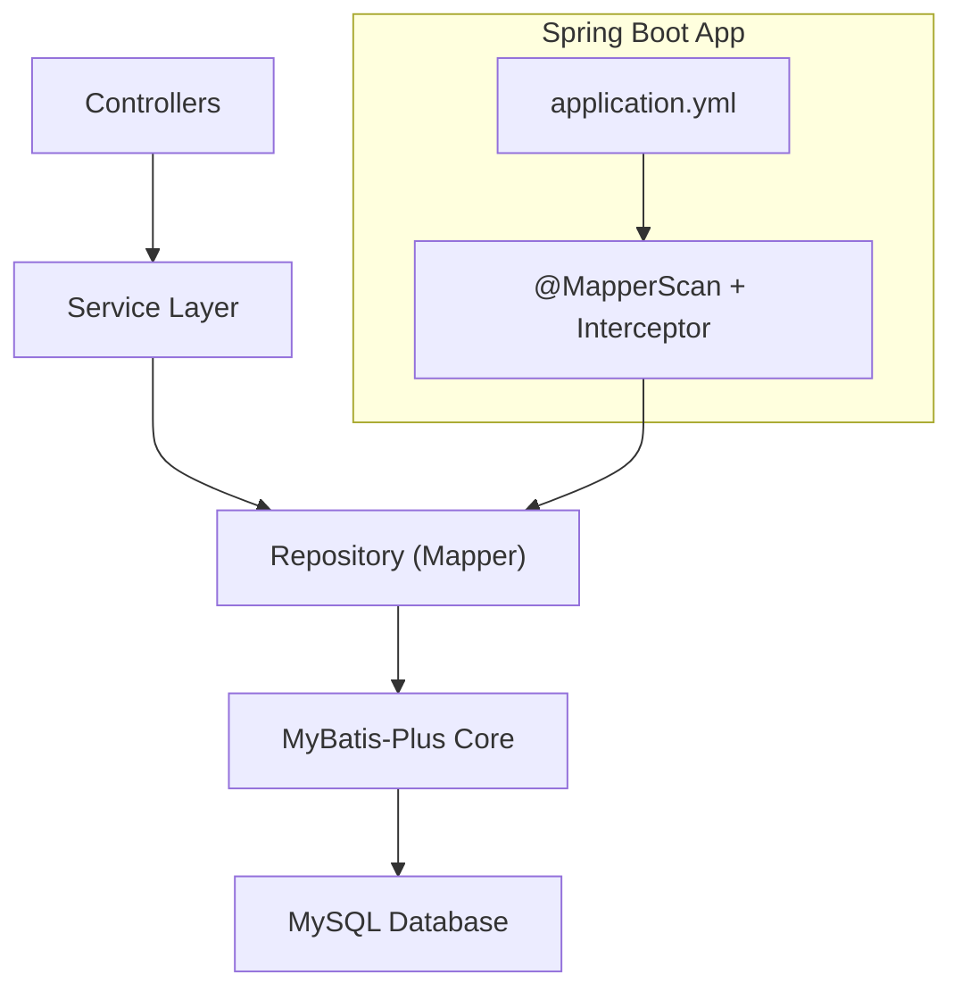
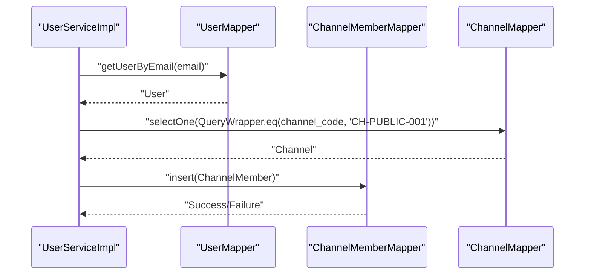
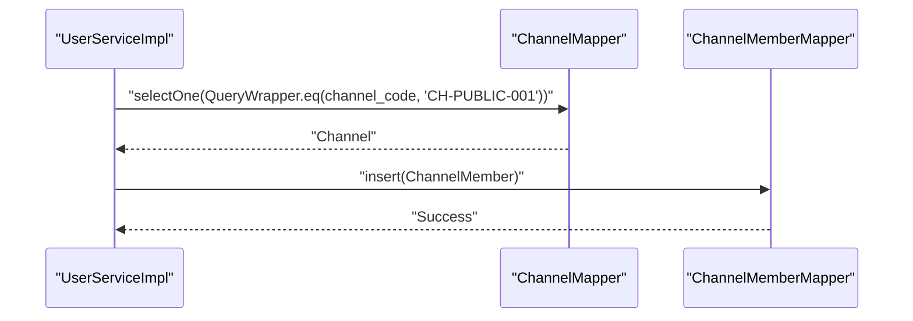
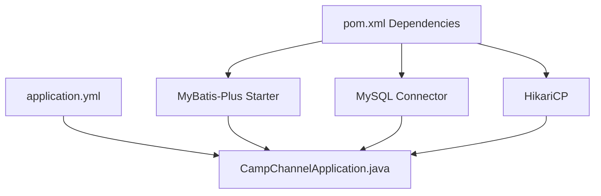
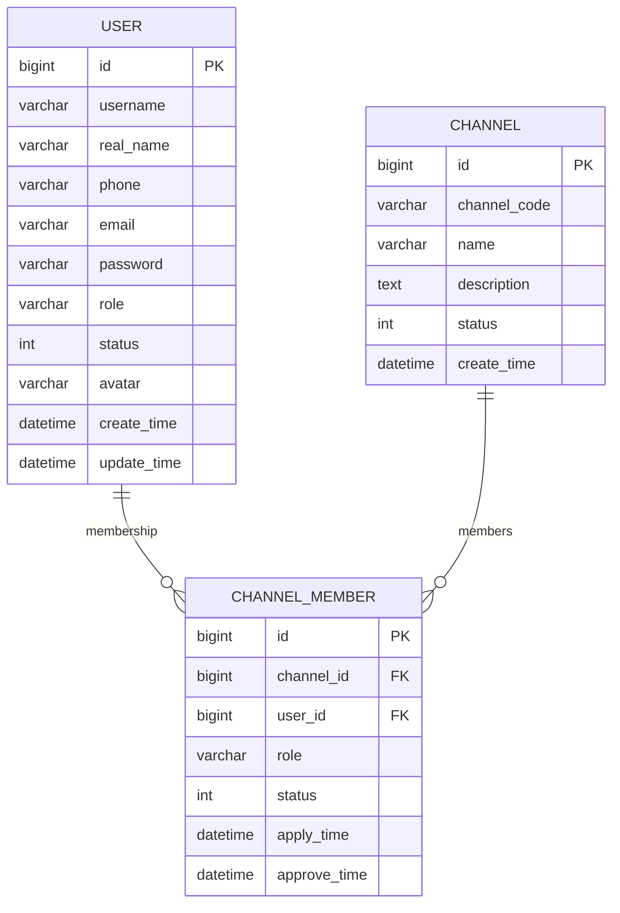

# Data Access Layer and MyBatis-Plus Integration

<cite>
**Referenced Files in This Document**
- [application.yml](file://camp-channel-server/src/main/resources/application.yml)
- [pom.xml](file://camp-channel-server/pom.xml)
- [CampChannelApplication.java](file://camp-channel-server/src/main/java/com/gdmec/campchannel/CampChannelApplication.java)
- [User.java](file://camp-channel-server/src/main/java/com/gdmec/campchannel/entity/User.java)
- [UserMapper.java](file://camp-channel-server/src/main/java/com/gdmec/campchannel/mapper/UserMapper.java)
- [UserService.java](file://camp-channel-server/src/main/java/com/gdmec/campchannel/service/UserService.java)
- [UserServiceImpl.java](file://camp-channel-server/src/main/java/com/gdmec/campchannel/service/impl/UserServiceImpl.java)
- [Channel.java](file://camp-channel-server/src/main/java/com/gdmec/campchannel/entity/Channel.java)
- [ChannelMapper.java](file://camp-channel-server/src/main/java/com/gdmec/campchannel/mapper/ChannelMapper.java)
- [ChannelMember.java](file://camp-channel-server/src/main/java/com/gdmec/campchannel/entity/ChannelMember.java)
- [ChannelMemberMapper.java](file://camp-channel-server/src/main/java/com/gdmec/campchannel/mapper/ChannelMemberMapper.java)
- [schema.sql](file://camp-channel-server/src/main/resources/db/schema.sql)
- [migration-fix.sql](file://camp-channel-server/src/main/resources/db/migration-fix.sql)
- [migrate-database.bat](file://camp-channel-server/migrate-database.bat)
- [run-migration.ps1](file://camp-channel-server/run-migration.ps1)
</cite>

## Table of Contents
1. [Introduction](#introduction)
2. [Project Structure](#project-structure)
3. [Core Components](#core-components)
4. [Architecture Overview](#architecture-overview)
5. [Detailed Component Analysis](#detailed-component-analysis)
6. [Dependency Analysis](#dependency-analysis)
7. [Performance Considerations](#performance-considerations)
8. [Troubleshooting Guide](#troubleshooting-guide)
9. [Conclusion](#conclusion)
10. [Appendices](#appendices)

## Introduction
This document explains the data access layer built with MyBatis-Plus in the server module. It covers entity mapping configuration, automatic CRUD generation via BaseMapper/IService, custom SQL query implementation, repository pattern usage, QueryWrapper-based filtering, pagination strategies, database connection and initialization, transaction management, and performance optimization. Practical examples demonstrate complex queries, batch operations, and data manipulation patterns. We also address schema evolution, migration strategies, and data consistency measures, along with guidelines to write efficient queries and avoid common pitfalls like N+1 problems.

## Project Structure
The data access layer follows a layered architecture:
- Entities define table mappings and metadata.
- Mappers extend BaseMapper to inherit CRUD and query capabilities.
- Services implement business logic and orchestrate transactions.
- Application configuration enables MyBatis-Plus, pagination, and datasource initialization.

**Diagram sources**
- [application.yml:68-77](file://camp-channel-server/src/main/resources/application.yml#L68-L77)
- [CampChannelApplication.java:12-29](file://camp-channel-server/src/main/java/com/gdmec/campchannel/CampChannelApplication.java#L12-L29)
- [User.java:10-42](file://camp-channel-server/src/main/java/com/gdmec/campchannel/entity/User.java#L10-L42)
- [UserMapper.java:1-9](file://camp-channel-server/src/main/java/com/gdmec/campchannel/mapper/UserMapper.java#L1-L9)
- [UserService.java:1-22](file://camp-channel-server/src/main/java/com/gdmec/campchannel/service/UserService.java#L1-L22)
- [UserServiceImpl.java:23-107](file://camp-channel-server/src/main/java/com/gdmec/campchannel/service/impl/UserServiceImpl.java#L23-L107)

**Section sources**
- [application.yml:1-119](file://camp-channel-server/src/main/resources/application.yml#L1-L119)
- [CampChannelApplication.java:1-31](file://camp-channel-server/src/main/java/com/gdmec/campchannel/CampChannelApplication.java#L1-L31)

## Core Components
- Entity mapping: Entities use annotations to map to database tables and columns, with ID strategy configured globally.
- Automatic CRUD: Mappers extend BaseMapper, inheriting standard CRUD and query methods.
- Custom queries: Services use QueryWrapper to build dynamic conditions and perform joins or multi-table operations.
- Repository pattern: Services encapsulate repositories (mappers) and coordinate transactions.
- Pagination: MyBatis-Plus pagination interceptor is registered for MySQL.
- Transactions: Service methods marked with @Transactional ensure atomicity for multi-step operations.
- Initialization: Datasource and schema initialization are configured via application.yml.

**Section sources**
- [User.java:10-42](file://camp-channel-server/src/main/java/com/gdmec/campchannel/entity/User.java#L10-L42)
- [UserMapper.java:1-9](file://camp-channel-server/src/main/java/com/gdmec/campchannel/mapper/UserMapper.java#L1-L9)
- [UserService.java:1-22](file://camp-channel-server/src/main/java/com/gdmec/campchannel/service/UserService.java#L1-L22)
- [UserServiceImpl.java:23-107](file://camp-channel-server/src/main/java/com/gdmec/campchannel/service/impl/UserServiceImpl.java#L23-L107)
- [application.yml:68-77](file://camp-channel-server/src/main/resources/application.yml#L68-L77)
- [CampChannelApplication.java:21-29](file://camp-channel-server/src/main/java/com/gdmec/campchannel/CampChannelApplication.java#L21-L29)

## Architecture Overview
The data access layer integrates Spring Boot, MyBatis-Plus, and MySQL. The application scans for mappers, registers a pagination interceptor, and initializes the schema on startup. Services act as repositories, using mappers for persistence and QueryWrapper for complex queries.

**Diagram sources**
- [application.yml:68-77](file://camp-channel-server/src/main/resources/application.yml#L68-L77)
- [CampChannelApplication.java:12-29](file://camp-channel-server/src/main/java/com/gdmec/campchannel/CampChannelApplication.java#L12-L29)
- [UserMapper.java:1-9](file://camp-channel-server/src/main/java/com/gdmec/campchannel/mapper/UserMapper.java#L1-L9)
- [UserServiceImpl.java:23-107](file://camp-channel-server/src/main/java/com/gdmec/campchannel/service/impl/UserServiceImpl.java#L23-L107)

## Detailed Component Analysis

### Entity Mapping Configuration
- Table and column mapping: Entities annotate table names and primary keys, enabling automatic mapping.
- Global ID strategy: Auto-increment ID type is configured globally.
- Naming strategy: Underscores are mapped to camelCase automatically.

Key configuration locations:
- Entity annotations and fields: [User.java:10-42](file://camp-channel-server/src/main/java/com/gdmec/campchannel/entity/User.java#L10-L42)
- Global ID type and mapper locations: [application.yml:68-77](file://camp-channel-server/src/main/resources/application.yml#L68-L77)

**Section sources**
- [User.java:10-42](file://camp-channel-server/src/main/java/com/gdmec/campchannel/entity/User.java#L10-L42)
- [application.yml:68-77](file://camp-channel-server/src/main/resources/application.yml#L68-L77)

### Automatic CRUD Generation
- BaseMapper inheritance: Mappers extend BaseMapper to gain CRUD methods out-of-the-box.
- IService pattern: Services extend IService and use ServiceImpl for higher-level operations.

References:
- [UserMapper.java:1-9](file://camp-channel-server/src/main/java/com/gdmec/campchannel/mapper/UserMapper.java#L1-L9)
- [UserService.java:1-22](file://camp-channel-server/src/main/java/com/gdmec/campchannel/service/UserService.java#L1-L22)
- [UserServiceImpl.java:23-107](file://camp-channel-server/src/main/java/com/gdmec/campchannel/service/impl/UserServiceImpl.java#L23-L107)

**Section sources**
- [UserMapper.java:1-9](file://camp-channel-server/src/main/java/com/gdmec/campchannel/mapper/UserMapper.java#L1-L9)
- [UserService.java:1-22](file://camp-channel-server/src/main/java/com/gdmec/campchannel/service/UserService.java#L1-L22)
- [UserServiceImpl.java:23-107](file://camp-channel-server/src/main/java/com/gdmec/campchannel/service/impl/UserServiceImpl.java#L23-L107)

### Custom SQL Query Implementation
- QueryWrapper usage: Services construct dynamic filters and conditions.
- Multi-table operations: Services join entities by querying related mappers and applying conditions.

Example references:
- Single-field equality queries: [UserServiceImpl.java:36-44](file://camp-channel-server/src/main/java/com/gdmec/campchannel/service/impl/UserServiceImpl.java#L36-L44)
- Join-like operation across entities: [UserServiceImpl.java:86-102](file://camp-channel-server/src/main/java/com/gdmec/campchannel/service/impl/UserServiceImpl.java#L86-L102)

**Diagram sources**
- [UserServiceImpl.java:36-44](file://camp-channel-server/src/main/java/com/gdmec/campchannel/service/impl/UserServiceImpl.java#L36-L44)
- [UserServiceImpl.java:86-102](file://camp-channel-server/src/main/java/com/gdmec/campchannel/service/impl/UserServiceImpl.java#L86-L102)

**Section sources**
- [UserServiceImpl.java:36-44](file://camp-channel-server/src/main/java/com/gdmec/campchannel/service/impl/UserServiceImpl.java#L36-L44)
- [UserServiceImpl.java:86-102](file://camp-channel-server/src/main/java/com/gdmec/campchannel/service/impl/UserServiceImpl.java#L86-L102)

### Repository Pattern Implementation
- Repositories: Mappers encapsulate data access logic.
- Services: Orchestrate repositories, apply business rules, and manage transactions.

References:
- [UserMapper.java:1-9](file://camp-channel-server/src/main/java/com/gdmec/campchannel/mapper/UserMapper.java#L1-L9)
- [UserService.java:1-22](file://camp-channel-server/src/main/java/com/gdmec/campchannel/service/UserService.java#L1-L22)
- [UserServiceImpl.java:23-107](file://camp-channel-server/src/main/java/com/gdmec/campchannel/service/impl/UserServiceImpl.java#L23-L107)

**Section sources**
- [UserMapper.java:1-9](file://camp-channel-server/src/main/java/com/gdmec/campchannel/mapper/UserMapper.java#L1-L9)
- [UserService.java:1-22](file://camp-channel-server/src/main/java/com/gdmec/campchannel/service/UserService.java#L1-L22)
- [UserServiceImpl.java:23-107](file://camp-channel-server/src/main/java/com/gdmec/campchannel/service/impl/UserServiceImpl.java#L23-L107)

### Query Wrapper Usage
- Dynamic conditions: Build filters using QueryWrapper for equals, comparisons, and logical combinations.
- Projection and ordering: Combine with select and orderBy clauses for optimized retrieval.

Reference:
- [UserServiceImpl.java:36-44](file://camp-channel-server/src/main/java/com/gdmec/campchannel/service/impl/UserServiceImpl.java#L36-L44)

**Section sources**
- [UserServiceImpl.java:36-44](file://camp-channel-server/src/main/java/com/gdmec/campchannel/service/impl/UserServiceImpl.java#L36-L44)

### Pagination Strategies
- Pagination interceptor: Registered for MySQL to transparently handle page requests.
- Configuration: Enabled via MyBatis-Plus configuration and mapper locations.

References:
- [CampChannelApplication.java:21-29](file://camp-channel-server/src/main/java/com/gdmec/campchannel/CampChannelApplication.java#L21-L29)
- [application.yml:68-77](file://camp-channel-server/src/main/resources/application.yml#L68-L77)

**Section sources**
- [CampChannelApplication.java:21-29](file://camp-channel-server/src/main/java/com/gdmec/campchannel/CampChannelApplication.java#L21-L29)
- [application.yml:68-77](file://camp-channel-server/src/main/resources/application.yml#L68-L77)

### Database Connection Configuration
- Datasource: MySQL JDBC driver, URL, credentials, and HikariCP pool settings.
- Schema initialization: SQL script location and initialization mode.

References:
- [application.yml:13-29](file://camp-channel-server/src/main/resources/application.yml#L13-L29)

**Section sources**
- [application.yml:13-29](file://camp-channel-server/src/main/resources/application.yml#L13-L29)

### Transaction Management
- Annotation-driven transactions: Methods annotated with @Transactional ensure rollback on exceptions.
- Multi-step operations: Registration process demonstrates combining user creation and membership assignment within a single transaction.

References:
- [UserServiceImpl.java:47-105](file://camp-channel-server/src/main/java/com/gdmec/campchannel/service/impl/UserServiceImpl.java#L47-L105)

**Section sources**
- [UserServiceImpl.java:47-105](file://camp-channel-server/src/main/java/com/gdmec/campchannel/service/impl/UserServiceImpl.java#L47-L105)

### Performance Optimization Techniques
- Enable MyBatis-Plus logging selectively for debugging.
- Use QueryWrapper with selective field selection to reduce payload.
- Prefer batch operations for bulk inserts/updates where applicable.
- Leverage pagination to avoid loading large datasets.
- Keep caches disabled at the MyBatis level to prevent stale reads in distributed environments.

References:
- [application.yml:102-119](file://camp-channel-server/src/main/resources/application.yml#L102-L119)
- [application.yml:70-72](file://camp-channel-server/src/main/resources/application.yml#L70-L72)

**Section sources**
- [application.yml:102-119](file://camp-channel-server/src/main/resources/application.yml#L102-L119)
- [application.yml:70-72](file://camp-channel-server/src/main/resources/application.yml#L70-L72)

### Practical Examples

#### Complex Queries Across Entities
- Join-like logic: Retrieve a channel by code and create a membership record for a newly registered user.
- References:
  - [UserServiceImpl.java:86-102](file://camp-channel-server/src/main/java/com/gdmec/campchannel/service/impl/UserServiceImpl.java#L86-L102)
  - [Channel.java](file://camp-channel-server/src/main/java/com/gdmec/campchannel/entity/Channel.java)
  - [ChannelMapper.java](file://camp-channel-server/src/main/java/com/gdmec/campchannel/mapper/ChannelMapper.java)
  - [ChannelMember.java](file://camp-channel-server/src/main/java/com/gdmec/campchannel/entity/ChannelMember.java)
  - [ChannelMemberMapper.java](file://camp-channel-server/src/main/java/com/gdmec/campchannel/mapper/ChannelMemberMapper.java)

**Diagram sources**
- [UserServiceImpl.java:86-102](file://camp-channel-server/src/main/java/com/gdmec/campchannel/service/impl/UserServiceImpl.java#L86-L102)
- [Channel.java](file://camp-channel-server/src/main/java/com/gdmec/campchannel/entity/Channel.java)
- [ChannelMember.java](file://camp-channel-server/src/main/java/com/gdmec/campchannel/entity/ChannelMember.java)
- [ChannelMapper.java](file://camp-channel-server/src/main/java/com/gdmec/campchannel/mapper/ChannelMapper.java)
- [ChannelMemberMapper.java](file://camp-channel-server/src/main/java/com/gdmec/campchannel/mapper/ChannelMemberMapper.java)

#### Batch Operations
- Use batch insert/update/delete APIs provided by MyBatis-Plus for improved throughput when handling large volumes.
- Reference: [pom.xml:61-77](file://camp-channel-server/pom.xml#L61-L77)

**Section sources**
- [pom.xml:61-77](file://camp-channel-server/pom.xml#L61-L77)

#### Data Manipulation Patterns
- Validation before persistence: Check uniqueness and business rules before saving.
- Default value assignment: Populate derived fields during creation.
- References:
  - [UserServiceImpl.java:48-84](file://camp-channel-server/src/main/java/com/gdmec/campchannel/service/impl/UserServiceImpl.java#L48-L84)

**Section sources**
- [UserServiceImpl.java:48-84](file://camp-channel-server/src/main/java/com/gdmec/campchannel/service/impl/UserServiceImpl.java#L48-L84)

### Soft Deletes
- Not implemented in the current codebase.
- Recommended approach: Introduce a deleted flag or datetime field in entities and configure a global handler in MyBatis-Plus to exclude deleted records by default.

[No sources needed since this section provides general guidance]

### Database Schema Evolution and Migration
- Initial schema: Loaded via SQL initialization.
- Migration scripts: Additional fixes and incremental updates.
- Migration automation: Batch and PowerShell scripts support automated migration runs.

References:
- [schema.sql](file://camp-channel-server/src/main/resources/db/schema.sql)
- [migration-fix.sql](file://camp-channel-server/src/main/resources/db/migration-fix.sql)
- [migrate-database.bat](file://camp-channel-server/migrate-database.bat)
- [run-migration.ps1](file://camp-channel-server/run-migration.ps1)

**Section sources**
- [schema.sql](file://camp-channel-server/src/main/resources/db/schema.sql)
- [migration-fix.sql](file://camp-channel-server/src/main/resources/db/migration-fix.sql)
- [migrate-database.bat](file://camp-channel-server/migrate-database.bat)
- [run-migration.ps1](file://camp-channel-server/run-migration.ps1)

## Dependency Analysis
The data access layer depends on Spring Boot, MyBatis-Plus starter, MySQL connector, and HikariCP. The application registers the MyBatis-Plus interceptor and scans for mappers.

**Diagram sources**
- [pom.xml:61-77](file://camp-channel-server/pom.xml#L61-L77)
- [application.yml:13-29](file://camp-channel-server/src/main/resources/application.yml#L13-L29)
- [CampChannelApplication.java:12-29](file://camp-channel-server/src/main/java/com/gdmec/campchannel/CampChannelApplication.java#L12-L29)

**Section sources**
- [pom.xml:61-77](file://camp-channel-server/pom.xml#L61-L77)
- [application.yml:13-29](file://camp-channel-server/src/main/resources/application.yml#L13-L29)
- [CampChannelApplication.java:12-29](file://camp-channel-server/src/main/java/com/gdmec/campchannel/CampChannelApplication.java#L12-L29)

## Performance Considerations
- Logging: Enable debug logs selectively for MyBatis-Plus and DAO layers to monitor query performance.
- Caching: Disable second-level caches at the MyBatis level to avoid stale reads.
- Pagination: Always paginate large result sets.
- Selectivity: Use QueryWrapper to limit returned columns and rows.
- Batch operations: Prefer batch APIs for bulk writes.

**Section sources**
- [application.yml:102-119](file://camp-channel-server/src/main/resources/application.yml#L102-L119)
- [application.yml:70-72](file://camp-channel-server/src/main/resources/application.yml#L70-L72)

## Troubleshooting Guide
- Connection failures: Verify datasource URL, credentials, and network connectivity.
- Schema initialization errors: Confirm SQL script path and mode settings.
- Pagination not applied: Ensure the interceptor bean is registered and mapper locations are correct.
- Transaction anomalies: Check @Transactional boundaries and exception propagation.

**Section sources**
- [application.yml:13-29](file://camp-channel-server/src/main/resources/application.yml#L13-L29)
- [application.yml:68-77](file://camp-channel-server/src/main/resources/application.yml#L68-L77)
- [CampChannelApplication.java:21-29](file://camp-channel-server/src/main/java/com/gdmec/campchannel/CampChannelApplication.java#L21-L29)

## Conclusion
The data access layer leverages MyBatis-Plus to provide a clean, maintainable abstraction over MySQL. Entities are mapped with minimal configuration, CRUD is generated automatically, and services encapsulate complex workflows with explicit transaction boundaries. QueryWrapper supports flexible filtering, while pagination and careful logging help maintain performance. Schema evolution is supported through initialization and migration scripts, and the architecture is ready to adopt advanced features like soft deletes and batch operations.

## Appendices

### Entity-Relationship Overview

**Diagram sources**
- [User.java:10-42](file://camp-channel-server/src/main/java/com/gdmec/campchannel/entity/User.java#L10-L42)
- [Channel.java](file://camp-channel-server/src/main/java/com/gdmec/campchannel/entity/Channel.java)
- [ChannelMember.java](file://camp-channel-server/src/main/java/com/gdmec/campchannel/entity/ChannelMember.java)