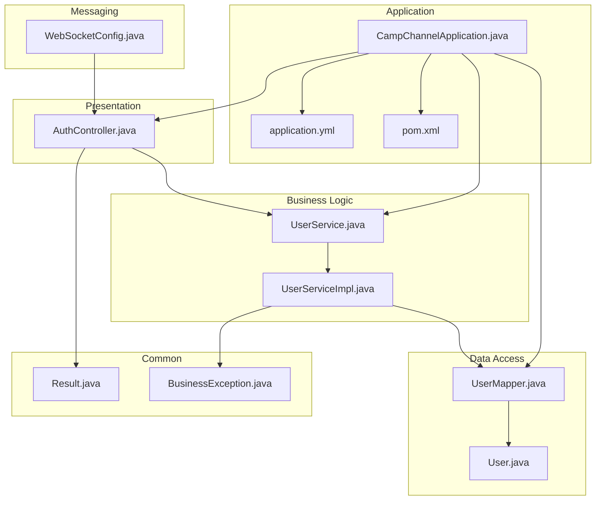
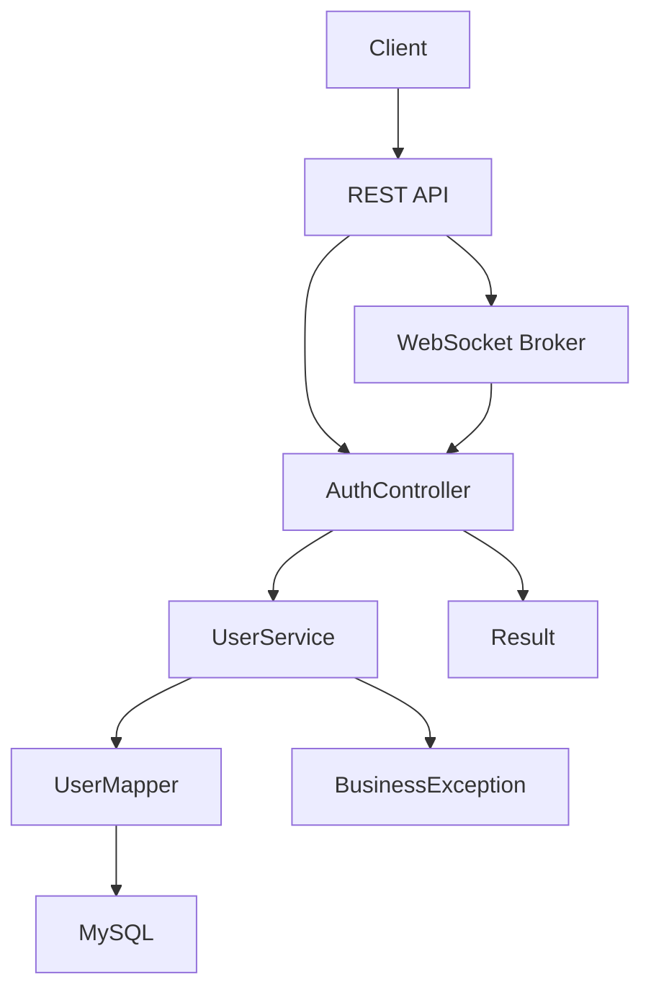
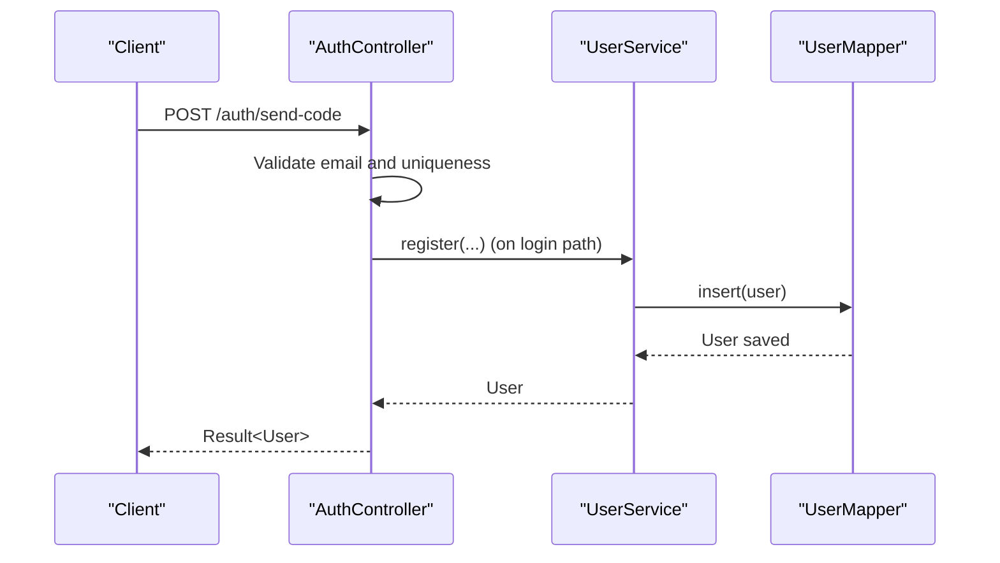
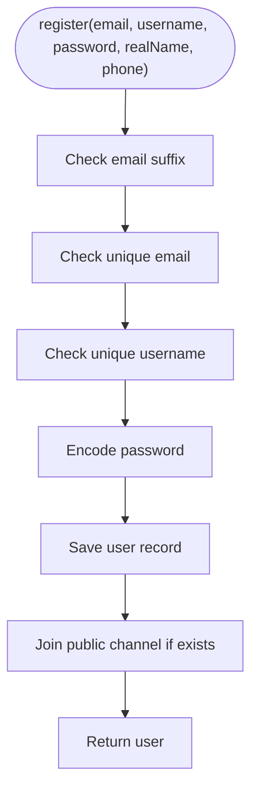
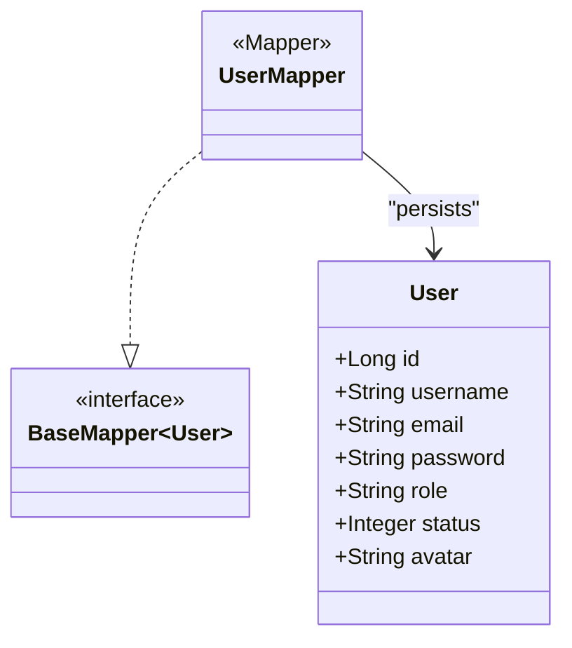
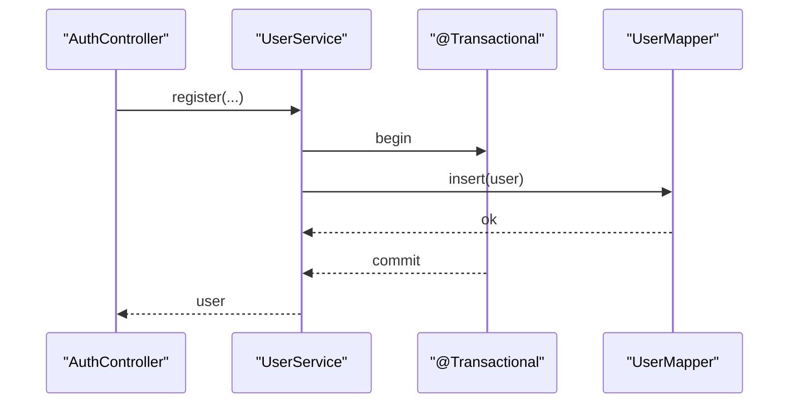
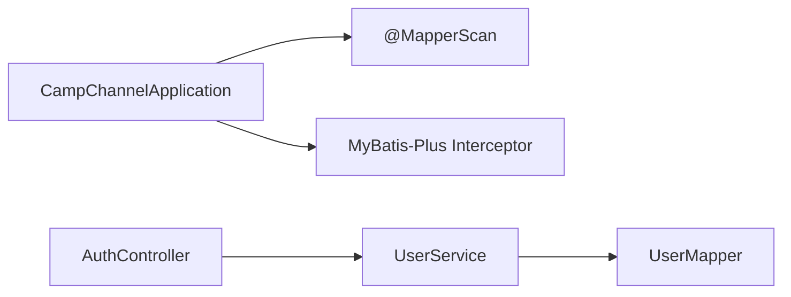
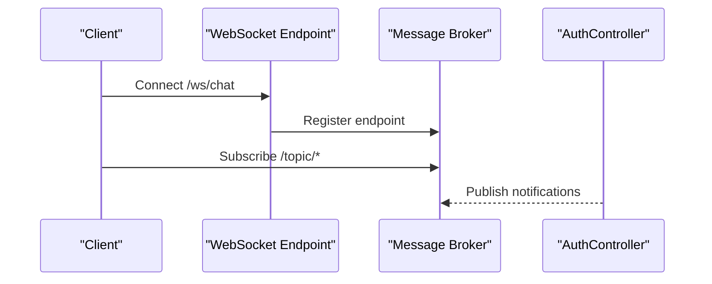
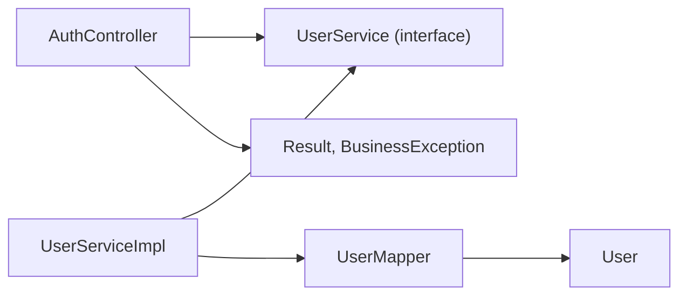

# Layered Architecture and Design Patterns

<cite>
**Referenced Files in This Document**
- [CampChannelApplication.java](file://camp-channel-server/src/main/java/com/gdmec/campchannel/CampChannelApplication.java)
- [pom.xml](file://camp-channel-server/pom.xml)
- [application.yml](file://camp-channel-server/src/main/resources/application.yml)
- [AuthController.java](file://camp-channel-server/src/main/java/com/gdmec/campchannel/controller/AuthController.java)
- [UserService.java](file://camp-channel-server/src/main/java/com/gdmec/campchannel/service/UserService.java)
- [UserServiceImpl.java](file://camp-channel-server/src/main/java/com/gdmec/campchannel/service/impl/UserServiceImpl.java)
- [UserMapper.java](file://camp-channel-server/src/main/java/com/gdmec/campchannel/mapper/UserMapper.java)
- [User.java](file://camp-channel-server/src/main/java/com/gdmec/campchannel/entity/User.java)
- [Result.java](file://camp-channel-server/src/main/java/com/gdmec/campchannel/common/api/Result.java)
- [BusinessException.java](file://camp-channel-server/src/main/java/com/gdmec/campchannel/common/exception/BusinessException.java)
- [WebSocketConfig.java](file://camp-channel-server/src/main/java/com/gdmec/campchannel/config/WebSocketConfig.java)
</cite>

## Table of Contents
1. [Introduction](#introduction)
2. [Project Structure](#project-structure)
3. [Core Components](#core-components)
4. [Architecture Overview](#architecture-overview)
5. [Detailed Component Analysis](#detailed-component-analysis)
6. [Dependency Analysis](#dependency-analysis)
7. [Performance Considerations](#performance-considerations)
8. [Troubleshooting Guide](#troubleshooting-guide)
9. [Conclusion](#conclusion)
10. [Appendices](#appendices)

## Introduction
This document explains the layered architecture and design patterns implemented in the backend. The system follows a three-tier architecture:
- Presentation tier: Controllers handle HTTP requests and responses, delegating business logic to services.
- Business logic tier: Services encapsulate domain rules, orchestrate transactions, and coordinate repositories.
- Data access tier: Repositories (MyBatis-Plus Mappers) abstract persistence operations.

We document the Repository pattern with automatic CRUD and custom SQL, service-layer transaction management, dependency injection, and real-time messaging via WebSocket. We also provide guidelines to maintain clean architecture boundaries and avoid common anti-patterns.

## Project Structure
The backend is organized by layers and bounded contexts:
- Application bootstrap and configuration
- Controllers (presentation)
- Services (business logic)
- Repositories (data access)
- Entities (domain models)
- Common utilities and exceptions
- Messaging configuration

**Diagram sources**
- [CampChannelApplication.java:12-30](file://camp-channel-server/src/main/java/com/gdmec/campchannel/CampChannelApplication.java#L12-L30)
- [application.yml:1-119](file://camp-channel-server/src/main/resources/application.yml#L1-L119)
- [pom.xml:32-135](file://camp-channel-server/pom.xml#L32-L135)
- [AuthController.java:37-41](file://camp-channel-server/src/main/java/com/gdmec/campchannel/controller/AuthController.java#L37-L41)
- [UserService.java:1-22](file://camp-channel-server/src/main/java/com/gdmec/campchannel/service/UserService.java#L1-L22)
- [UserServiceImpl.java:23-25](file://camp-channel-server/src/main/java/com/gdmec/campchannel/service/impl/UserServiceImpl.java#L23-L25)
- [UserMapper.java:1-9](file://camp-channel-server/src/main/java/com/gdmec/campchannel/mapper/UserMapper.java#L1-L9)
- [User.java:10-42](file://camp-channel-server/src/main/java/com/gdmec/campchannel/entity/User.java#L10-L42)
- [Result.java:7-88](file://camp-channel-server/src/main/java/com/gdmec/campchannel/common/api/Result.java#L7-L88)
- [BusinessException.java:6-28](file://camp-channel-server/src/main/java/com/gdmec/campchannel/common/exception/BusinessException.java#L6-L28)
- [WebSocketConfig.java:11-36](file://camp-channel-server/src/main/java/com/gdmec/campchannel/config/WebSocketConfig.java#L11-L36)

**Section sources**
- [CampChannelApplication.java:12-30](file://camp-channel-server/src/main/java/com/gdmec/campchannel/CampChannelApplication.java#L12-L30)
- [pom.xml:32-135](file://camp-channel-server/pom.xml#L32-L135)
- [application.yml:68-77](file://camp-channel-server/src/main/resources/application.yml#L68-L77)

## Core Components
- Presentation (Controllers): Handle HTTP endpoints, validate inputs, enforce basic constraints, and return unified response envelopes.
- Business logic (Services): Encapsulate domain rules, coordinate cross-entity operations, manage transactions, and interact with repositories.
- Data access (Repositories/Mappers): Provide type-safe persistence operations using MyBatis-Plus, supporting automatic CRUD and custom SQL.
- Common utilities: Unified response wrapper and business exception types.
- Messaging: WebSocket configuration enabling real-time communication.

**Section sources**
- [AuthController.java:37-41](file://camp-channel-server/src/main/java/com/gdmec/campchannel/controller/AuthController.java#L37-L41)
- [UserService.java:1-22](file://camp-channel-server/src/main/java/com/gdmec/campchannel/service/UserService.java#L1-L22)
- [UserServiceImpl.java:23-25](file://camp-channel-server/src/main/java/com/gdmec/campchannel/service/impl/UserServiceImpl.java#L23-L25)
- [UserMapper.java:1-9](file://camp-channel-server/src/main/java/com/gdmec/campchannel/mapper/UserMapper.java#L1-L9)
- [Result.java:7-88](file://camp-channel-server/src/main/java/com/gdmec/campchannel/common/api/Result.java#L7-L88)
- [BusinessException.java:6-28](file://camp-channel-server/src/main/java/com/gdmec/campchannel/common/exception/BusinessException.java#L6-L28)
- [WebSocketConfig.java:11-36](file://camp-channel-server/src/main/java/com/gdmec/campchannel/config/WebSocketConfig.java#L11-L36)

## Architecture Overview
The system adheres to layered architecture with clear separation of concerns:
- Controllers depend on Services (not on Repositories).
- Services depend on Repositories and other Services.
- Repositories depend on Entities and MyBatis-Plus infrastructure.
- Common utilities are shared across layers.
- Messaging is configured at the application level and used by controllers/services.

**Diagram sources**
- [AuthController.java:37-41](file://camp-channel-server/src/main/java/com/gdmec/campchannel/controller/AuthController.java#L37-L41)
- [UserService.java:1-22](file://camp-channel-server/src/main/java/com/gdmec/campchannel/service/UserService.java#L1-L22)
- [UserServiceImpl.java:23-25](file://camp-channel-server/src/main/java/com/gdmec/campchannel/service/impl/UserServiceImpl.java#L23-L25)
- [UserMapper.java:1-9](file://camp-channel-server/src/main/java/com/gdmec/campchannel/mapper/UserMapper.java#L1-L9)
- [Result.java:7-88](file://camp-channel-server/src/main/java/com/gdmec/campchannel/common/api/Result.java#L7-L88)
- [BusinessException.java:6-28](file://camp-channel-server/src/main/java/com/gdmec/campchannel/common/exception/BusinessException.java#L6-L28)
- [WebSocketConfig.java:11-36](file://camp-channel-server/src/main/java/com/gdmec/campchannel/config/WebSocketConfig.java#L11-L36)

## Detailed Component Analysis

### Presentation Layer: Controllers
Controllers are responsible for:
- Request mapping and validation
- Basic input checks and rate limiting
- Delegation to services
- Returning unified responses

Example: AuthController
- Sends verification code with rate limiting via Redis
- Registers users after validating code
- Authenticates users, enforces lockout policy, issues JWT tokens, records login devices

**Diagram sources**
- [AuthController.java:61-91](file://camp-channel-server/src/main/java/com/gdmec/campchannel/controller/AuthController.java#L61-L91)
- [AuthController.java:93-122](file://camp-channel-server/src/main/java/com/gdmec/campchannel/controller/AuthController.java#L93-L122)
- [AuthController.java:124-207](file://camp-channel-server/src/main/java/com/gdmec/campchannel/controller/AuthController.java#L124-L207)
- [UserServiceImpl.java:47-105](file://camp-channel-server/src/main/java/com/gdmec/campchannel/service/impl/UserServiceImpl.java#L47-L105)
- [UserMapper.java:1-9](file://camp-channel-server/src/main/java/com/gdmec/campchannel/mapper/UserMapper.java#L1-L9)

**Section sources**
- [AuthController.java:37-41](file://camp-channel-server/src/main/java/com/gdmec/campchannel/controller/AuthController.java#L37-L41)
- [AuthController.java:61-91](file://camp-channel-server/src/main/java/com/gdmec/campchannel/controller/AuthController.java#L61-L91)
- [AuthController.java:93-122](file://camp-channel-server/src/main/java/com/gdmec/campchannel/controller/AuthController.java#L93-L122)
- [AuthController.java:124-207](file://camp-channel-server/src/main/java/com/gdmec/campchannel/controller/AuthController.java#L124-L207)

### Business Logic Layer: Services
Services encapsulate business rules and orchestrate operations:
- Validation and business constraints
- Transaction boundaries
- Cross-entity coordination
- Integration with external systems (e.g., Redis, email)

Example: UserServiceImpl
- Validates email suffix and uniqueness
- Encodes passwords
- Assigns default avatar
- Auto-enrolls users into a public channel
- Uses @Transactional to ensure atomicity

**Diagram sources**
- [UserServiceImpl.java:47-105](file://camp-channel-server/src/main/java/com/gdmec/campchannel/service/impl/UserServiceImpl.java#L47-L105)

**Section sources**
- [UserService.java:1-22](file://camp-channel-server/src/main/java/com/gdmec/campchannel/service/UserService.java#L1-L22)
- [UserServiceImpl.java:23-25](file://camp-channel-server/src/main/java/com/gdmec/campchannel/service/impl/UserServiceImpl.java#L23-L25)
- [UserServiceImpl.java:47-105](file://camp-channel-server/src/main/java/com/gdmec/campchannel/service/impl/UserServiceImpl.java#L47-L105)

### Data Access Layer: Repository Pattern with MyBatis-Plus
Repositories abstract persistence:
- Automatic CRUD via BaseMapper extended by UserMapper
- Custom SQL supported via XML mapper files (configured in application.yml)
- MyBatis-Plus pagination interceptor configured in application bootstrap

**Diagram sources**
- [UserMapper.java:1-9](file://camp-channel-server/src/main/java/com/gdmec/campchannel/mapper/UserMapper.java#L1-L9)
- [User.java:10-42](file://camp-channel-server/src/main/java/com/gdmec/campchannel/entity/User.java#L10-L42)

**Section sources**
- [UserMapper.java:1-9](file://camp-channel-server/src/main/java/com/gdmec/campchannel/mapper/UserMapper.java#L1-L9)
- [User.java:10-42](file://camp-channel-server/src/main/java/com/gdmec/campchannel/entity/User.java#L10-L42)
- [application.yml:68-77](file://camp-channel-server/src/main/resources/application.yml#L68-L77)
- [CampChannelApplication.java:21-29](file://camp-channel-server/src/main/java/com/gdmec/campchannel/CampChannelApplication.java#L21-L29)

### Transaction Management and Business Rule Enforcement
- Services use @Transactional to demarcate atomic units of work.
- Business rules are enforced in-service (e.g., email suffix validation, uniqueness checks).
- Exceptions are modeled as BusinessException to propagate meaningful errors.

**Diagram sources**
- [AuthController.java:113-119](file://camp-channel-server/src/main/java/com/gdmec/campchannel/controller/AuthController.java#L113-L119)
- [UserServiceImpl.java:47-105](file://camp-channel-server/src/main/java/com/gdmec/campchannel/service/impl/UserServiceImpl.java#L47-L105)

**Section sources**
- [UserServiceImpl.java:47-105](file://camp-channel-server/src/main/java/com/gdmec/campchannel/service/impl/UserServiceImpl.java#L47-L105)
- [BusinessException.java:6-28](file://camp-channel-server/src/main/java/com/gdmec/campchannel/common/exception/BusinessException.java#L6-L28)

### Dependency Injection Patterns
- Spring-managed beans: @Service, @Mapper, @RestController
- Constructor or field injection via @Autowired
- Centralized configuration via @SpringBootApplication and application.yml

**Diagram sources**
- [CampChannelApplication.java:12-30](file://camp-channel-server/src/main/java/com/gdmec/campchannel/CampChannelApplication.java#L12-L30)
- [AuthController.java:43-59](file://camp-channel-server/src/main/java/com/gdmec/campchannel/controller/AuthController.java#L43-L59)
- [UserServiceImpl.java:23-25](file://camp-channel-server/src/main/java/com/gdmec/campchannel/service/impl/UserServiceImpl.java#L23-L25)

**Section sources**
- [CampChannelApplication.java:12-30](file://camp-channel-server/src/main/java/com/gdmec/campchannel/CampChannelApplication.java#L12-L30)
- [AuthController.java:43-59](file://camp-channel-server/src/main/java/com/gdmec/campchannel/controller/AuthController.java#L43-L59)
- [UserServiceImpl.java:23-25](file://camp-channel-server/src/main/java/com/gdmec/campchannel/service/impl/UserServiceImpl.java#L23-L25)

### Real-Time Messaging: WebSocket Configuration
WebSocket is configured to enable real-time messaging:
- STOMP endpoint registration
- Message broker configuration
- Inbound channel interception for authentication

**Diagram sources**
- [WebSocketConfig.java:11-36](file://camp-channel-server/src/main/java/com/gdmec/campchannel/config/WebSocketConfig.java#L11-L36)

**Section sources**
- [WebSocketConfig.java:11-36](file://camp-channel-server/src/main/java/com/gdmec/campchannel/config/WebSocketConfig.java#L11-L36)

### Factory Pattern: Configurable Components
- MyBatis-Plus interceptor configured as a @Bean in the application class
- Redis and JWT configurations centralized in application.yml
- This enables easy swapping of underlying implementations without changing business code

**Section sources**
- [CampChannelApplication.java:21-29](file://camp-channel-server/src/main/java/com/gdmec/campchannel/CampChannelApplication.java#L21-L29)
- [application.yml:68-83](file://camp-channel-server/src/main/resources/application.yml#L68-L83)

### Observer Pattern: Real-Time Notifications
- WebSocket message broker publishes events to subscribed clients
- Controllers/services can publish updates to topics/queues
- Clients receive push notifications without polling

**Section sources**
- [WebSocketConfig.java:24-28](file://camp-channel-server/src/main/java/com/gdmec/campchannel/config/WebSocketConfig.java#L24-L28)

## Dependency Analysis
The system exhibits low coupling and high cohesion:
- Controllers depend on abstractions (interfaces) rather than concrete implementations.
- Services depend on Repositories and other Services.
- Repositories depend on Entities and MyBatis-Plus infrastructure.
- Common utilities are shared but do not introduce cross-layer coupling.

**Diagram sources**
- [AuthController.java:52-56](file://camp-channel-server/src/main/java/com/gdmec/campchannel/controller/AuthController.java#L52-L56)
- [UserService.java:1-22](file://camp-channel-server/src/main/java/com/gdmec/campchannel/service/UserService.java#L1-L22)
- [UserServiceImpl.java:23-25](file://camp-channel-server/src/main/java/com/gdmec/campchannel/service/impl/UserServiceImpl.java#L23-L25)
- [UserMapper.java:1-9](file://camp-channel-server/src/main/java/com/gdmec/campchannel/mapper/UserMapper.java#L1-L9)
- [User.java:10-42](file://camp-channel-server/src/main/java/com/gdmec/campchannel/entity/User.java#L10-L42)
- [Result.java:7-88](file://camp-channel-server/src/main/java/com/gdmec/campchannel/common/api/Result.java#L7-L88)
- [BusinessException.java:6-28](file://camp-channel-server/src/main/java/com/gdmec/campchannel/common/exception/BusinessException.java#L6-L28)

**Section sources**
- [pom.xml:32-135](file://camp-channel-server/pom.xml#L32-L135)
- [application.yml:68-77](file://camp-channel-server/src/main/resources/application.yml#L68-L77)

## Performance Considerations
- Use pagination interceptor configured in the application to avoid large result sets.
- Prefer batch operations for bulk inserts/updates when applicable.
- Cache frequently accessed immutable data in Redis to reduce database load.
- Keep controllers thin; offload heavy computation to services.
- Use DTOs for responses to minimize payload sizes.

[No sources needed since this section provides general guidance]

## Troubleshooting Guide
- Unified response envelope: Use Result helpers to standardize success/failure responses.
- Business exceptions: Throw BusinessException to propagate domain-specific errors.
- Logging: Controllers and services log significant events and failures.
- Rate limiting: Apply Redis-based rate limits for sensitive endpoints (e.g., verification code sending).
- Transaction rollback: Ensure @Transactional is applied to methods that must succeed atomically.

**Section sources**
- [Result.java:32-87](file://camp-channel-server/src/main/java/com/gdmec/campchannel/common/api/Result.java#L32-L87)
- [BusinessException.java:6-28](file://camp-channel-server/src/main/java/com/gdmec/campchannel/common/exception/BusinessException.java#L6-L28)
- [AuthController.java:75-78](file://camp-channel-server/src/main/java/com/gdmec/campchannel/controller/AuthController.java#L75-L78)
- [UserServiceImpl.java:47-105](file://camp-channel-server/src/main/java/com/gdmec/campchannel/service/impl/UserServiceImpl.java#L47-L105)

## Conclusion
The backend implements a clean three-tier architecture with strong separation of concerns:
- Controllers focus on presentation and delegation.
- Services encapsulate business logic and transactions.
- Repositories abstract persistence with MyBatis-Plus.
- Real-time messaging is integrated via WebSocket.
Adhering to these patterns and guidelines helps maintain scalability, testability, and robustness.

[No sources needed since this section summarizes without analyzing specific files]

## Appendices
- Configuration highlights:
  - MyBatis-Plus mapper locations and pagination interceptor
  - Datasource and Redis settings
  - JWT header and token prefix
  - OpenAPI/Swagger paths

**Section sources**
- [application.yml:68-93](file://camp-channel-server/src/main/resources/application.yml#L68-L93)
- [application.yml:13-42](file://camp-channel-server/src/main/resources/application.yml#L13-L42)
- [application.yml:79-83](file://camp-channel-server/src/main/resources/application.yml#L79-L83)