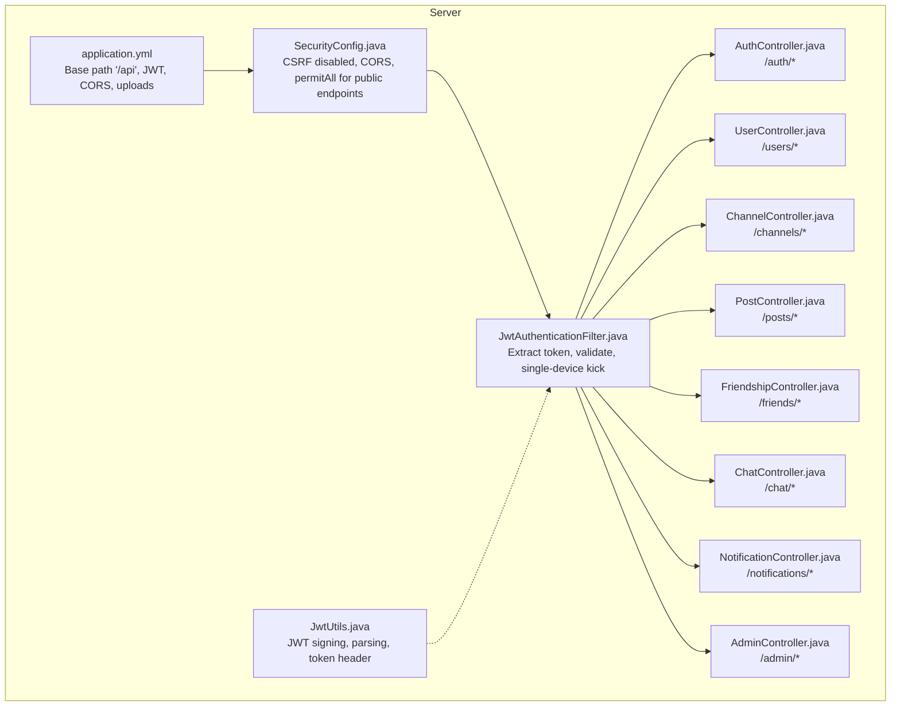
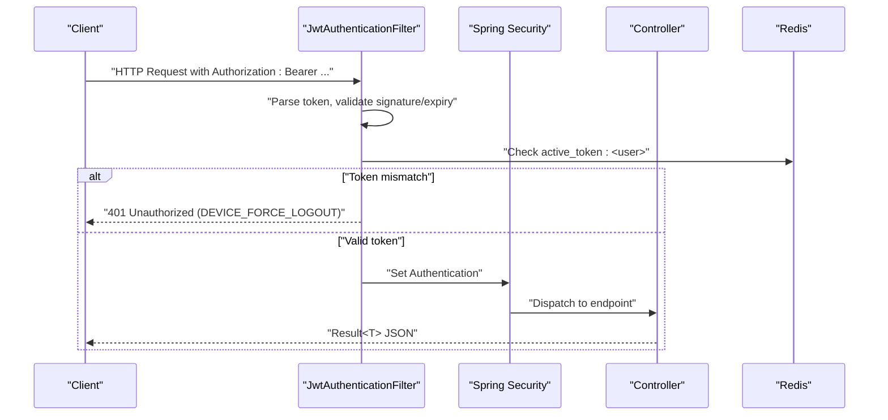
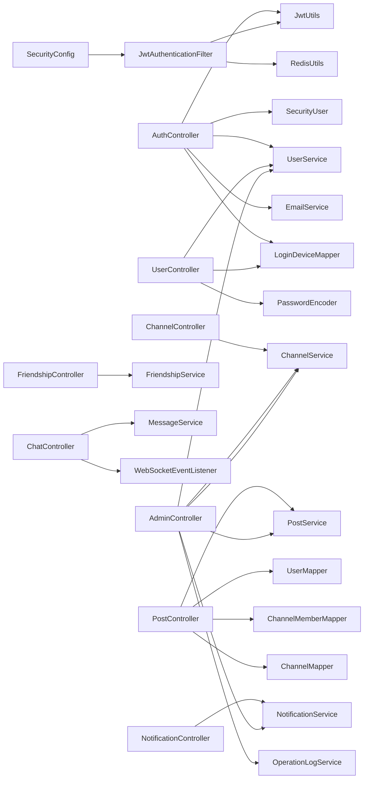

# REST API Design and Implementation

<cite>
**Referenced Files in This Document**
- [Result.java](file://camp-channel-server/src/main/java/com/gdmec/campchannel/common/api/Result.java)
- [ErrorCode.java](file://camp-channel-server/src/main/java/com/gdmec/campchannel/common/api/ErrorCode.java)
- [application.yml](file://camp-channel-server/src/main/resources/application.yml)
- [JwtUtils.java](file://camp-channel-server/src/main/java/com/gdmec/campchannel/common/utils/JwtUtils.java)
- [JwtAuthenticationFilter.java](file://camp-channel-server/src/main/java/com/gdmec/campchannel/security/JwtAuthenticationFilter.java)
- [SecurityConfig.java](file://camp-channel-server/src/main/java/com/gdmec/campchannel/config/SecurityConfig.java)
- [AuthController.java](file://camp-channel-server/src/main/java/com/gdmec/campchannel/controller/AuthController.java)
- [UserController.java](file://camp-channel-server/src/main/java/com/gdmec/campchannel/controller/UserController.java)
- [ChannelController.java](file://camp-channel-server/src/main/java/com/gdmec/campchannel/controller/ChannelController.java)
- [PostController.java](file://camp-channel-server/src/main/java/com/gdmec/campchannel/controller/PostController.java)
- [FriendshipController.java](file://camp-channel-server/src/main/java/com/gdmec/campchannel/controller/FriendshipController.java)
- [ChatController.java](file://camp-channel-server/src/main/java/com/gdmec/campchannel/controller/ChatController.java)
- [NotificationController.java](file://camp-channel-server/src/main/java/com/gdmec/campchannel/controller/NotificationController.java)
- [AdminController.java](file://camp-channel-server/src/main/java/com/gdmec/campchannel/controller/AdminController.java)
</cite>

## Table of Contents
1. [Introduction](#introduction)
2. [Project Structure](#project-structure)
3. [Core Components](#core-components)
4. [Architecture Overview](#architecture-overview)
5. [Detailed Component Analysis](#detailed-component-analysis)
6. [Dependency Analysis](#dependency-analysis)
7. [Performance Considerations](#performance-considerations)
8. [Troubleshooting Guide](#troubleshooting-guide)
9. [Conclusion](#conclusion)
10. [Appendices](#appendices)

## Introduction
This document describes the RESTful API design and implementation of the campus channel platform. It covers HTTP methods, URL patterns, request/response schemas, authentication, standardized response format, error handling, status code conventions, rate limiting, security measures, and practical usage examples. The API follows a unified Result wrapper for all responses and uses JWT-based authentication with method-level protection.

## Project Structure
The server is a Spring Boot application exposing REST endpoints under a base path and secured via Spring Security and JWT. Controllers are grouped by functional domains (authentication, user, channel, post, friendship, chat, notifications, admin). Configuration includes CORS, JWT settings, file upload limits, and OpenAPI/Swagger UI.

**Diagram sources**
- [application.yml:1-119](file://camp-channel-server/src/main/resources/application.yml#L1-L119)
- [SecurityConfig.java:1-137](file://camp-channel-server/src/main/java/com/gdmec/campchannel/config/SecurityConfig.java#L1-L137)
- [JwtUtils.java:1-85](file://camp-channel-server/src/main/java/com/gdmec/campchannel/common/utils/JwtUtils.java#L1-L85)
- [JwtAuthenticationFilter.java:1-113](file://camp-channel-server/src/main/java/com/gdmec/campchannel/security/JwtAuthenticationFilter.java#L1-L113)
- [AuthController.java:1-247](file://camp-channel-server/src/main/java/com/gdmec/campchannel/controller/AuthController.java#L1-L247)
- [UserController.java:1-393](file://camp-channel-server/src/main/java/com/gdmec/campchannel/controller/UserController.java#L1-L393)
- [ChannelController.java:1-168](file://camp-channel-server/src/main/java/com/gdmec/campchannel/controller/ChannelController.java#L1-L168)
- [PostController.java:1-202](file://camp-channel-server/src/main/java/com/gdmec/campchannel/controller/PostController.java#L1-L202)
- [FriendshipController.java:1-116](file://camp-channel-server/src/main/java/com/gdmec/campchannel/controller/FriendshipController.java#L1-L116)
- [ChatController.java:1-166](file://camp-channel-server/src/main/java/com/gdmec/campchannel/controller/ChatController.java#L1-L166)
- [NotificationController.java:1-72](file://camp-channel-server/src/main/java/com/gdmec/campchannel/controller/NotificationController.java#L1-L72)
- [AdminController.java:1-391](file://camp-channel-server/src/main/java/com/gdmec/campchannel/controller/AdminController.java#L1-L391)

**Section sources**
- [application.yml:1-119](file://camp-channel-server/src/main/resources/application.yml#L1-L119)
- [SecurityConfig.java:52-105](file://camp-channel-server/src/main/java/com/gdmec/campchannel/config/SecurityConfig.java#L52-L105)

## Core Components
- Unified response wrapper: Result<T> with fields code, message, data, timestamp.
- Standardized error codes: ErrorCode enum covering success, client errors, auth/session, business domain errors.
- Authentication: JWT with bearer token in Authorization header; single-device login enforcement via Redis.
- Rate limiting: Per-endpoint and per-user limits using Redis keys.
- CORS: Enabled globally; credentials allowed.
- Base path: All REST endpoints are under /api.

Response envelope
- Success: code 200, message success text, data payload.
- Failure: code from ErrorCode, message error text, data null.

**Section sources**
- [Result.java:12-87](file://camp-channel-server/src/main/java/com/gdmec/campchannel/common/api/Result.java#L12-L87)
- [ErrorCode.java:9-59](file://camp-channel-server/src/main/java/com/gdmec/campchannel/common/api/ErrorCode.java#L9-L59)
- [application.yml:4,82-83](file://camp-channel-server/src/main/resources/application.yml#L4,L82-L83)
- [JwtAuthenticationFilter.java:72-99](file://camp-channel-server/src/main/java/com/gdmec/campchannel/security/JwtAuthenticationFilter.java#L72-L99)

## Architecture Overview
High-level flow for authenticated requests:
- Client sends Authorization: Bearer <token>.
- JwtAuthenticationFilter extracts token, validates signature/expiry, checks single-device token freshness.
- If valid, builds Authentication and injects into Spring Security context.
- Controller handles request; returns Result<T>.

**Diagram sources**
- [JwtAuthenticationFilter.java:42-100](file://camp-channel-server/src/main/java/com/gdmec/campchannel/security/JwtAuthenticationFilter.java#L42-L100)
- [JwtUtils.java:80-83](file://camp-channel-server/src/main/java/com/gdmec/campchannel/common/utils/JwtUtils.java#L80-L83)
- [SecurityConfig.java:53-104](file://camp-channel-server/src/main/java/com/gdmec/campchannel/config/SecurityConfig.java#L53-L104)

## Detailed Component Analysis

### Authentication Endpoints
- Base path: /api/auth
- Public endpoints (no auth):
  - POST /send-code: Send registration verification code to email.
  - POST /register: Register user after verifying code.
  - POST /login: Authenticate and issue JWT.
- Authentication required for subsequent operations.

Request/response schemas
- Send code: {"email":"..."}
- Register: {"email":"...","username":"...","password":"...","realName":"...","phone":"...","code":"..."}
- Login: {"email":"...","username":"...","password":"..."} → Result with token and user info.

Common responses
- Success: Result.success(message, data) or Result.success(data).
- Errors: Result.failed(ErrorCode or custom code/message).

Rate limiting
- Verification code send rate limit enforced via Redis key.

Security
- Strong email suffix validation for student domain.
- Password attempts locked after threshold.
- Single-device login enforced via Redis active token.

Example curl
- Send code: curl -X POST "$BASE_URL/api/auth/send-code" -H "Content-Type: application/json" -d '{"email":"student@stu.gdmec.edu.cn"}'
- Register: curl -X POST "$BASE_URL/api/auth/register" -H "Content-Type: application/json" -d '{"email":"...","username":"...","password":"...","realName":"...","phone":"...","code":"..."}'
- Login: curl -X POST "$BASE_URL/api/auth/login" -H "Content-Type: application/json" -d '{"email":"...","username":"...","password":"..."}'

**Section sources**
- [AuthController.java:61-207](file://camp-channel-server/src/main/java/com/gdmec/campchannel/controller/AuthController.java#L61-L207)
- [application.yml:95-98](file://camp-channel-server/src/main/resources/application.yml#L95-L98)

### User Management Endpoints
- Base path: /api/users
- GET /me: Get current user profile (without password).
- GET /profile: Get profile summary with counts.
- GET /{userId}: Get user by ID.
- GET /{userId}/profile: Get user card with posts and friend relationship.
- POST /avatar: Upload avatar (MD5 de-duplication).
- PUT /me: Update profile fields.
- POST /change-password: Change password (invalidates active tokens).
- POST /logout-device: Force logout all devices.
- GET /devices: List login devices.
- POST /devices/{deviceId}/logout: Logout specific device.

Notes
- Authentication required except public profile reads.
- Avatar upload path: /uploads/avatars/<hash.ext>.
- Device logout invalidates active_token and removes device records.

Example curl
- Get profile: curl -H "Authorization: Bearer $TOKEN" "$BASE_URL/api/users/profile"
- Upload avatar: curl -X POST "$BASE_URL/api/users/avatar" -H "Authorization: Bearer $TOKEN" -F "file=@/path/to/image.jpg"
- Change password: curl -X POST "$BASE_URL/api/users/change-password" -H "Authorization: Bearer $TOKEN" -H "Content-Type: application/json" -d '{"oldPassword":"...","newPassword":"..."}'

**Section sources**
- [UserController.java:63-393](file://camp-channel-server/src/main/java/com/gdmec/campchannel/controller/UserController.java#L63-L393)

### Channel Management Endpoints
- Base path: /api/channels
- POST: Create channel (name, description).
- GET /search?keyword=: Search channels.
- GET /my: List joined channels.
- POST /{channelId}/join: Apply to join.
- GET /{channelId}/applications: Pending join applications.
- POST /applications/{applicationId}/approve: Approve/reject application.
- POST /{channelId}/leave: Leave channel.
- PUT /{channelId}: Update channel info.
- GET /{channelId}/members: List members.
- POST /{channelId}/members/{userId}/remove: Remove member.
- POST /{channelId}/members/{userId}/role: Set role.
- GET /applications/pending/count: Count pending apps.
- GET /applications/pending: List pending apps for channel owners.

Roles and permissions
- Owner/admin can manage members and roles.
- Approval required for joining private channels.

Example curl
- Create channel: curl -X POST "$BASE_URL/api/channels" -H "Authorization: Bearer $TOKEN" -H "Content-Type: application/json" -d '{"name":"...","description":"..."}'
- Join channel: curl -X POST "$BASE_URL/api/channels/1/join" -H "Authorization: Bearer $TOKEN"
- Approve application: curl -X POST "$BASE_URL/api/channels/applications/1/approve" -H "Authorization: Bearer $TOKEN" -H "Content-Type: application/json" -d '{"approved":true}'

**Section sources**
- [ChannelController.java:27-151](file://camp-channel-server/src/main/java/com/gdmec/campchannel/controller/ChannelController.java#L27-L151)

### Post Management Endpoints
- Base path: /api/posts
- GET: Feed of posts from joined channels (paginated).
- POST: Create post (channelId, content, images[], videoUrl).
- GET /channel/{channelId}: Channel feed (paginated).
- GET /{postId}: Get post by ID.
- GET /my: Get current user’s posts (paginated).
- DELETE /{postId}: Delete post.
- GET /{postId}/view: Increment view count.
- PUT /{postId}: Edit post.
- GET /user/{userId}: Posts by user (public).
- GET /liked: Posts liked by current user (paginated).

Permissions
- Requires authentication for most operations.
- Deletion/edit restricted to post owner.

Example curl
- Create post: curl -X POST "$BASE_URL/api/posts" -H "Authorization: Bearer $TOKEN" -H "Content-Type: application/json" -d '{"channelId":1,"content":"...","images":[],"videoUrl":""}'
- Get feed: curl "$BASE_URL/api/posts?page=1&size=10" -H "Authorization: Bearer $TOKEN"

**Section sources**
- [PostController.java:32-182](file://camp-channel-server/src/main/java/com/gdmec/campchannel/controller/PostController.java#L32-L182)

### Friendship and Social Endpoints
- Base path: /api/friends
- GET /search?keyword=: Search users.
- POST /request: Send friend request.
- GET /requests/pending: Pending requests.
- POST /requests/{requestId}/approve: Approve request.
- POST /requests/{requestId}/reject: Reject request.
- GET /list: List friends.
- DELETE /{friendId}: Remove friend.
- POST /{friendId}/block: Block friend’s posts.
- POST /{friendId}/unblock: Unblock friend.

Example curl
- Search users: curl "$BASE_URL/api/friends/search?keyword=john" -H "Authorization: Bearer $TOKEN"
- Send request: curl -X POST "$BASE_URL/api/friends/request" -H "Authorization: Bearer $TOKEN" -H "Content-Type: application/json" -d '{"friendId":2}'

**Section sources**
- [FriendshipController.java:27-110](file://camp-channel-server/src/main/java/com/gdmec/campchannel/controller/FriendshipController.java#L27-L110)

### Real-Time Chat Endpoints
- Base path: /api/chat
- GET /online/{userId}: Is user online?
- GET /online/batch?userIds=: Batch online status.
- POST /messages/send: Send message (REST).
- GET /history/{friendId}: Chat history (paginated).
- POST /messages/{messageId}/recall: Recall message (time-bound).
- GET /conversations: Conversations list.
- GET /conversations/with-unread: Conversations with unread counts.
- GET /unread/{friendId}: Unread count with a friend.
- POST /read-all/{friendId}: Mark all as read (pushes read receipt via WebSocket).

Example curl
- Send message: curl -X POST "$BASE_URL/api/chat/messages/send" -H "Authorization: Bearer $TOKEN" -H "Content-Type: application/json" -d '{"receiverId":2,"content":"hi","type":1}'
- Get unread: curl "$BASE_URL/api/chat/unread/2" -H "Authorization: Bearer $TOKEN"

**Section sources**
- [ChatController.java:32-156](file://camp-channel-server/src/main/java/com/gdmec/campchannel/controller/ChatController.java#L32-L156)

### Notifications Endpoints
- Base path: /api/notifications
- GET /unread: List unread notifications.
- GET /unread/count: Count unread.
- POST /{notificationId}/read: Mark one as read.
- POST /read-all: Mark all as read.
- GET /history?page=&size=: Paginated history.

Example curl
- Mark all read: curl -X POST "$BASE_URL/api/notifications/read-all" -H "Authorization: Bearer $TOKEN"

**Section sources**
- [NotificationController.java:25-71](file://camp-channel-server/src/main/java/com/gdmec/campchannel/controller/NotificationController.java#L25-L71)

### Admin Endpoints
- Base path: /api/admin
- Users: list, update status, reset password, delete.
- Channels: list pending/all, delete, update status.
- Content moderation: list pending posts/comments, approve/deny.
- Logs: list operation logs.
- Announcement: broadcast system-wide notification.

Access control
- Requires role sys_admin.

Example curl
- Disable user: curl -X PUT "$BASE_URL/api/admin/users/2/status" -H "Authorization: Bearer $TOKEN" -H "Content-Type: application/json" -d '{"status":0}'
- Approve post: curl -X POST "$BASE_URL/api/admin/posts/1/approve" -H "Authorization: Bearer $TOKEN" -H "Content-Type: application/json" -d '{"approved":true}'

**Section sources**
- [AdminController.java:51-374](file://camp-channel-server/src/main/java/com/gdmec/campchannel/controller/AdminController.java#L51-L374)

## Dependency Analysis
- Controllers depend on services and mappers for persistence and business logic.
- Security depends on JwtUtils for token operations and Redis for single-device enforcement.
- Global configuration defines base path, CORS, and permitAll for public endpoints.

**Diagram sources**
- [AuthController.java:43-59](file://camp-channel-server/src/main/java/com/gdmec/campchannel/controller/AuthController.java#L43-L59)
- [UserController.java:36-58](file://camp-channel-server/src/main/java/com/gdmec/campchannel/controller/UserController.java#L36-L58)
- [ChannelController.java:24-25](file://camp-channel-server/src/main/java/com/gdmec/campchannel/controller/ChannelController.java#L24-L25)
- [PostController.java:82-92](file://camp-channel-server/src/main/java/com/gdmec/campchannel/controller/PostController.java#L82-L92)
- [FriendshipController.java:24-25](file://camp-channel-server/src/main/java/com/gdmec/campchannel/controller/FriendshipController.java#L24-L25)
- [ChatController.java:26-30](file://camp-channel-server/src/main/java/com/gdmec/campchannel/controller/ChatController.java#L26-L30)
- [NotificationController.java:22-23](file://camp-channel-server/src/main/java/com/gdmec/campchannel/controller/NotificationController.java#L22-L23)
- [AdminController.java:27-49](file://camp-channel-server/src/main/java/com/gdmec/campchannel/controller/AdminController.java#L27-L49)
- [SecurityConfig.java:39-40](file://camp-channel-server/src/main/java/com/gdmec/campchannel/config/SecurityConfig.java#L39-L40)
- [JwtAuthenticationFilter.java:33-40](file://camp-channel-server/src/main/java/com/gdmec/campchannel/security/JwtAuthenticationFilter.java#L33-L40)

**Section sources**
- [SecurityConfig.java:52-105](file://camp-channel-server/src/main/java/com/gdmec/campchannel/config/SecurityConfig.java#L52-L105)

## Performance Considerations
- Pagination: Many endpoints support page and size parameters to limit payload sizes.
- Indexing: Ensure database indexes on frequently queried fields (e.g., user_id, channel_id, status).
- Caching: Consider caching public channel/user profiles and popular posts.
- Asynchronous operations: Background tasks for notifications and logs are configured.

[No sources needed since this section provides general guidance]

## Troubleshooting Guide
Common issues and resolutions
- 401 Unauthorized: Invalid or expired token; re-authenticate. Single-device kick returns DEVICE_FORCE_LOGOUT.
- 403 Forbidden: Insufficient privileges (e.g., non-admin calling admin endpoints).
- 429 Too Many Requests: Rate-limited endpoints (verification code send).
- 404 Not Found: Resource does not exist (e.g., post/channel/user).
- 500 Internal Server Error: Unexpected server error; check logs.

Error response format
- Always returns Result with code/message/data/timestamp.

**Section sources**
- [JwtAuthenticationFilter.java:105-111](file://camp-channel-server/src/main/java/com/gdmec/campchannel/security/JwtAuthenticationFilter.java#L105-L111)
- [SecurityConfig.java:91-100](file://camp-channel-server/src/main/java/com/gdmec/campchannel/config/SecurityConfig.java#L91-L100)
- [ErrorCode.java:10-50](file://camp-channel-server/src/main/java/com/gdmec/campchannel/common/api/ErrorCode.java#L10-L50)

## Conclusion
The API provides a consistent, secure, and extensible REST interface with unified responses, robust authentication, and clear error semantics. It supports core social features (authentication, profiles, channels, posts, friendships, chat, notifications) and administrative capabilities. Clients should include Authorization: Bearer <token> for protected endpoints and follow pagination and rate-limiting guidance.

[No sources needed since this section summarizes without analyzing specific files]

## Appendices

### Authentication Requirements
- Header: Authorization: Bearer <token>
- Token stored after login; single-device enforcement via Redis active token.
- Public endpoints: /api/auth/login, /api/auth/register, /api/auth/send-code, /api/swagger-ui.html, /api/v3/api-docs/**, /api/ws/**, /api/uploads/**.

**Section sources**
- [SecurityConfig.java:64-86](file://camp-channel-server/src/main/java/com/gdmec/campchannel/config/SecurityConfig.java#L64-L86)
- [JwtAuthenticationFilter.java:72-99](file://camp-channel-server/src/main/java/com/gdmec/campchannel/security/JwtAuthenticationFilter.java#L72-L99)

### Standardized Response Format
- Success: code 200, message, data, timestamp.
- Failure: code from ErrorCode, message, null data, timestamp.

**Section sources**
- [Result.java:13-30](file://camp-channel-server/src/main/java/com/gdmec/campchannel/common/api/Result.java#L13-L30)
- [ErrorCode.java:10-17](file://camp-channel-server/src/main/java/com/gdmec/campchannel/common/api/ErrorCode.java#L10-L17)

### Status Code Conventions
- 200 OK: Successful operations.
- 400 Bad Request: Invalid parameters or validation failures.
- 401 Unauthorized: No/invalid/expired token or single-device kick.
- 403 Forbidden: Insufficient permissions.
- 404 Not Found: Resource missing.
- 405 Method Not Allowed: HTTP method unsupported.
- 429 Too Many Requests: Rate limiting triggered.
- 500 Internal Server Error: Unexpected server error.

**Section sources**
- [ErrorCode.java:10-17](file://camp-channel-server/src/main/java/com/gdmec/campchannel/common/api/ErrorCode.java#L10-L17)

### Rate Limiting Considerations
- Verification code send: per-email cooldown enforced via Redis.
- Additional business limits: post/comment/like frequency caps implemented in services.

**Section sources**
- [AuthController.java:75-88](file://camp-channel-server/src/main/java/com/gdmec/campchannel/controller/AuthController.java#L75-L88)
- [ErrorCode.java:42-44](file://camp-channel-server/src/main/java/com/gdmec/campchannel/common/api/ErrorCode.java#L42-L44)

### Security Measures
- JWT with HS512 signing, configurable expiration.
- Single-device login enforcement via Redis active token.
- CORS enabled with credentials support.
- Public endpoints explicitly permitted; others require authentication.

**Section sources**
- [JwtUtils.java:66-83](file://camp-channel-server/src/main/java/com/gdmec/campchannel/common/utils/JwtUtils.java#L66-L83)
- [JwtAuthenticationFilter.java:79-96](file://camp-channel-server/src/main/java/com/gdmec/campchannel/security/JwtAuthenticationFilter.java#L79-L96)
- [SecurityConfig.java:110-124](file://camp-channel-server/src/main/java/com/gdmec/campchannel/config/SecurityConfig.java#L110-L124)

### API Versioning Approach
- Base path: /api (context path configured).
- No version segment in URLs; versioning can be introduced at base path (/api/v1) if needed.

**Section sources**
- [application.yml:4](file://camp-channel-server/src/main/resources/application.yml#L4)

### Practical Examples
- Get current profile: curl -H "Authorization: Bearer $TOKEN" "$BASE_URL/api/users/profile"
- Create post: curl -X POST "$BASE_URL/api/posts" -H "Authorization: Bearer $TOKEN" -H "Content-Type: application/json" -d '{"channelId":1,"content":"Hello","images":[],"videoUrl":""}'
- Send chat message: curl -X POST "$BASE_URL/api/chat/messages/send" -H "Authorization: Bearer $TOKEN" -H "Content-Type: application/json" -d '{"receiverId":2,"content":"Hi","type":1}'
- Admin approve post: curl -X POST "$BASE_URL/api/admin/posts/1/approve" -H "Authorization: Bearer $TOKEN" -H "Content-Type: application/json" -d '{"approved":true}'

[No sources needed since this section provides general usage examples]

### Client Implementation Guidelines
- Store token securely (e.g., in memory/secure storage) and attach to all authenticated requests.
- Handle 401 Unauthorized by prompting re-login; handle 403 Forbidden by informing insufficient permissions.
- Respect pagination parameters and rate limits.
- For real-time features, integrate WebSocket connections alongside REST calls.

[No sources needed since this section provides general guidance]

### Integration Patterns with Frontend Applications
- SPA: Use fetch/XHR with Authorization header; persist token in state/local storage.
- Real-time chat: Poll REST endpoints for history and unread counts; subscribe to WebSocket events for live updates.
- Image uploads: Use multipart/form-data for avatar and post media; serve via /uploads.

[No sources needed since this section provides general guidance]