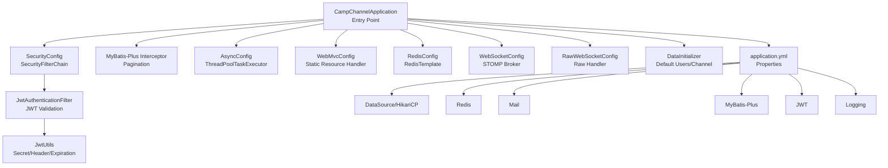
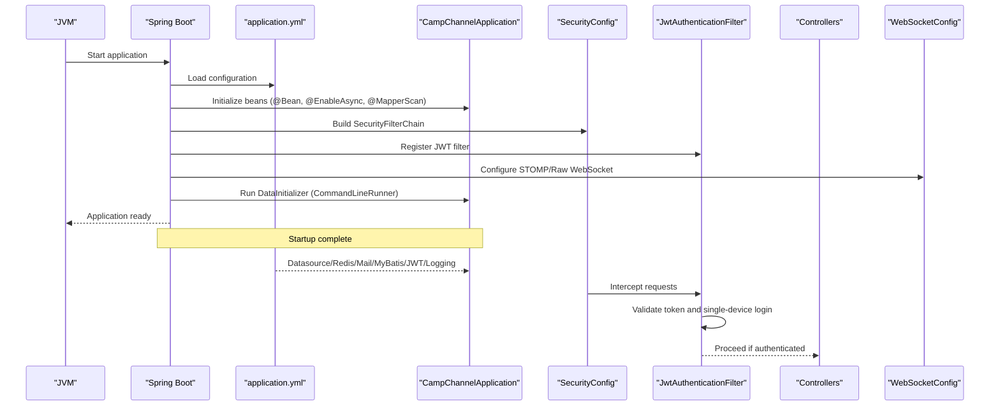
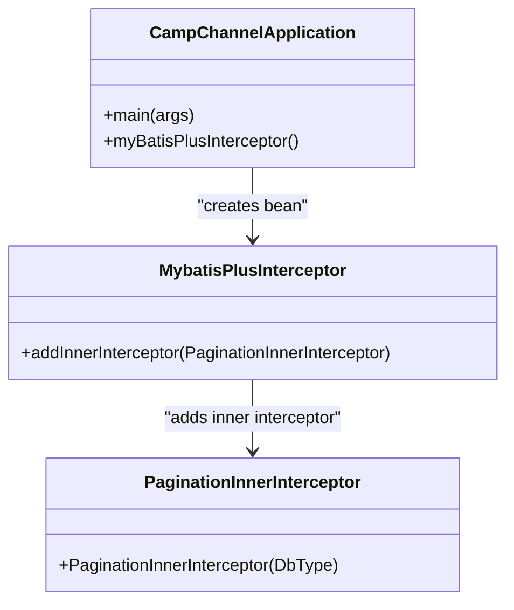
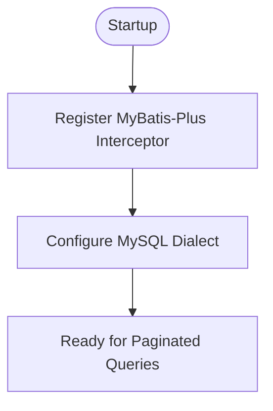
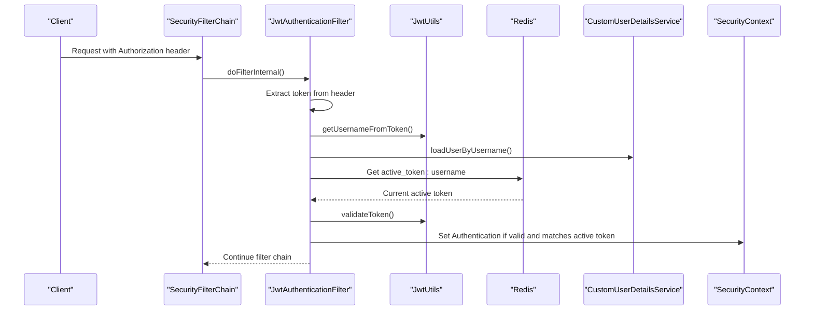
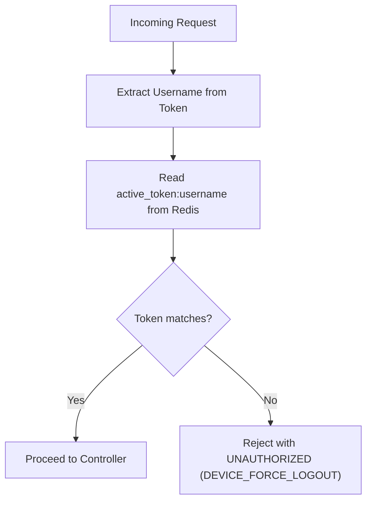
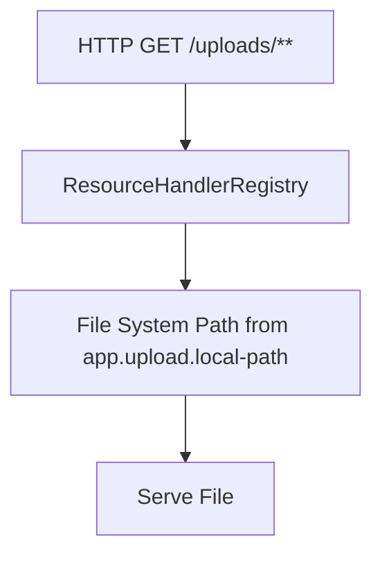
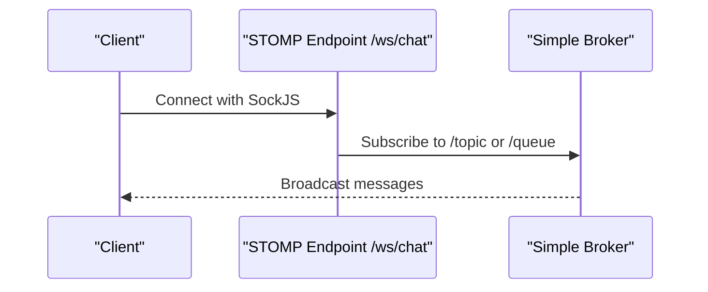
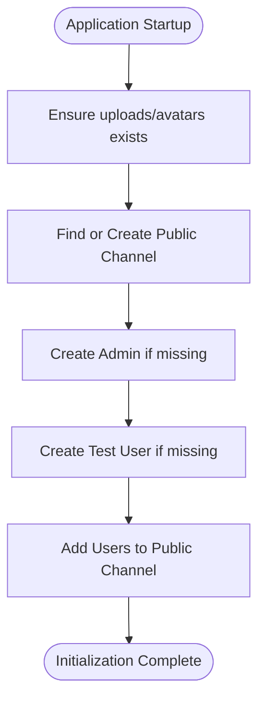

# Spring Boot Application Structure

<cite>
**Referenced Files in This Document**
- [CampChannelApplication.java](file://camp-channel-server/src/main/java/com/gdmec/campchannel/CampChannelApplication.java)
- [application.yml](file://camp-channel-server/src/main/resources/application.yml)
- [pom.xml](file://camp-channel-server/pom.xml)
- [WebMvcConfig.java](file://camp-channel-server/src/main/java/com/gdmec/campchannel/config/WebMvcConfig.java)
- [RedisConfig.java](file://camp-channel-server/src/main/java/com/gdmec/campchannel/config/RedisConfig.java)
- [SecurityConfig.java](file://camp-channel-server/src/main/java/com/gdmec/campchannel/config/SecurityConfig.java)
- [AsyncConfig.java](file://camp-channel-server/src/main/java/com/gdmec/campchannel/config/AsyncConfig.java)
- [DataInitializer.java](file://camp-channel-server/src/main/java/com/gdmec/campchannel/config/DataInitializer.java)
- [JwtAuthenticationFilter.java](file://camp-channel-server/src/main/java/com/gdmec/campchannel/security/JwtAuthenticationFilter.java)
- [JwtUtils.java](file://camp-channel-server/src/main/java/com/gdmec/campchannel/common/utils/JwtUtils.java)
- [WebSocketConfig.java](file://camp-channel-server/src/main/java/com/gdmec/campchannel/config/WebSocketConfig.java)
- [RawWebSocketConfig.java](file://camp-channel-server/src/main/java/com/gdmec/campchannel/config/RawWebSocketConfig.java)
- [schema.sql](file://camp-channel-server/src/main/resources/db/schema.sql)
- [sensitive_words.txt](file://camp-channel-server/src/main/resources/sensitive_words.txt)
- [run-migration.ps1](file://camp-channel-server/run-migration.ps1)
- [migrate-database.bat](file://camp-channel-server/migrate-database.bat)
</cite>

## Table of Contents
1. [Introduction](#introduction)
2. [Project Structure](#project-structure)
3. [Core Components](#core-components)
4. [Architecture Overview](#architecture-overview)
5. [Detailed Component Analysis](#detailed-component-analysis)
6. [Dependency Analysis](#dependency-analysis)
7. [Performance Considerations](#performance-considerations)
8. [Troubleshooting Guide](#troubleshooting-guide)
9. [Conclusion](#conclusion)
10. [Appendices](#appendices)

## Introduction
This document explains the Spring Boot application structure and initialization for the campus channel server. It covers the application entry point, component scanning, MyBatis-Plus integration with pagination, configuration loading, environment-specific settings, and the Maven build configuration. Practical examples illustrate the startup sequence, configuration resolution, and typical initialization issues with their resolutions.

## Project Structure
The server module follows a layered architecture:
- Entry point and configuration: application bootstrap, YAML configuration, and Spring configuration classes
- Persistence: MyBatis-Plus with MySQL and Redis
- Security: Spring Security with JWT and Redis-backed single-device login enforcement
- Messaging: STOMP WebSocket and raw WebSocket endpoints
- Utilities: async executor, file upload mapping, and data initializer

**Diagram sources**
- [CampChannelApplication.java:12-29](file://camp-channel-server/src/main/java/com/gdmec/campchannel/CampChannelApplication.java#L12-L29)
- [SecurityConfig.java:53-105](file://camp-channel-server/src/main/java/com/gdmec/campchannel/config/SecurityConfig.java#L53-L105)
- [JwtAuthenticationFilter.java:42-100](file://camp-channel-server/src/main/java/com/gdmec/campchannel/security/JwtAuthenticationFilter.java#L42-L100)
- [JwtUtils.java:20-33](file://camp-channel-server/src/main/java/com/gdmec/campchannel/common/utils/JwtUtils.java#L20-L33)
- [AsyncConfig.java:17-29](file://camp-channel-server/src/main/java/com/gdmec/campchannel/config/AsyncConfig.java#L17-L29)
- [WebMvcConfig.java:14-18](file://camp-channel-server/src/main/java/com/gdmec/campchannel/config/WebMvcConfig.java#L14-L18)
- [RedisConfig.java:20-45](file://camp-channel-server/src/main/java/com/gdmec/campchannel/config/RedisConfig.java#L20-L45)
- [WebSocketConfig.java:18-35](file://camp-channel-server/src/main/java/com/gdmec/campchannel/config/WebSocketConfig.java#L18-L35)
- [RawWebSocketConfig.java:18-22](file://camp-channel-server/src/main/java/com/gdmec/campchannel/config/RawWebSocketConfig.java#L18-L22)
- [DataInitializer.java:32-92](file://camp-channel-server/src/main/java/com/gdmec/campchannel/config/DataInitializer.java#L32-L92)
- [application.yml:1-119](file://camp-channel-server/src/main/resources/application.yml#L1-L119)

**Section sources**
- [CampChannelApplication.java:12-29](file://camp-channel-server/src/main/java/com/gdmec/campchannel/CampChannelApplication.java#L12-L29)
- [application.yml:1-119](file://camp-channel-server/src/main/resources/application.yml#L1-L119)

## Core Components
- Application entry point and component scanning:
  - The primary class enables Spring Boot auto-configuration, MyBatis-Plus mapper scanning, and asynchronous execution.
  - The MyBatis-Plus interceptor bean registers MySQL-compatible pagination support.
- Configuration loading:
  - application.yml defines server, datasource, Redis, mail, MyBatis-Plus, JWT, OpenAPI/Swagger, app-level settings, and logging.
- Security and JWT:
  - SecurityConfig sets up stateless sessions, CORS, permit-all for selected endpoints, and registers a JWT filter.
  - JwtAuthenticationFilter extracts tokens, validates them, enforces single-device login via Redis, and injects authentication into the security context.
  - JwtUtils reads JWT secret, header, token prefix, and expiration from configuration.
- Persistence and caching:
  - RedisConfig configures RedisTemplate with JSON serialization for values and String serializers for keys.
  - DataInitializer creates default channel and admin/test users on startup.
- Web and messaging:
  - WebMvcConfig maps /uploads/** to a local file system path for static access.
  - WebSocketConfig enables STOMP broker and registers /ws/chat with SockJS.
  - RawWebSocketConfig exposes a raw WebSocket endpoint at /ws/raw.

**Section sources**
- [CampChannelApplication.java:12-29](file://camp-channel-server/src/main/java/com/gdmec/campchannel/CampChannelApplication.java#L12-L29)
- [application.yml:1-119](file://camp-channel-server/src/main/resources/application.yml#L1-L119)
- [SecurityConfig.java:53-105](file://camp-channel-server/src/main/java/com/gdmec/campchannel/config/SecurityConfig.java#L53-L105)
- [JwtAuthenticationFilter.java:42-100](file://camp-channel-server/src/main/java/com/gdmec/campchannel/security/JwtAuthenticationFilter.java#L42-L100)
- [JwtUtils.java:20-33](file://camp-channel-server/src/main/java/com/gdmec/campchannel/common/utils/JwtUtils.java#L20-L33)
- [RedisConfig.java:20-45](file://camp-channel-server/src/main/java/com/gdmec/campchannel/config/RedisConfig.java#L20-L45)
- [DataInitializer.java:32-92](file://camp-channel-server/src/main/java/com/gdmec/campchannel/config/DataInitializer.java#L32-L92)
- [WebMvcConfig.java:14-18](file://camp-channel-server/src/main/java/com/gdmec/campchannel/config/WebMvcConfig.java#L14-L18)
- [WebSocketConfig.java:18-35](file://camp-channel-server/src/main/java/com/gdmec/campchannel/config/WebSocketConfig.java#L18-L35)
- [RawWebSocketConfig.java:18-22](file://camp-channel-server/src/main/java/com/gdmec/campchannel/config/RawWebSocketConfig.java#L18-L22)

## Architecture Overview
The application initializes as follows:
- Spring Boot loads application.yml and externalized properties
- Beans are registered: MyBatis-Plus interceptor, RedisTemplate, async executor, security filter chain, and WebSocket configurations
- DataInitializer runs after context refresh to seed defaults
- Requests flow through SecurityConfig’s filter chain, with JwtAuthenticationFilter validating tokens and enforcing single-device login
- Controllers handle REST endpoints; WebSocket endpoints serve real-time messaging

**Diagram sources**
- [application.yml:1-119](file://camp-channel-server/src/main/resources/application.yml#L1-L119)
- [CampChannelApplication.java:12-29](file://camp-channel-server/src/main/java/com/gdmec/campchannel/CampChannelApplication.java#L12-L29)
- [SecurityConfig.java:53-105](file://camp-channel-server/src/main/java/com/gdmec/campchannel/config/SecurityConfig.java#L53-L105)
- [JwtAuthenticationFilter.java:42-100](file://camp-channel-server/src/main/java/com/gdmec/campchannel/security/JwtAuthenticationFilter.java#L42-L100)
- [DataInitializer.java:32-92](file://camp-channel-server/src/main/java/com/gdmec/campchannel/config/DataInitializer.java#L32-L92)
- [WebSocketConfig.java:18-35](file://camp-channel-server/src/main/java/com/gdmec/campchannel/config/WebSocketConfig.java#L18-L35)

## Detailed Component Analysis

### Application Entry Point and Component Scanning
- The primary class:
  - Enables Spring Boot auto-configuration and component scanning
  - Scans MyBatis-Plus mappers under the configured package
  - Enables asynchronous task execution
  - Registers a MyBatis-Plus interceptor for MySQL pagination

**Diagram sources**
- [CampChannelApplication.java:12-29](file://camp-channel-server/src/main/java/com/gdmec/campchannel/CampChannelApplication.java#L12-L29)

**Section sources**
- [CampChannelApplication.java:12-29](file://camp-channel-server/src/main/java/com/gdmec/campchannel/CampChannelApplication.java#L12-L29)

### MyBatis-Plus Integration and Pagination
- Pagination interceptor:
  - Registered as a Spring bean with MySQL-specific dialect
  - Enables automatic pagination for queries without manual page parameters
- Mapper scanning:
  - Enabled at the primary class to scan all mapper interfaces under the designated package

**Diagram sources**
- [CampChannelApplication.java:24-29](file://camp-channel-server/src/main/java/com/gdmec/campchannel/CampChannelApplication.java#L24-L29)

**Section sources**
- [CampChannelApplication.java:24-29](file://camp-channel-server/src/main/java/com/gdmec/campchannel/CampChannelApplication.java#L24-L29)

### Security and JWT Configuration
- SecurityConfig:
  - Disables CSRF and enables CORS
  - Permits public endpoints (login/register/code, Swagger, WebSocket, uploads)
  - Enforces stateless sessions
  - Registers JwtAuthenticationFilter before the default form filter
- JwtAuthenticationFilter:
  - Extracts token from configured header
  - Validates token against user details and expiration
  - Enforces single-device login by comparing token with Redis “active_token” record
  - Injects authentication into SecurityContext upon success
- JwtUtils:
  - Reads secret, header, token prefix, and expiration from configuration
  - Generates and validates tokens using HMAC-SHA with the configured secret

**Diagram sources**
- [SecurityConfig.java:53-105](file://camp-channel-server/src/main/java/com/gdmec/campchannel/config/SecurityConfig.java#L53-L105)
- [JwtAuthenticationFilter.java:42-100](file://camp-channel-server/src/main/java/com/gdmec/campchannel/security/JwtAuthenticationFilter.java#L42-L100)
- [JwtUtils.java:20-33](file://camp-channel-server/src/main/java/com/gdmec/campchannel/common/utils/JwtUtils.java#L20-L33)

**Section sources**
- [SecurityConfig.java:53-105](file://camp-channel-server/src/main/java/com/gdmec/campchannel/config/SecurityConfig.java#L53-L105)
- [JwtAuthenticationFilter.java:42-100](file://camp-channel-server/src/main/java/com/gdmec/campchannel/security/JwtAuthenticationFilter.java#L42-L100)
- [JwtUtils.java:20-33](file://camp-channel-server/src/main/java/com/gdmec/campchannel/common/utils/JwtUtils.java#L20-L33)

### Redis Configuration and Single-Device Login
- RedisConfig:
  - Provides a RedisTemplate with String key serializers and Jackson2JsonRedisSerializer for values
  - Ensures proper type handling for stored objects
- Single-device enforcement:
  - Active token stored per user under a Redis key
  - If incoming token differs from stored token, request is rejected with a device-force-logout error

**Diagram sources**
- [JwtAuthenticationFilter.java:77-96](file://camp-channel-server/src/main/java/com/gdmec/campchannel/security/JwtAuthenticationFilter.java#L77-L96)
- [RedisConfig.java:20-45](file://camp-channel-server/src/main/java/com/gdmec/campchannel/config/RedisConfig.java#L20-L45)

**Section sources**
- [RedisConfig.java:20-45](file://camp-channel-server/src/main/java/com/gdmec/campchannel/config/RedisConfig.java#L20-L45)
- [JwtAuthenticationFilter.java:77-96](file://camp-channel-server/src/main/java/com/gdmec/campchannel/security/JwtAuthenticationFilter.java#L77-L96)

### File Uploads and Static Resources
- WebMvcConfig:
  - Maps /uploads/** to a local file system path configured via app.upload.local-path
- Local path default:
  - application.yml sets a default local path for uploads

**Diagram sources**
- [WebMvcConfig.java:14-18](file://camp-channel-server/src/main/java/com/gdmec/campchannel/config/WebMvcConfig.java#L14-L18)
- [application.yml:95-98](file://camp-channel-server/src/main/resources/application.yml#L95-L98)

**Section sources**
- [WebMvcConfig.java:14-18](file://camp-channel-server/src/main/java/com/gdmec/campchannel/config/WebMvcConfig.java#L14-L18)
- [application.yml:95-98](file://camp-channel-server/src/main/resources/application.yml#L95-L98)

### WebSocket Messaging
- STOMP WebSocket:
  - WebSocketConfig enables a simple broker for topics and queues, sets application destination prefixes, and registers /ws/chat with SockJS
- Raw WebSocket:
  - RawWebSocketConfig exposes /ws/raw for low-level WebSocket communication

**Diagram sources**
- [WebSocketConfig.java:18-35](file://camp-channel-server/src/main/java/com/gdmec/campchannel/config/WebSocketConfig.java#L18-L35)
- [RawWebSocketConfig.java:18-22](file://camp-channel-server/src/main/java/com/gdmec/campchannel/config/RawWebSocketConfig.java#L18-L22)

**Section sources**
- [WebSocketConfig.java:18-35](file://camp-channel-server/src/main/java/com/gdmec/campchannel/config/WebSocketConfig.java#L18-L35)
- [RawWebSocketConfig.java:18-22](file://camp-channel-server/src/main/java/com/gdmec/campchannel/config/RawWebSocketConfig.java#L18-L22)

### Data Initialization
- DataInitializer:
  - Creates default channel if missing
  - Seeds admin and test users with encoded passwords
  - Adds users to the public channel
  - Ensures uploads/avatars directory exists

**Diagram sources**
- [DataInitializer.java:32-92](file://camp-channel-server/src/main/java/com/gdmec/campchannel/config/DataInitializer.java#L32-L92)

**Section sources**
- [DataInitializer.java:32-92](file://camp-channel-server/src/main/java/com/gdmec/campchannel/config/DataInitializer.java#L32-L92)

## Dependency Analysis
- Maven dependencies include Spring Boot starters (web, security, data-redis, validation, websocket, mail), MyBatis-Plus, MySQL connector, JWT libraries, OpenAPI/Swagger, Lombok, and testing frameworks.
- Plugins:
  - maven-compiler-plugin configures Java 26, exports/opens for annotation processors, and Lombok path
  - maven-enforcer-plugin enforces Java 26
  - spring-boot-maven-plugin builds the executable JAR and passes JVM arguments for compiler internals

```mermaid
graph TB
POM["pom.xml"] --> SBWeb["spring-boot-starter-web"]
POM --> SBSec["spring-boot-starter-security"]
POM --> SBR["spring-boot-starter-data-redis"]
POM --> SBVal["spring-boot-starter-validation"]
POM --> SBWS["spring-boot-starter-websocket"]
POM --> SBMail["spring-boot-starter-mail"]
POM --> MP["mybatis-plus-spring-boot4-starter"]
POM --> MySQL["mysql-connector-j"]
POM --> JWT["jjwt-api/impl/jackson"]
POM --> SWG["springdoc-openapi-starter-webmvc-ui"]
POM --> Lombok["lombok"]
POM --> Devtools["spring-boot-devtools"]
POM --> Comp["maven-compiler-plugin"]
POM --> Enf["maven-enforcer-plugin"]
POM --> Boot["spring-boot-maven-plugin"]
```

**Diagram sources**
- [pom.xml:32-135](file://camp-channel-server/pom.xml#L32-L135)
- [pom.xml:137-225](file://camp-channel-server/pom.xml#L137-L225)

**Section sources**
- [pom.xml:32-135](file://camp-channel-server/pom.xml#L32-L135)
- [pom.xml:137-225](file://camp-channel-server/pom.xml#L137-L225)

## Performance Considerations
- Database connection pooling:
  - HikariCP settings in application.yml tune idle/max pool sizes and timeouts for predictable throughput
- Redis serialization:
  - Jackson2JsonRedisSerializer ensures compact storage for complex objects; ensure payload sizes are reasonable
- Async tasks:
  - AsyncConfig provides a bounded thread pool for email and similar tasks; adjust capacity based on workload
- Logging:
  - Logging levels are tuned to reduce overhead while retaining useful diagnostics

[No sources needed since this section provides general guidance]

## Troubleshooting Guide
Common initialization and configuration issues:
- Database connectivity:
  - Verify JDBC URL, credentials, and MySQL availability; confirm schema initialization settings
  - Use provided migration scripts to add missing columns if needed
- Redis connectivity:
  - Confirm host/port/password and database selection; ensure Redis is reachable
- JWT configuration:
  - Ensure jwt.secret, jwt.header, jwt.token-start-with, and jwt.expiration are present and consistent
  - Validate that the configured header matches client requests
- CORS and preflight:
  - OPTIONS requests are permitted; ensure allowed origins and credentials are configured appropriately
- File uploads:
  - Confirm app.upload.local-path exists and is writable; verify WebMvcConfig mapping for /uploads/**
- Logging:
  - Adjust logging.level entries to capture more or less detail during troubleshooting
- WebSocket:
  - Ensure endpoints (/ws/chat, /ws/raw) are allowed and clients connect with compatible protocols

**Section sources**
- [application.yml:13-42](file://camp-channel-server/src/main/resources/application.yml#L13-L42)
- [application.yml:78-83](file://camp-channel-server/src/main/resources/application.yml#L78-L83)
- [application.yml:101-119](file://camp-channel-server/src/main/resources/application.yml#L101-L119)
- [run-migration.ps1:1-54](file://camp-channel-server/run-migration.ps1#L1-L54)
- [migrate-database.bat:1-45](file://camp-channel-server/migrate-database.bat#L1-L45)

## Conclusion
The application is structured around a clean Spring Boot foundation with explicit configuration for persistence, security, messaging, and utilities. MyBatis-Plus pagination, Redis-backed JWT enforcement, and comprehensive CORS and upload handling provide a robust backend suitable for a campus social platform. The Maven configuration aligns with modern Java and Spring Boot requirements, ensuring reproducible builds and runtime stability.

[No sources needed since this section summarizes without analyzing specific files]

## Appendices

### Practical Examples

- Application startup sequence:
  - JVM starts Spring Boot
  - application.yml is loaded and merged with environment-specific overrides
  - Beans are instantiated (MyBatis-Plus interceptor, RedisTemplate, async executor, security chain, WebSocket configs)
  - DataInitializer seeds defaults
  - Application becomes ready for requests

- Configuration loading:
  - application.yml provides defaults for server, datasource, Redis, mail, MyBatis-Plus, JWT, OpenAPI, app settings, and logging
  - Environment-specific overrides can be applied via external properties or environment variables

- Environment-specific settings:
  - Example overrides:
    - server.port and server.servlet.context-path for deployment
    - spring.datasource.* for production database
    - spring.data.redis.* for remote Redis
    - jwt.* for secure token handling
    - logging.level.* for operational visibility

- Database schema and migrations:
  - Initial schema is applied via SQL initialization settings in application.yml
  - Additional migrations can be executed using provided scripts

**Section sources**
- [application.yml:1-119](file://camp-channel-server/src/main/resources/application.yml#L1-L119)
- [schema.sql:1-236](file://camp-channel-server/src/main/resources/db/schema.sql#L1-L236)
- [run-migration.ps1:1-54](file://camp-channel-server/run-migration.ps1#L1-L54)
- [migrate-database.bat:1-45](file://camp-channel-server/migrate-database.bat#L1-L45)