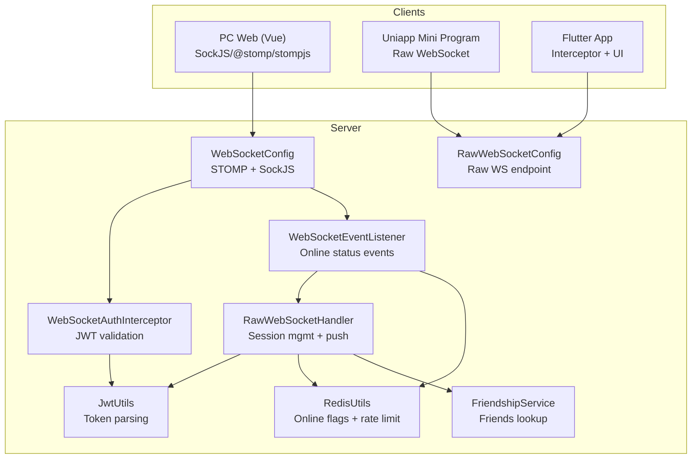
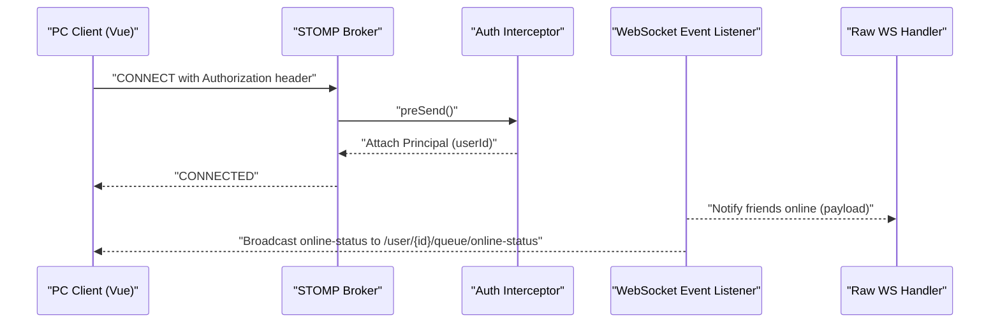
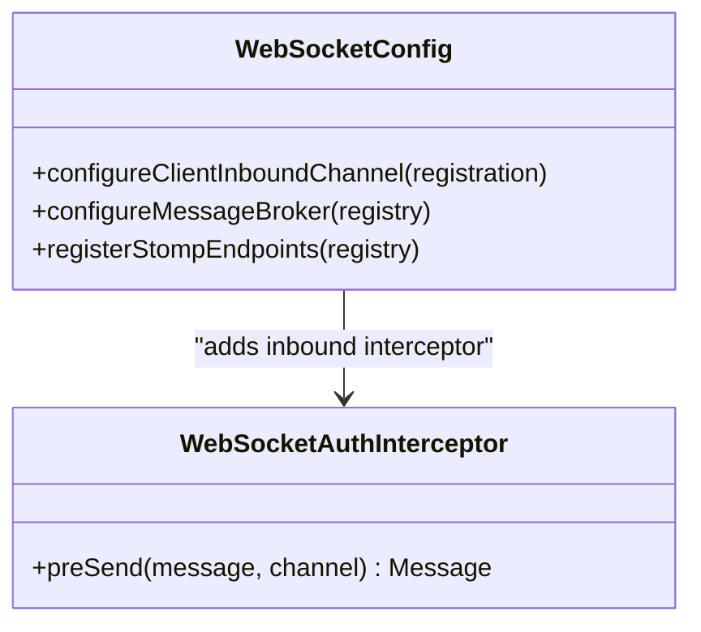
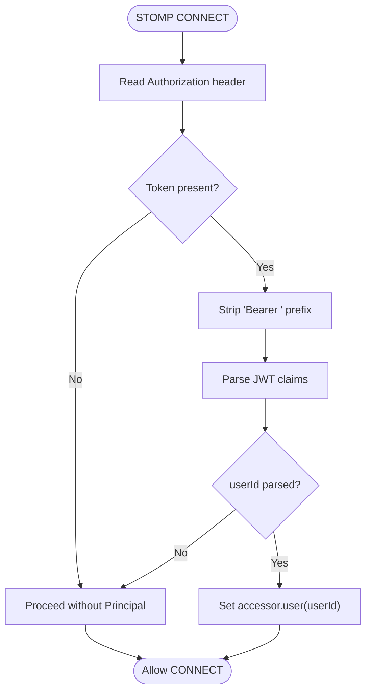
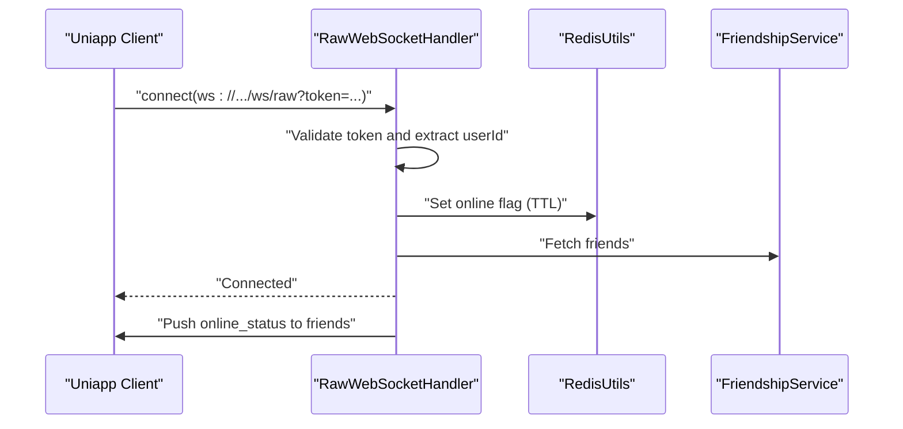
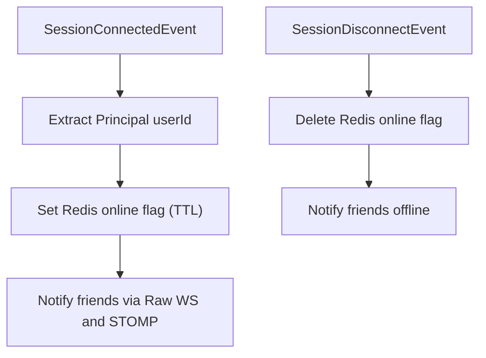
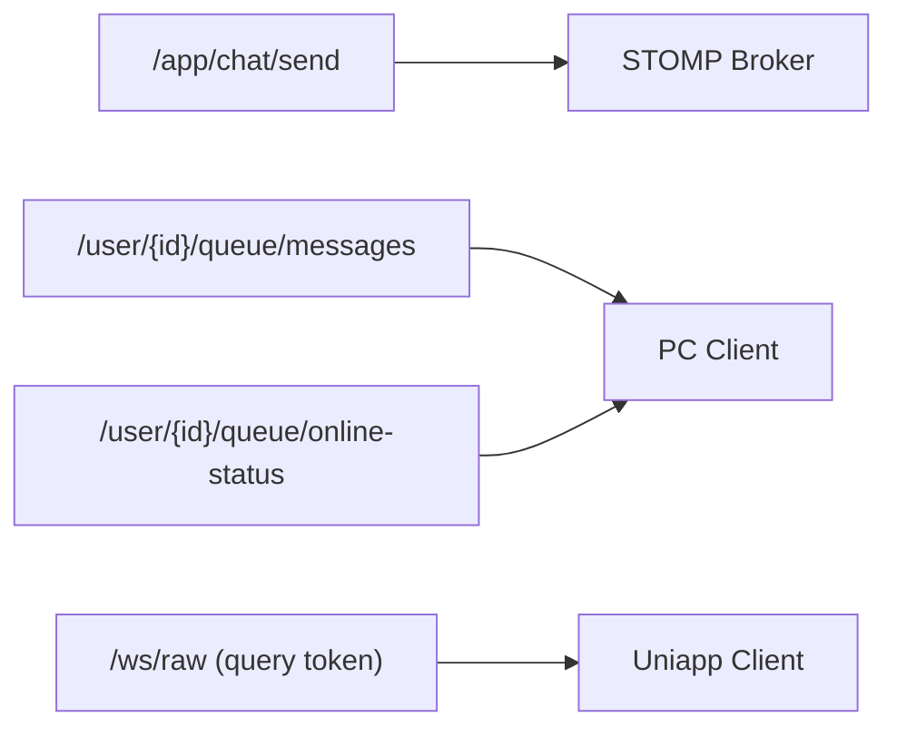
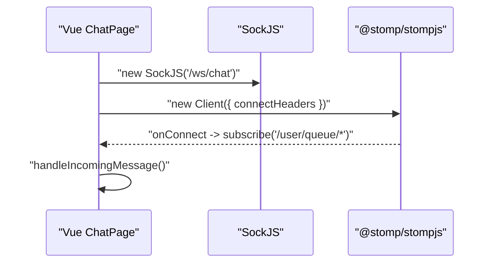
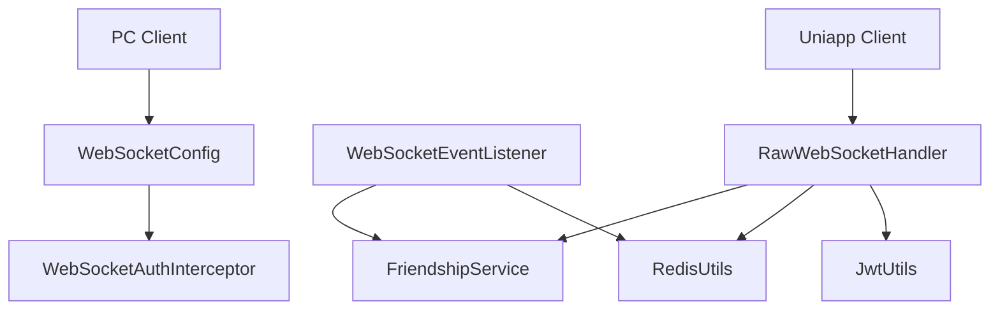

# WebSocket Configuration and Real-time Communication

<cite>
**Referenced Files in This Document**
- [WebSocketConfig.java](file://camp-channel-server/src/main/java/com/gdmec/campchannel/config/WebSocketConfig.java)
- [WebSocketAuthInterceptor.java](file://camp-channel-server/src/main/java/com/gdmec/campchannel/config/WebSocketAuthInterceptor.java)
- [RawWebSocketConfig.java](file://camp-channel-server/src/main/java/com/gdmec/campchannel/config/RawWebSocketConfig.java)
- [RawWebSocketHandler.java](file://camp-channel-server/src/main/java/com/gdmec/campchannel/config/RawWebSocketHandler.java)
- [WebSocketEventListener.java](file://camp-channel-server/src/main/java/com/gdmec/campchannel/config/WebSocketEventListener.java)
- [JwtUtils.java](file://camp-channel-server/src/main/java/com/gdmec/campchannel/common/utils/JwtUtils.java)
- [RedisUtils.java](file://camp-channel-server/src/main/java/com/gdmec/campchannel/common/utils/RedisUtils.java)
- [application.yml](file://camp-channel-server/src/main/resources/application.yml)
- [ChatPage.vue](file://camp-channel-client-pc/src/pages/ChatPage.vue)
- [websocket.ts](file://camp-channel-client-uniapp/src/utils/websocket.ts)
- [FriendshipService.java](file://camp-channel-server/src/main/java/com/gdmec/campchannel/service/FriendshipService.java)
- [FriendshipServiceImpl.java](file://camp-channel-server/src/main/java/com/gdmec/campchannel/service/impl/FriendshipServiceImpl.java)
</cite>

## Table of Contents
1. [Introduction](#introduction)
2. [Project Structure](#project-structure)
3. [Core Components](#core-components)
4. [Architecture Overview](#architecture-overview)
5. [Detailed Component Analysis](#detailed-component-analysis)
6. [Dependency Analysis](#dependency-analysis)
7. [Performance Considerations](#performance-considerations)
8. [Troubleshooting Guide](#troubleshooting-guide)
9. [Conclusion](#conclusion)
10. [Appendices](#appendices)

## Introduction
This document explains the WebSocket configuration and real-time communication implementation in the project. It covers:
- WebSocket server setup with STOMP and SockJS
- Raw WebSocket handling for diverse clients
- Authentication interceptors and session management
- Broadcasting mechanisms and online status propagation
- Message routing patterns, topic subscriptions, and client integrations
- Practical connection, sending/receiving, and error handling examples
- Performance, scalability, and troubleshooting guidance

## Project Structure
The real-time stack spans the Spring Boot server and multiple frontends:
- Server: Spring WebSocket + STOMP broker, raw WebSocket handler, JWT and Redis utilities, and event listeners
- Clients:
  - PC web (Vue + SockJS/@stomp/stompjs) connects to STOMP endpoint
  - Uniapp mini program uses raw WebSocket with token in query string
  - Flutter app integrates WebSocket via a dedicated interceptor and UI

**Diagram sources**
- [WebSocketConfig.java:11-36](file://camp-channel-server/src/main/java/com/gdmec/campchannel/config/WebSocketConfig.java#L11-L36)
- [WebSocketAuthInterceptor.java:15-46](file://camp-channel-server/src/main/java/com/gdmec/campchannel/config/WebSocketAuthInterceptor.java#L15-L46)
- [WebSocketEventListener.java:18-91](file://camp-channel-server/src/main/java/com/gdmec/campchannel/config/WebSocketEventListener.java#L18-L91)
- [RawWebSocketConfig.java:8-24](file://camp-channel-server/src/main/java/com/gdmec/campchannel/config/RawWebSocketConfig.java#L8-L24)
- [RawWebSocketHandler.java:23-171](file://camp-channel-server/src/main/java/com/gdmec/campchannel/config/RawWebSocketHandler.java#L23-L171)
- [JwtUtils.java:17-85](file://camp-channel-server/src/main/java/com/gdmec/campchannel/common/utils/JwtUtils.java#L17-L85)
- [RedisUtils.java:16-170](file://camp-channel-server/src/main/java/com/gdmec/campchannel/common/utils/RedisUtils.java#L16-L170)
- [FriendshipService.java:9-55](file://camp-channel-server/src/main/java/com/gdmec/campchannel/service/FriendshipService.java#L9-L55)

**Section sources**
- [WebSocketConfig.java:11-36](file://camp-channel-server/src/main/java/com/gdmec/campchannel/config/WebSocketConfig.java#L11-L36)
- [RawWebSocketConfig.java:8-24](file://camp-channel-server/src/main/java/com/gdmec/campchannel/config/RawWebSocketConfig.java#L8-L24)
- [application.yml:1-119](file://camp-channel-server/src/main/resources/application.yml#L1-L119)

## Core Components
- STOMP WebSocket configuration with SockJS and message broker
- Authentication interceptor validating JWT tokens on CONNECT frames
- Event listener for online/offline status propagation across both STOMP and raw WebSocket
- Raw WebSocket handler managing sessions, authentication via query token, and targeted/push notifications
- JWT utilities and Redis utilities supporting authentication and online presence

**Section sources**
- [WebSocketConfig.java:18-36](file://camp-channel-server/src/main/java/com/gdmec/campchannel/config/WebSocketConfig.java#L18-L36)
- [WebSocketAuthInterceptor.java:21-44](file://camp-channel-server/src/main/java/com/gdmec/campchannel/config/WebSocketAuthInterceptor.java#L21-L44)
- [WebSocketEventListener.java:32-62](file://camp-channel-server/src/main/java/com/gdmec/campchannel/config/WebSocketEventListener.java#L32-L62)
- [RawWebSocketHandler.java:41-102](file://camp-channel-server/src/main/java/com/gdmec/campchannel/config/RawWebSocketHandler.java#L41-L102)
- [JwtUtils.java:40-51](file://camp-channel-server/src/main/java/com/gdmec/campchannel/common/utils/JwtUtils.java#L40-L51)
- [RedisUtils.java:67-95](file://camp-channel-server/src/main/java/com/gdmec/campchannel/common/utils/RedisUtils.java#L67-L95)

## Architecture Overview
The system supports two client-facing protocols:
- STOMP over SockJS for PC web clients
- Raw WebSocket for mobile/mini-program clients

**Diagram sources**
- [WebSocketConfig.java:18-28](file://camp-channel-server/src/main/java/com/gdmec/campchannel/config/WebSocketConfig.java#L18-L28)
- [WebSocketAuthInterceptor.java:21-44](file://camp-channel-server/src/main/java/com/gdmec/campchannel/config/WebSocketAuthInterceptor.java#L21-L44)
- [WebSocketEventListener.java:32-89](file://camp-channel-server/src/main/java/com/gdmec/campchannel/config/WebSocketEventListener.java#L32-L89)
- [ChatPage.vue:89-127](file://camp-channel-client-pc/src/pages/ChatPage.vue#L89-L127)

## Detailed Component Analysis

### STOMP Messaging Configuration
- Enables a simple broker for topics and queues
- Sets application destination prefix and user destination prefix
- Registers the STOMP endpoint with SockJS support and cross-origin allowance

**Diagram sources**
- [WebSocketConfig.java:18-36](file://camp-channel-server/src/main/java/com/gdmec/campchannel/config/WebSocketConfig.java#L18-L36)
- [WebSocketAuthInterceptor.java:15-46](file://camp-channel-server/src/main/java/com/gdmec/campchannel/config/WebSocketAuthInterceptor.java#L15-L46)

**Section sources**
- [WebSocketConfig.java:23-36](file://camp-channel-server/src/main/java/com/gdmec/campchannel/config/WebSocketConfig.java#L23-L36)

### Authentication Interceptor for WebSocket Connections
- Validates Bearer tokens on STOMP CONNECT frames
- Extracts user ID from JWT claims and sets the session principal
- Allows connection to proceed even if token is invalid (graceful degradation)

**Diagram sources**
- [WebSocketAuthInterceptor.java:21-44](file://camp-channel-server/src/main/java/com/gdmec/campchannel/config/WebSocketAuthInterceptor.java#L21-L44)
- [JwtUtils.java:48-51](file://camp-channel-server/src/main/java/com/gdmec/campchannel/common/utils/JwtUtils.java#L48-L51)

**Section sources**
- [WebSocketAuthInterceptor.java:21-44](file://camp-channel-server/src/main/java/com/gdmec/campchannel/config/WebSocketAuthInterceptor.java#L21-L44)
- [JwtUtils.java:40-51](file://camp-channel-server/src/main/java/com/gdmec/campchannel/common/utils/JwtUtils.java#L40-L51)

### Raw WebSocket Handling for Mini Programs
- Endpoint: /ws/raw with query param token
- Authenticates via JWT claim extraction
- Maintains concurrent user sessions and Redis online flags
- Supports targeted push and broadcast to friends

**Diagram sources**
- [RawWebSocketHandler.java:41-102](file://camp-channel-server/src/main/java/com/gdmec/campchannel/config/RawWebSocketHandler.java#L41-L102)
- [WebSocketEventListener.java:68-89](file://camp-channel-server/src/main/java/com/gdmec/campchannel/config/WebSocketEventListener.java#L68-L89)
- [FriendshipService.java:33-34](file://camp-channel-server/src/main/java/com/gdmec/campchannel/service/FriendshipService.java#L33-L34)

**Section sources**
- [RawWebSocketHandler.java:41-102](file://camp-channel-server/src/main/java/com/gdmec/campchannel/config/RawWebSocketHandler.java#L41-L102)
- [RawWebSocketConfig.java:18-22](file://camp-channel-server/src/main/java/com/gdmec/campchannel/config/RawWebSocketConfig.java#L18-L22)

### Session Management and Online Presence
- STOMP: Tracks connected principals; publishes online/offline events
- Raw WS: Stores sessions per user ID, sets Redis online keys with TTL
- Event listener coordinates both channels to notify friends consistently

**Diagram sources**
- [WebSocketEventListener.java:32-62](file://camp-channel-server/src/main/java/com/gdmec/campchannel/config/WebSocketEventListener.java#L32-L62)
- [RawWebSocketHandler.java:90-102](file://camp-channel-server/src/main/java/com/gdmec/campchannel/config/RawWebSocketHandler.java#L90-L102)

**Section sources**
- [WebSocketEventListener.java:32-62](file://camp-channel-server/src/main/java/com/gdmec/campchannel/config/WebSocketEventListener.java#L32-L62)
- [RawWebSocketHandler.java:90-102](file://camp-channel-server/src/main/java/com/gdmec/campchannel/config/RawWebSocketHandler.java#L90-L102)

### Message Routing Patterns and Topic Subscriptions
- STOMP routing:
  - Application destinations under /app
  - User-specific queues under /user/{id}/queue/*
  - Topics under /topic/* (not used in current client code)
- Client subscriptions:
  - PC web subscribes to /user/queue/messages and /user/queue/online-status
  - Uniapp listens to messages via raw WebSocket message types

**Diagram sources**
- [WebSocketConfig.java:24-28](file://camp-channel-server/src/main/java/com/gdmec/campchannel/config/WebSocketConfig.java#L24-L28)
- [ChatPage.vue:89-127](file://camp-channel-client-pc/src/pages/ChatPage.vue#L89-L127)
- [websocket.ts:23-129](file://camp-channel-client-uniapp/src/utils/websocket.ts#L23-L129)

**Section sources**
- [WebSocketConfig.java:24-28](file://camp-channel-server/src/main/java/com/gdmec/campchannel/config/WebSocketConfig.java#L24-L28)
- [ChatPage.vue:89-127](file://camp-channel-client-pc/src/pages/ChatPage.vue#L89-L127)

### Client-Side Integration Approaches
- PC web (Vue):
  - Uses SockJS and @stomp/stompjs
  - Establishes connection with Authorization header
  - Subscribes to user-specific queues for messages and online status
- Uniapp mini program:
  - Uses native WebSocket with ws:// URL
  - Passes token via query string (?token=...)
  - Handles connection lifecycle, reconnection, and message dispatching

**Diagram sources**
- [ChatPage.vue:89-127](file://camp-channel-client-pc/src/pages/ChatPage.vue#L89-L127)

**Section sources**
- [ChatPage.vue:89-127](file://camp-channel-client-pc/src/pages/ChatPage.vue#L89-L127)
- [websocket.ts:23-129](file://camp-channel-client-uniapp/src/utils/websocket.ts#L23-L129)

## Dependency Analysis
- Server components depend on:
  - JwtUtils for token parsing
  - RedisUtils for online presence and rate limiting
  - FriendshipService for retrieving friend lists
- Client components depend on:
  - Server endpoints (/ws/chat for STOMP, /ws/raw for raw)
  - Local storage for tokens

**Diagram sources**
- [WebSocketConfig.java:15-21](file://camp-channel-server/src/main/java/com/gdmec/campchannel/config/WebSocketConfig.java#L15-L21)
- [WebSocketEventListener.java:21-29](file://camp-channel-server/src/main/java/com/gdmec/campchannel/config/WebSocketEventListener.java#L21-L29)
- [RawWebSocketHandler.java:30-37](file://camp-channel-server/src/main/java/com/gdmec/campchannel/config/RawWebSocketHandler.java#L30-L37)
- [JwtUtils.java:17-85](file://camp-channel-server/src/main/java/com/gdmec/campchannel/common/utils/JwtUtils.java#L17-L85)
- [RedisUtils.java:16-170](file://camp-channel-server/src/main/java/com/gdmec/campchannel/common/utils/RedisUtils.java#L16-L170)
- [FriendshipService.java:33-34](file://camp-channel-server/src/main/java/com/gdmec/campchannel/service/FriendshipService.java#L33-L34)

**Section sources**
- [WebSocketConfig.java:15-21](file://camp-channel-server/src/main/java/com/gdmec/campchannel/config/WebSocketConfig.java#L15-L21)
- [WebSocketEventListener.java:21-29](file://camp-channel-server/src/main/java/com/gdmec/campchannel/config/WebSocketEventListener.java#L21-L29)
- [RawWebSocketHandler.java:30-37](file://camp-channel-server/src/main/java/com/gdmec/campchannel/config/RawWebSocketHandler.java#L30-L37)

## Performance Considerations
- Connection pooling and concurrency:
  - STOMP broker uses Spring’s in-memory simple broker; suitable for moderate loads
  - Raw WebSocket maintains a concurrent map of sessions per user ID
- Redis online flags:
  - Short TTL ensures stale entries are cleaned up automatically
- Rate limiting:
  - Redis sliding window is available for general rate limiting scenarios
- Recommendations:
  - Scale out with clustered brokers or external message brokers (e.g., RabbitMQ/ActiveMQ)
  - Consider partitioning by user ID for horizontal scaling
  - Monitor Redis memory usage and tune TTLs appropriately

[No sources needed since this section provides general guidance]

## Troubleshooting Guide
Common issues and resolutions:
- STOMP CONNECT fails with unauthorized:
  - Ensure Authorization header is present and formatted as "Bearer ..."
  - Verify token validity and claims
- Raw WebSocket closes immediately:
  - Confirm query string contains a non-empty token (?token=...)
  - Check token signature and expiration
- No online status updates:
  - Verify Redis connectivity and online key TTL
  - Ensure event listener is active and friendship service returns friends
- Messages not delivered:
  - Confirm subscription to correct user queue (/user/{id}/queue/messages)
  - Check server logs for exceptions during message handling

**Section sources**
- [WebSocketAuthInterceptor.java:25-42](file://camp-channel-server/src/main/java/com/gdmec/campchannel/config/WebSocketAuthInterceptor.java#L25-L42)
- [RawWebSocketHandler.java:48-73](file://camp-channel-server/src/main/java/com/gdmec/campchannel/config/RawWebSocketHandler.java#L48-L73)
- [WebSocketEventListener.java:32-62](file://camp-channel-server/src/main/java/com/gdmec/campchannel/config/WebSocketEventListener.java#L32-L62)
- [application.yml:31-42](file://camp-channel-server/src/main/resources/application.yml#L31-L42)

## Conclusion
The system provides a robust dual-path real-time solution:
- STOMP for modern browsers with SockJS fallback
- Raw WebSocket for constrained environments like mini programs
Authentication is centralized via JWT, while Redis-backed online presence ensures consistent cross-channel notifications. The architecture supports straightforward scaling and maintenance with clear separation of concerns.

[No sources needed since this section summarizes without analyzing specific files]

## Appendices

### Practical Examples

- Establishing a STOMP connection (PC web):
  - Use SockJS to connect to /ws/chat
  - Provide Authorization header with Bearer token
  - Subscribe to /user/queue/messages and /user/queue/online-status

- Sending a message (PC web):
  - Publish to /app/chat/send with message payload

- Establishing a raw WebSocket connection (Uniapp):
  - Connect to ws://host/ws/raw?token=...
  - Handle incoming messages and dispatch by type

- Receiving online status (both clients):
  - Listen for online_status messages indicating user online/offline

**Section sources**
- [ChatPage.vue:89-127](file://camp-channel-client-pc/src/pages/ChatPage.vue#L89-L127)
- [websocket.ts:23-129](file://camp-channel-client-uniapp/src/utils/websocket.ts#L23-L129)
- [RawWebSocketHandler.java:76-88](file://camp-channel-server/src/main/java/com/gdmec/campchannel/config/RawWebSocketHandler.java#L76-L88)