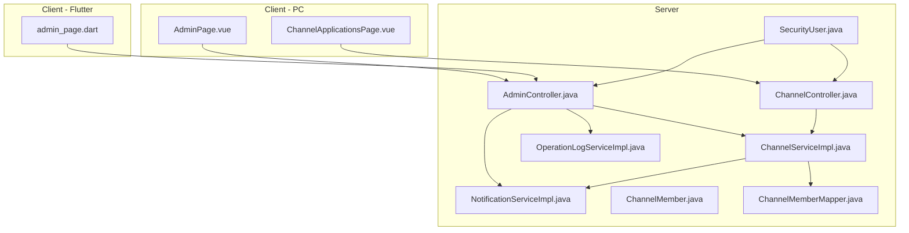
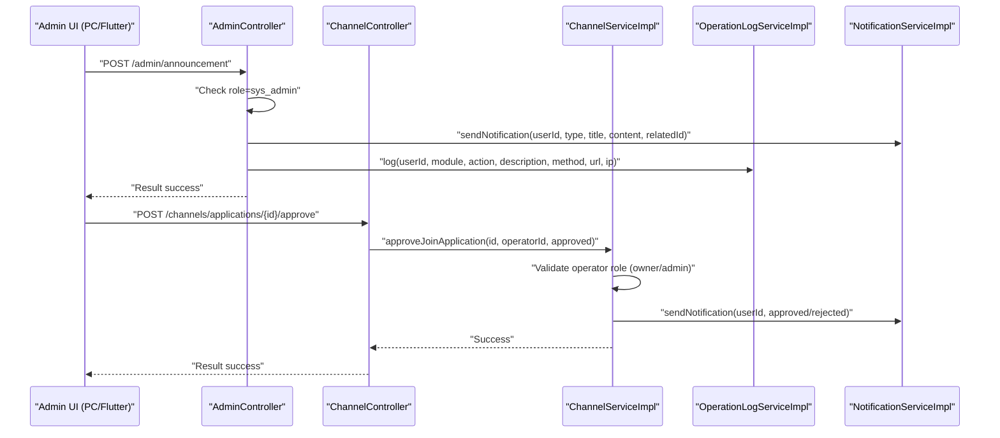
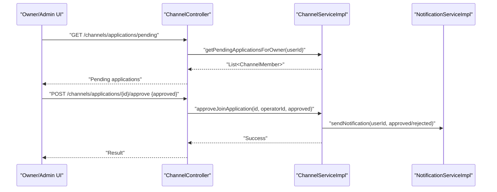
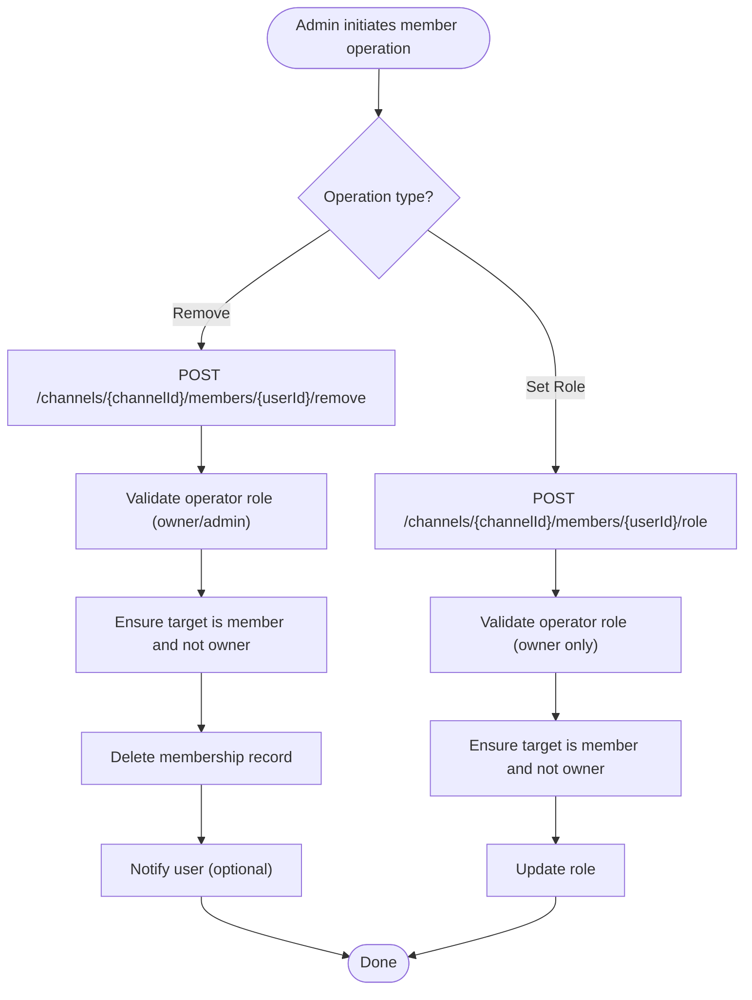
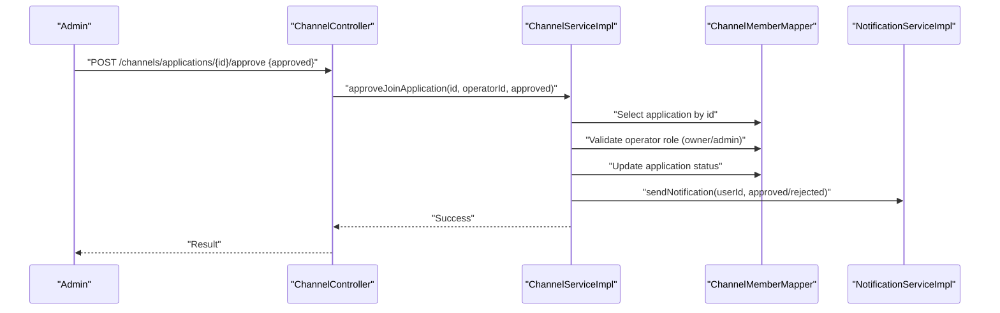
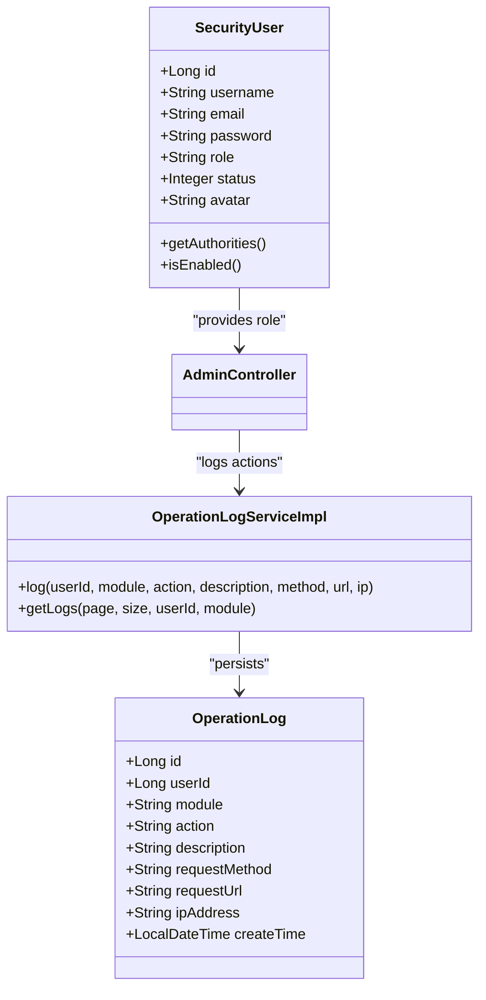
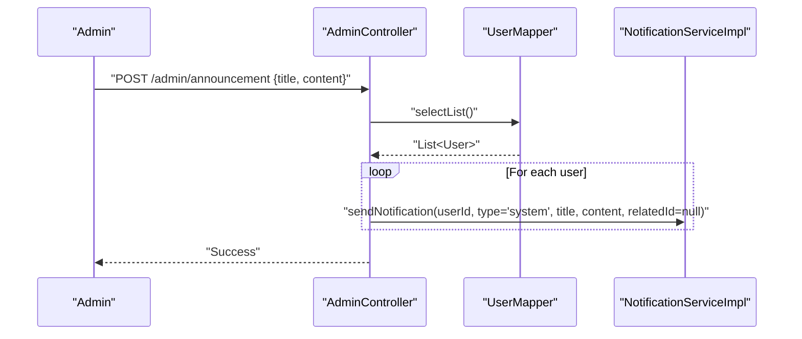
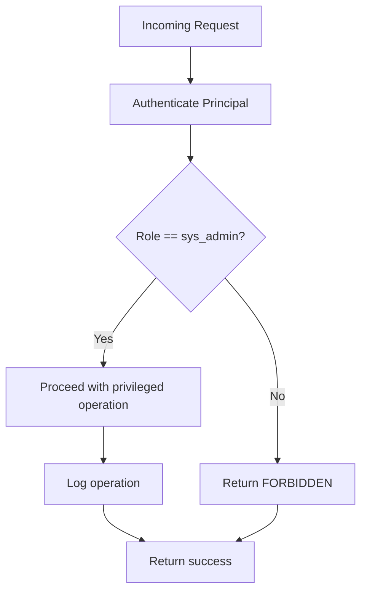
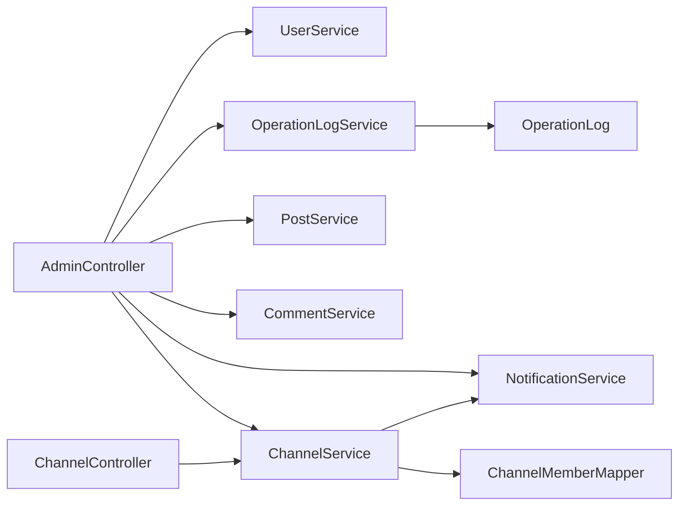

# Administrative Controls and Oversight

<cite>
**Referenced Files in This Document**
- [AdminController.java](file://camp-channel-server/src/main/java/com/gdmec/campchannel/controller/AdminController.java)
- [ChannelController.java](file://camp-channel-server/src/main/java/com/gdmec/campchannel/controller/ChannelController.java)
- [ChannelServiceImpl.java](file://camp-channel-server/src/main/java/com/gdmec/campchannel/service/impl/ChannelServiceImpl.java)
- [SecurityUser.java](file://camp-channel-server/src/main/java/com/gdmec/campchannel/security/SecurityUser.java)
- [OperationLog.java](file://camp-channel-server/src/main/java/com/gdmec/campchannel/entity/OperationLog.java)
- [OperationLogServiceImpl.java](file://camp-channel-server/src/main/java/com/gdmec/campchannel/service/impl/OperationLogServiceImpl.java)
- [NotificationServiceImpl.java](file://camp-channel-server/src/main/java/com/gdmec/campchannel/service/impl/NotificationServiceImpl.java)
- [ChannelMember.java](file://camp-channel-server/src/main/java/com/gdmec/campchannel/entity/ChannelMember.java)
- [ChannelMemberMapper.java](file://camp-channel-server/src/main/java/com/gdmec/campchannel/mapper/ChannelMemberMapper.java)
- [AdminPage.vue](file://camp-channel-client-pc/src/pages/AdminPage.vue)
- [ChannelApplicationsPage.vue](file://camp-channel-client-pc/src/pages/ChannelApplicationsPage.vue)
- [admin_page.dart](file://camp-channel-client-flutter/lib/pages/admin_page.dart)
- [application.yml](file://camp-channel-server/src/main/resources/application.yml)
</cite>

## Table of Contents
1. [Introduction](#introduction)
2. [Project Structure](#project-structure)
3. [Core Components](#core-components)
4. [Architecture Overview](#architecture-overview)
5. [Detailed Component Analysis](#detailed-component-analysis)
6. [Dependency Analysis](#dependency-analysis)
7. [Performance Considerations](#performance-considerations)
8. [Troubleshooting Guide](#troubleshooting-guide)
9. [Conclusion](#conclusion)
10. [Appendices](#appendices)

## Introduction
This document explains the administrative controls and oversight capabilities within the channel management system. It covers the administrative dashboard, pending application management, bulk member operations, and the administrative workflow for managing channel applications, member removal, and role assignments. It also documents administrative privileges, oversight mechanisms, audit trails, integration with notification systems, and security measures to protect administrative functions.

## Project Structure
The administrative functionality spans server-side controllers and services, domain entities, and client-side admin dashboards across multiple frontends.

**Diagram sources**
- [AdminController.java:1-391](file://camp-channel-server/src/main/java/com/gdmec/campchannel/controller/AdminController.java#L1-L391)
- [ChannelController.java:1-168](file://camp-channel-server/src/main/java/com/gdmec/campchannel/controller/ChannelController.java#L1-L168)
- [ChannelServiceImpl.java:1-385](file://camp-channel-server/src/main/java/com/gdmec/campchannel/service/impl/ChannelServiceImpl.java#L1-L385)
- [OperationLogServiceImpl.java:1-49](file://camp-channel-server/src/main/java/com/gdmec/campchannel/service/impl/OperationLogServiceImpl.java#L1-L49)
- [NotificationServiceImpl.java:1-95](file://camp-channel-server/src/main/java/com/gdmec/campchannel/service/impl/NotificationServiceImpl.java#L1-L95)
- [SecurityUser.java:1-66](file://camp-channel-server/src/main/java/com/gdmec/campchannel/security/SecurityUser.java#L1-L66)
- [ChannelMember.java:1-34](file://camp-channel-server/src/main/java/com/gdmec/campchannel/entity/ChannelMember.java#L1-L34)
- [ChannelMemberMapper.java:1-9](file://camp-channel-server/src/main/java/com/gdmec/campchannel/mapper/ChannelMemberMapper.java#L1-L9)
- [AdminPage.vue:1-1262](file://camp-channel-client-pc/src/pages/AdminPage.vue#L1-L1262)
- [ChannelApplicationsPage.vue:1-75](file://camp-channel-client-pc/src/pages/ChannelApplicationsPage.vue#L1-L75)
- [admin_page.dart:1-319](file://camp-channel-client-flutter/lib/pages/admin_page.dart#L1-L319)

**Section sources**
- [AdminController.java:1-391](file://camp-channel-server/src/main/java/com/gdmec/campchannel/controller/AdminController.java#L1-L391)
- [ChannelController.java:1-168](file://camp-channel-server/src/main/java/com/gdmec/campchannel/controller/ChannelController.java#L1-L168)
- [ChannelServiceImpl.java:1-385](file://camp-channel-server/src/main/java/com/gdmec/campchannel/service/impl/ChannelServiceImpl.java#L1-L385)
- [AdminPage.vue:1-1262](file://camp-channel-client-pc/src/pages/AdminPage.vue#L1-L1262)
- [ChannelApplicationsPage.vue:1-75](file://camp-channel-client-pc/src/pages/ChannelApplicationsPage.vue#L1-L75)
- [admin_page.dart:1-319](file://camp-channel-client-flutter/lib/pages/admin_page.dart#L1-L319)

## Core Components
- Administrative API surface: Provides user management, channel moderation, content moderation, operation logging, and system-wide announcements.
- Channel administrative workflows: Pending application listing and approval, member removal, and role assignment within channels.
- Audit and oversight: Centralized operation logging with filtering and pagination.
- Notifications: Automated communication for administrative decisions (e.g., application approvals).
- Security model: Role-based access control enforcing administrative privileges.

Key implementation references:
- Administrative endpoints and privilege checks: [AdminController.java:51-391](file://camp-channel-server/src/main/java/com/gdmec/campchannel/controller/AdminController.java#L51-L391)
- Channel application and member management: [ChannelController.java:65-168](file://camp-channel-server/src/main/java/com/gdmec/campchannel/controller/ChannelController.java#L65-L168), [ChannelServiceImpl.java:120-362](file://camp-channel-server/src/main/java/com/gdmec/campchannel/service/impl/ChannelServiceImpl.java#L120-L362)
- Audit trail model and service: [OperationLog.java:1-32](file://camp-channel-server/src/main/java/com/gdmec/campchannel/entity/OperationLog.java#L1-L32), [OperationLogServiceImpl.java:1-49](file://camp-channel-server/src/main/java/com/gdmec/campchannel/service/impl/OperationLogServiceImpl.java#L1-L49)
- Notification delivery and real-time push: [NotificationServiceImpl.java:1-95](file://camp-channel-server/src/main/java/com/gdmec/campchannel/service/impl/NotificationServiceImpl.java#L1-L95)
- Security principal and roles: [SecurityUser.java:17-66](file://camp-channel-server/src/main/java/com/gdmec/campchannel/security/SecurityUser.java#L17-L66)

**Section sources**
- [AdminController.java:51-391](file://camp-channel-server/src/main/java/com/gdmec/campchannel/controller/AdminController.java#L51-L391)
- [ChannelController.java:65-168](file://camp-channel-server/src/main/java/com/gdmec/campchannel/controller/ChannelController.java#L65-L168)
- [ChannelServiceImpl.java:120-362](file://camp-channel-server/src/main/java/com/gdmec/campchannel/service/impl/ChannelServiceImpl.java#L120-L362)
- [OperationLog.java:1-32](file://camp-channel-server/src/main/java/com/gdmec/campchannel/entity/OperationLog.java#L1-L32)
- [OperationLogServiceImpl.java:1-49](file://camp-channel-server/src/main/java/com/gdmec/campchannel/service/impl/OperationLogServiceImpl.java#L1-L49)
- [NotificationServiceImpl.java:1-95](file://camp-channel-server/src/main/java/com/gdmec/campchannel/service/impl/NotificationServiceImpl.java#L1-L95)
- [SecurityUser.java:17-66](file://camp-channel-server/src/main/java/com/gdmec/campchannel/security/SecurityUser.java#L17-L66)

## Architecture Overview
Administrative operations follow a layered architecture:
- Controllers enforce role-based access and delegate to services.
- Services encapsulate business logic, permissions, and side effects (notifications).
- Entities and mappers persist state changes.
- Clients render dashboards and submit administrative requests.

**Diagram sources**
- [AdminController.java:344-374](file://camp-channel-server/src/main/java/com/gdmec/campchannel/controller/AdminController.java#L344-L374)
- [ChannelController.java:75-84](file://camp-channel-server/src/main/java/com/gdmec/campchannel/controller/ChannelController.java#L75-L84)
- [ChannelServiceImpl.java:120-156](file://camp-channel-server/src/main/java/com/gdmec/campchannel/service/impl/ChannelServiceImpl.java#L120-L156)
- [OperationLogServiceImpl.java:17-48](file://camp-channel-server/src/main/java/com/gdmec/campchannel/service/impl/OperationLogServiceImpl.java#L17-L48)
- [NotificationServiceImpl.java:26-51](file://camp-channel-server/src/main/java/com/gdmec/campchannel/service/impl/NotificationServiceImpl.java#L26-L51)

## Detailed Component Analysis

### Administrative Dashboard Features
- Overview statistics and quick actions for administrators.
- User management: list, enable/disable, reset password, delete.
- Channel management: list, enable/disable, delete.
- Content moderation: pending posts and comments review.
- Reports and gallery moderation.
- Operation logs with filtering by user/module.
- System-wide announcement broadcast.

References:
- Dashboard rendering and navigation: [AdminPage.vue:16-56](file://camp-channel-client-pc/src/pages/AdminPage.vue#L16-L56)
- User management actions: [AdminPage.vue:505-531](file://camp-channel-client-pc/src/pages/AdminPage.vue#L505-L531)
- Channel management actions: [AdminPage.vue:555-575](file://camp-channel-client-pc/src/pages/AdminPage.vue#L555-L575)
- Content moderation tabs and actions: [AdminPage.vue:156-228](file://camp-channel-client-pc/src/pages/AdminPage.vue#L156-L228)
- Operation logs filtering: [AdminPage.vue:635-649](file://camp-channel-client-pc/src/pages/AdminPage.vue#L635-L649)
- Announcement publishing: [AdminPage.vue:362-383](file://camp-channel-client-pc/src/pages/AdminPage.vue#L362-L383), [admin_page.dart:185-285](file://camp-channel-client-flutter/lib/pages/admin_page.dart#L185-L285)

**Section sources**
- [AdminPage.vue:16-56](file://camp-channel-client-pc/src/pages/AdminPage.vue#L16-L56)
- [AdminPage.vue:505-531](file://camp-channel-client-pc/src/pages/AdminPage.vue#L505-L531)
- [AdminPage.vue:555-575](file://camp-channel-client-pc/src/pages/AdminPage.vue#L555-L575)
- [AdminPage.vue:156-228](file://camp-channel-client-pc/src/pages/AdminPage.vue#L156-L228)
- [AdminPage.vue:635-649](file://camp-channel-client-pc/src/pages/AdminPage.vue#L635-L649)
- [AdminPage.vue:362-383](file://camp-channel-client-pc/src/pages/AdminPage.vue#L362-L383)
- [admin_page.dart:185-285](file://camp-channel-client-flutter/lib/pages/admin_page.dart#L185-L285)

### Pending Application Management
Administrators can manage channel join applications via:
- Listing pending applications for owned/administered channels.
- Approving or rejecting applications with automatic notifications.

**Diagram sources**
- [ChannelController.java:139-151](file://camp-channel-server/src/main/java/com/gdmec/campchannel/controller/ChannelController.java#L139-L151)
- [ChannelController.java:75-84](file://camp-channel-server/src/main/java/com/gdmec/campchannel/controller/ChannelController.java#L75-L84)
- [ChannelServiceImpl.java:266-297](file://camp-channel-server/src/main/java/com/gdmec/campchannel/service/impl/ChannelServiceImpl.java#L266-L297)
- [ChannelServiceImpl.java:120-156](file://camp-channel-server/src/main/java/com/gdmec/campchannel/service/impl/ChannelServiceImpl.java#L120-L156)
- [NotificationServiceImpl.java:26-51](file://camp-channel-server/src/main/java/com/gdmec/campchannel/service/impl/NotificationServiceImpl.java#L26-L51)

**Section sources**
- [ChannelController.java:139-151](file://camp-channel-server/src/main/java/com/gdmec/campchannel/controller/ChannelController.java#L139-L151)
- [ChannelController.java:75-84](file://camp-channel-server/src/main/java/com/gdmec/campchannel/controller/ChannelController.java#L75-L84)
- [ChannelServiceImpl.java:266-297](file://camp-channel-server/src/main/java/com/gdmec/campchannel/service/impl/ChannelServiceImpl.java#L266-L297)
- [ChannelServiceImpl.java:120-156](file://camp-channel-server/src/main/java/com/gdmec/campchannel/service/impl/ChannelServiceImpl.java#L120-L156)
- [ChannelApplicationsPage.vue:30-54](file://camp-channel-client-pc/src/pages/ChannelApplicationsPage.vue#L30-L54)

### Bulk Member Operations
Administrative member management includes:
- Removing members from channels with permission checks.
- Assigning roles within channels with strict ownership constraints.

**Diagram sources**
- [ChannelController.java:116-137](file://camp-channel-server/src/main/java/com/gdmec/campchannel/controller/ChannelController.java#L116-L137)
- [ChannelServiceImpl.java:300-329](file://camp-channel-server/src/main/java/com/gdmec/campchannel/service/impl/ChannelServiceImpl.java#L300-L329)
- [ChannelServiceImpl.java:331-362](file://camp-channel-server/src/main/java/com/gdmec/campchannel/service/impl/ChannelServiceImpl.java#L331-L362)

**Section sources**
- [ChannelController.java:116-137](file://camp-channel-server/src/main/java/com/gdmec/campchannel/controller/ChannelController.java#L116-L137)
- [ChannelServiceImpl.java:300-329](file://camp-channel-server/src/main/java/com/gdmec/campchannel/service/impl/ChannelServiceImpl.java#L300-L329)
- [ChannelServiceImpl.java:331-362](file://camp-channel-server/src/main/java/com/gdmec/campchannel/service/impl/ChannelServiceImpl.java#L331-L362)

### Administrative Workflow for Managing Channel Applications, Member Removal, and Role Assignments
- Application approval workflow ensures only authorized operators can process applications and notifies applicants automatically.
- Member removal prevents owners from being removed and enforces operator permissions.
- Role assignment is restricted to channel owners.

**Diagram sources**
- [ChannelController.java:75-84](file://camp-channel-server/src/main/java/com/gdmec/campchannel/controller/ChannelController.java#L75-L84)
- [ChannelServiceImpl.java:120-156](file://camp-channel-server/src/main/java/com/gdmec/campchannel/service/impl/ChannelServiceImpl.java#L120-L156)
- [ChannelMemberMapper.java:1-9](file://camp-channel-server/src/main/java/com/gdmec/campchannel/mapper/ChannelMemberMapper.java#L1-L9)
- [NotificationServiceImpl.java:26-51](file://camp-channel-server/src/main/java/com/gdmec/campchannel/service/impl/NotificationServiceImpl.java#L26-L51)

**Section sources**
- [ChannelController.java:75-84](file://camp-channel-server/src/main/java/com/gdmec/campchannel/controller/ChannelController.java#L75-L84)
- [ChannelServiceImpl.java:120-156](file://camp-channel-server/src/main/java/com/gdmec/campchannel/service/impl/ChannelServiceImpl.java#L120-L156)
- [ChannelMemberMapper.java:1-9](file://camp-channel-server/src/main/java/com/gdmec/campchannel/mapper/ChannelMemberMapper.java#L1-L9)
- [NotificationServiceImpl.java:26-51](file://camp-channel-server/src/main/java/com/gdmec/campchannel/service/impl/NotificationServiceImpl.java#L26-L51)

### Implementation of Administrative Privileges, Oversight Mechanisms, and Audit Trail Functionality
- Role enforcement: Controllers check the authenticated user’s role before executing privileged actions.
- Audit trail: Every administrative action logs module, action, description, IP, and timestamp.
- Oversight: Logs support filtering by user ID and module for targeted investigations.

**Diagram sources**
- [SecurityUser.java:17-66](file://camp-channel-server/src/main/java/com/gdmec/campchannel/security/SecurityUser.java#L17-L66)
- [OperationLog.java:1-32](file://camp-channel-server/src/main/java/com/gdmec/campchannel/entity/OperationLog.java#L1-L32)
- [OperationLogServiceImpl.java:17-48](file://camp-channel-server/src/main/java/com/gdmec/campchannel/service/impl/OperationLogServiceImpl.java#L17-L48)
- [AdminController.java:58-94](file://camp-channel-server/src/main/java/com/gdmec/campchannel/controller/AdminController.java#L58-L94)

**Section sources**
- [SecurityUser.java:17-66](file://camp-channel-server/src/main/java/com/gdmec/campchannel/security/SecurityUser.java#L17-L66)
- [OperationLog.java:1-32](file://camp-channel-server/src/main/java/com/gdmec/campchannel/entity/OperationLog.java#L1-L32)
- [OperationLogServiceImpl.java:17-48](file://camp-channel-server/src/main/java/com/gdmec/campchannel/service/impl/OperationLogServiceImpl.java#L17-L48)
- [AdminController.java:58-94](file://camp-channel-server/src/main/java/com/gdmec/campchannel/controller/AdminController.java#L58-L94)

### Integration Between Administrative Operations and Notification Systems
- Announcement broadcasting iterates all users and sends individual notifications.
- Application approval triggers per-user notifications for pass/fail outcomes.
- Real-time delivery uses WebSocket template integration.

**Diagram sources**
- [AdminController.java:344-374](file://camp-channel-server/src/main/java/com/gdmec/campchannel/controller/AdminController.java#L344-L374)
- [NotificationServiceImpl.java:26-51](file://camp-channel-server/src/main/java/com/gdmec/campchannel/service/impl/NotificationServiceImpl.java#L26-L51)

**Section sources**
- [AdminController.java:344-374](file://camp-channel-server/src/main/java/com/gdmec/campchannel/controller/AdminController.java#L344-L374)
- [NotificationServiceImpl.java:26-51](file://camp-channel-server/src/main/java/com/gdmec/campchannel/service/impl/NotificationServiceImpl.java#L26-L51)

### Security Measures Protecting Administrative Functions
- Role-based access control enforced in controllers using the authenticated principal role.
- Password encoding for administrative resets.
- Account lock conditions based on user status.
- JWT configuration and secure headers defined in application settings.

**Diagram sources**
- [SecurityUser.java:17-66](file://camp-channel-server/src/main/java/com/gdmec/campchannel/security/SecurityUser.java#L17-L66)
- [AdminController.java:58-60](file://camp-channel-server/src/main/java/com/gdmec/campchannel/controller/AdminController.java#L58-L60)
- [application.yml:78-84](file://camp-channel-server/src/main/resources/application.yml#L78-L84)

**Section sources**
- [SecurityUser.java:17-66](file://camp-channel-server/src/main/java/com/gdmec/campchannel/security/SecurityUser.java#L17-L66)
- [AdminController.java:58-60](file://camp-channel-server/src/main/java/com/gdmec/campchannel/controller/AdminController.java#L58-L60)
- [application.yml:78-84](file://camp-channel-server/src/main/resources/application.yml#L78-L84)

### Common Administrative Scenarios
- Mass member operations: Remove multiple members by iterating channel memberships with operator permission checks.
- Application queue management: Fetch pending applications for owned/administered channels and approve/reject in batches.
- Administrative reporting: Filter operation logs by user/module for compliance and auditing.

References:
- Pending applications listing: [ChannelController.java:139-151](file://camp-channel-server/src/main/java/com/gdmec/campchannel/controller/ChannelController.java#L139-L151), [ChannelServiceImpl.java:266-297](file://camp-channel-server/src/main/java/com/gdmec/campchannel/service/impl/ChannelServiceImpl.java#L266-L297)
- Operation logs filtering: [AdminPage.vue:635-649](file://camp-channel-client-pc/src/pages/AdminPage.vue#L635-L649), [OperationLogServiceImpl.java:32-48](file://camp-channel-server/src/main/java/com/gdmec/campchannel/service/impl/OperationLogServiceImpl.java#L32-L48)

**Section sources**
- [ChannelController.java:139-151](file://camp-channel-server/src/main/java/com/gdmec/campchannel/controller/ChannelController.java#L139-L151)
- [ChannelServiceImpl.java:266-297](file://camp-channel-server/src/main/java/com/gdmec/campchannel/service/impl/ChannelServiceImpl.java#L266-L297)
- [AdminPage.vue:635-649](file://camp-channel-client-pc/src/pages/AdminPage.vue#L635-L649)
- [OperationLogServiceImpl.java:32-48](file://camp-channel-server/src/main/java/com/gdmec/campchannel/service/impl/OperationLogServiceImpl.java#L32-L48)

## Dependency Analysis
Administrative components depend on:
- Controllers for HTTP entry points and role checks.
- Services for business logic and permission validations.
- Mappers for persistence.
- Notification and logging services for side effects.

**Diagram sources**
- [AdminController.java:27-49](file://camp-channel-server/src/main/java/com/gdmec/campchannel/controller/AdminController.java#L27-L49)
- [ChannelController.java:24-25](file://camp-channel-server/src/main/java/com/gdmec/campchannel/controller/ChannelController.java#L24-L25)
- [ChannelServiceImpl.java:28-35](file://camp-channel-server/src/main/java/com/gdmec/campchannel/service/impl/ChannelServiceImpl.java#L28-L35)
- [ChannelMemberMapper.java:1-9](file://camp-channel-server/src/main/java/com/gdmec/campchannel/mapper/ChannelMemberMapper.java#L1-L9)
- [OperationLogServiceImpl.java:14-15](file://camp-channel-server/src/main/java/com/gdmec/campchannel/service/impl/OperationLogServiceImpl.java#L14-L15)
- [OperationLog.java:1-32](file://camp-channel-server/src/main/java/com/gdmec/campchannel/entity/OperationLog.java#L1-L32)

**Section sources**
- [AdminController.java:27-49](file://camp-channel-server/src/main/java/com/gdmec/campchannel/controller/AdminController.java#L27-L49)
- [ChannelController.java:24-25](file://camp-channel-server/src/main/java/com/gdmec/campchannel/controller/ChannelController.java#L24-L25)
- [ChannelServiceImpl.java:28-35](file://camp-channel-server/src/main/java/com/gdmec/campchannel/service/impl/ChannelServiceImpl.java#L28-L35)
- [ChannelMemberMapper.java:1-9](file://camp-channel-server/src/main/java/com/gdmec/campchannel/mapper/ChannelMemberMapper.java#L1-L9)
- [OperationLogServiceImpl.java:14-15](file://camp-channel-server/src/main/java/com/gdmec/campchannel/service/impl/OperationLogServiceImpl.java#L14-L15)
- [OperationLog.java:1-32](file://camp-channel-server/src/main/java/com/gdmec/campchannel/entity/OperationLog.java#L1-L32)

## Performance Considerations
- Pagination for lists of users, channels, posts, comments, and logs to avoid large payloads.
- Efficient queries using MyBatis-Plus wrappers and limits for pending queues.
- Asynchronous notification delivery with fallback for WebSocket failures.
- Database connection pooling and Redis configuration for scalability.

[No sources needed since this section provides general guidance]

## Troubleshooting Guide
- Forbidden access errors indicate insufficient role checks or disabled accounts.
- Business exceptions during administrative operations often arise from invalid states (e.g., attempting to remove a non-member or modifying an owner’s role).
- Logging and notification failures should be checked in the operation logs and notification history endpoints.

**Section sources**
- [ChannelServiceImpl.java:300-329](file://camp-channel-server/src/main/java/com/gdmec/campchannel/service/impl/ChannelServiceImpl.java#L300-L329)
- [ChannelServiceImpl.java:331-362](file://camp-channel-server/src/main/java/com/gdmec/campchannel/service/impl/ChannelServiceImpl.java#L331-L362)
- [OperationLogServiceImpl.java:32-48](file://camp-channel-server/src/main/java/com/gdmec/campchannel/service/impl/OperationLogServiceImpl.java#L32-L48)
- [NotificationServiceImpl.java:40-51](file://camp-channel-server/src/main/java/com/gdmec/campchannel/service/impl/NotificationServiceImpl.java#L40-L51)

## Conclusion
The administrative subsystem provides robust oversight through role-based controls, comprehensive audit logging, and integrated notifications. It supports efficient management of users, channels, content, and member operations with clear workflows for approvals and bulk actions. The client dashboards streamline administrative tasks across platforms while maintaining strong security boundaries.

[No sources needed since this section summarizes without analyzing specific files]

## Appendices

### Administrative API Reference Highlights
- Users: GET /admin/users, PUT /admin/users/{userId}/status, POST /admin/users/{userId}/reset-password, DELETE /admin/users/{userId}
- Channels: GET /admin/channels, GET /admin/channels/pending, PUT /admin/channels/{channelId}/status, DELETE /admin/channels/{channelId}
- Content Moderation: GET /admin/posts/pending, POST /admin/posts/{postId}/approve, GET /admin/comments/pending, POST /admin/comments/{commentId}/approve
- Operations: GET /admin/logs
- Announcements: POST /admin/announcement

**Section sources**
- [AdminController.java:51-391](file://camp-channel-server/src/main/java/com/gdmec/campchannel/controller/AdminController.java#L51-L391)