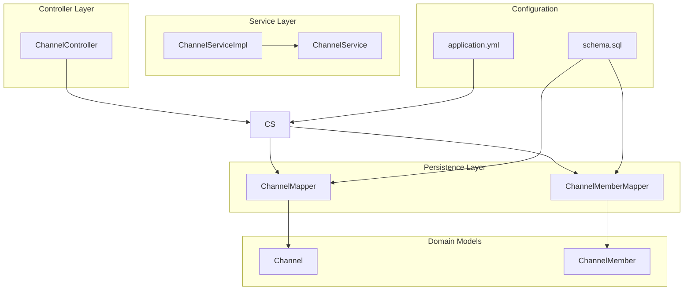
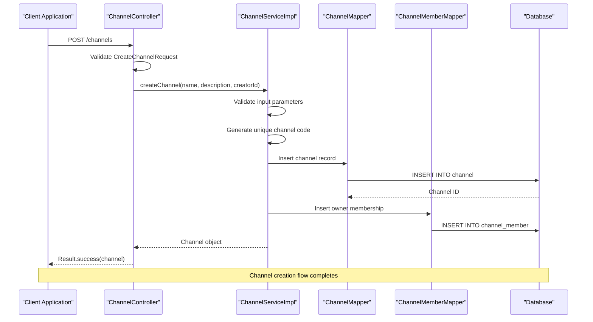
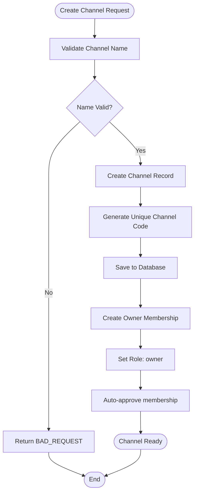
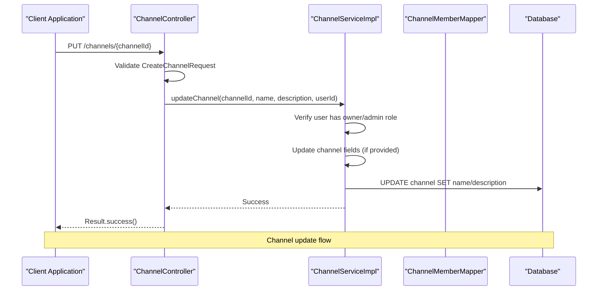
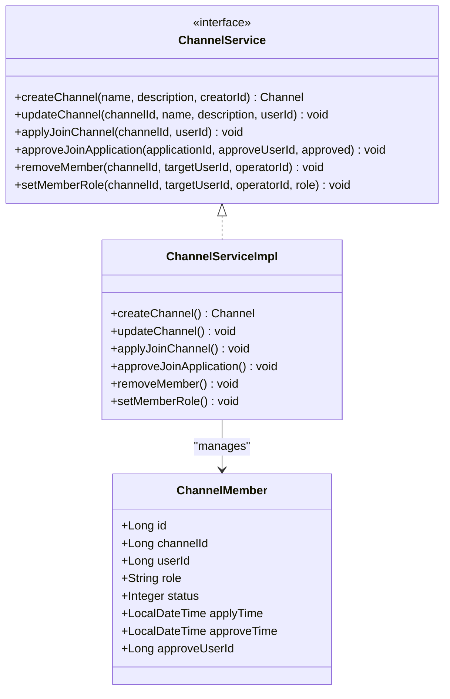
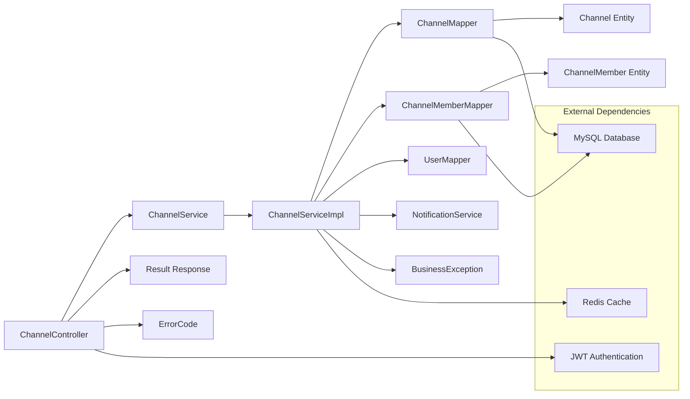

# Channel Creation and Management

<cite>
**Referenced Files in This Document**
- [ChannelController.java](file://camp-channel-server/src/main/java/com/gdmec/campchannel/controller/ChannelController.java)
- [ChannelService.java](file://camp-channel-server/src/main/java/com/gdmec/campchannel/service/ChannelService.java)
- [ChannelServiceImpl.java](file://camp-channel-server/src/main/java/com/gdmec/campchannel/service/impl/ChannelServiceImpl.java)
- [ChannelMapper.java](file://camp-channel-server/src/main/java/com/gdmec/campchannel/mapper/ChannelMapper.java)
- [Channel.java](file://camp-channel-server/src/main/java/com/gdmec/campchannel/entity/Channel.java)
- [ChannelMember.java](file://camp-channel-server/src/main/java/com/gdmec/campchannel/entity/ChannelMember.java)
- [ChannelMemberMapper.java](file://camp-channel-server/src/main/java/com/gdmec/campchannel/mapper/ChannelMemberMapper.java)
- [Result.java](file://camp-channel-server/src/main/java/com/gdmec/campchannel/common/api/Result.java)
- [ErrorCode.java](file://camp-channel-server/src/main/java/com/gdmec/campchannel/common/api/ErrorCode.java)
- [BusinessException.java](file://camp-channel-server/src/main/java/com/gdmec/campchannel/common/exception/BusinessException.java)
- [schema.sql](file://camp-channel-server/src/main/resources/db/schema.sql)
- [application.yml](file://camp-channel-server/src/main/resources/application.yml)
</cite>

## Table of Contents
1. [Introduction](#introduction)
2. [Project Structure](#project-structure)
3. [Core Components](#core-components)
4. [Architecture Overview](#architecture-overview)
5. [Detailed Component Analysis](#detailed-component-analysis)
6. [Dependency Analysis](#dependency-analysis)
7. [Performance Considerations](#performance-considerations)
8. [Troubleshooting Guide](#troubleshooting-guide)
9. [Conclusion](#conclusion)
10. [Appendices](#appendices)

## Introduction
This document provides comprehensive documentation for the channel creation and management functionality. It covers the complete workflow for creating new channels, including validation rules, naming constraints, and initial setup procedures. It documents channel editing capabilities, description management, and metadata updates. It explains the channel lifecycle from creation to deletion, including ownership transfer and administrative controls. The document includes concrete examples from the ChannelController showing REST API endpoints for channel CRUD operations, parameter validation, and response handling. It addresses the integration with the ChannelService layer for business logic implementation and the ChannelMapper for database persistence. Common issues such as duplicate channel names, invalid descriptions, and permission validation during channel operations are documented, along with practical examples of channel creation requests, update operations, and administrative management scenarios.

## Project Structure
The channel management module is implemented in the server-side Java application using Spring Boot and MyBatis-Plus. The structure follows a layered architecture:
- Controller layer: Exposes REST endpoints for channel operations
- Service layer: Implements business logic and validation
- Mapper layer: Handles database persistence
- Entity layer: Defines data models for channels and memberships
- Configuration: Application settings and database schema



**Diagram sources**
- [ChannelController.java:1-168](file://camp-channel-server/src/main/java/com/gdmec/campchannel/controller/ChannelController.java#L1-L168)
- [ChannelServiceImpl.java:1-385](file://camp-channel-server/src/main/java/com/gdmec/campchannel/service/impl/ChannelServiceImpl.java#L1-L385)
- [ChannelMapper.java:1-9](file://camp-channel-server/src/main/java/com/gdmec/campchannel/mapper/ChannelMapper.java#L1-L9)
- [ChannelMemberMapper.java:1-9](file://camp-channel-server/src/main/java/com/gdmec/campchannel/mapper/ChannelMemberMapper.java#L1-L9)
- [Channel.java:1-32](file://camp-channel-server/src/main/java/com/gdmec/campchannel/entity/Channel.java#L1-L32)
- [ChannelMember.java:1-34](file://camp-channel-server/src/main/java/com/gdmec/campchannel/entity/ChannelMember.java#L1-L34)
- [application.yml:1-119](file://camp-channel-server/src/main/resources/application.yml#L1-L119)
- [schema.sql:16-43](file://camp-channel-server/src/main/resources/db/schema.sql#L16-L43)

**Section sources**
- [ChannelController.java:18-22](file://camp-channel-server/src/main/java/com/gdmec/campchannel/controller/ChannelController.java#L18-L22)
- [ChannelServiceImpl.java:25-26](file://camp-channel-server/src/main/java/com/gdmec/campchannel/service/impl/ChannelServiceImpl.java#L25-L26)
- [schema.sql:16-43](file://camp-channel-server/src/main/resources/db/schema.sql#L16-L43)

## Core Components
The channel management system consists of several core components working together:

### Channel Entity
The Channel entity represents a communication group with essential attributes:
- Unique identifier and channel code
- Name and description
- Type (public/private) and status (active/inactive)
- Creator information and timestamps

### ChannelMember Entity
The ChannelMember entity manages user membership with roles and statuses:
- Role hierarchy: owner, admin, member
- Status states: active, pending, rejected
- Timestamps for application and approval

### ChannelService Interface
Defines the contract for channel operations including creation, search, membership management, and administrative functions.

### ChannelController
Exposes REST endpoints for all channel operations with proper authentication and authorization.

**Section sources**
- [Channel.java:10-32](file://camp-channel-server/src/main/java/com/gdmec/campchannel/entity/Channel.java#L10-L32)
- [ChannelMember.java:11-34](file://camp-channel-server/src/main/java/com/gdmec/campchannel/entity/ChannelMember.java#L11-L34)
- [ChannelService.java:9-75](file://camp-channel-server/src/main/java/com/gdmec/campchannel/service/ChannelService.java#L9-L75)
- [ChannelController.java:22-168](file://camp-channel-server/src/main/java/com/gdmec/campchannel/controller/ChannelController.java#L22-L168)

## Architecture Overview
The channel management system follows a clean architecture pattern with clear separation of concerns:



**Diagram sources**
- [ChannelController.java:27-39](file://camp-channel-server/src/main/java/com/gdmec/campchannel/controller/ChannelController.java#L27-L39)
- [ChannelServiceImpl.java:38-65](file://camp-channel-server/src/main/java/com/gdmec/campchannel/service/impl/ChannelServiceImpl.java#L38-L65)
- [ChannelMapper.java:8](file://camp-channel-server/src/main/java/com/gdmec/campchannel/mapper/ChannelMapper.java#L8)
- [ChannelMemberMapper.java:8](file://camp-channel-server/src/main/java/com/gdmec/campchannel/mapper/ChannelMemberMapper.java#L8)

The system integrates with several external services:
- Redis for caching and session management
- MySQL for persistent storage
- JWT for authentication and authorization
- Email service for notifications

**Section sources**
- [application.yml:13-42](file://camp-channel-server/src/main/resources/application.yml#L13-L42)
- [application.yml:79-83](file://camp-channel-server/src/main/resources/application.yml#L79-L83)

## Detailed Component Analysis

### Channel Creation Workflow
The channel creation process involves multiple validation steps and automatic membership assignment:



**Diagram sources**
- [ChannelServiceImpl.java:38-65](file://camp-channel-server/src/main/java/com/gdmec/campchannel/service/impl/ChannelServiceImpl.java#L38-L65)
- [ChannelServiceImpl.java:364-384](file://camp-channel-server/src/main/java/com/gdmec/campchannel/service/impl/ChannelServiceImpl.java#L364-L384)

Key validation rules for channel creation:
- Channel name is required and cannot be empty
- Channel code is automatically generated with format CH-XXXX-XXX
- Channel type defaults to private (type 2)
- Status defaults to active (status 1)
- Creator is assigned as the channel owner

**Section sources**
- [ChannelServiceImpl.java:38-65](file://camp-channel-server/src/main/java/com/gdmec/campchannel/service/impl/ChannelServiceImpl.java#L38-L65)
- [ChannelServiceImpl.java:364-384](file://camp-channel-server/src/main/java/com/gdmec/campchannel/service/impl/ChannelServiceImpl.java#L364-L384)
- [schema.sql:19](file://camp-channel-server/src/main/resources/db/schema.sql#L19)

### Channel Editing and Metadata Management
Channel editing allows authorized users to update channel information:



**Diagram sources**
- [ChannelController.java:96-105](file://camp-channel-server/src/main/java/com/gdmec/campchannel/controller/ChannelController.java#L96-L105)
- [ChannelServiceImpl.java:209-234](file://camp-channel-server/src/main/java/com/gdmec/campchannel/service/impl/ChannelServiceImpl.java#L209-L234)

Permission validation ensures only owners or admins can edit channels. The update operation supports partial updates where only provided fields are modified.

**Section sources**
- [ChannelServiceImpl.java:209-234](file://camp-channel-server/src/main/java/com/gdmec/campchannel/service/impl/ChannelServiceImpl.java#L209-L234)

### Membership Management and Administrative Controls
The system provides comprehensive membership management with role-based permissions:



**Diagram sources**
- [ChannelMember.java:11-34](file://camp-channel-server/src/main/java/com/gdmec/campchannel/entity/ChannelMember.java#L11-L34)
- [ChannelService.java:9-75](file://camp-channel-server/src/main/java/com/gdmec/campchannel/service/ChannelService.java#L9-L75)
- [ChannelServiceImpl.java:25-385](file://camp-channel-server/src/main/java/com/gdmec/campchannel/service/impl/ChannelServiceImpl.java#L25-L385)

Administrative controls include:
- Role hierarchy: owner (highest), admin, member
- Permission validation for all administrative operations
- Automatic notification system for membership decisions
- Pending application management dashboard

**Section sources**
- [ChannelServiceImpl.java:300-362](file://camp-channel-server/src/main/java/com/gdmec/campchannel/service/impl/ChannelServiceImpl.java#L300-L362)

### Channel Lifecycle Management
The complete channel lifecycle from creation to deletion:

```mermaid
stateDiagram-v2
[*] --> Created : "Channel created"
Created --> Active : "Members join"
Active --> Inactive : "Status changed to inactive"
Inactive --> Active : "Status restored"
Active --> Deleted : "Channel deleted"
Deleted --> [*]
state Active {
[*] --> PendingApproval : "Join application submitted"
PendingApproval --> Active : "Approved"
PendingApproval --> Rejected : "Rejected"
Active --> [*] : "Member leaves"
}
```

**Diagram sources**
- [ChannelServiceImpl.java:38-65](file://camp-channel-server/src/main/java/com/gdmec/campchannel/service/impl/ChannelServiceImpl.java#L38-L65)
- [ChannelServiceImpl.java:185-207](file://camp-channel-server/src/main/java/com/gdmec/campchannel/service/impl/ChannelServiceImpl.java#L185-L207)

The lifecycle includes:
- Creation with automatic owner assignment
- Membership approval workflows
- Status management (active/inactive)
- Deletion procedures
- Ownership transfer requirements

**Section sources**
- [ChannelServiceImpl.java:185-207](file://camp-channel-server/src/main/java/com/gdmec/campchannel/service/impl/ChannelServiceImpl.java#L185-L207)

## Dependency Analysis
The channel management system has well-defined dependencies between components:



**Diagram sources**
- [ChannelController.java:24-25](file://camp-channel-server/src/main/java/com/gdmec/campchannel/controller/ChannelController.java#L24-L25)
- [ChannelServiceImpl.java:28-35](file://camp-channel-server/src/main/java/com/gdmec/campchannel/service/impl/ChannelServiceImpl.java#L28-L35)
- [ChannelMapper.java:8](file://camp-channel-server/src/main/java/com/gdmec/campchannel/mapper/ChannelMapper.java#L8)
- [ChannelMemberMapper.java:8](file://camp-channel-server/src/main/java/com/gdmec/campchannel/mapper/ChannelMemberMapper.java#L8)

Key dependency relationships:
- Controller depends on Service interface for loose coupling
- Service implementation depends on Mappers for data access
- All components depend on shared error handling and response structures
- External services integrate through configuration

**Section sources**
- [ChannelController.java:24-25](file://camp-channel-server/src/main/java/com/gdmec/campchannel/controller/ChannelController.java#L24-L25)
- [ChannelServiceImpl.java:28-35](file://camp-channel-server/src/main/java/com/gdmec/campchannel/service/impl/ChannelServiceImpl.java#L28-L35)

## Performance Considerations
The channel management system incorporates several performance optimization strategies:

### Database Indexing
The schema includes strategic indexes for optimal query performance:
- Channel code indexing for fast lookups
- Channel name indexing for search operations
- User ID indexing for membership queries
- Composite indexes for frequently queried combinations

### Transaction Management
Critical operations use transactional boundaries to ensure data consistency:
- Channel creation wraps membership assignment in single transaction
- Membership approval maintains atomicity
- Administrative operations protect against race conditions

### Caching Strategy
Redis integration provides:
- Session management and user authentication caching
- Frequently accessed channel data caching
- Rate limiting and anti-spam protection

**Section sources**
- [schema.sql:27-28](file://camp-channel-server/src/main/resources/db/schema.sql#L27-L28)
- [schema.sql:42](file://camp-channel-server/src/main/resources/db/schema.sql#L42)
- [application.yml:31-42](file://camp-channel-server/src/main/resources/application.yml#L31-L42)

## Troubleshooting Guide

### Common Validation Issues
**Duplicate Channel Names**: The system enforces unique channel codes. When creating channels, the service generates unique codes in format CH-XXXX-XXX. If a collision occurs, the system recursively generates new codes until uniqueness is achieved.

**Invalid Descriptions**: Descriptions are stored as TEXT fields without length restrictions. However, the system applies content filtering for sensitive words during content operations.

**Permission Validation Failures**: 
- Non-existent channels: Returns BAD_REQUEST with channel not found message
- Insufficient privileges: Returns FORBIDDEN for unauthorized operations
- Membership conflicts: Prevents users from joining already joined channels

### Error Handling Patterns
The system uses a consistent error handling approach:
- BusinessException with predefined ErrorCode enumeration
- Standardized Result wrapper for API responses
- Detailed error messages for debugging and user feedback

### Database Integrity Constraints
The schema enforces referential integrity:
- Foreign key relationships between channels and memberships
- Unique constraints on channel codes and user-channel combinations
- Status-based filtering for active records only

**Section sources**
- [ChannelServiceImpl.java:38-65](file://camp-channel-server/src/main/java/com/gdmec/campchannel/service/impl/ChannelServiceImpl.java#L38-L65)
- [ChannelServiceImpl.java:84-118](file://camp-channel-server/src/main/java/com/gdmec/campchannel/service/impl/ChannelServiceImpl.java#L84-L118)
- [BusinessException.java:9-27](file://camp-channel-server/src/main/java/com/gdmec/campchannel/common/exception/BusinessException.java#L9-L27)
- [ErrorCode.java:9-60](file://camp-channel-server/src/main/java/com/gdmec/campchannel/common/api/ErrorCode.java#L9-L60)

## Conclusion
The channel creation and management system provides a robust, scalable solution for community-based communication platforms. The implementation demonstrates strong separation of concerns with clear architectural boundaries between controller, service, and persistence layers. The system incorporates comprehensive validation, permission management, and audit capabilities while maintaining good performance characteristics through strategic indexing and caching.

Key strengths of the implementation include:
- Comprehensive role-based access control
- Automated membership management workflows
- Flexible channel types and status management
- Integrated notification system
- Extensible error handling and response patterns

The system is well-suited for educational environments requiring controlled, moderated communication channels with clear administrative oversight.

## Appendices

### API Endpoint Reference
The ChannelController exposes the following REST endpoints:

**Channel Operations**
- POST `/channels` - Create new channel
- GET `/channels/search` - Search channels by keyword
- GET `/channels/my` - Get user's channels
- PUT `/channels/{channelId}` - Update channel information

**Membership Operations**
- POST `/channels/{channelId}/join` - Apply to join channel
- GET `/channels/{channelId}/applications` - Get pending applications
- POST `/channels/applications/{applicationId}/approve` - Approve/reject application
- POST `/channels/{channelId}/leave` - Leave channel

**Administrative Operations**
- GET `/channels/{channelId}/members` - Get channel members
- POST `/channels/{channelId}/members/{userId}/remove` - Remove member
- POST `/channels/{channelId}/members/{userId}/role` - Set member role
- GET `/channels/applications/pending/count` - Get pending count
- GET `/channels/applications/pending` - Get pending applications

### Data Model Specifications
**Channel Entity Fields**
- `id`: Auto-increment primary key
- `channelCode`: Unique identifier (CH-XXXX-XXX format)
- `name`: Channel display name (100 character limit)
- `description`: Channel description (unlimited text)
- `type`: Channel type (1=public, 2=private)
- `status`: Channel status (1=active, 0=inactive)
- `creatorId`: User ID of channel creator
- `createTime/updateTime`: Timestamps for creation and updates

**ChannelMember Entity Fields**
- `id`: Auto-increment primary key
- `channelId`: Foreign key to channel
- `userId`: Foreign key to user
- `role`: User role (owner, admin, member)
- `status`: Membership status (1=active, 0=pending, 2=rejected)
- `applyTime/approveTime`: Timestamps for application and approval
- `approveUserId`: Approving administrator ID

### Configuration Requirements
**Database Schema**
The system requires MySQL with the following table structures:
- `channel`: Main channel table with unique constraints
- `channel_member`: Membership relationship table
- Indexes for performance optimization

**Application Configuration**
Key configuration parameters include:
- Database connection settings
- Redis cache configuration
- JWT authentication settings
- File upload limits and storage paths
- Email service configuration for notifications

**Section sources**
- [ChannelController.java:27-151](file://camp-channel-server/src/main/java/com/gdmec/campchannel/controller/ChannelController.java#L27-L151)
- [schema.sql:16-43](file://camp-channel-server/src/main/resources/db/schema.sql#L16-L43)
- [application.yml:13-119](file://camp-channel-server/src/main/resources/application.yml#L13-L119)