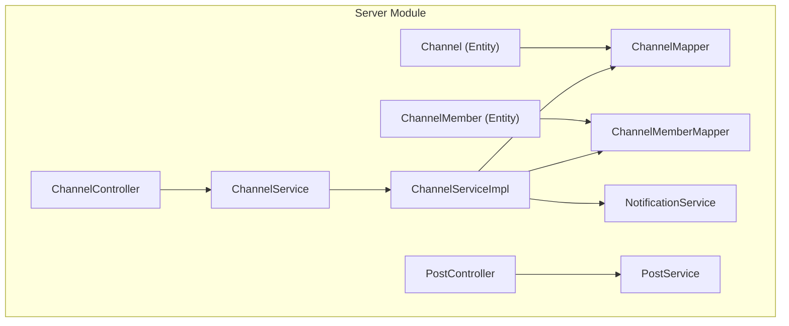
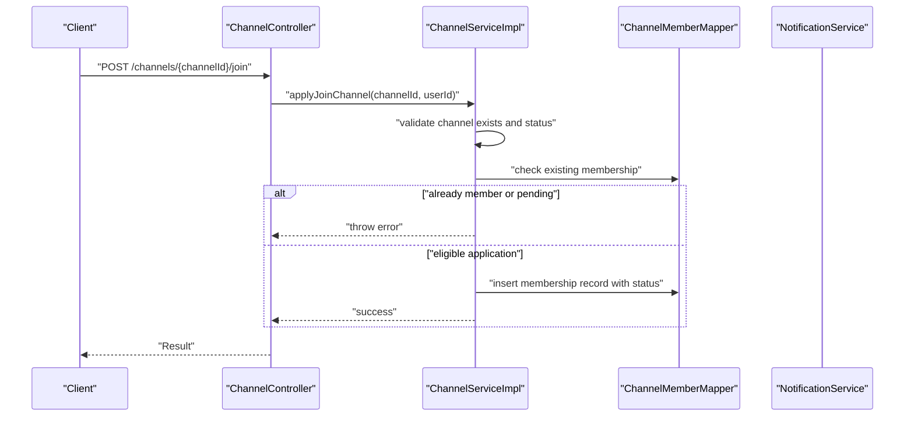
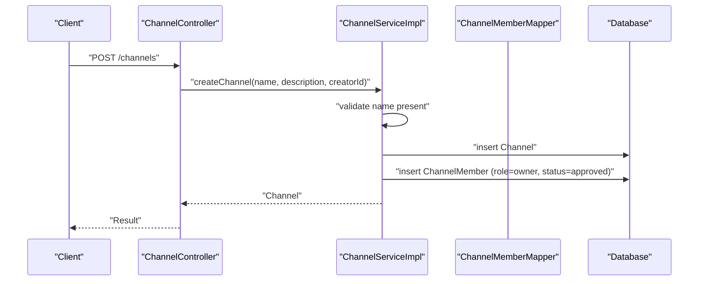
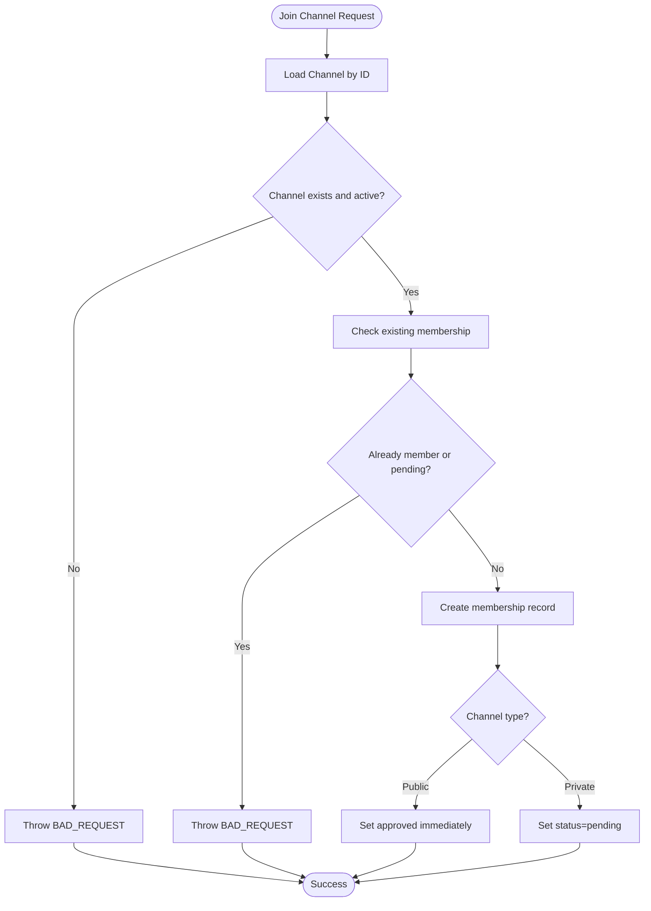
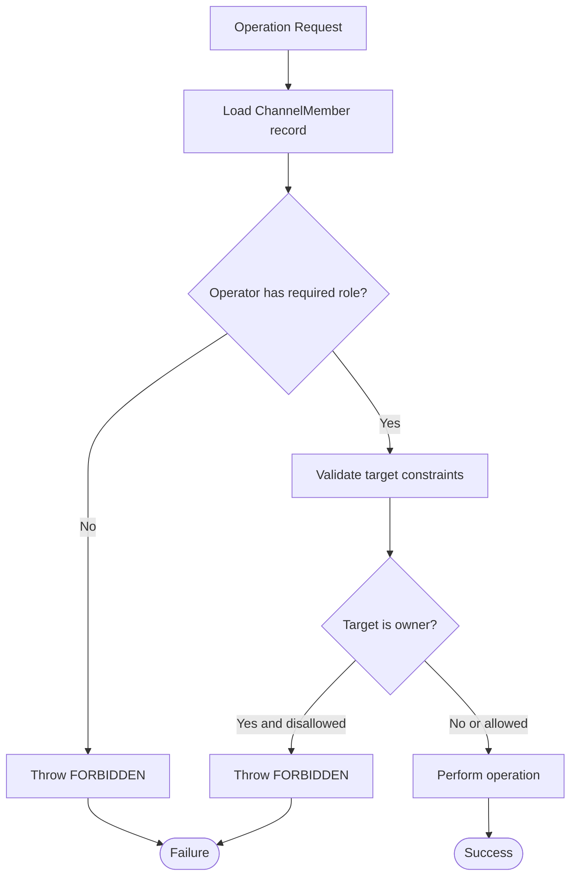
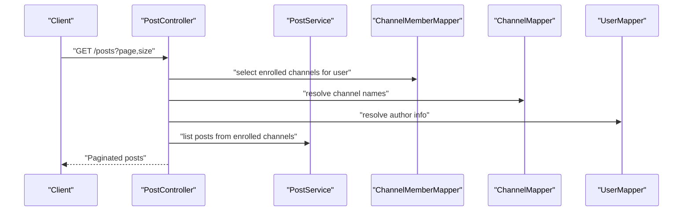
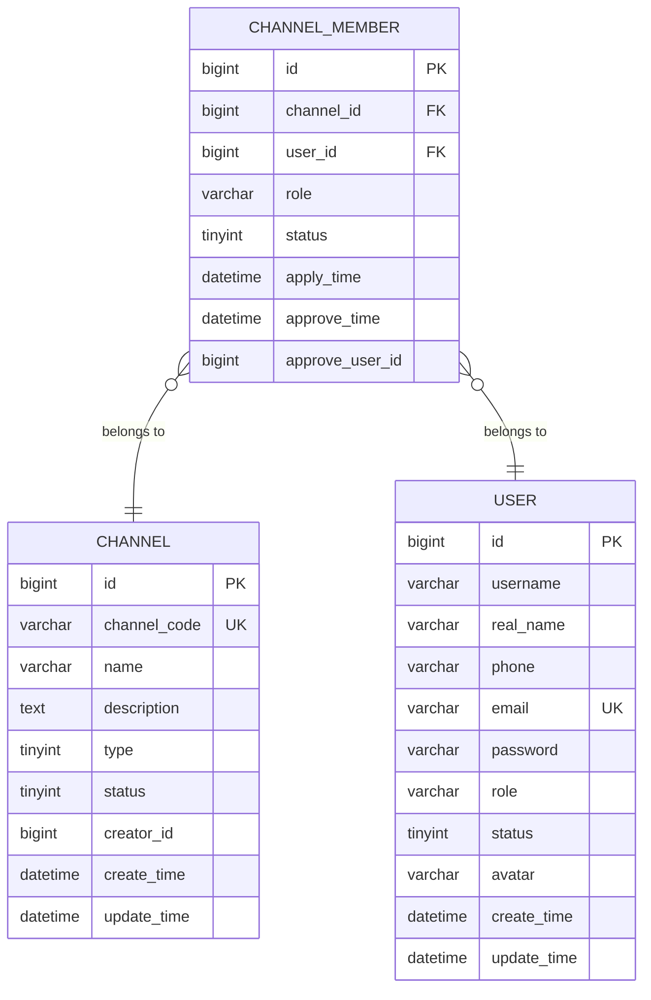
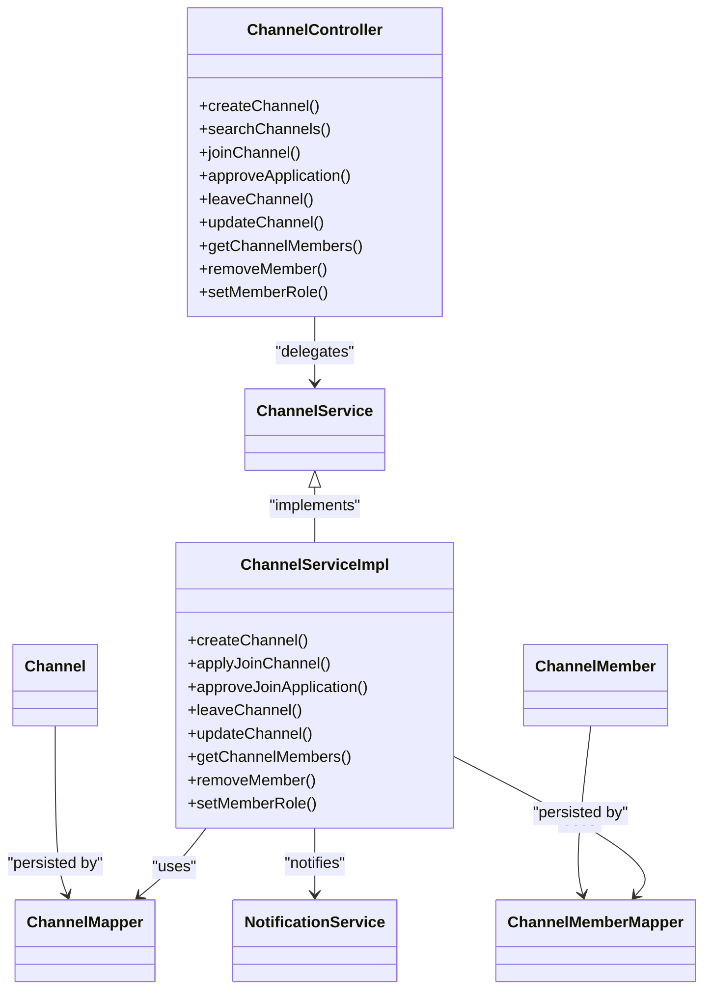

# Channel Management System

<cite>
**Referenced Files in This Document**
- [ChannelController.java](file://camp-channel-server/src/main/java/com/gdmec/campchannel/controller/ChannelController.java)
- [ChannelService.java](file://camp-channel-server/src/main/java/com/gdmec/campchannel/service/ChannelService.java)
- [ChannelServiceImpl.java](file://camp-channel-server/src/main/java/com/gdmec/campchannel/service/impl/ChannelServiceImpl.java)
- [Channel.java](file://camp-channel-server/src/main/java/com/gdmec/campchannel/entity/Channel.java)
- [ChannelMember.java](file://camp-channel-server/src/main/java/com/gdmec/campchannel/entity/ChannelMember.java)
- [ChannelMapper.java](file://camp-channel-server/src/main/java/com/gdmec/campchannel/mapper/ChannelMapper.java)
- [ChannelMemberMapper.java](file://camp-channel-server/src/main/java/com/gdmec/campchannel/mapper/ChannelMemberMapper.java)
- [PostController.java](file://camp-channel-server/src/main/java/com/gdmec/campchannel/controller/PostController.java)
- [PostService.java](file://camp-channel-server/src/main/java/com/gdmec/campchannel/service/PostService.java)
- [NotificationService.java](file://camp-channel-server/src/main/java/com/gdmec/campchannel/service/NotificationService.java)
- [schema.sql](file://camp-channel-server/src/main/resources/db/schema.sql)
- [application.yml](file://camp-channel-server/src/main/resources/application.yml)
- [Camp Channel 校园频道系统 V1.0 需求文档.md](file://Camp Channel 校园频道系统 V1.0 需求文档.md)
- [implementation_plan.md](file://implementation_plan.md)
</cite>

## Table of Contents
1. [Introduction](#introduction)
2. [Project Structure](#project-structure)
3. [Core Components](#core-components)
4. [Architecture Overview](#architecture-overview)
5. [Detailed Component Analysis](#detailed-component-analysis)
6. [Dependency Analysis](#dependency-analysis)
7. [Performance Considerations](#performance-considerations)
8. [Troubleshooting Guide](#troubleshooting-guide)
9. [Conclusion](#conclusion)
10. [Appendices](#appendices)

## Introduction
This document explains the channel management system implemented in the backend server module. It covers channel creation, member enrollment, permission management, and the integration with the post system for channel-based content distribution. It also documents the relationships with the user management system for member validation, configuration options for channel visibility and enrollment requirements, and operational controls such as approval workflows and moderation. The content is designed to be accessible to beginners while providing sufficient technical depth for experienced developers building community management features.

## Project Structure
The channel management system resides in the Spring Boot server module under the package com.gdmec.campchannel. The key layers are:
- Controllers: expose REST endpoints for channel operations
- Services: encapsulate business logic for channel lifecycle and membership
- Entities: define domain models for channels and channel-member relationships
- Mappers: data access layer for MyBatis-Plus
- Database schema: defines tables and constraints for channels, memberships, and notifications

**Diagram sources**
- [ChannelController.java:1-168](file://camp-channel-server/src/main/java/com/gdmec/campchannel/controller/ChannelController.java#L1-L168)
- [ChannelService.java:1-75](file://camp-channel-server/src/main/java/com/gdmec/campchannel/service/ChannelService.java#L1-L75)
- [ChannelServiceImpl.java:1-385](file://camp-channel-server/src/main/java/com/gdmec/campchannel/service/impl/ChannelServiceImpl.java#L1-L385)
- [ChannelMapper.java:1-9](file://camp-channel-server/src/main/java/com/gdmec/campchannel/mapper/ChannelMapper.java#L1-L9)
- [ChannelMemberMapper.java:1-9](file://camp-channel-server/src/main/java/com/gdmec/campchannel/mapper/ChannelMemberMapper.java#L1-L9)
- [Channel.java:1-32](file://camp-channel-server/src/main/java/com/gdmec/campchannel/entity/Channel.java#L1-L32)
- [ChannelMember.java:1-34](file://camp-channel-server/src/main/java/com/gdmec/campchannel/entity/ChannelMember.java#L1-L34)
- [PostController.java:32-108](file://camp-channel-server/src/main/java/com/gdmec/campchannel/controller/PostController.java#L32-L108)
- [PostService.java:1-49](file://camp-channel-server/src/main/java/com/gdmec/campchannel/service/PostService.java#L1-L49)
- [NotificationService.java:1-34](file://camp-channel-server/src/main/java/com/gdmec/campchannel/service/NotificationService.java#L1-L34)

**Section sources**
- [ChannelController.java:1-168](file://camp-channel-server/src/main/java/com/gdmec/campchannel/controller/ChannelController.java#L1-L168)
- [ChannelServiceImpl.java:1-385](file://camp-channel-server/src/main/java/com/gdmec/campchannel/service/impl/ChannelServiceImpl.java#L1-L385)
- [schema.sql:16-43](file://camp-channel-server/src/main/resources/db/schema.sql#L16-L43)

## Core Components
- ChannelController: Exposes REST endpoints for channel CRUD, enrollment, approvals, member management, and role updates.
- ChannelService and ChannelServiceImpl: Define and implement business logic for channel operations, membership checks, and moderation actions.
- Channel and ChannelMember entities: Represent the channel metadata and membership records, including roles and statuses.
- ChannelMapper and ChannelMemberMapper: Provide MyBatis-Plus data access for channels and memberships.
- PostController and PostService: Integrate channel-based content distribution and feed aggregation for enrolled users.
- NotificationService: Sends enrollment approval/rejection notifications to users.

Key responsibilities:
- Channel creation with automatic owner assignment and initial membership
- Enrollment application and approval workflows with configurable channel types
- Member role management (owner, administrator, member) and enforcement
- Moderation controls: removal and role changes restricted by permissions
- Integration with post system for channel-scoped content distribution

**Section sources**
- [ChannelController.java:27-168](file://camp-channel-server/src/main/java/com/gdmec/campchannel/controller/ChannelController.java#L27-L168)
- [ChannelService.java:9-75](file://camp-channel-server/src/main/java/com/gdmec/campchannel/service/ChannelService.java#L9-L75)
- [ChannelServiceImpl.java:38-385](file://camp-channel-server/src/main/java/com/gdmec/campchannel/service/impl/ChannelServiceImpl.java#L38-L385)
- [Channel.java:10-32](file://camp-channel-server/src/main/java/com/gdmec/campchannel/entity/Channel.java#L10-L32)
- [ChannelMember.java:11-34](file://camp-channel-server/src/main/java/com/gdmec/campchannel/entity/ChannelMember.java#L11-L34)
- [PostController.java:32-108](file://camp-channel-server/src/main/java/com/gdmec/campchannel/controller/PostController.java#L32-L108)
- [NotificationService.java:8-34](file://camp-channel-server/src/main/java/com/gdmec/campchannel/service/NotificationService.java#L8-L34)

## Architecture Overview
The channel management system follows a layered architecture:
- Presentation: ChannelController handles HTTP requests and delegates to ChannelService
- Application: ChannelServiceImpl implements business rules and orchestrates data access and notifications
- Persistence: MyBatis-Plus mappers access the database schema for channels and memberships
- Integration: PostController aggregates posts from channels the user belongs to; NotificationService sends enrollment outcomes

**Diagram sources**
- [ChannelController.java:55-63](file://camp-channel-server/src/main/java/com/gdmec/campchannel/controller/ChannelController.java#L55-L63)
- [ChannelServiceImpl.java:84-118](file://camp-channel-server/src/main/java/com/gdmec/campchannel/service/impl/ChannelServiceImpl.java#L84-L118)
- [ChannelMemberMapper.java:1-9](file://camp-channel-server/src/main/java/com/gdmec/campchannel/mapper/ChannelMemberMapper.java#L1-L9)

**Section sources**
- [ChannelController.java:27-168](file://camp-channel-server/src/main/java/com/gdmec/campchannel/controller/ChannelController.java#L27-L168)
- [ChannelServiceImpl.java:38-118](file://camp-channel-server/src/main/java/com/gdmec/campchannel/service/impl/ChannelServiceImpl.java#L38-L118)

## Detailed Component Analysis

### Channel Creation Workflow
Channel creation sets up a new channel with default attributes, assigns the creator as the owner, and creates the initial membership record with approved status.

**Diagram sources**
- [ChannelController.java:27-39](file://camp-channel-server/src/main/java/com/gdmec/campchannel/controller/ChannelController.java#L27-L39)
- [ChannelServiceImpl.java:38-65](file://camp-channel-server/src/main/java/com/gdmec/campchannel/service/impl/ChannelServiceImpl.java#L38-L65)
- [ChannelMemberMapper.java:1-9](file://camp-channel-server/src/main/java/com/gdmec/campchannel/mapper/ChannelMemberMapper.java#L1-L9)

**Section sources**
- [ChannelServiceImpl.java:38-65](file://camp-channel-server/src/main/java/com/gdmec/campchannel/service/impl/ChannelServiceImpl.java#L38-L65)
- [Channel.java:14-32](file://camp-channel-server/src/main/java/com/gdmec/campchannel/entity/Channel.java#L14-L32)
- [ChannelMember.java:15-34](file://camp-channel-server/src/main/java/com/gdmec/campchannel/entity/ChannelMember.java#L15-L34)

### Enrollment and Approval Workflows
Enrollment supports two channel types:
- Public channels (type=1): auto-approval upon application
- Private channels (type=2): require administrator approval

**Diagram sources**
- [ChannelServiceImpl.java:84-118](file://camp-channel-server/src/main/java/com/gdmec/campchannel/service/impl/ChannelServiceImpl.java#L84-L118)
- [schema.sql:22](file://camp-channel-server/src/main/resources/db/schema.sql#L22)

**Section sources**
- [ChannelServiceImpl.java:84-118](file://camp-channel-server/src/main/java/com/gdmec/campchannel/service/impl/ChannelServiceImpl.java#L84-L118)
- [schema.sql:16-43](file://camp-channel-server/src/main/resources/db/schema.sql#L16-L43)

### Permission Checking Mechanisms
Permission enforcement relies on membership roles and statuses:
- Editing channel info: requires owner/admin role
- Approving join applications: requires owner/admin role on the target channel
- Removing members: requires owner/admin; cannot remove owner
- Setting member roles: only owner can promote/demote; cannot modify owner’s role
- Leaving channel: owners must transfer ownership first

**Diagram sources**
- [ChannelServiceImpl.java:120-156](file://camp-channel-server/src/main/java/com/gdmec/campchannel/service/impl/ChannelServiceImpl.java#L120-L156)
- [ChannelServiceImpl.java:289-362](file://camp-channel-server/src/main/java/com/gdmec/campchannel/service/impl/ChannelServiceImpl.java#L289-L362)

**Section sources**
- [ChannelServiceImpl.java:120-156](file://camp-channel-server/src/main/java/com/gdmec/campchannel/service/impl/ChannelServiceImpl.java#L120-L156)
- [ChannelServiceImpl.java:289-362](file://camp-channel-server/src/main/java/com/gdmec/campchannel/service/impl/ChannelServiceImpl.java#L289-L362)

### Channel-Based Content Organization and Feed Integration
The post system integrates with channel membership to deliver content:
- Users see posts only from channels they belong to (status=1)
- PostController aggregates posts from enrolled channels for the home feed
- PostService provides channel-scoped retrieval and pagination

**Diagram sources**
- [PostController.java:32-80](file://camp-channel-server/src/main/java/com/gdmec/campchannel/controller/PostController.java#L32-L80)
- [PostService.java:10-18](file://camp-channel-server/src/main/java/com/gdmec/campchannel/service/PostService.java#L10-L18)

**Section sources**
- [PostController.java:32-80](file://camp-channel-server/src/main/java/com/gdmec/campchannel/controller/PostController.java#L32-L80)
- [PostService.java:10-18](file://camp-channel-server/src/main/java/com/gdmec/campchannel/service/PostService.java#L10-L18)

### Member Roles and Membership States
Roles and states are defined in the database schema:
- Roles: owner, admin, member
- States: 1=joined, 0=pending, 2=rejected

**Diagram sources**
- [schema.sql:16-43](file://camp-channel-server/src/main/resources/db/schema.sql#L16-L43)
- [schema.sql:103-129](file://camp-channel-server/src/main/resources/db/schema.sql#L103-L129)

**Section sources**
- [schema.sql:16-43](file://camp-channel-server/src/main/resources/db/schema.sql#L16-L43)
- [ChannelMember.java:11-34](file://camp-channel-server/src/main/java/com/gdmec/campchannel/entity/ChannelMember.java#L11-L34)

### Configuration Options
- Channel visibility and enrollment:
  - type=1: public (auto-join upon application)
  - type=2: private (requires approval)
- Channel code generation ensures uniqueness and readability (format example: CH-xxxx-xxx)
- Application context path and port configured via application.yml
- Database initialization loads schema.sql

**Section sources**
- [ChannelServiceImpl.java:364-384](file://camp-channel-server/src/main/java/com/gdmec/campchannel/service/impl/ChannelServiceImpl.java#L364-L384)
- [application.yml:1-119](file://camp-channel-server/src/main/resources/application.yml#L1-L119)
- [schema.sql:16-29](file://camp-channel-server/src/main/resources/db/schema.sql#L16-L29)

## Dependency Analysis
The system exhibits clear separation of concerns:
- Controllers depend on Services
- Services depend on Mappers and external services (NotificationService)
- Entities map to database tables with explicit indices and constraints
- PostController depends on ChannelMemberMapper to enforce membership-based feeds

**Diagram sources**
- [ChannelController.java:27-168](file://camp-channel-server/src/main/java/com/gdmec/campchannel/controller/ChannelController.java#L27-L168)
- [ChannelService.java:9-75](file://camp-channel-server/src/main/java/com/gdmec/campchannel/service/ChannelService.java#L9-L75)
- [ChannelServiceImpl.java:26-385](file://camp-channel-server/src/main/java/com/gdmec/campchannel/service/impl/ChannelServiceImpl.java#L26-L385)
- [ChannelMapper.java:1-9](file://camp-channel-server/src/main/java/com/gdmec/campchannel/mapper/ChannelMapper.java#L1-L9)
- [ChannelMemberMapper.java:1-9](file://camp-channel-server/src/main/java/com/gdmec/campchannel/mapper/ChannelMemberMapper.java#L1-L9)
- [Channel.java:10-32](file://camp-channel-server/src/main/java/com/gdmec/campchannel/entity/Channel.java#L10-L32)
- [ChannelMember.java:11-34](file://camp-channel-server/src/main/java/com/gdmec/campchannel/entity/ChannelMember.java#L11-L34)
- [NotificationService.java:8-34](file://camp-channel-server/src/main/java/com/gdmec/campchannel/service/NotificationService.java#L8-L34)

**Section sources**
- [ChannelServiceImpl.java:26-385](file://camp-channel-server/src/main/java/com/gdmec/campchannel/service/impl/ChannelServiceImpl.java#L26-L385)

## Performance Considerations
- Indexes on channel_code and channel.name support efficient search; similar indexes on channel_member.user_id and channel.id improve membership queries.
- Transactional boundaries in service methods ensure atomicity for enrollment and role changes.
- Pagination in PostController limits payload sizes for home feed retrieval.
- Unique constraints on channel_member.channel_id,user_id prevent duplicate memberships.

Recommendations:
- Monitor slow queries on membership and channel searches; consider composite indexes if needed.
- Cache frequently accessed channel metadata for read-heavy scenarios.
- Apply rate limiting for bulk enrollment operations at the controller level if traffic increases.

**Section sources**
- [schema.sql:27-43](file://camp-channel-server/src/main/resources/db/schema.sql#L27-L43)
- [PostController.java:58-80](file://camp-channel-server/src/main/java/com/gdmec/campchannel/controller/PostController.java#L58-L80)

## Troubleshooting Guide
Common issues and resolutions:
- Enrollment conflicts
  - Symptom: Attempting to re-apply or rejoin when already a member or pending
  - Resolution: Service throws BAD_REQUEST; instruct clients to check membership status before applying
  - Reference: [ChannelServiceImpl.java:96-103](file://camp-channel-server/src/main/java/com/gdmec/campchannel/service/impl/ChannelServiceImpl.java#L96-L103)
- Permission escalation
  - Symptom: Non-owner attempting to set roles or remove owner
  - Resolution: Service enforces owner-only role changes; throws FORBIDDEN for invalid operators/targets
  - Reference: [ChannelServiceImpl.java:333-362](file://camp-channel-server/src/main/java/com/gdmec/campchannel/service/impl/ChannelServiceImpl.java#L333-L362)
- Channel moderation
  - Symptom: Owner trying to leave channel
  - Resolution: Service prevents owner exit; requires role transfer first
  - Reference: [ChannelServiceImpl.java:186-207](file://camp-channel-server/src/main/java/com/gdmec/campchannel/service/impl/ChannelServiceImpl.java#L186-L207)
- Approval workflow errors
  - Symptom: Approving already processed applications
  - Resolution: Service validates application status; throws BAD_REQUEST for duplicates
  - Reference: [ChannelServiceImpl.java:122-130](file://camp-channel-server/src/main/java/com/gdmec/campchannel/service/impl/ChannelServiceImpl.java#L122-L130)

Operational controls:
- Pending application counts and lists are computed per owner/admin membership
- Notifications are sent upon approval/rejection outcomes

**Section sources**
- [ChannelServiceImpl.java:96-103](file://camp-channel-server/src/main/java/com/gdmec/campchannel/service/impl/ChannelServiceImpl.java#L96-L103)
- [ChannelServiceImpl.java:122-130](file://camp-channel-server/src/main/java/com/gdmec/campchannel/service/impl/ChannelServiceImpl.java#L122-L130)
- [ChannelServiceImpl.java:186-207](file://camp-channel-server/src/main/java/com/gdmec/campchannel/service/impl/ChannelServiceImpl.java#L186-L207)
- [ChannelServiceImpl.java:333-362](file://camp-channel-server/src/main/java/com/gdmec/campchannel/service/impl/ChannelServiceImpl.java#L333-L362)

## Conclusion
The channel management system provides a robust foundation for community-driven content platforms. It supports public and private channels, automated and manual enrollment, comprehensive permission enforcement, and seamless integration with the post system. The modular design, transactional service layer, and clear role/state semantics facilitate maintainability and extensibility. Administrators can efficiently moderate enrollments and manage memberships, while end-users benefit from straightforward workflows for joining, participating, and organizing content within channels.

## Appendices

### API Definitions and Examples
- Create channel
  - Method: POST
  - Path: /channels
  - Request body: CreateChannelRequest (name, description)
  - Response: Result<Channel>
  - Example path: [ChannelController.java:27-39](file://camp-channel-server/src/main/java/com/gdmec/campchannel/controller/ChannelController.java#L27-L39)
- Search channels
  - Method: GET
  - Path: /channels/search?keyword={text}
  - Response: Result<List<Channel>>
  - Example path: [ChannelController.java:41-46](file://camp-channel-server/src/main/java/com/gdmec/campchannel/controller/ChannelController.java#L41-L46)
- Apply to join channel
  - Method: POST
  - Path: /channels/{channelId}/join
  - Response: Result<Void>
  - Example path: [ChannelController.java:55-63](file://camp-channel-server/src/main/java/com/gdmec/campchannel/controller/ChannelController.java#L55-L63)
- Get pending applications
  - Method: GET
  - Path: /channels/{channelId}/applications
  - Response: Result<List<ChannelMember>>
  - Example path: [ChannelController.java:65-73](file://camp-channel-server/src/main/java/com/gdmec/campchannel/controller/ChannelController.java#L65-L73)
- Approve application
  - Method: POST
  - Path: /channels/applications/{applicationId}/approve
  - Request body: ApproveRequest (approved: boolean)
  - Response: Result<Void>
  - Example path: [ChannelController.java:75-84](file://camp-channel-server/src/main/java/com/gdmec/campchannel/controller/ChannelController.java#L75-L84)
- Leave channel
  - Method: POST
  - Path: /channels/{channelId}/leave
  - Response: Result<Void>
  - Example path: [ChannelController.java:86-94](file://camp-channel-server/src/main/java/com/gdmec/campchannel/controller/ChannelController.java#L86-L94)
- Edit channel
  - Method: PUT
  - Path: /channels/{channelId}
  - Request body: CreateChannelRequest (name, description)
  - Response: Result<Void>
  - Example path: [ChannelController.java:96-105](file://camp-channel-server/src/main/java/com/gdmec/campchannel/controller/ChannelController.java#L96-L105)
- Get channel members
  - Method: GET
  - Path: /channels/{channelId}/members
  - Response: Result<List<ChannelMember>>
  - Example path: [ChannelController.java:107-114](file://camp-channel-server/src/main/java/com/gdmec/campchannel/controller/ChannelController.java#L107-L114)
- Remove member
  - Method: POST
  - Path: /channels/{channelId}/members/{userId}/remove
  - Response: Result<Void>
  - Example path: [ChannelController.java:116-125](file://camp-channel-server/src/main/java/com/gdmec/campchannel/controller/ChannelController.java#L116-L125)
- Set member role
  - Method: POST
  - Path: /channels/{channelId}/members/{userId}/role
  - Request body: RoleRequest (role: string)
  - Response: Result<Void>
  - Example path: [ChannelController.java:127-137](file://camp-channel-server/src/main/java/com/gdmec/campchannel/controller/ChannelController.java#L127-L137)

### Requirements and Planning Alignment
- Phase 4 scope: Channel creation, search, and private/public enrollment workflows align with current implementation
- V1.0 requirement: Public/private channel distinction and enrollment approval process
- V2.0 enhancements (planned): Additional moderation features and advanced permissions are out of scope for this release

**Section sources**
- [implementation_plan.md:77-86](file://implementation_plan.md#L77-L86)
- [Camp Channel 校园频道系统 V1.0 需求文档.md:88-104](file://Camp Channel 校园频道系统 V1.0 需求文档.md#L88-L104)