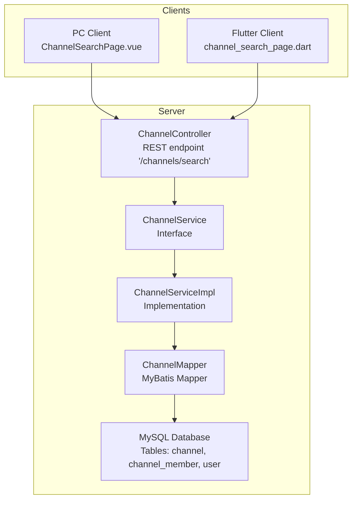
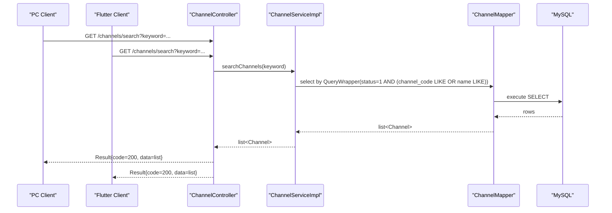
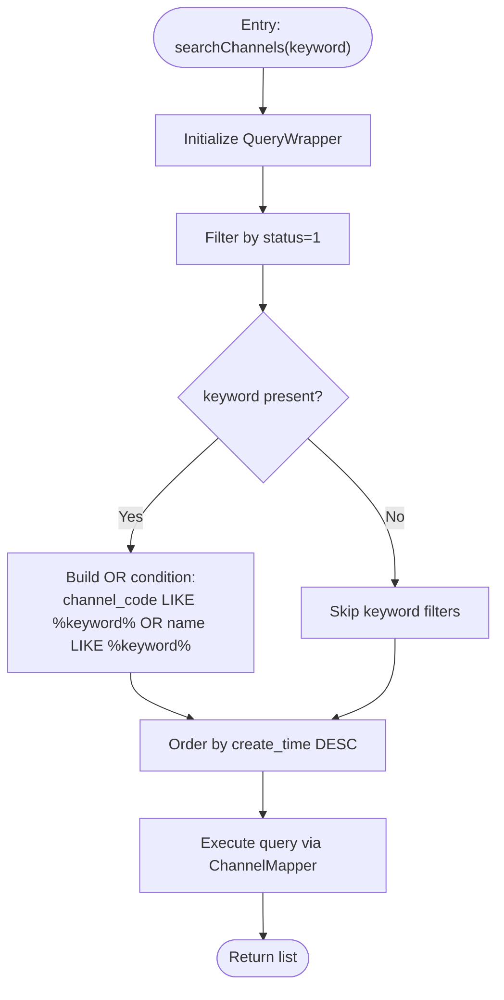
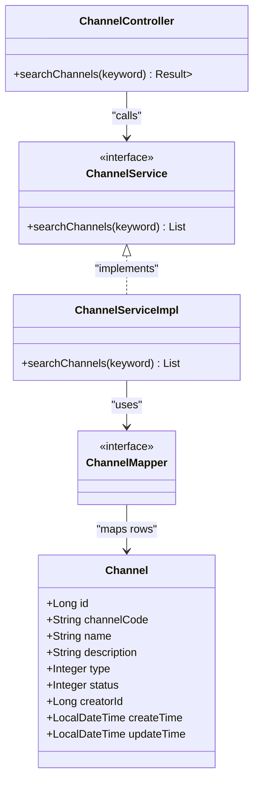

# Channel Search and Discovery

<cite>
**Referenced Files in This Document**
- [ChannelController.java](file://camp-channel-server/src/main/java/com/gdmec/campchannel/controller/ChannelController.java)
- [ChannelService.java](file://camp-channel-server/src/main/java/com/gdmec/campchannel/service/ChannelService.java)
- [ChannelServiceImpl.java](file://camp-channel-server/src/main/java/com/gdmec/campchannel/service/impl/ChannelServiceImpl.java)
- [ChannelMapper.java](file://camp-channel-server/src/main/java/com/gdmec/campchannel/mapper/ChannelMapper.java)
- [Channel.java](file://camp-channel-server/src/main/java/com/gdmec/campchannel/entity/Channel.java)
- [schema.sql](file://camp-channel-server/src/main/resources/db/schema.sql)
- [application.yml](file://camp-channel-server/src/main/resources/application.yml)
- [ChannelSearchPage.vue](file://camp-channel-client-pc/src/pages/ChannelSearchPage.vue)
- [channel_search_page.dart](file://camp-channel-client-flutter/lib/pages/channel_search_page.dart)
- [RedisUtils.java](file://camp-channel-server/src/main/java/com/gdmec/campchannel/common/utils/RedisUtils.java)
- [NotificationService.java](file://camp-channel-server/src/main/java/com/gdmec/campchannel/service/NotificationService.java)
- [NotificationServiceImpl.java](file://camp-channel-server/src/main/java/com/gdmec/campchannel/service/impl/NotificationServiceImpl.java)
</cite>

## Table of Contents
1. [Introduction](#introduction)
2. [Project Structure](#project-structure)
3. [Core Components](#core-components)
4. [Architecture Overview](#architecture-overview)
5. [Detailed Component Analysis](#detailed-component-analysis)
6. [Dependency Analysis](#dependency-analysis)
7. [Performance Considerations](#performance-considerations)
8. [Troubleshooting Guide](#troubleshooting-guide)
9. [Conclusion](#conclusion)
10. [Appendices](#appendices)

## Introduction
This document explains the channel search and discovery functionality across the backend server and frontend clients. It details the search algorithm, keyword matching strategies, result ordering, API endpoints, query parameter handling, and result formatting. It also covers database-backed search, visibility filtering, and practical examples for common search scenarios such as partial name matches, description searches, and category-based filtering. Finally, it outlines search result limitations, performance optimization techniques, and integration points with notifications and caching.

## Project Structure
The search feature spans three layers:
- Backend REST controller and service layer
- Database schema with indexing for efficient lookups
- Frontend clients that trigger and render search results

**Diagram sources**
- [ChannelController.java:41-46](file://camp-channel-server/src/main/java/com/gdmec/campchannel/controller/ChannelController.java#L41-L46)
- [ChannelService.java:16-19](file://camp-channel-server/src/main/java/com/gdmec/campchannel/service/ChannelService.java#L16-L19)
- [ChannelServiceImpl.java:67-82](file://camp-channel-server/src/main/java/com/gdmec/campchannel/service/impl/ChannelServiceImpl.java#L67-L82)
- [ChannelMapper.java:1-9](file://camp-channel-server/src/main/java/com/gdmec/campchannel/mapper/ChannelMapper.java#L1-L9)
- [schema.sql:16-29](file://camp-channel-server/src/main/resources/db/schema.sql#L16-L29)
- [ChannelSearchPage.vue:57-81](file://camp-channel-client-pc/src/pages/ChannelSearchPage.vue#L57-L81)
- [channel_search_page.dart:32-62](file://camp-channel-client-flutter/lib/pages/channel_search_page.dart#L32-L62)

**Section sources**
- [ChannelController.java:41-46](file://camp-channel-server/src/main/java/com/gdmec/campchannel/controller/ChannelController.java#L41-L46)
- [schema.sql:16-29](file://camp-channel-server/src/main/resources/db/schema.sql#L16-L29)

## Core Components
- ChannelController exposes the GET /channels/search endpoint and delegates to ChannelService.
- ChannelService defines the contract for searchChannels(keyword).
- ChannelServiceImpl implements searchChannels with a MyBatis-Plus QueryWrapper that filters by status and applies fuzzy matching on channel_code and name.
- ChannelMapper provides persistence access for Channel entities.
- Channel entity holds channel metadata including channelCode, name, description, type, status, and timestamps.
- Database schema defines indexes on channel_code and name to support fast LIKE queries.
- Clients trigger search via API and optionally refine results locally (e.g., Flutter client filters by description).

**Section sources**
- [ChannelController.java:41-46](file://camp-channel-server/src/main/java/com/gdmec/campchannel/controller/ChannelController.java#L41-L46)
- [ChannelService.java:16-19](file://camp-channel-server/src/main/java/com/gdmec/campchannel/service/ChannelService.java#L16-L19)
- [ChannelServiceImpl.java:67-82](file://camp-channel-server/src/main/java/com/gdmec/campchannel/service/impl/ChannelServiceImpl.java#L67-L82)
- [ChannelMapper.java:1-9](file://camp-channel-server/src/main/java/com/gdmec/campchannel/mapper/ChannelMapper.java#L1-L9)
- [Channel.java:10-32](file://camp-channel-server/src/main/java/com/gdmec/campchannel/entity/Channel.java#L10-L32)
- [schema.sql:16-29](file://camp-channel-server/src/main/resources/db/schema.sql#L16-L29)
- [channel_search_page.dart:54-62](file://camp-channel-client-flutter/lib/pages/channel_search_page.dart#L54-L62)

## Architecture Overview
The search pipeline is straightforward: clients call /channels/search with an optional keyword, the controller invokes the service, the service builds a query filtering by status and fuzzy-matching channel_code and name, and the mapper executes the SQL against the database.

**Diagram sources**
- [ChannelController.java:41-46](file://camp-channel-server/src/main/java/com/gdmec/campchannel/controller/ChannelController.java#L41-L46)
- [ChannelServiceImpl.java:67-82](file://camp-channel-server/src/main/java/com/gdmec/campchannel/service/impl/ChannelServiceImpl.java#L67-L82)
- [ChannelMapper.java:1-9](file://camp-channel-server/src/main/java/com/gdmec/campchannel/mapper/ChannelMapper.java#L1-L9)
- [schema.sql:16-29](file://camp-channel-server/src/main/resources/db/schema.sql#L16-L29)

## Detailed Component Analysis

### Search Algorithm Implementation
- Filtering: Only channels with status=1 are returned.
- Keyword Matching:
  - channel_code LIKE %keyword%
  - OR name LIKE %keyword%
- Ordering: Results are ordered by create_time descending to surface newest channels first.
- Pagination: No explicit pagination is applied in the current implementation; clients may implement client-side pagination or filtering.

**Diagram sources**
- [ChannelServiceImpl.java:67-82](file://camp-channel-server/src/main/java/com/gdmec/campchannel/service/impl/ChannelServiceImpl.java#L67-L82)

**Section sources**
- [ChannelServiceImpl.java:67-82](file://camp-channel-server/src/main/java/com/gdmec/campchannel/service/impl/ChannelServiceImpl.java#L67-L82)

### API Endpoints and Query Parameter Handling
- Endpoint: GET /channels/search
- Query parameter:
  - keyword (optional): Used to match channel_code or name via LIKE.
- Response:
  - Result wrapper with code, message, and data (list of channels).
- Sorting:
  - Results are sorted by create_time descending.

Practical examples:
- GET /channels/search
- GET /channels/search?keyword=CS
- GET /channels/search?keyword=computer

**Section sources**
- [ChannelController.java:41-46](file://camp-channel-server/src/main/java/com/gdmec/campchannel/controller/ChannelController.java#L41-L46)
- [ChannelServiceImpl.java:67-82](file://camp-channel-server/src/main/java/com/gdmec/campchannel/service/impl/ChannelServiceImpl.java#L67-L82)

### Result Filtering Mechanisms
- Backend filtering:
  - status=1 ensures only active channels are returned.
  - Optional keyword filters on channel_code and name.
- Frontend filtering:
  - Flutter client additionally filters by description using contains logic.
  - PC client filters out a specific public channel ID after receiving results.

**Section sources**
- [ChannelServiceImpl.java:67-82](file://camp-channel-server/src/main/java/com/gdmec/campchannel/service/impl/ChannelServiceImpl.java#L67-L82)
- [channel_search_page.dart:54-62](file://camp-channel-client-flutter/lib/pages/channel_search_page.dart#L54-L62)
- [ChannelSearchPage.vue:66-75](file://camp-channel-client-pc/src/pages/ChannelSearchPage.vue#L66-L75)

### Search Result Ranking Criteria
- Newest-first ordering: create_time DESC.
- No additional relevance scoring is implemented in the backend; frontend may augment results (e.g., highlight matches).

**Section sources**
- [ChannelServiceImpl.java:80-81](file://camp-channel-server/src/main/java/com/gdmec/campchannel/service/impl/ChannelServiceImpl.java#L80-L81)

### Channel Visibility Filtering
- Channels with status != 1 are excluded from search results.
- Channel type (public/private) is represented by type but is not used in the search query; clients may apply additional filtering (e.g., excluding a specific public channel ID in the PC client).

**Section sources**
- [ChannelServiceImpl.java:70-78](file://camp-channel-server/src/main/java/com/gdmec/campchannel/service/impl/ChannelServiceImpl.java#L70-L78)
- [schema.sql:22-23](file://camp-channel-server/src/main/resources/db/schema.sql#L22-L23)
- [ChannelSearchPage.vue:72-74](file://camp-channel-client-pc/src/pages/ChannelSearchPage.vue#L72-L74)

### Search Result Formatting
- Backend returns raw Channel entities; clients format fields such as channelCode, name, description, and derive counts (members/posts) for display.
- PC client enriches results by fetching the user’s joined channels and marking join status accordingly.

**Section sources**
- [ChannelSearchPage.vue:62-75](file://camp-channel-client-pc/src/pages/ChannelSearchPage.vue#L62-L75)
- [Channel.java:10-32](file://camp-channel-server/src/main/java/com/gdmec/campchannel/entity/Channel.java#L10-L32)

### Common Search Scenarios
- Partial name matches: Implemented via LIKE %keyword% on name.
- Description searches: Not supported by backend; Flutter client performs client-side contains on description.
- Category-based filtering: Not implemented in backend search; clients may filter by known identifiers (e.g., exclude a specific public channel ID).

**Section sources**
- [ChannelServiceImpl.java:72-78](file://camp-channel-server/src/main/java/com/gdmec/campchannel/service/impl/ChannelServiceImpl.java#L72-L78)
- [channel_search_page.dart:57-60](file://camp-channel-client-flutter/lib/pages/channel_search_page.dart#L57-L60)
- [ChannelSearchPage.vue:72-74](file://camp-channel-client-pc/src/pages/ChannelSearchPage.vue#L72-L74)

### Relationship Between Search and Channel Visibility Settings
- status=1 is a hard filter in the search query; disabled channels will not appear.
- type indicates public/private but does not restrict discovery in the search query; clients may still choose to hide or treat specific types differently.

**Section sources**
- [ChannelServiceImpl.java:70-78](file://camp-channel-server/src/main/java/com/gdmec/campchannel/service/impl/ChannelServiceImpl.java#L70-L78)
- [schema.sql:22-23](file://camp-channel-server/src/main/resources/db/schema.sql#L22-L23)

### Search Result Limitations
- No built-in pagination or limit in the search query.
- Clients may implement client-side filtering and pagination.

**Section sources**
- [ChannelServiceImpl.java:80-81](file://camp-channel-server/src/main/java/com/gdmec/campchannel/service/impl/ChannelServiceImpl.java#L80-L81)

### Practical Examples
- Backend search:
  - Request: GET /channels/search?keyword=CS
  - Behavior: Returns active channels whose channel_code or name contains “CS”, ordered by creation time.
- Frontend refinement:
  - Flutter: After receiving results, filters by description contains.
  - PC: Filters out a specific public channel ID post-fetch.

**Section sources**
- [ChannelController.java:41-46](file://camp-channel-server/src/main/java/com/gdmec/campchannel/controller/ChannelController.java#L41-L46)
- [channel_search_page.dart:32-62](file://camp-channel-client-flutter/lib/pages/channel_search_page.dart#L32-L62)
- [ChannelSearchPage.vue:57-81](file://camp-channel-client-pc/src/pages/ChannelSearchPage.vue#L57-L81)

## Dependency Analysis

**Diagram sources**
- [ChannelController.java:41-46](file://camp-channel-server/src/main/java/com/gdmec/campchannel/controller/ChannelController.java#L41-L46)
- [ChannelService.java:16-19](file://camp-channel-server/src/main/java/com/gdmec/campchannel/service/ChannelService.java#L16-L19)
- [ChannelServiceImpl.java:67-82](file://camp-channel-server/src/main/java/com/gdmec/campchannel/service/impl/ChannelServiceImpl.java#L67-L82)
- [ChannelMapper.java:1-9](file://camp-channel-server/src/main/java/com/gdmec/campchannel/mapper/ChannelMapper.java#L1-L9)
- [Channel.java:10-32](file://camp-channel-server/src/main/java/com/gdmec/campchannel/entity/Channel.java#L10-L32)

**Section sources**
- [ChannelController.java:41-46](file://camp-channel-server/src/main/java/com/gdmec/campchannel/controller/ChannelController.java#L41-L46)
- [ChannelServiceImpl.java:67-82](file://camp-channel-server/src/main/java/com/gdmec/campchannel/service/impl/ChannelServiceImpl.java#L67-L82)
- [ChannelMapper.java:1-9](file://camp-channel-server/src/main/java/com/gdmec/campchannel/mapper/ChannelMapper.java#L1-L9)
- [Channel.java:10-32](file://camp-channel-server/src/main/java/com/gdmec/campchannel/entity/Channel.java#L10-L32)

## Performance Considerations
- Database indexes:
  - channel(channel_code) and channel(name) support LIKE queries for keyword matching.
- Query characteristics:
  - Uses leading wildcards (LIKE %keyword%) which can be slow on large datasets; consider full-text search or prefix-only matching if performance becomes an issue.
- Ordering:
  - create_time DESC is fast with an index on create_time (present in schema).
- Pagination:
  - Not implemented in backend; consider adding page and size parameters and server-side LIMIT/OFFSET to reduce payload size.
- Caching:
  - Redis utilities exist; consider caching popular search terms with TTL to reduce repeated database load.
- Notifications:
  - Notification service supports real-time delivery; while not part of search, it complements user engagement around search results.

**Section sources**
- [schema.sql:27-28](file://camp-channel-server/src/main/resources/db/schema.sql#L27-L28)
- [application.yml:31-42](file://camp-channel-server/src/main/resources/application.yml#L31-L42)
- [RedisUtils.java:132-169](file://camp-channel-server/src/main/java/com/gdmec/campchannel/common/utils/RedisUtils.java#L132-L169)
- [NotificationService.java:10-13](file://camp-channel-server/src/main/java/com/gdmec/campchannel/service/NotificationService.java#L10-L13)
- [NotificationServiceImpl.java:26-51](file://camp-channel-server/src/main/java/com/gdmec/campchannel/service/impl/NotificationServiceImpl.java#L26-L51)

## Troubleshooting Guide
- Empty results:
  - Verify keyword length and spelling; ensure channels exist with status=1.
- Unexpectedly missing results:
  - Confirm channel_code and name indexes exist and are populated.
- Performance issues:
  - Monitor query execution time; consider adding pagination or full-text search.
- Client-side filtering not working:
  - Ensure frontend is passing keyword and applying filters correctly.

**Section sources**
- [ChannelServiceImpl.java:67-82](file://camp-channel-server/src/main/java/com/gdmec/campchannel/service/impl/ChannelServiceImpl.java#L67-L82)
- [schema.sql:16-29](file://camp-channel-server/src/main/resources/db/schema.sql#L16-L29)
- [ChannelSearchPage.vue:57-81](file://camp-channel-client-pc/src/pages/ChannelSearchPage.vue#L57-L81)
- [channel_search_page.dart:54-62](file://camp-channel-client-flutter/lib/pages/channel_search_page.dart#L54-L62)

## Conclusion
The current search implementation provides a simple, effective mechanism to discover active channels by channel code or name, with newest-first ordering. While backend search is intentionally minimal, clients enhance the experience with additional filtering and user-specific context. For production-scale deployments, consider adding pagination, full-text search, and caching strategies to improve performance and scalability.

## Appendices

### API Definition
- GET /channels/search
  - Query parameters:
    - keyword (optional)
  - Response:
    - Result wrapper containing a list of channels

**Section sources**
- [ChannelController.java:41-46](file://camp-channel-server/src/main/java/com/gdmec/campchannel/controller/ChannelController.java#L41-L46)

### Database Schema Highlights
- channel table:
  - channel_code (UNIQUE), name, type, status, creator_id, timestamps
  - Indexes: idx_channel_code, idx_channel_name

**Section sources**
- [schema.sql:16-29](file://camp-channel-server/src/main/resources/db/schema.sql#L16-L29)