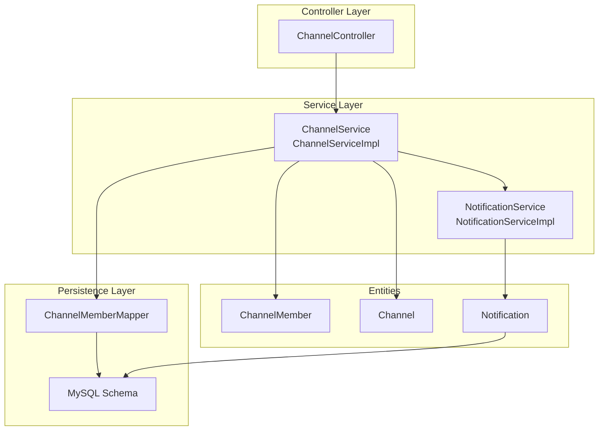
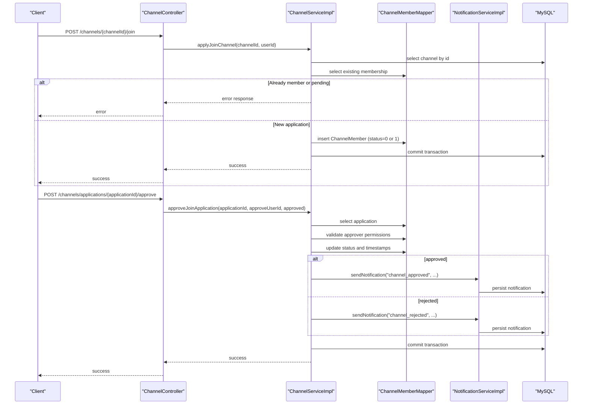
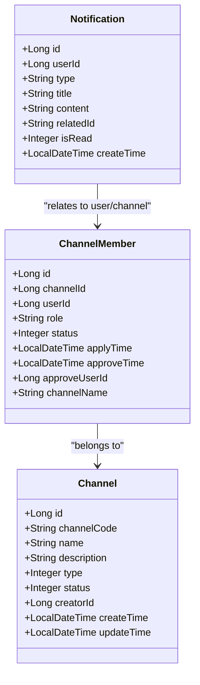
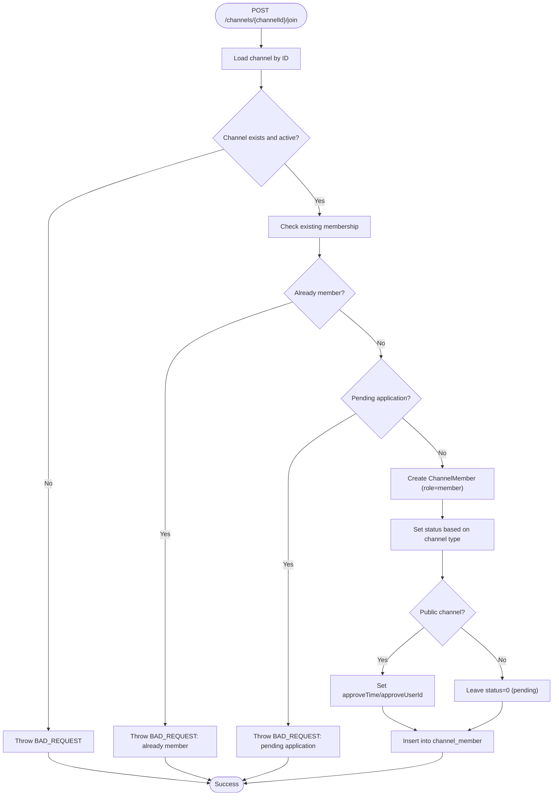
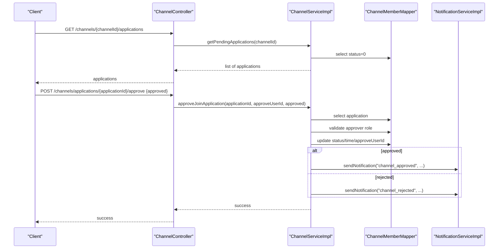
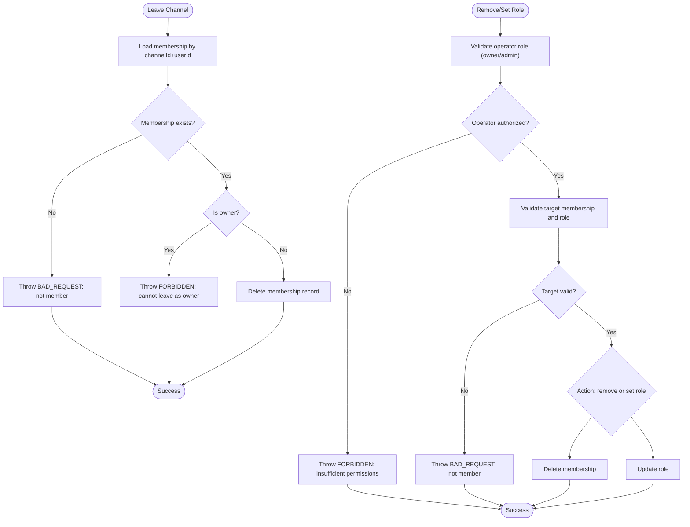
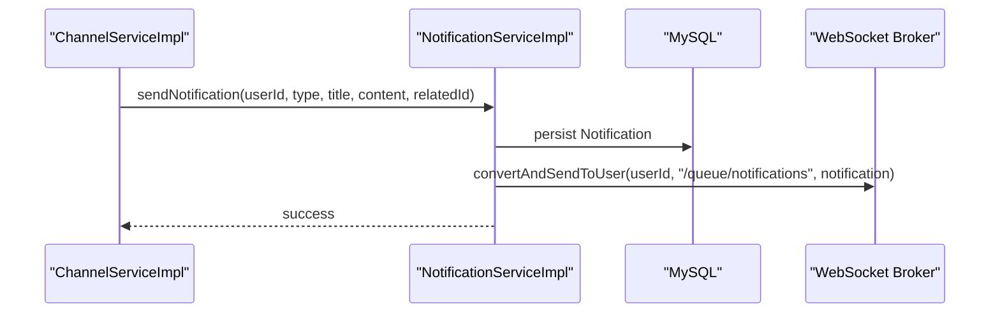
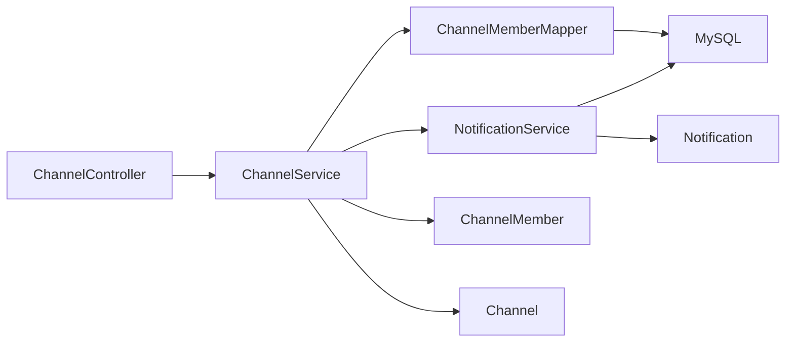

# Member Enrollment and Application System

<cite>
**Referenced Files in This Document**
- [ChannelController.java](file://camp-channel-server/src/main/java/com/gdmec/campchannel/controller/ChannelController.java)
- [ChannelServiceImpl.java](file://camp-channel-server/src/main/java/com/gdmec/campchannel/service/impl/ChannelServiceImpl.java)
- [ChannelService.java](file://camp-channel-server/src/main/java/com/gdmec/campchannel/service/ChannelService.java)
- [ChannelMember.java](file://camp-channel-server/src/main/java/com/gdmec/campchannel/entity/ChannelMember.java)
- [Channel.java](file://camp-channel-server/src/main/java/com/gdmec/campchannel/entity/Channel.java)
- [NotificationService.java](file://camp-channel-server/src/main/java/com/gdmec/campchannel/service/NotificationService.java)
- [NotificationServiceImpl.java](file://camp-channel-server/src/main/java/com/gdmec/campchannel/service/impl/NotificationServiceImpl.java)
- [Notification.java](file://camp-channel-server/src/main/java/com/gdmec/campchannel/entity/Notification.java)
- [ChannelMemberMapper.java](file://camp-channel-server/src/main/java/com/gdmec/campchannel/mapper/ChannelMemberMapper.java)
- [schema.sql](file://camp-channel-server/src/main/resources/db/schema.sql)
- [application.yml](file://camp-channel-server/src/main/resources/application.yml)
</cite>

## Table of Contents
1. [Introduction](#introduction)
2. [Project Structure](#project-structure)
3. [Core Components](#core-components)
4. [Architecture Overview](#architecture-overview)
5. [Detailed Component Analysis](#detailed-component-analysis)
6. [Dependency Analysis](#dependency-analysis)
7. [Performance Considerations](#performance-considerations)
8. [Troubleshooting Guide](#troubleshooting-guide)
9. [Conclusion](#conclusion)
10. [Appendices](#appendices)

## Introduction
This document explains the member enrollment and application system for channels. It covers the enrollment workflow from application submission to approval, membership management, and the ChannelMember entity structure. It documents the ChannelController APIs for join/leave operations, pending application management, and enrollment approval, along with the underlying approval workflows, member validation, and integration with the notification system for automated onboarding.

## Project Structure
The enrollment system spans the controller, service, persistence, and notification layers:
- Controller layer exposes REST endpoints for channel enrollment and management.
- Service layer implements business logic for enrollment, approvals, and member operations.
- Persistence layer maps ChannelMember and related entities to the database.
- Notification layer handles real-time and stored notifications for enrollment outcomes.

**Diagram sources**
- [ChannelController.java:1-168](file://camp-channel-server/src/main/java/com/gdmec/campchannel/controller/ChannelController.java#L1-L168)
- [ChannelServiceImpl.java:1-385](file://camp-channel-server/src/main/java/com/gdmec/campchannel/service/impl/ChannelServiceImpl.java#L1-L385)
- [ChannelMemberMapper.java:1-9](file://camp-channel-server/src/main/java/com/gdmec/campchannel/mapper/ChannelMemberMapper.java#L1-L9)
- [schema.sql:31-43](file://camp-channel-server/src/main/resources/db/schema.sql#L31-L43)
- [NotificationServiceImpl.java:1-95](file://camp-channel-server/src/main/java/com/gdmec/campchannel/service/impl/NotificationServiceImpl.java#L1-L95)

**Section sources**
- [ChannelController.java:1-168](file://camp-channel-server/src/main/java/com/gdmec/campchannel/controller/ChannelController.java#L1-L168)
- [ChannelServiceImpl.java:1-385](file://camp-channel-server/src/main/java/com/gdmec/campchannel/service/impl/ChannelServiceImpl.java#L1-L385)
- [schema.sql:31-43](file://camp-channel-server/src/main/resources/db/schema.sql#L31-L43)

## Core Components
- ChannelMember entity: Tracks user-channel relationships with roles, statuses, and timestamps.
- ChannelService interface and implementation: Orchestrates enrollment, approvals, and membership operations.
- ChannelController endpoints: Expose enrollment APIs for joining, approving, leaving, and managing members.
- NotificationService: Sends real-time and stored notifications for enrollment outcomes.

Key enrollment-related fields in ChannelMember:
- role: owner, admin, member
- status: 1 for joined, 0 for pending, 2 for rejected
- applyTime: when the application was submitted
- approveTime: when the application was processed
- approveUserId: who processed the application

**Section sources**
- [ChannelMember.java:1-34](file://camp-channel-server/src/main/java/com/gdmec/campchannel/entity/ChannelMember.java#L1-L34)
- [ChannelService.java:1-75](file://camp-channel-server/src/main/java/com/gdmec/campchannel/service/ChannelService.java#L1-L75)
- [ChannelServiceImpl.java:84-156](file://camp-channel-server/src/main/java/com/gdmec/campchannel/service/impl/ChannelServiceImpl.java#L84-L156)
- [ChannelController.java:55-94](file://camp-channel-server/src/main/java/com/gdmec/campchannel/controller/ChannelController.java#L55-L94)

## Architecture Overview
The enrollment workflow integrates REST endpoints, service logic, database persistence, and real-time notifications.

**Diagram sources**
- [ChannelController.java:55-84](file://camp-channel-server/src/main/java/com/gdmec/campchannel/controller/ChannelController.java#L55-L84)
- [ChannelServiceImpl.java:84-156](file://camp-channel-server/src/main/java/com/gdmec/campchannel/service/impl/ChannelServiceImpl.java#L84-L156)
- [NotificationServiceImpl.java:26-51](file://camp-channel-server/src/main/java/com/gdmec/campchannel/service/impl/NotificationServiceImpl.java#L26-L51)
- [ChannelMemberMapper.java:1-9](file://camp-channel-server/src/main/java/com/gdmec/campchannel/mapper/ChannelMemberMapper.java#L1-L9)

## Detailed Component Analysis

### ChannelMember Entity and Enrollment Status Tracking
ChannelMember captures the relationship between users and channels, including:
- Identity: channelId, userId
- Role: owner, admin, member
- Status: 1 joined, 0 pending, 2 rejected
- Timestamps: applyTime, approveTime
- Approver: approveUserId

**Diagram sources**
- [ChannelMember.java:1-34](file://camp-channel-server/src/main/java/com/gdmec/campchannel/entity/ChannelMember.java#L1-L34)
- [Channel.java:1-32](file://camp-channel-server/src/main/java/com/gdmec/campchannel/entity/Channel.java#L1-L32)
- [Notification.java:1-32](file://camp-channel-server/src/main/java/com/gdmec/campchannel/entity/Notification.java#L1-L32)

**Section sources**
- [ChannelMember.java:1-34](file://camp-channel-server/src/main/java/com/gdmec/campchannel/entity/ChannelMember.java#L1-L34)
- [schema.sql:31-43](file://camp-channel-server/src/main/resources/db/schema.sql#L31-L43)

### Enrollment Workflow: Application Submission
- Endpoint: POST /channels/{channelId}/join
- Business logic:
  - Validates channel existence and active status.
  - Prevents duplicate applications: rejects if user is already a member or has a pending application.
  - Creates a ChannelMember record with role "member".
  - Sets status based on channel type:
    - Public channel (type 1): automatically accepted (status 1).
    - Private channel (type 2): requires approval (status 0).
  - Records applyTime; for automatic acceptance, sets approveTime and approveUserId.

**Diagram sources**
- [ChannelController.java:55-63](file://camp-channel-server/src/main/java/com/gdmec/campchannel/controller/ChannelController.java#L55-L63)
- [ChannelServiceImpl.java:84-118](file://camp-channel-server/src/main/java/com/gdmec/campchannel/service/impl/ChannelServiceImpl.java#L84-L118)

**Section sources**
- [ChannelController.java:55-63](file://camp-channel-server/src/main/java/com/gdmec/campchannel/controller/ChannelController.java#L55-L63)
- [ChannelServiceImpl.java:84-118](file://camp-channel-server/src/main/java/com/gdmec/campchannel/service/impl/ChannelServiceImpl.java#L84-L118)

### Approval Workflow: Pending Applications and Approvals
- Endpoint: GET /channels/{channelId}/applications lists pending applications.
- Endpoint: POST /channels/applications/{applicationId}/approve approves or rejects an application.
- Business logic:
  - Validates application exists and is pending.
  - Ensures the approver has owner/admin role in the channel.
  - Updates status to 1 (approved) or 2 (rejected), sets approveTime and approveUserId.
  - Sends notifications:
    - "channel_approved" on acceptance.
    - "channel_rejected" on rejection.

**Diagram sources**
- [ChannelController.java:65-84](file://camp-channel-server/src/main/java/com/gdmec/campchannel/controller/ChannelController.java#L65-L84)
- [ChannelServiceImpl.java:120-156](file://camp-channel-server/src/main/java/com/gdmec/campchannel/service/impl/ChannelServiceImpl.java#L120-L156)
- [NotificationServiceImpl.java:26-51](file://camp-channel-server/src/main/java/com/gdmec/campchannel/service/impl/NotificationServiceImpl.java#L26-L51)

**Section sources**
- [ChannelController.java:65-84](file://camp-channel-server/src/main/java/com/gdmec/campchannel/controller/ChannelController.java#L65-L84)
- [ChannelServiceImpl.java:120-156](file://camp-channel-server/src/main/java/com/gdmec/campchannel/service/impl/ChannelServiceImpl.java#L120-L156)
- [NotificationServiceImpl.java:26-51](file://camp-channel-server/src/main/java/com/gdmec/campchannel/service/impl/NotificationServiceImpl.java#L26-L51)

### Membership Management: Leave and Role Changes
- Leave channel:
  - Endpoint: POST /channels/{channelId}/leave
  - Business logic: validates membership, prevents owners from leaving, deletes membership record.
- Remove member and set role:
  - Endpoint: POST /channels/{channelId}/members/{userId}/remove
  - Endpoint: POST /channels/{channelId}/members/{userId}/role
  - Business logic: validates operator permissions (owner/admin), enforces restrictions (owner cannot be removed or have role changed).

**Diagram sources**
- [ChannelController.java:86-137](file://camp-channel-server/src/main/java/com/gdmec/campchannel/controller/ChannelController.java#L86-L137)
- [ChannelServiceImpl.java:185-362](file://camp-channel-server/src/main/java/com/gdmec/campchannel/service/impl/ChannelServiceImpl.java#L185-L362)

**Section sources**
- [ChannelController.java:86-137](file://camp-channel-server/src/main/java/com/gdmec/campchannel/controller/ChannelController.java#L86-L137)
- [ChannelServiceImpl.java:185-362](file://camp-channel-server/src/main/java/com/gdmec/campchannel/service/impl/ChannelServiceImpl.java#L185-L362)

### Enrollment Requirements and Validation
- Channel type determines acceptance policy:
  - Public channels (type 1): automatic acceptance upon application.
  - Private channels (type 2): require manual approval.
- Duplicate application prevention:
  - Rejects if user is already a member or has a pending application.
- Approver permissions:
  - Only owners or admins can approve applications.
- Membership constraints:
  - Owners cannot leave; cannot be removed or have roles changed.

**Section sources**
- [ChannelServiceImpl.java:84-118](file://camp-channel-server/src/main/java/com/gdmec/campchannel/service/impl/ChannelServiceImpl.java#L84-L118)
- [ChannelServiceImpl.java:120-156](file://camp-channel-server/src/main/java/com/gdmec/campchannel/service/impl/ChannelServiceImpl.java#L120-L156)
- [ChannelServiceImpl.java:185-207](file://camp-channel-server/src/main/java/com/gdmec/campchannel/service/impl/ChannelServiceImpl.java#L185-L207)
- [ChannelServiceImpl.java:300-362](file://camp-channel-server/src/main/java/com/gdmec/campchannel/service/impl/ChannelServiceImpl.java#L300-L362)

### Notification Integration for Automated Onboarding
- After approval, the system sends a notification to the applicant:
  - Type: "channel_approved" or "channel_rejected"
  - Content: human-readable title and message
  - RelatedId: channel identifier
- Notifications are persisted and pushed via WebSocket to the user’s queue if online.

**Diagram sources**
- [ChannelServiceImpl.java:147-155](file://camp-channel-server/src/main/java/com/gdmec/campchannel/service/impl/ChannelServiceImpl.java#L147-L155)
- [NotificationServiceImpl.java:26-51](file://camp-channel-server/src/main/java/com/gdmec/campchannel/service/impl/NotificationServiceImpl.java#L26-L51)

**Section sources**
- [ChannelServiceImpl.java:147-155](file://camp-channel-server/src/main/java/com/gdmec/campchannel/service/impl/ChannelServiceImpl.java#L147-L155)
- [NotificationServiceImpl.java:26-51](file://camp-channel-server/src/main/java/com/gdmec/campchannel/service/impl/NotificationServiceImpl.java#L26-L51)

## Dependency Analysis
- Controller depends on ChannelService for business operations.
- ChannelService depends on ChannelMemberMapper for persistence and NotificationService for notifications.
- Entities define the data model and relationships used across layers.

**Diagram sources**
- [ChannelController.java:1-168](file://camp-channel-server/src/main/java/com/gdmec/campchannel/controller/ChannelController.java#L1-L168)
- [ChannelServiceImpl.java:1-385](file://camp-channel-server/src/main/java/com/gdmec/campchannel/service/impl/ChannelServiceImpl.java#L1-L385)
- [ChannelMemberMapper.java:1-9](file://camp-channel-server/src/main/java/com/gdmec/campchannel/mapper/ChannelMemberMapper.java#L1-L9)
- [NotificationService.java:1-34](file://camp-channel-server/src/main/java/com/gdmec/campchannel/service/NotificationService.java#L1-L34)

**Section sources**
- [ChannelController.java:1-168](file://camp-channel-server/src/main/java/com/gdmec/campchannel/controller/ChannelController.java#L1-L168)
- [ChannelServiceImpl.java:1-385](file://camp-channel-server/src/main/java/com/gdmec/campchannel/service/impl/ChannelServiceImpl.java#L1-L385)
- [ChannelMemberMapper.java:1-9](file://camp-channel-server/src/main/java/com/gdmec/campchannel/mapper/ChannelMemberMapper.java#L1-L9)
- [NotificationService.java:1-34](file://camp-channel-server/src/main/java/com/gdmec/campchannel/service/NotificationService.java#L1-L34)

## Performance Considerations
- Indexes on channel_member:
  - Unique constraint on (channel_id, user_id) prevents duplicates.
  - Index on user_id supports efficient user membership queries.
- Transaction boundaries:
  - Enrollment and approval operations are wrapped in transactions to ensure atomicity.
- Notification delivery:
  - Real-time delivery via WebSocket is attempted; failures are logged and do not block the approval process.

[No sources needed since this section provides general guidance]

## Troubleshooting Guide
Common issues and resolutions:
- Application conflicts:
  - Error when applying while already a member or with a pending application.
  - Resolution: wait for pending application resolution or withdraw previous application if applicable.
- Permission errors:
  - Approving an application requires owner/admin role in the channel.
  - Resolution: ensure the approver has sufficient privileges.
- Leaving channels:
  - Owners cannot exit; must transfer ownership or demote themselves first.
  - Resolution: remove owner role or reassign ownership before leaving.
- Notification delivery:
  - WebSocket push failures are logged; notifications still persist in the database.
  - Resolution: retry later or check WebSocket broker connectivity.

**Section sources**
- [ChannelServiceImpl.java:96-103](file://camp-channel-server/src/main/java/com/gdmec/campchannel/service/impl/ChannelServiceImpl.java#L96-L103)
- [ChannelServiceImpl.java:137-140](file://camp-channel-server/src/main/java/com/gdmec/campchannel/service/impl/ChannelServiceImpl.java#L137-L140)
- [ChannelServiceImpl.java:202-204](file://camp-channel-server/src/main/java/com/gdmec/campchannel/service/impl/ChannelServiceImpl.java#L202-L204)
- [NotificationServiceImpl.java:47-49](file://camp-channel-server/src/main/java/com/gdmec/campchannel/service/impl/NotificationServiceImpl.java#L47-L49)

## Conclusion
The enrollment system provides a robust, permission-aware workflow for channel membership. Applications are validated against channel type and user state, approvals are restricted to authorized users, and notifications automate onboarding feedback. The design cleanly separates concerns across controller, service, persistence, and notification layers, enabling maintainable and extensible membership management.

## Appendices

### API Reference Summary
- Join channel: POST /channels/{channelId}/join
- Get pending applications: GET /channels/{channelId}/applications
- Approve/reject application: POST /channels/applications/{applicationId}/approve
- Leave channel: POST /channels/{channelId}/leave
- Manage members: POST /channels/{channelId}/members/{userId}/remove, POST /channels/{channelId}/members/{userId}/role
- Pending counts and lists for owners: GET /channels/applications/pending/count, GET /channels/applications/pending

**Section sources**
- [ChannelController.java:55-151](file://camp-channel-server/src/main/java/com/gdmec/campchannel/controller/ChannelController.java#L55-L151)

### Enrollment Scenarios
- Automatic acceptance: Public channel application immediately becomes active.
- Manual approval: Private channel application remains pending until reviewed by an owner/admin.
- Enrollment conflicts: Duplicate applications are prevented; pending applications cannot be resubmitted.
- Membership verification: Only active members (status=1) appear in membership listings.

**Section sources**
- [ChannelServiceImpl.java:109-117](file://camp-channel-server/src/main/java/com/gdmec/campchannel/service/impl/ChannelServiceImpl.java#L109-L117)
- [ChannelServiceImpl.java:177-182](file://camp-channel-server/src/main/java/com/gdmec/campchannel/service/impl/ChannelServiceImpl.java#L177-L182)
- [schema.sql:37-37](file://camp-channel-server/src/main/resources/db/schema.sql#L37-L37)