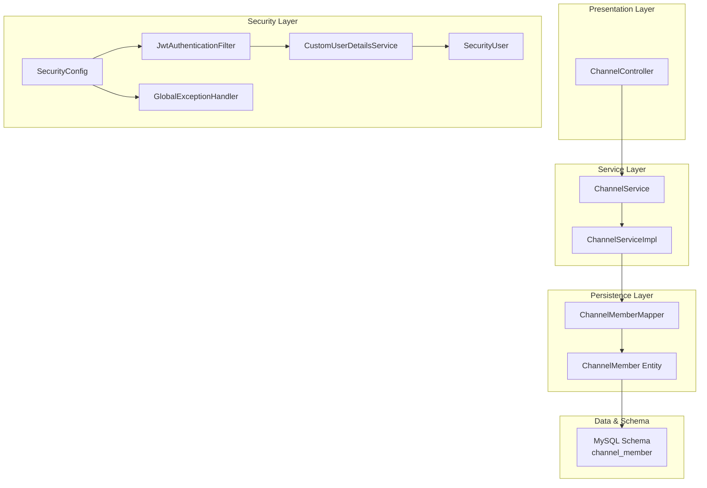
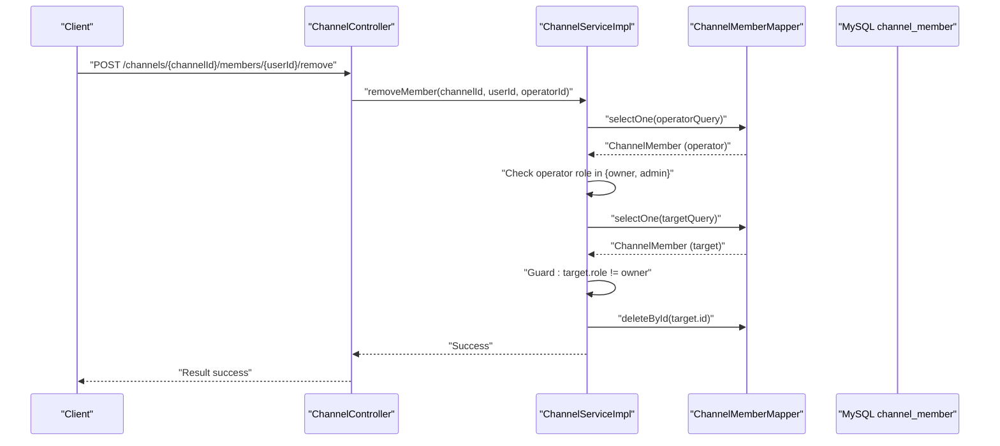
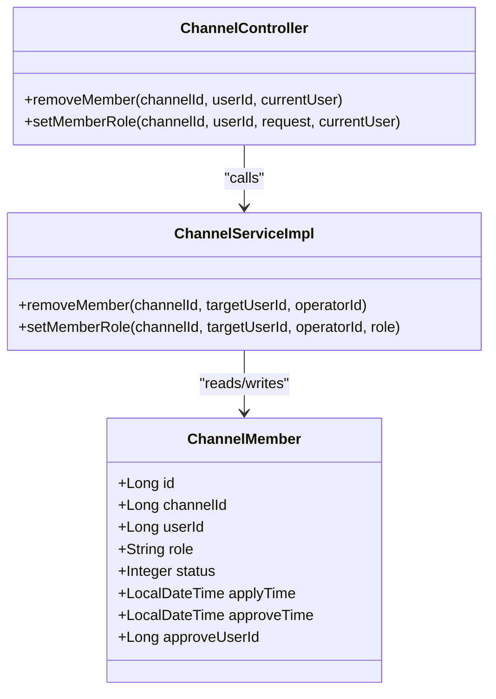
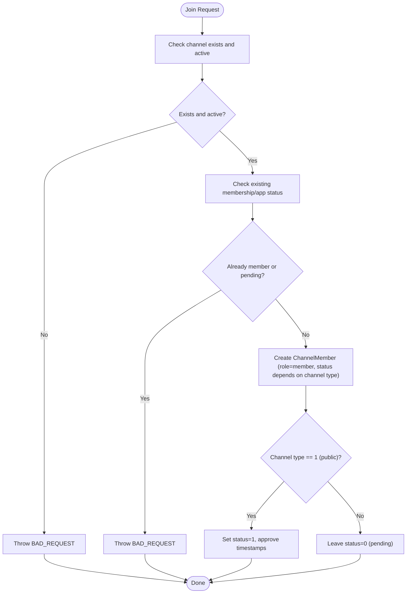
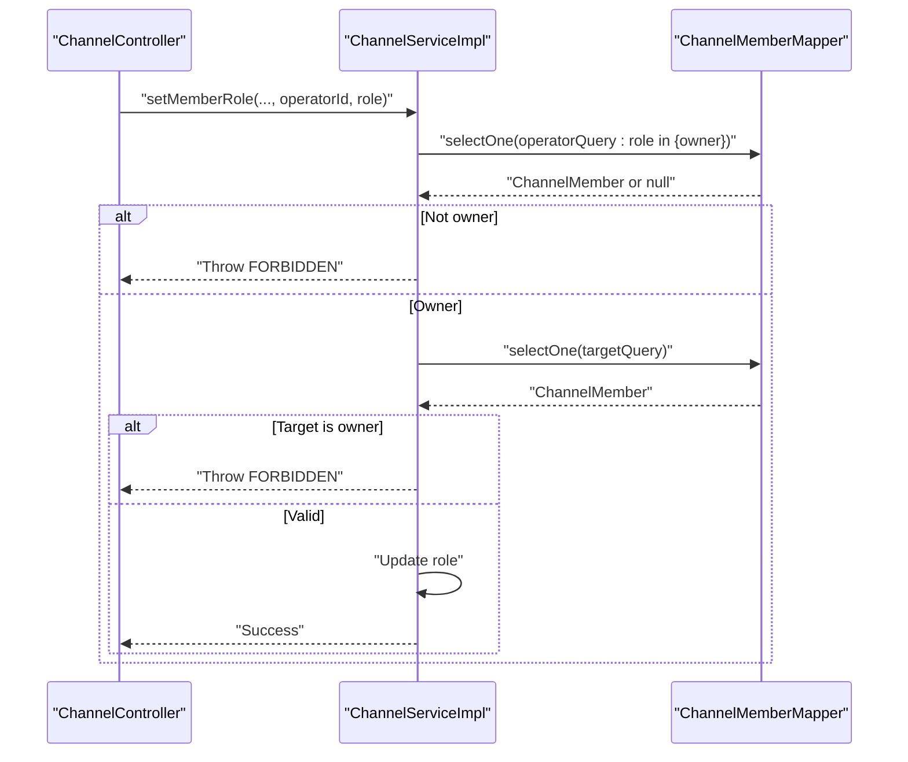
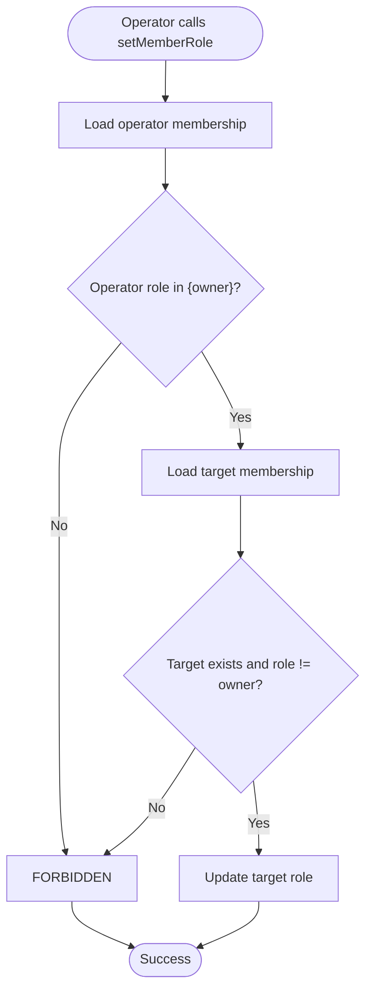
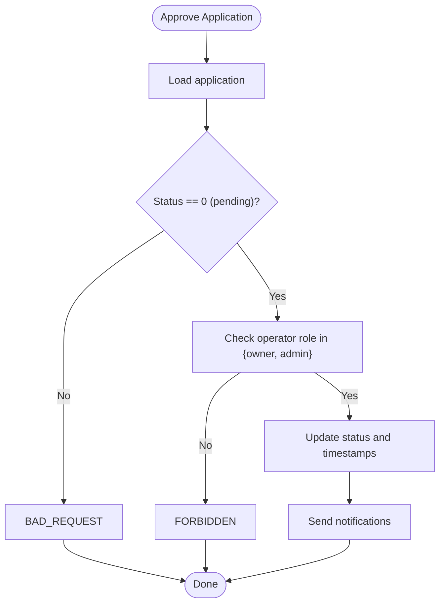
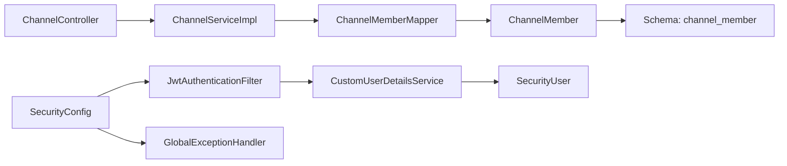

# Permission and Role Management

<cite>
**Referenced Files in This Document**
- [ChannelController.java](file://camp-channel-server/src/main/java/com/gdmec/campchannel/controller/ChannelController.java)
- [ChannelService.java](file://camp-channel-server/src/main/java/com/gdmec/campchannel/service/ChannelService.java)
- [ChannelServiceImpl.java](file://camp-channel-server/src/main/java/com/gdmec/campchannel/service/impl/ChannelServiceImpl.java)
- [ChannelMember.java](file://camp-channel-server/src/main/java/com/gdmec/campchannel/entity/ChannelMember.java)
- [ChannelMemberMapper.java](file://camp-channel-server/src/main/java/com/gdmec/campchannel/mapper/ChannelMemberMapper.java)
- [schema.sql](file://camp-channel-server/src/main/resources/db/schema.sql)
- [SecurityUser.java](file://camp-channel-server/src/main/java/com/gdmec/campchannel/security/SecurityUser.java)
- [CustomUserDetailsService.java](file://camp-channel-server/src/main/java/com/gdmec/campchannel/security/CustomUserDetailsService.java)
- [JwtAuthenticationFilter.java](file://camp-channel-server/src/main/java/com/gdmec/campchannel/security/JwtAuthenticationFilter.java)
- [SecurityConfig.java](file://camp-channel-server/src/main/java/com/gdmec/campchannel/config/SecurityConfig.java)
- [GlobalExceptionHandler.java](file://camp-channel-server/src/main/java/com/gdmec/campchannel/common/exception/GlobalExceptionHandler.java)
- [application.yml](file://camp-channel-server/src/main/resources/application.yml)
</cite>

## Table of Contents
1. [Introduction](#introduction)
2. [Project Structure](#project-structure)
3. [Core Components](#core-components)
4. [Architecture Overview](#architecture-overview)
5. [Detailed Component Analysis](#detailed-component-analysis)
6. [Dependency Analysis](#dependency-analysis)
7. [Performance Considerations](#performance-considerations)
8. [Troubleshooting Guide](#troubleshooting-guide)
9. [Conclusion](#conclusion)

## Introduction
This document explains the permission and role management system within channels. It covers the role hierarchy (owner, administrator, member), role assignment and modification workflows, permission checking mechanisms, and role-based access control (RBAC) enforcement. It also documents the implementation of role-based operations such as member removal and role elevation, along with security measures preventing unauthorized role changes and privilege escalation. Finally, it clarifies the relationship between channel-specific roles and global system roles.

## Project Structure
The role and permission system spans several layers:
- Controllers expose endpoints for channel operations and role management.
- Services encapsulate business logic and enforce RBAC rules.
- Entities and Mappers define channel membership and persistence.
- Security configuration integrates JWT authentication and method-level access control.
- Database schema defines channel membership roles and statuses.



**Diagram sources**
- [ChannelController.java:1-168](file://camp-channel-server/src/main/java/com/gdmec/campchannel/controller/ChannelController.java#L1-L168)
- [ChannelService.java:1-75](file://camp-channel-server/src/main/java/com/gdmec/campchannel/service/ChannelService.java#L1-L75)
- [ChannelServiceImpl.java:1-385](file://camp-channel-server/src/main/java/com/gdmec/campchannel/service/impl/ChannelServiceImpl.java#L1-L385)
- [ChannelMemberMapper.java:1-9](file://camp-channel-server/src/main/java/com/gdmec/campchannel/mapper/ChannelMemberMapper.java#L1-L9)
- [ChannelMember.java:1-34](file://camp-channel-server/src/main/java/com/gdmec/campchannel/entity/ChannelMember.java#L1-L34)
- [schema.sql:31-43](file://camp-channel-server/src/main/resources/db/schema.sql#L31-L43)
- [SecurityConfig.java:1-137](file://camp-channel-server/src/main/java/com/gdmec/campchannel/config/SecurityConfig.java#L1-L137)
- [JwtAuthenticationFilter.java:1-113](file://camp-channel-server/src/main/java/com/gdmec/campchannel/security/JwtAuthenticationFilter.java#L1-L113)
- [CustomUserDetailsService.java:1-47](file://camp-channel-server/src/main/java/com/gdmec/campchannel/security/CustomUserDetailsService.java#L1-L47)
- [SecurityUser.java:1-66](file://camp-channel-server/src/main/java/com/gdmec/campchannel/security/SecurityUser.java#L1-L66)
- [GlobalExceptionHandler.java:1-123](file://camp-channel-server/src/main/java/com/gdmec/campchannel/common/exception/GlobalExceptionHandler.java#L1-L123)

**Section sources**
- [ChannelController.java:1-168](file://camp-channel-server/src/main/java/com/gdmec/campchannel/controller/ChannelController.java#L1-L168)
- [ChannelService.java:1-75](file://camp-channel-server/src/main/java/com/gdmec/campchannel/service/ChannelService.java#L1-L75)
- [ChannelServiceImpl.java:1-385](file://camp-channel-server/src/main/java/com/gdmec/campchannel/service/impl/ChannelServiceImpl.java#L1-L385)
- [ChannelMember.java:1-34](file://camp-channel-server/src/main/java/com/gdmec/campchannel/entity/ChannelMember.java#L1-L34)
- [ChannelMemberMapper.java:1-9](file://camp-channel-server/src/main/java/com/gdmec/campchannel/mapper/ChannelMemberMapper.java#L1-L9)
- [schema.sql:31-43](file://camp-channel-server/src/main/resources/db/schema.sql#L31-L43)
- [SecurityConfig.java:1-137](file://camp-channel-server/src/main/java/com/gdmec/campchannel/config/SecurityConfig.java#L1-L137)
- [JwtAuthenticationFilter.java:1-113](file://camp-channel-server/src/main/java/com/gdmec/campchannel/security/JwtAuthenticationFilter.java#L1-L113)
- [CustomUserDetailsService.java:1-47](file://camp-channel-server/src/main/java/com/gdmec/campchannel/security/CustomUserDetailsService.java#L1-L47)
- [SecurityUser.java:1-66](file://camp-channel-server/src/main/java/com/gdmec/campchannel/security/SecurityUser.java#L1-L66)
- [GlobalExceptionHandler.java:1-123](file://camp-channel-server/src/main/java/com/gdmec/campchannel/common/exception/GlobalExceptionHandler.java#L1-L123)

## Core Components
- ChannelController: Exposes endpoints for role management operations such as removing members and setting roles.
- ChannelService and ChannelServiceImpl: Implement business logic and enforce RBAC rules for channel operations.
- ChannelMember: Represents membership records with role and status fields.
- SecurityUser and SecurityConfig: Provide JWT-based authentication and method-level access control.
- GlobalExceptionHandler: Centralizes error responses for permission and validation failures.

Key RBAC responsibilities:
- Enforce role-based authorization for modifying roles and managing members.
- Prevent privileged operations (e.g., removing owners, changing owner role) via explicit checks.
- Validate operator membership and role before performing operations.

**Section sources**
- [ChannelController.java:116-137](file://camp-channel-server/src/main/java/com/gdmec/campchannel/controller/ChannelController.java#L116-L137)
- [ChannelServiceImpl.java:299-362](file://camp-channel-server/src/main/java/com/gdmec/campchannel/service/impl/ChannelServiceImpl.java#L299-L362)
- [ChannelMember.java:22-24](file://camp-channel-server/src/main/java/com/gdmec/campchannel/entity/ChannelMember.java#L22-L24)
- [SecurityConfig.java:34-105](file://camp-channel-server/src/main/java/com/gdmec/campchannel/config/SecurityConfig.java#L34-L105)
- [GlobalExceptionHandler.java:74-91](file://camp-channel-server/src/main/java/com/gdmec/campchannel/common/exception/GlobalExceptionHandler.java#L74-L91)

## Architecture Overview
The system enforces RBAC at the service layer. Controllers receive requests and pass the current user identity to services. Services query membership records and validate roles before executing operations. JWT authentication ensures the caller’s identity and authorities are available.



**Diagram sources**
- [ChannelController.java:116-125](file://camp-channel-server/src/main/java/com/gdmec/campchannel/controller/ChannelController.java#L116-L125)
- [ChannelServiceImpl.java:299-329](file://camp-channel-server/src/main/java/com/gdmec/campchannel/service/impl/ChannelServiceImpl.java#L299-L329)
- [ChannelMemberMapper.java:1-9](file://camp-channel-server/src/main/java/com/gdmec/campchannel/mapper/ChannelMemberMapper.java#L1-L9)
- [schema.sql:31-43](file://camp-channel-server/src/main/resources/db/schema.sql#L31-L43)

## Detailed Component Analysis

### Role Hierarchy and Permissions
- Roles in channel_member: owner, admin, member.
- Owner: highest authority; can manage administrators and members, edit channel info, and approve join applications.
- Administrator: can manage members and approve join applications within their channels.
- Member: can participate but cannot manage others or change roles.



**Diagram sources**
- [ChannelMember.java:11-34](file://camp-channel-server/src/main/java/com/gdmec/campchannel/entity/ChannelMember.java#L11-L34)
- [ChannelController.java:116-137](file://camp-channel-server/src/main/java/com/gdmec/campchannel/controller/ChannelController.java#L116-L137)
- [ChannelServiceImpl.java:299-362](file://camp-channel-server/src/main/java/com/gdmec/campchannel/service/impl/ChannelServiceImpl.java#L299-L362)

**Section sources**
- [schema.sql:31-43](file://camp-channel-server/src/main/resources/db/schema.sql#L31-L43)
- [ChannelMember.java:22-24](file://camp-channel-server/src/main/java/com/gdmec/campchannel/entity/ChannelMember.java#L22-L24)

### Role Assignment Process
- Creation: When a channel is created, the creator is automatically assigned the owner role.
- Joining: Depending on channel type, joining may be immediate (status 1) or require approval (status 0).
- Approval: Only owners/admins can approve join applications; the approver must be a member with role in {owner, admin}.



**Diagram sources**
- [ChannelServiceImpl.java:84-118](file://camp-channel-server/src/main/java/com/gdmec/campchannel/service/impl/ChannelServiceImpl.java#L84-L118)
- [schema.sql:31-43](file://camp-channel-server/src/main/resources/db/schema.sql#L31-L43)

**Section sources**
- [ChannelServiceImpl.java:39-64](file://camp-channel-server/src/main/java/com/gdmec/campchannel/service/impl/ChannelServiceImpl.java#L39-L64)
- [ChannelServiceImpl.java:84-118](file://camp-channel-server/src/main/java/com/gdmec/campchannel/service/impl/ChannelServiceImpl.java#L84-L118)

### Permission Checking Mechanisms
- Operator validation: For member management and role elevation, the service queries the operator’s membership record and verifies the role is in {owner, admin} for managers and only {owner} for elevating roles.
- Target validation: Ensures the target user is currently a member and prevents operations on the owner role itself.
- Error handling: Throws business exceptions with appropriate error codes for forbidden or bad requests.



**Diagram sources**
- [ChannelController.java:127-137](file://camp-channel-server/src/main/java/com/gdmec/campchannel/controller/ChannelController.java#L127-L137)
- [ChannelServiceImpl.java:331-362](file://camp-channel-server/src/main/java/com/gdmec/campchannel/service/impl/ChannelServiceImpl.java#L331-L362)
- [ChannelMemberMapper.java:1-9](file://camp-channel-server/src/main/java/com/gdmec/campchannel/mapper/ChannelMemberMapper.java#L1-L9)

**Section sources**
- [ChannelServiceImpl.java:339-358](file://camp-channel-server/src/main/java/com/gdmec/campchannel/service/impl/ChannelServiceImpl.java#L339-L358)
- [GlobalExceptionHandler.java:74-91](file://camp-channel-server/src/main/java/com/gdmec/campchannel/common/exception/GlobalExceptionHandler.java#L74-L91)

### Role-Based Access Control Implementation
- Authentication: JWT filter extracts token, validates it, and injects authentication into Spring Security context.
- Authorities: SecurityUser maps system role to Spring authorities with ROLE_ prefix.
- Method-level enforcement: SecurityConfig enables method security; RBAC checks are performed in service methods.

```mermaid
sequenceDiagram
participant Client as "Client"
participant Filter as "JwtAuthenticationFilter"
participant Details as "CustomUserDetailsService"
participant SecCtx as "SecurityContext"
participant Controller as "ChannelController"
participant Service as "ChannelServiceImpl"
Client->>Filter : "HTTP request with Authorization"
Filter->>Details : "loadUserByUsername(username)"
Details-->>Filter : "SecurityUser (with role)"
Filter->>SecCtx : "Set Authentication (authorities)"
Client->>Controller : "Call endpoint"
Controller->>Service : "Invoke business method"
Service-->>Controller : "Authorized or throws"
```

**Diagram sources**
- [JwtAuthenticationFilter.java:42-99](file://camp-channel-server/src/main/java/com/gdmec/campchannel/security/JwtAuthenticationFilter.java#L42-L99)
- [CustomUserDetailsService.java:22-45](file://camp-channel-server/src/main/java/com/gdmec/campchannel/security/CustomUserDetailsService.java#L22-L45)
- [SecurityUser.java:27-34](file://camp-channel-server/src/main/java/com/gdmec/campchannel/security/SecurityUser.java#L27-L34)
- [SecurityConfig.java:34-105](file://camp-channel-server/src/main/java/com/gdmec/campchannel/config/SecurityConfig.java#L34-L105)
- [ChannelController.java:1-168](file://camp-channel-server/src/main/java/com/gdmec/campchannel/controller/ChannelController.java#L1-L168)
- [ChannelServiceImpl.java:1-385](file://camp-channel-server/src/main/java/com/gdmec/campchannel/service/impl/ChannelServiceImpl.java#L1-L385)

**Section sources**
- [JwtAuthenticationFilter.java:42-99](file://camp-channel-server/src/main/java/com/gdmec/campchannel/security/JwtAuthenticationFilter.java#L42-L99)
- [CustomUserDetailsService.java:22-45](file://camp-channel-server/src/main/java/com/gdmec/campchannel/security/CustomUserDetailsService.java#L22-L45)
- [SecurityUser.java:27-34](file://camp-channel-server/src/main/java/com/gdmec/campchannel/security/SecurityUser.java#L27-L34)
- [SecurityConfig.java:34-105](file://camp-channel-server/src/main/java/com/gdmec/campchannel/config/SecurityConfig.java#L34-L105)

### Role-Based Operations: Member Removal and Role Elevation
- Remove member:
  - Validates operator membership and role in {owner, admin}.
  - Ensures target is a member and not the owner.
  - Deletes the membership record.
- Set member role:
  - Only owner can elevate/demote roles.
  - Prevents changing the owner’s role.
  - Updates the target’s role.



**Diagram sources**
- [ChannelController.java:127-137](file://camp-channel-server/src/main/java/com/gdmec/campchannel/controller/ChannelController.java#L127-L137)
- [ChannelServiceImpl.java:331-362](file://camp-channel-server/src/main/java/com/gdmec/campchannel/service/impl/ChannelServiceImpl.java#L331-L362)

**Section sources**
- [ChannelController.java:116-137](file://camp-channel-server/src/main/java/com/gdmec/campchannel/controller/ChannelController.java#L116-L137)
- [ChannelServiceImpl.java:299-362](file://camp-channel-server/src/main/java/com/gdmec/campchannel/service/impl/ChannelServiceImpl.java#L299-L362)

### Administrative Privilege Enforcement
- Approve join applications: Only {owner, admin} can approve; service validates operator membership and role.
- Edit channel info: Only {owner, admin} can update channel metadata.
- Leave channel: Owners cannot leave; must transfer ownership first.



**Diagram sources**
- [ChannelServiceImpl.java:120-156](file://camp-channel-server/src/main/java/com/gdmec/campchannel/service/impl/ChannelServiceImpl.java#L120-L156)

**Section sources**
- [ChannelServiceImpl.java:120-156](file://camp-channel-server/src/main/java/com/gdmec/campchannel/service/impl/ChannelServiceImpl.java#L120-L156)
- [ChannelServiceImpl.java:209-234](file://camp-channel-server/src/main/java/com/gdmec/campchannel/service/impl/ChannelServiceImpl.java#L209-L234)
- [ChannelServiceImpl.java:185-207](file://camp-channel-server/src/main/java/com/gdmec/campchannel/service/impl/ChannelServiceImpl.java#L185-L207)

### Security Measures Against Unauthorized Changes
- Explicit role checks in service methods prevent privilege escalation.
- Guards against modifying owner role and removing owner.
- Validation of membership and status before operations.
- Centralized error handling returns consistent error codes.

**Section sources**
- [ChannelServiceImpl.java:324-326](file://camp-channel-server/src/main/java/com/gdmec/campchannel/service/impl/ChannelServiceImpl.java#L324-L326)
- [ChannelServiceImpl.java:356-358](file://camp-channel-server/src/main/java/com/gdmec/campchannel/service/impl/ChannelServiceImpl.java#L356-L358)
- [GlobalExceptionHandler.java:74-91](file://camp-channel-server/src/main/java/com/gdmec/campchannel/common/exception/GlobalExceptionHandler.java#L74-L91)

### Relationship Between Channel Roles and Global System Roles
- Channel roles (owner, admin, member) govern channel-specific permissions.
- Global system roles (e.g., sys_admin) are represented in the user table and are separate from channel membership.
- Authentication and authorities come from SecurityUser and are used for method-level access control; channel operations primarily rely on channel_member role checks.

**Section sources**
- [schema.sql:1-14](file://camp-channel-server/src/main/resources/db/schema.sql#L1-L14)
- [schema.sql:31-43](file://camp-channel-server/src/main/resources/db/schema.sql#L31-L43)
- [SecurityUser.java:23-34](file://camp-channel-server/src/main/java/com/gdmec/campchannel/security/SecurityUser.java#L23-L34)
- [SecurityConfig.java:34-105](file://camp-channel-server/src/main/java/com/gdmec/campchannel/config/SecurityConfig.java#L34-L105)

### Practical Examples
- Role modification API:
  - Endpoint: POST /channels/{channelId}/members/{userId}/role
  - Request body: {"role": "admin"}
  - Requires operator to be owner of the channel.
- Permission validation:
  - Service checks operator membership and role before updating target role.
- Administrative privilege validation:
  - Approving join applications requires operator to be owner or admin.
  - Editing channel info requires owner or admin.
  - Removing a member requires operator to be owner or admin and target to not be owner.

**Section sources**
- [ChannelController.java:127-137](file://camp-channel-server/src/main/java/com/gdmec/campchannel/controller/ChannelController.java#L127-L137)
- [ChannelServiceImpl.java:120-156](file://camp-channel-server/src/main/java/com/gdmec/campchannel/service/impl/ChannelServiceImpl.java#L120-L156)
- [ChannelServiceImpl.java:209-234](file://camp-channel-server/src/main/java/com/gdmec/campchannel/service/impl/ChannelServiceImpl.java#L209-L234)
- [ChannelServiceImpl.java:299-329](file://camp-channel-server/src/main/java/com/gdmec/campchannel/service/impl/ChannelServiceImpl.java#L299-L329)

## Dependency Analysis
The following diagram highlights the primary dependencies among components involved in role and permission enforcement.



**Diagram sources**
- [ChannelController.java:1-168](file://camp-channel-server/src/main/java/com/gdmec/campchannel/controller/ChannelController.java#L1-L168)
- [ChannelServiceImpl.java:1-385](file://camp-channel-server/src/main/java/com/gdmec/campchannel/service/impl/ChannelServiceImpl.java#L1-L385)
- [ChannelMemberMapper.java:1-9](file://camp-channel-server/src/main/java/com/gdmec/campchannel/mapper/ChannelMemberMapper.java#L1-L9)
- [ChannelMember.java:1-34](file://camp-channel-server/src/main/java/com/gdmec/campchannel/entity/ChannelMember.java#L1-L34)
- [SecurityConfig.java:1-137](file://camp-channel-server/src/main/java/com/gdmec/campchannel/config/SecurityConfig.java#L1-L137)
- [JwtAuthenticationFilter.java:1-113](file://camp-channel-server/src/main/java/com/gdmec/campchannel/security/JwtAuthenticationFilter.java#L1-L113)
- [CustomUserDetailsService.java:1-47](file://camp-channel-server/src/main/java/com/gdmec/campchannel/security/CustomUserDetailsService.java#L1-L47)
- [SecurityUser.java:1-66](file://camp-channel-server/src/main/java/com/gdmec/campchannel/security/SecurityUser.java#L1-L66)
- [schema.sql:31-43](file://camp-channel-server/src/main/resources/db/schema.sql#L31-L43)

**Section sources**
- [ChannelController.java:1-168](file://camp-channel-server/src/main/java/com/gdmec/campchannel/controller/ChannelController.java#L1-L168)
- [ChannelServiceImpl.java:1-385](file://camp-channel-server/src/main/java/com/gdmec/campchannel/service/impl/ChannelServiceImpl.java#L1-L385)
- [ChannelMemberMapper.java:1-9](file://camp-channel-server/src/main/java/com/gdmec/campchannel/mapper/ChannelMemberMapper.java#L1-L9)
- [ChannelMember.java:1-34](file://camp-channel-server/src/main/java/com/gdmec/campchannel/entity/ChannelMember.java#L1-L34)
- [SecurityConfig.java:1-137](file://camp-channel-server/src/main/java/com/gdmec/campchannel/config/SecurityConfig.java#L1-L137)
- [JwtAuthenticationFilter.java:1-113](file://camp-channel-server/src/main/java/com/gdmec/campchannel/security/JwtAuthenticationFilter.java#L1-L113)
- [CustomUserDetailsService.java:1-47](file://camp-channel-server/src/main/java/com/gdmec/campchannel/security/CustomUserDetailsService.java#L1-L47)
- [SecurityUser.java:1-66](file://camp-channel-server/src/main/java/com/gdmec/campchannel/security/SecurityUser.java#L1-L66)
- [schema.sql:31-43](file://camp-channel-server/src/main/resources/db/schema.sql#L31-L43)

## Performance Considerations
- Membership queries use indexed fields (channel_id, user_id) to minimize overhead.
- Role checks are O(1) lookups via equality conditions on role/status.
- Transaction boundaries wrap mutating operations to maintain consistency.

[No sources needed since this section provides general guidance]

## Troubleshooting Guide
Common issues and resolutions:
- Unauthorized operation: Occurs when operator lacks required role or is not a member. Verify operator membership and role.
- Target not found: Ensure the target user is a current member of the channel.
- Attempted to modify owner: Owner’s role cannot be changed; remove or transfer ownership first.
- Approve application errors: Confirm application exists, is pending, and operator has sufficient privileges.

**Section sources**
- [ChannelServiceImpl.java:312-314](file://camp-channel-server/src/main/java/com/gdmec/campchannel/service/impl/ChannelServiceImpl.java#L312-L314)
- [ChannelServiceImpl.java:320-322](file://camp-channel-server/src/main/java/com/gdmec/campchannel/service/impl/ChannelServiceImpl.java#L320-L322)
- [ChannelServiceImpl.java:352-354](file://camp-channel-server/src/main/java/com/gdmec/campchannel/service/impl/ChannelServiceImpl.java#L352-L354)
- [ChannelServiceImpl.java:120-156](file://camp-channel-server/src/main/java/com/gdmec/campchannel/service/impl/ChannelServiceImpl.java#L120-L156)

## Conclusion
The system implements a clear channel-specific RBAC model with owner, administrator, and member roles. Controllers delegate role-sensitive operations to services, which enforce strict authorization checks against membership and role constraints. JWT authentication and method-level security integrate with service-layer guards to prevent privilege escalation and unauthorized changes. The design balances usability with strong security controls, ensuring channel administrators can manage memberships while protecting the integrity of ownership.