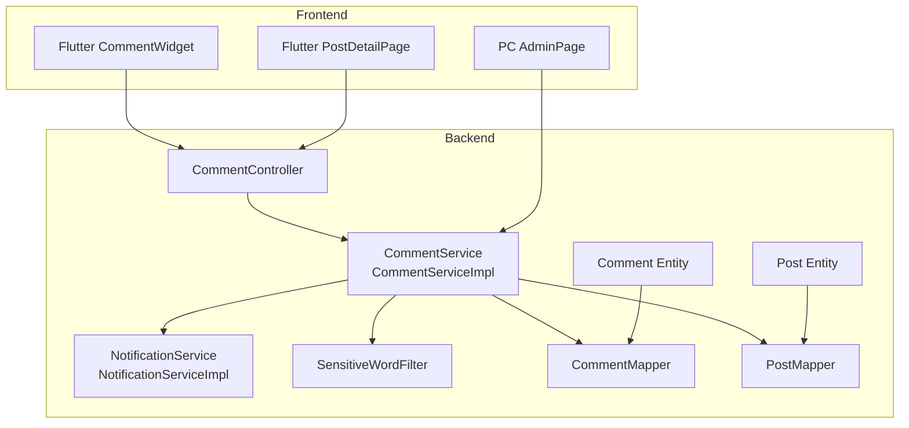
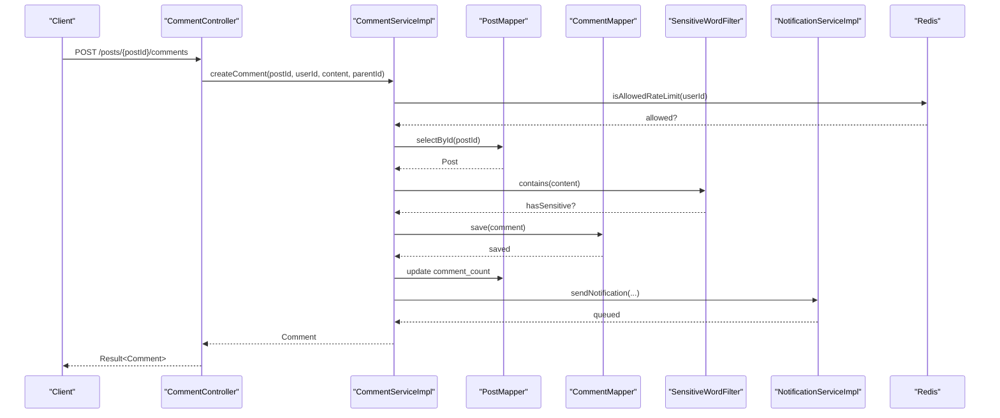
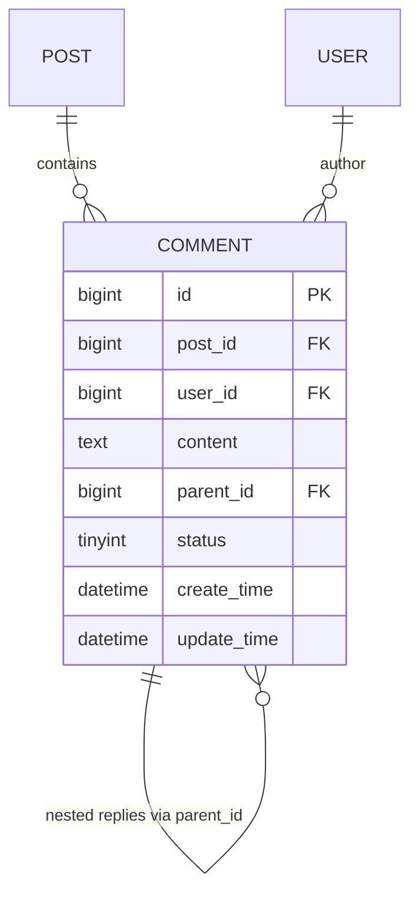
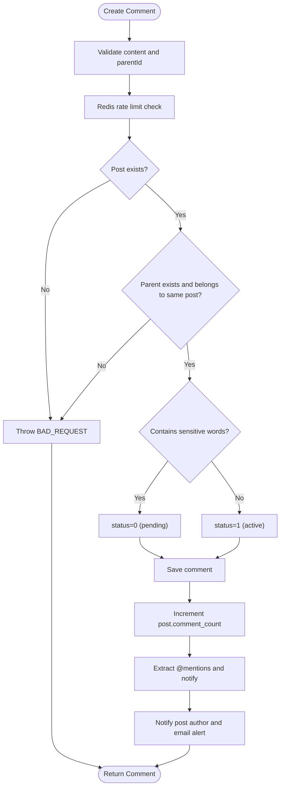
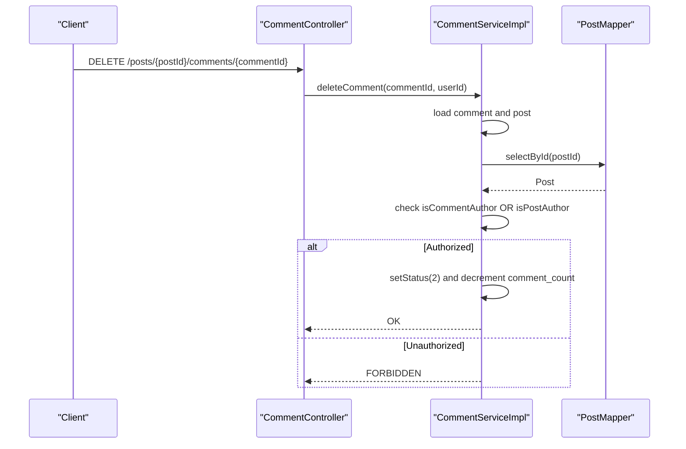
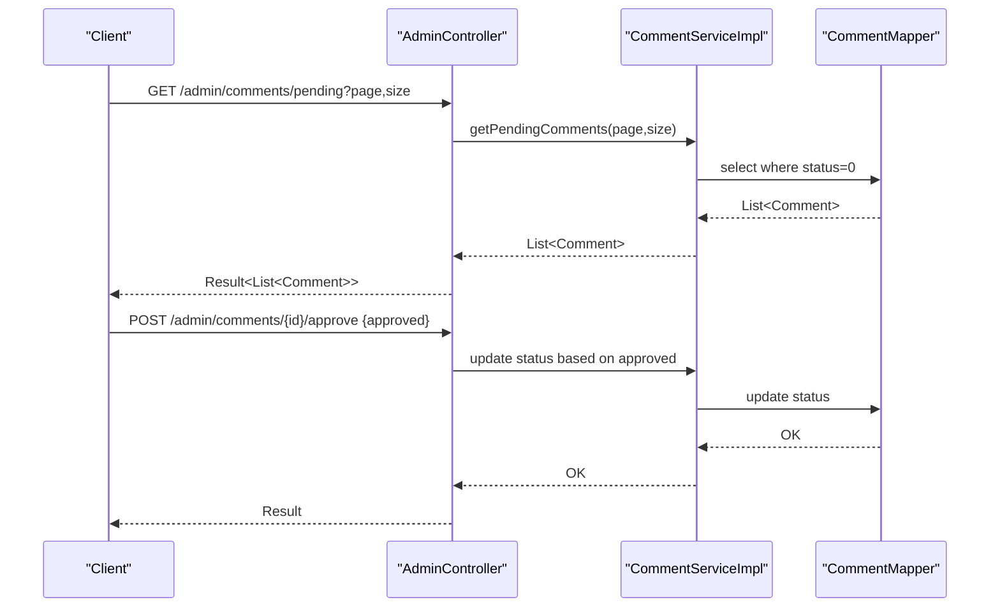
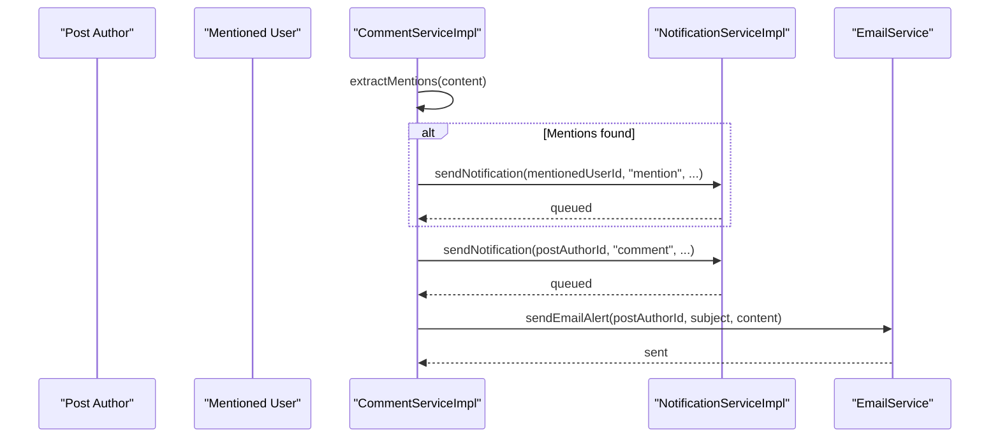
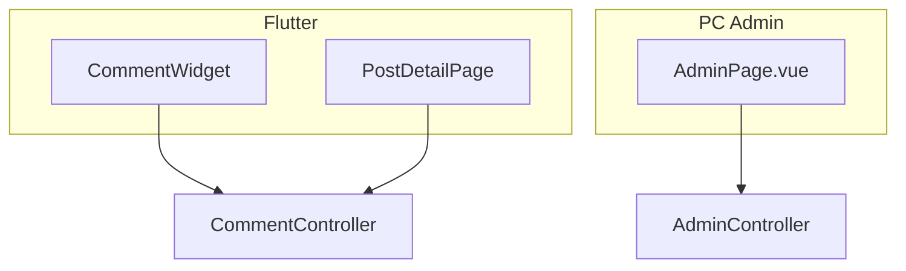
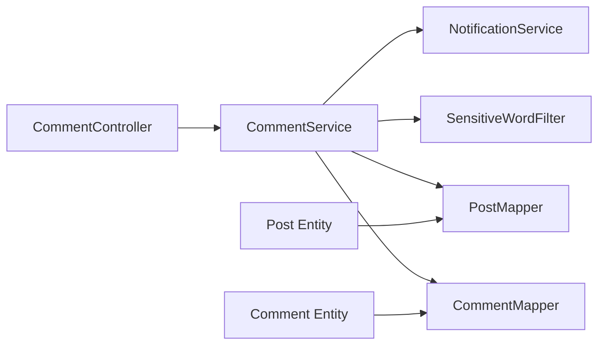

# Comment and Discussion System

<cite>
**Referenced Files in This Document**
- [CommentController.java](file://camp-channel-server/src/main/java/com/gdmec/campchannel/controller/CommentController.java)
- [CommentServiceImpl.java](file://camp-channel-server/src/main/java/com/gdmec/campchannel/service/impl/CommentServiceImpl.java)
- [CommentService.java](file://camp-channel-server/src/main/java/com/gdmec/campchannel/service/CommentService.java)
- [Comment.java](file://camp-channel-server/src/main/java/com/gdmec/campchannel/entity/Comment.java)
- [CommentMapper.java](file://camp-channel-server/src/main/java/com/gdmec/campchannel/mapper/CommentMapper.java)
- [Post.java](file://camp-channel-server/src/main/java/com/gdmec/campchannel/entity/Post.java)
- [PostMapper.java](file://camp-channel-server/src/main/java/com/gdmec/campchannel/mapper/PostMapper.java)
- [SensitiveWordFilter.java](file://camp-channel-server/src/main/java/com/gdmec/campchannel/common/filter/SensitiveWordFilter.java)
- [NotificationService.java](file://camp-channel-server/src/main/java/com/gdmec/campchannel/service/NotificationService.java)
- [NotificationServiceImpl.java](file://camp-channel-server/src/main/java/com/gdmec/campchannel/service/impl/NotificationServiceImpl.java)
- [AdminController.java](file://camp-channel-server/src/main/java/com/gdmec/campchannel/controller/AdminController.java)
- [schema.sql](file://camp-channel-server/src/main/resources/db/schema.sql)
- [application.yml](file://camp-channel-server/src/main/resources/application.yml)
- [sensitive_words.txt](file://camp-channel-server/src/main/resources/sensitive_words.txt)
- [comment_widget.dart](file://camp-channel-client-flutter/lib/widgets/comment_widget.dart)
- [post_detail_page.dart](file://camp-channel-client-flutter/lib/pages/post_detail_page.dart)
- [AdminPage.vue](file://camp-channel-client-pc/src/pages/AdminPage.vue)
</cite>

## Table of Contents
1. [Introduction](#introduction)
2. [Project Structure](#project-structure)
3. [Core Components](#core-components)
4. [Architecture Overview](#architecture-overview)
5. [Detailed Component Analysis](#detailed-component-analysis)
6. [Dependency Analysis](#dependency-analysis)
7. [Performance Considerations](#performance-considerations)
8. [Troubleshooting Guide](#troubleshooting-guide)
9. [Conclusion](#conclusion)
10. [Appendices](#appendices)

## Introduction
This document describes the comment and discussion system, focusing on hierarchical comment structure, threading, nested replies, CRUD operations, moderation workflows, integration with post ownership and permissions, comment count tracking, visibility controls, real-time notifications, and performance considerations for large threads. It synthesizes backend server-side implementation with frontend UI patterns and admin moderation flows.

## Project Structure
The comment system spans three layers:
- Backend REST API and services
- Domain entities and persistence
- Frontend UI widgets and pages
- Admin moderation endpoints

**Diagram sources**
- [CommentController.java:1-69](file://camp-channel-server/src/main/java/com/gdmec/campchannel/controller/CommentController.java#L1-L69)
- [CommentServiceImpl.java:1-210](file://camp-channel-server/src/main/java/com/gdmec/campchannel/service/impl/CommentServiceImpl.java#L1-L210)
- [CommentService.java:1-24](file://camp-channel-server/src/main/java/com/gdmec/campchannel/service/CommentService.java#L1-L24)
- [Comment.java:1-37](file://camp-channel-server/src/main/java/com/gdmec/campchannel/entity/Comment.java#L1-L37)
- [CommentMapper.java:1-9](file://camp-channel-server/src/main/java/com/gdmec/campchannel/mapper/CommentMapper.java#L1-L9)
- [Post.java:1-58](file://camp-channel-server/src/main/java/com/gdmec/campchannel/entity/Post.java#L1-L58)
- [PostMapper.java:1-9](file://camp-channel-server/src/main/java/com/gdmec/campchannel/mapper/PostMapper.java#L1-L9)
- [SensitiveWordFilter.java:1-166](file://camp-channel-server/src/main/java/com/gdmec/campchannel/common/filter/SensitiveWordFilter.java#L1-L166)
- [NotificationService.java:1-34](file://camp-channel-server/src/main/java/com/gdmec/campchannel/service/NotificationService.java#L1-L34)
- [NotificationServiceImpl.java:1-95](file://camp-channel-server/src/main/java/com/gdmec/campchannel/service/impl/NotificationServiceImpl.java#L1-L95)
- [comment_widget.dart:1-183](file://camp-channel-client-flutter/lib/widgets/comment_widget.dart#L1-L183)
- [post_detail_page.dart:251-273](file://camp-channel-client-flutter/lib/pages/post_detail_page.dart#L251-L273)
- [AdminPage.vue:192-619](file://camp-channel-client-pc/src/pages/AdminPage.vue#L192-L619)

**Section sources**
- [CommentController.java:1-69](file://camp-channel-server/src/main/java/com/gdmec/campchannel/controller/CommentController.java#L1-L69)
- [CommentServiceImpl.java:1-210](file://camp-channel-server/src/main/java/com/gdmec/campchannel/service/impl/CommentServiceImpl.java#L1-L210)
- [CommentService.java:1-24](file://camp-channel-server/src/main/java/com/gdmec/campchannel/service/CommentService.java#L1-L24)
- [Comment.java:1-37](file://camp-channel-server/src/main/java/com/gdmec/campchannel/entity/Comment.java#L1-L37)
- [Post.java:1-58](file://camp-channel-server/src/main/java/com/gdmec/campchannel/entity/Post.java#L1-L58)
- [schema.sql:76-89](file://camp-channel-server/src/main/resources/db/schema.sql#L76-L89)

## Core Components
- CommentController: Exposes REST endpoints for creating, listing, and deleting comments under a post.
- CommentService and CommentServiceImpl: Implement business logic for comment creation (including rate limiting, sensitive word detection, mentions, notifications), retrieval with pagination, and deletion with ownership checks.
- Comment Entity and Mapper: Persist hierarchical comments with parent-child self-reference.
- Post Entity and Mapper: Track comment counts and ownership for permission checks.
- SensitiveWordFilter: DFA-based filtering for inappropriate content detection.
- NotificationService and NotificationServiceImpl: Real-time notifications via WebSocket and persisted history.
- AdminController: Provides moderation endpoints for pending comments.
- Frontend Widgets/Pages: Render comments, handle nested replies, and integrate with backend APIs.

**Section sources**
- [CommentController.java:26-62](file://camp-channel-server/src/main/java/com/gdmec/campchannel/controller/CommentController.java#L26-L62)
- [CommentServiceImpl.java:48-140](file://camp-channel-server/src/main/java/com/gdmec/campchannel/service/impl/CommentServiceImpl.java#L48-L140)
- [CommentService.java:8-24](file://camp-channel-server/src/main/java/com/gdmec/campchannel/service/CommentService.java#L8-L24)
- [Comment.java:11-37](file://camp-channel-server/src/main/java/com/gdmec/campchannel/entity/Comment.java#L11-L37)
- [Post.java:11-58](file://camp-channel-server/src/main/java/com/gdmec/campchannel/entity/Post.java#L11-L58)
- [SensitiveWordFilter.java:20-166](file://camp-channel-server/src/main/java/com/gdmec/campchannel/common/filter/SensitiveWordFilter.java#L20-L166)
- [NotificationServiceImpl.java:16-95](file://camp-channel-server/src/main/java/com/gdmec/campchannel/service/impl/NotificationServiceImpl.java#L16-L95)
- [AdminController.java:278-287](file://camp-channel-server/src/main/java/com/gdmec/campchannel/controller/AdminController.java#L278-L287)

## Architecture Overview
The comment module follows a layered architecture:
- Presentation: REST endpoints under /posts/{postId}/comments
- Application: Service layer validates inputs, enforces permissions, and orchestrates persistence and notifications
- Persistence: MyBatis-Plus mappers for Comment and Post entities
- Infrastructure: Redis for rate limiting, sensitive word filtering, and optional email alerts

**Diagram sources**
- [CommentController.java:26-40](file://camp-channel-server/src/main/java/com/gdmec/campchannel/controller/CommentController.java#L26-L40)
- [CommentServiceImpl.java:48-140](file://camp-channel-server/src/main/java/com/gdmec/campchannel/service/impl/CommentServiceImpl.java#L48-L140)
- [PostMapper.java:1-9](file://camp-channel-server/src/main/java/com/gdmec/campchannel/mapper/PostMapper.java#L1-L9)
- [CommentMapper.java:1-9](file://camp-channel-server/src/main/java/com/gdmec/campchannel/mapper/CommentMapper.java#L1-L9)
- [SensitiveWordFilter.java:94-105](file://camp-channel-server/src/main/java/com/gdmec/campchannel/common/filter/SensitiveWordFilter.java#L94-L105)
- [NotificationServiceImpl.java:26-51](file://camp-channel-server/src/main/java/com/gdmec/campchannel/service/impl/NotificationServiceImpl.java#L26-L51)

## Detailed Component Analysis

### Hierarchical Comments and Threading
- Self-referencing parent_id enables nested replies.
- Retrieval filters top-level comments (parent_id is null) and sorts by creation time.
- Username and avatar are populated per comment for display.

**Diagram sources**
- [schema.sql:76-89](file://camp-channel-server/src/main/resources/db/schema.sql#L76-L89)
- [Comment.java:13-37](file://camp-channel-server/src/main/java/com/gdmec/campchannel/entity/Comment.java#L13-L37)
- [Post.java:13-58](file://camp-channel-server/src/main/java/com/gdmec/campchannel/entity/Post.java#L13-L58)

**Section sources**
- [CommentServiceImpl.java:142-165](file://camp-channel-server/src/main/java/com/gdmec/campchannel/service/impl/CommentServiceImpl.java#L142-L165)
- [Comment.java:18-26](file://camp-channel-server/src/main/java/com/gdmec/campchannel/entity/Comment.java#L18-L26)

### Comment CRUD Operations
- Create: Validates content, applies rate limit, checks post existence, optionally marks as pending for sensitive content, persists, updates post comment_count, and triggers notifications and mentions.
- Read: Lists top-level comments with pagination and populates user metadata.
- Delete: Enforces ownership or post ownership; marks as deleted and decrements comment_count.

**Diagram sources**
- [CommentServiceImpl.java:48-140](file://camp-channel-server/src/main/java/com/gdmec/campchannel/service/impl/CommentServiceImpl.java#L48-L140)

**Section sources**
- [CommentController.java:26-40](file://camp-channel-server/src/main/java/com/gdmec/campchannel/controller/CommentController.java#L26-L40)
- [CommentServiceImpl.java:48-140](file://camp-channel-server/src/main/java/com/gdmec/campchannel/service/impl/CommentServiceImpl.java#L48-L140)
- [CommentController.java:53-62](file://camp-channel-server/src/main/java/com/gdmec/campchannel/controller/CommentController.java#L53-L62)
- [CommentServiceImpl.java:167-190](file://camp-channel-server/src/main/java/com/gdmec/campchannel/service/impl/CommentServiceImpl.java#L167-L190)

### Permission and Ownership Verification
- Deletion requires either the comment author or the post author.
- Moderation endpoints require system administrator role.

**Diagram sources**
- [CommentController.java:53-62](file://camp-channel-server/src/main/java/com/gdmec/campchannel/controller/CommentController.java#L53-L62)
- [CommentServiceImpl.java:167-190](file://camp-channel-server/src/main/java/com/gdmec/campchannel/service/impl/CommentServiceImpl.java#L167-L190)

**Section sources**
- [CommentServiceImpl.java:175-181](file://camp-channel-server/src/main/java/com/gdmec/campchannel/service/impl/CommentServiceImpl.java#L175-L181)
- [AdminController.java:285-287](file://camp-channel-server/src/main/java/com/gdmec/campchannel/controller/AdminController.java#L285-L287)

### Visibility Controls and Moderation
- Status field governs visibility: active, pending, deleted.
- Pending comments are surfaced to administrators for approval/rejection.
- Sensitive content detection sets status to pending automatically.

**Diagram sources**
- [AdminController.java:278-287](file://camp-channel-server/src/main/java/com/gdmec/campchannel/controller/AdminController.java#L278-L287)
- [CommentServiceImpl.java:66-77](file://camp-channel-server/src/main/java/com/gdmec/campchannel/service/impl/CommentServiceImpl.java#L66-L77)

**Section sources**
- [CommentServiceImpl.java:66-77](file://camp-channel-server/src/main/java/com/gdmec/campchannel/service/impl/CommentServiceImpl.java#L66-L77)
- [AdminController.java:278-287](file://camp-channel-server/src/main/java/com/gdmec/campchannel/controller/AdminController.java#L278-L287)
- [AdminPage.vue:192-207](file://camp-channel-client-pc/src/pages/AdminPage.vue#L192-L207)

### Notifications and Mentions
- Mention parsing extracts @username tokens and sends targeted notifications.
- Post author receives notifications and optional email alerts upon new comments.
- Real-time notifications delivered via WebSocket queue.

**Diagram sources**
- [CommentServiceImpl.java:100-137](file://camp-channel-server/src/main/java/com/gdmec/campchannel/service/impl/CommentServiceImpl.java#L100-L137)
- [NotificationServiceImpl.java:26-51](file://camp-channel-server/src/main/java/com/gdmec/campchannel/service/impl/NotificationServiceImpl.java#L26-L51)

**Section sources**
- [CommentServiceImpl.java:100-137](file://camp-channel-server/src/main/java/com/gdmec/campchannel/service/impl/CommentServiceImpl.java#L100-L137)
- [NotificationServiceImpl.java:26-51](file://camp-channel-server/src/main/java/com/gdmec/campchannel/service/impl/NotificationServiceImpl.java#L26-L51)

### Frontend Integration and Nested Replies
- Flutter widgets render comments with optional nested replies.
- PC Admin page lists pending comments and supports approval actions.
- Post detail page displays comment count and renders comment tree.

**Diagram sources**
- [comment_widget.dart:1-183](file://camp-channel-client-flutter/lib/widgets/comment_widget.dart#L1-L183)
- [post_detail_page.dart:251-273](file://camp-channel-client-flutter/lib/pages/post_detail_page.dart#L251-L273)
- [AdminPage.vue:192-207](file://camp-channel-client-pc/src/pages/AdminPage.vue#L192-L207)

**Section sources**
- [comment_widget.dart:14-173](file://camp-channel-client-flutter/lib/widgets/comment_widget.dart#L14-L173)
- [post_detail_page.dart:251-273](file://camp-channel-client-flutter/lib/pages/post_detail_page.dart#L251-L273)
- [AdminPage.vue:192-207](file://camp-channel-client-pc/src/pages/AdminPage.vue#L192-L207)

## Dependency Analysis
- Controllers depend on services for business logic.
- Services depend on mappers for persistence and on infrastructure components (Redis, sensitive word filter, notification/email services).
- Entities define relationships and indexes for efficient queries.
- Frontend clients depend on backend endpoints for CRUD and moderation.

**Diagram sources**
- [CommentController.java:23-24](file://camp-channel-server/src/main/java/com/gdmec/campchannel/controller/CommentController.java#L23-L24)
- [CommentServiceImpl.java:30-46](file://camp-channel-server/src/main/java/com/gdmec/campchannel/service/impl/CommentServiceImpl.java#L30-L46)
- [Comment.java:13-37](file://camp-channel-server/src/main/java/com/gdmec/campchannel/entity/Comment.java#L13-L37)
- [Post.java:13-58](file://camp-channel-server/src/main/java/com/gdmec/campchannel/entity/Post.java#L13-L58)

**Section sources**
- [CommentController.java:23-24](file://camp-channel-server/src/main/java/com/gdmec/campchannel/controller/CommentController.java#L23-L24)
- [CommentServiceImpl.java:30-46](file://camp-channel-server/src/main/java/com/gdmec/campchannel/service/impl/CommentServiceImpl.java#L30-L46)

## Performance Considerations
- Pagination: Implemented via OFFSET/LIMIT in service layer for top-level comments.
- Indexes: comment(post_id), comment(parent_id), post(comment_count) improve query performance.
- Rate limiting: Redis-based throttling prevents spam bursts.
- Sensitive word filtering: DFA-based matching reduces false positives and improves throughput.
- Asynchronous notifications: Decouples expensive operations (email, WebSocket pushes) from request-response cycle.

Recommendations:
- For very large threads, consider materialized path or adjacency list with bounded depth and lazy loading of replies.
- Use cursor-based pagination for deep paging stability.
- Cache frequently accessed post metadata and user avatars.
- Batch mention notifications and deduplicate repeated mentions.

**Section sources**
- [CommentServiceImpl.java:142-165](file://camp-channel-server/src/main/java/com/gdmec/campchannel/service/impl/CommentServiceImpl.java#L142-L165)
- [schema.sql:86-88](file://camp-channel-server/src/main/resources/db/schema.sql#L86-L88)
- [application.yml:31-42](file://camp-channel-server/src/main/resources/application.yml#L31-L42)

## Troubleshooting Guide
Common issues and resolutions:
- Comment not found or unauthorized deletion: Verify commentId and user permissions; ensure deletion status is set rather than physical removal.
- Excessive requests: Rate limit enforced via Redis; wait for cooldown window.
- Sensitive content flagged: Content marked as pending; check moderation queue and adjust sensitive word list.
- Notifications not received: Confirm WebSocket connectivity and user online status; verify email settings and recipient preferences.
- Mention notifications missing: Ensure @mentions are properly formatted and usernames exist.

Operational checks:
- Validate Redis availability for rate limiting and caching.
- Confirm sensitive word dictionary file path and content.
- Review notification delivery logs and retry mechanisms.

**Section sources**
- [CommentServiceImpl.java:167-190](file://camp-channel-server/src/main/java/com/gdmec/campchannel/service/impl/CommentServiceImpl.java#L167-L190)
- [CommentServiceImpl.java:55-59](file://camp-channel-server/src/main/java/com/gdmec/campchannel/service/impl/CommentServiceImpl.java#L55-L59)
- [SensitiveWordFilter.java:40-64](file://camp-channel-server/src/main/java/com/gdmec/campchannel/common/filter/SensitiveWordFilter.java#L40-L64)
- [NotificationServiceImpl.java:40-49](file://camp-channel-server/src/main/java/com/gdmec/campchannel/service/impl/NotificationServiceImpl.java#L40-L49)

## Conclusion
The comment system provides robust hierarchical threading, moderation-ready visibility controls, and integrated real-time notifications. It balances correctness (ownership checks, status management) with scalability (rate limiting, pagination, asynchronous processing). Extending support for nested reply expansion, advanced moderation workflows, and performance tuning for large threads remains straightforward given the modular design.

## Appendices

### API Endpoints Summary
- POST /posts/{postId}/comments: Create a comment or nested reply
- GET /posts/{postId}/comments?page=&size=: List top-level comments with pagination
- DELETE /posts/{postId}/comments/{commentId}: Delete a comment (author or post author)
- GET /admin/comments/pending?page=&size=: Fetch pending comments for moderation
- POST /admin/comments/{id}/approve: Approve or reject a pending comment

**Section sources**
- [CommentController.java:26-62](file://camp-channel-server/src/main/java/com/gdmec/campchannel/controller/CommentController.java#L26-L62)
- [AdminController.java:278-287](file://camp-channel-server/src/main/java/com/gdmec/campchannel/controller/AdminController.java#L278-L287)

### Data Model Notes
- Status semantics: 1=active, 0=pending, 2=deleted
- Parent-child self-reference enables nested replies
- Post comment_count updated atomically on create/delete

**Section sources**
- [schema.sql:76-89](file://camp-channel-server/src/main/resources/db/schema.sql#L76-L89)
- [Comment.java](file://camp-channel-server/src/main/java/com/gdmec/campchannel/entity/Comment.java#L26)
- [Post.java](file://camp-channel-server/src/main/java/com/gdmec/campchannel/entity/Post.java#L38)