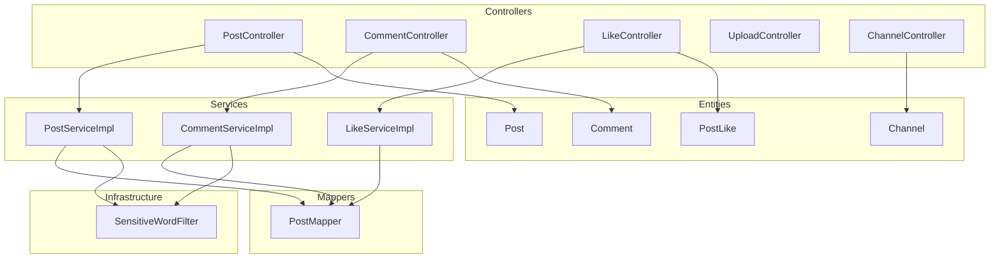
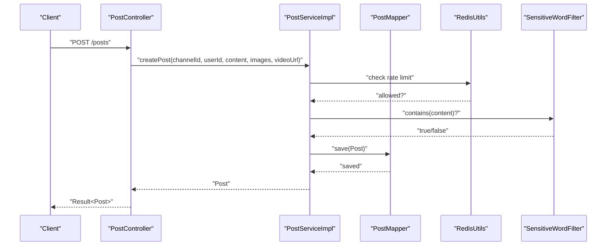
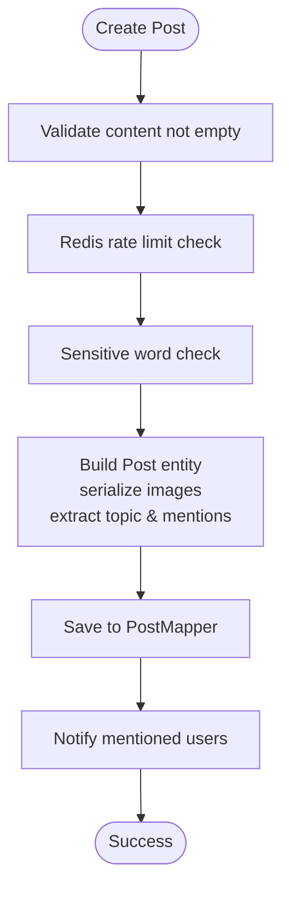
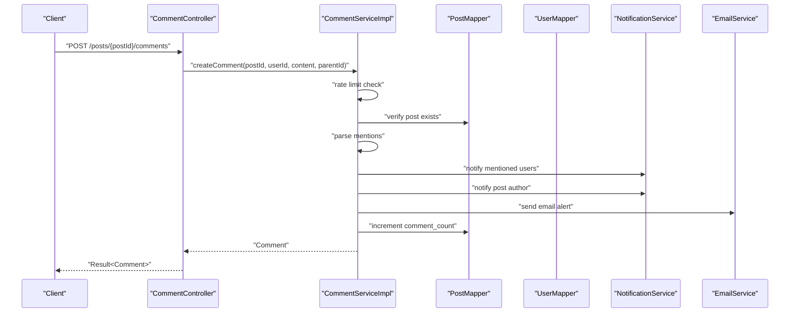
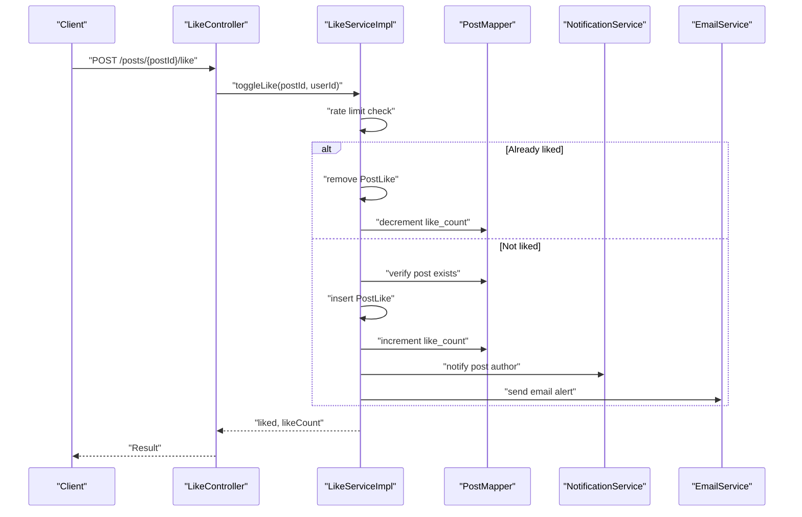
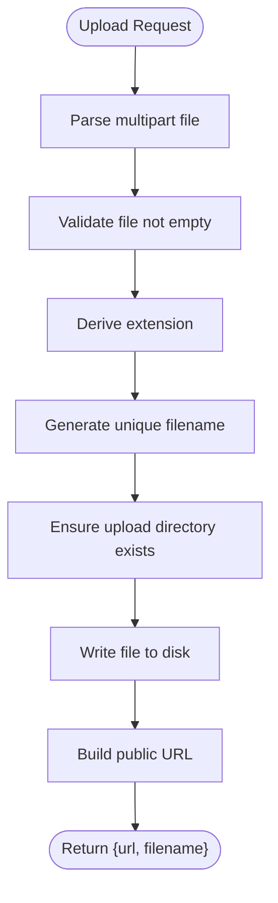
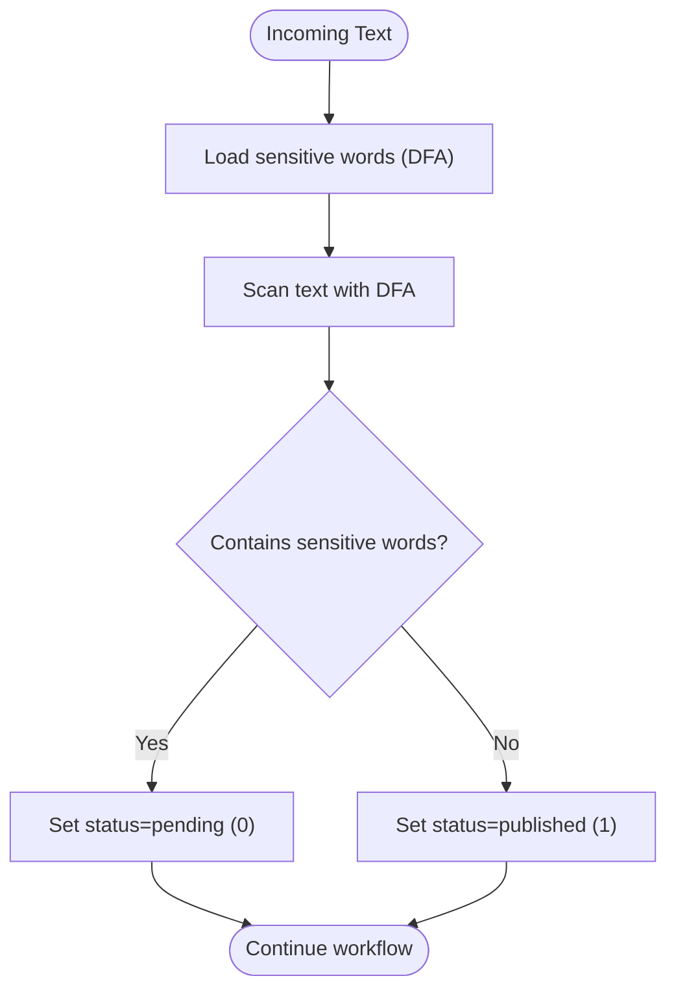
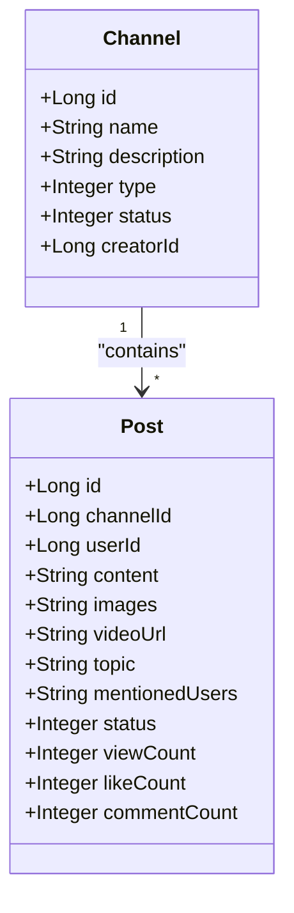
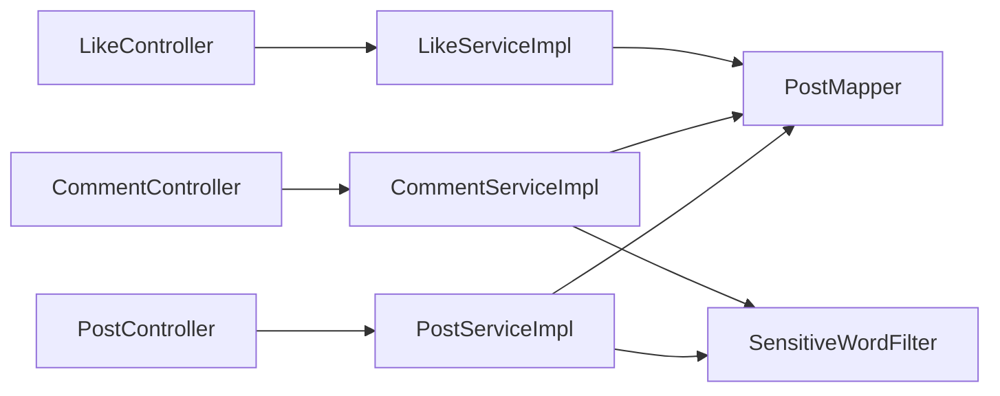

# Content Management System

<cite>
**Referenced Files in This Document**
- [Post.java](file://camp-channel-server/src/main/java/com/gdmec/campchannel/entity/Post.java)
- [PostController.java](file://camp-channel-server/src/main/java/com/gdmec/campchannel/controller/PostController.java)
- [PostServiceImpl.java](file://camp-channel-server/src/main/java/com/gdmec/campchannel/service/impl/PostServiceImpl.java)
- [PostMapper.java](file://camp-channel-server/src/main/java/com/gdmec/campchannel/mapper/PostMapper.java)
- [Comment.java](file://camp-channel-server/src/main/java/com/gdmec/campchannel/entity/Comment.java)
- [CommentController.java](file://camp-channel-server/src/main/java/com/gdmec/campchannel/controller/CommentController.java)
- [CommentServiceImpl.java](file://camp-channel-server/src/main/java/com/gdmec/campchannel/service/impl/CommentServiceImpl.java)
- [PostLike.java](file://camp-channel-server/src/main/java/com/gdmec/campchannel/entity/PostLike.java)
- [LikeController.java](file://camp-channel-server/src/main/java/com/gdmec/campchannel/controller/LikeController.java)
- [LikeServiceImpl.java](file://camp-channel-server/src/main/java/com/gdmec/campchannel/service/impl/LikeServiceImpl.java)
- [UploadController.java](file://camp-channel-server/src/main/java/com/gdmec/campchannel/controller/UploadController.java)
- [SensitiveWordFilter.java](file://camp-channel-server/src/main/java/com/gdmec/campchannel/common/filter/SensitiveWordFilter.java)
- [sensitive_words.txt](file://camp-channel-server/src/main/resources/sensitive_words.txt)
- [Channel.java](file://camp-channel-server/src/main/java/com/gdmec/campchannel/entity/Channel.java)
- [ChannelController.java](file://camp-channel-server/src/main/java/com/gdmec/campchannel/controller/ChannelController.java)
</cite>

## Table of Contents
1. [Introduction](#introduction)
2. [Project Structure](#project-structure)
3. [Core Components](#core-components)
4. [Architecture Overview](#architecture-overview)
5. [Detailed Component Analysis](#detailed-component-analysis)
6. [Dependency Analysis](#dependency-analysis)
7. [Performance Considerations](#performance-considerations)
8. [Troubleshooting Guide](#troubleshooting-guide)
9. [Conclusion](#conclusion)
10. [Appendices](#appendices)

## Introduction
This document describes the Content Management System (CMS) for the campus channel platform. It covers post creation, editing, and deletion; rich content features such as text formatting via topics and mentions; multimedia support through image and video embedding; comment and like systems; content moderation workflows; and integration with channel-based content organization. It also documents configuration options for content validation, rate limiting, and moderation thresholds, along with relationships to user management and notifications. Practical examples are provided via code snippet paths to actual implementations.

## Project Structure
The CMS backend is a Spring Boot application with layered architecture:
- Controllers expose REST endpoints for posts, comments, likes, uploads, and channels.
- Services encapsulate business logic, including validation, moderation, rate limiting, and notifications.
- Entities define domain models for posts, comments, likes, channels, and users.
- Mappers integrate with MyBatis-Plus for database access.
- Filters and utilities provide cross-cutting concerns like sensitive word filtering and Redis-based rate limiting.

**Diagram sources**
- [PostController.java:30-202](file://camp-channel-server/src/main/java/com/gdmec/campchannel/controller/PostController.java#L30-L202)
- [CommentController.java:20-69](file://camp-channel-server/src/main/java/com/gdmec/campchannel/controller/CommentController.java#L20-L69)
- [LikeController.java:18-54](file://camp-channel-server/src/main/java/com/gdmec/campchannel/controller/LikeController.java#L18-L54)
- [UploadController.java:21-84](file://camp-channel-server/src/main/java/com/gdmec/campchannel/controller/UploadController.java#L21-L84)
- [ChannelController.java:21-168](file://camp-channel-server/src/main/java/com/gdmec/campchannel/controller/ChannelController.java#L21-L168)
- [PostServiceImpl.java:35-387](file://camp-channel-server/src/main/java/com/gdmec/campchannel/service/impl/PostServiceImpl.java#L35-L387)
- [CommentServiceImpl.java:27-210](file://camp-channel-server/src/main/java/com/gdmec/campchannel/service/impl/CommentServiceImpl.java#L27-L210)
- [LikeServiceImpl.java:24-131](file://camp-channel-server/src/main/java/com/gdmec/campchannel/service/impl/LikeServiceImpl.java#L24-L131)
- [Post.java:11-58](file://camp-channel-server/src/main/java/com/gdmec/campchannel/entity/Post.java#L11-L58)
- [Comment.java:11-37](file://camp-channel-server/src/main/java/com/gdmec/campchannel/entity/Comment.java#L11-L37)
- [PostLike.java:10-22](file://camp-channel-server/src/main/java/com/gdmec/campchannel/entity/PostLike.java#L10-L22)
- [Channel.java:10-32](file://camp-channel-server/src/main/java/com/gdmec/campchannel/entity/Channel.java#L10-L32)
- [PostMapper.java:1-9](file://camp-channel-server/src/main/java/com/gdmec/campchannel/mapper/PostMapper.java#L1-L9)
- [SensitiveWordFilter.java:18-166](file://camp-channel-server/src/main/java/com/gdmec/campchannel/common/filter/SensitiveWordFilter.java#L18-L166)

**Section sources**
- [PostController.java:26-202](file://camp-channel-server/src/main/java/com/gdmec/campchannel/controller/PostController.java#L26-L202)
- [CommentController.java:17-69](file://camp-channel-server/src/main/java/com/gdmec/campchannel/controller/CommentController.java#L17-L69)
- [LikeController.java:16-54](file://camp-channel-server/src/main/java/com/gdmec/campchannel/controller/LikeController.java#L16-L54)
- [UploadController.java:19-84](file://camp-channel-server/src/main/java/com/gdmec/campchannel/controller/UploadController.java#L19-L84)
- [ChannelController.java:18-168](file://camp-channel-server/src/main/java/com/gdmec/campchannel/controller/ChannelController.java#L18-L168)

## Core Components
- Post management: creation, retrieval, updates, deletions, and view counting.
- Rich content: topic extraction (#tag) and mention parsing (@user) with notifications.
- Comments: hierarchical comments with parent-child replies and mention notifications.
- Likes: toggle-like with atomic counters and author notifications.
- Moderation: sensitive word filtering and content status transitions.
- Multimedia: image/video upload endpoints returning URLs for embedding.
- Channels: organization of content streams and member roles.

**Section sources**
- [Post.java:11-58](file://camp-channel-server/src/main/java/com/gdmec/campchannel/entity/Post.java#L11-L58)
- [PostController.java:94-171](file://camp-channel-server/src/main/java/com/gdmec/campchannel/controller/PostController.java#L94-L171)
- [PostServiceImpl.java:57-153](file://camp-channel-server/src/main/java/com/gdmec/campchannel/service/impl/PostServiceImpl.java#L57-L153)
- [Comment.java:11-37](file://camp-channel-server/src/main/java/com/gdmec/campchannel/entity/Comment.java#L11-L37)
- [CommentController.java:26-62](file://camp-channel-server/src/main/java/com/gdmec/campchannel/controller/CommentController.java#L26-L62)
- [CommentServiceImpl.java:48-140](file://camp-channel-server/src/main/java/com/gdmec/campchannel/service/impl/CommentServiceImpl.java#L48-L140)
- [PostLike.java:10-22](file://camp-channel-server/src/main/java/com/gdmec/campchannel/entity/PostLike.java#L10-L22)
- [LikeController.java:25-53](file://camp-channel-server/src/main/java/com/gdmec/campchannel/controller/LikeController.java#L25-L53)
- [LikeServiceImpl.java:42-115](file://camp-channel-server/src/main/java/com/gdmec/campchannel/service/impl/LikeServiceImpl.java#L42-L115)
- [UploadController.java:28-44](file://camp-channel-server/src/main/java/com/gdmec/campchannel/controller/UploadController.java#L28-L44)
- [SensitiveWordFilter.java:94-105](file://camp-channel-server/src/main/java/com/gdmec/campchannel/common/filter/SensitiveWordFilter.java#L94-L105)
- [Channel.java:10-32](file://camp-channel-server/src/main/java/com/gdmec/campchannel/entity/Channel.java#L10-L32)
- [ChannelController.java:41-53](file://camp-channel-server/src/main/java/com/gdmec/campchannel/controller/ChannelController.java#L41-L53)

## Architecture Overview
The CMS follows a layered REST architecture:
- Presentation: Controllers handle HTTP requests and responses.
- Application: Services implement business rules, enforce permissions, and coordinate persistence.
- Persistence: Mappers and MyBatis-Plus manage database operations.
- Cross-cutting: Sensitive word filtering and Redis-based rate limiting.

**Diagram sources**
- [PostController.java:94-108](file://camp-channel-server/src/main/java/com/gdmec/campchannel/controller/PostController.java#L94-L108)
- [PostServiceImpl.java:57-153](file://camp-channel-server/src/main/java/com/gdmec/campchannel/service/impl/PostServiceImpl.java#L57-L153)
- [PostMapper.java:1-9](file://camp-channel-server/src/main/java/com/gdmec/campchannel/mapper/PostMapper.java#L1-L9)
- [SensitiveWordFilter.java:94-105](file://camp-channel-server/src/main/java/com/gdmec/campchannel/common/filter/SensitiveWordFilter.java#L94-L105)

## Detailed Component Analysis

### Post Management
- Creation: Validates non-empty content, applies rate limiting, checks sensitive words, serializes images, extracts topic and mentions, persists, and optionally notifies mentioned users.
- Retrieval: Channel feed, user feed, liked posts, and single post with user/channel metadata.
- Editing: Validates ownership and non-deleted status, rechecks sensitive words, updates content/topic/images/videoUrl.
- Deletion: Soft-delete by setting status to deleted; enforced by ownership.
- View counting: Incremental counter update.

**Diagram sources**
- [PostServiceImpl.java:57-153](file://camp-channel-server/src/main/java/com/gdmec/campchannel/service/impl/PostServiceImpl.java#L57-L153)

**Section sources**
- [PostController.java:94-171](file://camp-channel-server/src/main/java/com/gdmec/campchannel/controller/PostController.java#L94-L171)
- [PostServiceImpl.java:57-349](file://camp-channel-server/src/main/java/com/gdmec/campchannel/service/impl/PostServiceImpl.java#L57-L349)
- [PostMapper.java:1-9](file://camp-channel-server/src/main/java/com/gdmec/campchannel/mapper/PostMapper.java#L1-L9)
- [Post.java:11-58](file://camp-channel-server/src/main/java/com/gdmec/campchannel/entity/Post.java#L11-L58)

### Comment System
- Hierarchical comments: Supports parent-child replies; validates parent existence within the same post.
- Mentions: Parses @mentions and sends notifications to mentioned users.
- Notifications: Notifies post author on new comments and sends email alerts.
- Deletion: Only authors or post owners can delete; decrements comment count atomically.

**Diagram sources**
- [CommentController.java:26-40](file://camp-channel-server/src/main/java/com/gdmec/campchannel/controller/CommentController.java#L26-L40)
- [CommentServiceImpl.java:48-140](file://camp-channel-server/src/main/java/com/gdmec/campchannel/service/impl/CommentServiceImpl.java#L48-L140)

**Section sources**
- [CommentController.java:26-62](file://camp-channel-server/src/main/java/com/gdmec/campchannel/controller/CommentController.java#L26-L62)
- [CommentServiceImpl.java:48-190](file://camp-channel-server/src/main/java/com/gdmec/campchannel/service/impl/CommentServiceImpl.java#L48-L190)
- [Comment.java:11-37](file://camp-channel-server/src/main/java/com/gdmec/campchannel/entity/Comment.java#L11-L37)

### Like System
- Toggle-like: Ensures rate limiting, checks existing like, inserts/deletes PostLike, and updates like_count atomically.
- Author notifications: Sends notifications and optional email alerts when a post receives a like.
- Status queries: Returns whether a user has liked a post and the current like count.

**Diagram sources**
- [LikeController.java:25-38](file://camp-channel-server/src/main/java/com/gdmec/campchannel/controller/LikeController.java#L25-L38)
- [LikeServiceImpl.java:42-115](file://camp-channel-server/src/main/java/com/gdmec/campchannel/service/impl/LikeServiceImpl.java#L42-L115)

**Section sources**
- [LikeController.java:25-53](file://camp-channel-server/src/main/java/com/gdmec/campchannel/controller/LikeController.java#L25-L53)
- [LikeServiceImpl.java:42-131](file://camp-channel-server/src/main/java/com/gdmec/campchannel/service/impl/LikeServiceImpl.java#L42-L131)
- [PostLike.java:10-22](file://camp-channel-server/src/main/java/com/gdmec/campchannel/entity/PostLike.java#L10-L22)

### Multimedia Support and Upload
- Image, video, and avatar upload endpoints accept multipart files and persist them under configured local paths.
- Returns a URL for client-side embedding in posts and comments.
- Directory creation ensures safe storage under absolute paths.

**Diagram sources**
- [UploadController.java:46-82](file://camp-channel-server/src/main/java/com/gdmec/campchannel/controller/UploadController.java#L46-L82)

**Section sources**
- [UploadController.java:28-44](file://camp-channel-server/src/main/java/com/gdmec/campchannel/controller/UploadController.java#L28-L44)

### Content Moderation and Validation
- Sensitive word filtering: DFA-based filtering loaded from a configurable file; posts/comments are marked as pending review if sensitive content is detected.
- Rate limiting: Redis-based sliding window enforcement for posts, comments, and likes.
- Status lifecycle: Posts/comments start as published (1) or pending review (0); deletion sets status to deleted (2).

**Diagram sources**
- [SensitiveWordFilter.java:94-105](file://camp-channel-server/src/main/java/com/gdmec/campchannel/common/filter/SensitiveWordFilter.java#L94-L105)
- [PostServiceImpl.java:77-84](file://camp-channel-server/src/main/java/com/gdmec/campchannel/service/impl/PostServiceImpl.java#L77-L84)
- [CommentServiceImpl.java:73-77](file://camp-channel-server/src/main/java/com/gdmec/campchannel/service/impl/CommentServiceImpl.java#L73-L77)

**Section sources**
- [SensitiveWordFilter.java:18-166](file://camp-channel-server/src/main/java/com/gdmec/campchannel/common/filter/SensitiveWordFilter.java#L18-L166)
- [sensitive_words.txt:1-10](file://camp-channel-server/src/main/resources/sensitive_words.txt#L1-L10)
- [PostServiceImpl.java:77-84](file://camp-channel-server/src/main/java/com/gdmec/campchannel/service/impl/PostServiceImpl.java#L77-L84)
- [CommentServiceImpl.java:73-77](file://camp-channel-server/src/main/java/com/gdmec/campchannel/service/impl/CommentServiceImpl.java#L73-L77)

### Channel-Based Content Organization
- Channels group posts and control membership and roles.
- Feed retrieval aggregates posts from channels a user belongs to.
- Channel endpoints support creation, search, joining, approvals, and member management.

**Diagram sources**
- [Channel.java:10-32](file://camp-channel-server/src/main/java/com/gdmec/campchannel/entity/Channel.java#L10-L32)
- [Post.java:11-58](file://camp-channel-server/src/main/java/com/gdmec/campchannel/entity/Post.java#L11-L58)
- [ChannelController.java:27-53](file://camp-channel-server/src/main/java/com/gdmec/campchannel/controller/ChannelController.java#L27-L53)

**Section sources**
- [ChannelController.java:41-53](file://camp-channel-server/src/main/java/com/gdmec/campchannel/controller/ChannelController.java#L41-L53)
- [PostController.java:32-80](file://camp-channel-server/src/main/java/com/gdmec/campchannel/controller/PostController.java#L32-L80)

## Dependency Analysis
- Controllers depend on services for business logic.
- Services depend on mappers for persistence and on shared utilities (e.g., sensitive word filter).
- Entities define the data model and relationships; Post embeds user/channel metadata for presentation.
- No circular dependencies observed among controllers/services/mappers.

**Diagram sources**
- [PostController.java:82-92](file://camp-channel-server/src/main/java/com/gdmec/campchannel/controller/PostController.java#L82-L92)
- [CommentController.java:23-24](file://camp-channel-server/src/main/java/com/gdmec/campchannel/controller/CommentController.java#L23-L24)
- [LikeController.java:22-23](file://camp-channel-server/src/main/java/com/gdmec/campchannel/controller/LikeController.java#L22-L23)
- [PostServiceImpl.java:37-53](file://camp-channel-server/src/main/java/com/gdmec/campchannel/service/impl/PostServiceImpl.java#L37-L53)
- [CommentServiceImpl.java:30-46](file://camp-channel-server/src/main/java/com/gdmec/campchannel/service/impl/CommentServiceImpl.java#L30-L46)
- [LikeServiceImpl.java:27-40](file://camp-channel-server/src/main/java/com/gdmec/campchannel/service/impl/LikeServiceImpl.java#L27-L40)
- [PostMapper.java:1-9](file://camp-channel-server/src/main/java/com/gdmec/campchannel/mapper/PostMapper.java#L1-L9)
- [SensitiveWordFilter.java:18-166](file://camp-channel-server/src/main/java/com/gdmec/campchannel/common/filter/SensitiveWordFilter.java#L18-L166)

**Section sources**
- [PostController.java:82-92](file://camp-channel-server/src/main/java/com/gdmec/campchannel/controller/PostController.java#L82-L92)
- [CommentController.java:23-24](file://camp-channel-server/src/main/java/com/gdmec/campchannel/controller/CommentController.java#L23-L24)
- [LikeController.java:22-23](file://camp-channel-server/src/main/java/com/gdmec/campchannel/controller/LikeController.java#L22-L23)
- [PostServiceImpl.java:37-53](file://camp-channel-server/src/main/java/com/gdmec/campchannel/service/impl/PostServiceImpl.java#L37-L53)
- [CommentServiceImpl.java:30-46](file://camp-channel-server/src/main/java/com/gdmec/campchannel/service/impl/CommentServiceImpl.java#L30-L46)
- [LikeServiceImpl.java:27-40](file://camp-channel-server/src/main/java/com/gdmec/campchannel/service/impl/LikeServiceImpl.java#L27-L40)

## Performance Considerations
- Indexing and pagination: Queries use LIMIT with calculated offsets; ensure database indexes on frequently filtered columns (e.g., channel_id, user_id, status, create_time).
- Atomic counters: Like and comment counts are updated atomically via SQL to avoid race conditions.
- Rate limiting: Redis sliding window prevents abuse; tune thresholds per endpoint as needed.
- Serialization: Images stored as JSON arrays; consider payload sizes and client-side validation.
- Caching: Consider caching popular channel feeds and user avatars; avoid caching personal feeds with dynamic permissions.
- Media optimization: Store original uploads and generate thumbnails/optimized variants externally; return optimized URLs to clients.

[No sources needed since this section provides general guidance]

## Troubleshooting Guide
- Unauthorized access: Controllers return unauthorized errors when unauthenticated; ensure proper JWT handling.
- Business exceptions: Services throw explicit errors for missing posts/comments, forbidden deletions, and rate limit violations.
- Sensitive content: If moderation fails to load dictionary, filtering is skipped; verify file path configuration.
- Upload failures: Check local path configuration and directory permissions; ensure multipart file presence.

**Section sources**
- [PostController.java:40-42](file://camp-channel-server/src/main/java/com/gdmec/campchannel/controller/PostController.java#L40-L42)
- [PostServiceImpl.java:64-75](file://camp-channel-server/src/main/java/com/gdmec/campchannel/service/impl/PostServiceImpl.java#L64-L75)
- [CommentServiceImpl.java:55-59](file://camp-channel-server/src/main/java/com/gdmec/campchannel/service/impl/CommentServiceImpl.java#L55-L59)
- [LikeServiceImpl.java:45-49](file://camp-channel-server/src/main/java/com/gdmec/campchannel/service/impl/LikeServiceImpl.java#L45-L49)
- [SensitiveWordFilter.java:42-47](file://camp-channel-server/src/main/java/com/gdmec/campchannel/common/filter/SensitiveWordFilter.java#L42-L47)
- [UploadController.java:47-49](file://camp-channel-server/src/main/java/com/gdmec/campchannel/controller/UploadController.java#L47-L49)

## Conclusion
The CMS provides a robust foundation for campus content creation and curation. It integrates channel-based organization, rich content features, moderation, and scalable media handling. By leveraging rate limiting, atomic counters, and DFA-based filtering, it balances usability with safety. Extending the system involves tuning configurations, adding indexes, and integrating external media optimization services.

[No sources needed since this section summarizes without analyzing specific files]

## Appendices

### Configuration Options and Thresholds
- Sensitive word dictionary: Path configurable via application property; loaded at startup.
- Rate limits:
  - Posts: N per minute per user.
  - Comments: N per minute per user.
  - Likes: N per minute per user.
- Upload paths: Local filesystem path configurable; images/videos/avatars stored under separate subdirectories.

**Section sources**
- [SensitiveWordFilter.java:22-23](file://camp-channel-server/src/main/java/com/gdmec/campchannel/common/filter/SensitiveWordFilter.java#L22-L23)
- [PostServiceImpl.java:64-75](file://camp-channel-server/src/main/java/com/gdmec/campchannel/service/impl/PostServiceImpl.java#L64-L75)
- [CommentServiceImpl.java:55-59](file://camp-channel-server/src/main/java/com/gdmec/campchannel/service/impl/CommentServiceImpl.java#L55-L59)
- [LikeServiceImpl.java:45-49](file://camp-channel-server/src/main/java/com/gdmec/campchannel/service/impl/LikeServiceImpl.java#L45-L49)
- [UploadController.java:25-26](file://camp-channel-server/src/main/java/com/gdmec/campchannel/controller/UploadController.java#L25-L26)

### Rich Content Features
- Topics: Extracted from content using hash-tag syntax.
- Mentions: Detected via @username with length constraints; triggers notifications.

**Section sources**
- [PostServiceImpl.java:351-367](file://camp-channel-server/src/main/java/com/gdmec/campchannel/service/impl/PostServiceImpl.java#L351-L367)
- [PostServiceImpl.java:369-386](file://camp-channel-server/src/main/java/com/gdmec/campchannel/service/impl/PostServiceImpl.java#L369-L386)
- [CommentServiceImpl.java:192-209](file://camp-channel-server/src/main/java/com/gdmec/campchannel/service/impl/CommentServiceImpl.java#L192-L209)

### Relationships with User Management and Notifications
- Author attribution: Post/comment entities attach usernames/avatars via user lookups.
- Notifications: Mentioning and engagement notifications are sent asynchronously.
- Real-time sharing: WebSocket configuration exists in the server; real-time updates can be integrated around post creation/likes/comments.

**Section sources**
- [PostController.java:67-77](file://camp-channel-server/src/main/java/com/gdmec/campchannel/controller/PostController.java#L67-L77)
- [CommentServiceImpl.java:120-137](file://camp-channel-server/src/main/java/com/gdmec/campchannel/service/impl/CommentServiceImpl.java#L120-L137)
- [LikeServiceImpl.java:92-111](file://camp-channel-server/src/main/java/com/gdmec/campchannel/service/impl/LikeServiceImpl.java#L92-L111)