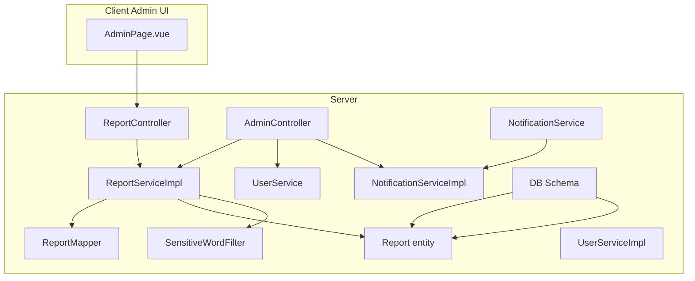
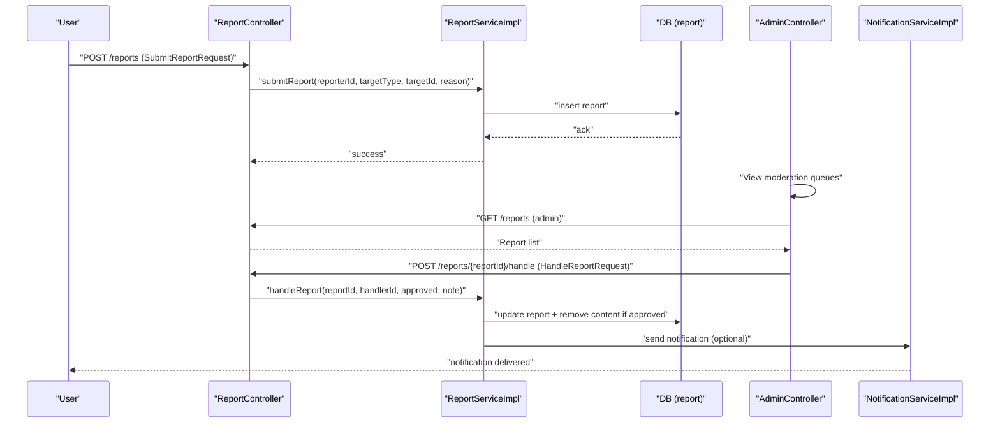
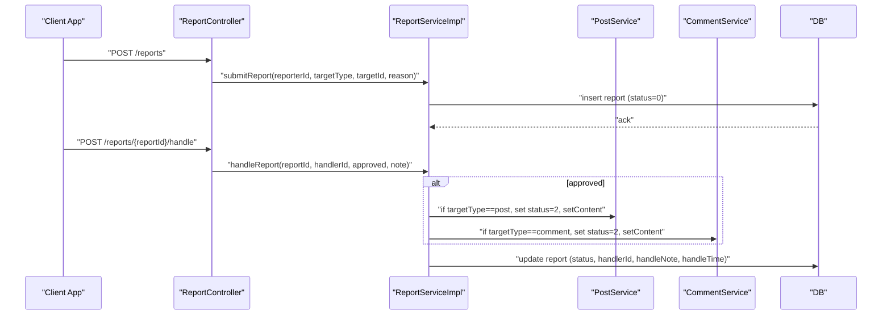
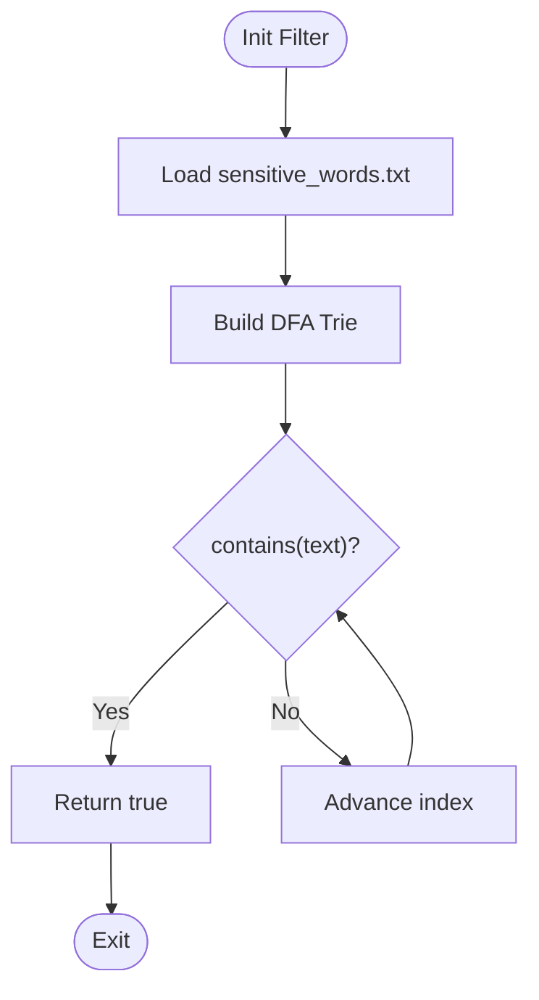
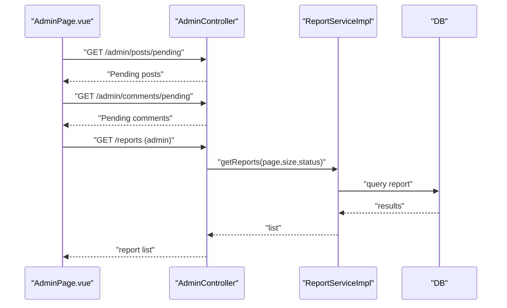
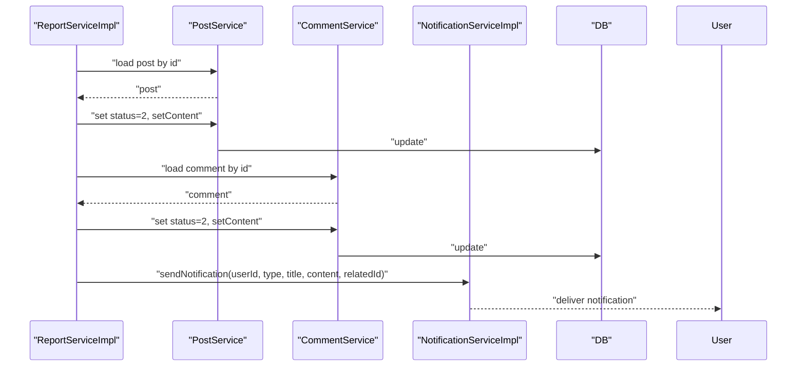
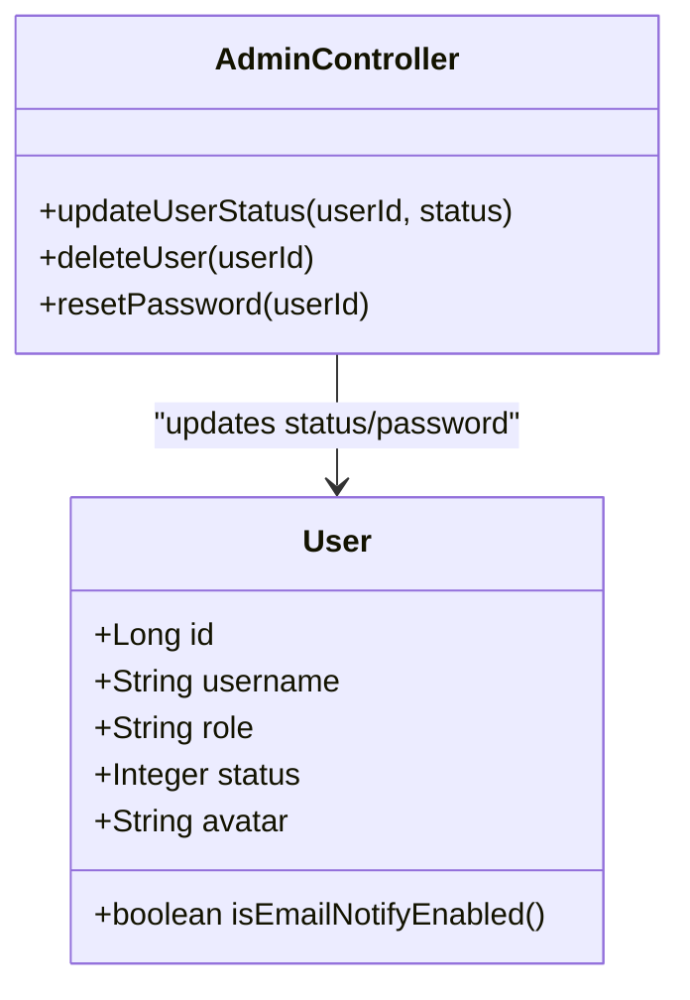
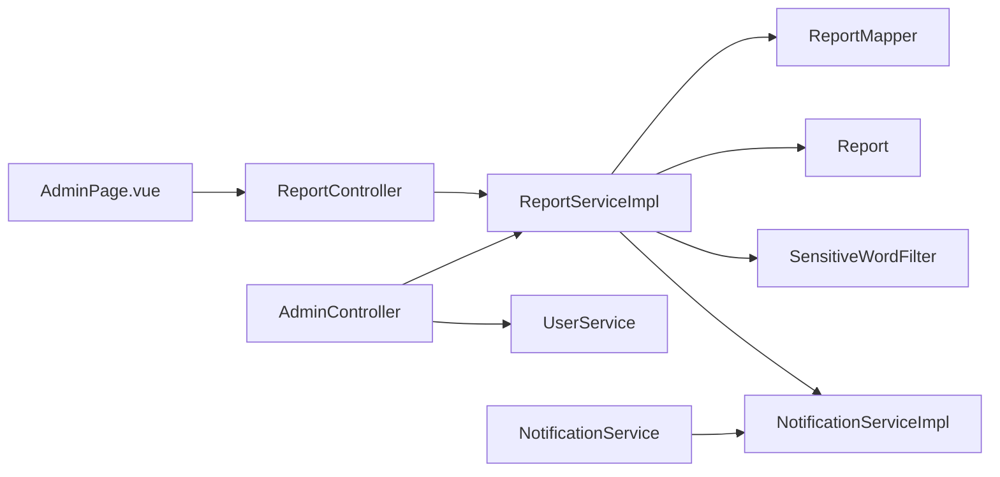

# Content Moderation and Reporting

<cite>
**Referenced Files in This Document**
- [ReportController.java](file://camp-channel-server/src/main/java/com/gdmec/campchannel/controller/ReportController.java)
- [ReportServiceImpl.java](file://camp-channel-server/src/main/java/com/gdmec/campchannel/service/impl/ReportServiceImpl.java)
- [Report.java](file://camp-channel-server/src/main/java/com/gdmec/campchannel/entity/Report.java)
- [ReportMapper.java](file://camp-channel-server/src/main/java/com/gdmec/campchannel/mapper/ReportMapper.java)
- [AdminController.java](file://camp-channel-server/src/main/java/com/gdmec/campchannel/controller/AdminController.java)
- [SensitiveWordFilter.java](file://camp-channel-server/src/main/java/com/gdmec/campchannel/common/filter/SensitiveWordFilter.java)
- [sensitive_words.txt](file://camp-channel-server/src/main/resources/sensitive_words.txt)
- [schema.sql](file://camp-channel-server/src/main/resources/db/schema.sql)
- [NotificationService.java](file://camp-channel-server/src/main/java/com/gdmec/campchannel/service/NotificationService.java)
- [NotificationServiceImpl.java](file://camp-channel-server/src/main/java/com/gdmec/campchannel/service/impl/NotificationServiceImpl.java)
- [AdminPage.vue](file://camp-channel-client-pc/src/pages/AdminPage.vue)
- [ReportDialog.vue](file://camp-channel-client-pc/src/components/ReportDialog.vue)
- [User.java](file://camp-channel-server/src/main/java/com/gdmec/campchannel/entity/User.java)
- [UserService.java](file://camp-channel-server/src/main/java/com/gdmec/campchannel/service/UserService.java)
- [UserServiceImpl.java](file://camp-channel-server/src/main/java/com/gdmec/campchannel/service/impl/UserServiceImpl.java)
- [SensitiveWordFilterTest.java](file://camp-channel-server/src/test/java/com/gdmec/campchannel/SensitiveWordFilterTest.java)
- [V1.0 需求文档.md](file://Camp Channel 校园频道系统 V1.0 需求文档.md)
- [implementation_plan.md](file://implementation_plan.md)
</cite>

## Table of Contents
1. [Introduction](#introduction)
2. [Project Structure](#project-structure)
3. [Core Components](#core-components)
4. [Architecture Overview](#architecture-overview)
5. [Detailed Component Analysis](#detailed-component-analysis)
6. [Dependency Analysis](#dependency-analysis)
7. [Performance Considerations](#performance-considerations)
8. [Troubleshooting Guide](#troubleshooting-guide)
9. [Conclusion](#conclusion)
10. [Appendices](#appendices)

## Introduction
This document describes the content moderation and reporting functionality of the system. It covers the reporting submission workflow, investigation and handling by administrators, automated content filtering via sensitive words, and integration with administrative panels, content removal, and user notifications. It also documents the moderation queue, appeal processes, and the relationship between reports and user reputation, including warning thresholds and account restrictions. Guidance is included for addressing common moderation challenges such as false positives, report abuse, and scaling moderation efforts, along with automated screening, manual review, and escalation procedures for serious violations.

## Project Structure
The moderation and reporting system spans server-side controllers, services, persistence, and client-side administrative UI. Key areas:
- Reporting API and business logic
- Sensitive word detection and filtering
- Administrative panel for moderation queues and actions
- Notifications for moderation outcomes
- Database schema for reports and related entities

**Diagram sources**
- [ReportController.java:20-79](file://camp-channel-server/src/main/java/com/gdmec/campchannel/controller/ReportController.java#L20-L79)
- [ReportServiceImpl.java:20-114](file://camp-channel-server/src/main/java/com/gdmec/campchannel/service/impl/ReportServiceImpl.java#L20-L114)
- [ReportMapper.java:1-10](file://camp-channel-server/src/main/java/com/gdmec/campchannel/mapper/ReportMapper.java#L1-L10)
- [Report.java:10-35](file://camp-channel-server/src/main/java/com/gdmec/campchannel/entity/Report.java#L10-L35)
- [SensitiveWordFilter.java:18-166](file://camp-channel-server/src/main/java/com/gdmec/campchannel/common/filter/SensitiveWordFilter.java#L18-L166)
- [AdminController.java:21-391](file://camp-channel-server/src/main/java/com/gdmec/campchannel/controller/AdminController.java#L21-L391)
- [NotificationService.java:1-34](file://camp-channel-server/src/main/java/com/gdmec/campchannel/service/NotificationService.java#L1-L34)
- [NotificationServiceImpl.java:16-95](file://camp-channel-server/src/main/java/com/gdmec/campchannel/service/impl/NotificationServiceImpl.java#L16-L95)
- [UserService.java:1-22](file://camp-channel-server/src/main/java/com/gdmec/campchannel/service/UserService.java#L1-L22)
- [UserServiceImpl.java:23-107](file://camp-channel-server/src/main/java/com/gdmec/campchannel/service/impl/UserServiceImpl.java#L23-L107)
- [schema.sql:146-161](file://camp-channel-server/src/main/resources/db/schema.sql#L146-L161)
- [AdminPage.vue:230-258](file://camp-channel-client-pc/src/pages/AdminPage.vue#L230-L258)

**Section sources**
- [ReportController.java:18-79](file://camp-channel-server/src/main/java/com/gdmec/campchannel/controller/ReportController.java#L18-L79)
- [ReportServiceImpl.java:20-114](file://camp-channel-server/src/main/java/com/gdmec/campchannel/service/impl/ReportServiceImpl.java#L20-L114)
- [schema.sql:146-161](file://camp-channel-server/src/main/resources/db/schema.sql#L146-L161)

## Core Components
- ReportController: Exposes endpoints for submitting reports, listing reports for admins, and handling reports.
- ReportServiceImpl: Implements rate limiting, deduplication, saving reports, and automatic content removal upon approval.
- Report entity and mapper: Persist report metadata and support queries.
- SensitiveWordFilter: Loads a dictionary and applies DFA-based filtering to detect and mask sensitive content.
- AdminController: Provides moderation queues and actions for posts, comments, channels, and user management.
- NotificationService/Impl: Manages system notifications and WebSocket delivery for moderation outcomes.
- AdminPage.vue: Presents moderation queues and actions in the admin UI.

**Section sources**
- [ReportController.java:27-64](file://camp-channel-server/src/main/java/com/gdmec/campchannel/controller/ReportController.java#L27-L64)
- [ReportServiceImpl.java:32-100](file://camp-channel-server/src/main/java/com/gdmec/campchannel/service/impl/ReportServiceImpl.java#L32-L100)
- [Report.java:10-35](file://camp-channel-server/src/main/java/com/gdmec/campchannel/entity/Report.java#L10-L35)
- [ReportMapper.java:1-10](file://camp-channel-server/src/main/java/com/gdmec/campchannel/mapper/ReportMapper.java#L1-L10)
- [SensitiveWordFilter.java:40-127](file://camp-channel-server/src/main/java/com/gdmec/campchannel/common/filter/SensitiveWordFilter.java#L40-L127)
- [AdminController.java:51-325](file://camp-channel-server/src/main/java/com/gdmec/campchannel/controller/AdminController.java#L51-L325)
- [NotificationServiceImpl.java:26-51](file://camp-channel-server/src/main/java/com/gdmec/campchannel/service/impl/NotificationServiceImpl.java#L26-L51)
- [AdminPage.vue:230-258](file://camp-channel-client-pc/src/pages/AdminPage.vue#L230-L258)

## Architecture Overview
The moderation pipeline integrates user-driven reporting, automated filtering, and administrative workflows:
- Users submit reports via ReportController.
- ReportServiceImpl validates and persists reports, enforces rate limits, and removes content when approved.
- AdminController exposes moderation queues and actions for posts, comments, channels, and users.
- SensitiveWordFilter detects sensitive content and can route items to moderation queues.
- NotificationServiceImpl delivers moderation outcomes to users.

**Diagram sources**
- [ReportController.java:27-64](file://camp-channel-server/src/main/java/com/gdmec/campchannel/controller/ReportController.java#L27-L64)
- [ReportServiceImpl.java:32-100](file://camp-channel-server/src/main/java/com/gdmec/campchannel/service/impl/ReportServiceImpl.java#L32-L100)
- [schema.sql:146-161](file://camp-channel-server/src/main/resources/db/schema.sql#L146-L161)
- [NotificationServiceImpl.java:26-51](file://camp-channel-server/src/main/java/com/gdmec/campchannel/service/impl/NotificationServiceImpl.java#L26-L51)

## Detailed Component Analysis

### Reporting Submission and Handling
- Submission endpoint validates the requester’s role and delegates to ReportService.
- ReportService enforces per-user rate limiting and prevents duplicate pending reports for the same target.
- On approval, the system automatically removes the reported content (sets status and replaces content) and records handler metadata.

**Diagram sources**
- [ReportController.java:27-64](file://camp-channel-server/src/main/java/com/gdmec/campchannel/controller/ReportController.java#L27-L64)
- [ReportServiceImpl.java:32-100](file://camp-channel-server/src/main/java/com/gdmec/campchannel/service/impl/ReportServiceImpl.java#L32-L100)

**Section sources**
- [ReportController.java:27-64](file://camp-channel-server/src/main/java/com/gdmec/campchannel/controller/ReportController.java#L27-L64)
- [ReportServiceImpl.java:32-100](file://camp-channel-server/src/main/java/com/gdmec/campchannel/service/impl/ReportServiceImpl.java#L32-L100)
- [Report.java:10-35](file://camp-channel-server/src/main/java/com/gdmec/campchannel/entity/Report.java#L10-L35)

### Automated Content Filtering (Sensitive Word Detection)
- SensitiveWordFilter loads a dictionary at startup and builds a DFA trie for efficient matching.
- Two matching modes are supported: minimal and maximal length matches.
- The filter can detect sensitive content and replace matches with a placeholder character.

**Diagram sources**
- [SensitiveWordFilter.java:40-105](file://camp-channel-server/src/main/java/com/gdmec/campchannel/common/filter/SensitiveWordFilter.java#L40-L105)
- [sensitive_words.txt:1-10](file://camp-channel-server/src/main/resources/sensitive_words.txt#L1-L10)

**Section sources**
- [SensitiveWordFilter.java:40-127](file://camp-channel-server/src/main/java/com/gdmec/campchannel/common/filter/SensitiveWordFilter.java#L40-L127)
- [sensitive_words.txt:1-10](file://camp-channel-server/src/main/resources/sensitive_words.txt#L1-L10)
- [SensitiveWordFilterTest.java:13-50](file://camp-channel-server/src/test/java/com/gdmec/campchannel/SensitiveWordFilterTest.java#L13-L50)

### Administrative Panel Integration and Moderation Queues
- AdminController exposes endpoints for:
  - Listing pending posts and comments
  - Approving/rejecting posts and comments
  - Managing channels and users
  - Viewing operation logs
- AdminPage.vue displays the report queue and allows approving or rejecting reports.

**Diagram sources**
- [AdminController.java:229-325](file://camp-channel-server/src/main/java/com/gdmec/campchannel/controller/AdminController.java#L229-L325)
- [ReportServiceImpl.java:102-112](file://camp-channel-server/src/main/java/com/gdmec/campchannel/service/impl/ReportServiceImpl.java#L102-L112)
- [AdminPage.vue:230-258](file://camp-channel-client-pc/src/pages/AdminPage.vue#L230-L258)

**Section sources**
- [AdminController.java:229-325](file://camp-channel-server/src/main/java/com/gdmec/campchannel/controller/AdminController.java#L229-L325)
- [AdminPage.vue:230-258](file://camp-channel-client-pc/src/pages/AdminPage.vue#L230-L258)

### Content Removal Procedures and User Notifications
- Upon report approval, the system sets the status of the reported post/comment to deleted and replaces content with a standardized message.
- Notifications can be sent to affected users via NotificationServiceImpl, which supports WebSocket delivery.

**Diagram sources**
- [ReportServiceImpl.java:74-94](file://camp-channel-server/src/main/java/com/gdmec/campchannel/service/impl/ReportServiceImpl.java#L74-L94)
- [NotificationServiceImpl.java:26-51](file://camp-channel-server/src/main/java/com/gdmec/campchannel/service/impl/NotificationServiceImpl.java#L26-L51)

**Section sources**
- [ReportServiceImpl.java:74-94](file://camp-channel-server/src/main/java/com/gdmec/campchannel/service/impl/ReportServiceImpl.java#L74-L94)
- [NotificationServiceImpl.java:26-51](file://camp-channel-server/src/main/java/com/gdmec/campchannel/service/impl/NotificationServiceImpl.java#L26-L51)

### User Reputation System and Account Restrictions
- The system defines roles and statuses for users, enabling administrative actions such as disabling/enabling accounts.
- While explicit warning thresholds and reputation scores are not present in the current code, the existing user status field and admin endpoints provide a foundation to implement reputation-based restrictions.

**Diagram sources**
- [User.java:10-42](file://camp-channel-server/src/main/java/com/gdmec/campchannel/entity/User.java#L10-L42)
- [AdminController.java:70-146](file://camp-channel-server/src/main/java/com/gdmec/campchannel/controller/AdminController.java#L70-L146)

**Section sources**
- [User.java:10-42](file://camp-channel-server/src/main/java/com/gdmec/campchannel/entity/User.java#L10-L42)
- [AdminController.java:70-146](file://camp-channel-server/src/main/java/com/gdmec/campchannel/controller/AdminController.java#L70-L146)

### Appeal Processes
- The current implementation does not include a dedicated appeals mechanism. Appeals could be modeled as a separate entity linked to reports, allowing users to submit appeals and track outcomes. This would require extending the schema and adding endpoints in the backend and UI.

[No sources needed since this section proposes future extension without analyzing specific files]

## Dependency Analysis
Moderation components depend on:
- Controllers for API exposure
- Services for business logic and persistence
- Mapper/Entity for data access
- Notification service for outcome delivery
- Sensitive word filter for automated screening

**Diagram sources**
- [ReportController.java:20-79](file://camp-channel-server/src/main/java/com/gdmec/campchannel/controller/ReportController.java#L20-L79)
- [ReportServiceImpl.java:20-114](file://camp-channel-server/src/main/java/com/gdmec/campchannel/service/impl/ReportServiceImpl.java#L20-L114)
- [ReportMapper.java:1-10](file://camp-channel-server/src/main/java/com/gdmec/campchannel/mapper/ReportMapper.java#L1-L10)
- [Report.java:10-35](file://camp-channel-server/src/main/java/com/gdmec/campchannel/entity/Report.java#L10-L35)
- [SensitiveWordFilter.java:18-166](file://camp-channel-server/src/main/java/com/gdmec/campchannel/common/filter/SensitiveWordFilter.java#L18-L166)
- [AdminController.java:21-391](file://camp-channel-server/src/main/java/com/gdmec/campchannel/controller/AdminController.java#L21-L391)
- [NotificationService.java:1-34](file://camp-channel-server/src/main/java/com/gdmec/campchannel/service/NotificationService.java#L1-L34)
- [NotificationServiceImpl.java:16-95](file://camp-channel-server/src/main/java/com/gdmec/campchannel/service/impl/NotificationServiceImpl.java#L16-L95)
- [AdminPage.vue:230-258](file://camp-channel-client-pc/src/pages/AdminPage.vue#L230-L258)

**Section sources**
- [ReportController.java:20-79](file://camp-channel-server/src/main/java/com/gdmec/campchannel/controller/ReportController.java#L20-L79)
- [ReportServiceImpl.java:20-114](file://camp-channel-server/src/main/java/com/gdmec/campchannel/service/impl/ReportServiceImpl.java#L20-L114)
- [AdminController.java:21-391](file://camp-channel-server/src/main/java/com/gdmec/campchannel/controller/AdminController.java#L21-L391)

## Performance Considerations
- Sensitive word detection uses a DFA trie, ensuring efficient matching with minimal overhead during content creation or updates.
- Rate limiting for report submissions prevents abuse and reduces load on the moderation system.
- Pagination endpoints for moderation queues help scale to large datasets.

[No sources needed since this section provides general guidance]

## Troubleshooting Guide
Common issues and remedies:
- Duplicate or excessive reports: The service prevents duplicate pending reports for the same target and applies rate limiting per user.
- Report not appearing in queues: Verify the status filter and pagination parameters; ensure the requesting user has the required role.
- Content not removed after approval: Confirm the target type and IDs; check for exceptions during deletion and review logs.
- Notifications not received: Ensure WebSocket connectivity and that the notification service is configured; verify user preferences.

**Section sources**
- [ReportServiceImpl.java:32-100](file://camp-channel-server/src/main/java/com/gdmec/campchannel/service/impl/ReportServiceImpl.java#L32-L100)
- [NotificationServiceImpl.java:26-51](file://camp-channel-server/src/main/java/com/gdmec/campchannel/service/impl/NotificationServiceImpl.java#L26-L51)

## Conclusion
The system provides a robust foundation for content moderation and reporting, combining user-driven reports, automated sensitive word filtering, and administrative moderation queues. Administrators can efficiently triage and act on reports, while the system supports immediate content removal upon approval. Future enhancements—such as a formal appeals process, reputation scoring, and escalation workflows—can further strengthen the moderation framework.

[No sources needed since this section summarizes without analyzing specific files]

## Appendices

### API Endpoints Summary
- Submit a report
  - Method: POST
  - Path: /reports
  - Request body: SubmitReportRequest (targetType, targetId, reason)
  - Response: Result<Void>
- Get reports (admin)
  - Method: GET
  - Path: /reports
  - Query params: page, size, status (optional)
  - Response: Result<List<Report>>
- Handle a report (admin)
  - Method: POST
  - Path: /reports/{reportId}/handle
  - Request body: HandleReportRequest (approved, note)
  - Response: Result<Void>

**Section sources**
- [ReportController.java:27-64](file://camp-channel-server/src/main/java/com/gdmec/campchannel/controller/ReportController.java#L27-L64)

### Moderation Queue Management
- Pending posts: GET /admin/posts/pending
- Approve/reject posts: POST /admin/posts/{postId}/approve
- Pending comments: GET /admin/comments/pending
- Approve/reject comments: POST /admin/comments/{commentId}/approve
- Reports queue: GET /reports (admin)

**Section sources**
- [AdminController.java:229-325](file://camp-channel-server/src/main/java/com/gdmec/campchannel/controller/AdminController.java#L229-L325)

### Sensitive Word Detection Details
- Dictionary file: sensitive_words.txt
- Matching modes: minimal and maximal length
- Replacement character: asterisk
- Initialization: @PostConstruct loads the dictionary at startup

**Section sources**
- [SensitiveWordFilter.java:40-127](file://camp-channel-server/src/main/java/com/gdmec/campchannel/common/filter/SensitiveWordFilter.java#L40-L127)
- [sensitive_words.txt:1-10](file://camp-channel-server/src/main/resources/sensitive_words.txt#L1-L10)

### Data Model: Report
- Fields: id, reporterId, targetType, targetId, reason, status, handlerId, handleNote, createTime, handleTime
- Indexes: reporter_id, (target_type, target_id), status

**Section sources**
- [Report.java:10-35](file://camp-channel-server/src/main/java/com/gdmec/campchannel/entity/Report.java#L10-L35)
- [schema.sql:146-161](file://camp-channel-server/src/main/resources/db/schema.sql#L146-L161)

### User Reputation and Restrictions
- Role/status fields enable administrative control over user accounts.
- No built-in warning thresholds or reputation score; can be extended via additional fields and logic.

**Section sources**
- [User.java:10-42](file://camp-channel-server/src/main/java/com/gdmec/campchannel/entity/User.java#L10-L42)
- [AdminController.java:70-146](file://camp-channel-server/src/main/java/com/gdmec/campchannel/controller/AdminController.java#L70-L146)

### Appeals Process (Proposed)
- Extend schema with an appeals table linking to reports.
- Add endpoints for users to submit appeals and for admins to review.
- Track appeal status and outcomes in notifications.

[No sources needed since this section proposes future extension without analyzing specific files]