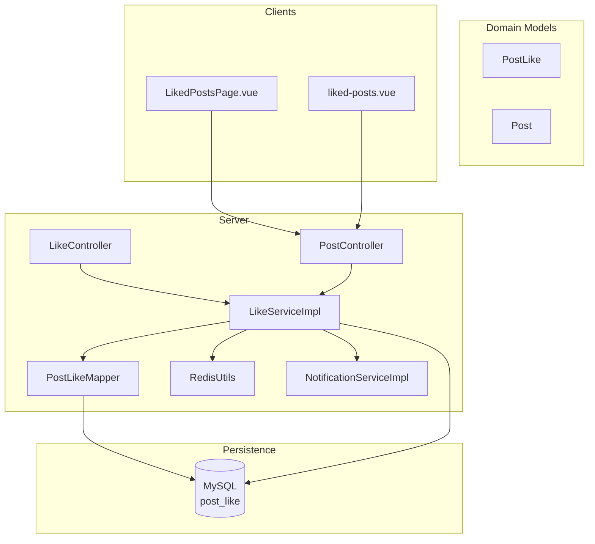
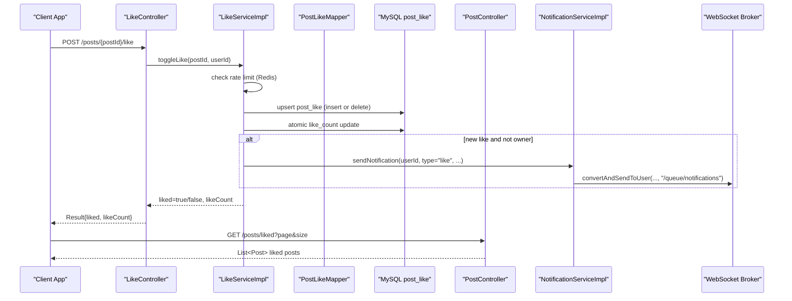
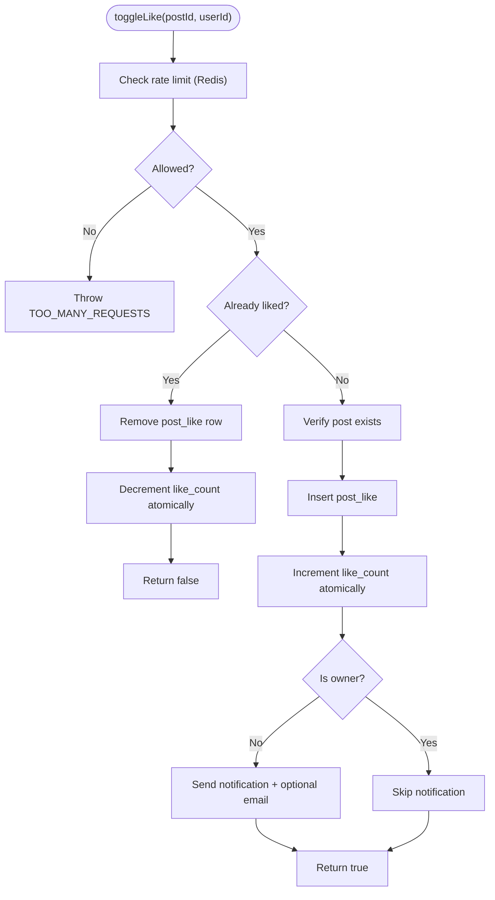
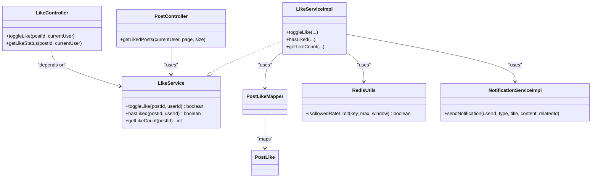
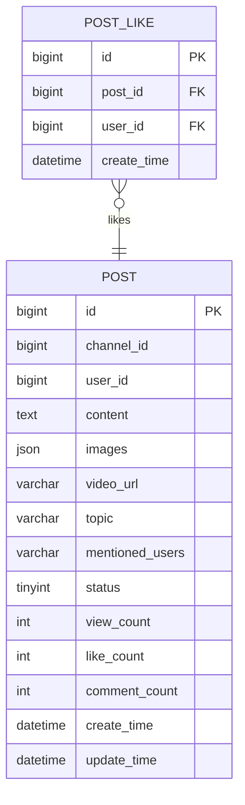

# Like and Reaction System

<cite>
**Referenced Files in This Document**
- [LikeController.java](file://camp-channel-server/src/main/java/com/gdmec/campchannel/controller/LikeController.java)
- [LikeService.java](file://camp-channel-server/src/main/java/com/gdmec/campchannel/service/LikeService.java)
- [LikeServiceImpl.java](file://camp-channel-server/src/main/java/com/gdmec/campchannel/service/impl/LikeServiceImpl.java)
- [PostLike.java](file://camp-channel-server/src/main/java/com/gdmec/campchannel/entity/PostLike.java)
- [PostLikeMapper.java](file://camp-channel-server/src/main/java/com/gdmec/campchannel/mapper/PostLikeMapper.java)
- [RedisUtils.java](file://camp-channel-server/src/main/java/com/gdmec/campchannel/common/utils/RedisUtils.java)
- [NotificationService.java](file://camp-channel-server/src/main/java/com/gdmec/campchannel/service/NotificationService.java)
- [NotificationServiceImpl.java](file://camp-channel-server/src/main/java/com/gdmec/campchannel/service/impl/NotificationServiceImpl.java)
- [Post.java](file://camp-channel-server/src/main/java/com/gdmec/campchannel/entity/Post.java)
- [PostController.java](file://camp-channel-server/src/main/java/com/gdmec/campchannel/controller/PostController.java)
- [schema.sql](file://camp-channel-server/src/main/resources/db/schema.sql)
- [LikedPostsPage.vue](file://camp-channel-client-pc/src/pages/LikedPostsPage.vue)
- [liked-posts.vue](file://camp-channel-client-uniapp/src/pages/post/liked-posts.vue)
</cite>

## Table of Contents
1. [Introduction](#introduction)
2. [Project Structure](#project-structure)
3. [Core Components](#core-components)
4. [Architecture Overview](#architecture-overview)
5. [Detailed Component Analysis](#detailed-component-analysis)
6. [Dependency Analysis](#dependency-analysis)
7. [Performance Considerations](#performance-considerations)
8. [Troubleshooting Guide](#troubleshooting-guide)
9. [Conclusion](#conclusion)
10. [Appendices](#appendices)

## Introduction
This document explains the complete like and reaction system for the campus channel platform. It covers like counting, user interaction tracking, state management across multiple posts, like/unlike operations, duplicate prevention, real-time updates, authentication integration, post ownership verification, and notification triggering. It also documents API endpoints, like history retrieval, and how likes contribute to engagement metrics and popularity calculations. Finally, it addresses concurrency, rollback scenarios, performance optimization for high-traffic posts, and frontend visual feedback.

## Project Structure
The like system spans server-side controllers, services, persistence, and client-side pages:
- Server-side: LikeController exposes endpoints; LikeServiceImpl implements business logic; PostLike entity and PostLikeMapper persist likes; RedisUtils enforces rate limiting; NotificationServiceImpl handles real-time notifications.
- Database: schema.sql defines the post_like table with uniqueness constraints and indexes.
- Clients: Vue-based pages for PC and UniApp fetch and display liked posts.

**Diagram sources**
- [LikeController.java:1-54](file://camp-channel-server/src/main/java/com/gdmec/campchannel/controller/LikeController.java#L1-L54)
- [LikeServiceImpl.java:1-131](file://camp-channel-server/src/main/java/com/gdmec/campchannel/service/impl/LikeServiceImpl.java#L1-L131)
- [PostLikeMapper.java:1-9](file://camp-channel-server/src/main/java/com/gdmec/campchannel/mapper/PostLikeMapper.java#L1-L9)
- [RedisUtils.java:1-170](file://camp-channel-server/src/main/java/com/gdmec/campchannel/common/utils/RedisUtils.java#L1-L170)
- [NotificationServiceImpl.java:1-95](file://camp-channel-server/src/main/java/com/gdmec/campchannel/service/impl/NotificationServiceImpl.java#L1-L95)
- [PostController.java:184-193](file://camp-channel-server/src/main/java/com/gdmec/campchannel/controller/PostController.java#L184-L193)
- [schema.sql:66-74](file://camp-channel-server/src/main/resources/db/schema.sql#L66-L74)
- [LikedPostsPage.vue:1-70](file://camp-channel-client-pc/src/pages/LikedPostsPage.vue#L1-L70)
- [liked-posts.vue:1-128](file://camp-channel-client-uniapp/src/pages/post/liked-posts.vue#L1-L128)

**Section sources**
- [LikeController.java:1-54](file://camp-channel-server/src/main/java/com/gdmec/campchannel/controller/LikeController.java#L1-L54)
- [LikeServiceImpl.java:1-131](file://camp-channel-server/src/main/java/com/gdmec/campchannel/service/impl/LikeServiceImpl.java#L1-L131)
- [PostLike.java:1-22](file://camp-channel-server/src/main/java/com/gdmec/campchannel/entity/PostLike.java#L1-L22)
- [PostLikeMapper.java:1-9](file://camp-channel-server/src/main/java/com/gdmec/campchannel/mapper/PostLikeMapper.java#L1-L9)
- [RedisUtils.java:1-170](file://camp-channel-server/src/main/java/com/gdmec/campchannel/common/utils/RedisUtils.java#L1-L170)
- [NotificationServiceImpl.java:1-95](file://camp-channel-server/src/main/java/com/gdmec/campchannel/service/impl/NotificationServiceImpl.java#L1-L95)
- [PostController.java:184-193](file://camp-channel-server/src/main/java/com/gdmec/campchannel/controller/PostController.java#L184-L193)
- [schema.sql:66-74](file://camp-channel-server/src/main/resources/db/schema.sql#L66-L74)
- [LikedPostsPage.vue:1-70](file://camp-channel-client-pc/src/pages/LikedPostsPage.vue#L1-L70)
- [liked-posts.vue:1-128](file://camp-channel-client-uniapp/src/pages/post/liked-posts.vue#L1-L128)

## Core Components
- LikeController: Exposes toggle and status endpoints under /posts/{postId}/like.
- LikeService and LikeServiceImpl: Implement toggleLike, hasLiked, and getLikeCount with transactional guarantees, rate limiting, duplicate prevention, and notification/email triggers.
- PostLike entity and PostLikeMapper: Persist per-user-per-post likes with a unique constraint.
- RedisUtils: Enforces sliding-window rate limiting for likes.
- NotificationServiceImpl: Stores notifications and pushes via WebSocket to online users.
- PostController: Provides /posts/liked endpoint to fetch liked posts for a user.
- Frontend pages: Display liked posts and integrate with backend APIs.

**Section sources**
- [LikeController.java:25-53](file://camp-channel-server/src/main/java/com/gdmec/campchannel/controller/LikeController.java#L25-L53)
- [LikeService.java:6-22](file://camp-channel-server/src/main/java/com/gdmec/campchannel/service/LikeService.java#L6-L22)
- [LikeServiceImpl.java:42-131](file://camp-channel-server/src/main/java/com/gdmec/campchannel/service/impl/LikeServiceImpl.java#L42-L131)
- [PostLike.java:10-22](file://camp-channel-server/src/main/java/com/gdmec/campchannel/entity/PostLike.java#L10-L22)
- [PostLikeMapper.java:1-9](file://camp-channel-server/src/main/java/com/gdmec/campchannel/mapper/PostLikeMapper.java#L1-L9)
- [RedisUtils.java:142-168](file://camp-channel-server/src/main/java/com/gdmec/campchannel/common/utils/RedisUtils.java#L142-L168)
- [NotificationServiceImpl.java:26-51](file://camp-channel-server/src/main/java/com/gdmec/campchannel/service/impl/NotificationServiceImpl.java#L26-L51)
- [PostController.java:184-193](file://camp-channel-server/src/main/java/com/gdmec/campchannel/controller/PostController.java#L184-L193)

## Architecture Overview
The like system follows a layered architecture:
- Presentation: LikeController exposes REST endpoints.
- Application: LikeServiceImpl orchestrates domain operations, rate limiting, persistence, and notifications.
- Persistence: MyBatis-Plus mappers and Redis handle data storage and rate limiting.
- Messaging: STOMP/Spring WebSocket delivers real-time notifications to users.

**Diagram sources**
- [LikeController.java:25-38](file://camp-channel-server/src/main/java/com/gdmec/campchannel/controller/LikeController.java#L25-L38)
- [LikeServiceImpl.java:42-115](file://camp-channel-server/src/main/java/com/gdmec/campchannel/service/impl/LikeServiceImpl.java#L42-L115)
- [PostLikeMapper.java:1-9](file://camp-channel-server/src/main/java/com/gdmec/campchannel/mapper/PostLikeMapper.java#L1-L9)
- [NotificationServiceImpl.java:40-50](file://camp-channel-server/src/main/java/com/gdmec/campchannel/service/impl/NotificationServiceImpl.java#L40-L50)
- [PostController.java:184-193](file://camp-channel-server/src/main/java/com/gdmec/campchannel/controller/PostController.java#L184-L193)

## Detailed Component Analysis

### LikeController
- Endpoints:
  - POST /posts/{postId}/like toggles like/unlike and returns liked status and likeCount.
  - GET /posts/{postId}/like/status checks current like status and likeCount.
- Authentication: Uses @AuthenticationPrincipal to extract current user ID.
- Returns structured result with success metadata and payload.

**Section sources**
- [LikeController.java:25-53](file://camp-channel-server/src/main/java/com/gdmec/campchannel/controller/LikeController.java#L25-L53)

### LikeService and LikeServiceImpl
- toggleLike:
  - Rate limiting via Redis sliding window (max 50 per minute).
  - Duplicate prevention using unique constraint on (post_id, user_id) with retry logic.
  - Atomic like count updates using SQL expressions to prevent race conditions.
  - Owner verification: skips notifications when the actor likes their own post.
  - Asynchronous notification delivery via NotificationServiceImpl and optional email alert.
- hasLiked: Checks existence of a like record.
- getLikeCount: Counts likes for a post.

**Diagram sources**
- [LikeServiceImpl.java:42-115](file://camp-channel-server/src/main/java/com/gdmec/campchannel/service/impl/LikeServiceImpl.java#L42-L115)
- [RedisUtils.java:142-168](file://camp-channel-server/src/main/java/com/gdmec/campchannel/common/utils/RedisUtils.java#L142-L168)
- [NotificationServiceImpl.java:26-51](file://camp-channel-server/src/main/java/com/gdmec/campchannel/service/impl/NotificationServiceImpl.java#L26-L51)

**Section sources**
- [LikeService.java:6-22](file://camp-channel-server/src/main/java/com/gdmec/campchannel/service/LikeService.java#L6-L22)
- [LikeServiceImpl.java:42-131](file://camp-channel-server/src/main/java/com/gdmec/campchannel/service/impl/LikeServiceImpl.java#L42-L131)
- [RedisUtils.java:142-168](file://camp-channel-server/src/main/java/com/gdmec/campchannel/common/utils/RedisUtils.java#L142-L168)
- [NotificationServiceImpl.java:26-51](file://camp-channel-server/src/main/java/com/gdmec/campchannel/service/impl/NotificationServiceImpl.java#L26-L51)

### PostLike Entity and Mapper
- Unique constraint ensures one like per user per post.
- Indexes support queries by post_id and user_id.
- Mapper extends MyBatis-Plus base to inherit common operations.

**Section sources**
- [PostLike.java:10-22](file://camp-channel-server/src/main/java/com/gdmec/campchannel/entity/PostLike.java#L10-L22)
- [PostLikeMapper.java:1-9](file://camp-channel-server/src/main/java/com/gdmec/campchannel/mapper/PostLikeMapper.java#L1-L9)
- [schema.sql:66-74](file://camp-channel-server/src/main/resources/db/schema.sql#L66-L74)

### Notification System
- NotificationServiceImpl persists notifications and pushes them to the user’s WebSocket queue.
- Real-time delivery uses Spring WebSocket STOMP with convertAndSendToUser.

**Section sources**
- [NotificationService.java:8-34](file://camp-channel-server/src/main/java/com/gdmec/campchannel/service/NotificationService.java#L8-L34)
- [NotificationServiceImpl.java:26-51](file://camp-channel-server/src/main/java/com/gdmec/campchannel/service/impl/NotificationServiceImpl.java#L26-L51)

### PostController Like History Endpoint
- GET /posts/liked returns liked posts for the authenticated user with pagination.

**Section sources**
- [PostController.java:184-193](file://camp-channel-server/src/main/java/com/gdmec/campchannel/controller/PostController.java#L184-L193)

### Frontend Integration
- PC client (Vue):
  - Fetches liked posts from /posts/liked?page&size and renders cards with metadata.
- UniApp client:
  - Loads liked posts with pagination and displays images, counts, and titles.

**Section sources**
- [LikedPostsPage.vue:32-51](file://camp-channel-client-pc/src/pages/LikedPostsPage.vue#L32-L51)
- [liked-posts.vue:46-86](file://camp-channel-client-uniapp/src/pages/post/liked-posts.vue#L46-L86)

## Dependency Analysis

**Diagram sources**
- [LikeController.java:1-54](file://camp-channel-server/src/main/java/com/gdmec/campchannel/controller/LikeController.java#L1-L54)
- [LikeService.java:1-22](file://camp-channel-server/src/main/java/com/gdmec/campchannel/service/LikeService.java#L1-L22)
- [LikeServiceImpl.java:1-131](file://camp-channel-server/src/main/java/com/gdmec/campchannel/service/impl/LikeServiceImpl.java#L1-L131)
- [PostLikeMapper.java:1-9](file://camp-channel-server/src/main/java/com/gdmec/campchannel/mapper/PostLikeMapper.java#L1-L9)
- [PostLike.java:1-22](file://camp-channel-server/src/main/java/com/gdmec/campchannel/entity/PostLike.java#L1-L22)
- [RedisUtils.java:1-170](file://camp-channel-server/src/main/java/com/gdmec/campchannel/common/utils/RedisUtils.java#L1-L170)
- [NotificationServiceImpl.java:1-95](file://camp-channel-server/src/main/java/com/gdmec/campchannel/service/impl/NotificationServiceImpl.java#L1-L95)
- [PostController.java:184-193](file://camp-channel-server/src/main/java/com/gdmec/campchannel/controller/PostController.java#L184-L193)

**Section sources**
- [LikeController.java:1-54](file://camp-channel-server/src/main/java/com/gdmec/campchannel/controller/LikeController.java#L1-L54)
- [LikeServiceImpl.java:1-131](file://camp-channel-server/src/main/java/com/gdmec/campchannel/service/impl/LikeServiceImpl.java#L1-L131)
- [PostLike.java:1-22](file://camp-channel-server/src/main/java/com/gdmec/campchannel/entity/PostLike.java#L1-L22)
- [PostLikeMapper.java:1-9](file://camp-channel-server/src/main/java/com/gdmec/campchannel/mapper/PostLikeMapper.java#L1-L9)
- [RedisUtils.java:1-170](file://camp-channel-server/src/main/java/com/gdmec/campchannel/common/utils/RedisUtils.java#L1-L170)
- [NotificationServiceImpl.java:1-95](file://camp-channel-server/src/main/java/com/gdmec/campchannel/service/impl/NotificationServiceImpl.java#L1-L95)
- [PostController.java:184-193](file://camp-channel-server/src/main/java/com/gdmec/campchannel/controller/PostController.java#L184-L193)

## Performance Considerations
- Atomic counters: Like counts are updated atomically via SQL to avoid race conditions.
- Unique constraints: Prevents duplicates and simplifies existence checks.
- Rate limiting: Redis sliding window limits burst-like operations to 50 per minute per user.
- Indexes: post_like.uk_post_user and post_like.idx_user_id optimize lookups.
- Transaction boundaries: toggleLike runs in a single transaction to maintain consistency.
- Asynchronous notifications: Non-blocking notification sending avoids request latency.
- Pagination: Liked posts endpoints support pagination to reduce payload sizes.

[No sources needed since this section provides general guidance]

## Troubleshooting Guide
- Too many requests: If rate limit is exceeded, a business exception is thrown with a retry-after message. Reduce client-side polling or batch operations.
- Duplicate like errors: Caught and handled; the system removes the duplicate and returns false.
- Notification failures: WebSocket send exceptions are logged and ignored to avoid blocking the like operation.
- Post not found: Attempting to like a non-existent post throws a bad request error.
- Owner self-like: No notification or email is sent when the actor likes their own post.

**Section sources**
- [LikeServiceImpl.java:45-49](file://camp-channel-server/src/main/java/com/gdmec/campchannel/service/impl/LikeServiceImpl.java#L45-L49)
- [LikeServiceImpl.java:77-85](file://camp-channel-server/src/main/java/com/gdmec/campchannel/service/impl/LikeServiceImpl.java#L77-L85)
- [LikeServiceImpl.java:94-111](file://camp-channel-server/src/main/java/com/gdmec/campchannel/service/impl/LikeServiceImpl.java#L94-L111)
- [NotificationServiceImpl.java:47-49](file://camp-channel-server/src/main/java/com/gdmec/campchannel/service/impl/NotificationServiceImpl.java#L47-L49)

## Conclusion
The like and reaction system is built around strong consistency, safety against duplicates, and real-time user feedback. It leverages Redis for rate limiting, atomic database updates for counters, and WebSocket notifications for instant engagement signals. The design supports scalability through indexing, pagination, and asynchronous processing while maintaining a simple and robust API surface.

[No sources needed since this section summarizes without analyzing specific files]

## Appendices

### API Endpoints
- POST /posts/{postId}/like
  - Description: Toggle like/unlike for a post.
  - Auth: Required.
  - Response: { liked: boolean, likeCount: integer }.
- GET /posts/{postId}/like/status
  - Description: Get current like status and like count.
  - Auth: Required.
  - Response: { hasLiked: boolean, likeCount: integer }.
- GET /posts/liked
  - Description: Retrieve posts liked by the authenticated user.
  - Auth: Required.
  - Query: page, size.

**Section sources**
- [LikeController.java:25-53](file://camp-channel-server/src/main/java/com/gdmec/campchannel/controller/LikeController.java#L25-L53)
- [PostController.java:184-193](file://camp-channel-server/src/main/java/com/gdmec/campchannel/controller/PostController.java#L184-L193)

### Data Model

**Diagram sources**
- [schema.sql:45-64](file://camp-channel-server/src/main/resources/db/schema.sql#L45-L64)
- [schema.sql:66-74](file://camp-channel-server/src/main/resources/db/schema.sql#L66-L74)

### Engagement Metrics and Popularity
- Like count is stored on the post entity and updated atomically during like/unlike.
- Trending and popularity can be derived from like_count combined with recency (e.g., decayed score or ranking by recent activity and like density). Implement such algorithms in the presentation or analytics layer as needed.

**Section sources**
- [Post.java:34-42](file://camp-channel-server/src/main/java/com/gdmec/campchannel/entity/Post.java#L34-L42)
- [LikeServiceImpl.java:87-90](file://camp-channel-server/src/main/java/com/gdmec/campchannel/service/impl/LikeServiceImpl.java#L87-L90)

### Frontend Visual Feedback
- Clients render liked posts and can reflect like state in UI (e.g., filled heart icon, like count updates). The provided pages demonstrate fetching and displaying liked posts; visual animations would be implemented in the respective UI frameworks.

**Section sources**
- [LikedPostsPage.vue:1-70](file://camp-channel-client-pc/src/pages/LikedPostsPage.vue#L1-L70)
- [liked-posts.vue:1-128](file://camp-channel-client-uniapp/src/pages/post/liked-posts.vue#L1-L128)