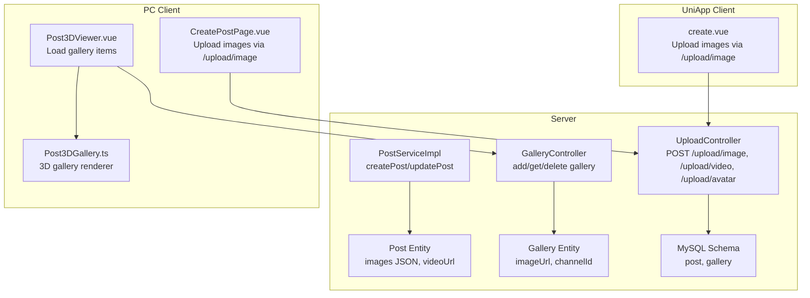
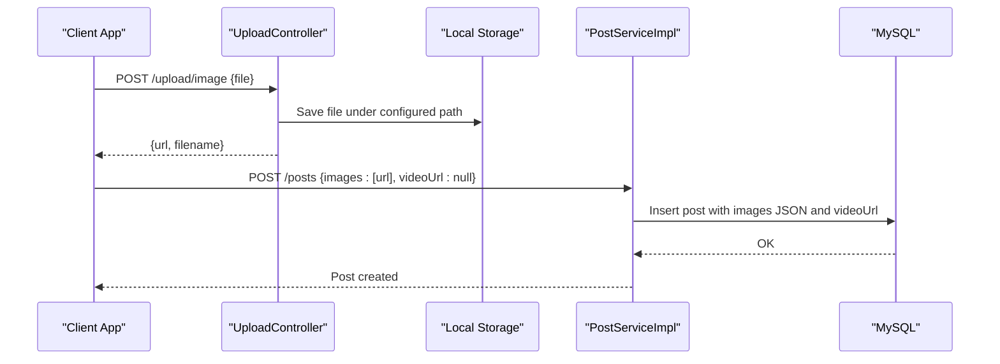
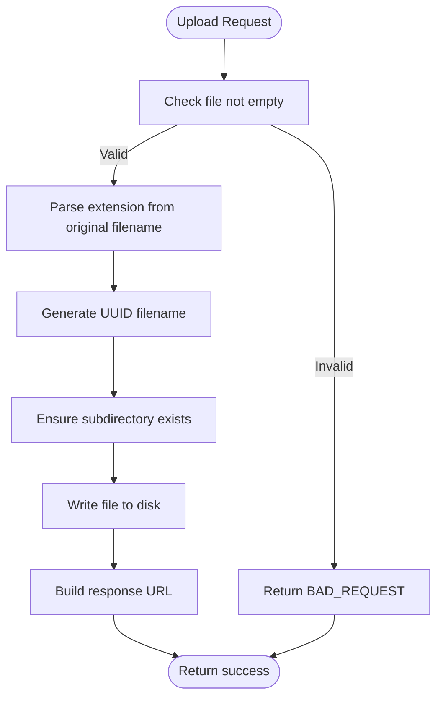
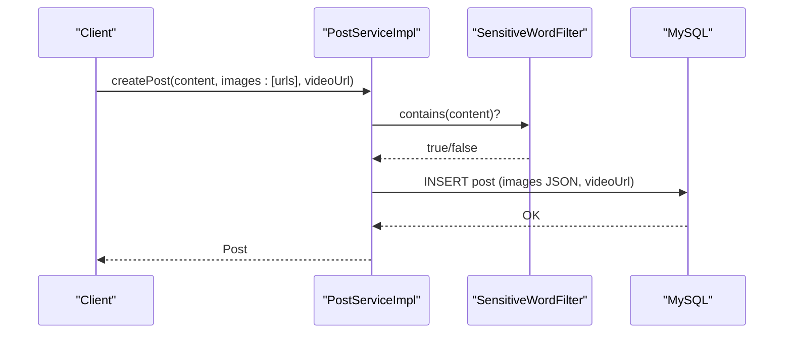
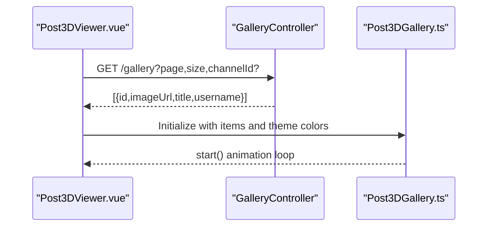
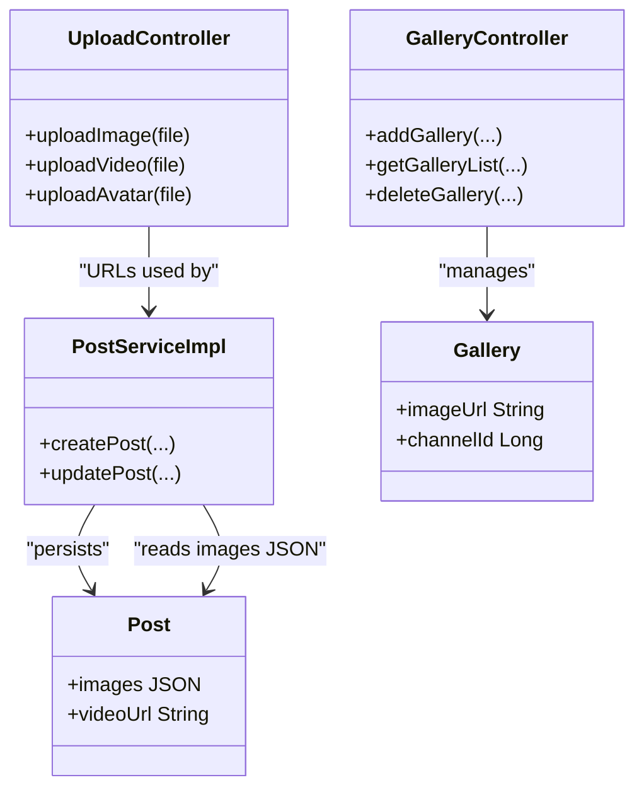
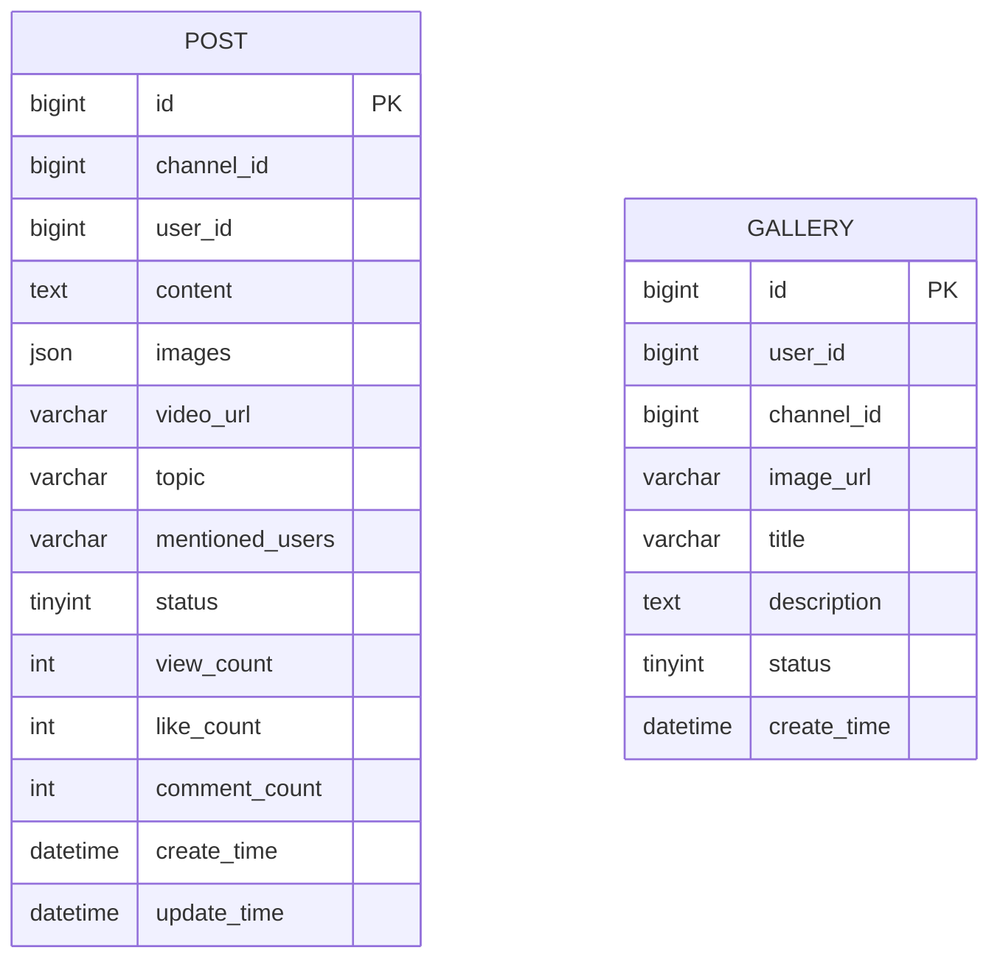

# Multimedia Content Support

<cite>
**Referenced Files in This Document**
- [UploadController.java](file://camp-channel-server/src/main/java/com/gdmec/campchannel/controller/UploadController.java)
- [application.yml](file://camp-channel-server/src/main/resources/application.yml)
- [PostServiceImpl.java](file://camp-channel-server/src/main/java/com/gdmec/campchannel/service/impl/PostServiceImpl.java)
- [Post.java](file://camp-channel-server/src/main/java/com/gdmec/campchannel/entity/Post.java)
- [schema.sql](file://camp-channel-server/src/main/resources/db/schema.sql)
- [GalleryController.java](file://camp-channel-server/src/main/java/com/gdmec/campchannel/controller/GalleryController.java)
- [Gallery.java](file://camp-channel-server/src/main/java/com/gdmec/campchannel/entity/Gallery.java)
- [UserController.java](file://camp-channel-server/src/main/java/com/gdmec/campchannel/controller/UserController.java)
- [CreatePostPage.vue](file://camp-channel-client-pc/src/pages/CreatePostPage.vue)
- [create.vue](file://camp-channel-client-uniapp/src/pages/post/create.vue)
- [Post3DGallery.ts](file://camp-channel-client-pc/src/canvas/Post3DGallery.ts)
- [Post3DViewer.vue](file://camp-channel-client-pc/src/components/Post3DViewer.vue)
- [implementation_plan.md](file://implementation_plan.md)
- [V2.0 需求文档.md](file://Camp Channel 校园频道系统 V2.0 需求文档.md)
</cite>

## Table of Contents
1. [Introduction](#introduction)
2. [Project Structure](#project-structure)
3. [Core Components](#core-components)
4. [Architecture Overview](#architecture-overview)
5. [Detailed Component Analysis](#detailed-component-analysis)
6. [Dependency Analysis](#dependency-analysis)
7. [Performance Considerations](#performance-considerations)
8. [Troubleshooting Guide](#troubleshooting-guide)
9. [Conclusion](#conclusion)
10. [Appendices](#appendices)

## Introduction
This document explains how multimedia content is supported in posts, focusing on:
- Image embedding via uploaded URLs (not base64)
- Video URL integration
- Media validation and upload architecture
- Integration with the upload controller for processing and storage
- Examples of image gallery display, video player integration, and 3D content rendering
- Media optimization pipeline, thumbnails, and responsive image loading strategies
- Handling unsupported formats, large files, and cross-platform compatibility
- Relationship between media assets and post deletion, including cleanup of orphaned files

## Project Structure
The multimedia support spans backend upload and post services, frontend creation flows, and 3D gallery rendering.

**Diagram sources**
- [UploadController.java:28-44](file://camp-channel-server/src/main/java/com/gdmec/campchannel/controller/UploadController.java#L28-L44)
- [PostServiceImpl.java:59-101](file://camp-channel-server/src/main/java/com/gdmec/campchannel/service/impl/PostServiceImpl.java#L59-L101)
- [Post.java:24-26](file://camp-channel-server/src/main/java/com/gdmec/campchannel/entity/Post.java#L24-L26)
- [GalleryController.java:27-41](file://camp-channel-server/src/main/java/com/gdmec/campchannel/controller/GalleryController.java#L27-L41)
- [Gallery.java:15-26](file://camp-channel-server/src/main/java/com/gdmec/campchannel/entity/Gallery.java#L15-L26)
- [schema.sql:45-64](file://camp-channel-server/src/main/resources/db/schema.sql#L45-L64)
- [CreatePostPage.vue:93-109](file://camp-channel-client-pc/src/pages/CreatePostPage.vue#L93-L109)
- [create.vue:142-176](file://camp-channel-client-uniapp/src/pages/post/create.vue#L142-L176)
- [Post3DViewer.vue:25-46](file://camp-channel-client-pc/src/components/Post3DViewer.vue#L25-L46)
- [Post3DGallery.ts:52-59](file://camp-channel-client-pc/src/canvas/Post3DGallery.ts#L52-L59)

**Section sources**
- [UploadController.java:28-44](file://camp-channel-server/src/main/java/com/gdmec/campchannel/controller/UploadController.java#L28-L44)
- [application.yml:44-47](file://camp-channel-server/src/main/resources/application.yml#L44-L47)
- [application.yml:94-98](file://camp-channel-server/src/main/resources/application.yml#L94-L98)
- [PostServiceImpl.java:59-101](file://camp-channel-server/src/main/java/com/gdmec/campchannel/service/impl/PostServiceImpl.java#L59-L101)
- [Post.java:24-26](file://camp-channel-server/src/main/java/com/gdmec/campchannel/entity/Post.java#L24-L26)
- [schema.sql:45-64](file://camp-channel-server/src/main/resources/db/schema.sql#L45-L64)
- [GalleryController.java:27-41](file://camp-channel-server/src/main/java/com/gdmec/campchannel/controller/GalleryController.java#L27-L41)
- [Gallery.java:15-26](file://camp-channel-server/src/main/java/com/gdmec/campchannel/entity/Gallery.java#L15-L26)
- [CreatePostPage.vue:93-109](file://camp-channel-client-pc/src/pages/CreatePostPage.vue#L93-L109)
- [create.vue:142-176](file://camp-channel-client-uniapp/src/pages/post/create.vue#L142-L176)
- [Post3DViewer.vue:25-46](file://camp-channel-client-pc/src/components/Post3DViewer.vue#L25-L46)
- [Post3DGallery.ts:52-59](file://camp-channel-client-pc/src/canvas/Post3DGallery.ts#L52-L59)

## Core Components
- UploadController: Handles image, video, and avatar uploads to a local path and returns a URL for later use in posts.
- PostServiceImpl: Persists posts with images serialized as JSON and video URL; integrates sensitive-word filtering and notifications.
- Post entity: Stores images as a JSON array and videoUrl as a string.
- GalleryController and Gallery: Manage curated image galleries used for 3D display.
- Frontend clients: Upload images to the server and embed returned URLs into posts; render 3D galleries from gallery items.

**Section sources**
- [UploadController.java:46-82](file://camp-channel-server/src/main/java/com/gdmec/campchannel/controller/UploadController.java#L46-L82)
- [PostServiceImpl.java:59-101](file://camp-channel-server/src/main/java/com/gdmec/campchannel/service/impl/PostServiceImpl.java#L59-L101)
- [Post.java:24-26](file://camp-channel-server/src/main/java/com/gdmec/campchannel/entity/Post.java#L24-L26)
- [GalleryController.java:27-41](file://camp-channel-server/src/main/java/com/gdmec/campchannel/controller/GalleryController.java#L27-L41)
- [Gallery.java:15-26](file://camp-channel-server/src/main/java/com/gdmec/campchannel/entity/Gallery.java#L15-L26)
- [CreatePostPage.vue:93-109](file://camp-channel-client-pc/src/pages/CreatePostPage.vue#L93-L109)
- [create.vue:142-176](file://camp-channel-client-uniapp/src/pages/post/create.vue#L142-L176)
- [Post3DViewer.vue:25-46](file://camp-channel-client-pc/src/components/Post3DViewer.vue#L25-L46)

## Architecture Overview
The multimedia pipeline:
- Clients upload media to UploadController endpoints.
- UploadController writes files to a configured local path and returns a URL.
- Posts store media references as URLs (images as JSON array, videoUrl as string).
- 3D gallery displays curated images from the gallery endpoint.

**Diagram sources**
- [UploadController.java:28-44](file://camp-channel-server/src/main/java/com/gdmec/campchannel/controller/UploadController.java#L28-L44)
- [UploadController.java:46-82](file://camp-channel-server/src/main/java/com/gdmec/campchannel/controller/UploadController.java#L46-L82)
- [PostServiceImpl.java:59-101](file://camp-channel-server/src/main/java/com/gdmec/campchannel/service/impl/PostServiceImpl.java#L59-L101)
- [schema.sql:45-64](file://camp-channel-server/src/main/resources/db/schema.sql#L45-L64)

## Detailed Component Analysis

### UploadController: File Upload Architecture
- Endpoints:
  - POST /upload/image for images
  - POST /upload/video for videos
  - POST /upload/avatar for avatars
- Behavior:
  - Validates non-empty file
  - Derives extension from original filename
  - Generates a UUID-based filename
  - Ensures subdirectory exists under the configured base path
  - Writes file to disk and returns a URL path
- Configuration:
  - Local path configured via application property
  - Spring multipart limits apply to file sizes

**Diagram sources**
- [UploadController.java:46-82](file://camp-channel-server/src/main/java/com/gdmec/campchannel/controller/UploadController.java#L46-L82)
- [application.yml:44-47](file://camp-channel-server/src/main/resources/application.yml#L44-L47)
- [application.yml:94-98](file://camp-channel-server/src/main/resources/application.yml#L94-L98)

**Section sources**
- [UploadController.java:28-44](file://camp-channel-server/src/main/java/com/gdmec/campchannel/controller/UploadController.java#L28-L44)
- [UploadController.java:46-82](file://camp-channel-server/src/main/java/com/gdmec/campchannel/controller/UploadController.java#L46-L82)
- [application.yml:44-47](file://camp-channel-server/src/main/resources/application.yml#L44-L47)
- [application.yml:94-98](file://camp-channel-server/src/main/resources/application.yml#L94-L98)

### Post Creation and Media Embedding
- Images are passed as a list of URLs and serialized to JSON before saving.
- Video URL is stored as a string.
- Sensitive word filtering and notifications are integrated during creation.

**Diagram sources**
- [PostServiceImpl.java:59-101](file://camp-channel-server/src/main/java/com/gdmec/campchannel/service/impl/PostServiceImpl.java#L59-L101)
- [Post.java:24-26](file://camp-channel-server/src/main/java/com/gdmec/campchannel/entity/Post.java#L24-L26)
- [schema.sql:45-64](file://camp-channel-server/src/main/resources/db/schema.sql#L45-L64)

**Section sources**
- [PostServiceImpl.java:59-101](file://camp-channel-server/src/main/java/com/gdmec/campchannel/service/impl/PostServiceImpl.java#L59-L101)
- [Post.java:24-26](file://camp-channel-server/src/main/java/com/gdmec/campchannel/entity/Post.java#L24-L26)
- [schema.sql:45-64](file://camp-channel-server/src/main/resources/db/schema.sql#L45-L64)

### Gallery and 3D Rendering
- GalleryController manages adding/removing curated images and retrieving lists.
- Post3DViewer loads gallery items and initializes Post3DGallery, which renders a 3D carousel of images.

**Diagram sources**
- [Post3DViewer.vue:25-46](file://camp-channel-client-pc/src/components/Post3DViewer.vue#L25-L46)
- [GalleryController.java:35-41](file://camp-channel-server/src/main/java/com/gdmec/campchannel/controller/GalleryController.java#L35-L41)
- [Post3DGallery.ts:52-59](file://camp-channel-client-pc/src/canvas/Post3DGallery.ts#L52-L59)

**Section sources**
- [GalleryController.java:27-41](file://camp-channel-server/src/main/java/com/gdmec/campchannel/controller/GalleryController.java#L27-L41)
- [Gallery.java:15-26](file://camp-channel-server/src/main/java/com/gdmec/campchannel/entity/Gallery.java#L15-L26)
- [Post3DViewer.vue:25-46](file://camp-channel-client-pc/src/components/Post3DViewer.vue#L25-L46)
- [Post3DGallery.ts:52-59](file://camp-channel-client-pc/src/canvas/Post3DGallery.ts#L52-L59)

### Supported Formats, Size Limits, and Security Restrictions
- Supported media types:
  - Images: uploaded via /upload/image
  - Videos: uploaded via /upload/video
  - Avatars: uploaded via /upload/avatar
- Size limits:
  - Max file size and request size configured in Spring
- Security:
  - No explicit MIME validation in UploadController; ensure client-side validation and server-side checks if needed
  - Sensitive word filtering applied to post content
  - Rate limiting via Redis for post creation

**Section sources**
- [UploadController.java:28-44](file://camp-channel-server/src/main/java/com/gdmec/campchannel/controller/UploadController.java#L28-L44)
- [application.yml:44-47](file://camp-channel-server/src/main/resources/application.yml#L44-L47)
- [PostServiceImpl.java:64-75](file://camp-channel-server/src/main/java/com/gdmec/campchannel/service/impl/PostServiceImpl.java#L64-L75)

### Media Validation Processes
- UploadController validates non-empty file and writes to disk; no MIME validation is performed in the controller.
- PostServiceImpl serializes images to JSON and applies sensitive word filtering to content.
- Frontend clients limit selection count and compress images when available.

**Section sources**
- [UploadController.java:46-82](file://camp-channel-server/src/main/java/com/gdmec/campchannel/controller/UploadController.java#L46-L82)
- [PostServiceImpl.java:91-99](file://camp-channel-server/src/main/java/com/gdmec/campchannel/service/impl/PostServiceImpl.java#L91-L99)
- [CreatePostPage.vue:93-109](file://camp-channel-client-pc/src/pages/CreatePostPage.vue#L93-L109)
- [create.vue:129-140](file://camp-channel-client-uniapp/src/pages/post/create.vue#L129-L140)

### Integration with Upload Controller for Media Processing and Storage Management
- Clients upload media to /upload/image or /upload/video and receive a URL.
- The URL is embedded in posts as part of the images JSON array or as videoUrl.
- Storage path is configurable; files are written to the configured local directory.

**Section sources**
- [UploadController.java:28-44](file://camp-channel-server/src/main/java/com/gdmec/campchannel/controller/UploadController.java#L28-L44)
- [UploadController.java:46-82](file://camp-channel-server/src/main/java/com/gdmec/campchannel/controller/UploadController.java#L46-L82)
- [application.yml:94-98](file://camp-channel-server/src/main/resources/application.yml#L94-L98)

### Examples

#### Image Gallery Display
- The PC client’s CreatePostPage.vue uploads images and collects returned URLs into a list for posting.
- The 3D gallery viewer loads curated images from the gallery endpoint and renders them in a 3D carousel.

**Section sources**
- [CreatePostPage.vue:93-109](file://camp-channel-client-pc/src/pages/CreatePostPage.vue#L93-L109)
- [Post3DViewer.vue:25-46](file://camp-channel-client-pc/src/components/Post3DViewer.vue#L25-L46)
- [Post3DGallery.ts:52-59](file://camp-channel-client-pc/src/canvas/Post3DGallery.ts#L52-L59)

#### Video Player Integration
- The V2.0 requirements document describes video messages and the use of /upload/video for video uploads.
- Posts can store a videoUrl string; integrate a video player component to render the URL when displaying posts.

**Section sources**
- [V2.0 需求文档.md:130-134](file://Camp Channel 校园频道系统 V2.0 需求文档.md#L130-L134)
- [PostServiceImpl.java:101-101](file://camp-channel-server/src/main/java/com/gdmec/campchannel/service/impl/PostServiceImpl.java#L101-L101)
- [Post.java:26-26](file://camp-channel-server/src/main/java/com/gdmec/campchannel/entity/Post.java#L26-L26)

#### 3D Content Rendering
- Post3DGallery creates a 3D carousel of images using Three.js, loading textures from image URLs.

**Section sources**
- [Post3DGallery.ts:52-59](file://camp-channel-client-pc/src/canvas/Post3DGallery.ts#L52-L59)
- [Post3DViewer.vue:25-46](file://camp-channel-client-pc/src/components/Post3DViewer.vue#L25-L46)

### Media Optimization Pipeline, Thumbnails, and Responsive Loading
- Current implementation does not include explicit thumbnail generation or optimization steps.
- Recommendations:
  - Generate thumbnails on upload and store separate URLs for previews.
  - Use responsive image attributes and lazy loading in clients.
  - Consider CDN delivery and image compression for performance.

[No sources needed since this section provides general guidance]

### Cross-Platform Compatibility
- PC client uses Vue and Three.js for 3D rendering.
- UniApp client uploads images via uni.uploadFile and attaches URLs to posts.
- Flutter web index.html supports web deployment.

**Section sources**
- [Post3DViewer.vue:1-95](file://camp-channel-client-pc/src/components/Post3DViewer.vue#L1-L95)
- [create.vue:142-176](file://camp-channel-client-uniapp/src/pages/post/create.vue#L142-L176)
- [index.html:1-38](file://camp-channel-client-flutter/web/index.html#L1-L38)

## Dependency Analysis

**Diagram sources**
- [UploadController.java:28-44](file://camp-channel-server/src/main/java/com/gdmec/campchannel/controller/UploadController.java#L28-L44)
- [PostServiceImpl.java:59-101](file://camp-channel-server/src/main/java/com/gdmec/campchannel/service/impl/PostServiceImpl.java#L59-L101)
- [Post.java:24-26](file://camp-channel-server/src/main/java/com/gdmec/campchannel/entity/Post.java#L24-L26)
- [GalleryController.java:27-41](file://camp-channel-server/src/main/java/com/gdmec/campchannel/controller/GalleryController.java#L27-L41)
- [Gallery.java:15-26](file://camp-channel-server/src/main/java/com/gdmec/campchannel/entity/Gallery.java#L15-L26)

**Section sources**
- [UploadController.java:28-44](file://camp-channel-server/src/main/java/com/gdmec/campchannel/controller/UploadController.java#L28-L44)
- [PostServiceImpl.java:59-101](file://camp-channel-server/src/main/java/com/gdmec/campchannel/service/impl/PostServiceImpl.java#L59-L101)
- [Post.java:24-26](file://camp-channel-server/src/main/java/com/gdmec/campchannel/entity/Post.java#L24-L26)
- [GalleryController.java:27-41](file://camp-channel-server/src/main/java/com/gdmec/campchannel/controller/GalleryController.java#L27-L41)
- [Gallery.java:15-26](file://camp-channel-server/src/main/java/com/gdmec/campchannel/entity/Gallery.java#L15-L26)

## Performance Considerations
- File size limits reduce memory pressure and I/O overhead.
- Redis-based rate limiting prevents abuse during post creation.
- 3D rendering performance depends on device pixel ratio and scene complexity; consider throttling animations on lower-end devices.

**Section sources**
- [application.yml:44-47](file://camp-channel-server/src/main/resources/application.yml#L44-L47)
- [PostServiceImpl.java:64-75](file://camp-channel-server/src/main/java/com/gdmec/campchannel/service/impl/PostServiceImpl.java#L64-L75)
- [Post3DGallery.ts:40-43](file://camp-channel-client-pc/src/canvas/Post3DGallery.ts#L40-L43)

## Troubleshooting Guide
- Upload fails with empty file:
  - Ensure the client sends a non-empty multipart file.
- Upload succeeds but URL not usable:
  - Verify the configured local path is accessible and the web server serves /uploads.
- Post creation fails:
  - Check sensitive word filtering and ensure content passes validation.
- 3D gallery not rendering:
  - Confirm gallery endpoint returns items with valid image URLs and the renderer initializes after DOM measurement.

**Section sources**
- [UploadController.java:46-82](file://camp-channel-server/src/main/java/com/gdmec/campchannel/controller/UploadController.java#L46-L82)
- [application.yml:94-98](file://camp-channel-server/src/main/resources/application.yml#L94-L98)
- [PostServiceImpl.java:77-84](file://camp-channel-server/src/main/java/com/gdmec/campchannel/service/impl/PostServiceImpl.java#L77-L84)
- [Post3DViewer.vue:25-46](file://camp-channel-client-pc/src/components/Post3DViewer.vue#L25-L46)

## Conclusion
The system supports multimedia posts by uploading media to a configurable local path and embedding returned URLs in posts. Posts store images as a JSON array and video as a URL string. The gallery module enables 3D rendering of curated images. While the current implementation focuses on URL-based embedding and basic validation, future enhancements can include MIME validation, thumbnail generation, CDN integration, and stricter size enforcement.

## Appendices

### Data Model for Posts and Galleries

**Diagram sources**
- [schema.sql:45-64](file://camp-channel-server/src/main/resources/db/schema.sql#L45-L64)
- [schema.sql:200-213](file://camp-channel-server/src/main/resources/db/schema.sql#L200-L213)

### Frontend Upload Examples
- PC client uploads images and pushes URLs into a list for submission.
- UniApp client uploads via uni.uploadFile and appends returned URLs.

**Section sources**
- [CreatePostPage.vue:93-109](file://camp-channel-client-pc/src/pages/CreatePostPage.vue#L93-L109)
- [create.vue:142-176](file://camp-channel-client-uniapp/src/pages/post/create.vue#L142-L176)