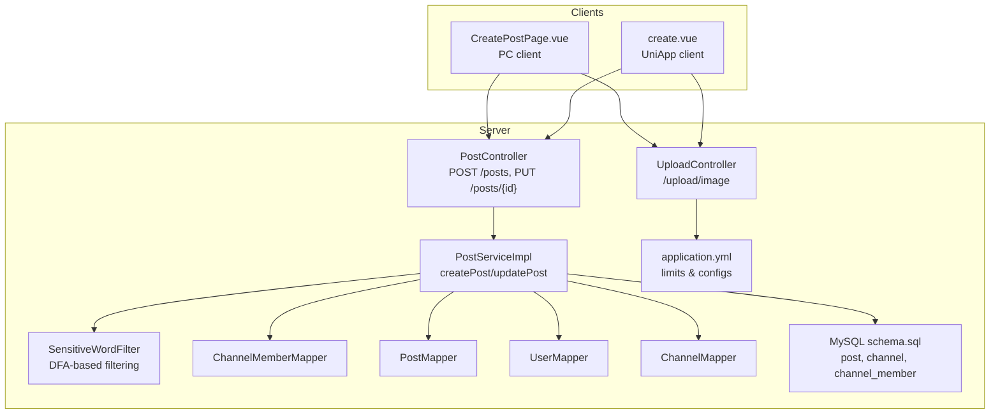
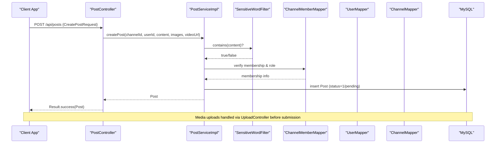
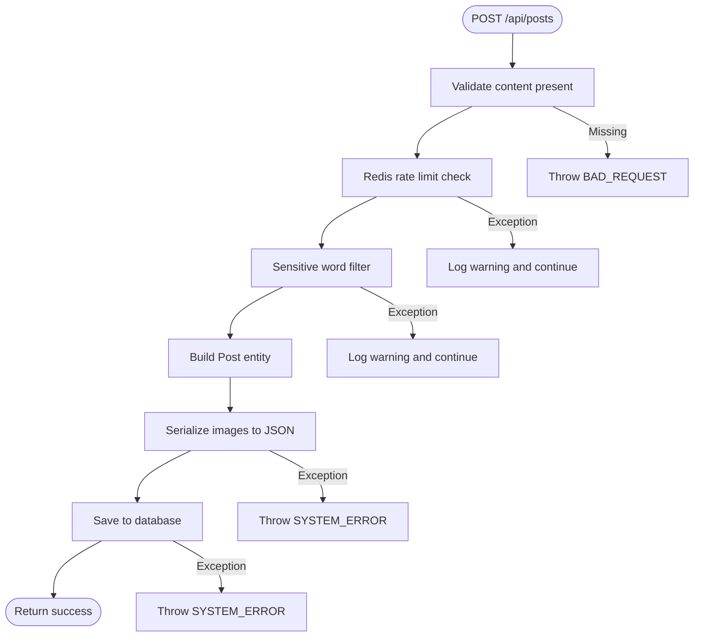
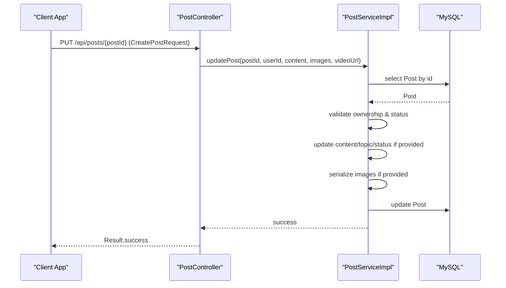
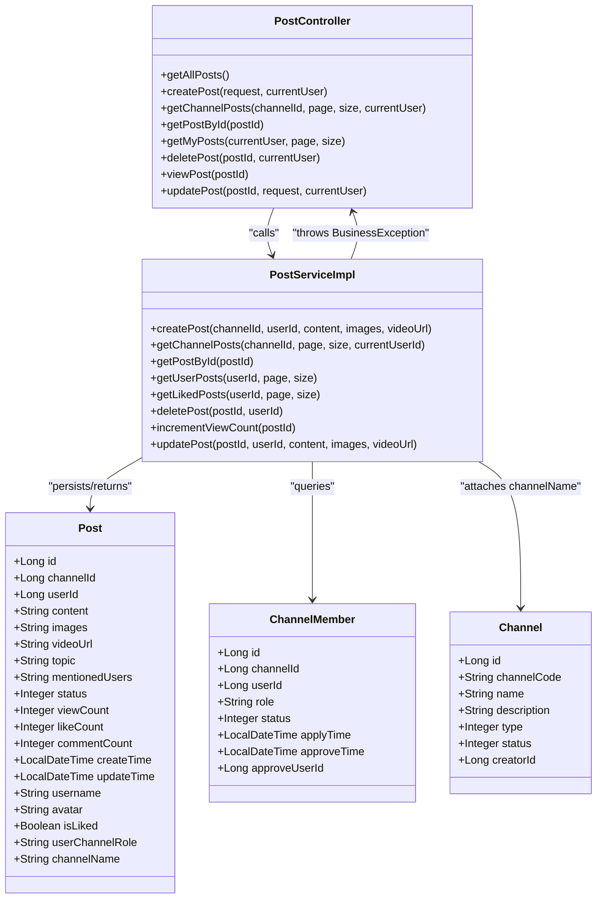
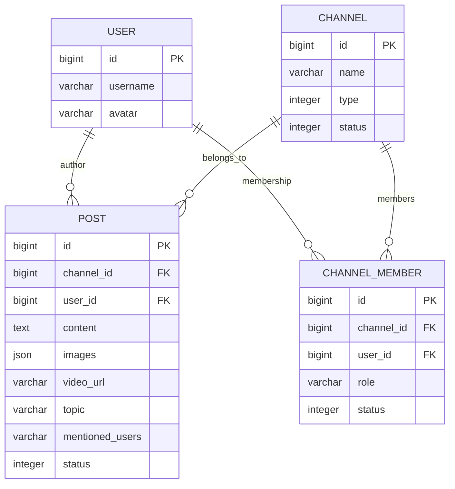

# Post Creation and Editing

<cite>
**Referenced Files in This Document**
- [PostController.java](file://camp-channel-server/src/main/java/com/gdmec/campchannel/controller/PostController.java)
- [PostServiceImpl.java](file://camp-channel-server/src/main/java/com/gdmec/campchannel/service/impl/PostServiceImpl.java)
- [Post.java](file://camp-channel-server/src/main/java/com/gdmec/campchannel/entity/Post.java)
- [Channel.java](file://camp-channel-server/src/main/java/com/gdmec/campchannel/entity/Channel.java)
- [ChannelMember.java](file://camp-channel-server/src/main/java/com/gdmec/campchannel/entity/ChannelMember.java)
- [ChannelMemberMapper.java](file://camp-channel-server/src/main/java/com/gdmec/campchannel/mapper/ChannelMemberMapper.java)
- [UploadController.java](file://camp-channel-server/src/main/java/com/gdmec/campchannel/controller/UploadController.java)
- [SensitiveWordFilter.java](file://camp-channel-server/src/main/java/com/gdmec/campchannel/common/filter/SensitiveWordFilter.java)
- [application.yml](file://camp-channel-server/src/main/resources/application.yml)
- [schema.sql](file://camp-channel-server/src/main/resources/db/schema.sql)
- [ErrorCode.java](file://camp-channel-server/src/main/java/com/gdmec/campchannel/common/api/ErrorCode.java)
- [BusinessException.java](file://camp-channel-server/src/main/java/com/gdmec/campchannel/common/exception/BusinessException.java)
- [CreatePostPage.vue](file://camp-channel-client-pc/src/pages/CreatePostPage.vue)
- [create.vue](file://camp-channel-client-uniapp/src/pages/post/create.vue)
</cite>

## Table of Contents
1. [Introduction](#introduction)
2. [Project Structure](#project-structure)
3. [Core Components](#core-components)
4. [Architecture Overview](#architecture-overview)
5. [Detailed Component Analysis](#detailed-component-analysis)
6. [Dependency Analysis](#dependency-analysis)
7. [Performance Considerations](#performance-considerations)
8. [Troubleshooting Guide](#troubleshooting-guide)
9. [Conclusion](#conclusion)
10. [Appendices](#appendices)

## Introduction
This document explains the complete workflow for creating and editing posts, from composition to publication. It covers the CreatePostRequest structure, validation rules, content length and media limitations, channel membership verification, permission checks, automatic metadata population, and error handling. It also documents the post lifecycle from draft to published state and rollback mechanisms for failed submissions.

## Project Structure
The post creation/editing feature spans the backend server and multiple frontend clients:
- Backend: Spring Boot REST controllers, services, mappers, entities, filters, and configuration.
- Frontend: Vue-based PC and UniApp mobile clients that collect input, upload media, and call the backend APIs.

**Diagram sources**
- [PostController.java:94-171](file://camp-channel-server/src/main/java/com/gdmec/campchannel/controller/PostController.java#L94-L171)
- [PostServiceImpl.java:57-349](file://camp-channel-server/src/main/java/com/gdmec/campchannel/service/impl/PostServiceImpl.java#L57-L349)
- [UploadController.java:28-82](file://camp-channel-server/src/main/java/com/gdmec/campchannel/controller/UploadController.java#L28-L82)
- [application.yml:44-47](file://camp-channel-server/src/main/resources/application.yml#L44-L47)
- [schema.sql:45-64](file://camp-channel-server/src/main/resources/db/schema.sql#L45-L64)

**Section sources**
- [PostController.java:26-202](file://camp-channel-server/src/main/java/com/gdmec/campchannel/controller/PostController.java#L26-L202)
- [PostServiceImpl.java:33-387](file://camp-channel-server/src/main/java/com/gdmec/campchannel/service/impl/PostServiceImpl.java#L33-L387)
- [UploadController.java:19-84](file://camp-channel-server/src/main/java/com/gdmec/campchannel/controller/UploadController.java#L19-L84)
- [application.yml:1-119](file://camp-channel-server/src/main/resources/application.yml#L1-L119)
- [schema.sql:1-236](file://camp-channel-server/src/main/resources/db/schema.sql#L1-L236)

## Core Components
- CreatePostRequest: Request payload for creating or updating posts.
- Post entity: Database representation of a post with metadata and optional fields for username, avatar, channel name, and user-channel role.
- PostController: Exposes endpoints for creating, editing, viewing, and deleting posts.
- PostServiceImpl: Implements business logic including validation, rate limiting, sensitive word filtering, serialization of media arrays, and metadata population.
- UploadController: Handles image/video/avatar uploads to local storage.
- SensitiveWordFilter: DFA-based filtering of sensitive content.
- ChannelMember and Channel: Membership and channel metadata used for permissions and role resolution.
- Frontend clients: Collect input, enforce client-side limits, upload media, and submit requests.

**Section sources**
- [PostController.java:195-201](file://camp-channel-server/src/main/java/com/gdmec/campchannel/controller/PostController.java#L195-L201)
- [Post.java:11-58](file://camp-channel-server/src/main/java/com/gdmec/campchannel/entity/Post.java#L11-L58)
- [PostController.java:94-171](file://camp-channel-server/src/main/java/com/gdmec/campchannel/controller/PostController.java#L94-L171)
- [PostServiceImpl.java:57-349](file://camp-channel-server/src/main/java/com/gdmec/campchannel/service/impl/PostServiceImpl.java#L57-L349)
- [UploadController.java:28-82](file://camp-channel-server/src/main/java/com/gdmec/campchannel/controller/UploadController.java#L28-L82)
- [SensitiveWordFilter.java:15-166](file://camp-channel-server/src/main/java/com/gdmec/campchannel/common/filter/SensitiveWordFilter.java#L15-L166)
- [ChannelMember.java:11-34](file://camp-channel-server/src/main/java/com/gdmec/campchannel/entity/ChannelMember.java#L11-L34)
- [Channel.java:10-32](file://camp-channel-server/src/main/java/com/gdmec/campchannel/entity/Channel.java#L10-L32)
- [CreatePostPage.vue:14-142](file://camp-channel-client-pc/src/pages/CreatePostPage.vue#L14-L142)
- [create.vue:15-227](file://camp-channel-client-uniapp/src/pages/post/create.vue#L15-L227)

## Architecture Overview
The post creation pipeline integrates client input, media upload, server-side validation, and persistence.

**Diagram sources**
- [PostController.java:94-108](file://camp-channel-server/src/main/java/com/gdmec/campchannel/controller/PostController.java#L94-L108)
- [PostServiceImpl.java:57-153](file://camp-channel-server/src/main/java/com/gdmec/campchannel/service/impl/PostServiceImpl.java#L57-L153)
- [SensitiveWordFilter.java:94-105](file://camp-channel-server/src/main/java/com/gdmec/campchannel/common/filter/SensitiveWordFilter.java#L94-L105)
- [ChannelMemberMapper.java:1-9](file://camp-channel-server/src/main/java/com/gdmec/campchannel/mapper/ChannelMemberMapper.java#L1-L9)
- [schema.sql:45-64](file://camp-channel-server/src/main/resources/db/schema.sql#L45-L64)

## Detailed Component Analysis

### CreatePostRequest Structure
- Fields:
  - channelId: Long
  - content: String
  - images: List<String> (optional)
  - videoUrl: String (optional)
- Validation rules enforced by the server:
  - Content must be present.
  - Images list is serialized to JSON before saving.
  - videoUrl is stored as-is.
  - Topic and mentioned users are extracted from content.
  - Status is set to published (1) unless sensitive words are detected.

**Section sources**
- [PostController.java:195-201](file://camp-channel-server/src/main/java/com/gdmec/campchannel/controller/PostController.java#L195-L201)
- [PostServiceImpl.java:57-153](file://camp-channel-server/src/main/java/com/gdmec/campchannel/service/impl/PostServiceImpl.java#L57-L153)

### Post Entity and Metadata Population
- Post entity fields include identifiers, content, media URLs, counts, timestamps, and optional fields for username, avatar, channel name, user-channel role, and liked status.
- Automatic metadata population:
  - Username and avatar are populated per post during feed retrieval.
  - Channel name is attached when fetching channel-specific feeds.
  - User-channel role is resolved for channel-scoped queries.

**Section sources**
- [Post.java:11-58](file://camp-channel-server/src/main/java/com/gdmec/campchannel/entity/Post.java#L11-L58)
- [PostController.java:67-77](file://camp-channel-server/src/main/java/com/gdmec/campchannel/controller/PostController.java#L67-L77)
- [PostServiceImpl.java:155-202](file://camp-channel-server/src/main/java/com/gdmec/campchannel/service/impl/PostServiceImpl.java#L155-L202)

### Post Creation Workflow
- Endpoint: POST /api/posts
- Steps:
  - Validate content presence.
  - Enforce rate limiting via Redis (fallback if unavailable).
  - Check sensitive words; mark as pending if detected.
  - Serialize images list to JSON.
  - Extract topic and mentioned users; send notifications asynchronously.
  - Persist post and return success.

**Diagram sources**
- [PostController.java:94-108](file://camp-channel-server/src/main/java/com/gdmec/campchannel/controller/PostController.java#L94-L108)
- [PostServiceImpl.java:57-153](file://camp-channel-server/src/main/java/com/gdmec/campchannel/service/impl/PostServiceImpl.java#L57-L153)

**Section sources**
- [PostController.java:94-108](file://camp-channel-server/src/main/java/com/gdmec/campchannel/controller/PostController.java#L94-L108)
- [PostServiceImpl.java:57-153](file://camp-channel-server/src/main/java/com/gdmec/campchannel/service/impl/PostServiceImpl.java#L57-L153)

### Post Editing Workflow
- Endpoint: PUT /api/posts/{postId}
- Steps:
  - Load post by ID and verify ownership.
  - Reject edits for deleted posts.
  - Validate content if provided; re-check sensitive words and update status/topic.
  - Serialize images if provided; update videoUrl if provided.
  - Persist updates.

**Diagram sources**
- [PostController.java:161-171](file://camp-channel-server/src/main/java/com/gdmec/campchannel/controller/PostController.java#L161-L171)
- [PostServiceImpl.java:309-349](file://camp-channel-server/src/main/java/com/gdmec/campchannel/service/impl/PostServiceImpl.java#L309-L349)

**Section sources**
- [PostController.java:161-171](file://camp-channel-server/src/main/java/com/gdmec/campchannel/controller/PostController.java#L161-L171)
- [PostServiceImpl.java:309-349](file://camp-channel-server/src/main/java/com/gdmec/campchannel/service/impl/PostServiceImpl.java#L309-L349)

### Channel Membership Verification and Permissions
- Membership verification:
  - During feed retrieval, the server queries channel memberships for the current user and filters posts accordingly.
  - For channel-specific feeds, roles are attached to posts for role-aware UI rendering.
- Ownership checks:
  - Edit/delete endpoints verify that the current user matches the post’s author.
- Role resolution:
  - User-channel role is derived from channel_member records; defaults to member if not found.

**Section sources**
- [PostController.java:44-52](file://camp-channel-server/src/main/java/com/gdmec/campchannel/controller/PostController.java#L44-L52)
- [PostServiceImpl.java:155-202](file://camp-channel-server/src/main/java/com/gdmec/campchannel/service/impl/PostServiceImpl.java#L155-L202)
- [PostServiceImpl.java:284-298](file://camp-channel-server/src/main/java/com/gdmec/campchannel/service/impl/PostServiceImpl.java#L284-L298)

### Media Attachment Limitations and Upload
- Client-side constraints:
  - Maximum 9 images per post.
  - Content length capped at 2000 characters.
- Server-side constraints:
  - Max file size and request size configured for multipart uploads.
  - UploadController supports image, video, and avatar uploads.
- Storage:
  - Files saved under ./uploads/images, ./uploads/videos, ./uploads/avatars with generated filenames.

**Section sources**
- [CreatePostPage.vue:25-41](file://camp-channel-client-pc/src/pages/CreatePostPage.vue#L25-L41)
- [create.vue:37-54](file://camp-channel-client-uniapp/src/pages/post/create.vue#L37-L54)
- [application.yml:44-47](file://camp-channel-server/src/main/resources/application.yml#L44-L47)
- [UploadController.java:28-82](file://camp-channel-server/src/main/java/com/gdmec/campchannel/controller/UploadController.java#L28-L82)

### Content Filtering and Status Management
- Sensitive word detection:
  - DFA-based filtering initialized from a dictionary file.
  - If sensitive words are found, post status is set to pending (0).
- Fallback behavior:
  - On filter exceptions, warnings are logged and filtering is skipped.
- Notifications:
  - Mentions trigger asynchronous notifications to mentioned users.

**Section sources**
- [SensitiveWordFilter.java:15-166](file://camp-channel-server/src/main/java/com/gdmec/campchannel/common/filter/SensitiveWordFilter.java#L15-L166)
- [PostServiceImpl.java:77-84](file://camp-channel-server/src/main/java/com/gdmec/campchannel/service/impl/PostServiceImpl.java#L77-L84)
- [PostServiceImpl.java:111-136](file://camp-channel-server/src/main/java/com/gdmec/campchannel/service/impl/PostServiceImpl.java#L111-L136)

### Post Lifecycle and Rollback Mechanisms
- Lifecycle:
  - Draft/Pending: Created with status 0 (pending) if sensitive words detected.
  - Published: Status 1 after successful creation or manual approval.
  - Deleted: Status 2 via soft deletion on delete operation.
- Rollback:
  - Transactional service methods wrap creation and updates; failures throw business/system errors and roll back changes.
  - Deletion sets status to deleted rather than hard removal.

**Section sources**
- [PostServiceImpl.java:57-153](file://camp-channel-server/src/main/java/com/gdmec/campchannel/service/impl/PostServiceImpl.java#L57-L153)
- [PostServiceImpl.java:284-298](file://camp-channel-server/src/main/java/com/gdmec/campchannel/service/impl/PostServiceImpl.java#L284-L298)
- [schema.sql:55-55](file://camp-channel-server/src/main/resources/db/schema.sql#L55-L55)

### Frontend Integration Examples
- PC client (Vue):
  - Selects channel, collects content, handles up to 9 images, and submits CreatePostRequest.
  - Displays character count and error messages.
- UniApp client:
  - Similar UX with picker for channels, image upload via uni.uploadFile, and submission to /api/posts.

**Section sources**
- [CreatePostPage.vue:14-142](file://camp-channel-client-pc/src/pages/CreatePostPage.vue#L14-L142)
- [create.vue:15-227](file://camp-channel-client-uniapp/src/pages/post/create.vue#L15-L227)

## Dependency Analysis

**Diagram sources**
- [PostController.java:26-202](file://camp-channel-server/src/main/java/com/gdmec/campchannel/controller/PostController.java#L26-L202)
- [PostServiceImpl.java:33-387](file://camp-channel-server/src/main/java/com/gdmec/campchannel/service/impl/PostServiceImpl.java#L33-L387)
- [Post.java:11-58](file://camp-channel-server/src/main/java/com/gdmec/campchannel/entity/Post.java#L11-L58)
- [ChannelMember.java:11-34](file://camp-channel-server/src/main/java/com/gdmec/campchannel/entity/ChannelMember.java#L11-L34)
- [Channel.java:10-32](file://camp-channel-server/src/main/java/com/gdmec/campchannel/entity/Channel.java#L10-L32)

**Section sources**
- [PostController.java:26-202](file://camp-channel-server/src/main/java/com/gdmec/campchannel/controller/PostController.java#L26-L202)
- [PostServiceImpl.java:33-387](file://camp-channel-server/src/main/java/com/gdmec/campchannel/service/impl/PostServiceImpl.java#L33-L387)
- [Post.java:11-58](file://camp-channel-server/src/main/java/com/gdmec/campchannel/entity/Post.java#L11-L58)
- [ChannelMember.java:11-34](file://camp-channel-server/src/main/java/com/gdmec/campchannel/entity/ChannelMember.java#L11-L34)
- [Channel.java:10-32](file://camp-channel-server/src/main/java/com/gdmec/campchannel/entity/Channel.java#L10-L32)

## Performance Considerations
- Rate limiting: Redis-based throttling prevents spam; falls back gracefully if Redis is unavailable.
- Asynchronous notifications: Mention notifications are sent asynchronously to avoid blocking the main thread.
- Pagination: Feed endpoints use LIMIT/OFFSET to constrain result sizes.
- Serialization: Images list is serialized to JSON; keep the list small to minimize storage overhead.

[No sources needed since this section provides general guidance]

## Troubleshooting Guide
Common issues and resolutions:
- Invalid channel access:
  - Symptom: Unauthorized or forbidden responses when accessing posts.
  - Cause: User not a member or not approved.
  - Resolution: Verify membership and status via channel_member records.
- Content filtering violations:
  - Symptom: Post marked as pending or rejected.
  - Cause: Sensitive words detected.
  - Resolution: Remove or rephrase sensitive content; ensure dictionary file is loaded.
- Media upload failures:
  - Symptom: Upload endpoint returns errors.
  - Cause: File size exceeds limits or filesystem issues.
  - Resolution: Check application.yml multipart limits and upload directory permissions.
- Post not found or unauthorized edit/delete:
  - Symptom: BAD_REQUEST or FORBIDDEN errors.
  - Cause: Post does not exist or user mismatch.
  - Resolution: Confirm postId and current user identity.

**Section sources**
- [ErrorCode.java:38-45](file://camp-channel-server/src/main/java/com/gdmec/campchannel/common/api/ErrorCode.java#L38-L45)
- [PostServiceImpl.java:284-298](file://camp-channel-server/src/main/java/com/gdmec/campchannel/service/impl/PostServiceImpl.java#L284-L298)
- [application.yml:44-47](file://camp-channel-server/src/main/resources/application.yml#L44-L47)
- [UploadController.java:46-82](file://camp-channel-server/src/main/java/com/gdmec/campchannel/controller/UploadController.java#L46-L82)

## Conclusion
The post creation and editing system enforces strong validation, integrates sensitive content filtering, manages media attachments with clear limits, and enriches posts with user and channel metadata. The transactional service layer ensures reliable persistence and rollback behavior. Frontend clients provide intuitive forms with client-side constraints and seamless media uploads.

[No sources needed since this section summarizes without analyzing specific files]

## Appendices

### API Definitions
- Create Post
  - Method: POST
  - Path: /api/posts
  - Request body: CreatePostRequest
  - Response: Result<Post>

- Update Post
  - Method: PUT
  - Path: /api/posts/{postId}
  - Request body: CreatePostRequest
  - Response: Result<Void>

- Delete Post
  - Method: DELETE
  - Path: /api/posts/{postId}
  - Response: Result<Void>

- Upload Image
  - Method: POST
  - Path: /api/upload/image
  - Form data: file
  - Response: Result<{ url, filename }>

**Section sources**
- [PostController.java:94-171](file://camp-channel-server/src/main/java/com/gdmec/campchannel/controller/PostController.java#L94-L171)
- [UploadController.java:28-82](file://camp-channel-server/src/main/java/com/gdmec/campchannel/controller/UploadController.java#L28-L82)

### Data Model Relationships

**Diagram sources**
- [schema.sql:1-236](file://camp-channel-server/src/main/resources/db/schema.sql#L1-L236)