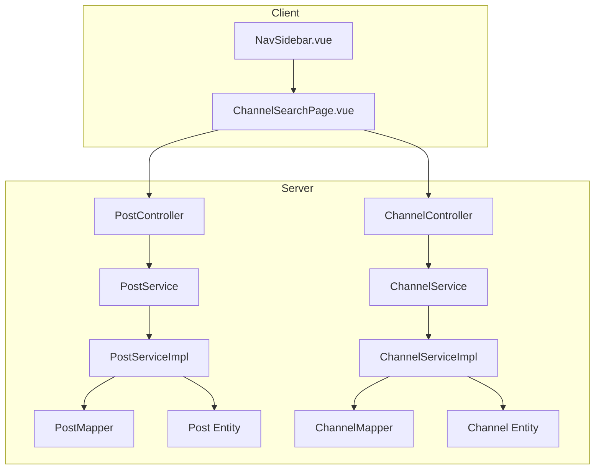
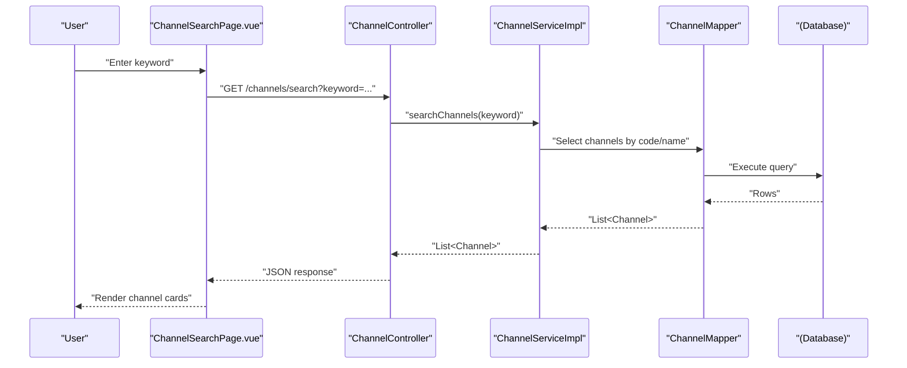
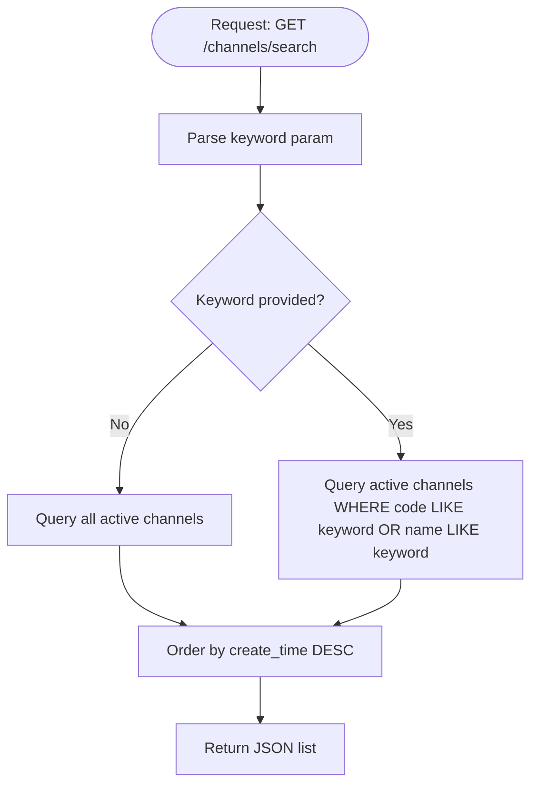
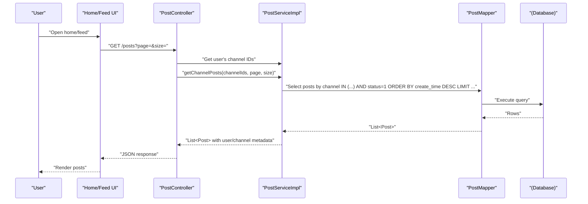
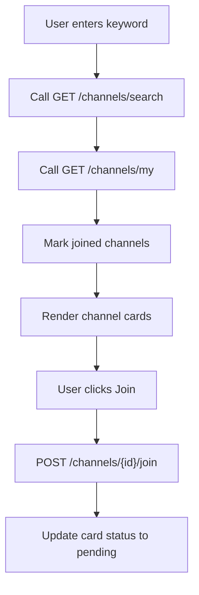
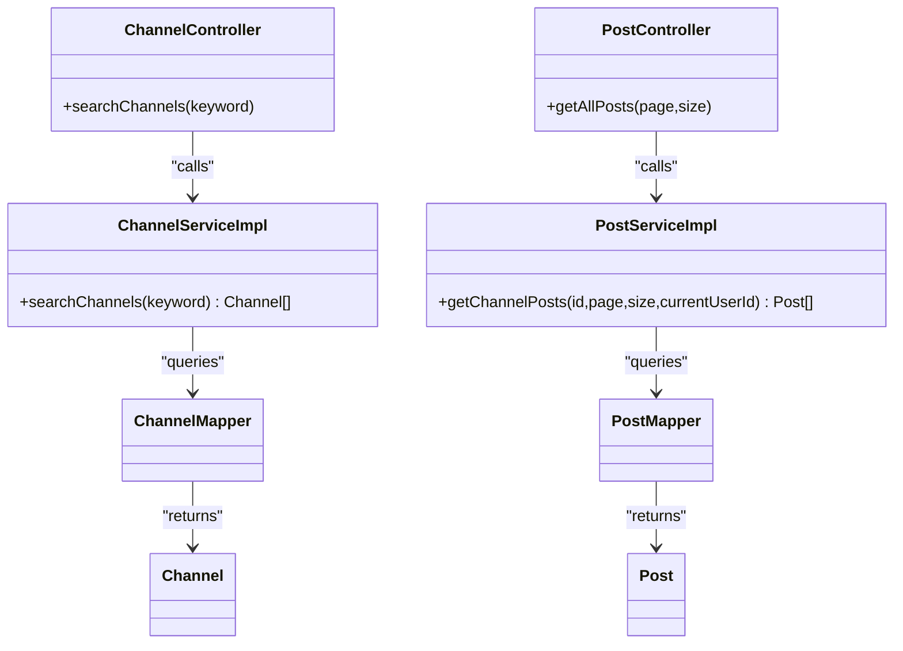

# Search and Content Discovery

<cite>
**Referenced Files in This Document**
- [PostController.java](file://camp-channel-server/src/main/java/com/gdmec/campchannel/controller/PostController.java)
- [PostService.java](file://camp-channel-server/src/main/java/com/gdmec/campchannel/service/PostService.java)
- [PostServiceImpl.java](file://camp-channel-server/src/main/java/com/gdmec/campchannel/service/impl/PostServiceImpl.java)
- [Post.java](file://camp-channel-server/src/main/java/com/gdmec/campchannel/entity/Post.java)
- [PostMapper.java](file://camp-channel-server/src/main/java/com/gdmec/campchannel/mapper/PostMapper.java)
- [ChannelController.java](file://camp-channel-server/src/main/java/com/gdmec/campchannel/controller/ChannelController.java)
- [ChannelService.java](file://camp-channel-server/src/main/java/com/gdmec/campchannel/service/ChannelService.java)
- [ChannelServiceImpl.java](file://camp-channel-server/src/main/java/com/gdmec/campchannel/service/impl/ChannelServiceImpl.java)
- [Channel.java](file://camp-channel-server/src/main/java/com/gdmec/campchannel/entity/Channel.java)
- [ChannelMapper.java](file://camp-channel-server/src/main/java/com/gdmec/campchannel/mapper/ChannelMapper.java)
- [ChannelSearchPage.vue](file://camp-channel-client-pc/src/pages/ChannelSearchPage.vue)
- [NavSidebar.vue](file://camp-channel-client-pc/src/components/NavSidebar.vue)
</cite>

## Table of Contents
1. [Introduction](#introduction)
2. [Project Structure](#project-structure)
3. [Core Components](#core-components)
4. [Architecture Overview](#architecture-overview)
5. [Detailed Component Analysis](#detailed-component-analysis)
6. [Dependency Analysis](#dependency-analysis)
7. [Performance Considerations](#performance-considerations)
8. [Troubleshooting Guide](#troubleshooting-guide)
9. [Conclusion](#conclusion)

## Introduction
This document explains the search and content discovery functionality of the platform. It focuses on how posts and channels are discovered, filtered, and presented to users. It also documents the available API endpoints, pagination, and the integration points with user preferences and engagement signals. The current implementation emphasizes channel-based discovery and basic post feed ordering. Advanced features such as full-text search, keyword matching, faceted search, and personalized recommendations are not present in the codebase and are therefore not covered here.

## Project Structure
The search and discovery features span the backend server (Spring Boot) and the PC web client (Vue):
- Backend exposes REST endpoints for posts and channels, with controllers delegating to services and persistence via MyBatis-Plus mappers.
- Frontend provides a channel discovery page and navigation that surfaces search and discovery flows.

**Diagram sources**
- [PostController.java:32-80](file://camp-channel-server/src/main/java/com/gdmec/campchannel/controller/PostController.java#L32-L80)
- [ChannelController.java:41-46](file://camp-channel-server/src/main/java/com/gdmec/campchannel/controller/ChannelController.java#L41-L46)
- [PostServiceImpl.java:155-202](file://camp-channel-server/src/main/java/com/gdmec/campchannel/service/impl/PostServiceImpl.java#L155-L202)
- [ChannelServiceImpl.java:67-82](file://camp-channel-server/src/main/java/com/gdmec/campchannel/service/impl/ChannelServiceImpl.java#L67-L82)
- [PostMapper.java:1-9](file://camp-channel-server/src/main/java/com/gdmec/campchannel/mapper/PostMapper.java#L1-L9)
- [ChannelMapper.java:1-9](file://camp-channel-server/src/main/java/com/gdmec/campchannel/mapper/ChannelMapper.java#L1-L9)
- [Post.java:1-58](file://camp-channel-server/src/main/java/com/gdmec/campchannel/entity/Post.java#L1-L58)
- [Channel.java:1-32](file://camp-channel-server/src/main/java/com/gdmec/campchannel/entity/Channel.java#L1-L32)
- [ChannelSearchPage.vue:1-168](file://camp-channel-client-pc/src/pages/ChannelSearchPage.vue#L1-L168)
- [NavSidebar.vue:105-128](file://camp-channel-client-pc/src/components/NavSidebar.vue#L105-L128)

**Section sources**
- [PostController.java:32-80](file://camp-channel-server/src/main/java/com/gdmec/campchannel/controller/PostController.java#L32-L80)
- [ChannelController.java:41-46](file://camp-channel-server/src/main/java/com/gdmec/campchannel/controller/ChannelController.java#L41-L46)
- [ChannelSearchPage.vue:1-168](file://camp-channel-client-pc/src/pages/ChannelSearchPage.vue#L1-L168)
- [NavSidebar.vue:105-128](file://camp-channel-client-pc/src/components/NavSidebar.vue#L105-L128)

## Core Components
- Channel discovery: Clients can search channels by code or name. The endpoint returns a list ordered by creation time.
- Post feeds: Users receive posts from channels they belong to, paginated and ordered by creation time.
- Engagement metadata: Post entities include counts and flags (e.g., like status) that inform UI and future ranking.

Key implementation highlights:
- Channel search endpoint supports a keyword parameter and returns matching channels.
- Post listing endpoints support pagination and channel scoping.
- Post entities carry engagement-related fields that can be used for ranking or personalization.

**Section sources**
- [ChannelController.java:41-46](file://camp-channel-server/src/main/java/com/gdmec/campchannel/controller/ChannelController.java#L41-L46)
- [ChannelServiceImpl.java:67-82](file://camp-channel-server/src/main/java/com/gdmec/campchannel/service/impl/ChannelServiceImpl.java#L67-L82)
- [PostController.java:32-80](file://camp-channel-server/src/main/java/com/gdmec/campchannel/controller/PostController.java#L32-L80)
- [PostServiceImpl.java:155-202](file://camp-channel-server/src/main/java/com/gdmec/campchannel/service/impl/PostServiceImpl.java#L155-L202)
- [Post.java:34-57](file://camp-channel-server/src/main/java/com/gdmec/campchannel/entity/Post.java#L34-L57)

## Architecture Overview
The search and discovery flow connects client UI to backend services and persistence:

**Diagram sources**
- [ChannelSearchPage.vue:57-81](file://camp-channel-client-pc/src/pages/ChannelSearchPage.vue#L57-L81)
- [ChannelController.java:41-46](file://camp-channel-server/src/main/java/com/gdmec/campchannel/controller/ChannelController.java#L41-L46)
- [ChannelServiceImpl.java:67-82](file://camp-channel-server/src/main/java/com/gdmec/campchannel/service/impl/ChannelServiceImpl.java#L67-L82)
- [ChannelMapper.java:1-9](file://camp-channel-server/src/main/java/com/gdmec/campchannel/mapper/ChannelMapper.java#L1-L9)

## Detailed Component Analysis

### Channel Discovery API
- Endpoint: GET /channels/search
- Query parameters:
  - keyword (optional): Filters channels by channel code or name.
- Response: List of channels, ordered by creation time.
- Implementation details:
  - Service applies a combined LIKE condition on channel code and name when a keyword is provided.
  - Results are ordered by creation time descending.

**Diagram sources**
- [ChannelController.java:41-46](file://camp-channel-server/src/main/java/com/gdmec/campchannel/controller/ChannelController.java#L41-L46)
- [ChannelServiceImpl.java:67-82](file://camp-channel-server/src/main/java/com/gdmec/campchannel/service/impl/ChannelServiceImpl.java#L67-L82)

**Section sources**
- [ChannelController.java:41-46](file://camp-channel-server/src/main/java/com/gdmec/campchannel/controller/ChannelController.java#L41-L46)
- [ChannelServiceImpl.java:67-82](file://camp-channel-server/src/main/java/com/gdmec/campchannel/service/impl/ChannelServiceImpl.java#L67-L82)

### Post Feed and Pagination
- Endpoint: GET /posts
- Query parameters:
  - page (default 1)
  - size (default 10)
- Behavior:
  - Returns posts from channels the user belongs to.
  - Orders by creation time descending.
  - Applies LIMIT/OFFSET for pagination.

**Diagram sources**
- [PostController.java:32-80](file://camp-channel-server/src/main/java/com/gdmec/campchannel/controller/PostController.java#L32-L80)
- [PostServiceImpl.java:155-202](file://camp-channel-server/src/main/java/com/gdmec/campchannel/service/impl/PostServiceImpl.java#L155-L202)
- [PostMapper.java:1-9](file://camp-channel-server/src/main/java/com/gdmec/campchannel/mapper/PostMapper.java#L1-L9)

**Section sources**
- [PostController.java:32-80](file://camp-channel-server/src/main/java/com/gdmec/campchannel/controller/PostController.java#L32-L80)
- [PostServiceImpl.java:155-202](file://camp-channel-server/src/main/java/com/gdmec/campchannel/service/impl/PostServiceImpl.java#L155-L202)

### Post Entities and Engagement Signals
Post entities include fields that can inform ranking and discovery:
- Counts: viewCount, likeCount, commentCount
- Flags: isLiked (per user)
- Auxiliary info: username, avatar, channelName

These fields enable:
- Basic popularity signals (e.g., likeCount)
- Personalized presentation (e.g., isLiked)
- UI enrichment (e.g., usernames and channel names)

**Section sources**
- [Post.java:34-57](file://camp-channel-server/src/main/java/com/gdmec/campchannel/entity/Post.java#L34-L57)
- [PostServiceImpl.java:175-201](file://camp-channel-server/src/main/java/com/gdmec/campchannel/service/impl/PostServiceImpl.java#L175-L201)

### Client-Side Channel Discovery UI
- Page: ChannelSearchPage.vue
- Features:
  - Keyword input triggers search.
  - Displays channel cards with name, code, description.
  - Shows join status per channel and allows joining.
  - Fetches user’s channels to mark joined ones.
- Navigation:
  - Sidebar includes a “Discover” item pointing to the channel search page.

**Diagram sources**
- [ChannelSearchPage.vue:57-113](file://camp-channel-client-pc/src/pages/ChannelSearchPage.vue#L57-L113)
- [NavSidebar.vue:105-128](file://camp-channel-client-pc/src/components/NavSidebar.vue#L105-L128)

**Section sources**
- [ChannelSearchPage.vue:1-168](file://camp-channel-client-pc/src/pages/ChannelSearchPage.vue#L1-L168)
- [NavSidebar.vue:105-128](file://camp-channel-client-pc/src/components/NavSidebar.vue#L105-L128)

## Dependency Analysis
- Controllers depend on services for business logic.
- Services depend on mappers for persistence.
- Entities define the shape of data returned to clients.
- Client pages depend on controllers for data.

**Diagram sources**
- [ChannelController.java:41-46](file://camp-channel-server/src/main/java/com/gdmec/campchannel/controller/ChannelController.java#L41-L46)
- [ChannelServiceImpl.java:67-82](file://camp-channel-server/src/main/java/com/gdmec/campchannel/service/impl/ChannelServiceImpl.java#L67-L82)
- [ChannelMapper.java:1-9](file://camp-channel-server/src/main/java/com/gdmec/campchannel/mapper/ChannelMapper.java#L1-L9)
- [Channel.java:1-32](file://camp-channel-server/src/main/java/com/gdmec/campchannel/entity/Channel.java#L1-L32)
- [PostController.java:32-80](file://camp-channel-server/src/main/java/com/gdmec/campchannel/controller/PostController.java#L32-L80)
- [PostServiceImpl.java:155-202](file://camp-channel-server/src/main/java/com/gdmec/campchannel/service/impl/PostServiceImpl.java#L155-L202)
- [PostMapper.java:1-9](file://camp-channel-server/src/main/java/com/gdmec/campchannel/mapper/PostMapper.java#L1-L9)
- [Post.java:1-58](file://camp-channel-server/src/main/java/com/gdmec/campchannel/entity/Post.java#L1-L58)

**Section sources**
- [ChannelController.java:41-46](file://camp-channel-server/src/main/java/com/gdmec/campchannel/controller/ChannelController.java#L41-L46)
- [ChannelServiceImpl.java:67-82](file://camp-channel-server/src/main/java/com/gdmec/campchannel/service/impl/ChannelServiceImpl.java#L67-L82)
- [PostController.java:32-80](file://camp-channel-server/src/main/java/com/gdmec/campchannel/controller/PostController.java#L32-L80)
- [PostServiceImpl.java:155-202](file://camp-channel-server/src/main/java/com/gdmec/campchannel/service/impl/PostServiceImpl.java#L155-L202)

## Performance Considerations
- Pagination: Implemented via LIMIT/OFFSET; suitable for moderate loads but may require index tuning for large datasets.
- Sorting: Posts and channels are sorted by creation time; ensure appropriate database indexes exist.
- Additional metadata: Attaching user/channel metadata per post incurs extra queries; consider batching or preloading for scalability.
- Redis usage: Post creation includes rate limiting checks via Redis utilities; ensure Redis availability for optimal performance.

[No sources needed since this section provides general guidance]

## Troubleshooting Guide
Common issues and resolutions:
- Unauthorized access to feeds: Ensure authentication is provided; otherwise, the feed endpoint returns an unauthorized error.
- Empty results:
  - For channel search, verify the keyword matches channel code or name.
  - For post feeds, confirm the user belongs to at least one active channel.
- Join requests:
  - Applying to join a channel that is already joined or has a pending application will fail with appropriate messages.
- Editing/deleting posts:
  - Editing is disallowed if the post is deleted; deleting requires ownership.

**Section sources**
- [PostController.java:40-42](file://camp-channel-server/src/main/java/com/gdmec/campchannel/controller/PostController.java#L40-L42)
- [PostServiceImpl.java:284-298](file://camp-channel-server/src/main/java/com/gdmec/campchannel/service/impl/PostServiceImpl.java#L284-L298)
- [ChannelServiceImpl.java:86-118](file://camp-channel-server/src/main/java/com/gdmec/campchannel/service/impl/ChannelServiceImpl.java#L86-L118)

## Conclusion
The current search and content discovery implementation centers on:
- Channel discovery via keyword search across channel code and name.
- Post feeds scoped to user membership with pagination and time-based ordering.
- Engagement metadata attached to posts to support basic personalization and UI enrichment.

Advanced features such as full-text search, keyword matching, faceted filters, and personalized recommendations are not present in the codebase. The documented APIs and flows provide a foundation for extending discovery with richer search capabilities and ranking systems.