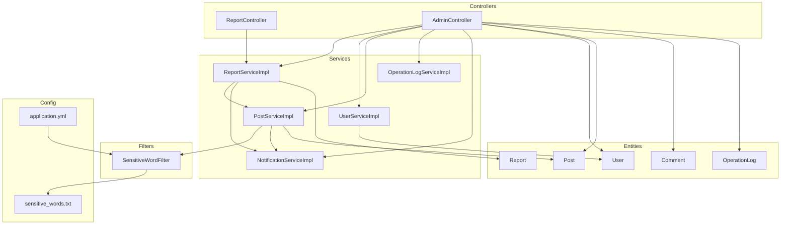
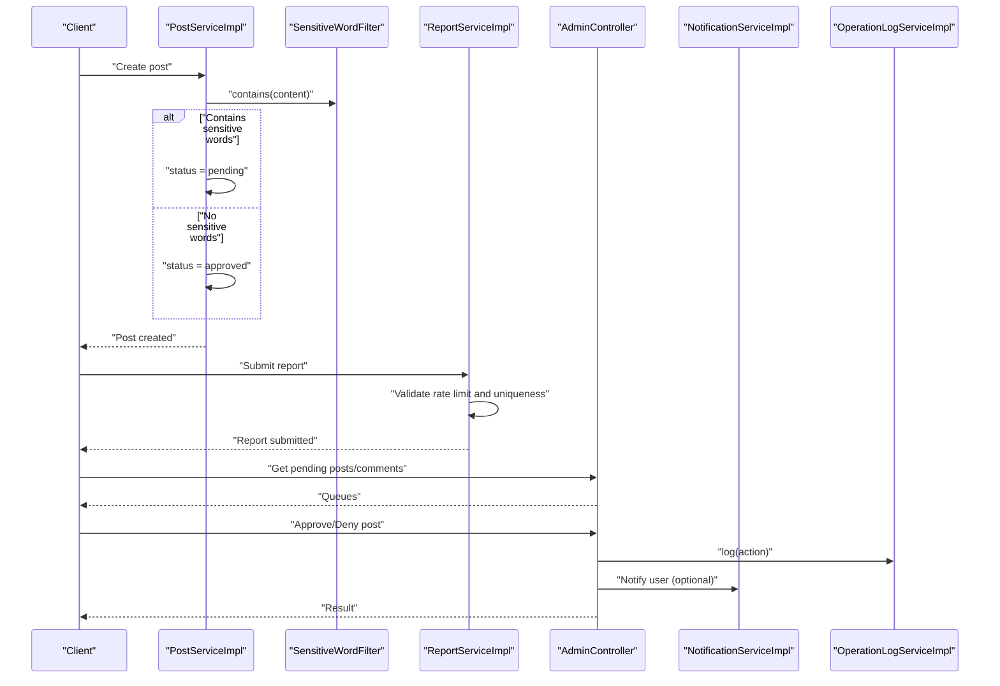
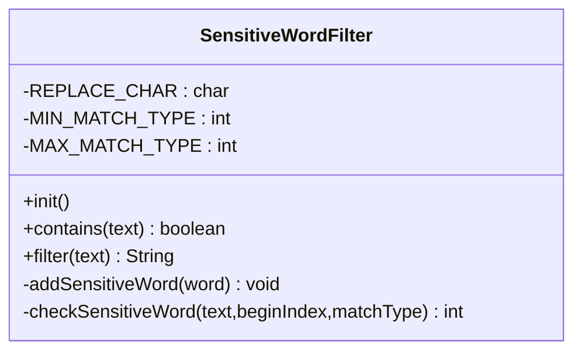
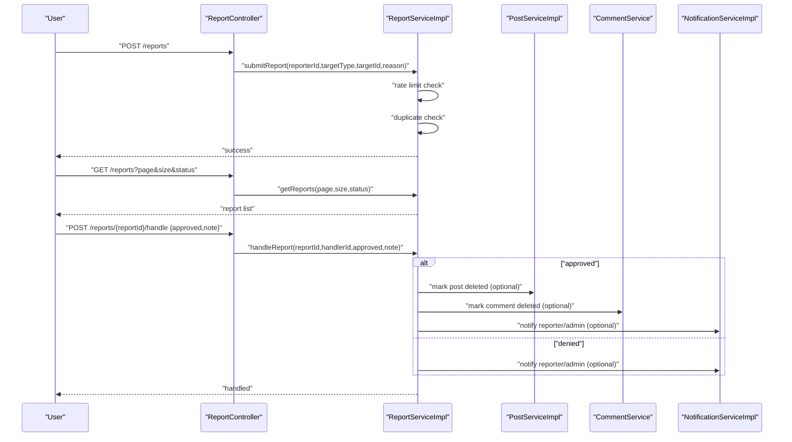
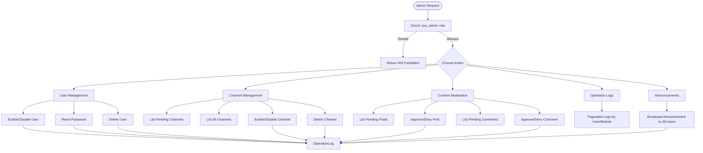
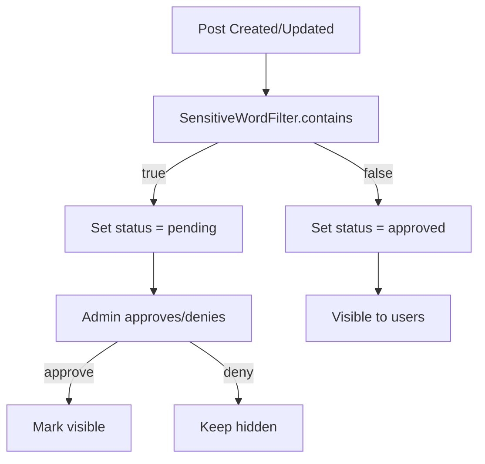
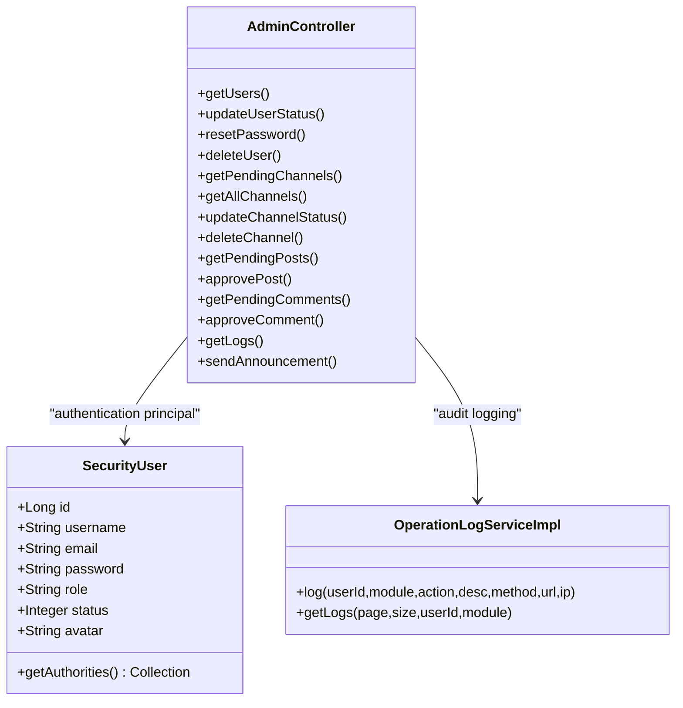
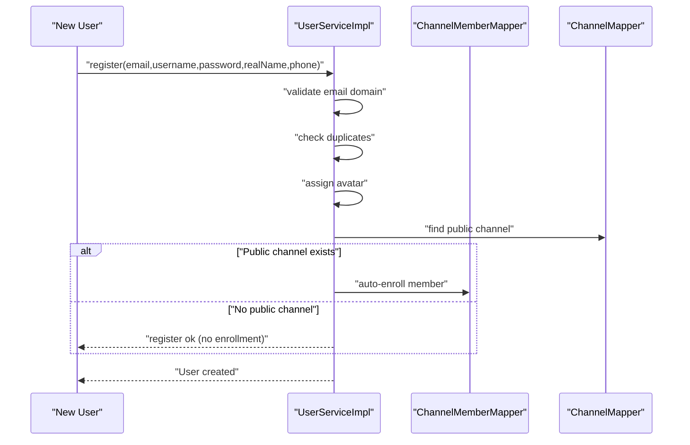
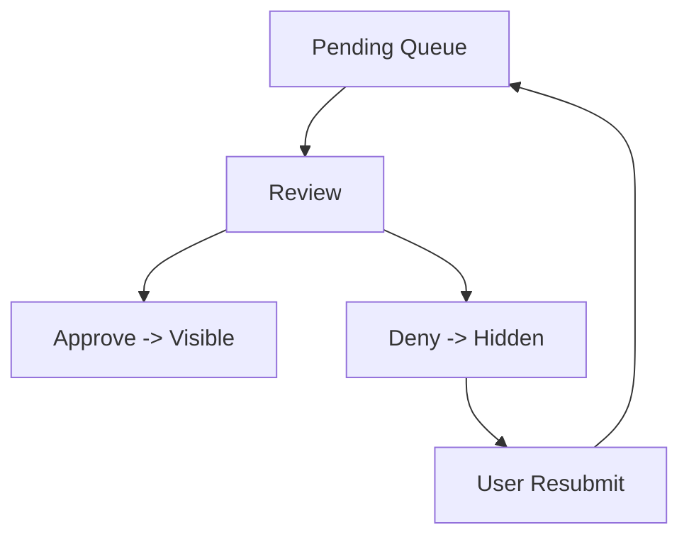
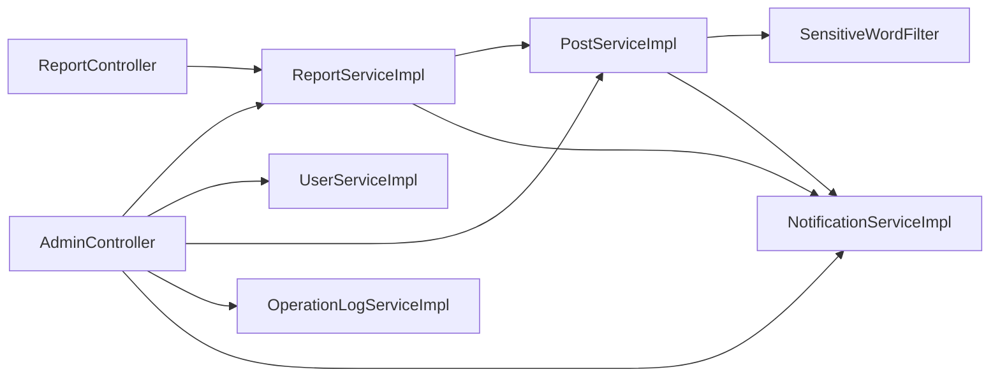

# Content Moderation and Administration

<cite>
**Referenced Files in This Document**
- [SensitiveWordFilter.java](file://camp-channel-server/src/main/java/com/gdmec/campchannel/common/filter/SensitiveWordFilter.java)
- [application.yml](file://camp-channel-server/src/main/resources/application.yml)
- [sensitive_words.txt](file://camp-channel-server/src/main/resources/sensitive_words.txt)
- [PostServiceImpl.java](file://camp-channel-server/src/main/java/com/gdmec/campchannel/service/impl/PostServiceImpl.java)
- [ReportController.java](file://camp-channel-server/src/main/java/com/gdmec/campchannel/controller/ReportController.java)
- [ReportServiceImpl.java](file://camp-channel-server/src/main/java/com/gdmec/campchannel/service/impl/ReportServiceImpl.java)
- [Report.java](file://camp-channel-server/src/main/java/com/gdmec/campchannel/entity/Report.java)
- [AdminController.java](file://camp-channel-server/src/main/java/com/gdmec/campchannel/controller/AdminController.java)
- [OperationLog.java](file://camp-channel-server/src/main/java/com/gdmec/campchannel/entity/OperationLog.java)
- [OperationLogServiceImpl.java](file://camp-channel-server/src/main/java/com/gdmec/campchannel/service/impl/OperationLogServiceImpl.java)
- [NotificationServiceImpl.java](file://camp-channel-server/src/main/java/com/gdmec/campchannel/service/impl/NotificationServiceImpl.java)
- [SecurityUser.java](file://camp-channel-server/src/main/java/com/gdmec/campchannel/security/SecurityUser.java)
- [User.java](file://camp-channel-server/src/main/java/com/gdmec/campchannel/entity/User.java)
- [Post.java](file://camp-channel-server/src/main/java/com/gdmec/campchannel/entity/Post.java)
- [Comment.java](file://camp-channel-server/src/main/java/com/gdmec/campchannel/entity/Comment.java)
- [UserServiceImpl.java](file://camp-channel-server/src/main/java/com/gdmec/campchannel/service/impl/UserServiceImpl.java)
- [SensitiveWordFilterTest.java](file://camp-channel-server/src/test/java/com/gdmec/campchannel/SensitiveWordFilterTest.java)
</cite>

## Table of Contents
1. [Introduction](#introduction)
2. [Project Structure](#project-structure)
3. [Core Components](#core-components)
4. [Architecture Overview](#architecture-overview)
5. [Detailed Component Analysis](#detailed-component-analysis)
6. [Dependency Analysis](#dependency-analysis)
7. [Performance Considerations](#performance-considerations)
8. [Troubleshooting Guide](#troubleshooting-guide)
9. [Conclusion](#conclusion)
10. [Appendices](#appendices)

## Introduction
This document describes the content moderation and administrative system for the campus social platform. It explains how sensitive words are detected and filtered, how users can report content, and how administrators manage users, channels, posts, comments, and system-wide announcements. It also documents the administrative dashboard capabilities, moderation workflows, operation logging, and notification integration. Guidance is included for configuration, operational thresholds, and best practices for moderation teams working within an educational institution context.

## Project Structure
The moderation and administration features span several layers:
- Controllers expose REST endpoints for reporting and administrative tasks.
- Services encapsulate business logic for filtering, reporting, user/channel/post/comment management, notifications, and operation logging.
- Entities define the data model for users, posts, comments, reports, and operation logs.
- Filters implement DFA-based sensitive word detection.
- Configuration defines the sensitive word dictionary location and runtime behavior.

**Diagram sources**
- [ReportController.java:1-79](file://camp-channel-server/src/main/java/com/gdmec/campchannel/controller/ReportController.java#L1-L79)
- [AdminController.java:1-391](file://camp-channel-server/src/main/java/com/gdmec/campchannel/controller/AdminController.java#L1-L391)
- [ReportServiceImpl.java:1-114](file://camp-channel-server/src/main/java/com/gdmec/campchannel/service/impl/ReportServiceImpl.java#L1-L114)
- [PostServiceImpl.java:1-387](file://camp-channel-server/src/main/java/com/gdmec/campchannel/service/impl/PostServiceImpl.java#L1-L387)
- [NotificationServiceImpl.java:1-95](file://camp-channel-server/src/main/java/com/gdmec/campchannel/service/impl/NotificationServiceImpl.java#L1-L95)
- [OperationLogServiceImpl.java:1-49](file://camp-channel-server/src/main/java/com/gdmec/campchannel/service/impl/OperationLogServiceImpl.java#L1-L49)
- [UserServiceImpl.java:1-107](file://camp-channel-server/src/main/java/com/gdmec/campchannel/service/impl/UserServiceImpl.java#L1-L107)
- [SensitiveWordFilter.java:1-166](file://camp-channel-server/src/main/java/com/gdmec/campchannel/common/filter/SensitiveWordFilter.java#L1-L166)
- [application.yml:94-100](file://camp-channel-server/src/main/resources/application.yml#L94-L100)
- [sensitive_words.txt:1-10](file://camp-channel-server/src/main/resources/sensitive_words.txt#L1-L10)

**Section sources**
- [application.yml:1-119](file://camp-channel-server/src/main/resources/application.yml#L1-L119)

## Core Components
- Sensitive word filtering: DFA-based filter initialized from a configurable dictionary file. It supports presence checks and replacement filtering with configurable matching rules.
- Reporting system: Users submit reports; administrators view and handle reports, with optional automatic content deletion upon approval.
- Administrative dashboard: Endpoints for user management, channel management, content moderation queues, operation logs, and system-wide announcements.
- Notifications: Real-time WebSocket notifications and persisted notification history.
- Operation logging: Centralized audit trail for administrative actions.
- User and content models: Entities for users, posts, comments, and reports.

**Section sources**
- [SensitiveWordFilter.java:1-166](file://camp-channel-server/src/main/java/com/gdmec/campchannel/common/filter/SensitiveWordFilter.java#L1-L166)
- [application.yml:94-100](file://camp-channel-server/src/main/resources/application.yml#L94-L100)
- [sensitive_words.txt:1-10](file://camp-channel-server/src/main/resources/sensitive_words.txt#L1-L10)
- [ReportController.java:1-79](file://camp-channel-server/src/main/java/com/gdmec/campchannel/controller/ReportController.java#L1-L79)
- [ReportServiceImpl.java:1-114](file://camp-channel-server/src/main/java/com/gdmec/campchannel/service/impl/ReportServiceImpl.java#L1-L114)
- [Report.java:1-35](file://camp-channel-server/src/main/java/com/gdmec/campchannel/entity/Report.java#L1-L35)
- [AdminController.java:1-391](file://camp-channel-server/src/main/java/com/gdmec/campchannel/controller/AdminController.java#L1-L391)
- [NotificationServiceImpl.java:1-95](file://camp-channel-server/src/main/java/com/gdmec/campchannel/service/impl/NotificationServiceImpl.java#L1-L95)
- [OperationLog.java:1-32](file://camp-channel-server/src/main/java/com/gdmec/campchannel/entity/OperationLog.java#L1-L32)
- [OperationLogServiceImpl.java:1-49](file://camp-channel-server/src/main/java/com/gdmec/campchannel/service/impl/OperationLogServiceImpl.java#L1-L49)
- [User.java:1-42](file://camp-channel-server/src/main/java/com/gdmec/campchannel/entity/User.java#L1-L42)
- [Post.java:1-58](file://camp-channel-server/src/main/java/com/gdmec/campchannel/entity/Post.java#L1-L58)
- [Comment.java:1-37](file://camp-channel-server/src/main/java/com/gdmec/campchannel/entity/Comment.java#L1-L37)

## Architecture Overview
The moderation pipeline integrates automated filtering with manual review and administrative enforcement. Automated filtering marks posts as pending review when sensitive content is detected. Administrators approve or reject content and can delete content and notify users accordingly. Operation logs capture all administrative actions for auditability.

**Diagram sources**
- [PostServiceImpl.java:58-153](file://camp-channel-server/src/main/java/com/gdmec/campchannel/service/impl/PostServiceImpl.java#L58-L153)
- [SensitiveWordFilter.java:94-105](file://camp-channel-server/src/main/java/com/gdmec/campchannel/common/filter/SensitiveWordFilter.java#L94-L105)
- [ReportServiceImpl.java:32-58](file://camp-channel-server/src/main/java/com/gdmec/campchannel/service/impl/ReportServiceImpl.java#L32-L58)
- [AdminController.java:229-276](file://camp-channel-server/src/main/java/com/gdmec/campchannel/controller/AdminController.java#L229-L276)
- [NotificationServiceImpl.java:26-51](file://camp-channel-server/src/main/java/com/gdmec/campchannel/service/impl/NotificationServiceImpl.java#L26-L51)
- [OperationLogServiceImpl.java:17-29](file://camp-channel-server/src/main/java/com/gdmec/campchannel/service/impl/OperationLogServiceImpl.java#L17-L29)

## Detailed Component Analysis

### Sensitive Word Filtering
- Implementation: DFA trie built from a dictionary file loaded at startup. Supports two matching modes: minimal and maximal length detection.
- Behavior: Presence check determines whether a post enters a pending queue; filtering replaces sensitive substrings with a placeholder character.
- Configuration: Dictionary file path is configurable via application settings.

**Diagram sources**
- [SensitiveWordFilter.java:1-166](file://camp-channel-server/src/main/java/com/gdmec/campchannel/common/filter/SensitiveWordFilter.java#L1-L166)

**Section sources**
- [SensitiveWordFilter.java:18-166](file://camp-channel-server/src/main/java/com/gdmec/campchannel/common/filter/SensitiveWordFilter.java#L18-L166)
- [application.yml:98-99](file://camp-channel-server/src/main/resources/application.yml#L98-L99)
- [sensitive_words.txt:1-10](file://camp-channel-server/src/main/resources/sensitive_words.txt#L1-L10)
- [SensitiveWordFilterTest.java:1-51](file://camp-channel-server/src/test/java/com/gdmec/campchannel/SensitiveWordFilterTest.java#L1-L51)

### Reporting System
- Submission: Users submit reports with target type and ID along with a reason. Rate limits prevent spam; duplicate unhandled reports are rejected.
- Administration: Admins can list reports, approve/deny, and record handling notes. Approved reports trigger immediate content deletion and marking.
- Data model: Reports track reporter, target, reason, status, handler, and timestamps.

**Diagram sources**
- [ReportController.java:27-64](file://camp-channel-server/src/main/java/com/gdmec/campchannel/controller/ReportController.java#L27-L64)
- [ReportServiceImpl.java:32-100](file://camp-channel-server/src/main/java/com/gdmec/campchannel/service/impl/ReportServiceImpl.java#L32-L100)
- [PostServiceImpl.java:310-349](file://camp-channel-server/src/main/java/com/gdmec/campchannel/service/impl/PostServiceImpl.java#L310-L349)
- [NotificationServiceImpl.java:26-51](file://camp-channel-server/src/main/java/com/gdmec/campchannel/service/impl/NotificationServiceImpl.java#L26-L51)

**Section sources**
- [ReportController.java:1-79](file://camp-channel-server/src/main/java/com/gdmec/campchannel/controller/ReportController.java#L1-L79)
- [ReportServiceImpl.java:1-114](file://camp-channel-server/src/main/java/com/gdmec/campchannel/service/impl/ReportServiceImpl.java#L1-L114)
- [Report.java:1-35](file://camp-channel-server/src/main/java/com/gdmec/campchannel/entity/Report.java#L1-L35)

### Administrative Dashboard Capabilities
- User management: List users, update status, reset passwords, and delete users. Enforced role check ensures only system administrators can perform these actions.
- Channel management: Retrieve pending channels, list all channels, update status, and delete channels.
- Content moderation: Retrieve pending posts and comments, approve or deny with status updates.
- Operations logging: View logs with pagination and filters by user/module.
- Announcements: Broadcast system-wide announcements to all users.

**Diagram sources**
- [AdminController.java:51-374](file://camp-channel-server/src/main/java/com/gdmec/campchannel/controller/AdminController.java#L51-L374)
- [OperationLogServiceImpl.java:17-48](file://camp-channel-server/src/main/java/com/gdmec/campchannel/service/impl/OperationLogServiceImpl.java#L17-L48)

**Section sources**
- [AdminController.java:1-391](file://camp-channel-server/src/main/java/com/gdmec/campchannel/controller/AdminController.java#L1-L391)
- [OperationLog.java:1-32](file://camp-channel-server/src/main/java/com/gdmec/campchannel/entity/OperationLog.java#L1-L32)
- [OperationLogServiceImpl.java:1-49](file://camp-channel-server/src/main/java/com/gdmec/campchannel/service/impl/OperationLogServiceImpl.java#L1-L49)

### Automated Content Filtering and Manual Review
- Automated filtering: During post creation/update, the system checks content against the sensitive word dictionary. If found, the post is placed in a pending state awaiting manual review.
- Manual review: Admins can approve or deny posts and comments. Approved items become visible; denied items remain hidden.
- Content deletion: When a report is approved, the system can automatically mark and replace content as deleted.

**Diagram sources**
- [PostServiceImpl.java:58-153](file://camp-channel-server/src/main/java/com/gdmec/campchannel/service/impl/PostServiceImpl.java#L58-L153)
- [SensitiveWordFilter.java:94-105](file://camp-channel-server/src/main/java/com/gdmec/campchannel/common/filter/SensitiveWordFilter.java#L94-L105)
- [AdminController.java:252-276](file://camp-channel-server/src/main/java/com/gdmec/campchannel/controller/AdminController.java#L252-L276)

**Section sources**
- [PostServiceImpl.java:58-153](file://camp-channel-server/src/main/java/com/gdmec/campchannel/service/impl/PostServiceImpl.java#L58-L153)
- [AdminController.java:229-276](file://camp-channel-server/src/main/java/com/gdmec/campchannel/controller/AdminController.java#L229-L276)

### Administrative Decision-Making Interfaces
- Role enforcement: All administrative endpoints validate that the caller has the system administrator role.
- Logging: Every administrative action is recorded with module, action, description, method, URL, and IP.
- Notifications: Optional notifications can be sent to affected users during moderation actions.

**Diagram sources**
- [SecurityUser.java:1-66](file://camp-channel-server/src/main/java/com/gdmec/campchannel/security/SecurityUser.java#L1-L66)
- [AdminController.java:1-391](file://camp-channel-server/src/main/java/com/gdmec/campchannel/controller/AdminController.java#L1-L391)
- [OperationLogServiceImpl.java:1-49](file://camp-channel-server/src/main/java/com/gdmec/campchannel/service/impl/OperationLogServiceImpl.java#L1-L49)

**Section sources**
- [SecurityUser.java:1-66](file://camp-channel-server/src/main/java/com/gdmec/campchannel/security/SecurityUser.java#L1-L66)
- [AdminController.java:51-374](file://camp-channel-server/src/main/java/com/gdmec/campchannel/controller/AdminController.java#L51-L374)
- [OperationLogServiceImpl.java:1-49](file://camp-channel-server/src/main/java/com/gdmec/campchannel/service/impl/OperationLogServiceImpl.java#L1-L49)

### User Management Tools
- Registration constraints: Enforces institutional email domain, prevents duplicate emails/usernames, assigns default avatar, and auto-enrolls new users into a public channel.
- User lifecycle: Admins can disable/enable accounts, reset passwords, and delete users. Self-deletion is prevented.

**Diagram sources**
- [UserServiceImpl.java:47-105](file://camp-channel-server/src/main/java/com/gdmec/campchannel/service/impl/UserServiceImpl.java#L47-L105)
- [User.java:1-42](file://camp-channel-server/src/main/java/com/gdmec/campchannel/entity/User.java#L1-L42)

**Section sources**
- [UserServiceImpl.java:1-107](file://camp-channel-server/src/main/java/com/gdmec/campchannel/service/impl/UserServiceImpl.java#L1-L107)
- [User.java:1-42](file://camp-channel-server/src/main/java/com/gdmec/campchannel/entity/User.java#L1-L42)

### Content Moderation Workflows
- Pending queues: Admins can retrieve pending posts and comments for review.
- Approval/denial: Admins set status to approved or rejected; logs are recorded.
- Appeals and re-submission: The system does not implement a dedicated appeals endpoint; however, users can re-submit content after revisions, which will enter the normal moderation flow.

**Diagram sources**
- [AdminController.java:229-325](file://camp-channel-server/src/main/java/com/gdmec/campchannel/controller/AdminController.java#L229-L325)
- [PostServiceImpl.java:58-153](file://camp-channel-server/src/main/java/com/gdmec/campchannel/service/impl/PostServiceImpl.java#L58-L153)

**Section sources**
- [AdminController.java:229-325](file://camp-channel-server/src/main/java/com/gdmec/campchannel/controller/AdminController.java#L229-L325)

### System Analytics Features
- Operation logs: Centralized audit trail with pagination and filters by user/module, enabling administrative oversight and compliance tracking.
- Notification history: Persisted notifications support historical tracking of moderation-related events.

**Section sources**
- [OperationLogServiceImpl.java:31-48](file://camp-channel-server/src/main/java/com/gdmec/campchannel/service/impl/OperationLogServiceImpl.java#L31-L48)
- [NotificationServiceImpl.java:84-94](file://camp-channel-server/src/main/java/com/gdmec/campchannel/service/impl/NotificationServiceImpl.java#L84-L94)

## Dependency Analysis
- Controllers depend on services for business logic.
- Services depend on filters for sensitive word detection and on persistence mappers/entities for data access.
- Operation logging and notifications are cross-cutting concerns invoked by controllers and services.
- SecurityUser provides role-based access control for administrative endpoints.

**Diagram sources**
- [ReportController.java:1-79](file://camp-channel-server/src/main/java/com/gdmec/campchannel/controller/ReportController.java#L1-L79)
- [AdminController.java:1-391](file://camp-channel-server/src/main/java/com/gdmec/campchannel/controller/AdminController.java#L1-L391)
- [ReportServiceImpl.java:1-114](file://camp-channel-server/src/main/java/com/gdmec/campchannel/service/impl/ReportServiceImpl.java#L1-L114)
- [PostServiceImpl.java:1-387](file://camp-channel-server/src/main/java/com/gdmec/campchannel/service/impl/PostServiceImpl.java#L1-L387)
- [SensitiveWordFilter.java:1-166](file://camp-channel-server/src/main/java/com/gdmec/campchannel/common/filter/SensitiveWordFilter.java#L1-L166)
- [NotificationServiceImpl.java:1-95](file://camp-channel-server/src/main/java/com/gdmec/campchannel/service/impl/NotificationServiceImpl.java#L1-L95)
- [OperationLogServiceImpl.java:1-49](file://camp-channel-server/src/main/java/com/gdmec/campchannel/service/impl/OperationLogServiceImpl.java#L1-L49)

**Section sources**
- [ReportController.java:1-79](file://camp-channel-server/src/main/java/com/gdmec/campchannel/controller/ReportController.java#L1-L79)
- [AdminController.java:1-391](file://camp-channel-server/src/main/java/com/gdmec/campchannel/controller/AdminController.java#L1-L391)
- [PostServiceImpl.java:1-387](file://camp-channel-server/src/main/java/com/gdmec/campchannel/service/impl/PostServiceImpl.java#L1-L387)
- [ReportServiceImpl.java:1-114](file://camp-channel-server/src/main/java/com/gdmec/campchannel/service/impl/ReportServiceImpl.java#L1-L114)
- [OperationLogServiceImpl.java:1-49](file://camp-channel-server/src/main/java/com/gdmec/campchannel/service/impl/OperationLogServiceImpl.java#L1-L49)
- [NotificationServiceImpl.java:1-95](file://camp-channel-server/src/main/java/com/gdmec/campchannel/service/impl/NotificationServiceImpl.java#L1-L95)

## Performance Considerations
- Sensitive word detection uses a DFA trie, ensuring linear-time scanning relative to input length.
- Rate limiting for posts and reports reduces load and abuse.
- Pagination is used in admin endpoints and notification retrieval to bound response sizes.
- Asynchronous notifications via WebSocket minimize latency for live updates.

[No sources needed since this section provides general guidance]

## Troubleshooting Guide
- Sensitive word dictionary missing: If the dictionary file is not found, filtering is disabled with a warning; verify the configured path.
- Redis failures: Rate limiting and caching rely on Redis; failures are logged and the system continues with reduced protections.
- Duplicate or excessive reports: The system enforces rate limits and disallows duplicate unhandled reports per reporter/target pair.
- Admin permission errors: Ensure the authenticated user has the system administrator role; otherwise requests are rejected.
- Content deletion anomalies: Approved reports attempt to mark content as deleted; exceptions are logged but do not block report handling.

**Section sources**
- [SensitiveWordFilter.java:40-64](file://camp-channel-server/src/main/java/com/gdmec/campchannel/common/filter/SensitiveWordFilter.java#L40-L64)
- [PostServiceImpl.java:64-75](file://camp-channel-server/src/main/java/com/gdmec/campchannel/service/impl/PostServiceImpl.java#L64-L75)
- [ReportServiceImpl.java:34-48](file://camp-channel-server/src/main/java/com/gdmec/campchannel/service/impl/ReportServiceImpl.java#L34-L48)
- [SecurityUser.java:27-34](file://camp-channel-server/src/main/java/com/gdmec/campchannel/security/SecurityUser.java#L27-L34)
- [ReportServiceImpl.java:74-94](file://camp-channel-server/src/main/java/com/gdmec/campchannel/service/impl/ReportServiceImpl.java#L74-L94)

## Conclusion
The moderation and administration system combines robust automated filtering with a clear manual review process and strong administrative controls. It provides comprehensive auditing, user and content management, and notification capabilities. By tuning the sensitive word dictionary and leveraging admin endpoints, institutions can maintain a safe and compliant environment for students.

[No sources needed since this section summarizes without analyzing specific files]

## Appendices

### Configuration Options
- Sensitive word dictionary file path: Configured under the application settings and loaded at startup.
- Upload storage path: Local path for file uploads.
- JWT secret and expiration: Security tokens for authentication.
- Mail server settings: SMTP configuration for email services.

**Section sources**
- [application.yml:94-119](file://camp-channel-server/src/main/resources/application.yml#L94-L119)

### Administrative Permissions
- Role requirement: Only users with the system administrator role can access administrative endpoints.
- Enforcement: Controllers validate roles before executing privileged operations.

**Section sources**
- [SecurityUser.java:27-34](file://camp-channel-server/src/main/java/com/gdmec/campchannel/security/SecurityUser.java#L27-L34)
- [AdminController.java:58-139](file://camp-channel-server/src/main/java/com/gdmec/campchannel/controller/AdminController.java#L58-L139)

### Moderation Thresholds and Policies
- Pending status threshold: Posts containing sensitive words are marked as pending for review.
- Minimum sensitive word length: Words shorter than a threshold are ignored to reduce false positives.
- Rate limits: Limits on posting frequency and report submissions help mitigate abuse.

**Section sources**
- [PostServiceImpl.java:77-84](file://camp-channel-server/src/main/java/com/gdmec/campchannel/service/impl/PostServiceImpl.java#L77-L84)
- [SensitiveWordFilter.java:160-163](file://camp-channel-server/src/main/java/com/gdmec/campchannel/common/filter/SensitiveWordFilter.java#L160-L163)
- [PostServiceImpl.java:64-75](file://camp-channel-server/src/main/java/com/gdmec/campchannel/service/impl/PostServiceImpl.java#L64-L75)
- [ReportServiceImpl.java:34-39](file://camp-channel-server/src/main/java/com/gdmec/campchannel/service/impl/ReportServiceImpl.java#L34-L39)

### Integration with Content Management and User Management
- Content review: Posts and comments enter moderation queues; admins approve/deny; approved content becomes visible.
- User moderation: Admins can disable/enable accounts, reset passwords, and delete users; user registration follows institutional policies.

**Section sources**
- [PostServiceImpl.java:155-202](file://camp-channel-server/src/main/java/com/gdmec/campchannel/service/impl/PostServiceImpl.java#L155-L202)
- [AdminController.java:51-146](file://camp-channel-server/src/main/java/com/gdmec/campchannel/controller/AdminController.java#L51-L146)
- [UserServiceImpl.java:47-105](file://camp-channel-server/src/main/java/com/gdmec/campchannel/service/impl/UserServiceImpl.java#L47-L105)

### Best Practices for Moderation Teams
- Maintain a balanced sensitive word dictionary to minimize false positives while catching problematic content.
- Establish clear escalation paths for complex cases and appeals.
- Use operation logs to track decisions and ensure compliance with institutional guidelines.
- Communicate moderation outcomes to users via notifications and platform announcements.

[No sources needed since this section provides general guidance]