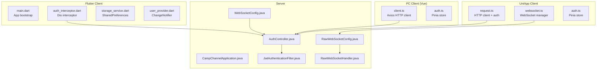
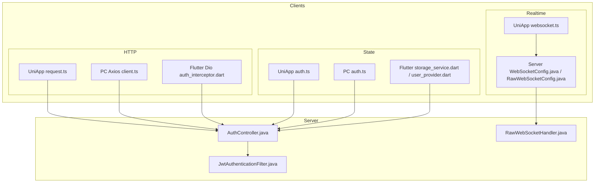
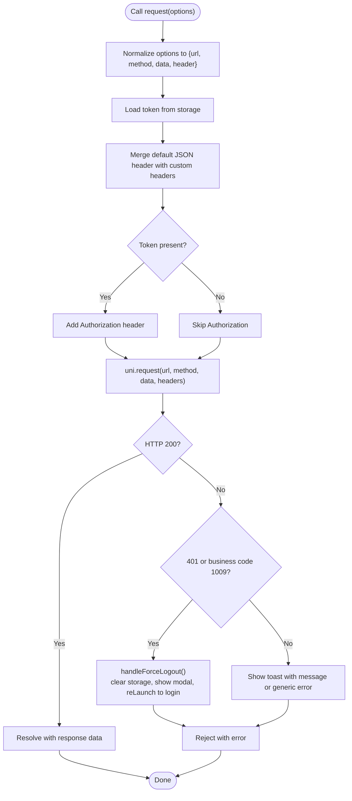
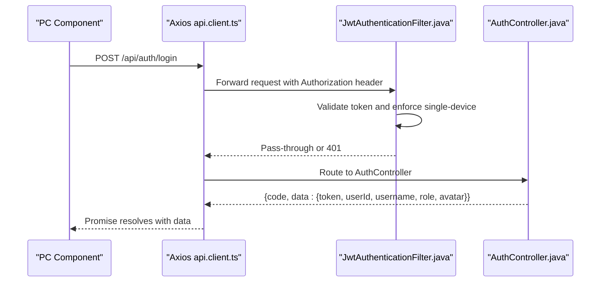
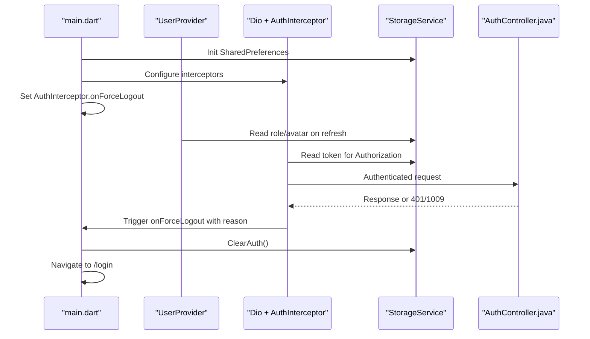
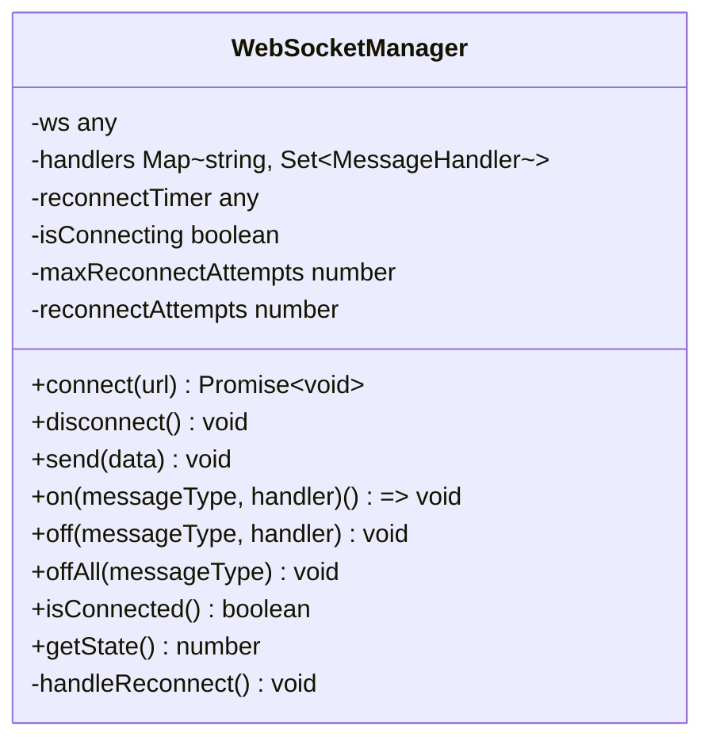
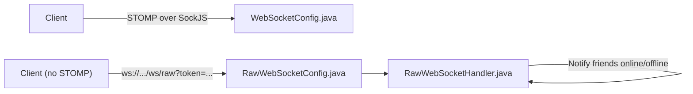
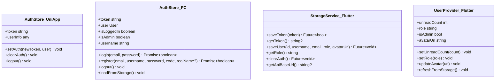
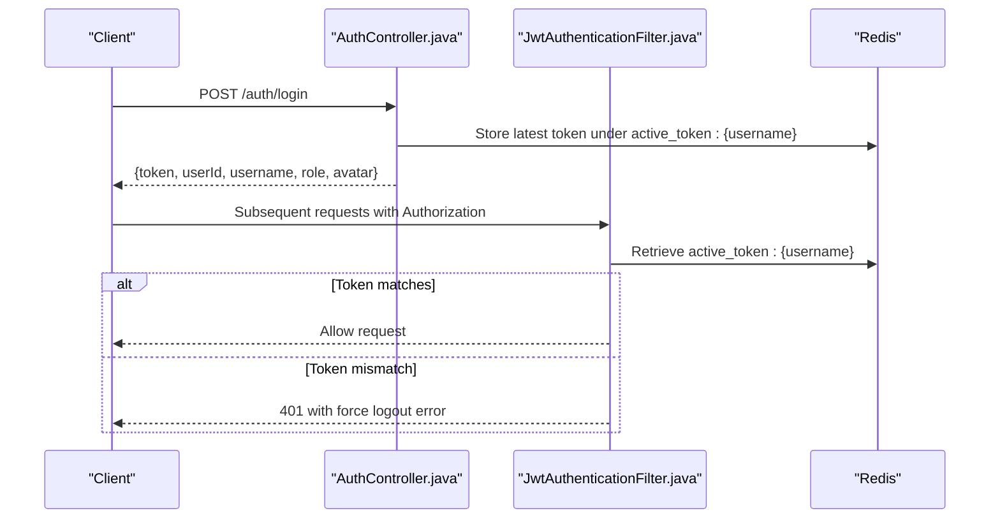
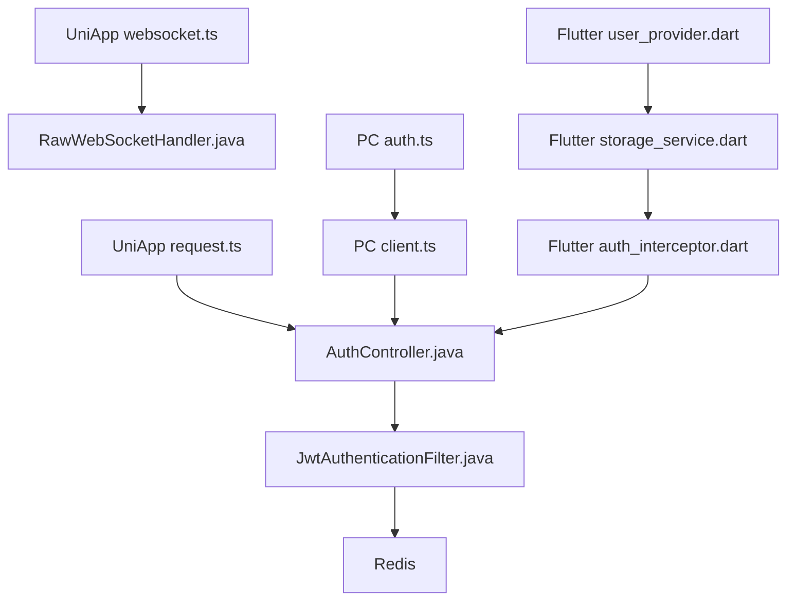

# API Integration and Service Layer

<cite>
**Referenced Files in This Document**
- [request.ts](file://camp-channel-client-uniapp/src/utils/request.ts)
- [websocket.ts](file://camp-channel-client-uniapp/src/utils/websocket.ts)
- [auth.ts](file://camp-channel-client-uniapp/src/stores/auth.ts)
- [client.ts](file://camp-channel-client-pc/src/api/client.ts)
- [auth.ts](file://camp-channel-client-pc/src/stores/auth.ts)
- [main.dart](file://camp-channel-client-flutter/lib/main.dart)
- [storage_service.dart](file://camp-channel-client-flutter/lib/core/services/storage_service.dart)
- [user_provider.dart](file://camp-channel-client-flutter/lib/core/services/user_provider.dart)
- [auth_interceptor.dart](file://camp-channel-client-flutter/lib/core/network/auth_interceptor.dart)
- [CampChannelApplication.java](file://camp-channel-server/src/main/java/com/gdmec/campchannel/CampChannelApplication.java)
- [WebSocketConfig.java](file://camp-channel-server/src/main/java/com/gdmec/campchannel/config/WebSocketConfig.java)
- [RawWebSocketConfig.java](file://camp-channel-server/src/main/java/com/gdmec/campchannel/config/RawWebSocketConfig.java)
- [RawWebSocketHandler.java](file://camp-channel-server/src/main/java/com/gdmec/campchannel/config/RawWebSocketHandler.java)
- [JwtAuthenticationFilter.java](file://camp-channel-server/src/main/java/com/gdmec/campchannel/security/JwtAuthenticationFilter.java)
- [AuthController.java](file://camp-channel-server/src/main/java/com/gdmec/campchannel/controller/AuthController.java)
</cite>

## Table of Contents
1. [Introduction](#introduction)
2. [Project Structure](#project-structure)
3. [Core Components](#core-components)
4. [Architecture Overview](#architecture-overview)
5. [Detailed Component Analysis](#detailed-component-analysis)
6. [Dependency Analysis](#dependency-analysis)
7. [Performance Considerations](#performance-considerations)
8. [Troubleshooting Guide](#troubleshooting-guide)
9. [Conclusion](#conclusion)
10. [Appendices](#appendices)

## Introduction
This document explains the API integration and service architecture across three client platforms (UniApp, PC/Vue, Flutter) and the Spring Boot server. It focuses on:
- Unified request handling and HTTP client configuration
- Authentication token management and session lifecycle
- WebSocket service for real-time communication and broadcasting
- Error handling, retry logic, and response transformation
- Service layer abstraction across platforms and offline-aware patterns
- Interceptors, loading states, and error boundaries
- Integration patterns among services, stores, and components, including caching and optimistic updates

## Project Structure
The system comprises:
- Three frontends:
  - UniApp (WeChat ecosystem) with a centralized request utility, WebSocket manager, and Pinia auth store
  - PC frontend (Vue + Vite) with Axios-based HTTP client and Pinia auth store
  - Flutter (Dart) with Dio-based HTTP client, shared preferences storage, and Provider-based user state
- A Spring Boot server implementing JWT-based authentication, CORS and preflight handling, STOMP/SockJS WebSocket broker, and a raw WebSocket endpoint for environments without STOMP support

**Diagram sources**
- [request.ts:1-112](file://camp-channel-client-uniapp/src/utils/request.ts#L1-L112)
- [websocket.ts:1-268](file://camp-channel-client-uniapp/src/utils/websocket.ts#L1-L268)
- [auth.ts:1-34](file://camp-channel-client-uniapp/src/stores/auth.ts#L1-L34)
- [client.ts:1-35](file://camp-channel-client-pc/src/api/client.ts#L1-L35)
- [auth.ts:1-61](file://camp-channel-client-pc/src/stores/auth.ts#L1-L61)
- [main.dart:1-122](file://camp-channel-client-flutter/lib/main.dart#L1-L122)
- [auth_interceptor.dart:1-66](file://camp-channel-client-flutter/lib/core/network/auth_interceptor.dart#L1-L66)
- [storage_service.dart:1-124](file://camp-channel-client-flutter/lib/core/services/storage_service.dart#L1-L124)
- [user_provider.dart:1-35](file://camp-channel-client-flutter/lib/core/services/user_provider.dart#L1-L35)
- [CampChannelApplication.java:1-31](file://camp-channel-server/src/main/java/com/gdmec/campchannel/CampChannelApplication.java#L1-L31)
- [AuthController.java:1-247](file://camp-channel-server/src/main/java/com/gdmec/campchannel/controller/AuthController.java#L1-L247)
- [JwtAuthenticationFilter.java:1-113](file://camp-channel-server/src/main/java/com/gdmec/campchannel/security/JwtAuthenticationFilter.java#L1-L113)
- [WebSocketConfig.java:1-36](file://camp-channel-server/src/main/java/com/gdmec/campchannel/config/WebSocketConfig.java#L1-L36)
- [RawWebSocketConfig.java:1-24](file://camp-channel-server/src/main/java/com/gdmec/campchannel/config/RawWebSocketConfig.java#L1-L24)
- [RawWebSocketHandler.java:1-171](file://camp-channel-server/src/main/java/com/gdmec/campchannel/config/RawWebSocketHandler.java#L1-L171)

**Section sources**
- [request.ts:1-112](file://camp-channel-client-uniapp/src/utils/request.ts#L1-L112)
- [websocket.ts:1-268](file://camp-channel-client-uniapp/src/utils/websocket.ts#L1-L268)
- [auth.ts:1-34](file://camp-channel-client-uniapp/src/stores/auth.ts#L1-L34)
- [client.ts:1-35](file://camp-channel-client-pc/src/api/client.ts#L1-L35)
- [auth.ts:1-61](file://camp-channel-client-pc/src/stores/auth.ts#L1-L61)
- [main.dart:1-122](file://camp-channel-client-flutter/lib/main.dart#L1-L122)
- [auth_interceptor.dart:1-66](file://camp-channel-client-flutter/lib/core/network/auth_interceptor.dart#L1-L66)
- [storage_service.dart:1-124](file://camp-channel-client-flutter/lib/core/services/storage_service.dart#L1-L124)
- [user_provider.dart:1-35](file://camp-channel-client-flutter/lib/core/services/user_provider.dart#L1-L35)
- [CampChannelApplication.java:1-31](file://camp-channel-server/src/main/java/com/gdmec/campchannel/CampChannelApplication.java#L1-L31)
- [AuthController.java:1-247](file://camp-channel-server/src/main/java/com/gdmec/campchannel/controller/AuthController.java#L1-L247)
- [JwtAuthenticationFilter.java:1-113](file://camp-channel-server/src/main/java/com/gdmec/campchannel/security/JwtAuthenticationFilter.java#L1-L113)
- [WebSocketConfig.java:1-36](file://camp-channel-server/src/main/java/com/gdmec/campchannel/config/WebSocketConfig.java#L1-L36)
- [RawWebSocketConfig.java:1-24](file://camp-channel-server/src/main/java/com/gdmec/campchannel/config/RawWebSocketConfig.java#L1-L24)
- [RawWebSocketHandler.java:1-171](file://camp-channel-server/src/main/java/com/gdmec/campchannel/config/RawWebSocketHandler.java#L1-L171)

## Core Components
- Unified HTTP client and request utility (UniApp):
  - Centralized base URL resolution, header injection, and error handling
  - Image URL processing and force logout on 401 or business-specific unauthorized code
- Axios-based HTTP client (PC):
  - Base URL, timeout, and Authorization header injection via interceptors
  - Automatic logout redirection on 401
- Dio-based HTTP client (Flutter):
  - Auth interceptor injecting Authorization header and handling 401/1009
  - Shared preferences-backed storage service for tokens and user info
- WebSocket managers:
  - UniApp: singleton WebSocket manager with exponential backoff, message routing, and wildcard handlers
  - Server: STOMP/SockJS broker and raw WebSocket endpoint supporting token-in-query authentication
- Authentication stores:
  - UniApp: Pinia store persisting token and user info via storage APIs
  - PC: Pinia store persisting token and user info via localStorage
  - Flutter: Provider-based user state and shared preferences-backed storage
- Server-side authentication:
  - JWT filter validating tokens and enforcing single-device login via Redis
  - Auth controller generating tokens and enforcing institution email suffix and rate limits

**Section sources**
- [request.ts:1-112](file://camp-channel-client-uniapp/src/utils/request.ts#L1-L112)
- [websocket.ts:1-268](file://camp-channel-client-uniapp/src/utils/websocket.ts#L1-L268)
- [client.ts:1-35](file://camp-channel-client-pc/src/api/client.ts#L1-L35)
- [auth.ts:1-61](file://camp-channel-client-pc/src/stores/auth.ts#L1-L61)
- [auth_interceptor.dart:1-66](file://camp-channel-client-flutter/lib/core/network/auth_interceptor.dart#L1-L66)
- [storage_service.dart:1-124](file://camp-channel-client-flutter/lib/core/services/storage_service.dart#L1-L124)
- [user_provider.dart:1-35](file://camp-channel-client-flutter/lib/core/services/user_provider.dart#L1-L35)
- [JwtAuthenticationFilter.java:1-113](file://camp-channel-server/src/main/java/com/gdmec/campchannel/security/JwtAuthenticationFilter.java#L1-L113)
- [AuthController.java:1-247](file://camp-channel-server/src/main/java/com/gdmec/campchannel/controller/AuthController.java#L1-L247)

## Architecture Overview
The architecture separates concerns across clients and server:
- Clients:
  - HTTP layer: request utilities/interceptors manage base URLs, headers, and auth
  - Real-time layer: WebSocket managers encapsulate connection, reconnection, and message dispatch
  - State layer: stores/providers persist credentials and user metadata
- Server:
  - REST endpoints secured by JWT filter and Redis-based single-device enforcement
  - WebSocket endpoints: STOMP for modern clients and raw WebSocket for environments without STOMP

**Diagram sources**
- [request.ts:1-112](file://camp-channel-client-uniapp/src/utils/request.ts#L1-L112)
- [client.ts:1-35](file://camp-channel-client-pc/src/api/client.ts#L1-L35)
- [auth_interceptor.dart:1-66](file://camp-channel-client-flutter/lib/core/network/auth_interceptor.dart#L1-L66)
- [websocket.ts:1-268](file://camp-channel-client-uniapp/src/utils/websocket.ts#L1-L268)
- [WebSocketConfig.java:1-36](file://camp-channel-server/src/main/java/com/gdmec/campchannel/config/WebSocketConfig.java#L1-L36)
- [RawWebSocketConfig.java:1-24](file://camp-channel-server/src/main/java/com/gdmec/campchannel/config/RawWebSocketConfig.java#L1-L24)
- [RawWebSocketHandler.java:1-171](file://camp-channel-server/src/main/java/com/gdmec/campchannel/config/RawWebSocketHandler.java#L1-L171)
- [AuthController.java:1-247](file://camp-channel-server/src/main/java/com/gdmec/campchannel/controller/AuthController.java#L1-L247)
- [JwtAuthenticationFilter.java:1-113](file://camp-channel-server/src/main/java/com/gdmec/campchannel/security/JwtAuthenticationFilter.java#L1-L113)
- [auth.ts:1-34](file://camp-channel-client-uniapp/src/stores/auth.ts#L1-L34)
- [auth.ts:1-61](file://camp-channel-client-pc/src/stores/auth.ts#L1-L61)
- [storage_service.dart:1-124](file://camp-channel-client-flutter/lib/core/services/storage_service.dart#L1-L124)
- [user_provider.dart:1-35](file://camp-channel-client-flutter/lib/core/services/user_provider.dart#L1-L35)

## Detailed Component Analysis

### Unified HTTP Request Handling (UniApp)
- Base URL resolution:
  - Reads a stored base URL; falls back to localhost development value
- Header injection:
  - Always sets JSON content type; adds Authorization header if token exists
- Request execution:
  - Uses uni.request with merged headers and resolved absolute URL
- Response handling:
  - Treats HTTP 401 and business code 1009 as force logout triggers
  - Displays toast for non-200 responses and rejects promise with error
- Image URL processing:
  - Converts relative paths to absolute URLs using current base URL

**Diagram sources**
- [request.ts:30-84](file://camp-channel-client-uniapp/src/utils/request.ts#L30-L84)
- [request.ts:89-109](file://camp-channel-client-uniapp/src/utils/request.ts#L89-L109)

**Section sources**
- [request.ts:1-112](file://camp-channel-client-uniapp/src/utils/request.ts#L1-L112)

### Axios HTTP Client (PC)
- Configuration:
  - Base URL to proxy API, timeout, and JSON content type
- Request interceptor:
  - Injects Authorization header from localStorage
- Response interceptor:
  - On 401, clears localStorage and redirects to login route if token existed

**Diagram sources**
- [client.ts:1-35](file://camp-channel-client-pc/src/api/client.ts#L1-L35)
- [JwtAuthenticationFilter.java:1-113](file://camp-channel-server/src/main/java/com/gdmec/campchannel/security/JwtAuthenticationFilter.java#L1-L113)
- [AuthController.java:1-247](file://camp-channel-server/src/main/java/com/gdmec/campchannel/controller/AuthController.java#L1-L247)

**Section sources**
- [client.ts:1-35](file://camp-channel-client-pc/src/api/client.ts#L1-L35)
- [auth.ts:1-61](file://camp-channel-client-pc/src/stores/auth.ts#L1-L61)

### Dio HTTP Client (Flutter)
- Auth interceptor:
  - Adds Authorization header from shared preferences
  - Handles 401 and business code 1009 by clearing storage and invoking global callback
- App bootstrap:
  - Initializes storage service and registers force logout callback to show dialog and navigate to login

**Diagram sources**
- [main.dart:1-122](file://camp-channel-client-flutter/lib/main.dart#L1-L122)
- [auth_interceptor.dart:1-66](file://camp-channel-client-flutter/lib/core/network/auth_interceptor.dart#L1-L66)
- [storage_service.dart:1-124](file://camp-channel-client-flutter/lib/core/services/storage_service.dart#L1-L124)
- [user_provider.dart:1-35](file://camp-channel-client-flutter/lib/core/services/user_provider.dart#L1-L35)
- [AuthController.java:1-247](file://camp-channel-server/src/main/java/com/gdmec/campchannel/controller/AuthController.java#L1-L247)

**Section sources**
- [main.dart:1-122](file://camp-channel-client-flutter/lib/main.dart#L1-L122)
- [auth_interceptor.dart:1-66](file://camp-channel-client-flutter/lib/core/network/auth_interceptor.dart#L1-L66)
- [storage_service.dart:1-124](file://camp-channel-client-flutter/lib/core/services/storage_service.dart#L1-L124)
- [user_provider.dart:1-35](file://camp-channel-client-flutter/lib/core/services/user_provider.dart#L1-L35)

### WebSocket Service Implementation (UniApp)
- Singleton manager:
  - Prevents multiple connections and tracks handlers per message type
- Connection lifecycle:
  - Builds WS URL from base URL, replaces http with ws, appends /ws/raw
  - Adds token as query parameter (?token=...)
  - Exponential backoff reconnection up to a maximum number of attempts
- Message handling:
  - Parses incoming JSON and dispatches to registered handlers for specific types and wildcard handlers
- Disconnection and cleanup:
  - Clears timers, closes socket, resets state, and attempts reconnection

**Diagram sources**
- [websocket.ts:8-261](file://camp-channel-client-uniapp/src/utils/websocket.ts#L8-L261)

**Section sources**
- [websocket.ts:1-268](file://camp-channel-client-uniapp/src/utils/websocket.ts#L1-L268)

### Server WebSocket Endpoints
- STOMP/SockJS:
  - Enables WebSocket message broker with destinations for topics, queues, and user-specific destinations
  - Registers /ws/chat endpoint with SockJS
- Raw WebSocket:
  - Provides /ws/raw for environments without STOMP
  - Authenticates via token in query parameter and maintains user sessions in memory
  - Supports ping/pong and broadcasts online status to friends

**Diagram sources**
- [WebSocketConfig.java:1-36](file://camp-channel-server/src/main/java/com/gdmec/campchannel/config/WebSocketConfig.java#L1-L36)
- [RawWebSocketConfig.java:1-24](file://camp-channel-server/src/main/java/com/gdmec/campchannel/config/RawWebSocketConfig.java#L1-L24)
- [RawWebSocketHandler.java:1-171](file://camp-channel-server/src/main/java/com/gdmec/campchannel/config/RawWebSocketHandler.java#L1-L171)

**Section sources**
- [WebSocketConfig.java:1-36](file://camp-channel-server/src/main/java/com/gdmec/campchannel/config/WebSocketConfig.java#L1-L36)
- [RawWebSocketConfig.java:1-24](file://camp-channel-server/src/main/java/com/gdmec/campchannel/config/RawWebSocketConfig.java#L1-L24)
- [RawWebSocketHandler.java:1-171](file://camp-channel-server/src/main/java/com/gdmec/campchannel/config/RawWebSocketHandler.java#L1-L171)

### Authentication Store and Session Management
- UniApp:
  - Pinia store persists token and user info in storage APIs
  - Provides setters to update and clear auth state
- PC:
  - Pinia store reads/writes localStorage for token and user
  - Login action strips Bearer prefix from returned token before storing
- Flutter:
  - StorageService centralizes SharedPreferences keys for token, user, and preferences
  - UserProvider exposes role and avatar state and notifies listeners on changes

**Diagram sources**
- [auth.ts:1-34](file://camp-channel-client-uniapp/src/stores/auth.ts#L1-L34)
- [auth.ts:1-61](file://camp-channel-client-pc/src/stores/auth.ts#L1-L61)
- [storage_service.dart:1-124](file://camp-channel-client-flutter/lib/core/services/storage_service.dart#L1-L124)
- [user_provider.dart:1-35](file://camp-channel-client-flutter/lib/core/services/user_provider.dart#L1-L35)

**Section sources**
- [auth.ts:1-34](file://camp-channel-client-uniapp/src/stores/auth.ts#L1-L34)
- [auth.ts:1-61](file://camp-channel-client-pc/src/stores/auth.ts#L1-L61)
- [storage_service.dart:1-124](file://camp-channel-client-flutter/lib/core/services/storage_service.dart#L1-L124)
- [user_provider.dart:1-35](file://camp-channel-client-flutter/lib/core/services/user_provider.dart#L1-L35)

### Token Refresh and Single-Device Enforcement
- Server enforces single-device login:
  - On successful login, server stores the latest token in Redis keyed by username
  - During filter validation, if the incoming token differs from the stored token, the request is rejected with unauthorized
- Client-side handling:
  - On receiving 401 or business code 1009, clients clear local storage and prompt re-login
  - Flutter also exposes a global callback to trigger UI-level force logout

**Diagram sources**
- [AuthController.java:176-180](file://camp-channel-server/src/main/java/com/gdmec/campchannel/controller/AuthController.java#L176-L180)
- [JwtAuthenticationFilter.java:80-89](file://camp-channel-server/src/main/java/com/gdmec/campchannel/security/JwtAuthenticationFilter.java#L80-L89)

**Section sources**
- [AuthController.java:1-247](file://camp-channel-server/src/main/java/com/gdmec/campchannel/controller/AuthController.java#L1-L247)
- [JwtAuthenticationFilter.java:1-113](file://camp-channel-server/src/main/java/com/gdmec/campchannel/security/JwtAuthenticationFilter.java#L1-L113)

### Offline Scenarios and Optimistic Updates
- HTTP layer:
  - UniApp request utility displays toast on network failure and rejects with error
  - PC Axios interceptor redirects to login on 401
  - Flutter interceptor clears storage and invokes UI callback on 401/1009
- WebSocket:
  - UniApp manager implements exponential backoff reconnection and continues operation gracefully when backend is unavailable
- Caching strategies:
  - Clients persist tokens and user info locally to resume sessions after restart
  - Server caches active tokens in Redis for single-device enforcement

**Section sources**
- [request.ts:75-84](file://camp-channel-client-uniapp/src/utils/request.ts#L75-L84)
- [client.ts:18-32](file://camp-channel-client-pc/src/api/client.ts#L18-L32)
- [auth_interceptor.dart:31-53](file://camp-channel-client-flutter/lib/core/network/auth_interceptor.dart#L31-L53)
- [websocket.ts:232-253](file://camp-channel-client-uniapp/src/utils/websocket.ts#L232-L253)

## Dependency Analysis
- Client-to-server dependencies:
  - All clients depend on REST endpoints for authentication and on WebSocket endpoints for real-time features
  - Server depends on JWT utilities and Redis for token validation and single-device enforcement
- Internal client dependencies:
  - UniApp: request utility depends on storage APIs; WebSocket manager depends on storage APIs and request lifecycle
  - PC: Axios client depends on localStorage; Pinia store depends on API client
  - Flutter: Dio interceptor depends on storage service; main app depends on interceptor and provider

**Diagram sources**
- [request.ts:1-112](file://camp-channel-client-uniapp/src/utils/request.ts#L1-L112)
- [websocket.ts:1-268](file://camp-channel-client-uniapp/src/utils/websocket.ts#L1-L268)
- [client.ts:1-35](file://camp-channel-client-pc/src/api/client.ts#L1-L35)
- [auth.ts:1-61](file://camp-channel-client-pc/src/stores/auth.ts#L1-L61)
- [auth_interceptor.dart:1-66](file://camp-channel-client-flutter/lib/core/network/auth_interceptor.dart#L1-L66)
- [storage_service.dart:1-124](file://camp-channel-client-flutter/lib/core/services/storage_service.dart#L1-L124)
- [user_provider.dart:1-35](file://camp-channel-client-flutter/lib/core/services/user_provider.dart#L1-L35)
- [AuthController.java:1-247](file://camp-channel-server/src/main/java/com/gdmec/campchannel/controller/AuthController.java#L1-L247)
- [JwtAuthenticationFilter.java:1-113](file://camp-channel-server/src/main/java/com/gdmec/campchannel/security/JwtAuthenticationFilter.java#L1-L113)
- [RawWebSocketHandler.java:1-171](file://camp-channel-server/src/main/java/com/gdmec/campchannel/config/RawWebSocketHandler.java#L1-L171)

**Section sources**
- [request.ts:1-112](file://camp-channel-client-uniapp/src/utils/request.ts#L1-L112)
- [websocket.ts:1-268](file://camp-channel-client-uniapp/src/utils/websocket.ts#L1-L268)
- [client.ts:1-35](file://camp-channel-client-pc/src/api/client.ts#L1-L35)
- [auth.ts:1-61](file://camp-channel-client-pc/src/stores/auth.ts#L1-L61)
- [auth_interceptor.dart:1-66](file://camp-channel-client-flutter/lib/core/network/auth_interceptor.dart#L1-L66)
- [storage_service.dart:1-124](file://camp-channel-client-flutter/lib/core/services/storage_service.dart#L1-L124)
- [user_provider.dart:1-35](file://camp-channel-client-flutter/lib/core/services/user_provider.dart#L1-L35)
- [AuthController.java:1-247](file://camp-channel-server/src/main/java/com/gdmec/campchannel/controller/AuthController.java#L1-L247)
- [JwtAuthenticationFilter.java:1-113](file://camp-channel-server/src/main/java/com/gdmec/campchannel/security/JwtAuthenticationFilter.java#L1-L113)
- [RawWebSocketHandler.java:1-171](file://camp-channel-server/src/main/java/com/gdmec/campchannel/config/RawWebSocketHandler.java#L1-L171)

## Performance Considerations
- HTTP client timeouts:
  - PC Axios client defines a 15-second timeout to prevent hanging requests
- WebSocket reconnection:
  - Exponential backoff reduces server load during transient failures
- Token validation:
  - Server validates tokens once per request and checks single-device enforcement against Redis
- Image URL normalization:
  - Avoids redundant base URL concatenation and ensures correct asset paths

[No sources needed since this section provides general guidance]

## Troubleshooting Guide
- Network failures:
  - UniApp: toast indicates network failure; inspect backend availability and base URL storage
  - PC: 401 triggers automatic logout; verify token presence and expiration
  - Flutter: 401/1009 triggers force logout; confirm interceptor configuration and storage initialization
- WebSocket connectivity:
  - UniApp: monitor console logs for connection events; ensure token is appended to query parameter
  - Server: raw WebSocket endpoint expects token in query; STOMP endpoint requires proper SockJS configuration
- Authentication issues:
  - Server enforces single-device login; if clients keep getting unauthorized, ensure the latest token is used and Redis is reachable

**Section sources**
- [request.ts:75-84](file://camp-channel-client-uniapp/src/utils/request.ts#L75-L84)
- [client.ts:18-32](file://camp-channel-client-pc/src/api/client.ts#L18-L32)
- [auth_interceptor.dart:31-53](file://camp-channel-client-flutter/lib/core/network/auth_interceptor.dart#L31-L53)
- [websocket.ts:232-253](file://camp-channel-client-uniapp/src/utils/websocket.ts#L232-L253)
- [RawWebSocketHandler.java:48-57](file://camp-channel-server/src/main/java/com/gdmec/campchannel/config/RawWebSocketHandler.java#L48-L57)
- [JwtAuthenticationFilter.java:80-89](file://camp-channel-server/src/main/java/com/gdmec/campchannel/security/JwtAuthenticationFilter.java#L80-L89)

## Conclusion
The API integration layer provides a consistent, cross-platform foundation for HTTP and WebSocket communication, robust authentication with single-device enforcement, and resilient error handling. Clients encapsulate platform-specific storage and UI integration while relying on shared server-side security and messaging infrastructure. The documented patterns enable predictable offline behavior, optimistic updates, and scalable real-time features.

[No sources needed since this section summarizes without analyzing specific files]

## Appendices
- Example references:
  - HTTP request utility (UniApp): [request.ts:30-84](file://camp-channel-client-uniapp/src/utils/request.ts#L30-L84)
  - Axios client (PC): [client.ts:1-35](file://camp-channel-client-pc/src/api/client.ts#L1-L35)
  - Dio interceptor (Flutter): [auth_interceptor.dart:1-66](file://camp-channel-client-flutter/lib/core/network/auth_interceptor.dart#L1-L66)
  - WebSocket manager (UniApp): [websocket.ts:23-129](file://camp-channel-client-uniapp/src/utils/websocket.ts#L23-L129)
  - Server WebSocket config: [WebSocketConfig.java:1-36](file://camp-channel-server/src/main/java/com/gdmec/campchannel/config/WebSocketConfig.java#L1-L36)
  - Raw WebSocket handler: [RawWebSocketHandler.java:42-74](file://camp-channel-server/src/main/java/com/gdmec/campchannel/config/RawWebSocketHandler.java#L42-L74)
  - JWT filter: [JwtAuthenticationFilter.java:42-96](file://camp-channel-server/src/main/java/com/gdmec/campchannel/security/JwtAuthenticationFilter.java#L42-L96)
  - Auth controller: [AuthController.java:124-207](file://camp-channel-server/src/main/java/com/gdmec/campchannel/controller/AuthController.java#L124-L207)

[No sources needed since this section lists references without analyzing specific files]