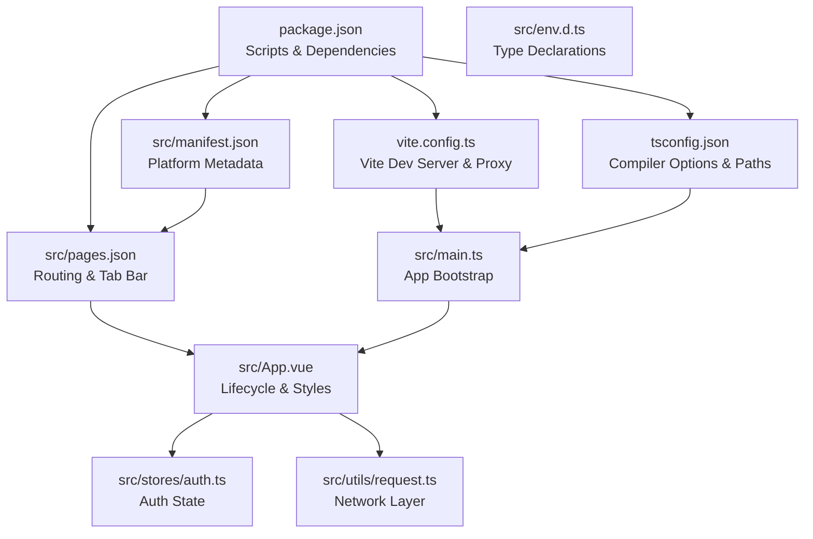
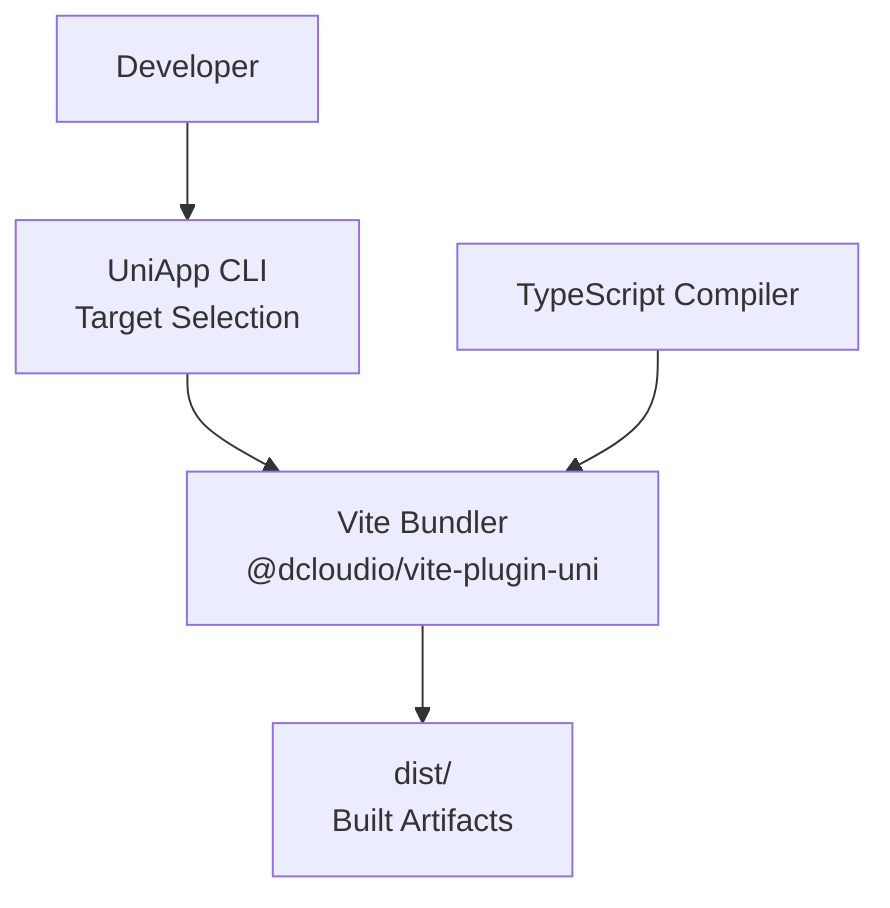
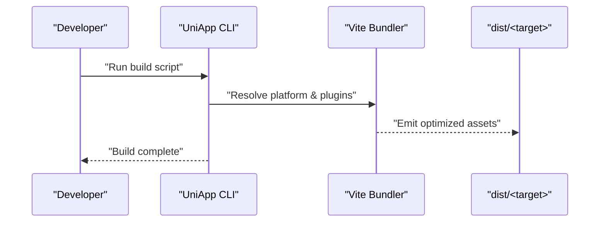
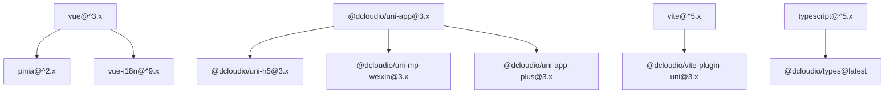

# Build and Deployment Configuration

<cite>
**Referenced Files in This Document**
- [package.json](file://camp-channel-client-uniapp/package.json)
- [vite.config.ts](file://camp-channel-client-uniapp/vite.config.ts)
- [tsconfig.json](file://camp-channel-client-uniapp/tsconfig.json)
- [manifest.json](file://camp-channel-client-uniapp/src/manifest.json)
- [pages.json](file://camp-channel-client-uniapp/src/pages.json)
- [main.ts](file://camp-channel-client-uniapp/src/main.ts)
- [env.d.ts](file://camp-channel-client-uniapp/src/env.d.ts)
- [App.vue](file://camp-channel-client-uniapp/src/App.vue)
- [auth.ts](file://camp-channel-client-uniapp/src/stores/auth.ts)
- [request.ts](file://camp-channel-client-uniapp/src/utils/request.ts)
</cite>

## Table of Contents
1. [Introduction](#introduction)
2. [Project Structure](#project-structure)
3. [Core Components](#core-components)
4. [Architecture Overview](#architecture-overview)
5. [Detailed Component Analysis](#detailed-component-analysis)
6. [Dependency Analysis](#dependency-analysis)
7. [Performance Considerations](#performance-considerations)
8. [Troubleshooting Guide](#troubleshooting-guide)
9. [Conclusion](#conclusion)
10. [Appendices](#appendices)

## Introduction
This document explains the build and deployment configuration for the UniApp client. It covers package scripts for building and developing across platforms, dependency management, TypeScript configuration for strictness and path mapping, Vite configuration for development and proxying, and the runtime configuration for H5 and Mini Program targets. It also outlines practical examples of asset processing, code splitting, and bundle optimization, and describes deployment strategies for H5 hosting, Mini Program publishing, and app store submissions. Finally, it provides guidance on CI/CD, automated testing, and release management tailored to cross-platform deployment.

## Project Structure
The UniApp project is organized around a single application that compiles to multiple targets via the UniApp CLI and Vite. Key configuration files include:
- package.json: Scripts and dependencies for building and developing for H5 and Mini Program targets.
- vite.config.ts: Vite configuration with plugin integration and development server proxy.
- tsconfig.json: TypeScript compiler options, path mapping, and included files.
- src/manifest.json: Platform-specific metadata and settings (H5 and Mini Program).
- src/pages.json: Page routing, navigation styles, and tab bar configuration.
- src/main.ts and src/env.d.ts: Application bootstrap and type declarations.
- src/App.vue: Root component lifecycle hooks and global styles.
- src/stores/auth.ts and src/utils/request.ts: Runtime logic for authentication and network requests.

**Diagram sources**
- [package.json:1-29](file://camp-channel-client-uniapp/package.json#L1-L29)
- [vite.config.ts:1-16](file://camp-channel-client-uniapp/vite.config.ts#L1-L16)
- [tsconfig.json:1-28](file://camp-channel-client-uniapp/tsconfig.json#L1-L28)
- [manifest.json:1-21](file://camp-channel-client-uniapp/src/manifest.json#L1-L21)
- [pages.json:1-202](file://camp-channel-client-uniapp/src/pages.json#L1-L202)
- [main.ts:1-10](file://camp-channel-client-uniapp/src/main.ts#L1-L10)
- [env.d.ts:1-8](file://camp-channel-client-uniapp/src/env.d.ts#L1-L8)
- [App.vue:1-93](file://camp-channel-client-uniapp/src/App.vue#L1-L93)
- [auth.ts:1-34](file://camp-channel-client-uniapp/src/stores/auth.ts#L1-L34)
- [request.ts:1-112](file://camp-channel-client-uniapp/src/utils/request.ts#L1-L112)

**Section sources**
- [package.json:1-29](file://camp-channel-client-uniapp/package.json#L1-L29)
- [vite.config.ts:1-16](file://camp-channel-client-uniapp/vite.config.ts#L1-L16)
- [tsconfig.json:1-28](file://camp-channel-client-uniapp/tsconfig.json#L1-L28)
- [manifest.json:1-21](file://camp-channel-client-uniapp/src/manifest.json#L1-L21)
- [pages.json:1-202](file://camp-channel-client-uniapp/src/pages.json#L1-L202)
- [main.ts:1-10](file://camp-channel-client-uniapp/src/main.ts#L1-L10)
- [env.d.ts:1-8](file://camp-channel-client-uniapp/src/env.d.ts#L1-L8)
- [App.vue:1-93](file://camp-channel-client-uniapp/src/App.vue#L1-L93)
- [auth.ts:1-34](file://camp-channel-client-uniapp/src/stores/auth.ts#L1-L34)
- [request.ts:1-112](file://camp-channel-client-uniapp/src/utils/request.ts#L1-L112)

## Core Components
- Package scripts for building and developing:
  - H5 development and build commands.
  - Mini Program (WeChat) development and build commands.
- Dependencies:
  - UniApp runtime and platform adapters.
  - Vue 3, Pinia, vue-i18n for core functionality.
  - Vite and @dcloudio/vite-plugin-uni for bundling and platform support.
  - TypeScript and related types for type safety.
- TypeScript configuration:
  - Module resolution, strictness, JSX preservation, source maps, and DOM/libraries.
  - Path alias @/* mapped to src/.
  - Type declarations for UniApp.
- Vite configuration:
  - Plugin integration for UniApp.
  - Development server port and API proxy to backend.
- Runtime configuration:
  - manifest.json defines app metadata, H5 title and router mode, and WeChat appid.
  - pages.json defines pages, global styles, and tab bar configuration.

**Section sources**
- [package.json:5-10](file://camp-channel-client-uniapp/package.json#L5-L10)
- [package.json:11-27](file://camp-channel-client-uniapp/package.json#L11-L27)
- [tsconfig.json:2-16](file://camp-channel-client-uniapp/tsconfig.json#L2-L16)
- [tsconfig.json:12-14](file://camp-channel-client-uniapp/tsconfig.json#L12-L14)
- [vite.config.ts:4-15](file://camp-channel-client-uniapp/vite.config.ts#L4-L15)
- [manifest.json:8-19](file://camp-channel-client-uniapp/src/manifest.json#L8-L19)
- [pages.json:157-200](file://camp-channel-client-uniapp/src/pages.json#L157-L200)

## Architecture Overview
The build pipeline integrates the UniApp CLI with Vite and the @dcloudio/vite-plugin-uni. The CLI selects the target platform (H5 or Mini Program) and delegates bundling to Vite. TypeScript compiles source files with configured path aliases and type declarations. During development, Vite serves assets and proxies API calls to the backend. Production builds generate optimized bundles per platform.

**Diagram sources**
- [package.json:6-9](file://camp-channel-client-uniapp/package.json#L6-L9)
- [vite.config.ts:2](file://camp-channel-client-uniapp/vite.config.ts#L2)
- [tsconfig.json:17-26](file://camp-channel-client-uniapp/tsconfig.json#L17-L26)

## Detailed Component Analysis

### Build Scripts and Targets
- H5 development and build:
  - Scripts invoke the UniApp CLI without explicit platform flag for H5.
- Mini Program (WeChat) development and build:
  - Scripts specify the Mini Program target for WeChat.
- These scripts delegate to the UniApp CLI, which coordinates Vite and platform-specific transforms.

Practical implications:
- Use the H5 scripts for browser testing during development.
- Use the Mini Program scripts for previewing in the WeChat developer tool.

**Section sources**
- [package.json:5-10](file://camp-channel-client-uniapp/package.json#L5-L10)

### TypeScript Configuration
Key compiler options and settings:
- Target and module: ESNext for modern JavaScript features.
- Module resolution: Node for predictable module resolution.
- Strictness: Disabled by default; enable for stricter checks if desired.
- JSX: Preserved for Vue Single File Components.
- Source maps: Enabled for debugging.
- Libraries: ESNext and DOM for browser APIs.
- Path mapping: @/* resolves to src/.
- Types: Includes UniApp type declarations.

Recommendations:
- Enable strict mode and additional checks (e.g., noImplicitAny, strictNullChecks) for improved reliability.
- Keep path mapping consistent across the project for maintainability.

**Section sources**
- [tsconfig.json:2-16](file://camp-channel-client-uniapp/tsconfig.json#L2-L16)
- [tsconfig.json:12-14](file://camp-channel-client-uniapp/tsconfig.json#L12-L14)
- [env.d.ts:1](file://camp-channel-client-uniapp/src/env.d.ts#L1)

### Vite Configuration
Development server:
- Port: 5173.
- Proxy: Routes /api to the backend server running on localhost:8080 with origin changes enabled.
Plugin integration:
- Uses @dcloudio/vite-plugin-uni for UniApp platform support.

Production builds:
- The UniApp CLI handles platform-specific optimizations and output directories.

Asset processing and code splitting:
- Vite performs tree-shaking and module-level splitting by default.
- Platform-specific code is separated via the UniApp plugin and manifest configuration.

**Section sources**
- [vite.config.ts:4-15](file://camp-channel-client-uniapp/vite.config.ts#L4-L15)

### Runtime Configuration (H5 and Mini Program)
Manifest:
- H5 title and router mode set to hash.
- WeChat appid configured; URL checking disabled for development convenience.

Pages:
- Defines page routes, navigation bar styles, pull-to-refresh for specific pages, and tab bar entries with localized labels.

Global style:
- Navigation bar colors and background color applied globally.

**Section sources**
- [manifest.json:8-19](file://camp-channel-client-uniapp/src/manifest.json#L8-L19)
- [pages.json:2-156](file://camp-channel-client-uniapp/src/pages.json#L2-L156)
- [pages.json:157-200](file://camp-channel-client-uniapp/src/pages.json#L157-L200)

### Application Bootstrap and Lifecycle
Bootstrap:
- Creates a Vue 3 app instance and installs Pinia.
- Exports a factory function for SSR compatibility.

Root component:
- Registers lifecycle hooks for launch, show, and hide.
- Loads unread notification counts and sets tab bar styles.
- Applies global gradient background and transitions.

**Section sources**
- [main.ts:1-10](file://camp-channel-client-uniapp/src/main.ts#L1-L10)
- [App.vue:8-43](file://camp-channel-client-uniapp/src/App.vue#L8-L43)
- [App.vue:52-92](file://camp-channel-client-uniapp/src/App.vue#L52-L92)

### Authentication and Network Layer
Authentication store:
- Persists token and user info in storage.
- Provides setters and cleanup functions.

Network utility:
- Centralizes base URL with storage-backed override.
- Adds Authorization header when present.
- Handles 401 business logic by forcing logout and navigating to login.
- Converts relative image URLs to absolute using the base URL.

**Section sources**
- [auth.ts:4-32](file://camp-channel-client-uniapp/src/stores/auth.ts#L4-L32)
- [request.ts:30-84](file://camp-channel-client-uniapp/src/utils/request.ts#L30-L84)
- [request.ts:89-109](file://camp-channel-client-uniapp/src/utils/request.ts#L89-L109)

### Build and Deployment Workflows

#### H5 Hosting
- Development:
  - Run the H5 development script to start Vite dev server on the configured port.
  - Use the proxy to forward API calls to the backend.
- Production:
  - Run the H5 build script to generate optimized static assets.
  - Deploy the dist/h5 output to a web server or CDN.
  - Ensure the backend CORS and reverse proxy are configured to serve the SPA and API under the same domain/path as needed.

#### Mini Program Publishing (WeChat)
- Development:
  - Run the Mini Program development script to preview in the WeChat developer tool.
  - Configure the appid in manifest.json for the target environment.
- Production:
  - Run the Mini Program build script to produce the distribution package.
  - Publish to the WeChat public platform or enterprise platform according to their guidelines.

#### App Store Submission (if applicable)
- For native app targets supported by UniApp, compile to the respective native SDKs and follow platform-specific submission requirements.
- Ensure assets, permissions, and metadata are correctly configured in manifest.json and pages.json.

**Diagram sources**
- [package.json:7-8](file://camp-channel-client-uniapp/package.json#L7-L8)
- [package.json:9](file://camp-channel-client-uniapp/package.json#L9)

### Asset Processing, Code Splitting, and Bundle Optimization
- Asset processing:
  - Vite handles static assets, resolving path aliases and generating hashed filenames for cache busting.
- Code splitting:
  - Route-based splitting is commonly achieved by organizing pages in separate directories and letting the bundler split chunks accordingly.
- Bundle optimization:
  - Tree-shaking removes unused exports.
  - Minification and dead-code elimination occur in production builds.
  - Platform-specific polyfills and shims are handled by the UniApp plugin.

**Section sources**
- [vite.config.ts:2](file://camp-channel-client-uniapp/vite.config.ts#L2)
- [pages.json:2-156](file://camp-channel-client-uniapp/src/pages.json#L2-L156)

### Continuous Integration and Release Management
- CI/CD:
  - Configure jobs to install dependencies, run tests, and build for each target.
  - Cache node_modules to speed up builds.
  - Publish artifacts for H5 and Mini Program distributions.
- Automated testing:
  - Integrate unit and component tests into CI stages.
  - Use headless browsers for H5 smoke tests and platform emulators for Mini Program checks.
- Release management:
  - Tag releases and automate changelog generation.
  - Promote builds to staging and production environments with approval gates.

[No sources needed since this section provides general guidance]

## Dependency Analysis
The project’s build-time and runtime dependencies form a cohesive stack:
- UniApp ecosystem packages provide platform abstraction and bundling.
- Vue 3 and Pinia deliver reactive state management.
- Vite and the UniApp plugin orchestrate bundling and platform-specific transforms.
- TypeScript and type declarations ensure type safety across platforms.

**Diagram sources**
- [package.json:11-27](file://camp-channel-client-uniapp/package.json#L11-L27)

**Section sources**
- [package.json:11-27](file://camp-channel-client-uniapp/package.json#L11-L27)

## Performance Considerations
- Enable strict TypeScript checks to catch potential runtime errors early.
- Keep path aliases consistent to avoid deep-relative imports that complicate bundling.
- Use route-based code splitting by organizing pages into distinct directories.
- Leverage Vite’s built-in minification and tree-shaking; avoid importing unused libraries.
- For H5, configure long-term caching for static assets and set appropriate cache headers.
- For Mini Programs, minimize payload size by removing unused assets and enabling platform-specific optimizations.

[No sources needed since this section provides general guidance]

## Troubleshooting Guide
- Proxy not working:
  - Verify the backend is running and reachable at the configured target host/port.
  - Confirm the proxy path matches the frontend API calls.
- 401 Unauthorized:
  - The network utility forces logout on 401 or specific business codes; ensure tokens are persisted and refreshed as needed.
- Tab bar badge not updating:
  - Confirm the unread count endpoint exists and returns expected shape; the root component attempts to set badges on show.
- Mini Program preview issues:
  - Ensure the WeChat appid is set in manifest.json and URL verification is configured for the development environment.

**Section sources**
- [vite.config.ts:8-13](file://camp-channel-client-uniapp/vite.config.ts#L8-L13)
- [request.ts:57-63](file://camp-channel-client-uniapp/src/utils/request.ts#L57-L63)
- [App.vue:22-36](file://camp-channel-client-uniapp/src/App.vue#L22-L36)
- [manifest.json:14-19](file://camp-channel-client-uniapp/src/manifest.json#L14-L19)

## Conclusion
The UniApp client leverages a streamlined configuration: package scripts for target selection, Vite with the UniApp plugin for bundling, TypeScript for type safety, and runtime manifests for platform-specific behavior. By following the outlined build and deployment workflows, optimizing assets and bundles, and integrating CI/CD and testing, teams can reliably deliver H5 and Mini Program experiences with consistent performance and developer productivity.

## Appendices
- Example build command references:
  - H5 development: [package.json:8](file://camp-channel-client-uniapp/package.json#L8)
  - H5 production: [package.json:9](file://camp-channel-client-uniapp/package.json#L9)
  - Mini Program development: [package.json:6](file://camp-channel-client-uniapp/package.json#L6)
  - Mini Program production: [package.json:7](file://camp-channel-client-uniapp/package.json#L7)