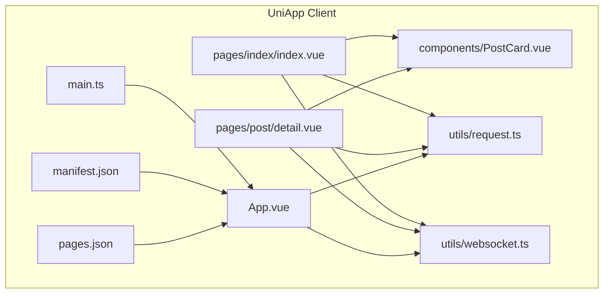
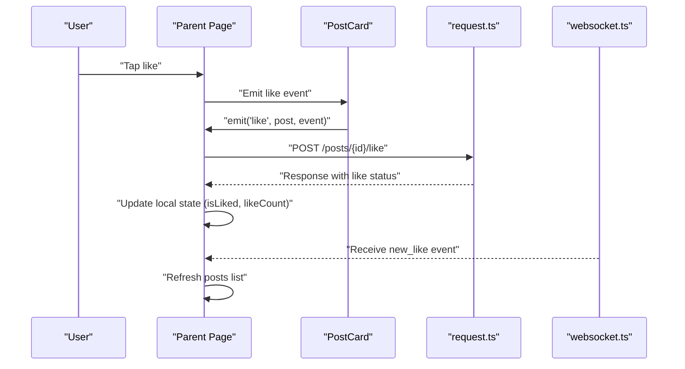
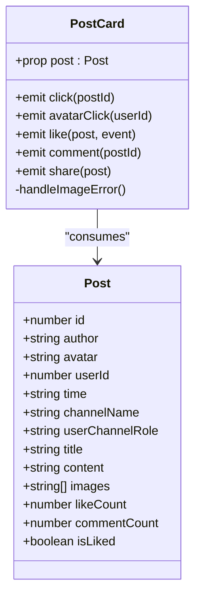
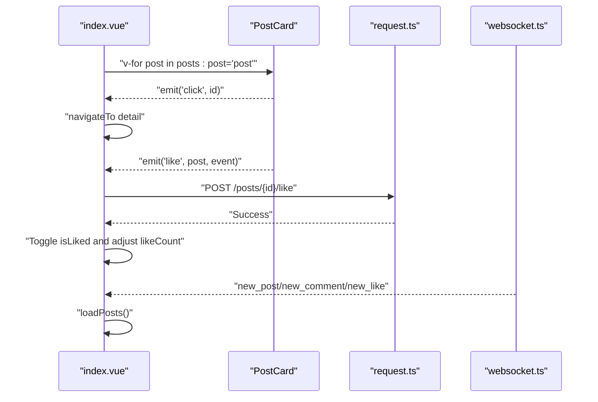
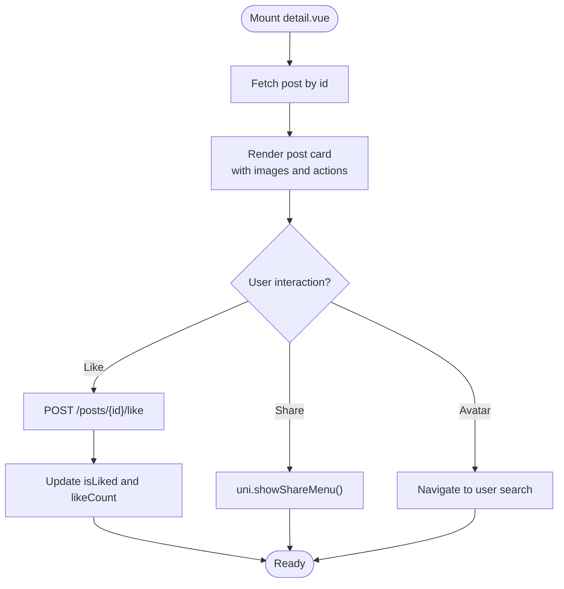
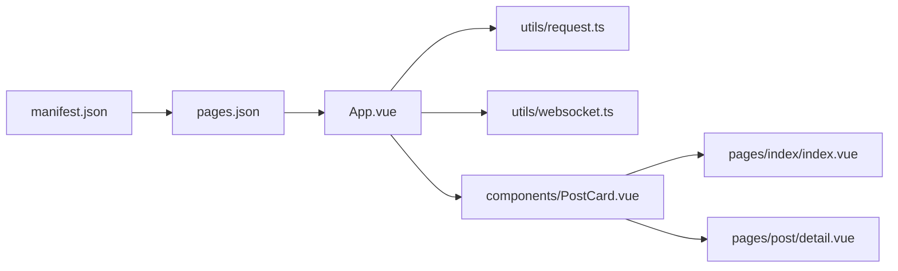
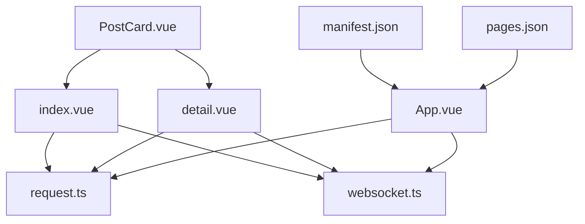

# Component Sharing and Reusability

<cite>
**Referenced Files in This Document**
- [PostCard.vue](file://camp-channel-client-uniapp/src/components/PostCard.vue)
- [index.vue](file://camp-channel-client-uniapp/src/pages/index/index.vue)
- [detail.vue](file://camp-channel-client-uniapp/src/pages/post/detail.vue)
- [request.ts](file://camp-channel-client-uniapp/src/utils/request.ts)
- [websocket.ts](file://camp-channel-client-uniapp/src/utils/websocket.ts)
- [App.vue](file://camp-channel-client-uniapp/src/App.vue)
- [main.ts](file://camp-channel-client-uniapp/src/main.ts)
- [manifest.json](file://camp-channel-client-uniapp/src/manifest.json)
- [pages.json](file://camp-channel-client-uniapp/src/pages.json)
</cite>

## Table of Contents
1. [Introduction](#introduction)
2. [Project Structure](#project-structure)
3. [Core Components](#core-components)
4. [Architecture Overview](#architecture-overview)
5. [Detailed Component Analysis](#detailed-component-analysis)
6. [Dependency Analysis](#dependency-analysis)
7. [Performance Considerations](#performance-considerations)
8. [Troubleshooting Guide](#troubleshooting-guide)
9. [Conclusion](#conclusion)

## Introduction
This document explains component sharing strategies within the UniApp ecosystem, focusing on designing cross-platform compatible components, shared patterns, and platform-specific adaptations. It documents the PostCard component as a case study, demonstrating how it adapts across platforms while maintaining consistent functionality. Topics include prop handling, conditional rendering, shared business logic, lifecycle management, event handling, state integration, composition patterns, slots, and performance optimization. The goal is to help developers maintain component reusability while accommodating platform-specific requirements.

## Project Structure
The UniApp client resides under the “camp-channel-client-uniapp” directory. Key areas:
- Components: Shared UI building blocks (e.g., PostCard.vue)
- Pages: Feature pages that compose components (e.g., index.vue, detail.vue)
- Utils: Cross-cutting concerns (networking, WebSocket)
- App bootstrap: Application initialization and global styles
- Platform configuration: Manifest and pages configuration

**Diagram sources**
- [App.vue:1-93](file://camp-channel-client-uniapp/src/App.vue#L1-L93)
- [main.ts:1-10](file://camp-channel-client-uniapp/src/main.ts#L1-L10)
- [PostCard.vue:1-318](file://camp-channel-client-uniapp/src/components/PostCard.vue#L1-L318)
- [index.vue:1-395](file://camp-channel-client-uniapp/src/pages/index/index.vue#L1-L395)
- [detail.vue:1-598](file://camp-channel-client-uniapp/src/pages/post/detail.vue#L1-L598)
- [request.ts:1-112](file://camp-channel-client-uniapp/src/utils/request.ts#L1-L112)
- [websocket.ts:1-268](file://camp-channel-client-uniapp/src/utils/websocket.ts#L1-L268)
- [manifest.json:1-21](file://camp-channel-client-uniapp/src/manifest.json#L1-L21)
- [pages.json:1-202](file://camp-channel-client-uniapp/src/pages.json#L1-L202)

**Section sources**
- [App.vue:1-93](file://camp-channel-client-uniapp/src/App.vue#L1-L93)
- [main.ts:1-10](file://camp-channel-client-uniapp/src/main.ts#L1-L10)
- [manifest.json:1-21](file://camp-channel-client-uniapp/src/manifest.json#L1-L21)
- [pages.json:1-202](file://camp-channel-client-uniapp/src/pages.json#L1-L202)

## Core Components
- PostCard: A reusable card component displaying post metadata, content, optional images, and action buttons. It encapsulates presentation and user interactions while emitting events upward for parent pages to handle business logic.
- Parent pages (index and detail): Compose PostCard with platform-agnostic props and event handlers, ensuring consistent behavior across platforms.

Key characteristics:
- Props-driven interface with a strongly typed Post shape
- Emits events for clicks, likes, comments, shares, and avatar taps
- Uses conditional rendering for images and placeholders
- Integrates with shared utilities for networking and real-time updates

**Section sources**
- [PostCard.vue:54-121](file://camp-channel-client-uniapp/src/components/PostCard.vue#L54-L121)
- [index.vue:27-49](file://camp-channel-client-uniapp/src/pages/index/index.vue#L27-L49)
- [detail.vue:4-51](file://camp-channel-client-uniapp/src/pages/post/detail.vue#L4-L51)

## Architecture Overview
The PostCard component is consumed by two pages:
- Home page (index.vue): Renders a list of PostCard instances inside a swipeable tabbed layout, handles pagination, refresh, and real-time updates via WebSocket.
- Detail page (detail.vue): Displays a single post with expanded media previews and a comments section.

Networking and real-time updates are centralized in utils/request.ts and utils/websocket.ts, ensuring consistent behavior across platforms.

**Diagram sources**
- [index.vue:216-226](file://camp-channel-client-uniapp/src/pages/index/index.vue#L216-L226)
- [PostCard.vue:106-116](file://camp-channel-client-uniapp/src/components/PostCard.vue#L106-L116)
- [request.ts:30-84](file://camp-channel-client-uniapp/src/utils/request.ts#L30-L84)
- [websocket.ts:23-129](file://camp-channel-client-uniapp/src/utils/websocket.ts#L23-L129)

## Detailed Component Analysis

### PostCard Component
PostCard is a self-contained, props-driven component that:
- Accepts a Post object and renders author info, title, content, optional images, and actions
- Handles avatar image errors gracefully with a fallback placeholder
- Emits events for user interactions to be handled by parent pages
- Uses scoped styles with platform-friendly units and gradients

**Diagram sources**
- [PostCard.vue:59-85](file://camp-channel-client-uniapp/src/components/PostCard.vue#L59-L85)

Implementation highlights:
- Props typing ensures compile-time safety and IDE support
- Emits structured events enabling parent pages to update state consistently
- Conditional rendering for images and role badges maintains flexibility across data shapes
- Scoped styles keep visuals isolated and portable

**Section sources**
- [PostCard.vue:54-121](file://camp-channel-client-uniapp/src/components/PostCard.vue#L54-L121)
- [PostCard.vue:123-317](file://camp-channel-client-uniapp/src/components/PostCard.vue#L123-L317)

### Parent Page Composition (index.vue)
The home page composes PostCard in a loop, passing props and handling emitted events. It:
- Normalizes incoming data into a Post shape, including image URLs and counts
- Implements pull-to-refresh and tab switching
- Subscribes to WebSocket events to keep lists fresh
- Navigates to detail or user profile on interactions

**Diagram sources**
- [index.vue:27-49](file://camp-channel-client-uniapp/src/pages/index/index.vue#L27-L49)
- [index.vue:156-172](file://camp-channel-client-uniapp/src/pages/index/index.vue#L156-L172)
- [index.vue:216-226](file://camp-channel-client-uniapp/src/pages/index/index.vue#L216-L226)
- [request.ts:30-84](file://camp-channel-client-uniapp/src/utils/request.ts#L30-L84)
- [websocket.ts:23-129](file://camp-channel-client-uniapp/src/utils/websocket.ts#L23-L129)

**Section sources**
- [index.vue:53-267](file://camp-channel-client-uniapp/src/pages/index/index.vue#L53-L267)

### Parent Page Composition (detail.vue)
The detail page displays a single post with:
- Expanded image grid and preview capability
- Comment input and list
- Like toggling and share menu
- Role badge rendering aligned with PostCard’s logic

**Diagram sources**
- [detail.vue:162-202](file://camp-channel-client-uniapp/src/pages/post/detail.vue#L162-L202)
- [detail.vue:232-243](file://camp-channel-client-uniapp/src/pages/post/detail.vue#L232-L243)
- [detail.vue:275-279](file://camp-channel-client-uniapp/src/pages/post/detail.vue#L275-L279)
- [request.ts:30-84](file://camp-channel-client-uniapp/src/utils/request.ts#L30-L84)

**Section sources**
- [detail.vue:93-337](file://camp-channel-client-uniapp/src/pages/post/detail.vue#L93-L337)

### Platform Compatibility and Adaptations
- Cross-platform APIs: Networking and WebSocket utilities rely on uni-app APIs, ensuring consistent behavior across H5, Mini Program, and native targets configured in manifest.json and pages.json.
- Image URL normalization: processImageUrl converts relative paths to absolute URLs, supporting both H5 and Mini Program environments.
- Tab bar and navigation: pages.json defines platform navigation styles and tabBar behavior; App.vue applies global styles and tab bar customization.

**Diagram sources**
- [manifest.json:1-21](file://camp-channel-client-uniapp/src/manifest.json#L1-L21)
- [pages.json:1-202](file://camp-channel-client-uniapp/src/pages.json#L1-L202)
- [App.vue:1-93](file://camp-channel-client-uniapp/src/App.vue#L1-L93)
- [request.ts:16-25](file://camp-channel-client-uniapp/src/utils/request.ts#L16-L25)
- [PostCard.vue:118-120](file://camp-channel-client-uniapp/src/components/PostCard.vue#L118-L120)
- [index.vue:27-49](file://camp-channel-client-uniapp/src/pages/index/index.vue#L27-L49)
- [detail.vue:4-51](file://camp-channel-client-uniapp/src/pages/post/detail.vue#L4-L51)

**Section sources**
- [manifest.json:8-19](file://camp-channel-client-uniapp/src/manifest.json#L8-L19)
- [pages.json:157-200](file://camp-channel-client-uniapp/src/pages.json#L157-L200)
- [request.ts:16-25](file://camp-channel-client-uniapp/src/utils/request.ts#L16-L25)
- [App.vue:8-43](file://camp-channel-client-uniapp/src/App.vue#L8-L43)

## Dependency Analysis
PostCard depends on:
- Parent pages for props and event handling
- Shared utilities for networking and real-time updates
- Platform configuration for navigation and tab bar behavior

**Diagram sources**
- [PostCard.vue:54-121](file://camp-channel-client-uniapp/src/components/PostCard.vue#L54-L121)
- [index.vue:27-49](file://camp-channel-client-uniapp/src/pages/index/index.vue#L27-L49)
- [detail.vue:4-51](file://camp-channel-client-uniapp/src/pages/post/detail.vue#L4-L51)
- [request.ts:30-84](file://camp-channel-client-uniapp/src/utils/request.ts#L30-L84)
- [websocket.ts:23-129](file://camp-channel-client-uniapp/src/utils/websocket.ts#L23-L129)
- [App.vue:1-93](file://camp-channel-client-uniapp/src/App.vue#L1-L93)
- [manifest.json:1-21](file://camp-channel-client-uniapp/src/manifest.json#L1-L21)
- [pages.json:1-202](file://camp-channel-client-uniapp/src/pages.json#L1-L202)

**Section sources**
- [index.vue:53-267](file://camp-channel-client-uniapp/src/pages/index/index.vue#L53-L267)
- [detail.vue:93-337](file://camp-channel-client-uniapp/src/pages/post/detail.vue#L93-L337)
- [request.ts:30-84](file://camp-channel-client-uniapp/src/utils/request.ts#L30-L84)
- [websocket.ts:23-129](file://camp-channel-client-uniapp/src/utils/websocket.ts#L23-L129)

## Performance Considerations
- Virtualization and rendering:
  - Limit rendered items by slicing image arrays to a fixed number in templates to reduce DOM nodes.
  - Prefer lightweight placeholders for missing images and handle errors early to avoid layout thrashing.
- Event handling:
  - Use event delegation patterns where appropriate; in this codebase, each action button emits a focused event, minimizing unnecessary re-renders.
- Network efficiency:
  - Normalize image URLs once per item to avoid repeated conversions.
  - Debounce or batch refresh triggers from WebSocket events to prevent excessive reloads.
- Lifecycle:
  - Unsubscribe from WebSocket listeners on component unmount to prevent memory leaks.
- Styles:
  - Keep scoped styles minimal and reuse computed values for dynamic classes to reduce style recalculation.

[No sources needed since this section provides general guidance]

## Troubleshooting Guide
Common issues and resolutions:
- Image rendering failures:
  - PostCard sets an internal flag on image error and falls back to a placeholder. Ensure network connectivity and correct image URLs.
  - Verify processImageUrl behavior for relative paths.
- Authentication and session expiry:
  - request.ts centralizes token handling and unauthorized responses. On 401 or business code indicating logout, it clears credentials and navigates to the login page.
- WebSocket connectivity:
  - websocket.ts manages connection lifecycle, reconnection attempts, and handler registration. If real-time updates are missing, check connection state and handler subscriptions.
- Navigation and tab bar:
  - App.vue applies tab bar styles and badges; pages.json defines navigation bar and tabBar configuration. Misaligned styles often stem from these configurations.

**Section sources**
- [PostCard.vue:118-120](file://camp-channel-client-uniapp/src/components/PostCard.vue#L118-L120)
- [request.ts:57-109](file://camp-channel-client-uniapp/src/utils/request.ts#L57-L109)
- [websocket.ts:23-129](file://camp-channel-client-uniapp/src/utils/websocket.ts#L23-L129)
- [App.vue:8-43](file://camp-channel-client-uniapp/src/App.vue#L8-L43)
- [pages.json:157-200](file://camp-channel-client-uniapp/src/pages.json#L157-L200)

## Conclusion
PostCard exemplifies effective component sharing in UniApp by:
- Using a strict props interface and emitting focused events
- Leveraging shared utilities for networking and real-time updates
- Adapting to platform differences through configuration and normalized URLs
- Maintaining consistent UX across pages and platforms

Adopting similar patterns—typed props, event-driven interactions, centralized utilities, and platform-aware configuration—enables robust, reusable components that scale across H5, Mini Program, and native targets.