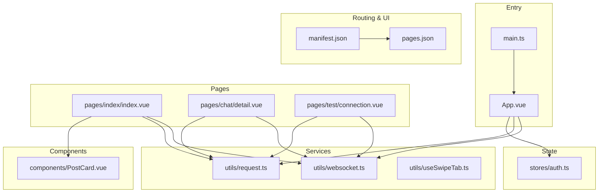
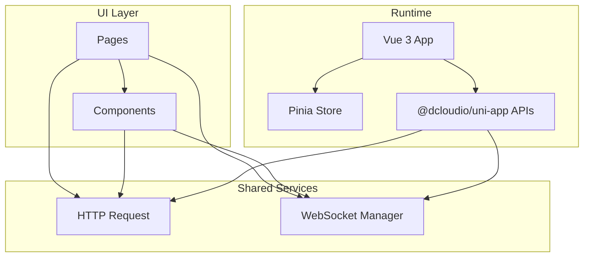
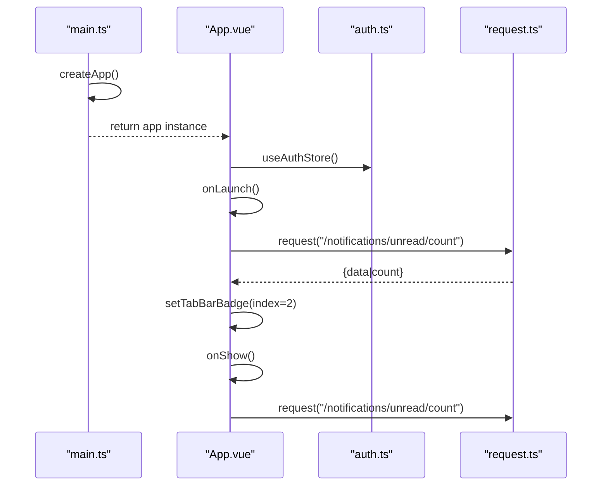
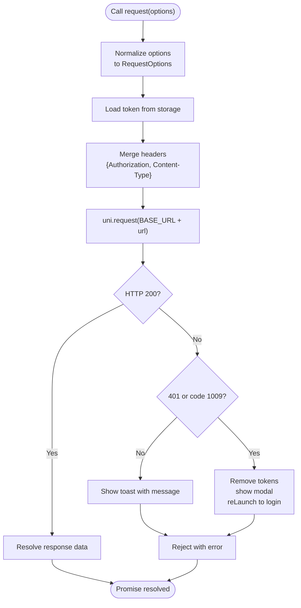
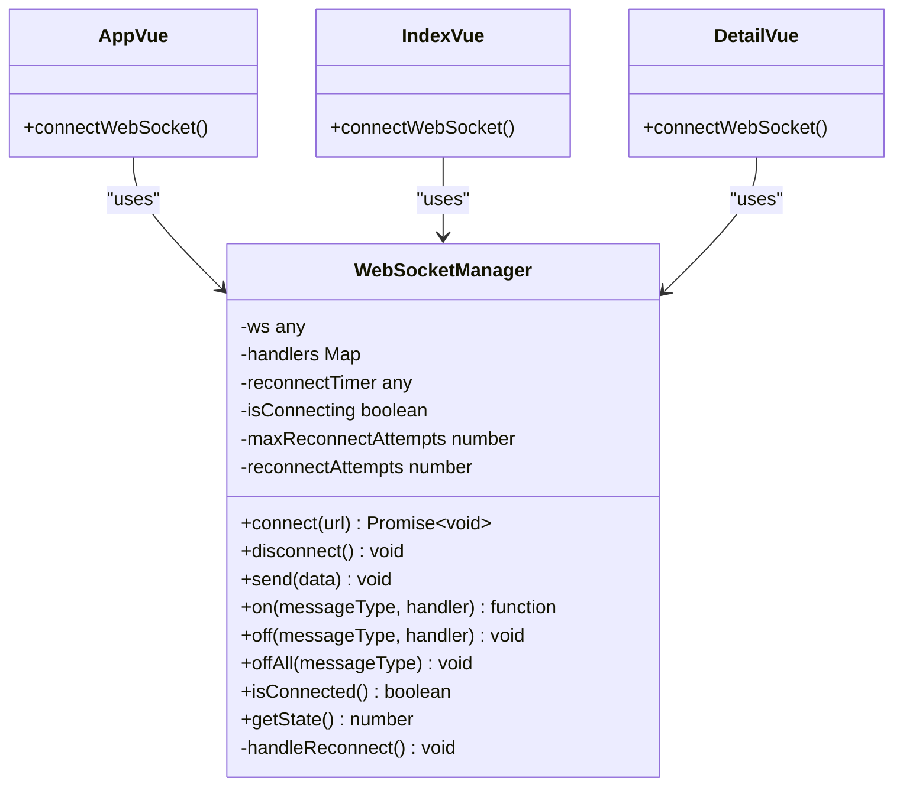
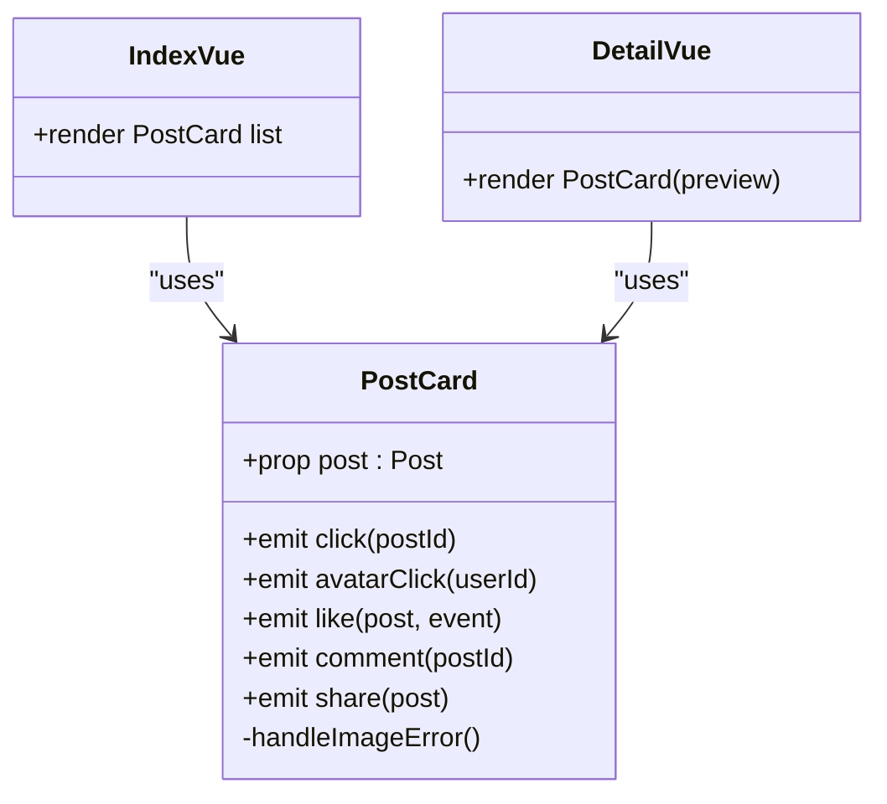
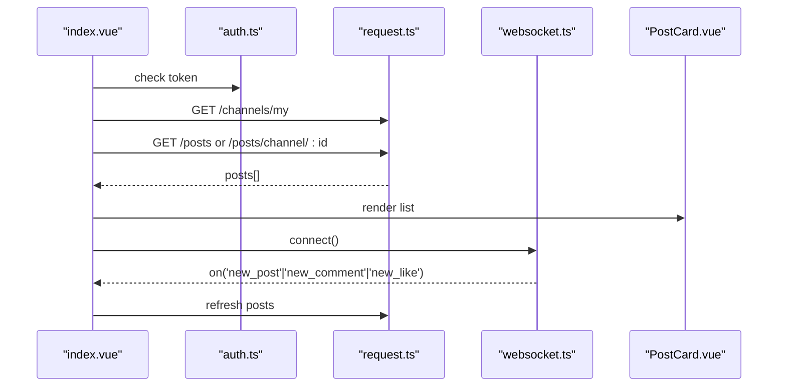
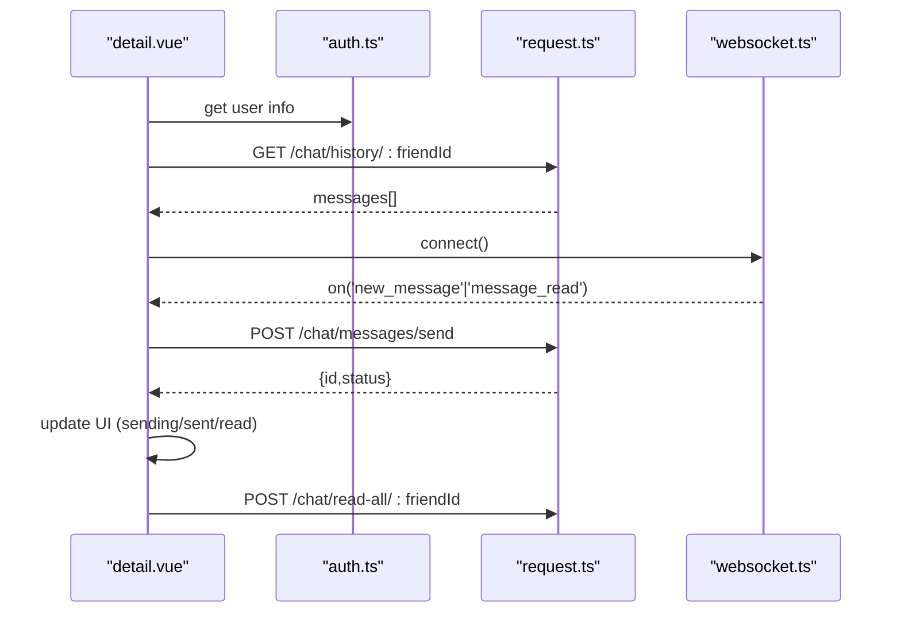
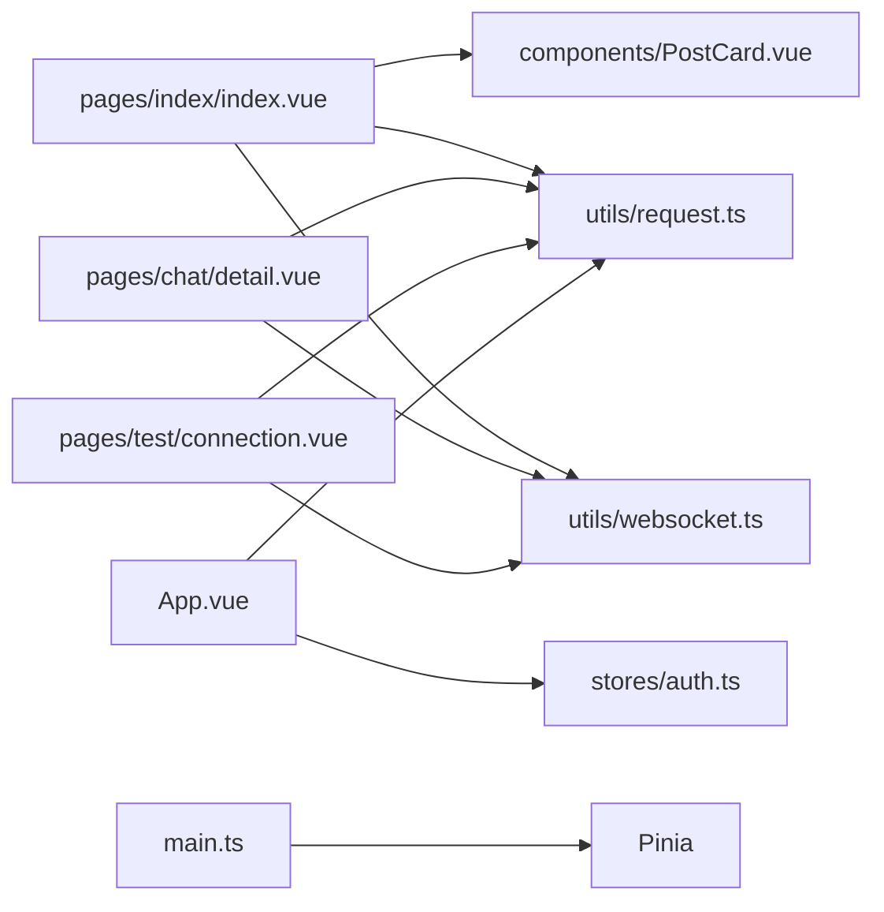

# Cross-platform Application - UniApp Client

<cite>
**Referenced Files in This Document**
- [main.ts](file://camp-channel-client-uniapp/src/main.ts)
- [App.vue](file://camp-channel-client-uniapp/src/App.vue)
- [manifest.json](file://camp-channel-client-uniapp/src/manifest.json)
- [pages.json](file://camp-channel-client-uniapp/src/pages.json)
- [package.json](file://camp-channel-client-uniapp/package.json)
- [auth.ts](file://camp-channel-client-uniapp/src/stores/auth.ts)
- [request.ts](file://camp-channel-client-uniapp/src/utils/request.ts)
- [websocket.ts](file://camp-channel-client-uniapp/src/utils/websocket.ts)
- [PostCard.vue](file://camp-channel-client-uniapp/src/components/PostCard.vue)
- [index.vue](file://camp-channel-client-uniapp/src/pages/index/index.vue)
- [detail.vue](file://camp-channel-client-uniapp/src/pages/chat/detail.vue)
- [connection.vue](file://camp-channel-client-uniapp/src/pages/test/connection.vue)
- [useSwipeTab.ts](file://camp-channel-client-uniapp/src/utils/useSwipeTab.ts)
</cite>

## Table of Contents
1. [Introduction](#introduction)
2. [Project Structure](#project-structure)
3. [Core Components](#core-components)
4. [Architecture Overview](#architecture-overview)
5. [Detailed Component Analysis](#detailed-component-analysis)
6. [Dependency Analysis](#dependency-analysis)
7. [Performance Considerations](#performance-considerations)
8. [Troubleshooting Guide](#troubleshooting-guide)
9. [Conclusion](#conclusion)
10. [Appendices](#appendices)

## Introduction
This document explains the UniApp cross-platform client implementation for the campus channel application. It covers the framework architecture that targets H5, Mini Program (WeChat), and App platforms, component sharing strategies, platform-specific optimizations, unified request handling, and WebSocket services for real-time communication. It also documents build configuration, platform-specific styling, deployment strategies, and how the client integrates with shared backend services while handling platform capabilities and limitations.

## Project Structure
The UniApp client is organized around a Vue 3 + Pinia architecture with a clear separation of concerns:
- Application bootstrap and global initialization live in the entry file.
- Global UI and lifecycle hooks are centralized in the root App component.
- Routing, tab bar, and page-level styles are configured via pages.json.
- Platform metadata and build targets are defined in manifest.json.
- Shared business logic is encapsulated in composables and stores.
- Pages consume reusable components and services.

**Diagram sources**
- [main.ts:1-10](file://camp-channel-client-uniapp/src/main.ts#L1-L10)
- [App.vue:1-93](file://camp-channel-client-uniapp/src/App.vue#L1-L93)
- [pages.json:1-202](file://camp-channel-client-uniapp/src/pages.json#L1-L202)
- [manifest.json:1-21](file://camp-channel-client-uniapp/src/manifest.json#L1-L21)
- [auth.ts:1-34](file://camp-channel-client-uniapp/src/stores/auth.ts#L1-L34)
- [request.ts:1-112](file://camp-channel-client-uniapp/src/utils/request.ts#L1-L112)
- [websocket.ts:1-268](file://camp-channel-client-uniapp/src/utils/websocket.ts#L1-L268)
- [useSwipeTab.ts:1-76](file://camp-channel-client-uniapp/src/utils/useSwipeTab.ts#L1-L76)
- [PostCard.vue:1-318](file://camp-channel-client-uniapp/src/components/PostCard.vue#L1-L318)
- [index.vue:1-395](file://camp-channel-client-uniapp/src/pages/index/index.vue#L1-L395)
- [detail.vue:1-507](file://camp-channel-client-uniapp/src/pages/chat/detail.vue#L1-L507)
- [connection.vue:1-334](file://camp-channel-client-uniapp/src/pages/test/connection.vue#L1-L334)

**Section sources**
- [main.ts:1-10](file://camp-channel-client-uniapp/src/main.ts#L1-L10)
- [App.vue:1-93](file://camp-channel-client-uniapp/src/App.vue#L1-L93)
- [pages.json:1-202](file://camp-channel-client-uniapp/src/pages.json#L1-L202)
- [manifest.json:1-21](file://camp-channel-client-uniapp/src/manifest.json#L1-L21)
- [package.json:1-29](file://camp-channel-client-uniapp/package.json#L1-L29)

## Core Components
- Application bootstrap: Creates the Vue app instance and installs Pinia.
- Root App: Initializes tab bar styles, badge counts, and global lifecycle hooks.
- Authentication Store: Manages token and user info using platform storage.
- Request Utility: Unified HTTP client with token injection, base URL resolution, and force logout handling.
- WebSocket Manager: Centralized, singleton WebSocket manager with reconnection and message routing.
- Post Card Component: Reusable card for displaying posts with actions and badges.
- Pages: Index feed, chat detail, and connection test demonstrate component reuse and service integration.

**Section sources**
- [main.ts:5-9](file://camp-channel-client-uniapp/src/main.ts#L5-L9)
- [App.vue:8-43](file://camp-channel-client-uniapp/src/App.vue#L8-L43)
- [auth.ts:4-32](file://camp-channel-client-uniapp/src/stores/auth.ts#L4-L32)
- [request.ts:30-84](file://camp-channel-client-uniapp/src/utils/request.ts#L30-L84)
- [websocket.ts:8-261](file://camp-channel-client-uniapp/src/utils/websocket.ts#L8-L261)
- [PostCard.vue:54-121](file://camp-channel-client-uniapp/src/components/PostCard.vue#L54-L121)
- [index.vue:53-128](file://camp-channel-client-uniapp/src/pages/index/index.vue#L53-L128)
- [detail.vue:68-142](file://camp-channel-client-uniapp/src/pages/chat/detail.vue#L68-L142)
- [connection.vue:47-86](file://camp-channel-client-uniapp/src/pages/test/connection.vue#L47-L86)

## Architecture Overview
UniApp compiles the same Vue codebase to multiple targets. The client uses:
- Vue 3 + Pinia for state management.
- @dcloudio/uni-app APIs for platform-aware features (storage, network, socket).
- pages.json for routing and tab bar configuration.
- manifest.json for platform metadata and H5 router mode.
- Shared services for HTTP and WebSocket communication.

**Diagram sources**
- [main.ts:1-10](file://camp-channel-client-uniapp/src/main.ts#L1-L10)
- [App.vue:2-5](file://camp-channel-client-uniapp/src/App.vue#L2-L5)
- [request.ts:30-84](file://camp-channel-client-uniapp/src/utils/request.ts#L30-L84)
- [websocket.ts:23-129](file://camp-channel-client-uniapp/src/utils/websocket.ts#L23-L129)
- [pages.json:156-201](file://camp-channel-client-uniapp/src/pages.json#L156-L201)

## Detailed Component Analysis

### Application Bootstrap and Lifecycle
- The app factory initializes the SSR-capable Vue app and registers Pinia.
- The root App sets tab bar styles and badge counts, and triggers unread notifications refresh on launch/show.

**Diagram sources**
- [main.ts:5-9](file://camp-channel-client-uniapp/src/main.ts#L5-L9)
- [App.vue:8-43](file://camp-channel-client-uniapp/src/App.vue#L8-L43)
- [auth.ts:4-32](file://camp-channel-client-uniapp/src/stores/auth.ts#L4-L32)
- [request.ts:30-84](file://camp-channel-client-uniapp/src/utils/request.ts#L30-L84)

**Section sources**
- [main.ts:5-9](file://camp-channel-client-uniapp/src/main.ts#L5-L9)
- [App.vue:8-43](file://camp-channel-client-uniapp/src/App.vue#L8-L43)

### Unified HTTP Request Handling
- Base URL resolution from storage or default.
- Automatic Authorization header injection.
- Business logic error handling and force logout on unauthorized responses.
- Image URL normalization for relative paths.

**Diagram sources**
- [request.ts:30-112](file://camp-channel-client-uniapp/src/utils/request.ts#L30-L112)

**Section sources**
- [request.ts:3-25](file://camp-channel-client-uniapp/src/utils/request.ts#L3-L25)
- [request.ts:30-84](file://camp-channel-client-uniapp/src/utils/request.ts#L30-L84)
- [request.ts:89-112](file://camp-channel-client-uniapp/src/utils/request.ts#L89-L112)

### WebSocket Real-time Communication
- Centralized WebSocketManager with singleton pattern.
- Connection lifecycle: connect, onOpen, onMessage, onError, onClose.
- Message routing by type and wildcard handlers.
- Exponential backoff reconnection with max attempts.
- Token appended to raw WebSocket URL for authentication.

**Diagram sources**
- [websocket.ts:8-261](file://camp-channel-client-uniapp/src/utils/websocket.ts#L8-L261)
- [index.vue:242-267](file://camp-channel-client-uniapp/src/pages/index/index.vue#L242-L267)
- [detail.vue:259-297](file://camp-channel-client-uniapp/src/pages/chat/detail.vue#L259-L297)
- [App.vue:22-36](file://camp-channel-client-uniapp/src/App.vue#L22-L36)

**Section sources**
- [websocket.ts:8-261](file://camp-channel-client-uniapp/src/utils/websocket.ts#L8-L261)

### Component Reusability: PostCard
- Props-driven interface for post rendering.
- Emits actions (click, avatarClick, like, comment, share).
- Robust image fallback and role badges.
- Scoped styles with glassmorphism and backdrop filters.

**Diagram sources**
- [PostCard.vue:54-121](file://camp-channel-client-uniapp/src/components/PostCard.vue#L54-L121)
- [index.vue:28-37](file://camp-channel-client-uniapp/src/pages/index/index.vue#L28-L37)
- [detail.vue:1-66](file://camp-channel-client-uniapp/src/pages/chat/detail.vue#L1-L66)

**Section sources**
- [PostCard.vue:54-121](file://camp-channel-client-uniapp/src/components/PostCard.vue#L54-L121)

### Page Integration Examples

#### Home Feed (index.vue)
- Loads channels and posts, supports pull-to-refresh.
- Integrates PostCard component and emits actions.
- Subscribes to WebSocket events for real-time updates.
- Uses swipe tab composable for bottom tab navigation.

**Diagram sources**
- [index.vue:53-128](file://camp-channel-client-uniapp/src/pages/index/index.vue#L53-L128)
- [index.vue:130-180](file://camp-channel-client-uniapp/src/pages/index/index.vue#L130-L180)
- [index.vue:242-267](file://camp-channel-client-uniapp/src/pages/index/index.vue#L242-L267)
- [PostCard.vue:54-121](file://camp-channel-client-uniapp/src/components/PostCard.vue#L54-L121)
- [websocket.ts:23-129](file://camp-channel-client-uniapp/src/utils/websocket.ts#L23-L129)

**Section sources**
- [index.vue:53-128](file://camp-channel-client-uniapp/src/pages/index/index.vue#L53-L128)
- [index.vue:130-180](file://camp-channel-client-uniapp/src/pages/index/index.vue#L130-L180)
- [index.vue:242-267](file://camp-channel-client-uniapp/src/pages/index/index.vue#L242-L267)

#### Chat Detail (detail.vue)
- Loads chat history, displays bubbles with status indicators.
- Sends messages via HTTP and receives real-time updates via WebSocket.
- Polling mechanism to keep history synchronized.
- Handles message recall within a time window.

**Diagram sources**
- [detail.vue:68-142](file://camp-channel-client-uniapp/src/pages/chat/detail.vue#L68-L142)
- [detail.vue:144-165](file://camp-channel-client-uniapp/src/pages/chat/detail.vue#L144-L165)
- [detail.vue:180-221](file://camp-channel-client-uniapp/src/pages/chat/detail.vue#L180-L221)
- [detail.vue:259-297](file://camp-channel-client-uniapp/src/pages/chat/detail.vue#L259-L297)

**Section sources**
- [detail.vue:68-142](file://camp-channel-client-uniapp/src/pages/chat/detail.vue#L68-L142)
- [detail.vue:144-165](file://camp-channel-client-uniapp/src/pages/chat/detail.vue#L144-L165)
- [detail.vue:180-221](file://camp-channel-client-uniapp/src/pages/chat/detail.vue#L180-L221)
- [detail.vue:259-297](file://camp-channel-client-uniapp/src/pages/chat/detail.vue#L259-L297)

#### Connection Test (connection.vue)
- Demonstrates runtime configuration of API base URL.
- Tests HTTP connectivity and WebSocket connection.
- Logs diagnostic information.

**Section sources**
- [connection.vue:47-86](file://camp-channel-client-uniapp/src/pages/test/connection.vue#L47-L86)
- [connection.vue:96-134](file://camp-channel-client-uniapp/src/pages/test/connection.vue#L96-L134)
- [connection.vue:136-172](file://camp-channel-client-uniapp/src/pages/test/connection.vue#L136-L172)

### Platform-Specific Optimizations and Configuration
- Build scripts support H5 and Mini Program targets.
- H5 router mode configured to hash-based routing.
- Mini Program app ID and security settings configured.
- Tab bar customization and badge updates for unread notifications.
- Platform storage APIs used for auth persistence.

**Section sources**
- [package.json:5-10](file://camp-channel-client-uniapp/package.json#L5-L10)
- [manifest.json:8-19](file://camp-channel-client-uniapp/src/manifest.json#L8-L19)
- [App.vue:13-36](file://camp-channel-client-uniapp/src/App.vue#L13-L36)
- [auth.ts:5-20](file://camp-channel-client-uniapp/src/stores/auth.ts#L5-L20)

### Platform Detection and Native API Integration
- The codebase relies on @dcloudio/uni-app APIs for storage, networking, sockets, and navigation, which abstract platform differences.
- Example native integrations:
  - Storage: uni.setStorageSync/getStorageSync/removeStorageSync for auth tokens and API base URL.
  - Network: uni.request for HTTP requests.
  - Socket: uni.connectSocket for WebSocket connections.
  - Navigation: uni.switchTab, uni.reLaunch, uni.navigateTo for page routing.
  - UI: uni.setTabBarStyle, uni.setTabBarBadge for tab bar customization.

**Section sources**
- [auth.ts:5-20](file://camp-channel-client-uniapp/src/stores/auth.ts#L5-L20)
- [request.ts:49-83](file://camp-channel-client-uniapp/src/utils/request.ts#L49-L83)
- [websocket.ts:55-121](file://camp-channel-client-uniapp/src/utils/websocket.ts#L55-L121)
- [index.vue:114-118](file://camp-channel-client-uniapp/src/pages/index/index.vue#L114-L118)
- [App.vue:14-19](file://camp-channel-client-uniapp/src/App.vue#L14-L19)
- [App.vue:28-32](file://camp-channel-client-uniapp/src/App.vue#L28-L32)

## Dependency Analysis
The client exhibits low coupling and high cohesion:
- Pages depend on shared services and components.
- Stores encapsulate platform storage and auth state.
- Services abstract platform APIs behind a unified interface.
- Composables (e.g., useSwipeTab) encapsulate gesture logic.

**Diagram sources**
- [index.vue:53-128](file://camp-channel-client-uniapp/src/pages/index/index.vue#L53-L128)
- [PostCard.vue:54-121](file://camp-channel-client-uniapp/src/components/PostCard.vue#L54-L121)
- [request.ts:30-84](file://camp-channel-client-uniapp/src/utils/request.ts#L30-L84)
- [websocket.ts:23-129](file://camp-channel-client-uniapp/src/utils/websocket.ts#L23-L129)
- [detail.vue:68-142](file://camp-channel-client-uniapp/src/pages/chat/detail.vue#L68-L142)
- [connection.vue:47-86](file://camp-channel-client-uniapp/src/pages/test/connection.vue#L47-L86)
- [App.vue:2-5](file://camp-channel-client-uniapp/src/App.vue#L2-L5)
- [main.ts:1-10](file://camp-channel-client-uniapp/src/main.ts#L1-L10)

**Section sources**
- [index.vue:53-128](file://camp-channel-client-uniapp/src/pages/index/index.vue#L53-L128)
- [detail.vue:68-142](file://camp-channel-client-uniapp/src/pages/chat/detail.vue#L68-L142)
- [connection.vue:47-86](file://camp-channel-client-uniapp/src/pages/test/connection.vue#L47-L86)
- [App.vue:2-5](file://camp-channel-client-uniapp/src/App.vue#L2-L5)
- [main.ts:1-10](file://camp-channel-client-uniapp/src/main.ts#L1-L10)

## Performance Considerations
- Prefer component composition and reusable UI elements (e.g., PostCard) to reduce duplication and improve maintainability.
- Use lazy loading and pagination for lists (as seen with chat history polling interval).
- Minimize heavy DOM operations inside frequent event handlers; leverage reactive updates and efficient list rendering.
- Optimize image URLs with processImageUrl to avoid redundant conversions.
- Debounce or throttle network requests where appropriate (e.g., refresh triggers).
- Keep WebSocket subscriptions scoped to page lifecycles to prevent memory leaks.

## Troubleshooting Guide
- Authentication expiration: The request utility detects unauthorized responses and forces logout. Verify token storage and backend JWT configuration.
- WebSocket connectivity: The manager logs connection attempts and reconnection delays. Confirm API base URL and token propagation to the WebSocket URL.
- Tab bar badge: Ensure unread count endpoint returns expected shape and that setTabBarBadge is called with valid index.
- H5 routing: If links do not navigate as expected, verify hash-based routing configuration in manifest.json.
- Mini Program security: Disable URL checks during development if encountering certificate issues.

**Section sources**
- [request.ts:57-63](file://camp-channel-client-uniapp/src/utils/request.ts#L57-L63)
- [request.ts:89-112](file://camp-channel-client-uniapp/src/utils/request.ts#L89-L112)
- [websocket.ts:232-253](file://camp-channel-client-uniapp/src/utils/websocket.ts#L232-L253)
- [App.vue:28-32](file://camp-channel-client-uniapp/src/App.vue#L28-L32)
- [manifest.json:8-13](file://camp-channel-client-uniapp/src/manifest.json#L8-L13)

## Conclusion
The UniApp client demonstrates a robust, shared-code architecture that targets H5, Mini Program, and App with consistent UI and behavior. Through unified request handling and a centralized WebSocket manager, it delivers real-time features while abstracting platform differences. Component reuse (e.g., PostCard) and composable utilities (e.g., useSwipeTab) promote maintainability. With proper configuration and lifecycle management, the client scales across platforms and integrates seamlessly with shared backend services.

## Appendices

### Build Targets and Scripts
- H5 development/build: use the H5 script defined in package.json.
- Mini Program development/build: use the Mini Program script defined in package.json.

**Section sources**
- [package.json:5-10](file://camp-channel-client-uniapp/package.json#L5-L10)

### Platform-Specific Styling Notes
- Glassmorphism and backdrop filters are applied via scoped styles in components and pages.
- Safe area insets are considered for mobile input areas using env(safe-area-inset-bottom) polyfills.
- Tab bar customization is performed programmatically in the root App component.

**Section sources**
- [App.vue:52-92](file://camp-channel-client-uniapp/src/App.vue#L52-L92)
- [index.vue:270-394](file://camp-channel-client-uniapp/src/pages/index/index.vue#L270-L394)
- [detail.vue:457-506](file://camp-channel-client-uniapp/src/pages/chat/detail.vue#L457-L506)

### Deployment Strategies
- Configure the API base URL via platform storage to override defaults at runtime.
- For H5, ensure the router mode aligns with hosting environment (hash-based routing is preconfigured).
- For Mini Program, verify app ID and security settings in manifest.json.

**Section sources**
- [request.ts:3-4](file://camp-channel-client-uniapp/src/utils/request.ts#L3-L4)
- [connection.vue:77-86](file://camp-channel-client-uniapp/src/pages/test/connection.vue#L77-L86)
- [manifest.json:8-19](file://camp-channel-client-uniapp/src/manifest.json#L8-L19)