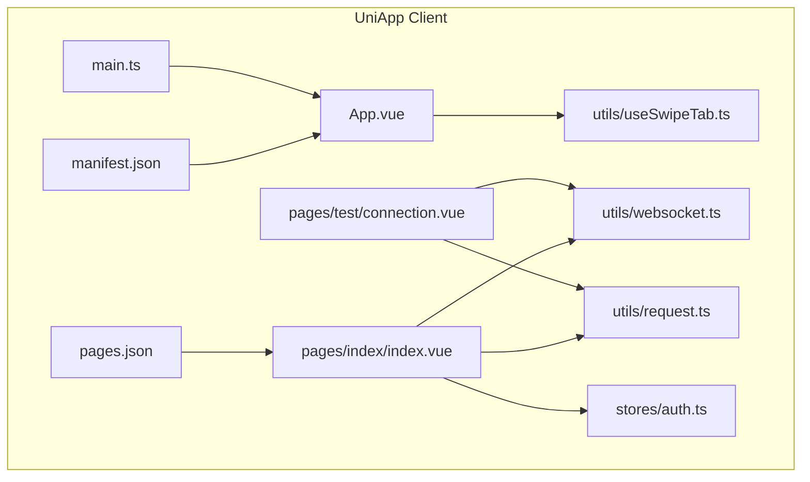
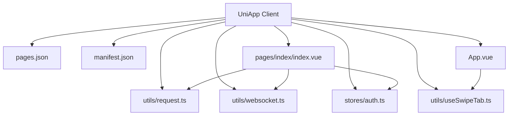
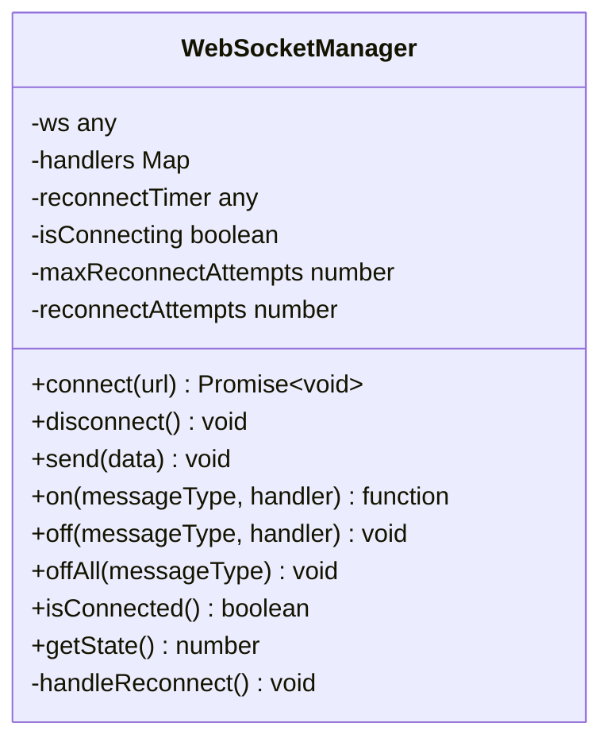
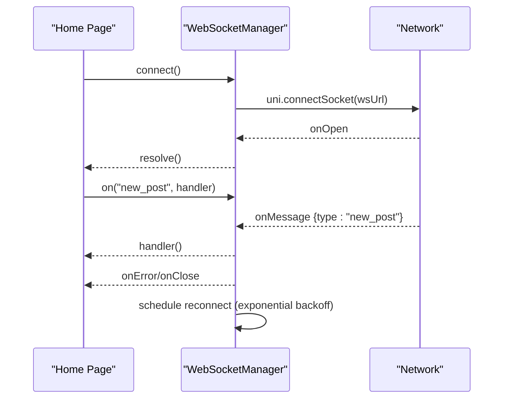
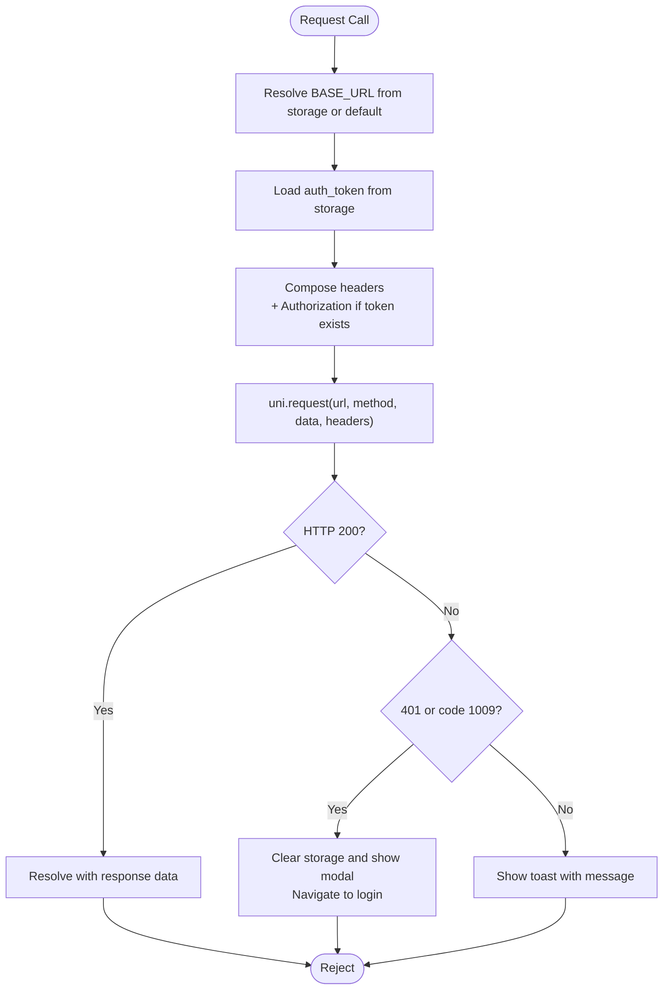
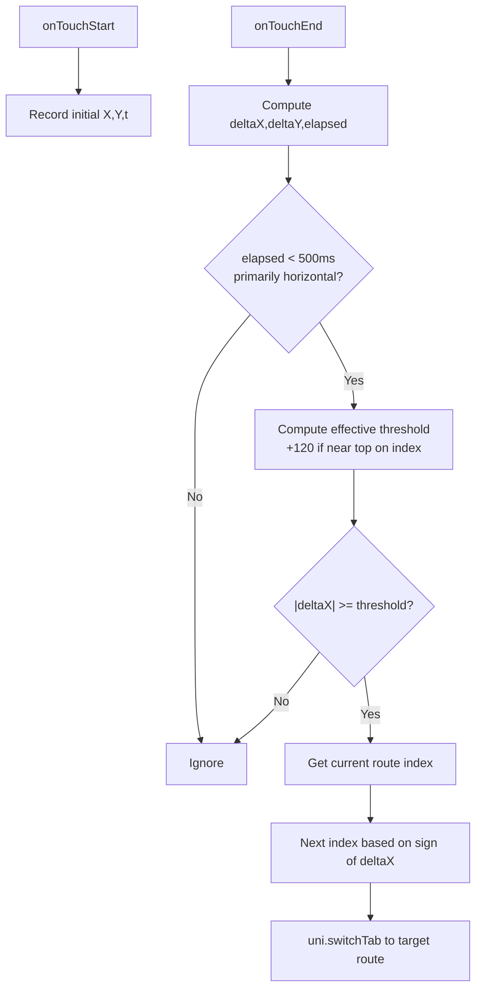
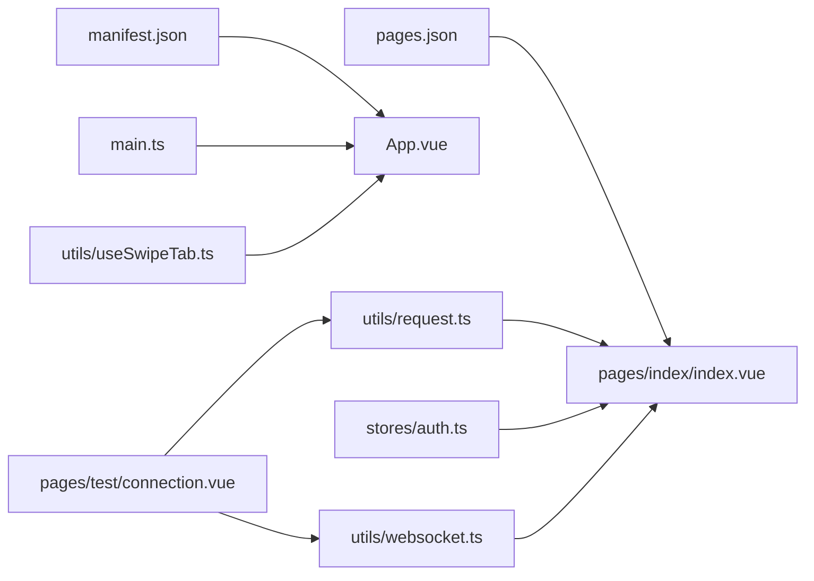

# Platform-Specific Optimizations

<cite>
**Referenced Files in This Document**
- [manifest.json](file://camp-channel-client-uniapp/src/manifest.json)
- [pages.json](file://camp-channel-client-uniapp/src/pages.json)
- [main.ts](file://camp-channel-client-uniapp/src/main.ts)
- [App.vue](file://camp-channel-client-uniapp/src/App.vue)
- [websocket.ts](file://camp-channel-client-uniapp/src/utils/websocket.ts)
- [request.ts](file://camp-channel-client-uniapp/src/utils/request.ts)
- [auth.ts](file://camp-channel-client-uniapp/src/stores/auth.ts)
- [useSwipeTab.ts](file://camp-channel-client-uniapp/src/utils/useSwipeTab.ts)
- [index.vue](file://camp-channel-client-uniapp/src/pages/index/index.vue)
- [connection.vue](file://camp-channel-client-uniapp/src/pages/test/connection.vue)
- [package.json](file://camp-channel-client-uniapp/package.json)
- [vite.config.ts](file://camp-channel-client-uniapp/vite.config.ts)
- [env.d.ts](file://camp-channel-client-uniapp/src/env.d.ts)
</cite>

## Table of Contents
1. [Introduction](#introduction)
2. [Project Structure](#project-structure)
3. [Core Components](#core-components)
4. [Architecture Overview](#architecture-overview)
5. [Detailed Component Analysis](#detailed-component-analysis)
6. [Dependency Analysis](#dependency-analysis)
7. [Performance Considerations](#performance-considerations)
8. [Troubleshooting Guide](#troubleshooting-guide)
9. [Conclusion](#conclusion)
10. [Appendices](#appendices)

## Introduction
This document explains how the UniApp client adapts to different target platforms (H5, Mini Program, App) through conditional compilation and platform detection. It documents route management via pages.json, navigation patterns, and platform-specific page layouts. It also covers manifest.json configuration for app metadata, build targets, and platform-specific settings. Real-time communication is exemplified by the WebSocket manager, which demonstrates platform-aware behavior for mini program environments. Platform-specific UI considerations, touch interactions, navigation differences, and performance optimizations are addressed alongside native API integration patterns, platform-specific storage solutions, device capability detection, build configuration differences, asset optimization per platform, and deployment strategies.

## Project Structure
The UniApp client organizes platform-specific concerns in configuration files and runtime utilities:
- pages.json defines routes, global styles, and tabBar configuration per platform.
- manifest.json sets platform-specific metadata and router modes.
- main.ts initializes the Vue app and Pinia store.
- App.vue handles lifecycle hooks and applies platform-specific UI updates (e.g., tab bar style).
- utils/websocket.ts encapsulates platform-aware WebSocket connectivity for mini programs.
- utils/request.ts centralizes network requests with platform storage integration.
- stores/auth.ts persists tokens and user info using platform storage APIs.
- utils/useSwipeTab.ts implements platform-specific touch interactions for tab switching.
- pages/index/index.vue integrates WebSocket subscriptions and platform navigation.
- pages/test/connection.vue validates platform connectivity and configuration.

**Diagram sources**
- [pages.json:1-202](file://camp-channel-client-uniapp/src/pages.json#L1-L202)
- [manifest.json:1-21](file://camp-channel-client-uniapp/src/manifest.json#L1-L21)
- [main.ts:1-10](file://camp-channel-client-uniapp/src/main.ts#L1-L10)
- [App.vue:1-93](file://camp-channel-client-uniapp/src/App.vue#L1-L93)
- [request.ts:1-112](file://camp-channel-client-uniapp/src/utils/request.ts#L1-L112)
- [websocket.ts:1-268](file://camp-channel-client-uniapp/src/utils/websocket.ts#L1-L268)
- [auth.ts:1-34](file://camp-channel-client-uniapp/src/stores/auth.ts#L1-L34)
- [useSwipeTab.ts:1-76](file://camp-channel-client-uniapp/src/utils/useSwipeTab.ts#L1-L76)
- [index.vue:1-395](file://camp-channel-client-uniapp/src/pages/index/index.vue#L1-L395)
- [connection.vue:1-334](file://camp-channel-client-uniapp/src/pages/test/connection.vue#L1-L334)

**Section sources**
- [pages.json:1-202](file://camp-channel-client-uniapp/src/pages.json#L1-L202)
- [manifest.json:1-21](file://camp-channel-client-uniapp/src/manifest.json#L1-L21)
- [main.ts:1-10](file://camp-channel-client-uniapp/src/main.ts#L1-L10)
- [App.vue:1-93](file://camp-channel-client-uniapp/src/App.vue#L1-L93)
- [request.ts:1-112](file://camp-channel-client-uniapp/src/utils/request.ts#L1-L112)
- [websocket.ts:1-268](file://camp-channel-client-uniapp/src/utils/websocket.ts#L1-L268)
- [auth.ts:1-34](file://camp-channel-client-uniapp/src/stores/auth.ts#L1-L34)
- [useSwipeTab.ts:1-76](file://camp-channel-client-uniapp/src/utils/useSwipeTab.ts#L1-L76)
- [index.vue:1-395](file://camp-channel-client-uniapp/src/pages/index/index.vue#L1-L395)
- [connection.vue:1-334](file://camp-channel-client-uniapp/src/pages/test/connection.vue#L1-L334)

## Core Components
- Route and Navigation Management: pages.json defines page routes, global navigation bar styles, and tabBar entries. It enables platform-specific navigation behaviors and layout customization.
- App Metadata and Build Targets: manifest.json configures app metadata, versioning, and platform-specific settings such as H5 router mode and Mini Program appid.
- Network Layer: utils/request.ts centralizes HTTP requests, merges Authorization headers, and handles platform storage for base URL and tokens.
- Real-Time Communication: utils/websocket.ts provides a platform-aware WebSocket manager tailored for mini program environments, including token injection, reconnection logic, and message routing.
- Authentication Store: stores/auth.ts persists tokens and user info using platform storage APIs for cross-session availability.
- Touch Interactions: utils/useSwipeTab.ts detects horizontal swipes to switch between tabBar pages, with thresholds tuned to avoid conflicts with page-specific swipers.
- Platform Initialization: main.ts creates the Vue app and registers Pinia for state management.
- Lifecycle Hooks and UI Updates: App.vue applies platform-specific tab bar styling and badge updates during app lifecycle events.

**Section sources**
- [pages.json:1-202](file://camp-channel-client-uniapp/src/pages.json#L1-L202)
- [manifest.json:1-21](file://camp-channel-client-uniapp/src/manifest.json#L1-L21)
- [request.ts:1-112](file://camp-channel-client-uniapp/src/utils/request.ts#L1-L112)
- [websocket.ts:1-268](file://camp-channel-client-uniapp/src/utils/websocket.ts#L1-L268)
- [auth.ts:1-34](file://camp-channel-client-uniapp/src/stores/auth.ts#L1-L34)
- [useSwipeTab.ts:1-76](file://camp-channel-client-uniapp/src/utils/useSwipeTab.ts#L1-L76)
- [main.ts:1-10](file://camp-channel-client-uniapp/src/main.ts#L1-L10)
- [App.vue:1-93](file://camp-channel-client-uniapp/src/App.vue#L1-L93)

## Architecture Overview
The UniApp client leverages platform-specific APIs and configurations to deliver optimized experiences across H5, Mini Program, and App targets. The architecture centers on:
- Configuration-driven routing and navigation via pages.json.
- Platform-aware network and WebSocket layers via utils/request.ts and utils/websocket.ts.
- Persistent authentication via stores/auth.ts using platform storage.
- Touch interaction composables for platform-specific gestures.
- Manifest-driven metadata and router modes for H5.

**Diagram sources**
- [pages.json:1-202](file://camp-channel-client-uniapp/src/pages.json#L1-L202)
- [manifest.json:1-21](file://camp-channel-client-uniapp/src/manifest.json#L1-L21)
- [request.ts:1-112](file://camp-channel-client-uniapp/src/utils/request.ts#L1-L112)
- [websocket.ts:1-268](file://camp-channel-client-uniapp/src/utils/websocket.ts#L1-L268)
- [auth.ts:1-34](file://camp-channel-client-uniapp/src/stores/auth.ts#L1-L34)
- [useSwipeTab.ts:1-76](file://camp-channel-client-uniapp/src/utils/useSwipeTab.ts#L1-L76)
- [App.vue:1-93](file://camp-channel-client-uniapp/src/App.vue#L1-L93)
- [index.vue:1-395](file://camp-channel-client-uniapp/src/pages/index/index.vue#L1-L395)

## Detailed Component Analysis

### Route Management and Navigation Patterns (pages.json)
- Pages: Defines each route’s path and page-specific styles including navigation bar title, background, pull-to-refresh, and custom navigation styles.
- Global Style: Sets default navigation bar appearance for all pages.
- TabBar: Configures tabBar items with page paths, labels, and optional icons, enabling bottom-tab navigation across platforms.

Key platform considerations:
- H5 router mode is configured to hash-based routing for compatibility.
- Mini Program appid is specified for WeChat ecosystem builds.

Navigation patterns:
- Standard navigation via uni.navigateTo and uni.switchTab is used in page components.
- TabBar navigation is optimized for swipe gestures and platform-specific thresholds.

**Section sources**
- [pages.json:1-202](file://camp-channel-client-uniapp/src/pages.json#L1-L202)
- [manifest.json:8-19](file://camp-channel-client-uniapp/src/manifest.json#L8-L19)
- [index.vue:228-234](file://camp-channel-client-uniapp/src/pages/index/index.vue#L228-L234)

### Manifest Configuration (manifest.json)
- App metadata: Name, appid, description, versionName, versionCode.
- H5 settings: Title and router mode set to hash for SPA-like navigation.
- Mini Program settings: appid and urlCheck disabled for development flexibility.

Build targets:
- Scripts in package.json demonstrate platform-specific dev/build commands for H5 and Mini Program.

**Section sources**
- [manifest.json:1-21](file://camp-channel-client-uniapp/src/manifest.json#L1-L21)
- [package.json:5-10](file://camp-channel-client-uniapp/package.json#L5-L10)

### Real-Time Communication (WebSocket Manager)
The WebSocket manager is designed for mini program environments and includes:
- Singleton pattern to prevent multiple connections.
- Connection lifecycle management with open, message, error, and close handlers.
- Automatic reconnection with exponential backoff and a maximum retry limit.
- Message routing by type and wildcard handlers.
- Token injection via query parameter for backend authentication.
- Graceful degradation on connection failures.

**Diagram sources**
- [websocket.ts:8-261](file://camp-channel-client-uniapp/src/utils/websocket.ts#L8-L261)

**Diagram sources**
- [websocket.ts:23-129](file://camp-channel-client-uniapp/src/utils/websocket.ts#L23-L129)
- [index.vue:242-267](file://camp-channel-client-uniapp/src/pages/index/index.vue#L242-L267)

**Section sources**
- [websocket.ts:1-268](file://camp-channel-client-uniapp/src/utils/websocket.ts#L1-L268)
- [index.vue:242-267](file://camp-channel-client-uniapp/src/pages/index/index.vue#L242-L267)

### Network Layer and Platform Storage
- Base URL resolution: Uses platform storage to determine API base URL, falling back to a default value.
- Image URL processing: Converts relative paths to absolute URLs while preserving API context.
- Request composition: Merges Authorization header when a token exists and handles 401/1009 business errors by triggering forced logout.
- Logout flow: Clears platform storage and navigates to the login page.

**Diagram sources**
- [request.ts:30-109](file://camp-channel-client-uniapp/src/utils/request.ts#L30-L109)

**Section sources**
- [request.ts:1-112](file://camp-channel-client-uniapp/src/utils/request.ts#L1-L112)
- [auth.ts:1-34](file://camp-channel-client-uniapp/src/stores/auth.ts#L1-L34)

### Platform-Specific UI and Touch Interactions
- App-level tab bar styling: Applied during app launch and updated on visibility changes.
- Tab switching via swipe: Horizontal swipe detection with configurable thresholds avoids conflicts with page-specific swipers.
- Page-level navigation: Uses uni.switchTab for tabBar pages and uni.navigateTo for nested routes.

**Diagram sources**
- [useSwipeTab.ts:20-67](file://camp-channel-client-uniapp/src/utils/useSwipeTab.ts#L20-L67)
- [App.vue:14-19](file://camp-channel-client-uniapp/src/App.vue#L14-L19)
- [index.vue:228-234](file://camp-channel-client-uniapp/src/pages/index/index.vue#L228-L234)

**Section sources**
- [App.vue:8-43](file://camp-channel-client-uniapp/src/App.vue#L8-L43)
- [useSwipeTab.ts:1-76](file://camp-channel-client-uniapp/src/utils/useSwipeTab.ts#L1-L76)
- [index.vue:228-234](file://camp-channel-client-uniapp/src/pages/index/index.vue#L228-L234)

### Platform-Specific Page Layouts
- Index page: Implements channel tabs, swiper-based content switching, pull-to-refresh, and real-time updates via WebSocket subscriptions.
- Test page: Validates API and WebSocket connectivity, displays current configuration, and logs diagnostic information.

**Section sources**
- [index.vue:1-395](file://camp-channel-client-uniapp/src/pages/index/index.vue#L1-L395)
- [connection.vue:1-334](file://camp-channel-client-uniapp/src/pages/test/connection.vue#L1-L334)

## Dependency Analysis
The UniApp client’s platform-specific optimizations rely on:
- pages.json for route and navigation configuration.
- manifest.json for metadata and platform-specific router settings.
- utils/request.ts and stores/auth.ts for platform storage-backed network and authentication.
- utils/websocket.ts for platform-aware real-time communication.
- utils/useSwipeTab.ts for platform-specific gesture handling.
- main.ts and App.vue for initialization and lifecycle hooks.

**Diagram sources**
- [pages.json:1-202](file://camp-channel-client-uniapp/src/pages.json#L1-L202)
- [manifest.json:1-21](file://camp-channel-client-uniapp/src/manifest.json#L1-L21)
- [main.ts:1-10](file://camp-channel-client-uniapp/src/main.ts#L1-L10)
- [App.vue:1-93](file://camp-channel-client-uniapp/src/App.vue#L1-L93)
- [request.ts:1-112](file://camp-channel-client-uniapp/src/utils/request.ts#L1-L112)
- [auth.ts:1-34](file://camp-channel-client-uniapp/src/stores/auth.ts#L1-L34)
- [websocket.ts:1-268](file://camp-channel-client-uniapp/src/utils/websocket.ts#L1-L268)
- [useSwipeTab.ts:1-76](file://camp-channel-client-uniapp/src/utils/useSwipeTab.ts#L1-L76)
- [index.vue:1-395](file://camp-channel-client-uniapp/src/pages/index/index.vue#L1-L395)
- [connection.vue:1-334](file://camp-channel-client-uniapp/src/pages/test/connection.vue#L1-L334)

**Section sources**
- [pages.json:1-202](file://camp-channel-client-uniapp/src/pages.json#L1-L202)
- [manifest.json:1-21](file://camp-channel-client-uniapp/src/manifest.json#L1-L21)
- [main.ts:1-10](file://camp-channel-client-uniapp/src/main.ts#L1-L10)
- [App.vue:1-93](file://camp-channel-client-uniapp/src/App.vue#L1-L93)
- [request.ts:1-112](file://camp-channel-client-uniapp/src/utils/request.ts#L1-L112)
- [auth.ts:1-34](file://camp-channel-client-uniapp/src/stores/auth.ts#L1-L34)
- [websocket.ts:1-268](file://camp-channel-client-uniapp/src/utils/websocket.ts#L1-L268)
- [useSwipeTab.ts:1-76](file://camp-channel-client-uniapp/src/utils/useSwipeTab.ts#L1-L76)
- [index.vue:1-395](file://camp-channel-client-uniapp/src/pages/index/index.vue#L1-L395)
- [connection.vue:1-334](file://camp-channel-client-uniapp/src/pages/test/connection.vue#L1-L334)

## Performance Considerations
- WebSocket reconnection: Exponential backoff with capped delays prevents excessive retries and conserves bandwidth.
- Lazy subscriptions: WebSocket handlers are registered on mount and cleaned up on unmount to avoid memory leaks.
- Pull-to-refresh: Debounces refresh actions to reduce redundant network calls.
- Image URL processing: Converts relative paths to absolute URLs once per resource to minimize parsing overhead.
- Gesture thresholds: Tuned thresholds reduce accidental tab switches and improve responsiveness on touch devices.

[No sources needed since this section provides general guidance]

## Troubleshooting Guide
- WebSocket connectivity:
  - Use the test page to validate API and WebSocket connectivity and review logs for detailed diagnostics.
  - Confirm token presence and correct URL construction for WebSocket connections.
- Authentication:
  - On 401 or business code 1009, the network layer triggers forced logout and navigates to the login page.
  - Verify platform storage keys for tokens and user info.
- H5 routing:
  - Ensure router mode is set to hash in manifest.json for SPA navigation.
- Mini Program:
  - Confirm appid and urlCheck settings in manifest.json.
  - Verify that WebSocket endpoints support raw WebSocket connections for mini program environments.

**Section sources**
- [connection.vue:96-172](file://camp-channel-client-uniapp/src/pages/test/connection.vue#L96-L172)
- [request.ts:58-109](file://camp-channel-client-uniapp/src/utils/request.ts#L58-L109)
- [manifest.json:8-19](file://camp-channel-client-uniapp/src/manifest.json#L8-L19)

## Conclusion
The UniApp client implements platform-specific optimizations through configuration-driven routing (pages.json), manifest metadata (manifest.json), and runtime utilities for networking (request.ts), real-time communication (websocket.ts), authentication (auth.ts), and touch interactions (useSwipeTab.ts). These components collectively enable adaptive navigation, robust connectivity, and responsive UI behaviors across H5, Mini Program, and App targets.

[No sources needed since this section summarizes without analyzing specific files]

## Appendices

### Build Configuration Differences
- H5 development and build scripts are defined in package.json.
- Vite proxy configuration targets the backend API for local development.

**Section sources**
- [package.json:5-10](file://camp-channel-client-uniapp/package.json#L5-L10)
- [vite.config.ts:1-16](file://camp-channel-client-uniapp/vite.config.ts#L1-L16)

### Asset Optimization Per Platform
- H5 assets are served via Vite with proxy support for API requests.
- Mini Program and App builds leverage UniApp’s platform-specific bundling and optimization.

**Section sources**
- [vite.config.ts:6-14](file://camp-channel-client-uniapp/vite.config.ts#L6-L14)
- [package.json:11-28](file://camp-channel-client-uniapp/package.json#L11-L28)

### Deployment Strategies
- H5: Deploy built artifacts to a web server with hash-based routing enabled.
- Mini Program: Build with platform-specific CLI and upload to the WeChat ecosystem.
- App: Package for iOS/Android using UniApp’s App build targets.

**Section sources**
- [package.json:6-9](file://camp-channel-client-uniapp/package.json#L6-L9)
- [manifest.json:14-19](file://camp-channel-client-uniapp/src/manifest.json#L14-L19)