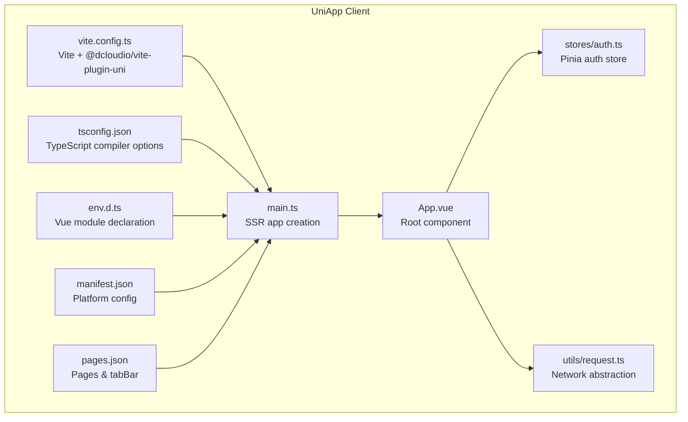
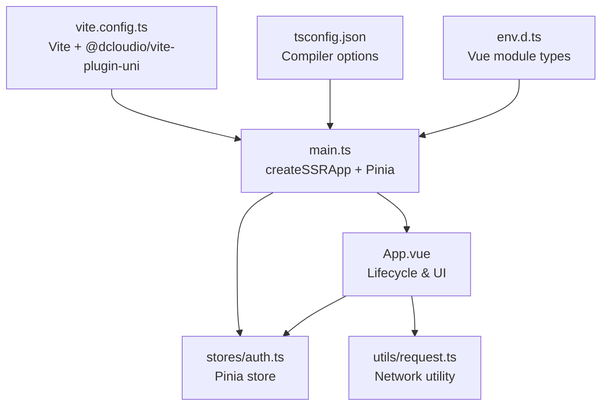
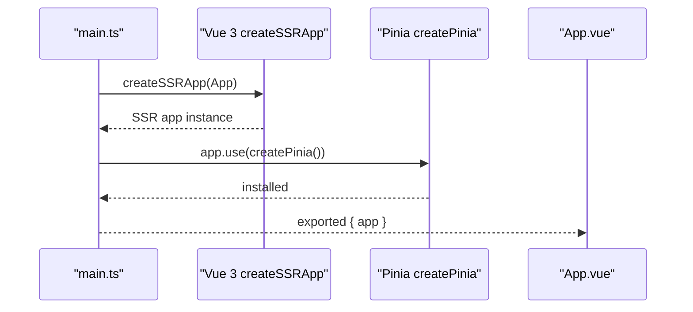
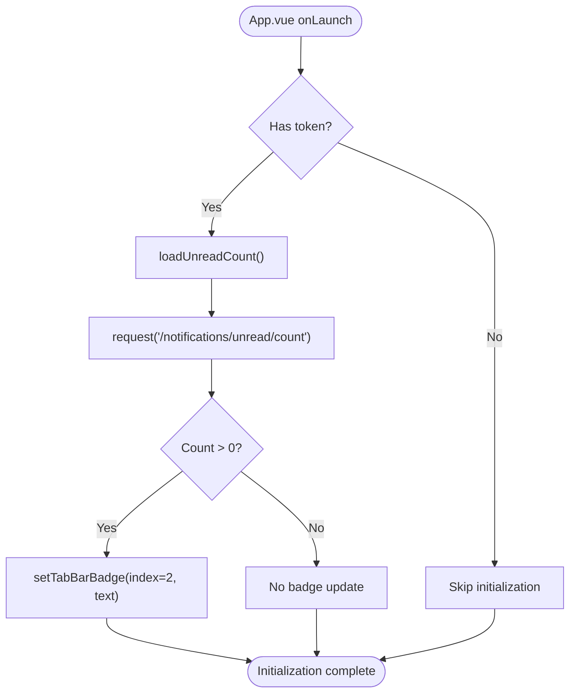
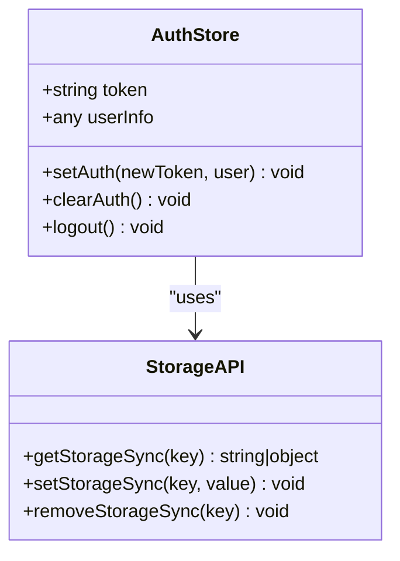
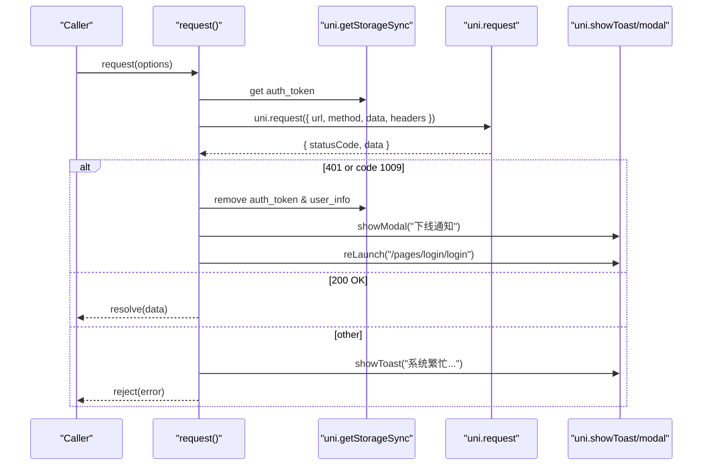
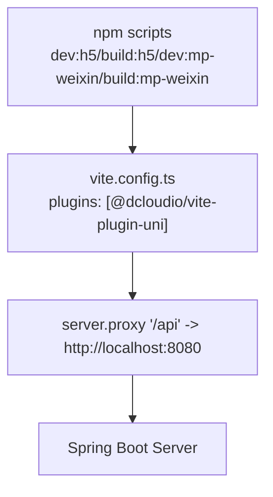
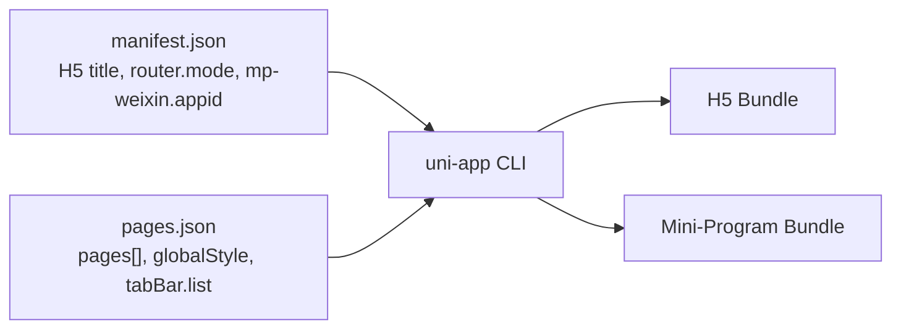
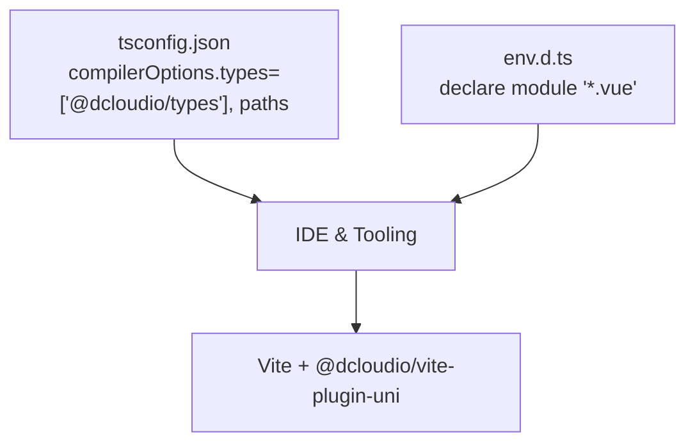
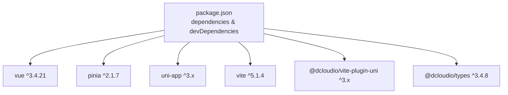

# UniApp Framework Architecture

<cite>
**Referenced Files in This Document**
- [package.json](file://camp-channel-client-uniapp/package.json)
- [vite.config.ts](file://camp-channel-client-uniapp/vite.config.ts)
- [main.ts](file://camp-channel-client-uniapp/src/main.ts)
- [App.vue](file://camp-channel-client-uniapp/src/App.vue)
- [manifest.json](file://camp-channel-client-uniapp/src/manifest.json)
- [pages.json](file://camp-channel-client-uniapp/src/pages.json)
- [auth.ts](file://camp-channel-client-uniapp/src/stores/auth.ts)
- [request.ts](file://camp-channel-client-uniapp/src/utils/request.ts)
- [env.d.ts](file://camp-channel-client-uniapp/src/env.d.ts)
- [tsconfig.json](file://camp-channel-client-uniapp/tsconfig.json)
</cite>

## Table of Contents
1. [Introduction](#introduction)
2. [Project Structure](#project-structure)
3. [Core Components](#core-components)
4. [Architecture Overview](#architecture-overview)
5. [Detailed Component Analysis](#detailed-component-analysis)
6. [Dependency Analysis](#dependency-analysis)
7. [Performance Considerations](#performance-considerations)
8. [Troubleshooting Guide](#troubleshooting-guide)
9. [Conclusion](#conclusion)

## Introduction
This document explains the UniApp framework architecture implementation for the campus channel client. It focuses on the Vue 3 + TypeScript foundation, the SSR app creation pattern, Pinia state management integration, and how the project leverages Vite and the uni-app CLI to enable multi-platform compilation and runtime. The document also covers the application bootstrap process, global configuration via manifest and pages.json, environment variable handling, and the relationship between uni-app's virtual DOM and platform-specific rendering engines. Finally, it outlines framework-specific optimizations, plugin integration patterns, and performance considerations for cross-platform development.

## Project Structure
The UniApp client project is organized around a single-page application built with Vue 3 Composition API, TypeScript, and Pinia for state management. The project integrates with the uni-app ecosystem to support multiple platforms (H5 and mini-program platforms) through a unified codebase.

Key structural elements:
- Application bootstrap and SSR app creation in main.ts
- Root application component with lifecycle hooks in App.vue
- Platform configuration via manifest.json and pages.json
- State management with Pinia stores in src/stores
- Network request abstraction in src/utils
- TypeScript configuration and type declarations
- Vite build configuration and development server proxy

**Diagram sources**
- [main.ts:1-10](file://camp-channel-client-uniapp/src/main.ts#L1-L10)
- [App.vue:1-93](file://camp-channel-client-uniapp/src/App.vue#L1-L93)
- [auth.ts:1-34](file://camp-channel-client-uniapp/src/stores/auth.ts#L1-L34)
- [request.ts:1-112](file://camp-channel-client-uniapp/src/utils/request.ts#L1-L112)
- [manifest.json:1-21](file://camp-channel-client-uniapp/src/manifest.json#L1-L21)
- [pages.json:1-202](file://camp-channel-client-uniapp/src/pages.json#L1-L202)
- [vite.config.ts:1-16](file://camp-channel-client-uniapp/vite.config.ts#L1-L16)
- [tsconfig.json:1-28](file://camp-channel-client-uniapp/tsconfig.json#L1-L28)
- [env.d.ts:1-8](file://camp-channel-client-uniapp/src/env.d.ts#L1-L8)

**Section sources**
- [package.json:1-29](file://camp-channel-client-uniapp/package.json#L1-L29)
- [vite.config.ts:1-16](file://camp-channel-client-uniapp/vite.config.ts#L1-L16)
- [main.ts:1-10](file://camp-channel-client-uniapp/src/main.ts#L1-L10)
- [App.vue:1-93](file://camp-channel-client-uniapp/src/App.vue#L1-L93)
- [manifest.json:1-21](file://camp-channel-client-uniapp/src/manifest.json#L1-L21)
- [pages.json:1-202](file://camp-channel-client-uniapp/src/pages.json#L1-L202)
- [auth.ts:1-34](file://camp-channel-client-uniapp/src/stores/auth.ts#L1-L34)
- [request.ts:1-112](file://camp-channel-client-uniapp/src/utils/request.ts#L1-L112)
- [tsconfig.json:1-28](file://camp-channel-client-uniapp/tsconfig.json#L1-L28)
- [env.d.ts:1-8](file://camp-channel-client-uniapp/src/env.d.ts#L1-L8)

## Core Components
- SSR app creation and Pinia integration: The application initializes a Vue 3 SSR app and installs Pinia globally during bootstrap.
- Root component lifecycle: The root component handles platform lifecycle events and applies UI customization.
- State management: A Pinia store encapsulates authentication state and persistence using uni-app storage APIs.
- Network layer: A centralized request utility wraps uni.request with token injection, base URL resolution, and force logout handling.
- Build and dev server: Vite is configured with the uni-app plugin and a proxy to the backend server.
- Type safety: TypeScript configuration includes uni-app types and Vue module declarations for proper IDE support.

**Section sources**
- [main.ts:1-10](file://camp-channel-client-uniapp/src/main.ts#L1-L10)
- [App.vue:1-93](file://camp-channel-client-uniapp/src/App.vue#L1-L93)
- [auth.ts:1-34](file://camp-channel-client-uniapp/src/stores/auth.ts#L1-L34)
- [request.ts:1-112](file://camp-channel-client-uniapp/src/utils/request.ts#L1-L112)
- [vite.config.ts:1-16](file://camp-channel-client-uniapp/vite.config.ts#L1-L16)
- [tsconfig.json:1-28](file://camp-channel-client-uniapp/tsconfig.json#L1-L28)
- [env.d.ts:1-8](file://camp-channel-client-uniapp/src/env.d.ts#L1-L8)

## Architecture Overview
The architecture follows a unidirectional data flow: UI components trigger actions in Pinia stores, which persist state using uni-app storage APIs. Network requests are handled by a shared utility that injects tokens and manages authentication errors. The Vite build pipeline compiles the Vue 3 + TypeScript codebase and delegates platform-specific bundling to the uni-app plugin.

**Diagram sources**
- [main.ts:1-10](file://camp-channel-client-uniapp/src/main.ts#L1-L10)
- [App.vue:1-93](file://camp-channel-client-uniapp/src/App.vue#L1-L93)
- [auth.ts:1-34](file://camp-channel-client-uniapp/src/stores/auth.ts#L1-L34)
- [request.ts:1-112](file://camp-channel-client-uniapp/src/utils/request.ts#L1-L112)
- [vite.config.ts:1-16](file://camp-channel-client-uniapp/vite.config.ts#L1-L16)
- [tsconfig.json:1-28](file://camp-channel-client-uniapp/tsconfig.json#L1-L28)
- [env.d.ts:1-8](file://camp-channel-client-uniapp/src/env.d.ts#L1-L8)

## Detailed Component Analysis

### Application Bootstrap and SSR Pattern
The bootstrap process creates a Vue 3 SSR app and installs Pinia globally. This pattern ensures consistent state management across platforms while enabling server-side rendering capabilities.

**Diagram sources**
- [main.ts:1-10](file://camp-channel-client-uniapp/src/main.ts#L1-L10)

**Section sources**
- [main.ts:1-10](file://camp-channel-client-uniapp/src/main.ts#L1-L10)

### Root Component Lifecycle and UI Customization
The root component integrates with uni-app lifecycle hooks to initialize unread notification badges and customize the tab bar appearance. It conditionally loads badge counts when a token exists and updates UI on visibility changes.

**Diagram sources**
- [App.vue:8-42](file://camp-channel-client-uniapp/src/App.vue#L8-L42)
- [request.ts:22-36](file://camp-channel-client-uniapp/src/utils/request.ts#L22-L36)

**Section sources**
- [App.vue:1-93](file://camp-channel-client-uniapp/src/App.vue#L1-L93)

### Pinia Authentication Store
The authentication store persists credentials and user info using uni-app storage APIs. It exposes setters and clearers for managing session state and integrates with the network utility for token injection.

**Diagram sources**
- [auth.ts:1-34](file://camp-channel-client-uniapp/src/stores/auth.ts#L1-L34)

**Section sources**
- [auth.ts:1-34](file://camp-channel-client-uniapp/src/stores/auth.ts#L1-L34)

### Network Request Utility and Base URL Resolution
The request utility centralizes HTTP communication, resolves absolute URLs, injects Authorization headers, and handles force logout scenarios. It supports dynamic base URL storage and image URL processing.

**Diagram sources**
- [request.ts:30-84](file://camp-channel-client-uniapp/src/utils/request.ts#L30-L84)
- [request.ts:89-109](file://camp-channel-client-uniapp/src/utils/request.ts#L89-L109)

**Section sources**
- [request.ts:1-112](file://camp-channel-client-uniapp/src/utils/request.ts#L1-L112)

### Build Configuration and Development Server
Vite is configured with the uni-app plugin and a proxy to the backend server. Scripts in package.json demonstrate platform-specific builds and development commands.

**Diagram sources**
- [package.json:5-10](file://camp-channel-client-uniapp/package.json#L5-L10)
- [vite.config.ts:1-16](file://camp-channel-client-uniapp/vite.config.ts#L1-L16)

**Section sources**
- [package.json:1-29](file://camp-channel-client-uniapp/package.json#L1-L29)
- [vite.config.ts:1-16](file://camp-channel-client-uniapp/vite.config.ts#L1-L16)

### Platform Configuration and Multi-Platform Compilation
Global configuration is defined via manifest.json and pages.json. These files specify platform-specific settings (e.g., H5 router mode, mini-program app ID) and page routing/tabBar layouts.

**Diagram sources**
- [manifest.json:1-21](file://camp-channel-client-uniapp/src/manifest.json#L1-L21)
- [pages.json:1-202](file://camp-channel-client-uniapp/src/pages.json#L1-L202)

**Section sources**
- [manifest.json:1-21](file://camp-channel-client-uniapp/src/manifest.json#L1-L21)
- [pages.json:1-202](file://camp-channel-client-uniapp/src/pages.json#L1-L202)

### TypeScript Integration and Environment Handling
TypeScript configuration includes uni-app types and Vue module declarations to ensure accurate type checking and IDE support. The env.d.ts file declares Vue modules for seamless integration.

**Diagram sources**
- [tsconfig.json:1-28](file://camp-channel-client-uniapp/tsconfig.json#L1-L28)
- [env.d.ts:1-8](file://camp-channel-client-uniapp/src/env.d.ts#L1-L8)

**Section sources**
- [tsconfig.json:1-28](file://camp-channel-client-uniapp/tsconfig.json#L1-L28)
- [env.d.ts:1-8](file://camp-channel-client-uniapp/src/env.d.ts#L1-L8)

## Dependency Analysis
The project relies on Vue 3, Pinia, and the uni-app ecosystem. Dependencies are declared in package.json, and Vite integrates with the uni-app plugin to handle platform-specific bundling.

**Diagram sources**
- [package.json:11-27](file://camp-channel-client-uniapp/package.json#L11-L27)

**Section sources**
- [package.json:1-29](file://camp-channel-client-uniapp/package.json#L1-L29)

## Performance Considerations
- Minimize unnecessary re-renders by leveraging Vue 3 Composition API and reactive primitives effectively.
- Persist only essential state in Pinia stores to reduce memory footprint across platforms.
- Use lazy loading for heavy components and routes to improve initial load times.
- Optimize network requests with caching strategies and efficient error handling to avoid redundant calls.
- Keep platform-specific assets optimized and avoid bundling unused polyfills or libraries.

## Troubleshooting Guide
Common issues and resolutions:
- Authentication expiration: The request utility triggers a force logout when encountering unauthorized responses. Verify token storage and ensure proper cleanup on logout.
- Network connectivity: The request utility displays toast messages on failures. Confirm the backend server is reachable and the proxy configuration is correct.
- Platform-specific UI: If tab bar or navigation styles appear incorrect, review manifest.json and pages.json configurations for the target platform.

**Section sources**
- [request.ts:57-84](file://camp-channel-client-uniapp/src/utils/request.ts#L57-L84)
- [request.ts:89-109](file://camp-channel-client-uniapp/src/utils/request.ts#L89-L109)
- [vite.config.ts:6-14](file://camp-channel-client-uniapp/vite.config.ts#L6-L14)

## Conclusion
The UniApp client architecture demonstrates a cohesive integration of Vue 3, TypeScript, and Pinia, orchestrated by Vite and the uni-app plugin. The project’s bootstrap pattern, centralized state management, and unified network layer enable efficient cross-platform development. Platform-specific configurations in manifest.json and pages.json, combined with lifecycle-aware root components, deliver a consistent user experience across H5 and mini-program targets. By following the outlined patterns and performance considerations, developers can maintain a scalable and maintainable codebase for multi-platform deployment.