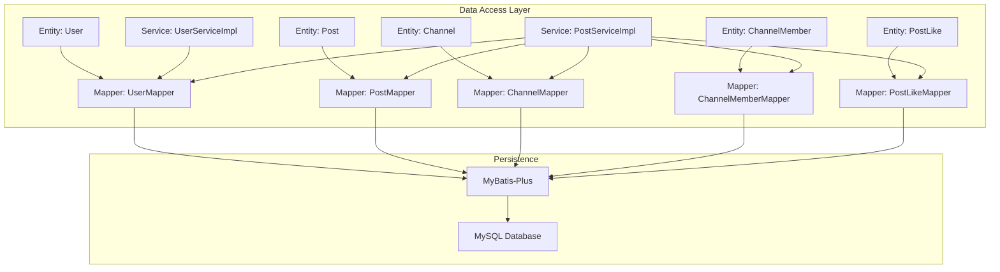
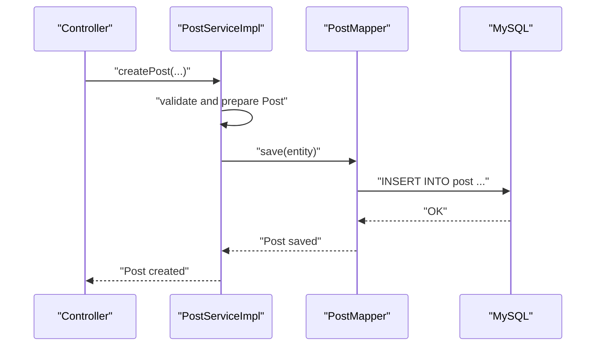
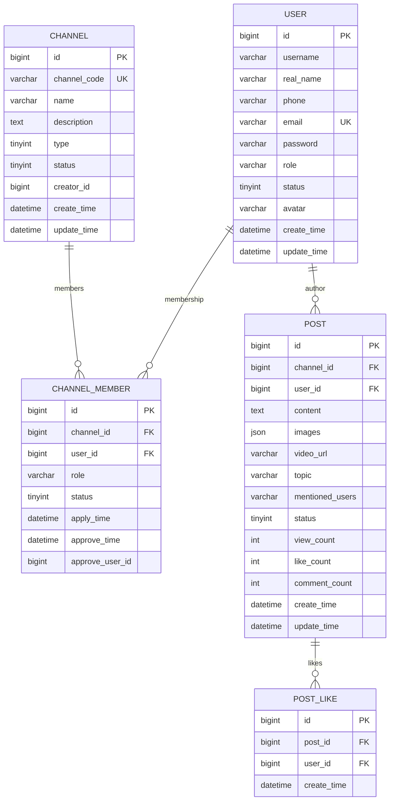
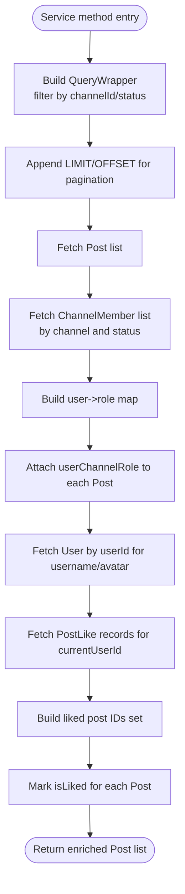
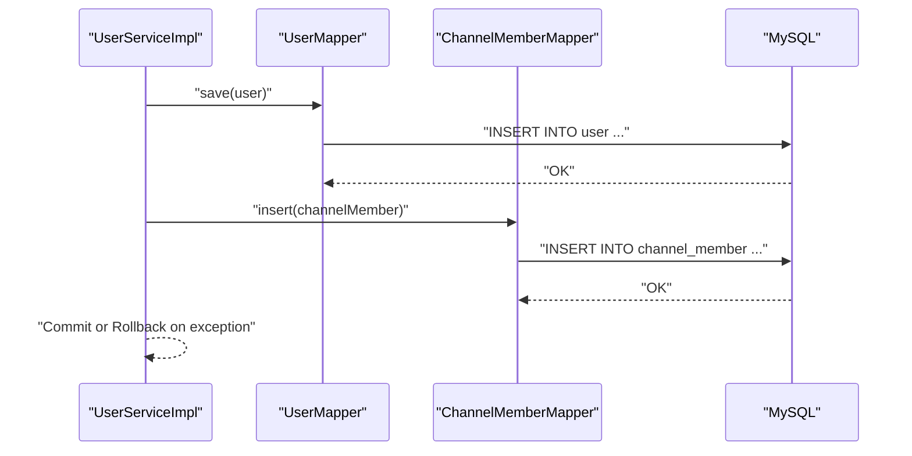
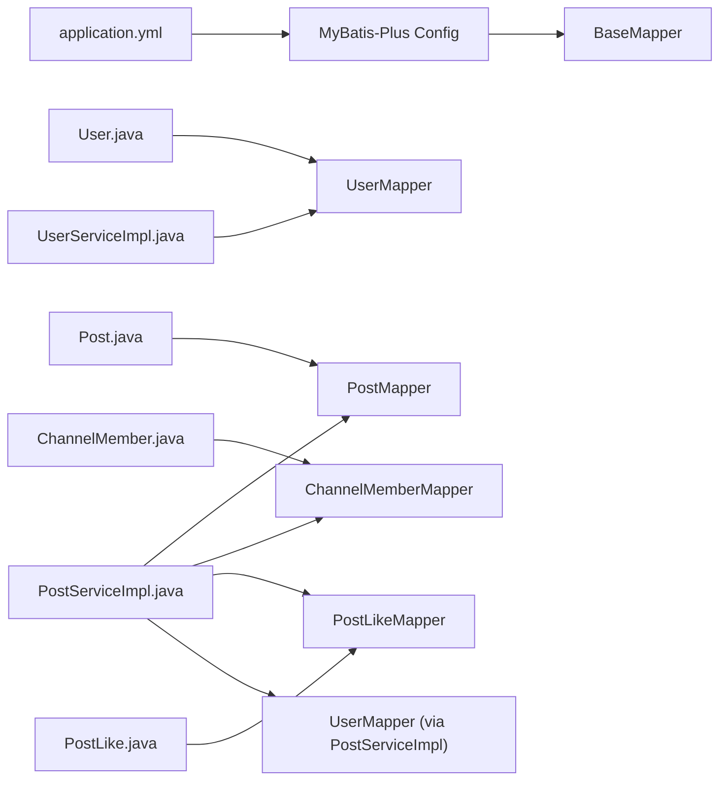

# Data Access Patterns and MyBatis-Plus Integration

<cite>
**Referenced Files in This Document**
- [User.java](file://camp-channel-server/src/main/java/com/gdmec/campchannel/entity/User.java)
- [Post.java](file://camp-channel-server/src/main/java/com/gdmec/campchannel/entity/Post.java)
- [Channel.java](file://camp-channel-server/src/main/java/com/gdmec/campchannel/entity/Channel.java)
- [ChannelMember.java](file://camp-channel-server/src/main/java/com/gdmec/campchannel/entity/ChannelMember.java)
- [PostLike.java](file://camp-channel-server/src/main/java/com/gdmec/campchannel/entity/PostLike.java)
- [UserMapper.java](file://camp-channel-server/src/main/java/com/gdmec/campchannel/mapper/UserMapper.java)
- [PostMapper.java](file://camp-channel-server/src/main/java/com/gdmec/campchannel/mapper/PostMapper.java)
- [ChannelMapper.java](file://camp-channel-server/src/main/java/com/gdmec/campchannel/mapper/ChannelMapper.java)
- [ChannelMemberMapper.java](file://camp-channel-server/src/main/java/com/gdmec/campchannel/mapper/ChannelMemberMapper.java)
- [PostLikeMapper.java](file://camp-channel-server/src/main/java/com/gdmec/campchannel/mapper/PostLikeMapper.java)
- [UserServiceImpl.java](file://camp-channel-server/src/main/java/com/gdmec/campchannel/service/impl/UserServiceImpl.java)
- [PostServiceImpl.java](file://camp-channel-server/src/main/java/com/gdmec/campchannel/service/impl/PostServiceImpl.java)
- [application.yml](file://camp-channel-server/src/main/resources/application.yml)
- [schema.sql](file://camp-channel-server/src/main/resources/db/schema.sql)
- [CampChannelApplication.java](file://camp-channel-server/src/main/java/com/gdmec/campchannel/CampChannelApplication.java)
</cite>

## Table of Contents
1. [Introduction](#introduction)
2. [Project Structure](#project-structure)
3. [Core Components](#core-components)
4. [Architecture Overview](#architecture-overview)
5. [Detailed Component Analysis](#detailed-component-analysis)
6. [Dependency Analysis](#dependency-analysis)
7. [Performance Considerations](#performance-considerations)
8. [Troubleshooting Guide](#troubleshooting-guide)
9. [Conclusion](#conclusion)

## Introduction
This document explains the data access layer built with MyBatis-Plus and common data access patterns across the application. It covers repository structure per entity, CRUD operations, custom queries, pagination, sorting, filtering, transactions, complex queries (joins, aggregations, subqueries), soft deletes, audit trails, and performance optimization. It also describes how the data access layer integrates with the service layer and supports real-time features and caching.

## Project Structure
The data access layer follows a layered architecture:
- Entities define domain models mapped to database tables.
- Mappers extend MyBatis-Plus BaseMapper to inherit standard CRUD operations.
- Services orchestrate business logic and coordinate multiple mappers.
- Application configuration enables MyBatis-Plus and data source settings.

**Diagram sources**
- [User.java:10-42](file://camp-channel-server/src/main/java/com/gdmec/campchannel/entity/User.java#L10-L42)
- [Post.java](file://camp-channel-server/src/main/java/com/gdmec/campchannel/entity/Post.java)
- [Channel.java](file://camp-channel-server/src/main/java/com/gdmec/campchannel/entity/Channel.java)
- [ChannelMember.java](file://camp-channel-server/src/main/java/com/gdmec/campchannel/entity/ChannelMember.java)
- [PostLike.java](file://camp-channel-server/src/main/java/com/gdmec/campchannel/entity/PostLike.java)
- [UserMapper.java:1-9](file://camp-channel-server/src/main/java/com/gdmec/campchannel/mapper/UserMapper.java#L1-L9)
- [PostMapper.java:1-9](file://camp-channel-server/src/main/java/com/gdmec/campchannel/mapper/PostMapper.java#L1-L9)
- [ChannelMapper.java:1-9](file://camp-channel-server/src/main/java/com/gdmec/campchannel/mapper/ChannelMapper.java#L1-L9)
- [ChannelMemberMapper.java:1-9](file://camp-channel-server/src/main/java/com/gdmec/campchannel/mapper/ChannelMemberMapper.java#L1-L9)
- [PostLikeMapper.java:1-9](file://camp-channel-server/src/main/java/com/gdmec/campchannel/mapper/PostLikeMapper.java#L1-L9)
- [UserServiceImpl.java:25-107](file://camp-channel-server/src/main/java/com/gdmec/campchannel/service/impl/UserServiceImpl.java#L25-L107)
- [PostServiceImpl.java:35-387](file://camp-channel-server/src/main/java/com/gdmec/campchannel/service/impl/PostServiceImpl.java#L35-L387)

**Section sources**
- [application.yml:68-77](file://camp-channel-server/src/main/resources/application.yml#L68-L77)
- [schema.sql:1-236](file://camp-channel-server/src/main/resources/db/schema.sql#L1-L236)

## Core Components
- Entities: Define table mappings and metadata. Examples include User, Post, Channel, ChannelMember, PostLike.
- Mappers: Extend BaseMapper to inherit standard CRUD and query capabilities.
- Services: Implement business workflows, coordinate multiple mappers, and manage transactions.

Key characteristics:
- MyBatis-Plus configuration enables automatic camelCase mapping and mapper scanning.
- Standard CRUD is inherited from BaseMapper; custom queries are implemented via QueryWrapper or XML.

**Section sources**
- [User.java:10-42](file://camp-channel-server/src/main/java/com/gdmec/campchannel/entity/User.java#L10-L42)
- [Post.java](file://camp-channel-server/src/main/java/com/gdmec/campchannel/entity/Post.java)
- [Channel.java](file://camp-channel-server/src/main/java/com/gdmec/campchannel/entity/Channel.java)
- [ChannelMember.java](file://camp-channel-server/src/main/java/com/gdmec/campchannel/entity/ChannelMember.java)
- [PostLike.java](file://camp-channel-server/src/main/java/com/gdmec/campchannel/entity/PostLike.java)
- [UserMapper.java:1-9](file://camp-channel-server/src/main/java/com/gdmec/campchannel/mapper/UserMapper.java#L1-L9)
- [PostMapper.java:1-9](file://camp-channel-server/src/main/java/com/gdmec/campchannel/mapper/PostMapper.java#L1-L9)
- [application.yml:68-77](file://camp-channel-server/src/main/resources/application.yml#L68-L77)

## Architecture Overview
The data access layer leverages MyBatis-Plus to provide:
- Type-safe query construction using QueryWrapper.
- Pagination via manual LIMIT clauses appended to queries.
- Sorting via orderBy methods.
- Filtering via condition chaining.
- Transactions managed at the service layer.

**Diagram sources**
- [PostServiceImpl.java:58-153](file://camp-channel-server/src/main/java/com/gdmec/campchannel/service/impl/PostServiceImpl.java#L58-L153)
- [PostMapper.java:1-9](file://camp-channel-server/src/main/java/com/gdmec/campchannel/mapper/PostMapper.java#L1-L9)

## Detailed Component Analysis

### Entity Model and Table Mapping
Entities annotate table names and primary keys. Example:
- User: annotated table name and auto-increment ID.
- Post: includes JSON-like images field and status flags.
- ChannelMember: composite unique constraint on channel_id and user_id.
- PostLike: unique constraint on post_id and user_id.

**Diagram sources**
- [User.java:10-42](file://camp-channel-server/src/main/java/com/gdmec/campchannel/entity/User.java#L10-L42)
- [Post.java](file://camp-channel-server/src/main/java/com/gdmec/campchannel/entity/Post.java)
- [Channel.java](file://camp-channel-server/src/main/java/com/gdmec/campchannel/entity/Channel.java)
- [ChannelMember.java](file://camp-channel-server/src/main/java/com/gdmec/campchannel/entity/ChannelMember.java)
- [PostLike.java](file://camp-channel-server/src/main/java/com/gdmec/campchannel/entity/PostLike.java)
- [schema.sql:1-236](file://camp-channel-server/src/main/resources/db/schema.sql#L1-L236)

**Section sources**
- [User.java:10-42](file://camp-channel-server/src/main/java/com/gdmec/campchannel/entity/User.java#L10-L42)
- [Post.java](file://camp-channel-server/src/main/java/com/gdmec/campchannel/entity/Post.java)
- [ChannelMember.java](file://camp-channel-server/src/main/java/com/gdmec/campchannel/entity/ChannelMember.java)
- [PostLike.java](file://camp-channel-server/src/main/java/com/gdmec/campchannel/entity/PostLike.java)
- [schema.sql:1-236](file://camp-channel-server/src/main/resources/db/schema.sql#L1-L236)

### Repository Structure and Base CRUD
Each entity has a corresponding mapper extending BaseMapper, inheriting:
- save(entity), saveBatch(entities)
- update(entity), updateById(id)
- removeById(id), removeBatchByIds(ids)
- getById(id), list(), page(Page)
- selectOne(QueryWrapper), selectBatchIds(ids), selectCount(QueryWrapper)

Customization is achieved by adding methods to mappers or by composing QueryWrapper conditions in services.

**Section sources**
- [UserMapper.java:1-9](file://camp-channel-server/src/main/java/com/gdmec/campchannel/mapper/UserMapper.java#L1-L9)
- [PostMapper.java:1-9](file://camp-channel-server/src/main/java/com/gdmec/campchannel/mapper/PostMapper.java#L1-L9)
- [ChannelMapper.java:1-9](file://camp-channel-server/src/main/java/com/gdmec/campchannel/mapper/ChannelMapper.java#L1-L9)
- [ChannelMemberMapper.java:1-9](file://camp-channel-server/src/main/java/com/gdmec/campchannel/mapper/ChannelMemberMapper.java#L1-L9)
- [PostLikeMapper.java:1-9](file://camp-channel-server/src/main/java/com/gdmec/campchannel/mapper/PostLikeMapper.java#L1-L9)

### CRUD Operations and Query Construction
- Type-safe queries: QueryWrapper is used extensively in services to build filters, sorts, and limits.
- Manual pagination: OFFSET and LIMIT are appended to queries for page-based retrieval.
- Sorting: orderByDesc/orderByAsc applied to QueryWrapper.
- Filtering: eq, in, and nested conditions chained to match business rules.

Example patterns:
- Fetching a single record by unique field.
- Listing with status filtering and ordering.
- Page-based retrieval with manual LIMIT.

**Section sources**
- [UserServiceImpl.java:36-44](file://camp-channel-server/src/main/java/com/gdmec/campchannel/service/impl/UserServiceImpl.java#L36-L44)
- [PostServiceImpl.java:155-202](file://camp-channel-server/src/main/java/com/gdmec/campchannel/service/impl/PostServiceImpl.java#L155-L202)
- [PostServiceImpl.java:216-239](file://camp-channel-server/src/main/java/com/gdmec/campchannel/service/impl/PostServiceImpl.java#L216-L239)
- [PostServiceImpl.java:241-282](file://camp-channel-server/src/main/java/com/gdmec/campchannel/service/impl/PostServiceImpl.java#L241-L282)

### Custom Queries and Complex Logic
- Joined-like retrieval: Service fetches related entities (e.g., ChannelMember, User) and enriches Post entities with derived fields (e.g., userChannelRole, username, avatar).
- Aggregation-like grouping: Service constructs maps from lists to attach roles and liked status.
- Subqueries: Service retrieves IDs from PostLike and then queries Post with in(...) to reconstruct ordered results.

**Diagram sources**
- [PostServiceImpl.java:155-202](file://camp-channel-server/src/main/java/com/gdmec/campchannel/service/impl/PostServiceImpl.java#L155-L202)

**Section sources**
- [PostServiceImpl.java:155-202](file://camp-channel-server/src/main/java/com/gdmec/campchannel/service/impl/PostServiceImpl.java#L155-L202)
- [PostServiceImpl.java:216-239](file://camp-channel-server/src/main/java/com/gdmec/campchannel/service/impl/PostServiceImpl.java#L216-L239)
- [PostServiceImpl.java:241-282](file://camp-channel-server/src/main/java/com/gdmec/campchannel/service/impl/PostServiceImpl.java#L241-L282)

### Soft Deletes and Status-Based Filtering
- Soft delete pattern: Instead of physical deletion, Post status transitions to a deleted state (e.g., 2), and queries filter out deleted items by default.
- Status-based filtering: Services consistently check status fields to enforce visibility rules (e.g., normal posts only).

**Section sources**
- [PostServiceImpl.java:284-298](file://camp-channel-server/src/main/java/com/gdmec/campchannel/service/impl/PostServiceImpl.java#L284-L298)
- [PostServiceImpl.java:157-160](file://camp-channel-server/src/main/java/com/gdmec/campchannel/service/impl/PostServiceImpl.java#L157-L160)
- [PostServiceImpl.java:244-246](file://camp-channel-server/src/main/java/com/gdmec/campchannel/service/impl/PostServiceImpl.java#L244-L246)

### Audit Trails
- Operation logging: The OperationLog entity captures module, action, IP, and timestamps. While not directly shown in the referenced files, the presence of the entity and indices indicates audit support.

**Section sources**
- [schema.sql:131-144](file://camp-channel-server/src/main/resources/db/schema.sql#L131-L144)

### Transaction Management
- Service-level transactions: Methods annotated with @Transactional rollback on exceptions, ensuring atomicity for multi-step operations (e.g., user registration and joining a default channel).
- Coordination across mappers: Services call multiple mappers within a single transaction boundary.

**Diagram sources**
- [UserServiceImpl.java:47-105](file://camp-channel-server/src/main/java/com/gdmec/campchannel/service/impl/UserServiceImpl.java#L47-L105)

**Section sources**
- [UserServiceImpl.java:47-105](file://camp-channel-server/src/main/java/com/gdmec/campchannel/service/impl/UserServiceImpl.java#L47-L105)

### Pagination, Sorting, and Filtering
- Pagination: Manual LIMIT/OFFSET appended to QueryWrapper for page-based retrieval.
- Sorting: orderByDesc/orderByAsc applied to QueryWrapper.
- Filtering: eq/in conditions and status checks ensure filtered results.

**Section sources**
- [PostServiceImpl.java:155-202](file://camp-channel-server/src/main/java/com/gdmec/campchannel/service/impl/PostServiceImpl.java#L155-L202)
- [PostServiceImpl.java:216-239](file://camp-channel-server/src/main/java/com/gdmec/campchannel/service/impl/PostServiceImpl.java#L216-L239)
- [PostServiceImpl.java:241-282](file://camp-channel-server/src/main/java/com/gdmec/campchannel/service/impl/PostServiceImpl.java#L241-L282)

### Batch Operations
- Inherited batch operations: saveBatch, removeBatchByIds, selectBatchIds are available from BaseMapper.
- Practical usage: Services collect IDs and perform batch queries to enrich results (e.g., fetching multiple PostLike records).

**Section sources**
- [PostServiceImpl.java:190-198](file://camp-channel-server/src/main/java/com/gdmec/campchannel/service/impl/PostServiceImpl.java#L190-L198)
- [PostServiceImpl.java:219-224](file://camp-channel-server/src/main/java/com/gdmec/campchannel/service/impl/PostServiceImpl.java#L219-L224)

### Real-Time Features and Caching
- Redis integration: Services use Redis utilities for rate limiting and asynchronous notifications.
- Caching strategy: Redis keys are used for throttling and potential caching of hot reads (implementation details are service-specific).

**Section sources**
- [PostServiceImpl.java:64-75](file://camp-channel-server/src/main/java/com/gdmec/campchannel/service/impl/PostServiceImpl.java#L64-L75)
- [application.yml:30-43](file://camp-channel-server/src/main/resources/application.yml#L30-L43)

### Error Handling and Exception Management
- Business exceptions: Services throw BusinessException with ErrorCode for invalid inputs, forbidden actions, and system errors.
- Logging: WARN/ERROR levels are used for non-fatal issues (e.g., default avatar assignment, sensitive word detection failure).
- Transaction boundaries: Exceptions trigger rollback, preventing partial updates.

**Section sources**
- [UserServiceImpl.java:49-58](file://camp-channel-server/src/main/java/com/gdmec/campchannel/service/impl/UserServiceImpl.java#L49-L58)
- [PostServiceImpl.java:64-84](file://camp-channel-server/src/main/java/com/gdmec/campchannel/service/impl/PostServiceImpl.java#L64-L84)
- [PostServiceImpl.java:149-152](file://camp-channel-server/src/main/java/com/gdmec/campchannel/service/impl/PostServiceImpl.java#L149-L152)

## Dependency Analysis
- Entities depend on MyBatis-Plus annotations for table mapping and ID generation.
- Mappers depend on BaseMapper for CRUD and query capabilities.
- Services depend on multiple mappers and external utilities (Redis, sensitive word filter).
- Application configuration enables MyBatis-Plus and data source settings.

**Diagram sources**
- [application.yml:68-77](file://camp-channel-server/src/main/resources/application.yml#L68-L77)
- [User.java:10-42](file://camp-channel-server/src/main/java/com/gdmec/campchannel/entity/User.java#L10-L42)
- [Post.java](file://camp-channel-server/src/main/java/com/gdmec/campchannel/entity/Post.java)
- [ChannelMember.java](file://camp-channel-server/src/main/java/com/gdmec/campchannel/entity/ChannelMember.java)
- [PostLike.java](file://camp-channel-server/src/main/java/com/gdmec/campchannel/entity/PostLike.java)
- [UserMapper.java:1-9](file://camp-channel-server/src/main/java/com/gdmec/campchannel/mapper/UserMapper.java#L1-L9)
- [PostMapper.java:1-9](file://camp-channel-server/src/main/java/com/gdmec/campchannel/mapper/PostMapper.java#L1-L9)
- [ChannelMemberMapper.java:1-9](file://camp-channel-server/src/main/java/com/gdmec/campchannel/mapper/ChannelMemberMapper.java#L1-L9)
- [PostLikeMapper.java:1-9](file://camp-channel-server/src/main/java/com/gdmec/campchannel/mapper/PostLikeMapper.java#L1-L9)
- [UserServiceImpl.java:25-107](file://camp-channel-server/src/main/java/com/gdmec/campchannel/service/impl/UserServiceImpl.java#L25-L107)
- [PostServiceImpl.java:35-387](file://camp-channel-server/src/main/java/com/gdmec/campchannel/service/impl/PostServiceImpl.java#L35-L387)

**Section sources**
- [application.yml:68-77](file://camp-channel-server/src/main/resources/application.yml#L68-L77)
- [CampChannelApplication.java](file://camp-channel-server/src/main/java/com/gdmec/campchannel/CampChannelApplication.java)

## Performance Considerations
- Indexes: Strategic indexes on frequently queried columns (e.g., channel_code, user_id, create_time) improve query performance.
- Pagination: Manual LIMIT/OFFSET is straightforward but consider offset-based pagination scalability for very large datasets.
- Batch operations: Use selectBatchIds and batch insert/update where appropriate to reduce round-trips.
- Lazy loading: Not enabled by default; consider enabling for associations if needed.
- Query optimization: Prefer selective projections and avoid SELECT *. Use indices and limit returned columns.
- Caching: Use Redis for hot reads and rate limiting to reduce database load.

**Section sources**
- [schema.sql:27-63](file://camp-channel-server/src/main/resources/db/schema.sql#L27-L63)
- [PostServiceImpl.java:155-202](file://camp-channel-server/src/main/java/com/gdmec/campchannel/service/impl/PostServiceImpl.java#L155-L202)

## Troubleshooting Guide
- Query failures: Verify QueryWrapper conditions and ensure proper column names align with camelCase mapping.
- Transaction anomalies: Confirm @Transactional is present on service methods and exceptions propagate to trigger rollback.
- Pagination issues: Ensure LIMIT/OFFSET is correctly calculated and appended to the QueryWrapper.
- Soft delete confusion: Check status filtering logic and ensure deleted items are excluded from normal queries.
- Redis-related errors: Validate Redis connectivity and key formats used for rate limiting and caching.

**Section sources**
- [PostServiceImpl.java:64-75](file://camp-channel-server/src/main/java/com/gdmec/campchannel/service/impl/PostServiceImpl.java#L64-L75)
- [UserServiceImpl.java:47-105](file://camp-channel-server/src/main/java/com/gdmec/campchannel/service/impl/UserServiceImpl.java#L47-L105)

## Conclusion
The data access layer leverages MyBatis-Plus to provide a clean, maintainable, and efficient persistence layer. Repositories are structured around BaseMapper with explicit QueryWrapper usage for type-safe queries, pagination, sorting, and filtering. Services manage transactions and orchestrate multi-table operations, while Redis and database indexes support real-time features and performance. Soft deletes and status-based filtering ensure robust content lifecycle management, and error handling patterns provide clear feedback and resilience.