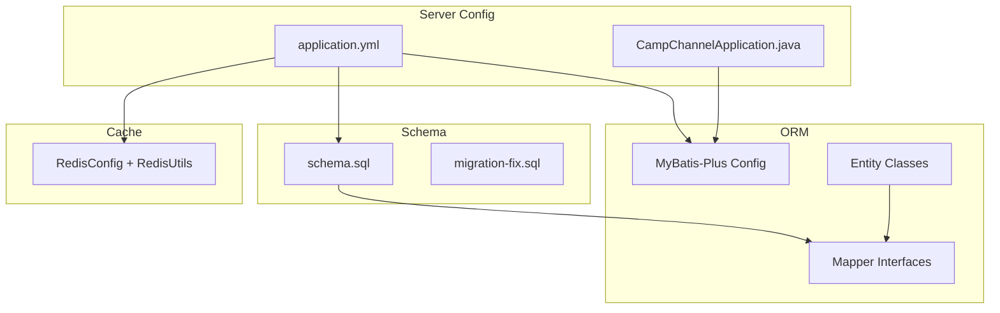
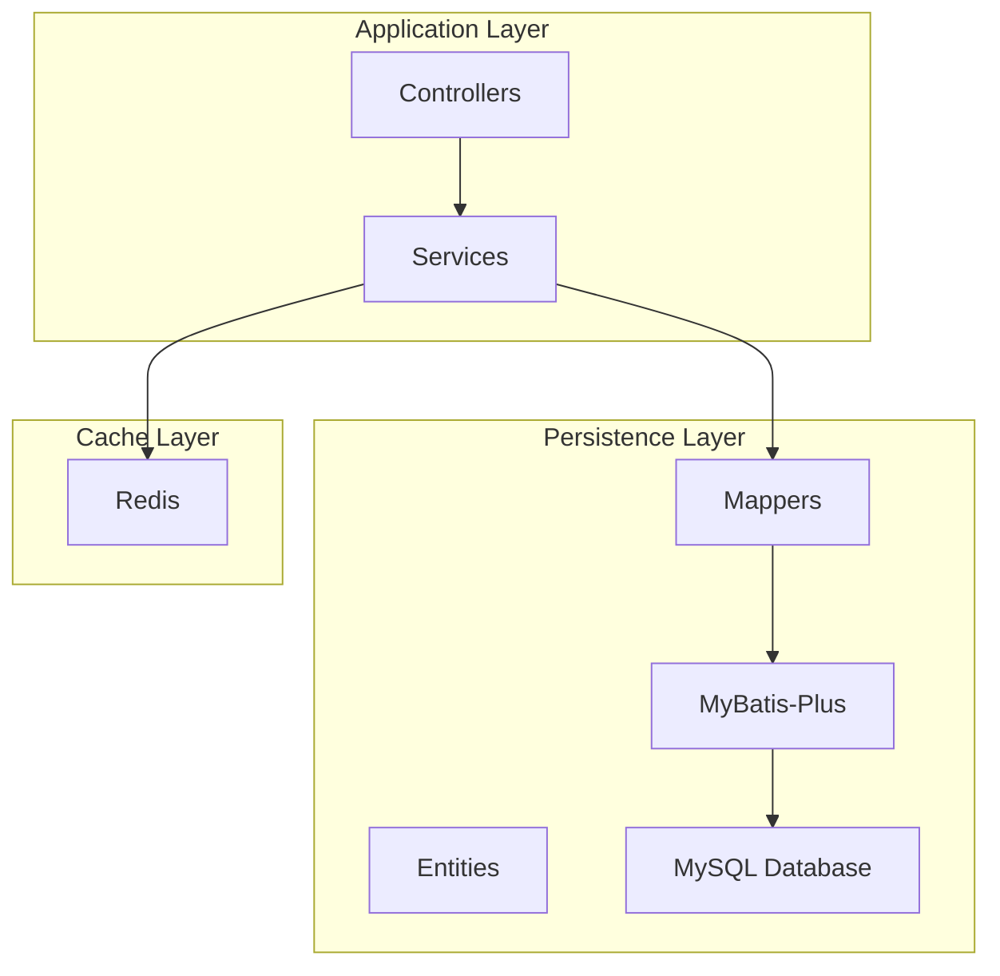
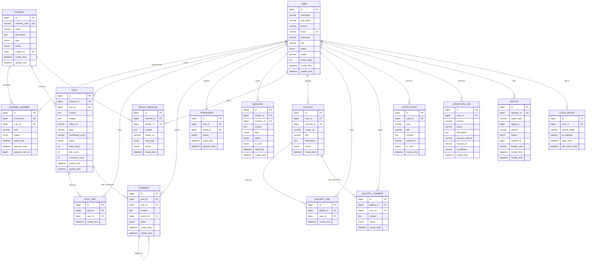
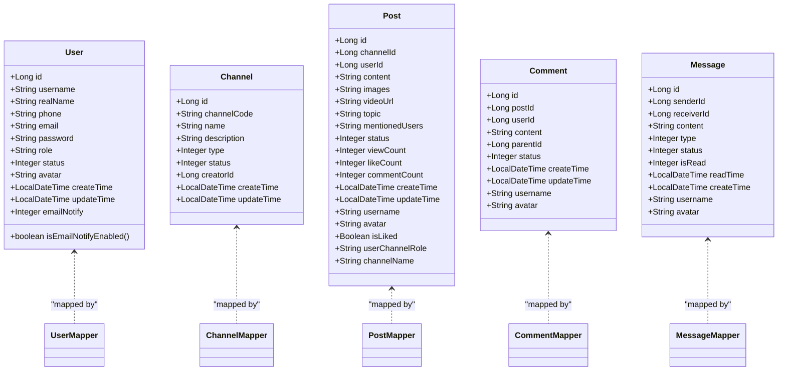
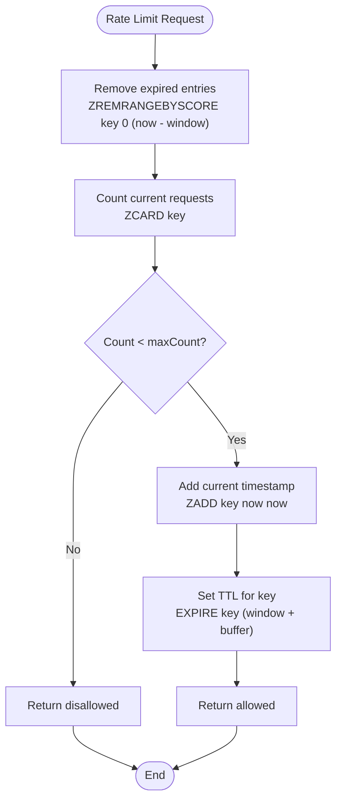
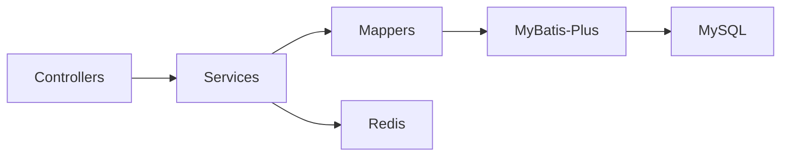

# Database Design

<cite>
**Referenced Files in This Document**
- [schema.sql](file://camp-channel-server/src/main/resources/db/schema.sql)
- [migration-fix.sql](file://camp-channel-server/src/main/resources/db/migration-fix.sql)
- [application.yml](file://camp-channel-server/src/main/resources/application.yml)
- [CampChannelApplication.java](file://camp-channel-server/src/main/java/com/gdmec/campchannel/CampChannelApplication.java)
- [RedisUtils.java](file://camp-channel-server/src/main/java/com/gdmec/campchannel/common/utils/RedisUtils.java)
- [User.java](file://camp-channel-server/src/main/java/com/gdmec/campchannel/entity/User.java)
- [Channel.java](file://camp-channel-server/src/main/java/com/gdmec/campchannel/entity/Channel.java)
- [Post.java](file://camp-channel-server/src/main/java/com/gdmec/campchannel/entity/Post.java)
- [Comment.java](file://camp-channel-server/src/main/java/com/gdmec/campchannel/entity/Comment.java)
- [Message.java](file://camp-channel-server/src/main/java/com/gdmec/campchannel/entity/Message.java)
- [Friendship.java](file://camp-channel-server/src/main/java/com/gdmec/campchannel/entity/Friendship.java)
- [Notification.java](file://camp-channel-server/src/main/java/com/gdmec/campchannel/entity/Notification.java)
- [OperationLog.java](file://camp-channel-server/src/main/java/com/gdmec/campchannel/entity/OperationLog.java)
- [Report.java](file://camp-channel-server/src/main/java/com/gdmec/campchannel/entity/Report.java)
- [LoginDevice.java](file://camp-channel-server/src/main/java/com/gdmec/campchannel/entity/LoginDevice.java)
- [GroupMessage.java](file://camp-channel-server/src/main/java/com/gdmec/campchannel/entity/GroupMessage.java)
- [Gallery.java](file://camp-channel-server/src/main/java/com/gdmec/campchannel/entity/Gallery.java)
- [GalleryLike.java](file://camp-channel-server/src/main/java/com/gdmec/campchannel/entity/GalleryLike.java)
- [GalleryComment.java](file://camp-channel-server/src/main/java/com/gdmec/campchannel/entity/GalleryComment.java)
- [ChannelMember.java](file://camp-channel-server/src/main/java/com/gdmec/campchannel/entity/ChannelMember.java)
- [PostLike.java](file://camp-channel-server/src/main/java/com/gdmec/campchannel/entity/PostLike.java)
- [UserMapper.java](file://camp-channel-server/src/main/java/com/gdmec/campchannel/mapper/UserMapper.java)
- [ChannelMapper.java](file://camp-channel-server/src/main/java/com/gdmec/campchannel/mapper/ChannelMapper.java)
- [PostMapper.java](file://camp-channel-server/src/main/java/com/gdmec/campchannel/mapper/PostMapper.java)
- [CommentMapper.java](file://camp-channel-server/src/main/java/com/gdmec/campchannel/mapper/CommentMapper.java)
- [MessageMapper.java](file://camp-channel-server/src/main/java/com/gdmec/campchannel/mapper/MessageMapper.java)
- [FriendshipMapper.java](file://camp-channel-server/src/main/java/com/gdmec/campchannel/mapper/FriendshipMapper.java)
- [NotificationMapper.java](file://camp-channel-server/src/main/java/com/gdmec/campchannel/mapper/NotificationMapper.java)
- [OperationLogMapper.java](file://camp-channel-server/src/main/java/com/gdmec/campchannel/mapper/OperationLogMapper.java)
- [ReportMapper.java](file://camp-channel-server/src/main/java/com/gdmec/campchannel/mapper/ReportMapper.java)
- [LoginDeviceMapper.java](file://camp-channel-server/src/main/java/com/gdmec/campchannel/mapper/LoginDeviceMapper.java)
- [GroupMessageMapper.java](file://camp-channel-server/src/main/java/com/gdmec/campchannel/mapper/GroupMessageMapper.java)
- [GalleryMapper.java](file://camp-channel-server/src/main/java/com/gdmec/campchannel/mapper/GalleryMapper.java)
- [GalleryLikeMapper.java](file://camp-channel-server/src/main/java/com/gdmec/campchannel/mapper/GalleryLikeMapper.java)
- [GalleryCommentMapper.java](file://camp-channel-server/src/main/java/com/gdmec/campchannel/mapper/GalleryCommentMapper.java)
- [ChannelMemberMapper.java](file://camp-channel-server/src/main/java/com/gdmec/campchannel/mapper/ChannelMemberMapper.java)
- [PostLikeMapper.java](file://camp-channel-server/src/main/java/com/gdmec/campchannel/mapper/PostLikeMapper.java)
</cite>

## Table of Contents
1. [Introduction](#introduction)
2. [Project Structure](#project-structure)
3. [Core Components](#core-components)
4. [Architecture Overview](#architecture-overview)
5. [Detailed Component Analysis](#detailed-component-analysis)
6. [Dependency Analysis](#dependency-analysis)
7. [Performance Considerations](#performance-considerations)
8. [Troubleshooting Guide](#troubleshooting-guide)
9. [Conclusion](#conclusion)
10. [Appendices](#appendices)

## Introduction
This document provides comprehensive database design documentation for the campus channel platform. It covers the relational schema, entity relationships, constraints, indexes, and business rules enforced at the database level. It also documents data access patterns using MyBatis-Plus, caching strategies with Redis, performance considerations, data lifecycle and retention, migration management, and security and privacy controls aligned with educational institution policies.

## Project Structure
The database schema is initialized via SQL scripts and managed by Spring Boot’s SQL initialization. MyBatis-Plus is configured for ORM and pagination. Redis is integrated for caching and rate limiting.

**Diagram sources**
- [application.yml:25-77](file://camp-channel-server/src/main/resources/application.yml#L25-L77)
- [CampChannelApplication.java:21-29](file://camp-channel-server/src/main/java/com/gdmec/campchannel/CampChannelApplication.java#L21-L29)
- [schema.sql:1-236](file://camp-channel-server/src/main/resources/db/schema.sql#L1-L236)
- [migration-fix.sql:1-16](file://camp-channel-server/src/main/resources/db/migration-fix.sql#L1-L16)

**Section sources**
- [application.yml:1-119](file://camp-channel-server/src/main/resources/application.yml#L1-L119)
- [CampChannelApplication.java:1-31](file://camp-channel-server/src/main/java/com/gdmec/campchannel/CampChannelApplication.java#L1-L31)
- [schema.sql:1-236](file://camp-channel-server/src/main/resources/db/schema.sql#L1-L236)
- [migration-fix.sql:1-16](file://camp-channel-server/src/main/resources/db/migration-fix.sql#L1-L16)

## Core Components
This section defines the core entities and their attributes, primary keys, foreign keys, indexes, and constraints. It also outlines business rules enforced by the schema.

- User
  - Purpose: Platform user accounts with roles and status.
  - Fields: id (PK), username, realName, phone, email (UNIQUE), password, role, status, avatar, emailNotify, createTime, updateTime.
  - Constraints: UNIQUE(email); default role=user; default status=active; default emailNotify enabled.
  - Indexes: None explicitly defined; consider adding indexes on username and phone for search and auth.

- Channel
  - Purpose: Public or private channels where posts and group messages are organized.
  - Fields: id (PK), channelCode (UNIQUE), name, description, type, status, creatorId (FK to User), createTime, updateTime.
  - Constraints: UNIQUE(channelCode); default type=public; default status=active.
  - Indexes: idx_channel_code, idx_channel_name.

- ChannelMember
  - Purpose: Tracks membership, roles, and approval status for channels.
  - Fields: id (PK), channelId (FK to Channel), userId (FK to User), role, status, applyTime, approveTime, approveUserId.
  - Constraints: UNIQUE(channelId, userId); default role=member; default status=pending.
  - Indexes: idx_user_id.

- Post
  - Purpose: User-generated content within a channel.
  - Fields: id (PK), channelId (FK to Channel), userId (FK to User), content, images (JSON), videoUrl, topic, mentionedUsers, status, viewCount, likeCount, commentCount, createTime, updateTime.
  - Constraints: default status=active; counters maintained by application/business logic.
  - Indexes: idx_channel_id, idx_user_id, idx_create_time.

- PostLike
  - Purpose: Tracks likes per post per user.
  - Fields: id (PK), postId (FK to Post), userId (FK to User), createTime.
  - Constraints: UNIQUE(postId, userId).
  - Indexes: idx_user_id.

- Comment
  - Purpose: Hierarchical comments under posts.
  - Fields: id (PK), postId (FK to Post), userId (FK to User), content, parentId (self-reference), status, createTime, updateTime.
  - Constraints: default status=active; parentId self-references to Comment.id.
  - Indexes: idx_post_id, idx_user_id, idx_parent_id.

- Friendship
  - Purpose: Manages friend requests and relationships.
  - Fields: id (PK), userId (FK to User), friendId (FK to User), status, applyTime, approveTime.
  - Constraints: UNIQUE(userId, friendId); default status=pending.
  - Indexes: idx_friend_id.

- Message
  - Purpose: One-on-one chat messages.
  - Fields: id (PK), senderId (FK to User), receiverId (FK to User), content, type, status, isRead, readTime, createTime.
  - Constraints: default status=active; default isRead=false.
  - Indexes: idx_sender_receiver, idx_receiver_sender, idx_create_time.

- Notification
  - Purpose: System notifications for users.
  - Fields: id (PK), userId (FK to User), type, title, content, relatedId, isRead, createTime.
  - Constraints: default isRead=false.
  - Indexes: idx_user_id, idx_is_read.

- OperationLog
  - Purpose: Audit trail for administrative actions.
  - Fields: id (PK), userId (FK to User), module, action, description, requestMethod, requestUrl, ipAddress, createTime.
  - Indexes: idx_user_id, idx_create_time.

- Report
  - Purpose: Reports against posts, comments, or messages.
  - Fields: id (PK), reporterId (FK to User), targetType, targetId, reason, status, handlerId, handleNote, createTime, handleTime.
  - Constraints: default status=pending.
  - Indexes: idx_reporter_id, idx_target, idx_status.

- LoginDevice
  - Purpose: Track user login devices and activity.
  - Fields: id (PK), userId (FK to User), deviceName, ipAddress, loginTime, lastActiveTime.
  - Indexes: idx_ld_user_id.

- GroupMessage
  - Purpose: Messages sent in channels (group chat).
  - Fields: id (PK), channelId (FK to Channel), senderId (FK to User), content, mediaUrl, msgType, status, createTime.
  - Constraints: default status=active.
  - Indexes: idx_gm_channel_id, idx_gm_create_time.

- Gallery
  - Purpose: Image gallery entries associated with users and channels.
  - Fields: id (PK), userId (FK to User), channelId (FK to Channel), imageUrl, title, description, status, createTime.
  - Constraints: default status=active.
  - Indexes: idx_gallery_user_id, idx_gallery_status, idx_gallery_channel_id.

- GalleryLike
  - Purpose: Likes for gallery items.
  - Fields: id (PK), galleryId (FK to Gallery), userId (FK to User), createTime.
  - Constraints: UNIQUE(galleryId, userId).
  - Indexes: idx_gallery_like_gallery_id, idx_gallery_like_user_id.

- GalleryComment
  - Purpose: Comments on gallery items.
  - Fields: id (PK), galleryId (FK to Gallery), userId (FK to User), content, status, createTime.
  - Constraints: default status=active.
  - Indexes: idx_gallery_comment_gallery_id, idx_gallery_comment_user_id.

Notes on indexes and constraints:
- Many tables define explicit indexes to optimize frequent queries (e.g., sender/receiver pairs, timestamps).
- Unique constraints prevent duplicate relationships (e.g., channel memberships, likes, gallery likes).
- Status fields enforce soft-deletion and moderation-friendly workflows.

**Section sources**
- [schema.sql:1-236](file://camp-channel-server/src/main/resources/db/schema.sql#L1-L236)

## Architecture Overview
The database layer integrates with Spring Boot, MyBatis-Plus, and Redis. Initialization runs schema.sql automatically. Entities map to tables via MyBatis-Plus annotations. Redis supports caching and sliding-window rate limiting.

**Diagram sources**
- [application.yml:25-77](file://camp-channel-server/src/main/resources/application.yml#L25-L77)
- [CampChannelApplication.java:12-29](file://camp-channel-server/src/main/java/com/gdmec/campchannel/CampChannelApplication.java#L12-L29)
- [User.java:10-42](file://camp-channel-server/src/main/java/com/gdmec/campchannel/entity/User.java#L10-L42)
- [Channel.java:10-32](file://camp-channel-server/src/main/java/com/gdmec/campchannel/entity/Channel.java#L10-L32)
- [Post.java:11-58](file://camp-channel-server/src/main/java/com/gdmec/campchannel/entity/Post.java#L11-L58)
- [Message.java:11-40](file://camp-channel-server/src/main/java/com/gdmec/campchannel/entity/Message.java#L11-L40)
- [RedisUtils.java:132-168](file://camp-channel-server/src/main/java/com/gdmec/campchannel/common/utils/RedisUtils.java#L132-L168)

## Detailed Component Analysis

### Entity Relationship Model
The following ER diagram maps core entities and their relationships:

**Diagram sources**
- [schema.sql:1-236](file://camp-channel-server/src/main/resources/db/schema.sql#L1-L236)
- [User.java:10-42](file://camp-channel-server/src/main/java/com/gdmec/campchannel/entity/User.java#L10-L42)
- [Channel.java:10-32](file://camp-channel-server/src/main/java/com/gdmec/campchannel/entity/Channel.java#L10-L32)
- [Post.java:11-58](file://camp-channel-server/src/main/java/com/gdmec/campchannel/entity/Post.java#L11-L58)
- [Comment.java:11-37](file://camp-channel-server/src/main/java/com/gdmec/campchannel/entity/Comment.java#L11-L37)
- [Message.java:11-40](file://camp-channel-server/src/main/java/com/gdmec/campchannel/entity/Message.java#L11-L40)
- [GroupMessage.java:11-40](file://camp-channel-server/src/main/java/com/gdmec/campchannel/entity/GroupMessage.java#L11-L40)
- [Gallery.java:11-40](file://camp-channel-server/src/main/java/com/gdmec/campchannel/entity/Gallery.java#L11-L40)
- [GalleryLike.java:10-20](file://camp-channel-server/src/main/java/com/gdmec/campchannel/entity/GalleryLike.java#L10-L20)
- [GalleryComment.java:10-20](file://camp-channel-server/src/main/java/com/gdmec/campchannel/entity/GalleryComment.java#L10-L20)
- [Friendship.java:10-20](file://camp-channel-server/src/main/java/com/gdmec/campchannel/entity/Friendship.java#L10-L20)
- [Notification.java:10-25](file://camp-channel-server/src/main/java/com/gdmec/campchannel/entity/Notification.java#L10-L25)
- [OperationLog.java:10-25](file://camp-channel-server/src/main/java/com/gdmec/campchannel/entity/OperationLog.java#L10-L25)
- [Report.java:10-25](file://camp-channel-server/src/main/java/com/gdmec/campchannel/entity/Report.java#L10-L25)
- [LoginDevice.java:10-25](file://camp-channel-server/src/main/java/com/gdmec/campchannel/entity/LoginDevice.java#L10-L25)

### Data Access Patterns with MyBatis-Plus
- Configuration
  - Mapper scanning is enabled for the package containing mapper interfaces.
  - Pagination interceptor is configured for MySQL.
  - MyBatis-Plus locations are loaded from classpath.
- Entities
  - Entities use @TableName and @TableId annotations to map to tables and primary keys.
  - Some entities expose computed fields via @TableField(exist=false) for joined data.
- Mappers
  - Each entity has a corresponding mapper interface extending base MyBatis-Plus interfaces.
  - Mappers are scanned by the application and used by services for CRUD and query operations.

**Diagram sources**
- [CampChannelApplication.java:12-14](file://camp-channel-server/src/main/java/com/gdmec/campchannel/CampChannelApplication.java#L12-L14)
- [application.yml:68-77](file://camp-channel-server/src/main/resources/application.yml#L68-L77)
- [User.java:10-42](file://camp-channel-server/src/main/java/com/gdmec/campchannel/entity/User.java#L10-L42)
- [Channel.java:10-32](file://camp-channel-server/src/main/java/com/gdmec/campchannel/entity/Channel.java#L10-L32)
- [Post.java:11-58](file://camp-channel-server/src/main/java/com/gdmec/campchannel/entity/Post.java#L11-L58)
- [Comment.java:11-37](file://camp-channel-server/src/main/java/com/gdmec/campchannel/entity/Comment.java#L11-L37)
- [Message.java:11-40](file://camp-channel-server/src/main/java/com/gdmec/campchannel/entity/Message.java#L11-L40)

**Section sources**
- [CampChannelApplication.java:12-29](file://camp-channel-server/src/main/java/com/gdmec/campchannel/CampChannelApplication.java#L12-L29)
- [application.yml:68-77](file://camp-channel-server/src/main/resources/application.yml#L68-L77)
- [User.java:10-42](file://camp-channel-server/src/main/java/com/gdmec/campchannel/entity/User.java#L10-L42)
- [Channel.java:10-32](file://camp-channel-server/src/main/java/com/gdmec/campchannel/entity/Channel.java#L10-L32)
- [Post.java:11-58](file://camp-channel-server/src/main/java/com/gdmec/campchannel/entity/Post.java#L11-L58)
- [Comment.java:11-37](file://camp-channel-server/src/main/java/com/gdmec/campchannel/entity/Comment.java#L11-L37)
- [Message.java:11-40](file://camp-channel-server/src/main/java/com/gdmec/campchannel/entity/Message.java#L11-L40)

### Caching Strategies with Redis
- Redis configuration is provided via application.yml with host, port, database, and connection settings.
- RedisUtils encapsulates common operations and implements a sliding window rate limiter using ZSet to track request timestamps within a time window.
- The rate limiter removes expired entries, counts current requests, decides allowance, and sets TTL to prevent stale data accumulation.

**Diagram sources**
- [application.yml:31-42](file://camp-channel-server/src/main/resources/application.yml#L31-L42)
- [RedisUtils.java:132-168](file://camp-channel-server/src/main/java/com/gdmec/campchannel/common/utils/RedisUtils.java#L132-L168)

**Section sources**
- [application.yml:31-42](file://camp-channel-server/src/main/resources/application.yml#L31-L42)
- [RedisUtils.java:132-168](file://camp-channel-server/src/main/java/com/gdmec/campchannel/common/utils/RedisUtils.java#L132-L168)

### Sample Data for Key Entities
Below are representative rows for major entities. These illustrate typical values and constraints.

- User
  - Example row: id, username, realName, phone, email, password, role=user, status=1, avatar=null, emailNotify=1, createTime, updateTime.
  - Notes: email is unique; default role and status are applied.

- Channel
  - Example row: id, channelCode (unique), name, description, type=1(public), status=1, creatorId, createTime, updateTime.
  - Notes: channelCode uniqueness is enforced.

- Post
  - Example row: id, channelId, userId, content, images(JSON), videoUrl, topic, mentionedUsers, status=1, counters=0, createTime, updateTime.
  - Notes: counters are maintained by application logic.

- Message
  - Example row: id, senderId, receiverId, content, type=1, status=1, isRead=0, readTime=null, createTime.
  - Notes: default unread and active.

- GroupMessage
  - Example row: id, channelId, senderId, content, mediaUrl, msgType=1, status=1, createTime.
  - Notes: default active.

- Gallery
  - Example row: id, userId, channelId, imageUrl, title="", description, status=1, createTime.
  - Notes: default active.

**Section sources**
- [schema.sql:1-236](file://camp-channel-server/src/main/resources/db/schema.sql#L1-L236)

### Data Validation and Business Rules via Database Constraints
- Uniqueness
  - User.email: UNIQUE.
  - Channel.channelCode: UNIQUE.
  - ChannelMember(channelId, userId): UNIQUE.
  - PostLike(postId, userId): UNIQUE.
  - GalleryLike(galleryId, userId): UNIQUE.
- Defaults
  - Many fields carry sensible defaults (e.g., status=active, counters=0, role=user).
- Referential Integrity
  - Foreign keys are implied by table relationships; ensure application-level cascading and referential actions align with business needs.
- Moderation and Soft Deletion
  - Status fields enable moderation workflows (pending/approved/deleted) and soft deletion semantics.

**Section sources**
- [schema.sql:1-236](file://camp-channel-server/src/main/resources/db/schema.sql#L1-L236)

### Data Lifecycle, Retention, and Archival
- Operational data (messages, posts, comments) should be retained per institutional policy; consider partitioning by time and archiving older records to separate storage tiers.
- Audit logs (operation_log) should be retained per compliance requirements; define purge schedules aligned with legal obligations.
- User data retention depends on privacy policies; implement anonymization or deletion upon user request.
- Gallery and media assets require separate lifecycle policies aligned with storage costs and access patterns.

[No sources needed since this section provides general guidance]

### Migration Paths and Version Management
- Schema initialization
  - application.yml configures schema.sql to be executed on startup with continue-on-error enabled.
- Incremental fixes
  - migration-fix.sql adds missing columns if needed and verifies their presence.
- Future migrations
  - For production, adopt a dedicated migration tool (Flyway or Liquibase) to manage schema changes with versioned scripts and rollback capabilities.

**Section sources**
- [application.yml:25-29](file://camp-channel-server/src/main/resources/application.yml#L25-L29)
- [migration-fix.sql:1-16](file://camp-channel-server/src/main/resources/db/migration-fix.sql#L1-L16)

### Data Security and Privacy Controls
- Authentication and Authorization
  - JWT-based authentication is configured; ensure secure secret management and token expiration.
- Data Protection
  - Passwords are stored hashed; enforce strong hashing and rotation policies.
  - Student data (e.g., phone, realName) should be processed under privacy-compliant policies; limit collection to necessity and provide user controls.
- Access Control
  - Controllers and services should enforce authorization checks (e.g., ownership, channel roles) before accessing sensitive data.
- Logging and Monitoring
  - Operation logs capture actions; ensure logs do not persist sensitive data unnecessarily.

**Section sources**
- [application.yml:78-84](file://camp-channel-server/src/main/resources/application.yml#L78-L84)
- [schema.sql:1-236](file://camp-channel-server/src/main/resources/db/schema.sql#L1-L236)

## Dependency Analysis
The following diagram shows dependencies among core components and their persistence layer:

**Diagram sources**
- [application.yml:25-77](file://camp-channel-server/src/main/resources/application.yml#L25-L77)
- [CampChannelApplication.java:12-29](file://camp-channel-server/src/main/java/com/gdmec/campchannel/CampChannelApplication.java#L12-L29)
- [RedisUtils.java:132-168](file://camp-channel-server/src/main/java/com/gdmec/campchannel/common/utils/RedisUtils.java#L132-L168)

**Section sources**
- [application.yml:25-77](file://camp-channel-server/src/main/resources/application.yml#L25-L77)
- [CampChannelApplication.java:12-29](file://camp-channel-server/src/main/java/com/gdmec/campchannel/CampChannelApplication.java#L12-L29)
- [RedisUtils.java:132-168](file://camp-channel-server/src/main/java/com/gdmec/campchannel/common/utils/RedisUtils.java#L132-L168)

## Performance Considerations
- Indexing Strategy
  - Leverage existing indexes (e.g., sender/receiver pairs for messages, timestamps for posts and group messages).
  - Consider adding composite indexes for frequent filters (e.g., user_id + status, channel_id + status).
- Query Patterns
  - Use MyBatis-Plus pagination for large lists (posts, comments, notifications).
  - Prefer selective projections to reduce payload sizes.
- Caching
  - Cache frequently accessed metadata (e.g., user profiles, channel info) using Redis with short TTLs.
  - Apply rate limiting to protect upstream systems.
- Storage and Media
  - Offload images/videos to external storage; keep only references in the database.
- Concurrency
  - Use optimistic locking or application-level guards for counters (view_count, like_count, comment_count).

[No sources needed since this section provides general guidance]

## Troubleshooting Guide
- Schema Initialization Failures
  - Verify application.yml points to schema.sql and continue-on-error is enabled.
  - If columns are missing, run migration-fix.sql to add them.
- Redis Connectivity Issues
  - Confirm host, port, and credentials in application.yml; ensure Redis server is reachable.
  - Inspect RedisUtils behavior during rate-limiting scenarios.
- MyBatis-Plus Issues
  - Ensure mappers are in the scanned package and entity annotations match table names.
  - Validate pagination interceptor configuration for MySQL.

**Section sources**
- [application.yml:25-29](file://camp-channel-server/src/main/resources/application.yml#L25-L29)
- [migration-fix.sql:1-16](file://camp-channel-server/src/main/resources/db/migration-fix.sql#L1-L16)
- [application.yml:31-42](file://camp-channel-server/src/main/resources/application.yml#L31-L42)
- [CampChannelApplication.java:12-29](file://camp-channel-server/src/main/java/com/gdmec/campchannel/CampChannelApplication.java#L12-L29)
- [RedisUtils.java:132-168](file://camp-channel-server/src/main/java/com/gdmec/campchannel/common/utils/RedisUtils.java#L132-L168)

## Conclusion
The database design supports the platform’s core features—channels, posts, messaging, and user management—through normalized relations, explicit constraints, and indexes. MyBatis-Plus simplifies data access, while Redis enhances performance and reliability. Robust migration and security practices are essential for production readiness and compliance.

[No sources needed since this section summarizes without analyzing specific files]

## Appendices

### Appendix A: Entity-to-Table Mapping Reference
- User -> user
- Channel -> channel
- ChannelMember -> channel_member
- Post -> post
- PostLike -> post_like
- Comment -> comment
- Friendship -> friendship
- Message -> message
- GroupMessage -> group_message
- Gallery -> gallery
- GalleryLike -> gallery_like
- GalleryComment -> gallery_comment
- Notification -> notification
- OperationLog -> operation_log
- Report -> report
- LoginDevice -> login_device

**Section sources**
- [schema.sql:1-236](file://camp-channel-server/src/main/resources/db/schema.sql#L1-L236)