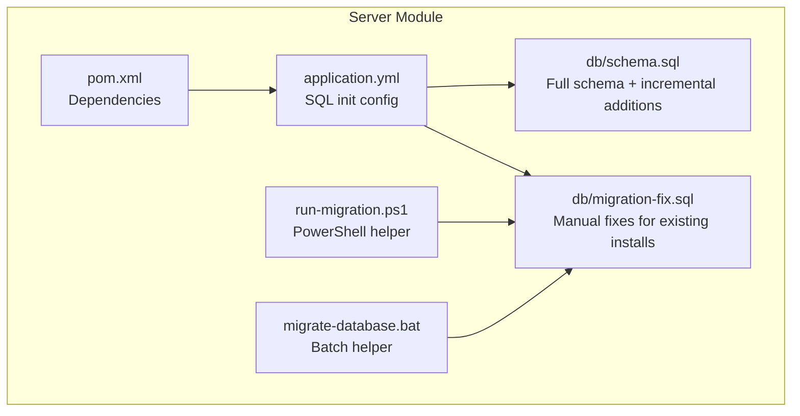
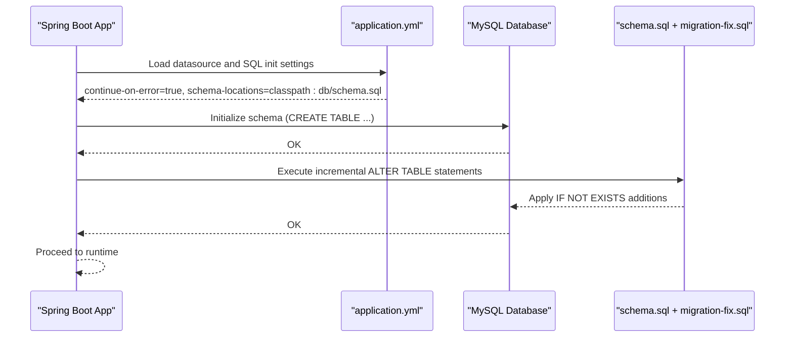
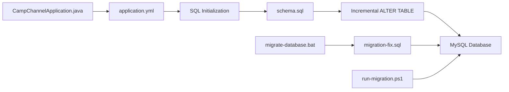

# Database Migration and Version Management

<cite>
**Referenced Files in This Document**
- [schema.sql](file://camp-channel-server/src/main/resources/db/schema.sql)
- [migration-fix.sql](file://camp-channel-server/src/main/resources/db/migration-fix.sql)
- [application.yml](file://camp-channel-server/src/main/resources/application.yml)
- [run-migration.ps1](file://camp-channel-server/run-migration.ps1)
- [migrate-database.bat](file://camp-channel-server/migrate-database.bat)
- [pom.xml](file://camp-channel-server/pom.xml)
- [CampChannelApplication.java](file://camp-channel-server/src/main/java/com/gdmec/campchannel/CampChannelApplication.java)
- [DataInitializer.java](file://camp-channel-server/src/main/java/com/gdmec/campchannel/config/DataInitializer.java)
- [V1.0 Requirements](file://Camp Channel 校园频道系统 V1.0 需求文档.md)
- [V2.0 Requirements](file://Camp Channel 校园频道系统 V2.0 需求文档.md)
</cite>

## Table of Contents
1. [Introduction](#introduction)
2. [Project Structure](#project-structure)
3. [Core Components](#core-components)
4. [Architecture Overview](#architecture-overview)
5. [Detailed Component Analysis](#detailed-component-analysis)
6. [Dependency Analysis](#dependency-analysis)
7. [Performance Considerations](#performance-considerations)
8. [Troubleshooting Guide](#troubleshooting-guide)
9. [Conclusion](#conclusion)
10. [Appendices](#appendices)

## Introduction
This document explains the database migration strategy and version management implementation for the campus social platform. It covers:
- How schema initialization and incremental migrations are configured and executed
- The role of the manual migration-fix.sql script for updating existing installations
- The continue-on-error strategy enabling safe re-execution of migration scripts
- Schema evolution patterns and backward compatibility
- Rollback considerations and safety measures
- Deployment process for applying migrations in production
- How migrations support continuous development and feature releases

## Project Structure
The database migration assets and configuration are organized under the server module’s resources and scripts:
- SQL schema and incremental migration scripts live under src/main/resources/db
- Application configuration controls schema initialization and continue-on-error behavior
- Platform-specific migration helpers exist as PowerShell and batch scripts

**Diagram sources**
- [application.yml:25-29](file://camp-channel-server/src/main/resources/application.yml#L25-L29)
- [schema.sql:174-184](file://camp-channel-server/src/main/resources/db/schema.sql#L174-L184)
- [migration-fix.sql:1-16](file://camp-channel-server/src/main/resources/db/migration-fix.sql#L1-L16)
- [run-migration.ps1:1-54](file://camp-channel-server/run-migration.ps1#L1-L54)
- [migrate-database.bat:1-45](file://camp-channel-server/migrate-database.bat#L1-L45)
- [pom.xml:32-76](file://camp-channel-server/pom.xml#L32-L76)

**Section sources**
- [application.yml:25-29](file://camp-channel-server/src/main/resources/application.yml#L25-L29)
- [schema.sql:174-184](file://camp-channel-server/src/main/resources/db/schema.sql#L174-L184)
- [migration-fix.sql:1-16](file://camp-channel-server/src/main/resources/db/migration-fix.sql#L1-L16)
- [run-migration.ps1:1-54](file://camp-channel-server/run-migration.ps1#L1-L54)
- [migrate-database.bat:1-45](file://camp-channel-server/migrate-database.bat#L1-L45)
- [pom.xml:32-76](file://camp-channel-server/pom.xml#L32-L76)

## Core Components
- Full schema initializer: db/schema.sql defines the complete schema and includes incremental additions for backward-compatible updates.
- Incremental migration engine: Spring SQL initialization with continue-on-error ensures idempotent re-execution.
- Manual fix scripts: migration-fix.sql and migrate-database.bat provide targeted fixes for existing installations.
- Helper scripts: run-migration.ps1 automates adding missing columns in specific scenarios.

Key behaviors:
- Full schema creation plus incremental ALTER TABLE statements for evolving fields
- continue-on-error enabled to tolerate repeated runs
- IF NOT EXISTS clauses to avoid errors on subsequent executions
- Dedicated scripts for manual remediation of partial upgrades

**Section sources**
- [schema.sql:174-184](file://camp-channel-server/src/main/resources/db/schema.sql#L174-L184)
- [application.yml:25-29](file://camp-channel-server/src/main/resources/application.yml#L25-L29)
- [migration-fix.sql:1-16](file://camp-channel-server/src/main/resources/db/migration-fix.sql#L1-L16)
- [migrate-database.bat:19](file://camp-channel-server/migrate-database.bat#L19)
- [run-migration.ps1:35](file://camp-channel-server/run-migration.ps1#L35)

## Architecture Overview
The migration architecture integrates Spring Boot’s SQL initialization with explicit schema and incremental migration scripts. The application starts, initializes the schema, and applies incremental changes safely.

**Diagram sources**
- [application.yml:25-29](file://camp-channel-server/src/main/resources/application.yml#L25-L29)
- [schema.sql:174-184](file://camp-channel-server/src/main/resources/db/schema.sql#L174-L184)
- [schema.sql:1-16](file://camp-channel-server/src/main/resources/db/schema.sql#L1-L16)

## Detailed Component Analysis

### Full Schema Initialization (schema.sql)
- Defines all core tables and indexes
- Contains a dedicated section for incremental additions that are safe to re-run
- Uses IF NOT EXISTS for column additions to ensure idempotency

Migration patterns shown:
- Adding optional columns with defaults to preserve backward compatibility
- Creating new tables for expanded features (e.g., group messaging, favorites)
- Indexes added alongside new tables for performance

Backward compatibility:
- New columns are optional and defaulted
- Existing applications can continue operating while new features evolve

**Section sources**
- [schema.sql:1-16](file://camp-channel-server/src/main/resources/db/schema.sql#L1-L16)
- [schema.sql:174-184](file://camp-channel-server/src/main/resources/db/schema.sql#L174-L184)
- [schema.sql:186-236](file://camp-channel-server/src/main/resources/db/schema.sql#L186-L236)

### Incremental Migration Engine (continue-on-error)
- Spring SQL initialization is configured to continue on error
- This enables safe re-execution of migration scripts without failing the application startup
- Ensures idempotency for repeated deployments

Safety:
- IF NOT EXISTS prevents duplicate column/index creation
- Defaults and nullable settings protect existing data

**Section sources**
- [application.yml:25-29](file://camp-channel-server/src/main/resources/application.yml#L25-L29)
- [schema.sql:174-184](file://camp-channel-server/src/main/resources/db/schema.sql#L174-L184)

### Manual Fix Scripts (migration-fix.sql and migrate-database.bat)
Purpose:
- Address partial upgrades or missing columns in existing installations
- Provide a controlled way to apply targeted fixes

Workflow:
- migrate-database.bat executes migration-fix.sql against the target database
- migration-fix.sql adds missing columns with IF NOT EXISTS checks and verifies results

Use cases:
- After upgrading from older versions where some columns were not added
- During troubleshooting to remediate schema inconsistencies

**Section sources**
- [migration-fix.sql:1-16](file://camp-channel-server/src/main/resources/db/migration-fix.sql#L1-L16)
- [migrate-database.bat:19](file://camp-channel-server/migrate-database.bat#L19)

### PowerShell Helper (run-migration.ps1)
Purpose:
- Automates adding a specific missing column to the post table
- Detects MySQL installation and executes the ALTER TABLE statement

Behavior:
- Searches for MySQL executable in common locations
- Executes the SQL with credentials supplied inline
- Reports success or failure with exit codes

**Section sources**
- [run-migration.ps1:1-54](file://camp-channel-server/run-migration.ps1#L1-L54)

### Database Dependencies and Configuration
- MySQL Connector/J dependency is declared for JDBC connectivity
- Spring Boot configuration sets up the datasource and SQL initialization

Integration:
- The application connects to the database using the configured datasource
- SQL initialization runs automatically at startup

**Section sources**
- [pom.xml:73-76](file://camp-channel-server/pom.xml#L73-L76)
- [application.yml:13-17](file://camp-channel-server/src/main/resources/application.yml#L13-L17)

### Application Bootstrap and Data Initialization
- The main application class registers MyBatis-Plus pagination interceptor
- DataInitializer creates default channels and admin/test users on startup
- While not part of schema migration, it demonstrates application readiness after migrations

**Section sources**
- [CampChannelApplication.java:1-31](file://camp-channel-server/src/main/java/com/gdmec/campchannel/CampChannelApplication.java#L1-L31)
- [DataInitializer.java:1-105](file://camp-channel-server/src/main/java/com/gdmec/campchannel/config/DataInitializer.java#L1-L105)

### V1.0 and V2.0 Feature Impact on Migrations
- V1.0 baseline includes posts, channels, messages, likes, comments, galleries, and notifications
- V2.0 introduces group messaging, read receipts, favorites, pinned posts, and richer message states
- These features are reflected in schema.sql with new tables and column additions

Implications:
- Incremental additions in schema.sql prepare for V2.0 features
- continue-on-error ensures smooth rollout across environments

**Section sources**
- [V1.0 Requirements: 341-455:341-455](file://Camp Channel 校园频道系统 V1.0 需求文档.md#L341-L455)
- [V2.0 Requirements: 191-229:191-229](file://Camp Channel 校园频道系统 V2.0 需求文档.md#L191-L229)
- [schema.sql:186-236](file://camp-channel-server/src/main/resources/db/schema.sql#L186-L236)

## Dependency Analysis
The migration pipeline depends on:
- Spring Boot SQL initialization configuration
- MySQL database connectivity
- Executable scripts for manual remediation

**Diagram sources**
- [CampChannelApplication.java:1-31](file://camp-channel-server/src/main/java/com/gdmec/campchannel/CampChannelApplication.java#L1-L31)
- [application.yml:25-29](file://camp-channel-server/src/main/resources/application.yml#L25-L29)
- [schema.sql:174-184](file://camp-channel-server/src/main/resources/db/schema.sql#L174-L184)
- [migration-fix.sql:1-16](file://camp-channel-server/src/main/resources/db/migration-fix.sql#L1-L16)
- [migrate-database.bat:19](file://camp-channel-server/migrate-database.bat#L19)
- [run-migration.ps1:35](file://camp-channel-server/run-migration.ps1#L35)

**Section sources**
- [application.yml:25-29](file://camp-channel-server/src/main/resources/application.yml#L25-L29)
- [schema.sql:174-184](file://camp-channel-server/src/main/resources/db/schema.sql#L174-L184)
- [migration-fix.sql:1-16](file://camp-channel-server/src/main/resources/db/migration-fix.sql#L1-L16)
- [migrate-database.bat:19](file://camp-channel-server/migrate-database.bat#L19)
- [run-migration.ps1:35](file://camp-channel-server/run-migration.ps1#L35)

## Performance Considerations
- Indexes accompany new tables to optimize reads (e.g., group_message, post_favourite)
- Incremental ALTER TABLE statements are designed to be lightweight and idempotent
- continue-on-error avoids startup failures, enabling faster rollouts

Recommendations:
- Monitor slow queries after adding new indexes
- Use EXPLAIN to verify index usage for frequently accessed tables
- Keep ALTER TABLE operations minimal and additive to reduce downtime risk

[No sources needed since this section provides general guidance]

## Troubleshooting Guide
Common issues and resolutions:
- MySQL not found by PowerShell script
  - The script searches common installation paths; adjust the path or install MySQL accordingly
- Incorrect credentials or database not selected
  - Ensure the correct username/password and that the target database exists
- Partial upgrade leaving missing columns
  - Run migrate-database.bat to apply migration-fix.sql
- Repeated execution causing errors
  - continue-on-error is enabled; repeated runs should succeed without failure

Verification steps:
- Confirm column existence using INFORMATION_SCHEMA queries included in migration-fix.sql
- Check application logs for SQL initialization output

**Section sources**
- [run-migration.ps1:7-29](file://camp-channel-server/run-migration.ps1#L7-L29)
- [migrate-database.bat:21-41](file://camp-channel-server/migrate-database.bat#L21-L41)
- [migration-fix.sql:10-16](file://camp-channel-server/src/main/resources/db/migration-fix.sql#L10-L16)

## Conclusion
The platform employs a robust, idempotent migration strategy:
- Full schema initialization with incremental additions ensures forward compatibility
- continue-on-error enables safe, repeatable deployments
- Manual fix scripts address real-world partial upgrades
- Helper scripts streamline remediation tasks
- The approach supports continuous development and feature releases without breaking existing installations

[No sources needed since this section summarizes without analyzing specific files]

## Appendices

### Migration Patterns and Examples
- Adding new fields to existing tables
  - Example: Adding optional columns with defaults and comments
  - Reference: [schema.sql:177-184](file://camp-channel-server/src/main/resources/db/schema.sql#L177-L184)
- Creating new tables for new features
  - Example: group_message and post_favourite tables
  - Reference: [schema.sql:186-236](file://camp-channel-server/src/main/resources/db/schema.sql#L186-L236)
- Modifying existing constraints and statuses
  - Example: Extending message status and adding read_at field
  - Reference: [V2.0 Requirements: 220-228:220-228](file://Camp Channel 校园频道系统 V2.0 需求文档.md#L220-L228)

### Rollback Strategy and Safety Measures
- Idempotent design: IF NOT EXISTS and defaults prevent destructive re-execution
- continue-on-error: Ensures application startup succeeds even if some migrations fail
- Manual remediation: migration-fix.sql and migrate-database.bat allow targeted fixes
- Verification: INFORMATION_SCHEMA queries confirm successful additions

**Section sources**
- [schema.sql:174-184](file://camp-channel-server/src/main/resources/db/schema.sql#L174-L184)
- [application.yml:25-29](file://camp-channel-server/src/main/resources/application.yml#L25-L29)
- [migration-fix.sql:10-16](file://camp-channel-server/src/main/resources/db/migration-fix.sql#L10-L16)

### Production Deployment Process
- Prepare environment: Ensure MySQL is running and accessible
- Apply schema: Allow Spring Boot to initialize schema and incremental migrations
- Verify: Confirm columns and tables exist as expected
- Restart services: Restart the backend to pick up new schema changes
- Monitor: Watch application logs for SQL initialization output

**Section sources**
- [application.yml:25-29](file://camp-channel-server/src/main/resources/application.yml#L25-L29)
- [migrate-database.bat:19](file://camp-channel-server/migrate-database.bat#L19)