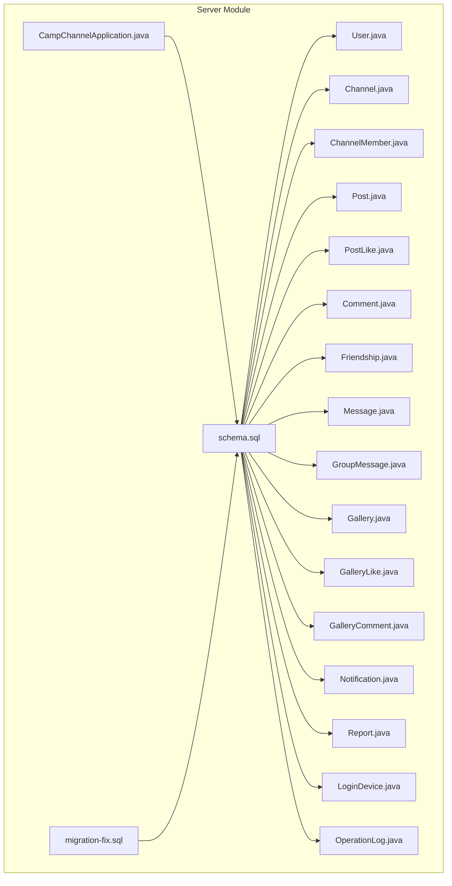
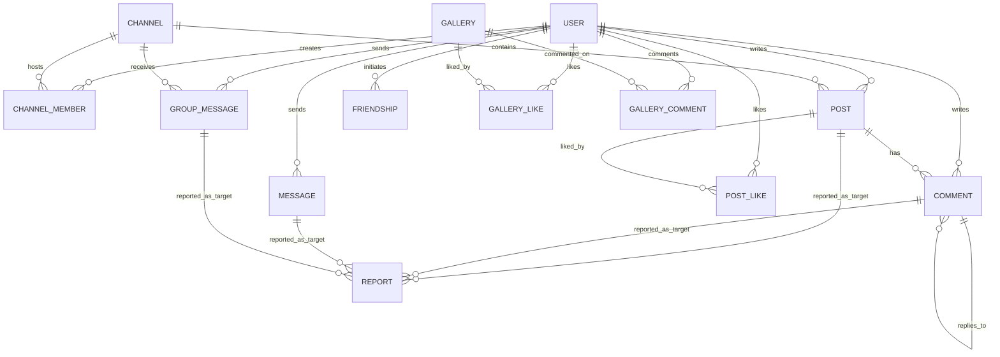
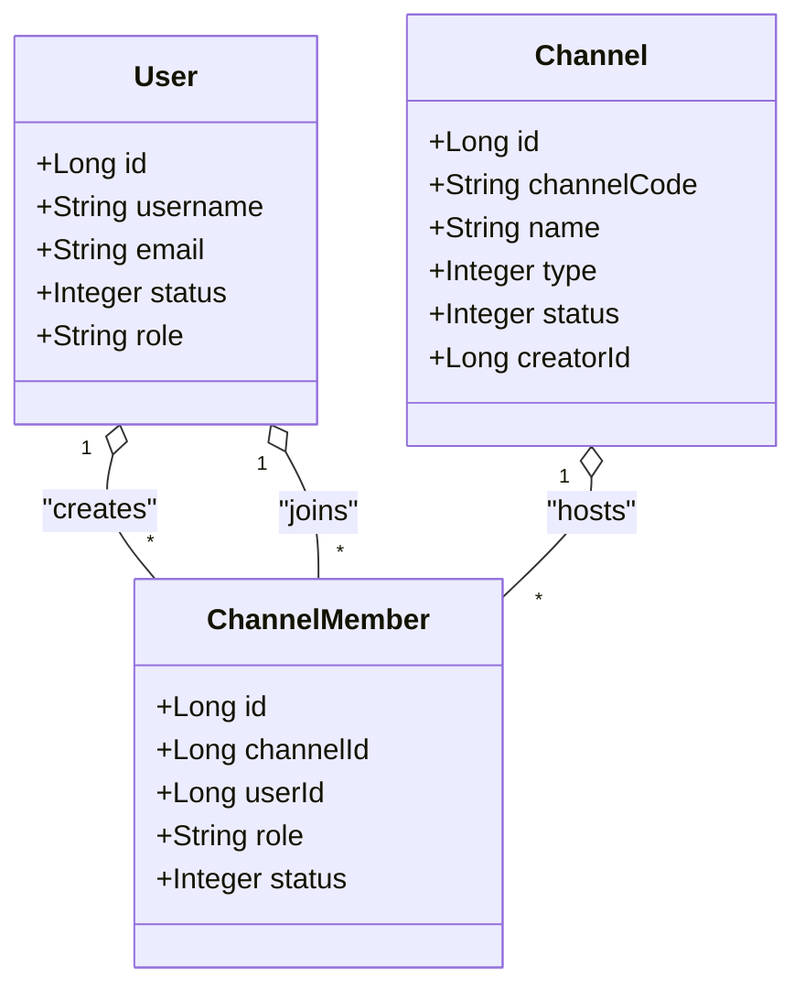
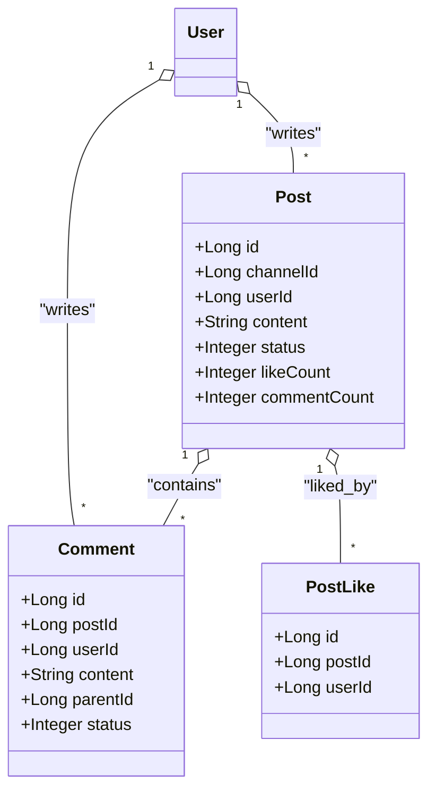
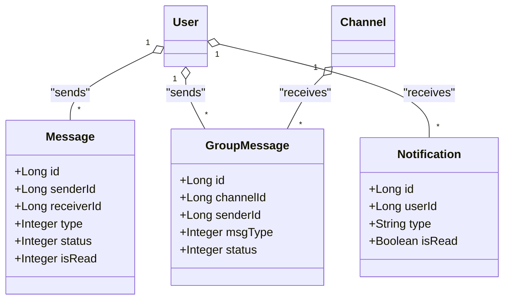
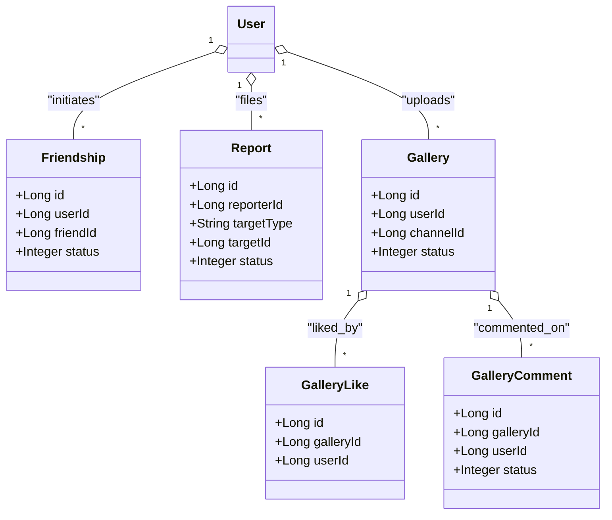
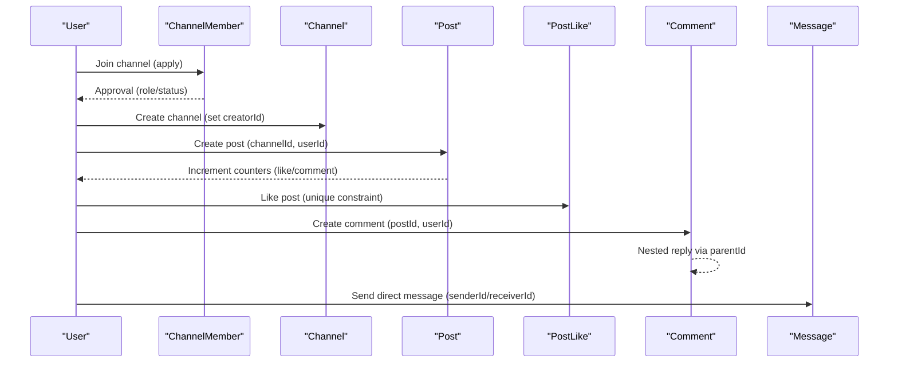
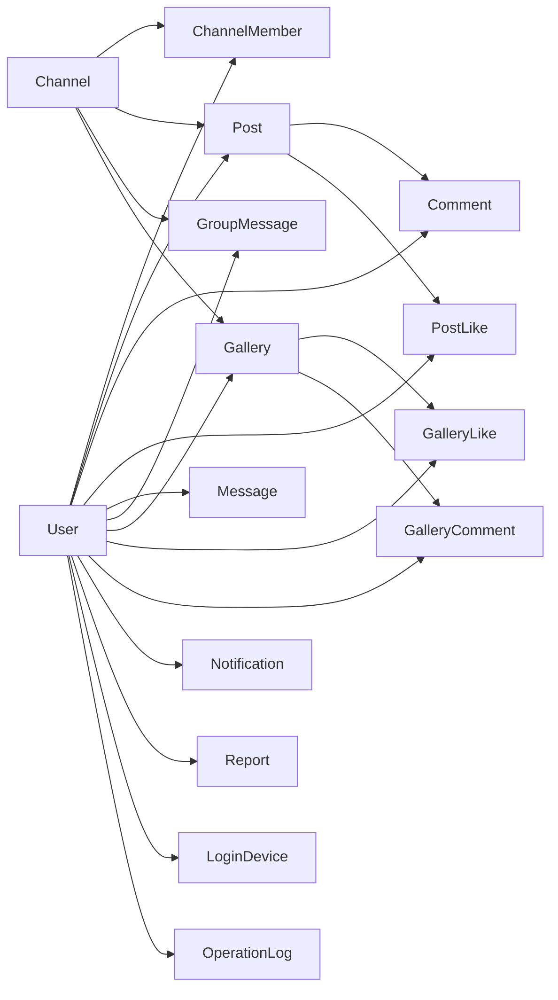

# Entity Relationships and Schema

<cite>
**Referenced Files in This Document**
- [schema.sql](file://camp-channel-server/src/main/resources/db/schema.sql)
- [migration-fix.sql](file://camp-channel-server/src/main/resources/db/migration-fix.sql)
- [CampChannelApplication.java](file://camp-channel-server/src/main/java/com/gdmec/campchannel/CampChannelApplication.java)
- [User.java](file://camp-channel-server/src/main/java/com/gdmec/campchannel/entity/User.java)
- [Channel.java](file://camp-channel-server/src/main/java/com/gdmec/campchannel/entity/Channel.java)
- [ChannelMember.java](file://camp-channel-server/src/main/java/com/gdmec/campchannel/entity/ChannelMember.java)
- [Post.java](file://camp-channel-server/src/main/java/com/gdmec/campchannel/entity/Post.java)
- [PostLike.java](file://camp-channel-server/src/main/java/com/gdmec/campchannel/entity/PostLike.java)
- [Comment.java](file://camp-channel-server/src/main/java/com/gdmec/campchannel/entity/Comment.java)
- [Friendship.java](file://camp-channel-server/src/main/java/com/gdmec/campchannel/entity/Friendship.java)
- [Message.java](file://camp-channel-server/src/main/java/com/gdmec/campchannel/entity/Message.java)
- [GroupMessage.java](file://camp-channel-server/src/main/java/com/gdmec/campchannel/entity/GroupMessage.java)
- [Gallery.java](file://camp-channel-server/src/main/java/com/gdmec/campchannel/entity/Gallery.java)
- [GalleryLike.java](file://camp-channel-server/src/main/java/com/gdmec/campchannel/entity/GalleryLike.java)
- [GalleryComment.java](file://camp-channel-server/src/main/java/com/gdmec/campchannel/entity/GalleryComment.java)
- [Notification.java](file://camp-channel-server/src/main/java/com/gdmec/campchannel/entity/Notification.java)
- [Report.java](file://camp-channel-server/src/main/java/com/gdmec/campchannel/entity/Report.java)
- [LoginDevice.java](file://camp-channel-server/src/main/java/com/gdmec/campchannel/entity/LoginDevice.java)
- [OperationLog.java](file://camp-channel-server/src/main/java/com/gdmec/campchannel/entity/OperationLog.java)
</cite>

## Table of Contents
1. [Introduction](#introduction)
2. [Project Structure](#project-structure)
3. [Core Components](#core-components)
4. [Architecture Overview](#architecture-overview)
5. [Detailed Component Analysis](#detailed-component-analysis)
6. [Dependency Analysis](#dependency-analysis)
7. [Performance Considerations](#performance-considerations)
8. [Troubleshooting Guide](#troubleshooting-guide)
9. [Conclusion](#conclusion)
10. [Appendices](#appendices)

## Introduction
This document provides a comprehensive entity relationship and database schema guide for the campus channel platform. It focuses on the core entities (User, Channel, Post, Message, Comment, Friendship, Gallery, and supporting tables) and explains their relationships, foreign keys, referential integrity rules, and how the schema enables platform features such as content moderation, real-time messaging, and social networking.

## Project Structure
The schema and entities are defined under the server module. The database schema is initialized via a SQL migration script, and the Java entities map to these tables using MyBatis-Plus annotations. The application bootstraps with MyBatis-Plus pagination support and scans for mapper interfaces.

**Diagram sources**
- [CampChannelApplication.java:12-30](file://camp-channel-server/src/main/java/com/gdmec/campchannel/CampChannelApplication.java#L12-L30)
- [schema.sql:1-236](file://camp-channel-server/src/main/resources/db/schema.sql#L1-L236)
- [migration-fix.sql:1-16](file://camp-channel-server/src/main/resources/db/migration-fix.sql#L1-L16)

**Section sources**
- [CampChannelApplication.java:12-30](file://camp-channel-server/src/main/java/com/gdmec/campchannel/CampChannelApplication.java#L12-L30)
- [schema.sql:1-236](file://camp-channel-server/src/main/resources/db/schema.sql#L1-L236)

## Core Components
This section documents the primary entities and their attributes, focusing on how they relate to each other and the business logic they represent.

- User
  - Purpose: Platform users with roles and status.
  - Key attributes: id, username, realName, phone, email, password, role, status, avatar, createTime, updateTime, emailNotify.
  - Notes: emailNotify toggles email notifications; role supports user/sys_admin.

- Channel
  - Purpose: Content groups with public/private visibility and creator tracking.
  - Key attributes: id, channelCode, name, description, type, status, creatorId, createTime, updateTime.
  - Notes: channelCode is unique; type distinguishes public vs private; creatorId links to User.

- ChannelMember
  - Purpose: Membership and roles within channels; supports join requests and approvals.
  - Key attributes: id, channelId, userId, role, status, applyTime, approveTime, approveUserId.
  - Notes: Unique constraint on (channelId, userId); role includes owner, admin, member; status includes pending/accepted/rejected.

- Post
  - Purpose: User-generated content within channels.
  - Key attributes: id, channelId, userId, content, images (JSON), videoUrl, topic, mentionedUsers, status, viewCount, likeCount, commentCount, createTime, updateTime.
  - Notes: References Channel and User; counts track engagement; mentionedUsers supports @mentions.

- PostLike
  - Purpose: Tracks likes on posts; implements many-to-many via junction table.
  - Key attributes: id, postId, userId, createTime.
  - Notes: Unique constraint on (postId, userId).

- Comment
  - Purpose: Hierarchical comments on posts; supports nested replies via parent_id.
  - Key attributes: id, postId, userId, content, parentId, status, createTime, updateTime.
  - Notes: Self-referencing via parentId; belongs to Post and User.

- Friendship
  - Purpose: Social connections between users with request and approval lifecycle.
  - Key attributes: id, userId, friendId, status, applyTime, approveTime.
  - Notes: Unique constraint on (userId, friendId); status includes pending/accepted/rejected.

- Message
  - Purpose: Direct (1:1) messaging between users.
  - Key attributes: id, senderId, receiverId, content, type, status, isRead, readTime, createTime.
  - Notes: Indexed composite keys optimize sender/receiver queries.

- GroupMessage
  - Purpose: Channel-wide group messaging.
  - Key attributes: id, channelId, senderId, content, mediaUrl, msgType, status, createTime.
  - Notes: Links Channel and User; supports text/media types.

- Gallery, GalleryLike, GalleryComment
  - Purpose: Media gallery with likes and comments; supports channel scoping.
  - Key attributes: Gallery (id, userId, channelId, imageUrl, title, description, status, createTime); GalleryLike (unique per gallery-user); GalleryComment (galleryId, userId, content, status, createTime).

- Notification
  - Purpose: System notifications for user actions (friendships, mentions, likes, comments).
  - Key attributes: id, userId, type, title, content, relatedId, isRead, createTime.

- Report
  - Purpose: Moderation workflow for posts, comments, and messages.
  - Key attributes: id, reporterId, targetType, targetId, reason, status, handlerId, handleNote, createTime, handleTime.

- LoginDevice
  - Purpose: Track user login devices and activity.
  - Key attributes: id, userId, deviceName, ipAddress, loginTime, lastActiveTime.

- OperationLog
  - Purpose: Audit trail for administrative actions.
  - Key attributes: id, userId, module, action, description, requestMethod, requestUrl, ipAddress, createTime.

**Section sources**
- [User.java:10-42](file://camp-channel-server/src/main/java/com/gdmec/campchannel/entity/User.java#L10-L42)
- [Channel.java:10-32](file://camp-channel-server/src/main/java/com/gdmec/campchannel/entity/Channel.java#L10-L32)
- [ChannelMember.java:11-34](file://camp-channel-server/src/main/java/com/gdmec/campchannel/entity/ChannelMember.java#L11-L34)
- [Post.java:11-58](file://camp-channel-server/src/main/java/com/gdmec/campchannel/entity/Post.java#L11-L58)
- [PostLike.java](file://camp-channel-server/src/main/java/com/gdmec/campchannel/entity/PostLike.java)
- [Comment.java:11-37](file://camp-channel-server/src/main/java/com/gdmec/campchannel/entity/Comment.java#L11-L37)
- [Friendship.java:10-26](file://camp-channel-server/src/main/java/com/gdmec/campchannel/entity/Friendship.java#L10-L26)
- [Message.java:11-40](file://camp-channel-server/src/main/java/com/gdmec/campchannel/entity/Message.java#L11-L40)
- [GroupMessage.java:11-38](file://camp-channel-server/src/main/java/com/gdmec/campchannel/entity/GroupMessage.java#L11-L38)
- [Gallery.java](file://camp-channel-server/src/main/java/com/gdmec/campchannel/entity/Gallery.java)
- [GalleryLike.java](file://camp-channel-server/src/main/java/com/gdmec/campchannel/entity/GalleryLike.java)
- [GalleryComment.java](file://camp-channel-server/src/main/java/com/gdmec/campchannel/entity/GalleryComment.java)
- [Notification.java](file://camp-channel-server/src/main/java/com/gdmec/campchannel/entity/Notification.java)
- [Report.java](file://camp-channel-server/src/main/java/com/gdmec/campchannel/entity/Report.java)
- [LoginDevice.java](file://camp-channel-server/src/main/java/com/gdmec/campchannel/entity/LoginDevice.java)
- [OperationLog.java](file://camp-channel-server/src/main/java/com/gdmec/campchannel/entity/OperationLog.java)

## Architecture Overview
The schema enforces referential integrity through foreign keys and indexes. Many-to-many relationships are implemented via explicit junction tables (e.g., ChannelMember, PostLike, GalleryLike). The design supports:
- Content moderation via status flags and report handling.
- Real-time messaging via separate direct and group message tables.
- Social networking via friendship and user-centric metrics.

**Diagram sources**
- [schema.sql:1-236](file://camp-channel-server/src/main/resources/db/schema.sql#L1-L236)
- [User.java:10-42](file://camp-channel-server/src/main/java/com/gdmec/campchannel/entity/User.java#L10-L42)
- [Channel.java:10-32](file://camp-channel-server/src/main/java/com/gdmec/campchannel/entity/Channel.java#L10-L32)
- [ChannelMember.java:11-34](file://camp-channel-server/src/main/java/com/gdmec/campchannel/entity/ChannelMember.java#L11-L34)
- [Post.java:11-58](file://camp-channel-server/src/main/java/com/gdmec/campchannel/entity/Post.java#L11-L58)
- [PostLike.java](file://camp-channel-server/src/main/java/com/gdmec/campchannel/entity/PostLike.java)
- [Comment.java:11-37](file://camp-channel-server/src/main/java/com/gdmec/campchannel/entity/Comment.java#L11-L37)
- [Friendship.java:10-26](file://camp-channel-server/src/main/java/com/gdmec/campchannel/entity/Friendship.java#L10-L26)
- [Message.java:11-40](file://camp-channel-server/src/main/java/com/gdmec/campchannel/entity/Message.java#L11-L40)
- [GroupMessage.java:11-38](file://camp-channel-server/src/main/java/com/gdmec/campchannel/entity/GroupMessage.java#L11-L38)
- [Gallery.java](file://camp-channel-server/src/main/java/com/gdmec/campchannel/entity/Gallery.java)
- [GalleryLike.java](file://camp-channel-server/src/main/java/com/gdmec/campchannel/entity/GalleryLike.java)
- [GalleryComment.java](file://camp-channel-server/src/main/java/com/gdmec/campchannel/entity/GalleryComment.java)
- [Report.java](file://camp-channel-server/src/main/java/com/gdmec/campchannel/entity/Report.java)

## Detailed Component Analysis

### Users and Channels
- One-to-many: User → Channel (creator), ChannelMember (membership).
- Many-to-many: User ↔ Channel via ChannelMember.
- Business logic: ChannelMember tracks join requests, approvals, and roles (owner/admin/member). Channel.type differentiates public/private access.

**Diagram sources**
- [User.java:10-42](file://camp-channel-server/src/main/java/com/gdmec/campchannel/entity/User.java#L10-L42)
- [Channel.java:10-32](file://camp-channel-server/src/main/java/com/gdmec/campchannel/entity/Channel.java#L10-L32)
- [ChannelMember.java:11-34](file://camp-channel-server/src/main/java/com/gdmec/campchannel/entity/ChannelMember.java#L11-L34)

**Section sources**
- [schema.sql:16-43](file://camp-channel-server/src/main/resources/db/schema.sql#L16-L43)
- [ChannelMember.java:11-34](file://camp-channel-server/src/main/java/com/gdmec/campchannel/entity/ChannelMember.java#L11-L34)

### Posts and Comments
- One-to-many: Channel → Post, User → Post, Post → Comment.
- Many-to-many: Post ↔ User via PostLike.
- Business logic: Comments support hierarchical replies via parentId; Post.status enables moderation; Post.counters track engagement.

**Diagram sources**
- [Post.java:11-58](file://camp-channel-server/src/main/java/com/gdmec/campchannel/entity/Post.java#L11-L58)
- [Comment.java:11-37](file://camp-channel-server/src/main/java/com/gdmec/campchannel/entity/Comment.java#L11-L37)
- [PostLike.java](file://camp-channel-server/src/main/java/com/gdmec/campchannel/entity/PostLike.java)

**Section sources**
- [schema.sql:45-89](file://camp-channel-server/src/main/resources/db/schema.sql#L45-L89)
- [Post.java:11-58](file://camp-channel-server/src/main/java/com/gdmec/campchannel/entity/Post.java#L11-L58)
- [Comment.java:11-37](file://camp-channel-server/src/main/java/com/gdmec/campchannel/entity/Comment.java#L11-L37)

### Messaging and Notifications
- Direct messaging: User → Message (sender/receiver).
- Group messaging: Channel → GroupMessage, User → GroupMessage.
- Notifications: User → Notification; Notification.type categorizes events.

**Diagram sources**
- [Message.java:11-40](file://camp-channel-server/src/main/java/com/gdmec/campchannel/entity/Message.java#L11-L40)
- [GroupMessage.java:11-38](file://camp-channel-server/src/main/java/com/gdmec/campchannel/entity/GroupMessage.java#L11-L38)
- [Notification.java](file://camp-channel-server/src/main/java/com/gdmec/campchannel/entity/Notification.java)

**Section sources**
- [schema.sql:103-129](file://camp-channel-server/src/main/resources/db/schema.sql#L103-L129)
- [schema.sql:186-198](file://camp-channel-server/src/main/resources/db/schema.sql#L186-L198)

### Social Networking and Moderation
- Friendship: User → Friendship (user/friend), status tracks lifecycle.
- Reporting: Reporter → Report; Report.targetType/Id identifies the subject; status drives moderation workflow.
- Gallery: User → Gallery; GalleryLike/GalleryComment enable media social features.

**Diagram sources**
- [Friendship.java:10-26](file://camp-channel-server/src/main/java/com/gdmec/campchannel/entity/Friendship.java#L10-L26)
- [Report.java](file://camp-channel-server/src/main/java/com/gdmec/campchannel/entity/Report.java)
- [Gallery.java](file://camp-channel-server/src/main/java/com/gdmec/campchannel/entity/Gallery.java)
- [GalleryLike.java](file://camp-channel-server/src/main/java/com/gdmec/campchannel/entity/GalleryLike.java)
- [GalleryComment.java](file://camp-channel-server/src/main/java/com/gdmec/campchannel/entity/GalleryComment.java)

**Section sources**
- [schema.sql:91-101](file://camp-channel-server/src/main/resources/db/schema.sql#L91-L101)
- [schema.sql:146-161](file://camp-channel-server/src/main/resources/db/schema.sql#L146-L161)
- [schema.sql:200-236](file://camp-channel-server/src/main/resources/db/schema.sql#L200-L236)

### Relationship Flow: From User to Channel, Post, Message, Comment

**Diagram sources**
- [schema.sql:31-89](file://camp-channel-server/src/main/resources/db/schema.sql#L31-L89)
- [schema.sql:103-115](file://camp-channel-server/src/main/resources/db/schema.sql#L103-L115)
- [Post.java:11-58](file://camp-channel-server/src/main/java/com/gdmec/campchannel/entity/Post.java#L11-L58)
- [Comment.java:11-37](file://camp-channel-server/src/main/java/com/gdmec/campchannel/entity/Comment.java#L11-L37)
- [PostLike.java](file://camp-channel-server/src/main/java/com/gdmec/campchannel/entity/PostLike.java)

## Dependency Analysis
- Foreign keys enforced by schema:
  - ChannelMember.channel_id → Channel.id
  - ChannelMember.user_id → User.id
  - Post.channel_id → Channel.id
  - Post.user_id → User.id
  - PostLike.post_id → Post.id
  - PostLike.user_id → User.id
  - Comment.post_id → Post.id
  - Comment.user_id → User.id
  - Message.sender_id → User.id
  - Message.receiver_id → User.id
  - GroupMessage.channel_id → Channel.id
  - GroupMessage.sender_id → User.id
  - Gallery.user_id → User.id
  - Gallery.channel_id → Channel.id
  - GalleryLike.gallery_id → Gallery.id
  - GalleryLike.user_id → User.id
  - GalleryComment.gallery_id → Gallery.id
  - GalleryComment.user_id → User.id
  - Notification.user_id → User.id
  - Report.reporter_id → User.id
  - LoginDevice.user_id → User.id
  - OperationLog.user_id → User.id
- Junction tables:
  - ChannelMember implements many-to-many User ↔ Channel.
  - PostLike implements many-to-many Post ↔ User.
  - GalleryLike implements many-to-many Gallery ↔ User.

**Diagram sources**
- [schema.sql:1-236](file://camp-channel-server/src/main/resources/db/schema.sql#L1-L236)

**Section sources**
- [schema.sql:1-236](file://camp-channel-server/src/main/resources/db/schema.sql#L1-L236)

## Performance Considerations
- Indexes:
  - Channel: idx_channel_code, idx_channel_name
  - Post: idx_channel_id, idx_user_id, idx_create_time
  - Comment: idx_post_id, idx_user_id, idx_parent_id
  - Message: idx_sender_receiver, idx_receiver_sender, idx_create_time
  - GroupMessage: idx_gm_channel_id, idx_gm_create_time
  - Friendship: idx_friend_id
  - Report: idx_reporter_id, idx_target, idx_status
  - LoginDevice: idx_ld_user_id
  - OperationLog: idx_user_id, idx_create_time
- Recommendations:
  - Use filtered indexes for status where applicable (e.g., active posts/comments).
  - Partition large tables by time (e.g., messages, operation logs) to improve query performance.
  - Normalize denormalized counters (likeCount, commentCount) with triggers or batch updates to maintain consistency.

[No sources needed since this section provides general guidance]

## Troubleshooting Guide
- Missing columns after migration:
  - The migration-fix script adds channel_id to gallery and mentioned_users to post if absent. Use it to reconcile schema drift.
- Referential integrity errors:
  - Ensure foreign key constraints are satisfied before inserts/updates (e.g., channelId/userId must exist).
- Duplicate membership or likes:
  - Unique constraints prevent duplicates; handle duplicate key exceptions gracefully in services.
- Notification delivery:
  - Verify Notification.userId and type mapping align with business events.

**Section sources**
- [migration-fix.sql:1-16](file://camp-channel-server/src/main/resources/db/migration-fix.sql#L1-L16)
- [schema.sql:31-89](file://camp-channel-server/src/main/resources/db/schema.sql#L31-L89)
- [schema.sql:103-161](file://camp-channel-server/src/main/resources/db/schema.sql#L103-L161)

## Conclusion
The schema establishes a robust foundation for the campus channel platform. It models core relationships clearly, enforces referential integrity, and leverages junction tables for many-to-many associations. Together with moderation, real-time messaging, and social features, it supports scalable and secure platform operations.

[No sources needed since this section summarizes without analyzing specific files]

## Appendices

### Appendix A: Schema Migration Notes
- Automatic migration runs schema.sql; manual fix script ensures backward compatibility by adding missing columns.

**Section sources**
- [schema.sql:174-184](file://camp-channel-server/src/main/resources/db/schema.sql#L174-L184)
- [migration-fix.sql:4-8](file://camp-channel-server/src/main/resources/db/migration-fix.sql#L4-L8)