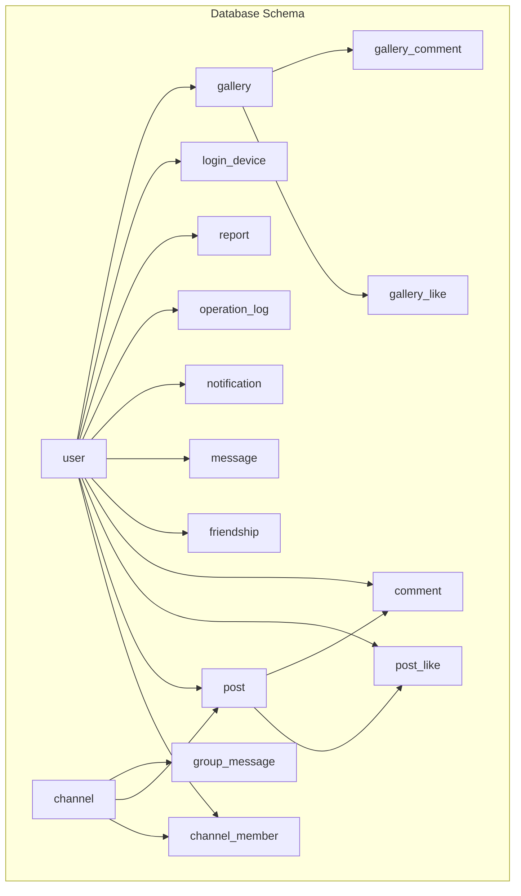
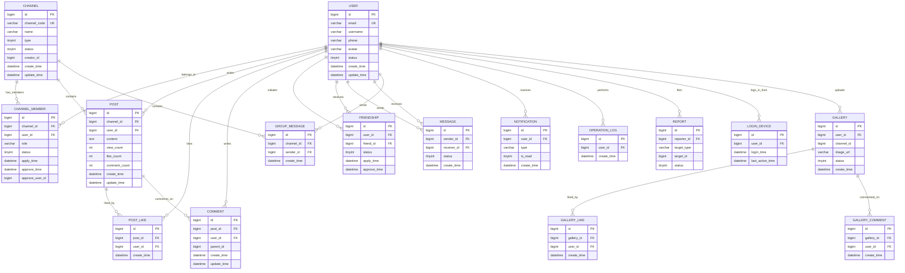
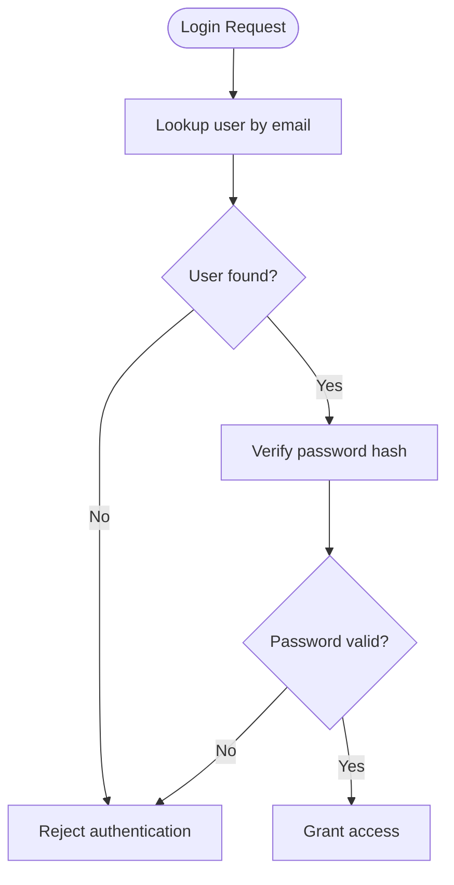
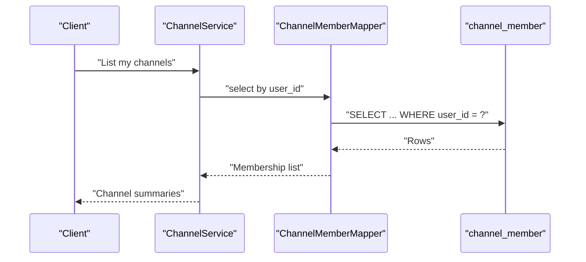
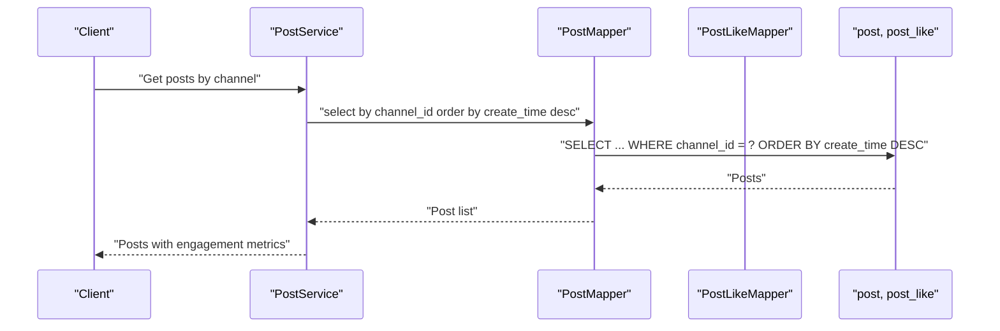
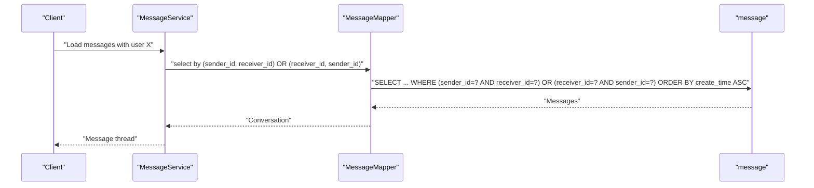
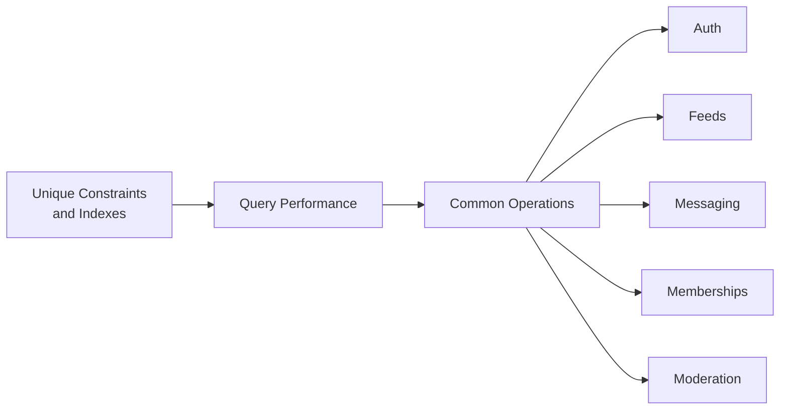

# Indexing Strategy and Constraints

<cite>
**Referenced Files in This Document**
- [schema.sql](file://camp-channel-server/src/main/resources/db/schema.sql)
- [migration-fix.sql](file://camp-channel-server/src/main/resources/db/migration-fix.sql)
- [implementation_plan.md](file://implementation_plan.md)
- [User.java](file://camp-channel-server/src/main/java/com/gdmec/campchannel/entity/User.java)
- [Channel.java](file://camp-channel-server/src/main/java/com/gdmec/campchannel/entity/Channel.java)
- [Message.java](file://camp-channel-server/src/main/java/com/gdmec/campchannel/entity/Message.java)
- [Friendship.java](file://camp-channel-server/src/main/java/com/gdmec/campchannel/entity/Friendship.java)
- [Post.java](file://camp-channel-server/src/main/java/com/gdmec/campchannel/entity/Post.java)
</cite>

## Table of Contents
1. [Introduction](#introduction)
2. [Project Structure](#project-structure)
3. [Core Components](#core-components)
4. [Architecture Overview](#architecture-overview)
5. [Detailed Component Analysis](#detailed-component-analysis)
6. [Dependency Analysis](#dependency-analysis)
7. [Performance Considerations](#performance-considerations)
8. [Troubleshooting Guide](#troubleshooting-guide)
9. [Conclusion](#conclusion)

## Introduction
This document explains the database indexing strategy and constraint implementation across the campus channel platform. It documents primary keys, unique constraints, composite indexes, and foreign key relationships, and provides rationale for each index choice with a focus on optimizing common operations such as user authentication, post retrieval, message searching, and channel membership queries. It also covers how constraints enforce business rules and maintain referential integrity, along with practical guidance on balancing write and read performance.

## Project Structure
The database schema is defined in a single SQL script that creates all tables, indexes, and constraints. Supporting migration scripts ensure backward compatibility by adding missing columns. Entity classes in the backend align with the schema and drive MyBatis-Plus mapping.

**Diagram sources**
- [schema.sql](file://camp-channel-server/src/main/resources/db/schema.sql)

**Section sources**
- [schema.sql](file://camp-channel-server/src/main/resources/db/schema.sql)
- [implementation_plan.md](file://implementation_plan.md)

## Core Components
This section summarizes the primary keys, unique constraints, composite indexes, and foreign key relationships defined in the schema.

- Primary Keys
  - All tables define a single-column auto-increment primary key named id.
- Unique Constraints
  - user.email: unique
  - channel.channel_code: unique
  - channel_member: unique key on (channel_id, user_id)
  - post_like: unique key on (post_id, user_id)
  - friendship: unique key on (user_id, friend_id)
  - gallery_like: unique key on (gallery_id, user_id)
- Composite Indexes
  - channel: idx_channel_code, idx_channel_name
  - channel_member: idx_user_id
  - post: idx_channel_id, idx_user_id, idx_create_time
  - post_like: idx_user_id
  - comment: idx_post_id, idx_user_id, idx_parent_id
  - friendship: idx_friend_id
  - message: idx_sender_receiver(sender_id, receiver_id), idx_receiver_sender(receiver_id, sender_id), idx_create_time
  - notification: idx_user_id, idx_is_read
  - operation_log: idx_user_id, idx_create_time
  - report: idx_reporter_id, idx_target(target_type, target_id), idx_status
  - login_device: idx_ld_user_id
  - group_message: idx_gm_channel_id, idx_gm_create_time
  - gallery: idx_gallery_user_id, idx_gallery_status, idx_gallery_channel_id
  - gallery_like: idx_gallery_like_gallery_id, idx_gallery_like_user_id
  - gallery_comment: idx_gallery_comment_gallery_id, idx_gallery_comment_user_id

Notes on foreign keys:
- The schema defines unique constraints and indexes but does not declare explicit foreign key constraints. Referential integrity is enforced via application/business logic and unique constraints. This simplifies migrations and avoids cascade effects, but requires careful handling in service layers.

**Section sources**
- [schema.sql](file://camp-channel-server/src/main/resources/db/schema.sql)

## Architecture Overview
The schema supports a social and communication platform with clear separation of concerns:
- Identity and access: user
- Content and community: channel, post, comment, post_like
- Social graph: friendship
- Messaging: message, group_message
- Notifications and audit: notification, operation_log
- Reporting and moderation: report
- User sessions: login_device
- Media galleries: gallery, gallery_like, gallery_comment

**Diagram sources**
- [schema.sql](file://camp-channel-server/src/main/resources/db/schema.sql)

## Detailed Component Analysis

### Users and Authentication
- Purpose: Store identity, roles, and account state.
- Primary key: id
- Unique constraints: email
- Indexes: none on user except the primary key
- Rationale:
  - email is unique to prevent duplicate identities and enable fast login lookups by email.
  - No extra indexes are present because typical auth flows rely on email lookup and password verification, which are adequately supported by the unique index on email.

**Diagram sources**
- [schema.sql](file://camp-channel-server/src/main/resources/db/schema.sql)
- [User.java](file://camp-channel-server/src/main/java/com/gdmec/campchannel/entity/User.java)

**Section sources**
- [schema.sql](file://camp-channel-server/src/main/resources/db/schema.sql)
- [User.java](file://camp-channel-server/src/main/java/com/gdmec/campchannel/entity/User.java)

### Channels and Membership
- Purpose: Define public/private channels and membership with roles and statuses.
- Primary key: id
- Unique constraints: channel_code
- Indexes: idx_channel_code, idx_channel_name, idx_user_id (on channel_member)
- Rationale:
  - channel_code is unique and indexed to support fast channel discovery by code.
  - name is indexed to support channel name searches.
  - channel_member.uk_channel_user ensures a user can join a channel only once, preventing duplicates.
  - idx_user_id accelerates queries for a user’s memberships.

**Diagram sources**
- [schema.sql](file://camp-channel-server/src/main/resources/db/schema.sql)
- [Channel.java](file://camp-channel-server/src/main/java/com/gdmec/campchannel/entity/Channel.java)

**Section sources**
- [schema.sql](file://camp-channel-server/src/main/resources/db/schema.sql)
- [Channel.java](file://camp-channel-server/src/main/java/com/gdmec/campchannel/entity/Channel.java)

### Posts, Likes, and Comments
- Purpose: Support content creation, engagement, and threaded discussions.
- Primary keys: id
- Unique constraints: post_like(post_id, user_id)
- Indexes: post.idx_channel_id, post.idx_user_id, post.idx_create_time; post_like.idx_user_id; comment.idx_post_id, comment.idx_user_id, comment.idx_parent_id
- Rationale:
  - post.idx_channel_id and post.idx_user_id optimize feed retrieval and author-specific queries.
  - post.idx_create_time supports chronological sorting and pagination.
  - post_like.uk_post_user prevents duplicate likes and idx_user_id accelerates per-user like counts.
  - comment.idx_post_id and idx_user_id support post timelines and author activity.
  - comment.idx_parent_id enables efficient threaded replies.

**Diagram sources**
- [schema.sql](file://camp-channel-server/src/main/resources/db/schema.sql)
- [Post.java](file://camp-channel-server/src/main/java/com/gdmec/campchannel/entity/Post.java)

**Section sources**
- [schema.sql](file://camp-channel-server/src/main/resources/db/schema.sql)
- [Post.java](file://camp-channel-server/src/main/java/com/gdmec/campchannel/entity/Post.java)

### Messaging (Direct and Group)
- Purpose: Enable direct messaging and group communications.
- Primary keys: id
- Indexes: message.idx_sender_receiver, message.idx_receiver_sender, message.idx_create_time; group_message.idx_gm_channel_id, group_message.idx_gm_create_time
- Rationale:
  - message.idx_sender_receiver and idx_receiver_sender support bidirectional message history queries between two users.
  - message.idx_create_time enables time-ordered retrieval for chat windows.
  - group_message indexes optimize channel-wide message retrieval.

**Diagram sources**
- [schema.sql](file://camp-channel-server/src/main/resources/db/schema.sql)
- [Message.java](file://camp-channel-server/src/main/java/com/gdmec/campchannel/entity/Message.java)

**Section sources**
- [schema.sql](file://camp-channel-server/src/main/resources/db/schema.sql)
- [Message.java](file://camp-channel-server/src/main/java/com/gdmec/campchannel/entity/Message.java)

### Friendships
- Purpose: Manage friend requests and relationships.
- Primary key: id
- Unique constraints: friendship(user_id, friend_id)
- Indexes: idx_friend_id
- Rationale:
  - uk_user_friend prevents duplicate friend entries.
  - idx_friend_id accelerates queries for pending friend requests and friend lists.

**Section sources**
- [schema.sql](file://camp-channel-server/src/main/resources/db/schema.sql)
- [Friendship.java](file://camp-channel-server/src/main/java/com/gdmec/campchannel/entity/Friendship.java)

### Notifications and Audit
- Purpose: Track user actions and send notifications.
- Primary keys: id
- Indexes: notification.idx_user_id, notification.idx_is_read; operation_log.idx_user_id, operation_log.idx_create_time
- Rationale:
  - notification indexes support fetching unread notifications per user and filtering by read status.
  - operation_log indexes support user activity timelines and time-based reports.

**Section sources**
- [schema.sql](file://camp-channel-server/src/main/resources/db/schema.sql)

### Reports and Moderation
- Purpose: Record and track moderation actions.
- Primary keys: id
- Indexes: report.idx_reporter_id, report.idx_target(target_type, target_id), report.idx_status
- Rationale:
  - report.idx_target optimizes queries for all reports against a specific object regardless of type.
  - idx_status supports moderation queues and filtering by resolution state.

**Section sources**
- [schema.sql](file://camp-channel-server/src/main/resources/db/schema.sql)

### Login Devices
- Purpose: Track user sessions and devices.
- Primary key: id
- Indexes: login_device.idx_ld_user_id
- Rationale:
  - Accelerates device listing per user for session management.

**Section sources**
- [schema.sql](file://camp-channel-server/src/main/resources/db/schema.sql)

### Galleries and Engagement
- Purpose: Store media assets and engagement metadata.
- Primary keys: id
- Unique constraints: gallery_like(gallery_id, user_id)
- Indexes: gallery.idx_gallery_user_id, gallery.idx_gallery_status, gallery.idx_gallery_channel_id; gallery_like.idx_gallery_like_gallery_id, gallery_like.idx_gallery_like_user_id; gallery_comment.idx_gallery_comment_gallery_id, gallery_comment.idx_gallery_comment_user_id
- Rationale:
  - Supports user galleries, channel-scoped galleries, and moderation filtering.
  - Prevents duplicate likes and accelerates per-user and per-gallery queries.

**Section sources**
- [schema.sql](file://camp-channel-server/src/main/resources/db/schema.sql)

## Dependency Analysis
- Referential integrity is not enforced via foreign key constraints in the schema. Instead, unique constraints and indexes are used to maintain data quality and query performance.
- Application-level logic is responsible for enforcing relationships (e.g., ensuring channel existence before creating posts, ensuring users exist before adding likes).
- The absence of foreign keys reduces cascading updates/deletes and simplifies schema evolution, but places responsibility on services to maintain consistency.

[No sources needed since this diagram shows conceptual workflow, not actual code structure]

**Section sources**
- [schema.sql](file://camp-channel-server/src/main/resources/db/schema.sql)
- [implementation_plan.md](file://implementation_plan.md)

## Performance Considerations
- Write vs. Read Trade-offs
  - Heavy writes (likes, comments, messages) benefit from minimal index overhead. The current schema adds only essential indexes to avoid slowing down inserts.
  - Reads for feeds, conversations, and moderation require targeted indexes to remain responsive.
- Index Selectivity
  - Unique indexes on channel_code and email provide strong selectivity for authentication and channel lookup.
  - Composite indexes on sender/receiver pairs in messages maximize selectivity for bidirectional chat queries.
- Maintenance Costs
  - Adding/removing indexes impacts DML performance. Keep indexes aligned with observed query patterns.
  - Monitor slow queries and add covering indexes if needed (e.g., include frequently accessed columns in existing indexes).
- Query Patterns and Index Coverage
  - Authentication: email unique index suffices.
  - Post feeds: use channel_id and create_time indexes for pagination.
  - Messaging: use composite indexes on sender_id+receiver_id and receiver_id+sender_id to cover both directions efficiently.
  - Moderation: use target_type+target_id composite index to quickly locate all reports for a given object.

[No sources needed since this section provides general guidance]

## Troubleshooting Guide
- Symptom: Duplicate memberships or friends
  - Cause: Missing unique constraints or unique indexes.
  - Resolution: Ensure uk_channel_user, uk_post_user, uk_user_friend, and uk_gallery_user exist and are enforced.
- Symptom: Slow chat history retrieval
  - Cause: Missing or underused composite indexes on sender/receiver pairs.
  - Resolution: Confirm idx_sender_receiver and idx_receiver_sender exist and are used by queries.
- Symptom: Slow moderation dashboard
  - Cause: Lack of index on report.target_type and report.target_id.
  - Resolution: Ensure idx_target exists and is leveraged for filtering by target.
- Symptom: Migration failures after updates
  - Cause: Missing columns introduced in later schema versions.
  - Resolution: Apply migration-fix.sql to add missing columns and verify via INFORMATION_SCHEMA checks.

**Section sources**
- [schema.sql](file://camp-channel-server/src/main/resources/db/schema.sql)
- [migration-fix.sql](file://camp-channel-server/src/main/resources/db/migration-fix.sql)

## Conclusion
The schema balances simplicity and performance by relying on unique constraints and carefully chosen indexes rather than foreign keys. This approach streamlines migrations and reduces cascading effects while still enabling efficient execution of core operations such as authentication, content feeds, messaging, and moderation. Adhering to the documented index strategy and maintaining alignment between application logic and schema constraints will preserve data integrity and responsiveness as the system scales.