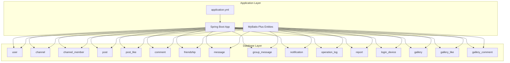
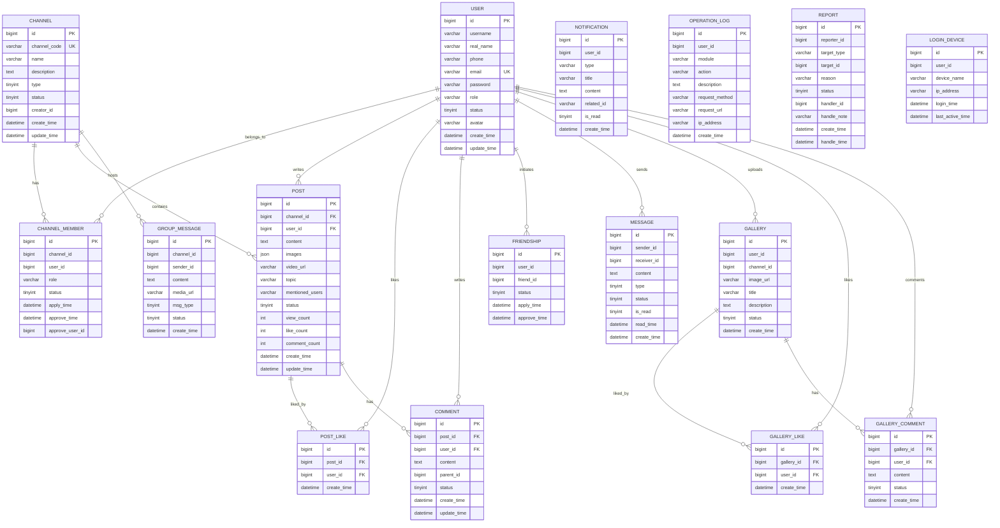
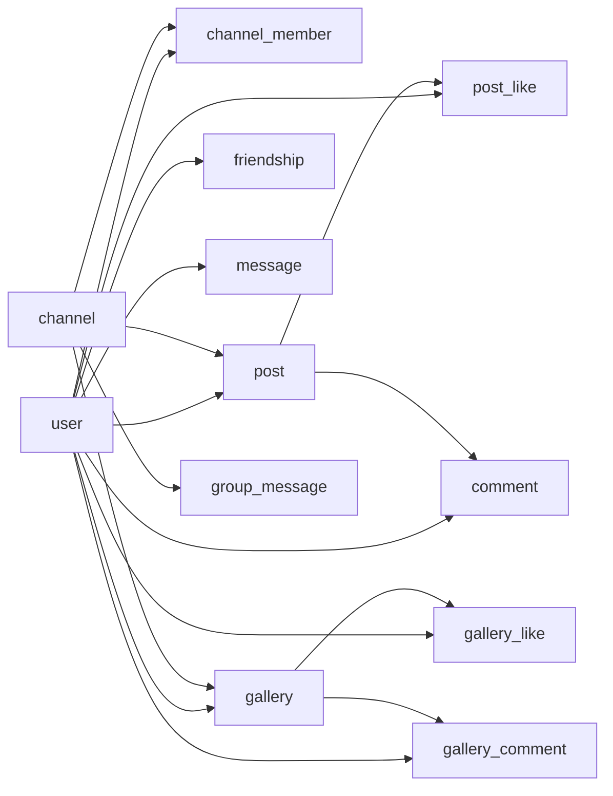

# Table Schemas and Field Definitions

<cite>
**Referenced Files in This Document**
- [schema.sql](file://camp-channel-server/src/main/resources/db/schema.sql)
- [migration-fix.sql](file://camp-channel-server/src/main/resources/db/migration-fix.sql)
- [application.yml](file://camp-channel-server/src/main/resources/application.yml)
- [User.java](file://camp-channel-server/src/main/java/com/gdmec/campchannel/entity/User.java)
- [Channel.java](file://camp-channel-server/src/main/java/com/gdmec/campchannel/entity/Channel.java)
- [Post.java](file://camp-channel-server/src/main/java/com/gdmec/campchannel/entity/Post.java)
- [Message.java](file://camp-channel-server/src/main/java/com/gdmec/campchannel/entity/Message.java)
- [Comment.java](file://camp-channel-server/src/main/java/com/gdmec/campchannel/entity/Comment.java)
- [Friendship.java](file://camp-channel-server/src/main/java/com/gdmec/campchannel/entity/Friendship.java)
- [Gallery.java](file://camp-channel-server/src/main/java/com/gdmec/campchannel/entity/Gallery.java)
- [Notification.java](file://camp-channel-server/src/main/java/com/gdmec/campchannel/entity/Notification.java)
- [Report.java](file://camp-channel-server/src/main/java/com/gdmec/campchannel/entity/Report.java)
</cite>

## Table of Contents
1. [Introduction](#introduction)
2. [Project Structure](#project-structure)
3. [Core Components](#core-components)
4. [Architecture Overview](#architecture-overview)
5. [Detailed Component Analysis](#detailed-component-analysis)
6. [Dependency Analysis](#dependency-analysis)
7. [Performance Considerations](#performance-considerations)
8. [Troubleshooting Guide](#troubleshooting-guide)
9. [Conclusion](#conclusion)
10. [Appendices](#appendices)

## Introduction
This document provides comprehensive database schema documentation for the campus channel platform. It covers all table definitions, field-level metadata (data types, constraints, defaults), indexes, and foreign key relationships. It also explains business significance, validation rules (including ENUM-like constraints via TINYINT and domain-specific checks), nullable decisions, and how schemas support platform features such as user management, posts and media, comments, real-time messaging, group chats, galleries, notifications, reports, and audit logging.

## Project Structure
The database schema is defined in a single SQL script and initialized automatically by the Spring Boot application. Entity classes define Java models mapped to these tables using MyBatis-Plus annotations.

**Diagram sources**
- [schema.sql:1-236](file://camp-channel-server/src/main/resources/db/schema.sql#L1-L236)
- [application.yml:25-29](file://camp-channel-server/src/main/resources/application.yml#L25-L29)

**Section sources**
- [schema.sql:1-236](file://camp-channel-server/src/main/resources/db/schema.sql#L1-L236)
- [application.yml:25-29](file://camp-channel-server/src/main/resources/application.yml#L25-L29)

## Core Components
This section documents each table’s purpose, fields, constraints, and indexes. It also highlights how fields support platform features and validation rules.

- user
  - Purpose: Stores user account information, roles, status, and profile metadata.
  - Business significance: Core identity and access control; enables notifications and personalization.
  - Key fields and constraints:
    - id: BIGINT AUTO_INCREMENT PRIMARY KEY
    - username: VARCHAR(50) NOT NULL
    - real_name: VARCHAR(20) COMMENT
    - phone: VARCHAR(20) COMMENT
    - email: VARCHAR(100) NOT NULL UNIQUE
    - password: VARCHAR(255) NOT NULL
    - role: VARCHAR(20) DEFAULT "user"
    - status: TINYINT DEFAULT 1 (1=active, 0=disabled)
    - avatar: VARCHAR(255)
    - email_notify: TINYINT DEFAULT 1 (1=enabled, 0=disabled)
    - create_time: DATETIME DEFAULT CURRENT_TIMESTAMP
    - update_time: DATETIME DEFAULT CURRENT_TIMESTAMP ON UPDATE CURRENT_TIMESTAMP
  - Indexes: None (primary key index implicitly exists)
  - Notes: email_notify is a boolean-like flag via TINYINT; default enabled unless set otherwise.

- channel
  - Purpose: Defines communication channels (public/private) with unique codes and metadata.
  - Business significance: Organizes content and controls membership and visibility.
  - Key fields and constraints:
    - id: BIGINT AUTO_INCREMENT PRIMARY KEY
    - channel_code: VARCHAR(20) NOT NULL UNIQUE
    - name: VARCHAR(100) NOT NULL
    - description: TEXT
    - type: TINYINT DEFAULT 1 (1=public, 2=private)
    - status: TINYINT DEFAULT 1 (1=active, 0=disabled)
    - creator_id: BIGINT NOT NULL
    - create_time: DATETIME DEFAULT CURRENT_TIMESTAMP
    - update_time: DATETIME DEFAULT CURRENT_TIMESTAMP ON UPDATE CURRENT_TIMESTAMP
  - Indexes: idx_channel_code, idx_channel_name

- channel_member
  - Purpose: Tracks membership requests, roles, and approvals.
  - Business significance: Enforces join policies and permissions per channel.
  - Key fields and constraints:
    - id: BIGINT AUTO_INCREMENT PRIMARY KEY
    - channel_id: BIGINT NOT NULL
    - user_id: BIGINT NOT NULL
    - role: VARCHAR(20) DEFAULT "member" (owner/admin/member)
    - status: TINYINT DEFAULT 1 (1=joined, 0=pending, 2=rejected)
    - apply_time: DATETIME DEFAULT CURRENT_TIMESTAMP
    - approve_time: DATETIME
    - approve_user_id: BIGINT
    - UNIQUE KEY uk_channel_user(channel_id, user_id)
    - Indexes: idx_user_id
  - Notes: Unique constraint prevents duplicate memberships.

- post
  - Purpose: Stores user-generated posts with optional media and metadata.
  - Business significance: Central content hub supporting multimedia and social interactions.
  - Key fields and constraints:
    - id: BIGINT AUTO_INCREMENT PRIMARY KEY
    - channel_id: BIGINT NOT NULL
    - user_id: BIGINT NOT NULL
    - content: TEXT NOT NULL
    - images: JSON (array of image URLs)
    - video_url: VARCHAR(500)
    - topic: VARCHAR(100)
    - mentioned_users: VARCHAR(500) (comma-separated usernames)
    - status: TINYINT DEFAULT 1 (1=normal, 0=pending, 2=deleted)
    - view_count: INT DEFAULT 0
    - like_count: INT DEFAULT 0
    - comment_count: INT DEFAULT 0
    - create_time: DATETIME DEFAULT CURRENT_TIMESTAMP
    - update_time: DATETIME DEFAULT CURRENT_TIMESTAMP ON UPDATE CURRENT_TIMESTAMP
  - Indexes: idx_channel_id, idx_user_id, idx_create_time
  - Notes: images stored as JSON array; mentioned_users supports @mentions.

- post_like
  - Purpose: Records likes on posts with deduplication.
  - Business significance: Enables engagement metrics and user interactions.
  - Key fields and constraints:
    - id: BIGINT AUTO_INCREMENT PRIMARY KEY
    - post_id: BIGINT NOT NULL
    - user_id: BIGINT NOT NULL
    - create_time: DATETIME DEFAULT CURRENT_TIMESTAMP
    - UNIQUE KEY uk_post_user(post_id, user_id)
    - Indexes: idx_user_id
  - Notes: Unique constraint ensures one like per user per post.

- comment
  - Purpose: Stores hierarchical comments (including replies).
  - Business significance: Supports threaded discussions and community engagement.
  - Key fields and constraints:
    - id: BIGINT AUTO_INCREMENT PRIMARY KEY
    - post_id: BIGINT NOT NULL
    - user_id: BIGINT NOT NULL
    - content: TEXT NOT NULL
    - parent_id: BIGINT (self-reference for replies)
    - status: TINYINT DEFAULT 1 (1=normal, 0=pending, 2=deleted)
    - create_time: DATETIME DEFAULT CURRENT_TIMESTAMP
    - update_time: DATETIME DEFAULT CURRENT_TIMESTAMP ON UPDATE CURRENT_TIMESTAMP
  - Indexes: idx_post_id, idx_user_id, idx_parent_id

- friendship
  - Purpose: Manages friend requests and relationships.
  - Business significance: Enables direct messaging and social graph.
  - Key fields and constraints:
    - id: BIGINT AUTO_INCREMENT PRIMARY KEY
    - user_id: BIGINT NOT NULL
    - friend_id: BIGINT NOT NULL
    - status: TINYINT DEFAULT 0 (0=pending, 1=accepted, 2=rejected)
    - apply_time: DATETIME DEFAULT CURRENT_TIMESTAMP
    - approve_time: DATETIME
    - UNIQUE KEY uk_user_friend(user_id, friend_id)
    - Indexes: idx_friend_id
  - Notes: Unique constraint prevents duplicate friend entries.

- message
  - Purpose: Stores direct messages between users.
  - Business significance: Real-time personal communication.
  - Key fields and constraints:
    - id: BIGINT AUTO_INCREMENT PRIMARY KEY
    - sender_id: BIGINT NOT NULL
    - receiver_id: BIGINT NOT NULL
    - content: TEXT NOT NULL
    - type: TINYINT DEFAULT 1 (1=text, 2=emoji, 3=image, 4=video)
    - status: TINYINT DEFAULT 1 (1=normal, 2=withdrawn)
    - is_read: TINYINT DEFAULT 0 (0=unread, 1=read)
    - read_time: DATETIME
    - create_time: DATETIME DEFAULT CURRENT_TIMESTAMP
    - Indexes: idx_sender_receiver, idx_receiver_sender, idx_create_time
  - Notes: Additional columns added via migration for read tracking.

- group_message
  - Purpose: Stores channel-wide messages (group chat).
  - Business significance: Real-time broadcast within channels.
  - Key fields and constraints:
    - id: BIGINT AUTO_INCREMENT PRIMARY KEY
    - channel_id: BIGINT NOT NULL
    - sender_id: BIGINT NOT NULL
    - content: TEXT
    - media_url: VARCHAR(500)
    - msg_type: TINYINT DEFAULT 1 (1=text, 2=image, 3=video)
    - status: TINYINT DEFAULT 1 (1=normal, 2=withdrawn)
    - create_time: DATETIME DEFAULT CURRENT_TIMESTAMP
  - Indexes: idx_gm_channel_id, idx_gm_create_time

- notification
  - Purpose: System notifications for user actions.
  - Business significance: Engagement and awareness of platform events.
  - Key fields and constraints:
    - id: BIGINT AUTO_INCREMENT PRIMARY KEY
    - user_id: BIGINT NOT NULL
    - type: VARCHAR(50) NOT NULL (friend_request, friend_approved, comment, like, mention, channel_approved)
    - title: VARCHAR(100)
    - content: TEXT
    - related_id: VARCHAR(100)
    - is_read: TINYINT DEFAULT 0 (0=unread, 1=read)
    - create_time: DATETIME DEFAULT CURRENT_TIMESTAMP
  - Indexes: idx_user_id, idx_is_read

- operation_log
  - Purpose: Audit trail of administrative and user actions.
  - Business significance: Compliance, monitoring, and troubleshooting.
  - Key fields and constraints:
    - id: BIGINT AUTO_INCREMENT PRIMARY KEY
    - user_id: BIGINT NOT NULL
    - module: VARCHAR(50)
    - action: VARCHAR(50)
    - description: TEXT
    - request_method: VARCHAR(10)
    - request_url: VARCHAR(500)
    - ip_address: VARCHAR(50)
    - create_time: DATETIME DEFAULT CURRENT_TIMESTAMP
  - Indexes: idx_user_id, idx_create_time

- report
  - Purpose: Reports for moderation.
  - Business significance: Content governance and safety.
  - Key fields and constraints:
    - id: BIGINT AUTO_INCREMENT PRIMARY KEY
    - reporter_id: BIGINT NOT NULL
    - target_type: VARCHAR(20) NOT NULL (post, comment, message)
    - target_id: BIGINT NOT NULL
    - reason: VARCHAR(500)
    - status: TINYINT DEFAULT 0 (0=pending, 1=approved, 2=rejected)
    - handler_id: BIGINT
    - handle_note: VARCHAR(500)
    - create_time: DATETIME DEFAULT CURRENT_TIMESTAMP
    - handle_time: DATETIME
  - Indexes: idx_reporter_id, idx_target, idx_status

- login_device
  - Purpose: Tracks user sessions and devices.
  - Business significance: Security and session management.
  - Key fields and constraints:
    - id: BIGINT AUTO_INCREMENT PRIMARY KEY
    - user_id: BIGINT NOT NULL
    - device_name: VARCHAR(100)
    - ip_address: VARCHAR(50)
    - login_time: DATETIME DEFAULT CURRENT_TIMESTAMP
    - last_active_time: DATETIME
  - Indexes: idx_ld_user_id

- gallery
  - Purpose: Media gallery for users and channels.
  - Business significance: Multimedia sharing and discovery.
  - Key fields and constraints:
    - id: BIGINT AUTO_INCREMENT PRIMARY KEY
    - user_id: BIGINT NOT NULL
    - channel_id: BIGINT DEFAULT 0 (0 means global)
    - image_url: VARCHAR(500) NOT NULL
    - title: VARCHAR(200) DEFAULT ""
    - description: TEXT
    - status: TINYINT DEFAULT 1 (1=normal, 0=pending, 2=removed)
    - create_time: DATETIME DEFAULT CURRENT_TIMESTAMP
  - Indexes: idx_gallery_user_id, idx_gallery_status, idx_gallery_channel_id

- gallery_like
  - Purpose: Likes for gallery items.
  - Business significance: Engagement and popularity signals.
  - Key fields and constraints:
    - id: BIGINT AUTO_INCREMENT PRIMARY KEY
    - gallery_id: BIGINT NOT NULL
    - user_id: BIGINT NOT NULL
    - create_time: DATETIME DEFAULT CURRENT_TIMESTAMP
    - UNIQUE KEY uk_gallery_user(gallery_id, user_id)
    - Indexes: idx_gallery_like_gallery_id, idx_gallery_like_user_id

- gallery_comment
  - Purpose: Comments on gallery items.
  - Business significance: Community interaction around media.
  - Key fields and constraints:
    - id: BIGINT AUTO_INCREMENT PRIMARY KEY
    - gallery_id: BIGINT NOT NULL
    - user_id: BIGINT NOT NULL
    - content: TEXT NOT NULL
    - status: TINYINT DEFAULT 1 (1=normal, 0=pending, 2=deleted)
    - create_time: DATETIME DEFAULT CURRENT_TIMESTAMP
  - Indexes: idx_gallery_comment_gallery_id, idx_gallery_comment_user_id

Validation and ENUM-like constraints:
- TINYINT flags represent discrete states (e.g., status, type, role). These act as ENUM-like constraints enforced at the database level.
- Domain-specific validations:
  - email: Unique and NOT NULL; platform comment indicates institutional email pattern.
  - channel_code: Unique and NOT NULL; platform comment indicates format pattern.
  - images: JSON array validated by MySQL JSON type; application logic should ensure array format.
  - mentioned_users: Comma-separated usernames stored as string; application logic should parse and validate.

Nullable decisions and impacts:
- Many fields are nullable by default in the schema (e.g., real_name, phone, avatar, description, media URLs). Application logic treats these as optional and may provide defaults or placeholders.
- Some fields are explicitly NOT NULL (e.g., username, email, password, content, channel_id, user_id), ensuring core integrity.
- Optional flags like email_notify default to enabled, allowing opt-out behavior.

Data type rationale:
- JSON for images: Allows flexible storage of multiple media URLs per post; application serializes/deserializes arrays.
- TEXT for content fields: Provides unlimited-length text for posts, comments, and descriptions.
- TINYINT for flags: Efficient storage for small integer enums; compact indexing and comparisons.
- VARCHAR sizes: Balanced to accommodate typical values while constraining excessive growth.

Sample data (expected formats):
- user: username, email (institutional), role, status, avatar, timestamps.
- post: content, images (JSON array), video_url, topic, mentioned_users, counts, timestamps.
- message: sender_id, receiver_id, content, type, status, timestamps; optional is_read/read_time after migration.
- gallery: user_id, channel_id (0 for global), image_url, title, description, status, timestamps.

**Section sources**
- [schema.sql:1-236](file://camp-channel-server/src/main/resources/db/schema.sql#L1-L236)
- [migration-fix.sql:1-16](file://camp-channel-server/src/main/resources/db/migration-fix.sql#L1-L16)
- [User.java:1-42](file://camp-channel-server/src/main/java/com/gdmec/campchannel/entity/User.java#L1-L42)
- [Channel.java:1-32](file://camp-channel-server/src/main/java/com/gdmec/campchannel/entity/Channel.java#L1-L32)
- [Post.java:1-58](file://camp-channel-server/src/main/java/com/gdmec/campchannel/entity/Post.java#L1-L58)
- [Message.java:1-40](file://camp-channel-server/src/main/java/com/gdmec/campchannel/entity/Message.java#L1-L40)
- [Comment.java:1-37](file://camp-channel-server/src/main/java/com/gdmec/campchannel/entity/Comment.java#L1-L37)
- [Friendship.java:1-26](file://camp-channel-server/src/main/java/com/gdmec/campchannel/entity/Friendship.java#L1-L26)
- [Gallery.java:1-38](file://camp-channel-server/src/main/java/com/gdmec/campchannel/entity/Gallery.java#L1-L38)
- [Notification.java:1-32](file://camp-channel-server/src/main/java/com/gdmec/campchannel/entity/Notification.java#L1-L32)
- [Report.java:1-35](file://camp-channel-server/src/main/java/com/gdmec/campchannel/entity/Report.java#L1-L35)

## Architecture Overview
The schema supports a layered architecture:
- Identity and access: user and channel_member
- Content and media: post, gallery, gallery_like, gallery_comment
- Social and engagement: post_like, comment, friendship
- Communication: message and group_message
- Governance and auditing: report, operation_log
- Operational metadata: notification, login_device

**Diagram sources**
- [schema.sql:1-236](file://camp-channel-server/src/main/resources/db/schema.sql#L1-L236)

## Detailed Component Analysis

### user
- Purpose: User identity and preferences.
- Notable fields: email_notify flag; timestamps for audit.
- Validation: email uniqueness; role/status via TINYINT.
- Sample data: username, email, role, status, avatar, timestamps; email_notify defaults to enabled.

**Section sources**
- [schema.sql:2-14](file://camp-channel-server/src/main/resources/db/schema.sql#L2-L14)
- [User.java:1-42](file://camp-channel-server/src/main/java/com/gdmec/campchannel/entity/User.java#L1-L42)

### channel and channel_member
- Purpose: Channel lifecycle and membership control.
- Notable fields: channel_code uniqueness; role/status; approval tracking.
- Validation: channel_code unique; uk_channel_user unique constraint.
- Sample data: channel_code, name, type, status, creator_id; membership role, status, timestamps.

**Section sources**
- [schema.sql:16-43](file://camp-channel-server/src/main/resources/db/schema.sql#L16-L43)
- [Channel.java:1-32](file://camp-channel-server/src/main/java/com/gdmec/campchannel/entity/Channel.java#L1-L32)
- [User.java:1-42](file://camp-channel-server/src/main/java/com/gdmec/campchannel/entity/User.java#L1-L42)

### post, post_like, comment
- Purpose: Content creation, engagement, and threaded discussions.
- Notable fields: images JSON; mentioned_users CSV; counts for analytics.
- Validation: uk_post_user; parent_id self-reference for replies.
- Sample data: content, images (JSON), video_url, topic, mentioned_users, counts, timestamps.

**Section sources**
- [schema.sql:45-89](file://camp-channel-server/src/main/resources/db/schema.sql#L45-L89)
- [Post.java:1-58](file://camp-channel-server/src/main/java/com/gdmec/campchannel/entity/Post.java#L1-L58)
- [Comment.java:1-37](file://camp-channel-server/src/main/java/com/gdmec/campchannel/entity/Comment.java#L1-L37)

### friendship
- Purpose: Social graph and direct messaging eligibility.
- Notable fields: status with pending/accepted/rejected.
- Validation: uk_user_friend unique constraint.
- Sample data: user_id, friend_id, status, timestamps.

**Section sources**
- [schema.sql:91-101](file://camp-channel-server/src/main/resources/db/schema.sql#L91-L101)
- [Friendship.java:1-26](file://camp-channel-server/src/main/java/com/gdmec/campchannel/entity/Friendship.java#L1-L26)

### message and group_message
- Purpose: Real-time personal and channel-wide communication.
- Notable fields: type/msg_type enums; is_read/read_time after migration.
- Validation: composite indexes for efficient queries; status withdrawn.
- Sample data: sender_id, receiver_id/channel_id, content/media_url, type/msg_type, status, timestamps.

**Section sources**
- [schema.sql:103-198](file://camp-channel-server/src/main/resources/db/schema.sql#L103-L198)
- [Message.java:1-40](file://camp-channel-server/src/main/java/com/gdmec/campchannel/entity/Message.java#L1-L40)

### notification
- Purpose: User-centric event alerts.
- Notable fields: type enumeration; is_read flag.
- Validation: indexes on user_id and is_read for filtering.
- Sample data: user_id, type, title, content, related_id, is_read, timestamps.

**Section sources**
- [schema.sql:117-129](file://camp-channel-server/src/main/resources/db/schema.sql#L117-L129)
- [Notification.java:1-32](file://camp-channel-server/src/main/java/com/gdmec/campchannel/entity/Notification.java#L1-L32)

### operation_log
- Purpose: Audit trail for compliance and troubleshooting.
- Notable fields: module/action/description; IP address; timestamps.
- Validation: indexes on user_id and create_time.
- Sample data: user_id, module, action, description, request_method/url, ip_address, timestamps.

**Section sources**
- [schema.sql:131-144](file://camp-channel-server/src/main/resources/db/schema.sql#L131-L144)

### report
- Purpose: Moderation workflow for violations.
- Notable fields: target_type enumeration; status with resolution states.
- Validation: indexes for reporter, target, and status.
- Sample data: reporter_id, target_type, target_id, reason, status, handler_id, timestamps.

**Section sources**
- [schema.sql:146-161](file://camp-channel-server/src/main/resources/db/schema.sql#L146-L161)
- [Report.java:1-35](file://camp-channel-server/src/main/java/com/gdmec/campchannel/entity/Report.java#L1-L35)

### login_device
- Purpose: Session and device tracking for security.
- Notable fields: device_name, ip_address, timestamps.
- Validation: index on user_id.
- Sample data: user_id, device_name, ip_address, login_time, last_active_time.

**Section sources**
- [schema.sql:163-172](file://camp-channel-server/src/main/resources/db/schema.sql#L163-L172)

### gallery, gallery_like, gallery_comment
- Purpose: Multimedia gallery with engagement and comments.
- Notable fields: channel_id allows global (0) vs channel-scoped; status flags.
- Validation: uk_gallery_user; indexes for performance.
- Sample data: user_id, channel_id, image_url, title, description, status, timestamps.

**Section sources**
- [schema.sql:200-236](file://camp-channel-server/src/main/resources/db/schema.sql#L200-L236)
- [Gallery.java:1-38](file://camp-channel-server/src/main/java/com/gdmec/campchannel/entity/Gallery.java#L1-L38)

## Dependency Analysis
Foreign keys and relationships:
- channel_member.channel_id -> channel.id
- post.channel_id -> channel.id
- post.user_id -> user.id
- post_like.post_id -> post.id
- post_like.user_id -> user.id
- comment.post_id -> post.id
- comment.user_id -> user.id
- friendship.user_id -> user.id
- friendship.friend_id -> user.id
- message.sender_id -> user.id
- message.receiver_id -> user.id
- group_message.channel_id -> channel.id
- group_message.sender_id -> user.id
- notification.user_id -> user.id
- operation_log.user_id -> user.id
- report.reporter_id -> user.id
- login_device.user_id -> user.id
- gallery.user_id -> user.id
- gallery.channel_id -> channel.id
- gallery_like.gallery_id -> gallery.id
- gallery_like.user_id -> user.id
- gallery_comment.gallery_id -> gallery.id
- gallery_comment.user_id -> user.id

**Diagram sources**
- [schema.sql:1-236](file://camp-channel-server/src/main/resources/db/schema.sql#L1-L236)

**Section sources**
- [schema.sql:1-236](file://camp-channel-server/src/main/resources/db/schema.sql#L1-L236)

## Performance Considerations
- Indexes:
  - Presence of selective indexes (e.g., idx_channel_code, idx_user_id, idx_create_time) improves query performance for frequent filters and sorts.
  - Composite indexes (sender/receiver pairs) optimize chat queries.
- JSON fields:
  - images JSON allows flexible media storage but may require careful querying; consider application-side normalization if needed.
- ENUM-like flags:
  - TINYINT flags reduce storage and improve index efficiency compared to strings.
- Data types:
  - TEXT for content supports large payloads; ensure appropriate pagination and caching.
  - VARCHAR sizing balances precision and storage; monitor growth trends.

[No sources needed since this section provides general guidance]

## Troubleshooting Guide
- Initialization:
  - Schema is applied via Spring Boot initialization with continue-on-error enabled to avoid blocking startup on repeated runs.
- Migration fixes:
  - Manual migration script adds missing columns (channel_id for gallery, mentioned_users for post) and verifies additions.
- Common issues:
  - Missing columns after schema updates: re-run migration-fix.sql.
  - Unique constraint violations: check uk_channel_user, uk_post_user, uk_user_friend.
  - ENUM-like flag mismatches: ensure TINYINT values align with expected states.

**Section sources**
- [application.yml:25-29](file://camp-channel-server/src/main/resources/application.yml#L25-L29)
- [migration-fix.sql:1-16](file://camp-channel-server/src/main/resources/db/migration-fix.sql#L1-L16)

## Conclusion
The schema is designed to support a rich, media-rich social platform with clear separation of concerns across identity, content, engagement, communication, and governance. ENUM-like constraints via TINYINT ensure consistent state management, while JSON and TEXT fields accommodate flexible content and media. Indexes and foreign keys balance performance and referential integrity. The migration scripts ensure backward compatibility and robustness.

[No sources needed since this section summarizes without analyzing specific files]

## Appendices
- Data type choices rationale:
  - JSON for images: application serializes arrays; database validates JSON format.
  - TEXT for content: unlimited-length fields for posts/comments/notifications.
  - TINYINT for flags: compact, indexed, and efficient for state machines.
- Nullable decisions:
  - Optional fields default to null; application logic provides defaults or placeholders.
  - Core identifiers and credentials remain NOT NULL to maintain integrity.

[No sources needed since this section provides general guidance]