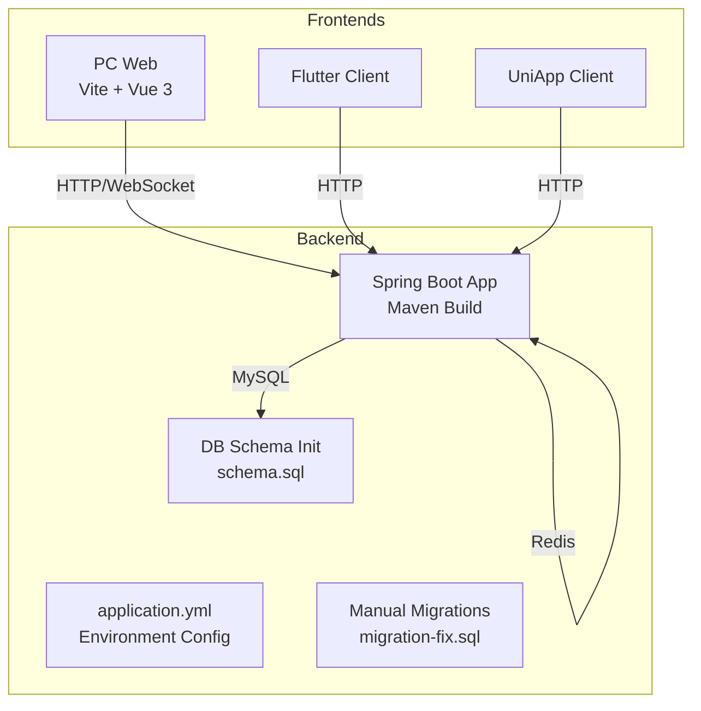
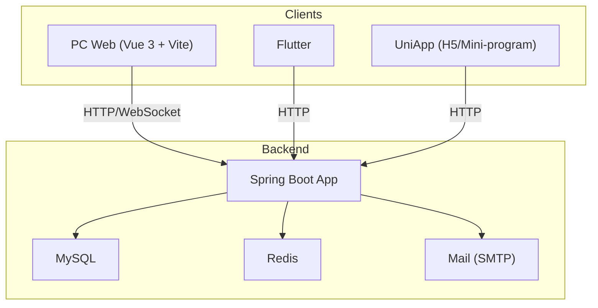
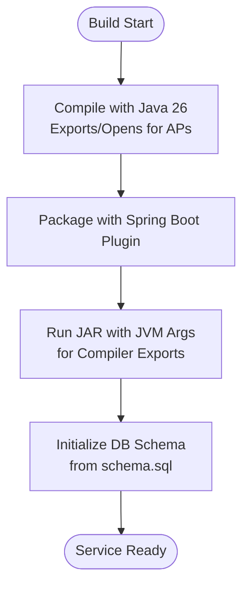
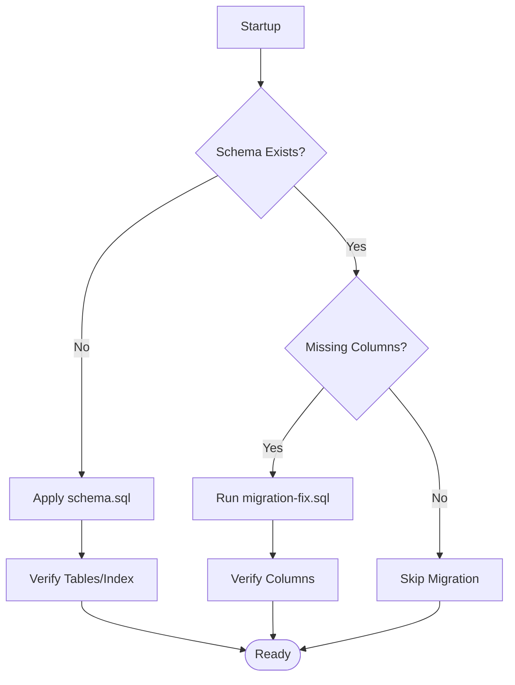
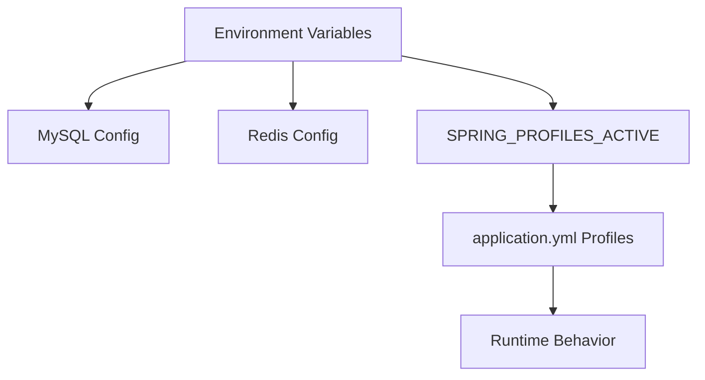
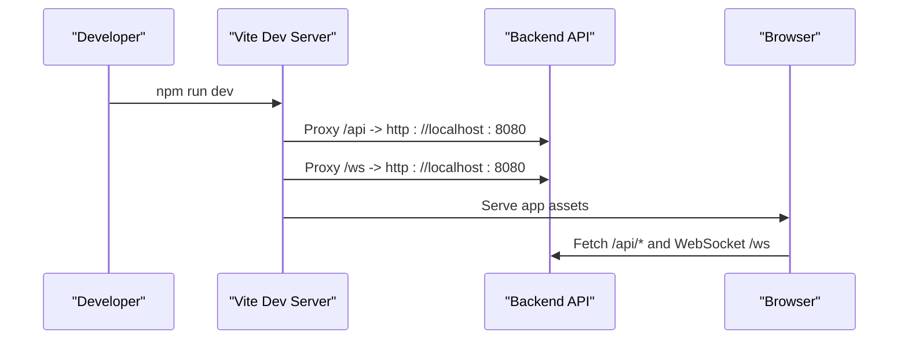
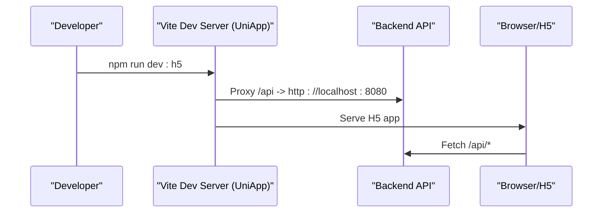
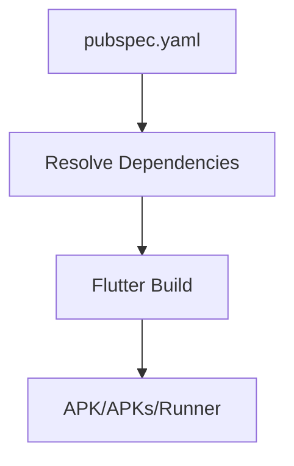
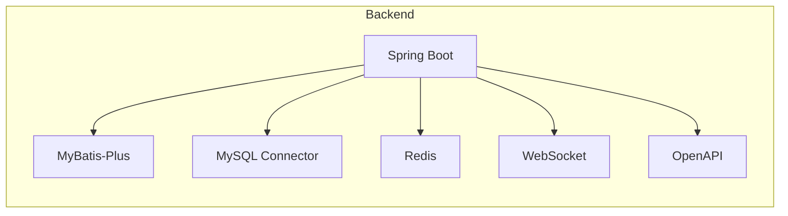

# Deployment and DevOps

<cite>
**Referenced Files in This Document**
- [pom.xml](file://camp-channel-server/pom.xml)
- [application.yml](file://camp-channel-server/src/main/resources/application.yml)
- [mvnw.cmd](file://camp-channel-server/mvnw.cmd)
- [run-migration.ps1](file://camp-channel-server/run-migration.ps1)
- [migrate-database.bat](file://camp-channel-server/migrate-database.bat)
- [schema.sql](file://camp-channel-server/src/main/resources/db/schema.sql)
- [migration-fix.sql](file://camp-channel-server/src/main/resources/db/migration-fix.sql)
- [setup-java-env.bat](file://setup-java-env.bat)
- [package.json (PC)](file://camp-channel-client-pc/package.json)
- [vite.config.ts (PC)](file://camp-channel-client-pc/vite.config.ts)
- [index.html (PC)](file://camp-channel-client-pc/index.html)
- [package.json (UniApp)](file://camp-channel-client-uniapp/package.json)
- [vite.config.ts (UniApp)](file://camp-channel-client-uniapp/vite.config.ts)
- [pubspec.yaml (Flutter)](file://camp-channel-client-flutter/pubspec.yaml)
</cite>

## Table of Contents
1. [Introduction](#introduction)
2. [Project Structure](#project-structure)
3. [Core Components](#core-components)
4. [Architecture Overview](#architecture-overview)
5. [Detailed Component Analysis](#detailed-component-analysis)
6. [Dependency Analysis](#dependency-analysis)
7. [Performance Considerations](#performance-considerations)
8. [Troubleshooting Guide](#troubleshooting-guide)
9. [Conclusion](#conclusion)
10. [Appendices](#appendices)

## Introduction
This document provides comprehensive deployment and DevOps guidance for the Camp Channel platform. It covers backend deployment configuration (Spring Boot packaging, database migrations, environment configuration), frontend build and optimization for PC web, Flutter, and UniApp clients, and production deployment topologies. It also documents environment-specific configuration management, monitoring setup, and operational integration between deployment scripts, environment variables, and monitoring systems. Practical examples are referenced from the repository’s actual build and configuration files.

## Project Structure
The platform consists of:
- Backend: Spring Boot application packaged with Maven, configured via application.yml, and includes embedded database initialization and manual migration scripts.
- Frontend: Three clients:
  - PC web built with Vite and Vue 3.
  - Flutter client for cross-platform support.
  - UniApp client targeting H5 and mini-programs.

**Diagram sources**
- [pom.xml:137-225](file://camp-channel-server/pom.xml#L137-L225)
- [application.yml:1-119](file://camp-channel-server/src/main/resources/application.yml#L1-L119)
- [schema.sql:1-236](file://camp-channel-server/src/main/resources/db/schema.sql#L1-L236)
- [migration-fix.sql:1-16](file://camp-channel-server/src/main/resources/db/migration-fix.sql#L1-L16)
- [package.json (PC):1-28](file://camp-channel-client-pc/package.json#L1-L28)
- [vite.config.ts (PC):1-35](file://camp-channel-client-pc/vite.config.ts#L1-L35)
- [package.json (UniApp):1-29](file://camp-channel-client-uniapp/package.json#L1-L29)
- [vite.config.ts (UniApp):1-16](file://camp-channel-client-uniapp/vite.config.ts#L1-L16)
- [pubspec.yaml (Flutter):1-38](file://camp-channel-client-flutter/pubspec.yaml#L1-L38)

**Section sources**
- [pom.xml:1-227](file://camp-channel-server/pom.xml#L1-L227)
- [application.yml:1-119](file://camp-channel-server/src/main/resources/application.yml#L1-L119)
- [schema.sql:1-236](file://camp-channel-server/src/main/resources/db/schema.sql#L1-L236)
- [migration-fix.sql:1-16](file://camp-channel-server/src/main/resources/db/migration-fix.sql#L1-L16)
- [package.json (PC):1-28](file://camp-channel-client-pc/package.json#L1-L28)
- [vite.config.ts (PC):1-35](file://camp-channel-client-pc/vite.config.ts#L1-L35)
- [package.json (UniApp):1-29](file://camp-channel-client-uniapp/package.json#L1-L29)
- [vite.config.ts (UniApp):1-16](file://camp-channel-client-uniapp/vite.config.ts#L1-L16)
- [pubspec.yaml (Flutter):1-38](file://camp-channel-client-flutter/pubspec.yaml#L1-L38)

## Core Components
- Backend packaging and runtime:
  - Maven build with Spring Boot plugin and compiler configuration tailored for Java 26.
  - Embedded database initialization via schema.sql and continued execution policy for idempotency.
- Environment configuration:
  - application.yml defines server port, context path, datasource, Redis, mail, MyBatis-Plus, JWT, OpenAPI, and logging.
- Database migration:
  - Automatic schema initialization plus manual migration scripts for backward-compatible field additions.
- Frontend build and development:
  - PC web: Vite-based build with proxy to backend and upload/static asset routing.
  - UniApp: Vite-based build with platform targets and proxy to backend.
  - Flutter: Dart-based client with dependencies declared in pubspec.yaml.

**Section sources**
- [pom.xml:137-225](file://camp-channel-server/pom.xml#L137-L225)
- [application.yml:1-119](file://camp-channel-server/src/main/resources/application.yml#L1-L119)
- [schema.sql:174-185](file://camp-channel-server/src/main/resources/db/schema.sql#L174-L185)
- [migration-fix.sql:1-16](file://camp-channel-server/src/main/resources/db/migration-fix.sql#L1-L16)
- [package.json (PC):5-9](file://camp-channel-client-pc/package.json#L5-L9)
- [vite.config.ts (PC):16-34](file://camp-channel-client-pc/vite.config.ts#L16-L34)
- [package.json (UniApp):5-9](file://camp-channel-client-uniapp/package.json#L5-L9)
- [vite.config.ts (UniApp):6-14](file://camp-channel-client-uniapp/vite.config.ts#L6-L14)
- [pubspec.yaml (Flutter):8-30](file://camp-channel-client-flutter/pubspec.yaml#L8-L30)

## Architecture Overview
The deployment architecture integrates three frontend clients with a single Spring Boot backend. The backend initializes the database schema and manages Redis and email services. Frontends communicate via HTTP and WebSocket to the backend API.

**Diagram sources**
- [application.yml:13-66](file://camp-channel-server/src/main/resources/application.yml#L13-L66)
- [schema.sql:1-236](file://camp-channel-server/src/main/resources/db/schema.sql#L1-L236)
- [vite.config.ts (PC):19-32](file://camp-channel-client-pc/vite.config.ts#L19-L32)
- [vite.config.ts (UniApp):8-13](file://camp-channel-client-uniapp/vite.config.ts#L8-L13)

## Detailed Component Analysis

### Backend Packaging and Runtime
- Build configuration:
  - Maven Compiler Plugin sets explicit source/target to 26 and exports/opens required JDK internals for annotation processors.
  - Spring Boot Maven Plugin included for executable JAR generation.
  - Enforcer plugin enforces Java 26 requirement.
- Runtime behavior:
  - application.yml configures server port, context path, datasource, Redis, multipart limits, mail SMTP, MyBatis-Plus, JWT, OpenAPI, and logging.

**Diagram sources**
- [pom.xml:137-225](file://camp-channel-server/pom.xml#L137-L225)
- [application.yml:25-29](file://camp-channel-server/src/main/resources/application.yml#L25-L29)

**Section sources**
- [pom.xml:137-225](file://camp-channel-server/pom.xml#L137-L225)
- [application.yml:1-119](file://camp-channel-server/src/main/resources/application.yml#L1-L119)

### Database Initialization and Migration
- Automatic schema initialization:
  - schema.sql creates tables and indexes, and includes idempotent ALTER statements for forward-compatible field additions.
  - application.yml enables schema initialization on startup with continue-on-error.
- Manual migration scripts:
  - migration-fix.sql adds missing columns to existing tables and verifies them.
  - migrate-database.bat runs the SQL script against the database.
  - run-migration.ps1 adds a missing column to the post table using mysql.exe.

**Diagram sources**
- [application.yml:25-29](file://camp-channel-server/src/main/resources/application.yml#L25-L29)
- [schema.sql:174-185](file://camp-channel-server/src/main/resources/db/schema.sql#L174-L185)
- [migration-fix.sql:1-16](file://camp-channel-server/src/main/resources/db/migration-fix.sql#L1-L16)
- [migrate-database.bat:19-20](file://camp-channel-server/migrate-database.bat#L19-L20)
- [run-migration.ps1:35-43](file://camp-channel-server/run-migration.ps1#L35-L43)

**Section sources**
- [application.yml:25-29](file://camp-channel-server/src/main/resources/application.yml#L25-L29)
- [schema.sql:1-236](file://camp-channel-server/src/main/resources/db/schema.sql#L1-L236)
- [migration-fix.sql:1-16](file://camp-channel-server/src/main/resources/db/migration-fix.sql#L1-L16)
- [migrate-database.bat:1-45](file://camp-channel-server/migrate-database.bat#L1-L45)
- [run-migration.ps1:1-54](file://camp-channel-server/run-migration.ps1#L1-L54)

### Environment Configuration Management
- Active profiles:
  - application.yml declares an empty active profile; environment-specific overrides can be applied via Spring Boot profile files or external configuration.
- Key environment variables:
  - MYSQL_ROOT_PASSWORD, MYSQL_DATABASE, MYSQL_USER, MYSQL_PASSWORD for database.
  - REDIS_PASSWORD, REDIS_URL for Redis.
  - SPRING_PROFILES_ACTIVE for switching environments.
- Logging:
  - application.yml configures log levels and file/console output.

**Diagram sources**
- [application.yml:13-119](file://camp-channel-server/src/main/resources/application.yml#L13-L119)

**Section sources**
- [application.yml:1-119](file://camp-channel-server/src/main/resources/application.yml#L1-L119)

### Frontend Build and Optimization

#### PC Web (Vue 3 + Vite)
- Scripts:
  - Development, build, and preview scripts defined in package.json.
- Proxy and asset routing:
  - Vite proxy routes /api, /uploads, and /ws to the backend.
  - index.html loads the main script and includes fonts.
- Build output:
  - Vite produces optimized static assets for production.

**Diagram sources**
- [package.json (PC):5-9](file://camp-channel-client-pc/package.json#L5-L9)
- [vite.config.ts (PC):16-34](file://camp-channel-client-pc/vite.config.ts#L16-L34)
- [index.html (PC):10-12](file://camp-channel-client-pc/index.html#L10-L12)

**Section sources**
- [package.json (PC):1-28](file://camp-channel-client-pc/package.json#L1-L28)
- [vite.config.ts (PC):1-35](file://camp-channel-client-pc/vite.config.ts#L1-L35)
- [index.html (PC):1-15](file://camp-channel-client-pc/index.html#L1-L15)

#### UniApp (H5 and Mini-Program)
- Scripts:
  - Platform-specific dev/build scripts for H5 and WeChat Mini Program.
- Proxy:
  - Vite proxy routes /api to the backend during development.
- Build:
  - Uses @dcloudio/vite-plugin-uni for multi-target builds.

**Diagram sources**
- [package.json (UniApp):5-9](file://camp-channel-client-uniapp/package.json#L5-L9)
- [vite.config.ts (UniApp):6-14](file://camp-channel-client-uniapp/vite.config.ts#L6-L14)

**Section sources**
- [package.json (UniApp):1-29](file://camp-channel-client-uniapp/package.json#L1-L29)
- [vite.config.ts (UniApp):1-16](file://camp-channel-client-uniapp/vite.config.ts#L1-L16)

#### Flutter Client
- Dependencies:
  - HTTP client (dio), state management (provider), persistence (shared_preferences), and caching (cached_network_image).
- Build:
  - Flutter project managed via pubspec.yaml; platform targets are declared.

**Diagram sources**
- [pubspec.yaml (Flutter):8-30](file://camp-channel-client-flutter/pubspec.yaml#L8-L30)

**Section sources**
- [pubspec.yaml (Flutter):1-38](file://camp-channel-client-flutter/pubspec.yaml#L1-L38)

### Production Deployment Topologies
Recommended topologies:
- Single VM:
  - Nginx reverse proxy serving frontend static assets and proxying /api to backend.
  - Backend runs as a Spring Boot JAR behind Nginx.
  - MySQL and Redis run locally or on separate VMs.
- Containerized:
  - Docker Compose for backend, MySQL, Redis, and Nginx.
  - Frontends served via Nginx or CDN.
- Blue-Green or Rolling Deployments:
  - Use two backend instances behind a load balancer; switch traffic after health checks.

[No sources needed since this section provides general guidance]

### Zero-Downtime and Rollback Strategies
- Database migrations:
  - Keep schema.sql idempotent and use migration-fix.sql for incremental fixes.
  - Apply migrations before deploying new backend versions.
- Backend rollout:
  - Blue-green: deploy new version alongside old, switch DNS/load balancer after health checks.
  - Rolling: replace instances gradually with readiness probes.
- Frontend:
  - Versioned static assets and cache-busting; serve via CDN with immutable caching for long-term cache.

[No sources needed since this section provides general guidance]

### Monitoring Setup
- Application logs:
  - Configure file and console logging in application.yml; ship logs to centralized logging (e.g., ELK or similar).
- Health and metrics:
  - Expose actuator endpoints and integrate with Prometheus/Grafana.
- Frontend monitoring:
  - Use performance monitoring and error tracking for browsers and mobile apps.

[No sources needed since this section provides general guidance]

## Dependency Analysis
- Backend dependencies:
  - Spring Boot starters for web, security, Redis, validation, WebSocket, mail, and OpenAPI.
  - MyBatis-Plus for ORM and MySQL connector for JDBC.
- Frontend dependencies:
  - PC web: Vue 3, Vue Router, Pinia, Axios, Three.js, STOMP/SockJS for WebSocket.
  - UniApp: @dcloudio/uni-app ecosystem and Vite plugin.
  - Flutter: dio, provider, shared_preferences, cached_network_image.

**Diagram sources**
- [pom.xml:32-135](file://camp-channel-server/pom.xml#L32-L135)

**Section sources**
- [pom.xml:32-135](file://camp-channel-server/pom.xml#L32-L135)

## Performance Considerations
- Database:
  - Use connection pooling settings from application.yml; ensure proper indexing on frequently queried columns.
- Backend:
  - Tune JVM arguments and thread pools; leverage async tasks where appropriate.
- Frontend:
  - Enable code splitting and lazy loading; optimize images and assets; use CDN for static delivery.

[No sources needed since this section provides general guidance]

## Troubleshooting Guide
- Java environment:
  - Use setup-java-env.bat to configure JAVA_HOME and PATH for Java 26.
- Maven wrapper:
  - mvnw.cmd ensures consistent Maven execution across environments.
- Database migration failures:
  - Confirm MySQL availability and credentials; run migrate-database.bat or run-migration.ps1 as appropriate.
- Frontend proxy issues:
  - Verify Vite proxy settings for /api, /uploads, and /ws in development.

**Section sources**
- [setup-java-env.bat:1-44](file://setup-java-env.bat#L1-L44)
- [mvnw.cmd:1-206](file://camp-channel-server/mvnw.cmd#L1-L206)
- [migrate-database.bat:1-45](file://camp-channel-server/migrate-database.bat#L1-L45)
- [run-migration.ps1:1-54](file://camp-channel-server/run-migration.ps1#L1-L54)
- [vite.config.ts (PC):16-34](file://camp-channel-client-pc/vite.config.ts#L16-L34)
- [vite.config.ts (UniApp):6-14](file://camp-channel-client-uniapp/vite.config.ts#L6-L14)

## Conclusion
The Camp Channel platform provides a clear separation between a Spring Boot backend and multiple frontend clients. The backend is configured for robust initialization and migration, while the frontends are set up for efficient development and production builds. By adopting the recommended deployment topologies, zero-downtime strategies, and monitoring practices, teams can achieve reliable, scalable operations.

[No sources needed since this section summarizes without analyzing specific files]

## Appendices

### Environment Configuration Options
- Development:
  - Local MySQL and Redis; application.yml defaults suffice; enable devtools for hot reload.
- Staging:
  - External MySQL and Redis; externalize secrets via environment variables; activate appropriate Spring profile.
- Production:
  - Containerized deployment with Nginx, backend, MySQL, and Redis; enable SSL/TLS; secure secrets management.

[No sources needed since this section provides general guidance]

### CI/CD Pipeline Suggestions
- Build:
  - Maven build and test in CI; publish artifacts.
- Frontend:
  - Build PC web and UniApp; upload static assets to CDN.
- Deploy:
  - Run database migrations; deploy backend; roll out frontend; health checks.

[No sources needed since this section provides general guidance]