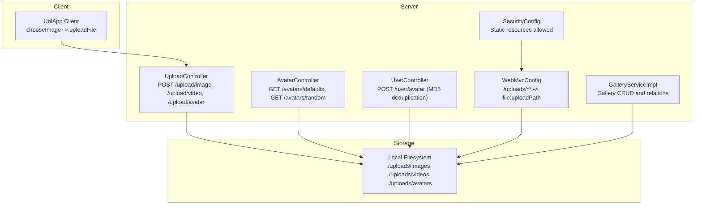
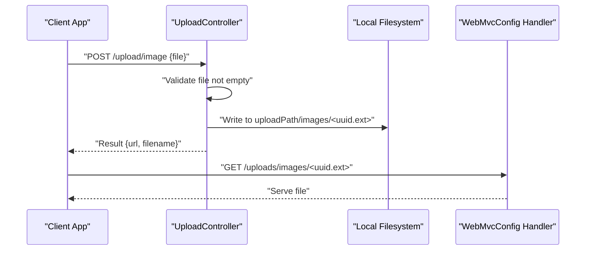
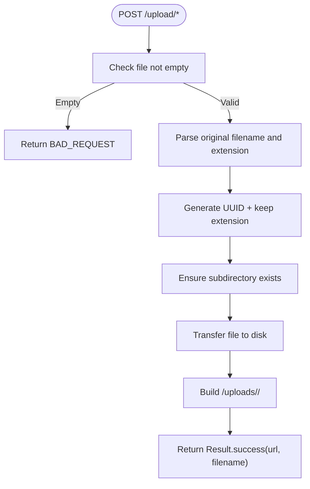
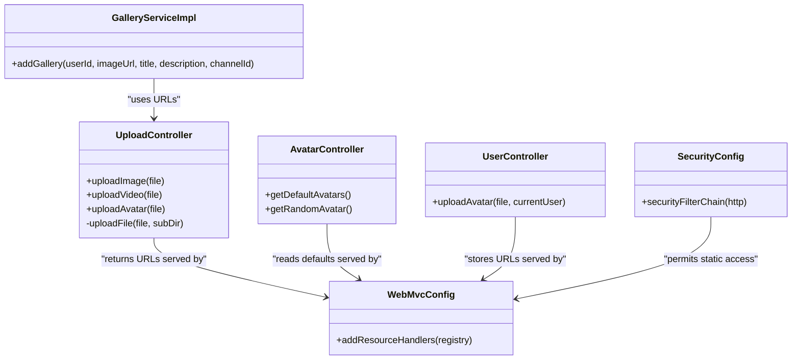

# File Upload and Media Management

<cite>
**Referenced Files in This Document**
- [UploadController.java](file://camp-channel-server/src/main/java/com/gdmec/campchannel/controller/UploadController.java)
- [AvatarController.java](file://camp-channel-server/src/main/java/com/gdmec/campchannel/controller/AvatarController.java)
- [UserController.java](file://camp-channel-server/src/main/java/com/gdmec/campchannel/controller/UserController.java)
- [WebMvcConfig.java](file://camp-channel-server/src/main/java/com/gdmec/campchannel/config/WebMvcConfig.java)
- [SecurityConfig.java](file://camp-channel-server/src/main/java/com/gdmec/campchannel/config/SecurityConfig.java)
- [application.yml](file://camp-channel-server/src/main/resources/application.yml)
- [schema.sql](file://camp-channel-server/src/main/resources/db/schema.sql)
- [Result.java](file://camp-channel-server/src/main/java/com/gdmec/campchannel/common/api/Result.java)
- [ErrorCode.java](file://camp-channel-server/src/main/java/com/gdmec/campchannel/common/api/ErrorCode.java)
- [GalleryController.java](file://camp-channel-server/src/main/java/com/gdmec/campchannel/controller/GalleryController.java)
- [GalleryServiceImpl.java](file://camp-channel-server/src/main/java/com/gdmec/campchannel/service/impl/GalleryServiceImpl.java)
- [Gallery.java](file://camp-channel-server/src/main/java/com/gdmec/campchannel/entity/Gallery.java)
- [create.vue](file://camp-channel-client-uniapp/src/pages/post/create.vue)
</cite>

## Table of Contents
1. [Introduction](#introduction)
2. [Project Structure](#project-structure)
3. [Core Components](#core-components)
4. [Architecture Overview](#architecture-overview)
5. [Detailed Component Analysis](#detailed-component-analysis)
6. [Dependency Analysis](#dependency-analysis)
7. [Performance Considerations](#performance-considerations)
8. [Troubleshooting Guide](#troubleshooting-guide)
9. [Conclusion](#conclusion)
10. [Appendices](#appendices)

## Introduction
This document explains the file upload and media management system, covering image and video uploads, avatar handling, and integration with the content management system for posts and galleries. It documents the upload architecture, validation and size limits, storage management, security considerations, and operational best practices. Concrete examples from the codebase illustrate upload endpoints, validation logic, and storage configuration. The document also outlines relationships with the content management system and provides guidance for cloud storage integration, concurrency, large file handling, and virus scanning.

## Project Structure
The upload and media management system spans server-side controllers, services, configuration, and client-side integration:
- Controllers expose upload endpoints for images, videos, and avatars.
- Static resource serving maps local upload paths to URLs for preview.
- Application configuration defines multipart limits and local storage path.
- Database schema supports storing media references in posts and galleries.
- Client-side code demonstrates uploading images to the backend.

**Diagram sources**
- [UploadController.java:28-44](file://camp-channel-server/src/main/java/com/gdmec/campchannel/controller/UploadController.java#L28-L44)
- [AvatarController.java:22-59](file://camp-channel-server/src/main/java/com/gdmec/campchannel/controller/AvatarController.java#L22-L59)
- [UserController.java:229-258](file://camp-channel-server/src/main/java/com/gdmec/campchannel/controller/UserController.java#L229-L258)
- [WebMvcConfig.java:14-18](file://camp-channel-server/src/main/java/com/gdmec/campchannel/config/WebMvcConfig.java#L14-L18)
- [SecurityConfig.java:52-74](file://camp-channel-server/src/main/java/com/gdmec/campchannel/config/SecurityConfig.java#L52-L74)
- [GalleryServiceImpl.java:44-62](file://camp-channel-server/src/main/java/com/gdmec/campchannel/service/impl/GalleryServiceImpl.java#L44-L62)

**Section sources**
- [UploadController.java:1-84](file://camp-channel-server/src/main/java/com/gdmec/campchannel/controller/UploadController.java#L1-L84)
- [application.yml:44-47](file://camp-channel-server/src/main/resources/application.yml#L44-L47)
- [application.yml:95-97](file://camp-channel-server/src/main/resources/application.yml#L95-L97)
- [WebMvcConfig.java:1-19](file://camp-channel-server/src/main/java/com/gdmec/campchannel/config/WebMvcConfig.java#L1-L19)
- [SecurityConfig.java:52-74](file://camp-channel-server/src/main/java/com/gdmec/campchannel/config/SecurityConfig.java#L52-L74)

## Core Components
- UploadController: Provides endpoints for image, video, and avatar uploads. Handles basic validation (empty file), generates unique filenames, writes to configured local path, and returns standardized Result responses.
- AvatarController: Lists and selects default avatars from the avatars directory.
- UserController: Supports updating user avatar with MD5-based deduplication to avoid storing identical files multiple times.
- WebMvcConfig: Registers static resource handler to serve uploaded files via /uploads/**.
- SecurityConfig: Allows static resource access for local file preview.
- Result and ErrorCode: Standardized response envelope and error codes used across controllers.
- GalleryService and Gallery: Store and manage gallery items referencing uploaded images.

Key capabilities:
- Unified upload flow with UUID-based filenames and directory separation by type.
- Static file serving for previews.
- Basic validation and error handling.
- Integration with gallery and post content via stored URLs.

**Section sources**
- [UploadController.java:28-82](file://camp-channel-server/src/main/java/com/gdmec/campchannel/controller/UploadController.java#L28-L82)
- [AvatarController.java:22-59](file://camp-channel-server/src/main/java/com/gdmec/campchannel/controller/AvatarController.java#L22-L59)
- [UserController.java:229-258](file://camp-channel-server/src/main/java/com/gdmec/campchannel/controller/UserController.java#L229-L258)
- [WebMvcConfig.java:14-18](file://camp-channel-server/src/main/java/com/gdmec/campchannel/config/WebMvcConfig.java#L14-L18)
- [Result.java:13-87](file://camp-channel-server/src/main/java/com/gdmec/campchannel/common/api/Result.java#L13-L87)
- [ErrorCode.java:9-59](file://camp-channel-server/src/main/java/com/gdmec/campchannel/common/api/ErrorCode.java#L9-L59)
- [GalleryServiceImpl.java:44-62](file://camp-channel-server/src/main/java/com/gdmec/campchannel/service/impl/GalleryServiceImpl.java#L44-L62)

## Architecture Overview
The upload architecture consists of:
- Client initiates uploads via multipart/form-data requests.
- UploadController validates input and persists files under a configurable base path.
- Unique filenames prevent collisions and simplify deduplication.
- Static resource handler serves files for preview.
- Content modules (posts and galleries) store media URLs and render them.

**Diagram sources**
- [UploadController.java:28-82](file://camp-channel-server/src/main/java/com/gdmec/campchannel/controller/UploadController.java#L28-L82)
- [WebMvcConfig.java:14-18](file://camp-channel-server/src/main/java/com/gdmec/campchannel/config/WebMvcConfig.java#L14-L18)

## Detailed Component Analysis

### UploadController: Image, Video, Avatar Uploads
Responsibilities:
- Expose three endpoints: image, video, and avatar.
- Validate non-empty file.
- Extract original extension and generate UUID-based filename.
- Ensure subdirectory exists and write file.
- Return standardized Result with URL and filename.

Processing logic highlights:
- Uses MultipartFile for streaming upload.
- Creates directories if missing.
- Writes to absolute normalized path under configured base.
- Returns URL path compatible with static resource serving.

**Diagram sources**
- [UploadController.java:46-82](file://camp-channel-server/src/main/java/com/gdmec/campchannel/controller/UploadController.java#L46-L82)

**Section sources**
- [UploadController.java:28-82](file://camp-channel-server/src/main/java/com/gdmec/campchannel/controller/UploadController.java#L28-L82)

### AvatarController: Default Avatars
Responsibilities:
- List default avatars from the avatars directory.
- Return random default avatar URL.
- Filters by common image extensions.

Operational notes:
- Reads from the same configured upload path.
- Sorts files by name for deterministic listing.

**Section sources**
- [AvatarController.java:22-59](file://camp-channel-server/src/main/java/com/gdmec/campchannel/controller/AvatarController.java#L22-L59)

### UserController: User Avatar Upload with Deduplication
Responsibilities:
- Accepts avatar upload for current user.
- Computes MD5 hash of file bytes to detect duplicates.
- Stores only if hash differs from existing files.
- Updates user’s avatar field with the returned URL.

Best practices demonstrated:
- MD5-based deduplication reduces storage usage.
- Maintains consistent naming and URL structure.

**Section sources**
- [UserController.java:229-258](file://camp-channel-server/src/main/java/com/gdmec/campchannel/controller/UserController.java#L229-L258)

### WebMvcConfig: Static Resource Serving
Responsibilities:
- Maps /uploads/** to the configured filesystem path.
- Enables clients to preview uploaded files directly.

Integration:
- Works with UploadController’s returned URLs.
- Requires SecurityConfig to permit static resource access.

**Section sources**
- [WebMvcConfig.java:14-18](file://camp-channel-server/src/main/java/com/gdmec/campchannel/config/WebMvcConfig.java#L14-L18)
- [SecurityConfig.java:52-74](file://camp-channel-server/src/main/java/com/gdmec/campchannel/config/SecurityConfig.java#L52-L74)

### Gallery Integration: Storing and Rendering Images
Responsibilities:
- GalleryController accepts an image URL and persists gallery metadata.
- GalleryServiceImpl populates user info and manages likes/comments.
- Database schema stores image_url for gallery items.

Relationships:
- UploadController returns URLs that can be used as gallery image_url.
- Posts also support storing media references (images JSON array and video_url).

**Section sources**
- [GalleryController.java:27-33](file://camp-channel-server/src/main/java/com/gdmec/campchannel/controller/GalleryController.java#L27-L33)
- [GalleryServiceImpl.java:44-62](file://camp-channel-server/src/main/java/com/gdmec/campchannel/service/impl/GalleryServiceImpl.java#L44-L62)
- [schema.sql:200-213](file://camp-channel-server/src/main/resources/db/schema.sql#L200-L213)
- [schema.sql:45-64](file://camp-channel-server/src/main/resources/db/schema.sql#L45-L64)

### Client-Side Upload Example
The UniApp client demonstrates:
- Choosing images from album or camera.
- Uploading to /api/upload/image with Authorization header.
- Handling response and appending URLs to a list.

**Section sources**
- [create.vue:129-176](file://camp-channel-client-uniapp/src/pages/post/create.vue#L129-L176)

## Dependency Analysis
Component relationships and data flow:

**Diagram sources**
- [UploadController.java:28-82](file://camp-channel-server/src/main/java/com/gdmec/campchannel/controller/UploadController.java#L28-L82)
- [AvatarController.java:22-59](file://camp-channel-server/src/main/java/com/gdmec/campchannel/controller/AvatarController.java#L22-L59)
- [UserController.java:229-258](file://camp-channel-server/src/main/java/com/gdmec/campchannel/controller/UserController.java#L229-L258)
- [WebMvcConfig.java:14-18](file://camp-channel-server/src/main/java/com/gdmec/campchannel/config/WebMvcConfig.java#L14-L18)
- [SecurityConfig.java:52-74](file://camp-channel-server/src/main/java/com/gdmec/campchannel/config/SecurityConfig.java#L52-L74)
- [GalleryServiceImpl.java:44-62](file://camp-channel-server/src/main/java/com/gdmec/campchannel/service/impl/GalleryServiceImpl.java#L44-L62)

## Performance Considerations
- Large file handling:
  - Current multipart limits are set in application configuration. Consider adjusting max-file-size and max-request-size for larger media.
  - For very large files, consider chunked uploads or cloud storage pre-signed URLs to offload the server.
- Concurrency:
  - UUID-based filenames eliminate collisions and reduce contention.
  - Ensure filesystem supports concurrent writes; otherwise, add synchronization or queue-based processing.
- Storage:
  - Local filesystem is simple but not ideal for scale. Plan migration to cloud storage (S3-compatible or CDN) with signed URLs.
- Memory:
  - MD5 computation in UserController reads entire file into memory; consider streaming checksum for large files.

[No sources needed since this section provides general guidance]

## Troubleshooting Guide
Common issues and resolutions:
- Empty file upload:
  - Validation rejects empty files; ensure clients send non-empty multipart files.
- File not found after upload:
  - Verify static resource handler mapping matches configured upload path.
  - Confirm directory permissions allow creation and writing.
- Incorrect URL returned:
  - Ensure returned URL format aligns with static resource mapping (/uploads/<type>/<uuid.ext>).
- Duplicate uploads:
  - Use MD5-based deduplication in user avatar updates to avoid redundant storage.
- CORS/static access blocked:
  - Confirm SecurityConfig permits static resource access for /uploads/**.

**Section sources**
- [UploadController.java:46-82](file://camp-channel-server/src/main/java/com/gdmec/campchannel/controller/UploadController.java#L46-L82)
- [WebMvcConfig.java:14-18](file://camp-channel-server/src/main/java/com/gdmec/campchannel/config/WebMvcConfig.java#L14-L18)
- [SecurityConfig.java:52-74](file://camp-channel-server/src/main/java/com/gdmec/campchannel/config/SecurityConfig.java#L52-L74)
- [UserController.java:246-254](file://camp-channel-server/src/main/java/com/gdmec/campchannel/controller/UserController.java#L246-L254)

## Conclusion
The system provides a straightforward, extensible foundation for file uploads and media management. It includes basic validation, UUID-based naming, static resource serving, and integration with galleries and posts. To evolve toward production-grade resilience, consider adding cloud storage integration, virus scanning, rate limiting, chunked uploads, and CDN distribution.

[No sources needed since this section summarizes without analyzing specific files]

## Appendices

### Configuration Options
- Upload path:
  - app.upload.local-path: Base filesystem path for uploads (default ./uploads/)
- Multipart limits:
  - spring.servlet.multipart.max-file-size: Per-file size limit
  - spring.servlet.multipart.max-request-size: Total request size limit

These settings control upload size constraints and are applied globally to multipart handling.

**Section sources**
- [application.yml:44-47](file://camp-channel-server/src/main/resources/application.yml#L44-L47)
- [application.yml:95-97](file://camp-channel-server/src/main/resources/application.yml#L95-L97)

### Supported Formats and Validation
- Extension handling:
  - Original filename extension is preserved; no explicit MIME validation is performed in the upload controllers.
- Recommendations:
  - Enforce allowed extensions and MIME types in future iterations.
  - Consider integrating virus scanning and content inspection.

**Section sources**
- [UploadController.java:52-58](file://camp-channel-server/src/main/java/com/gdmec/campchannel/controller/UploadController.java#L52-L58)

### Cloud Storage Integration and CDN
- Current state:
  - Local filesystem serving via static resource handler.
- Recommended steps:
  - Replace local path with cloud bucket path and configure signed URLs.
  - Integrate with CDN for global delivery and reduced latency.
  - Add asynchronous processing for heavy transformations (resize, optimize).

[No sources needed since this section provides general guidance]

### Best Practices for File Naming, Metadata, and Cleanup
- File naming:
  - Use UUID-based filenames to prevent collisions and obfuscate originals.
- Metadata:
  - Store minimal metadata (extension, size) alongside URLs for future processing.
- Cleanup:
  - Implement orphan detection: periodically scan uploads directory for unreferenced files.
  - Add soft-deletion and scheduled cleanup jobs for gallery/post removal.

[No sources needed since this section provides general guidance]