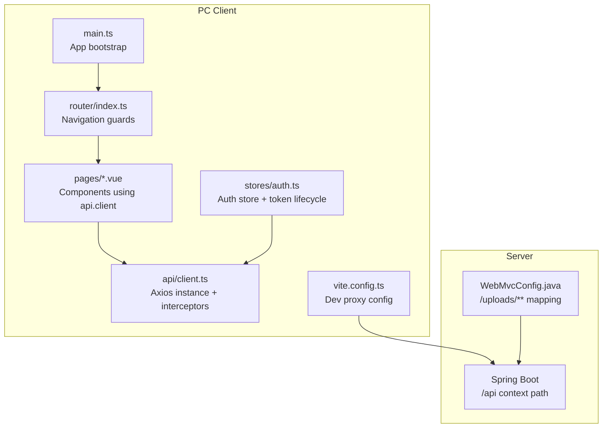
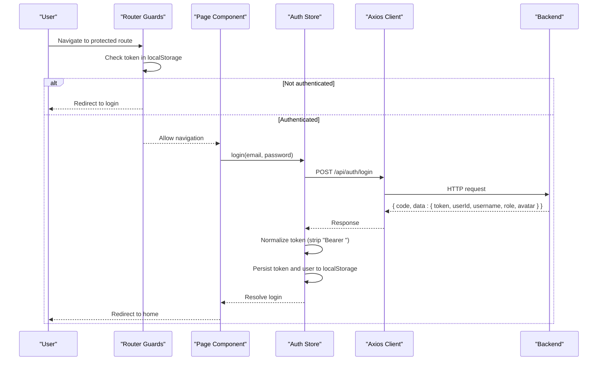
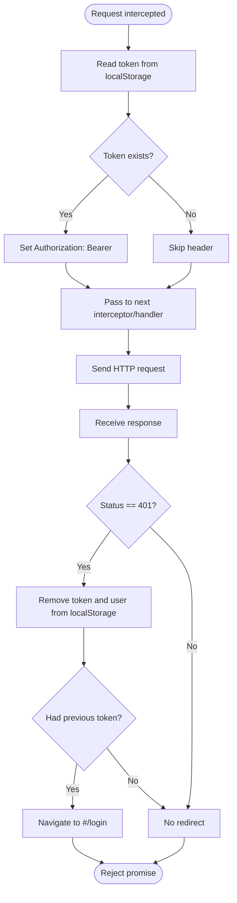
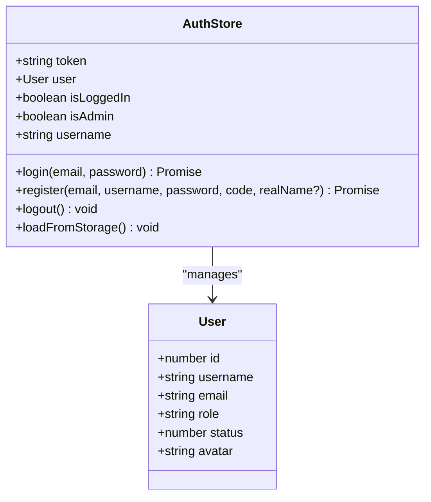
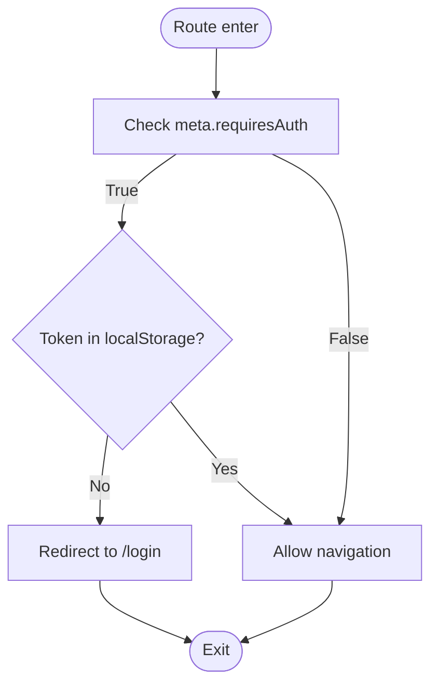
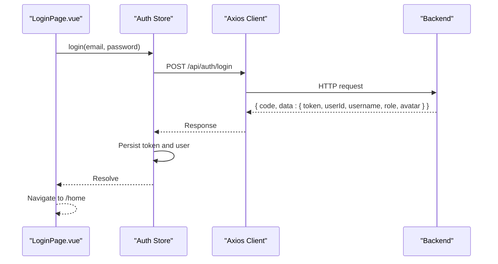
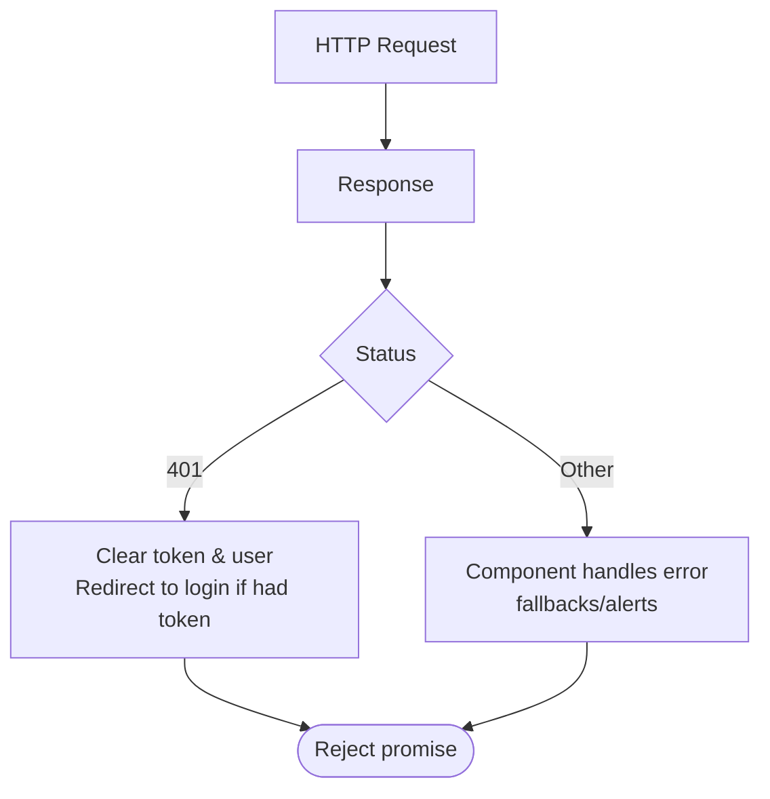
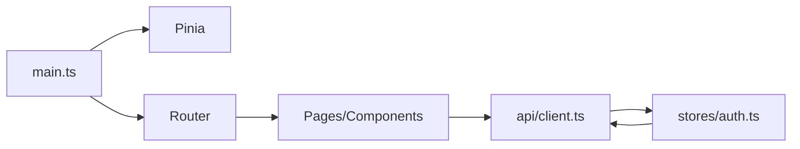

# API Integration and HTTP Client

<cite>
**Referenced Files in This Document**
- [client.ts](file://camp-channel-client-pc/src/api/client.ts)
- [auth.ts](file://camp-channel-client-pc/src/stores/auth.ts)
- [index.ts](file://camp-channel-client-pc/src/router/index.ts)
- [main.ts](file://camp-channel-client-pc/src/main.ts)
- [vite.config.ts](file://camp-channel-client-pc/vite.config.ts)
- [package.json](file://camp-channel-client-pc/package.json)
- [LoginPage.vue](file://camp-channel-client-pc/src/pages/LoginPage.vue)
- [HomePage.vue](file://camp-channel-client-pc/src/pages/HomePage.vue)
- [PostDetailPage.vue](file://camp-channel-client-pc/src/pages/PostDetailPage.vue)
- [UserCard.vue](file://camp-channel-client-pc/src/components/UserCard.vue)
- [index.ts](file://camp-channel-client-pc/src/types/index.ts)
- [WebMvcConfig.java](file://camp-channel-server/src/main/java/com/gdmec/campchannel/config/WebMvcConfig.java)
- [application.yml](file://camp-channel-server/src/main/resources/application.yml)
</cite>

## Table of Contents
1. [Introduction](#introduction)
2. [Project Structure](#project-structure)
3. [Core Components](#core-components)
4. [Architecture Overview](#architecture-overview)
5. [Detailed Component Analysis](#detailed-component-analysis)
6. [Dependency Analysis](#dependency-analysis)
7. [Performance Considerations](#performance-considerations)
8. [Troubleshooting Guide](#troubleshooting-guide)
9. [Conclusion](#conclusion)
10. [Appendices](#appendices)

## Introduction
This document explains the API integration layer and HTTP client configuration for the PC web client. It covers the centralized HTTP client setup, request/response interceptors, authentication token management, and integration with the Pinia authentication store. It also documents HTTP client configuration (base URLs, headers, timeouts), error handling strategies, retry mechanisms, offline state management, and the relationship between API integration and component-level data fetching. Security considerations such as token storage, request sanitization, and CORS configuration are addressed.

## Project Structure
The API integration is implemented in a single HTTP client module and consumed by Vue components and Pinia stores. The development server proxies API requests to the backend, while the production deployment would route traffic to the backend server.

**Diagram sources**
- [main.ts:1-19](file://camp-channel-client-pc/src/main.ts#L1-L19)
- [index.ts:1-46](file://camp-channel-client-pc/src/router/index.ts#L1-L46)
- [client.ts:1-35](file://camp-channel-client-pc/src/api/client.ts#L1-L35)
- [auth.ts:1-61](file://camp-channel-client-pc/src/stores/auth.ts#L1-L61)
- [vite.config.ts:1-35](file://camp-channel-client-pc/vite.config.ts#L1-L35)
- [WebMvcConfig.java:1-19](file://camp-channel-server/src/main/java/com/gdmec/campchannel/config/WebMvcConfig.java#L1-L19)

**Section sources**
- [main.ts:1-19](file://camp-channel-client-pc/src/main.ts#L1-L19)
- [index.ts:1-46](file://camp-channel-client-pc/src/router/index.ts#L1-L46)
- [client.ts:1-35](file://camp-channel-client-pc/src/api/client.ts#L1-L35)
- [auth.ts:1-61](file://camp-channel-client-pc/src/stores/auth.ts#L1-L61)
- [vite.config.ts:1-35](file://camp-channel-client-pc/vite.config.ts#L1-L35)
- [WebMvcConfig.java:1-19](file://camp-channel-server/src/main/java/com/gdmec/campchannel/config/WebMvcConfig.java#L1-L19)

## Core Components
- Centralized HTTP client: An Axios instance configured with base URL, timeout, and JSON content type. It injects Authorization headers automatically and handles 401 responses by clearing tokens and redirecting to login.
- Authentication store: Manages token and user state, persists credentials to localStorage, and exposes login/register/logout functions that call API endpoints.
- Router guards: Enforce authentication requirements per route and redirect accordingly.
- Dev proxy: Routes /api, /uploads, and /ws to the backend server during development.

Key behaviors:
- Automatic token injection: Request interceptor reads token from localStorage and attaches Authorization header.
- Centralized 401 handling: On 401 responses, removes token and user from localStorage and navigates to login if previously authenticated.
- Token normalization: Strips “Bearer ” prefix returned by backend for storage.
- Component-level usage: Pages and components import the shared api client to call endpoints.

**Section sources**
- [client.ts:4-32](file://camp-channel-client-pc/src/api/client.ts#L4-L32)
- [auth.ts:14-50](file://camp-channel-client-pc/src/stores/auth.ts#L14-L50)
- [index.ts:34-43](file://camp-channel-client-pc/src/router/index.ts#L34-L43)
- [vite.config.ts:16-34](file://camp-channel-client-pc/vite.config.ts#L16-L34)

## Architecture Overview
The client uses a single Axios instance for all HTTP calls. The auth store coordinates token lifecycle and user data. Components call the API client directly, and the router enforces authentication policies.

**Diagram sources**
- [index.ts:34-43](file://camp-channel-client-pc/src/router/index.ts#L34-L43)
- [auth.ts:14-37](file://camp-channel-client-pc/src/stores/auth.ts#L14-L37)
- [client.ts:10-16](file://camp-channel-client-pc/src/api/client.ts#L10-L16)

**Section sources**
- [index.ts:34-43](file://camp-channel-client-pc/src/router/index.ts#L34-L43)
- [auth.ts:14-37](file://camp-channel-client-pc/src/stores/auth.ts#L14-L37)
- [client.ts:10-16](file://camp-channel-client-pc/src/api/client.ts#L10-L16)

## Detailed Component Analysis

### HTTP Client Configuration and Interceptors
- Base URL: /api
- Timeout: 15000 ms
- Headers: Content-Type: application/json
- Request interceptor: Reads token from localStorage and sets Authorization header if present.
- Response interceptor: On 401 Unauthorized, clears token and user from localStorage and redirects to login if a token existed.

**Diagram sources**
- [client.ts:10-32](file://camp-channel-client-pc/src/api/client.ts#L10-L32)

**Section sources**
- [client.ts:4-32](file://camp-channel-client-pc/src/api/client.ts#L4-L32)

### Authentication Store and Token Management
- Loads token and user from localStorage on initialization.
- Provides login(email, password) that posts to /api/auth/login, normalizes token, persists to localStorage, and sets store state.
- Provides register(...) that posts to /api/auth/register.
- Provides logout() that clears token and user from both store and localStorage.
- Computes isLoggedIn, isAdmin, and username from store state.

**Diagram sources**
- [auth.ts:6-60](file://camp-channel-client-pc/src/stores/auth.ts#L6-L60)
- [index.ts:1-12](file://camp-channel-client-pc/src/types/index.ts#L1-L12)

**Section sources**
- [auth.ts:6-60](file://camp-channel-client-pc/src/stores/auth.ts#L6-L60)
- [index.ts:1-12](file://camp-channel-client-pc/src/types/index.ts#L1-L12)

### Router Guards and Navigation
- Requires authentication for most routes via meta.requiresAuth.
- Redirects unauthenticated users to login and authenticated users away from login.
- Uses localStorage to check token presence.

**Diagram sources**
- [index.ts:34-43](file://camp-channel-client-pc/src/router/index.ts#L34-L43)

**Section sources**
- [index.ts:34-43](file://camp-channel-client-pc/src/router/index.ts#L34-L43)

### Component-Level Data Fetching and API Usage
- LoginPage.vue: Imports api and auth store; calls authStore.login and navigates on success.
- HomePage.vue: Uses api.get to fetch channels and posts, api.post to toggle likes.
- PostDetailPage.vue: Uses api.get to fetch post and comments, api.post to add comments and toggle likes, api.delete to remove posts and comments.
- UserCard.vue: Uses api.get to fetch user profile and posts, and api.post to send friend requests.

**Diagram sources**
- [LoginPage.vue:82-99](file://camp-channel-client-pc/src/pages/LoginPage.vue#L82-L99)
- [auth.ts:14-37](file://camp-channel-client-pc/src/stores/auth.ts#L14-L37)
- [client.ts:10-16](file://camp-channel-client-pc/src/api/client.ts#L10-L16)

**Section sources**
- [LoginPage.vue:82-99](file://camp-channel-client-pc/src/pages/LoginPage.vue#L82-L99)
- [HomePage.vue:177-225](file://camp-channel-client-pc/src/pages/HomePage.vue#L177-L225)
- [PostDetailPage.vue:85-138](file://camp-channel-client-pc/src/pages/PostDetailPage.vue#L85-L138)
- [UserCard.vue:61-97](file://camp-channel-client-pc/src/components/UserCard.vue#L61-L97)

### Error Handling Patterns
- Centralized 401 handling: On 401, token and user are removed and user is redirected to login if previously authenticated.
- Component-level try/catch: Components handle failures gracefully (e.g., fallback endpoints, empty lists, alerts).
- No explicit retry mechanism is implemented in the client; failures bubble up to components.

**Diagram sources**
- [client.ts:18-32](file://camp-channel-client-pc/src/api/client.ts#L18-L32)
- [PostDetailPage.vue:174-200](file://camp-channel-client-pc/src/pages/PostDetailPage.vue#L174-L200)
- [UserCard.vue:76-96](file://camp-channel-client-pc/src/components/UserCard.vue#L76-L96)

**Section sources**
- [client.ts:18-32](file://camp-channel-client-pc/src/api/client.ts#L18-L32)
- [PostDetailPage.vue:174-200](file://camp-channel-client-pc/src/pages/PostDetailPage.vue#L174-L200)
- [UserCard.vue:76-96](file://camp-channel-client-pc/src/components/UserCard.vue#L76-L96)

### Retry Mechanisms and Offline State Management
- No built-in retry logic in the HTTP client.
- WebSocket connections in components attempt to reconnect if available; however, this is separate from HTTP retries.
- Offline state is not explicitly modeled; components handle network errors by displaying empty states or fallbacks.

[No sources needed since this section provides general guidance]

### Relationship Between API Integration and Component-Level Data Fetching
- Components depend on the shared Axios instance for all HTTP calls.
- Auth store encapsulates token lifecycle and user state, ensuring consistent authentication across the app.
- Router guards enforce access control, preventing unauthorized navigation and ensuring components only render when authenticated.

**Section sources**
- [HomePage.vue:177-225](file://camp-channel-client-pc/src/pages/HomePage.vue#L177-L225)
- [PostDetailPage.vue:85-138](file://camp-channel-client-pc/src/pages/PostDetailPage.vue#L85-L138)
- [UserCard.vue:61-97](file://camp-channel-client-pc/src/components/UserCard.vue#L61-L97)
- [index.ts:34-43](file://camp-channel-client-pc/src/router/index.ts#L34-L43)

### Security Considerations
- Token storage: Tokens and user info are stored in localStorage. This is convenient but less secure than HttpOnly cookies; consider mitigations such as short-lived tokens, CSRF protection, and secure headers on the backend.
- Request sanitization: There is no client-side request sanitization; sanitize inputs on the backend.
- CORS configuration: The backend runs on the same origin during development (proxy). In production, configure CORS headers on the server to restrict origins and expose only necessary methods/headers.

**Section sources**
- [client.ts:10-16](file://camp-channel-client-pc/src/api/client.ts#L10-L16)
- [auth.ts:32-33](file://camp-channel-client-pc/src/stores/auth.ts#L32-L33)
- [vite.config.ts:16-34](file://camp-channel-client-pc/vite.config.ts#L16-L34)
- [application.yml:1-119](file://camp-channel-server/src/main/resources/application.yml#L1-L119)

## Dependency Analysis
- The app boots with Pinia and Vue Router.
- Pages and components import the shared Axios instance.
- The auth store depends on the Axios instance for login/register calls.
- The router depends on localStorage for authentication checks.

**Diagram sources**
- [main.ts:9-12](file://camp-channel-client-pc/src/main.ts#L9-L12)
- [index.ts:4-23](file://camp-channel-client-pc/src/router/index.ts#L4-L23)
- [client.ts:1-35](file://camp-channel-client-pc/src/api/client.ts#L1-L35)
- [auth.ts:3-60](file://camp-channel-client-pc/src/stores/auth.ts#L3-L60)

**Section sources**
- [main.ts:9-12](file://camp-channel-client-pc/src/main.ts#L9-L12)
- [index.ts:4-23](file://camp-channel-client-pc/src/router/index.ts#L4-L23)
- [client.ts:1-35](file://camp-channel-client-pc/src/api/client.ts#L1-L35)
- [auth.ts:3-60](file://camp-channel-client-pc/src/stores/auth.ts#L3-L60)

## Performance Considerations
- Timeout: 15000 ms provides a reasonable balance between responsiveness and long-running operations.
- JSON content type ensures compact payloads.
- Consider adding request/response caching for frequently accessed data (e.g., posts, comments) to reduce bandwidth and improve perceived performance.
- Debounce or throttle frequent actions (e.g., search, infinite scroll) to avoid excessive requests.

[No sources needed since this section provides general guidance]

## Troubleshooting Guide
Common issues and resolutions:
- 401 Unauthorized: The client clears token and redirects to login. Verify backend token validity and ensure Authorization header is attached.
- Login/Register failures: Check backend endpoints and error messages returned in the response body.
- Network errors: Components should handle exceptions and display user-friendly messages. Consider adding a global error toast or status indicator.
- Proxy misconfiguration: Ensure Vite proxy targets the correct backend address and ports.

**Section sources**
- [client.ts:18-32](file://camp-channel-client-pc/src/api/client.ts#L18-L32)
- [PostDetailPage.vue:174-200](file://camp-channel-client-pc/src/pages/PostDetailPage.vue#L174-L200)
- [vite.config.ts:16-34](file://camp-channel-client-pc/vite.config.ts#L16-L34)

## Conclusion
The PC client employs a centralized Axios instance with automatic token injection and robust 401 handling. The Pinia auth store manages token lifecycle and integrates seamlessly with Vue components and router guards. While the current setup is straightforward and effective, consider enhancing security (e.g., token hardening), implementing retry logic, and adding caching and offline support for improved resilience and performance.

## Appendices

### HTTP Client Configuration Summary
- Base URL: /api
- Timeout: 15000 ms
- Default headers: Content-Type: application/json
- Request interceptor: Attach Authorization header if token exists
- Response interceptor: On 401, clear tokens and redirect to login if previously authenticated

**Section sources**
- [client.ts:4-32](file://camp-channel-client-pc/src/api/client.ts#L4-L32)

### Server-Side CORS and Resource Handling
- Backend context path: /api
- Static resource mapping: /uploads/** served from local file system
- Configure CORS headers on the server for production deployments

**Section sources**
- [application.yml:1-119](file://camp-channel-server/src/main/resources/application.yml#L1-L119)
- [WebMvcConfig.java:14-18](file://camp-channel-server/src/main/java/com/gdmec/campchannel/config/WebMvcConfig.java#L14-L18)