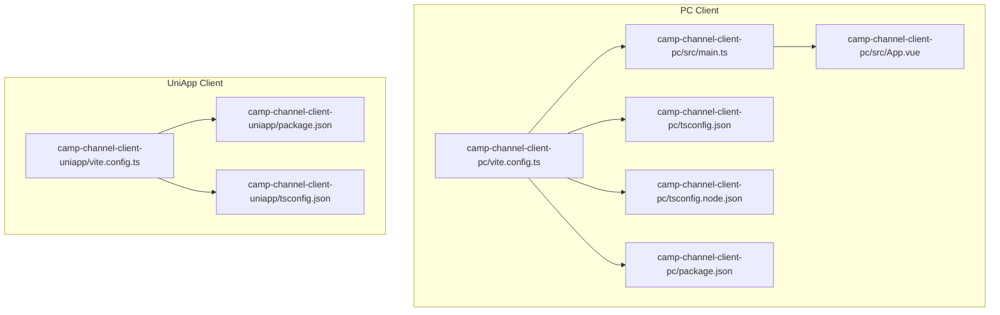
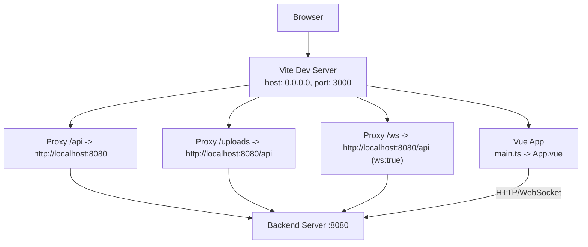
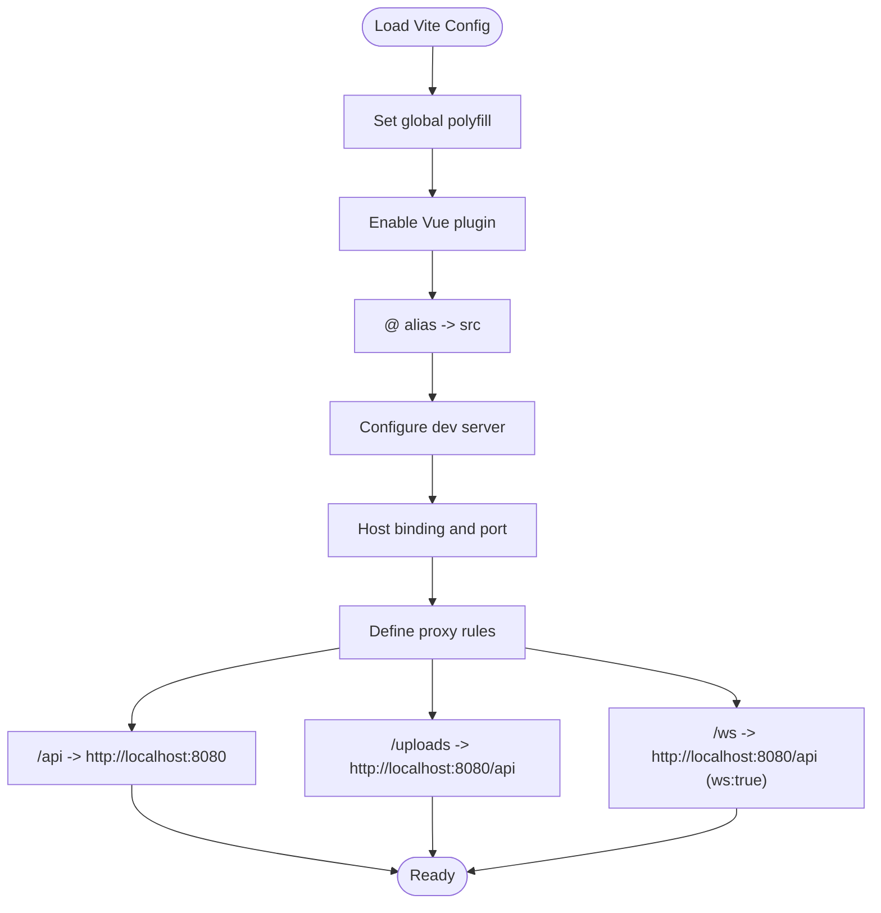
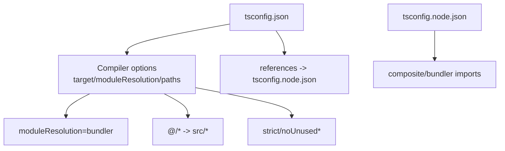
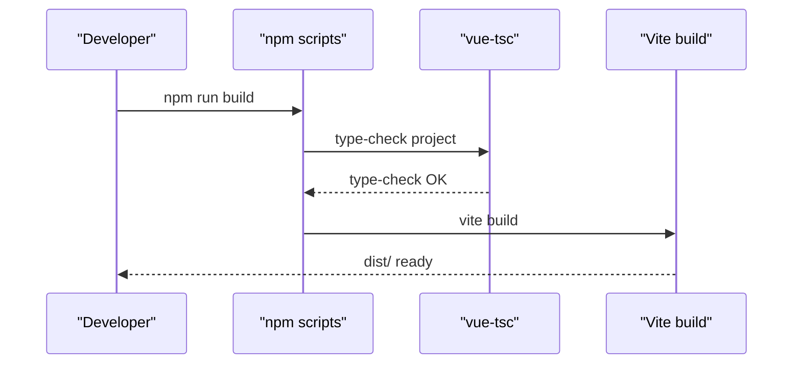
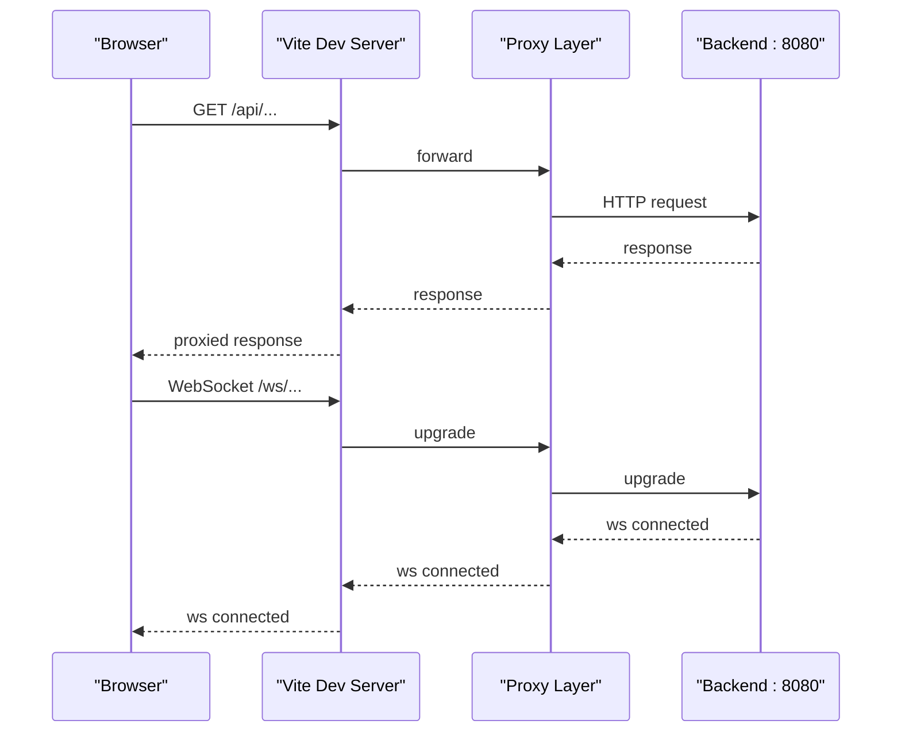
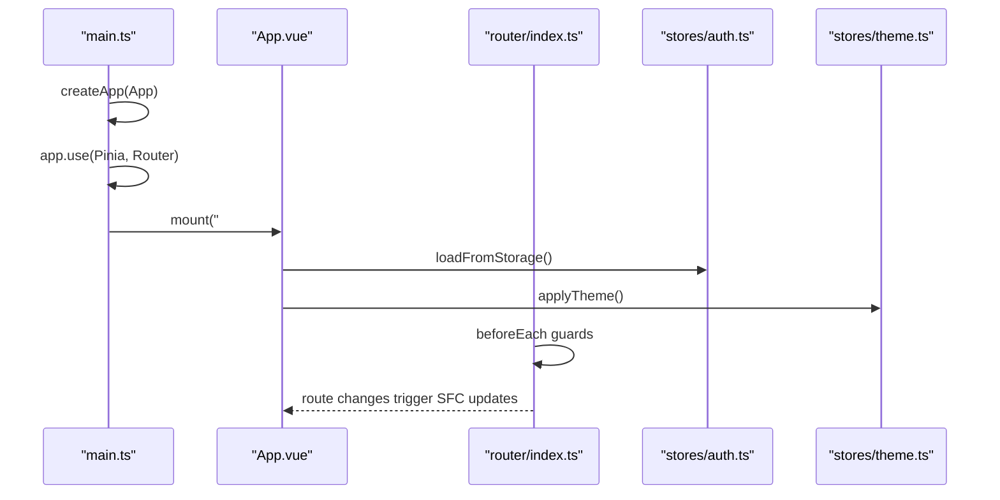
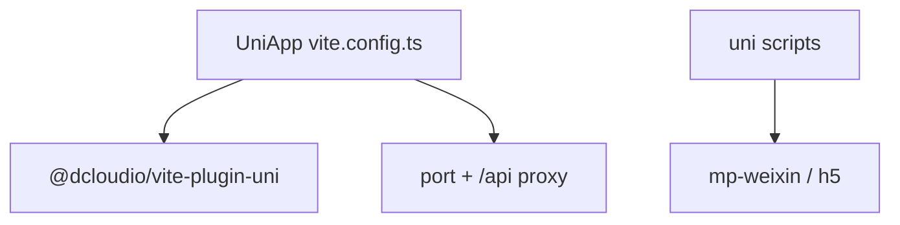
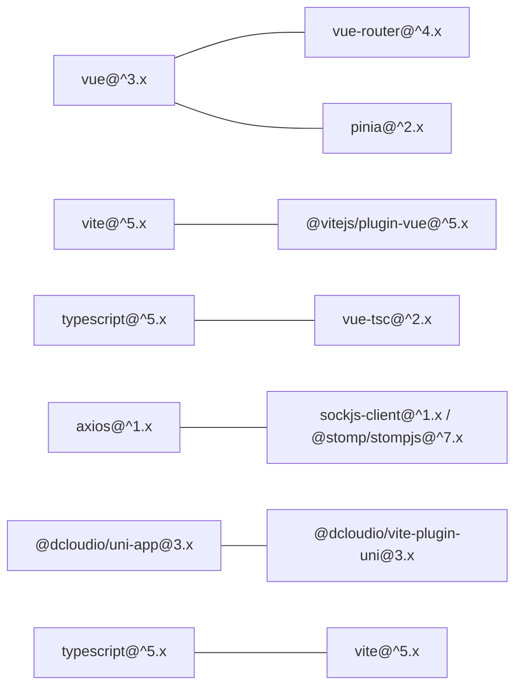

# Build Configuration and Vite Setup

<cite>
**Referenced Files in This Document**
- [vite.config.ts](file://camp-channel-client-pc/vite.config.ts)
- [tsconfig.json](file://camp-channel-client-pc/tsconfig.json)
- [tsconfig.node.json](file://camp-channel-client-pc/tsconfig.node.json)
- [package.json](file://camp-channel-client-pc/package.json)
- [main.ts](file://camp-channel-client-pc/src/main.ts)
- [App.vue](file://camp-channel-client-pc/src/App.vue)
- [env.d.ts](file://camp-channel-client-pc/src/env.d.ts)
- [router/index.ts](file://camp-channel-client-pc/src/router/index.ts)
- [stores/auth.ts](file://camp-channel-client-pc/src/stores/auth.ts)
- [stores/theme.ts](file://camp-channel-client-pc/src/stores/theme.ts)
- [vite.config.ts](file://camp-channel-client-uniapp/vite.config.ts)
- [package.json](file://camp-channel-client-uniapp/package.json)
- [tsconfig.json](file://camp-channel-client-uniapp/tsconfig.json)
</cite>

## Table of Contents
1. [Introduction](#introduction)
2. [Project Structure](#project-structure)
3. [Core Components](#core-components)
4. [Architecture Overview](#architecture-overview)
5. [Detailed Component Analysis](#detailed-component-analysis)
6. [Dependency Analysis](#dependency-analysis)
7. [Performance Considerations](#performance-considerations)
8. [Troubleshooting Guide](#troubleshooting-guide)
9. [Conclusion](#conclusion)
10. [Appendices](#appendices)

## Introduction
This document explains the Vite build configuration and development setup for the PC web client and the UniApp client. It covers Vite configuration (plugins, server, proxy), TypeScript configuration and path aliases, the build pipeline, development server behavior, and integration with Vue Single File Components. It also provides guidance on production optimization, asset handling, and common build issues.

## Project Structure
Two distinct client projects are present:
- PC web client (Vue 3 + Vite): configured via vite.config.ts and TypeScript configs.
- UniApp client (Vue 3 + Vite via @dcloudio/vite-plugin-uni): configured via its own vite.config.ts and tsconfig.json.

Key files:
- PC Vite config defines the Vue plugin, path alias, and development server with API proxying.
- PC TypeScript configs define module resolution, bundler-aware settings, and path mapping.
- PC package.json scripts orchestrate dev/build/preview commands.
- UniApp Vite config uses the Uni plugin and a simpler proxy setup.
- UniApp TypeScript config defines paths and includes for Vue/TSX/Vue files.

**Diagram sources**
- [vite.config.ts:1-35](file://camp-channel-client-pc/vite.config.ts#L1-L35)
- [tsconfig.json:1-25](file://camp-channel-client-pc/tsconfig.json#L1-L25)
- [tsconfig.node.json:1-11](file://camp-channel-client-pc/tsconfig.node.json#L1-L11)
- [package.json:1-28](file://camp-channel-client-pc/package.json#L1-L28)
- [main.ts:1-19](file://camp-channel-client-pc/src/main.ts#L1-L19)
- [App.vue:1-85](file://camp-channel-client-pc/src/App.vue#L1-L85)
- [vite.config.ts:1-16](file://camp-channel-client-uniapp/vite.config.ts#L1-L16)
- [tsconfig.json:1-28](file://camp-channel-client-uniapp/tsconfig.json#L1-L28)
- [package.json:1-29](file://camp-channel-client-uniapp/package.json#L1-L29)

**Section sources**
- [vite.config.ts:1-35](file://camp-channel-client-pc/vite.config.ts#L1-L35)
- [tsconfig.json:1-25](file://camp-channel-client-pc/tsconfig.json#L1-L25)
- [tsconfig.node.json:1-11](file://camp-channel-client-pc/tsconfig.node.json#L1-L11)
- [package.json:1-28](file://camp-channel-client-pc/package.json#L1-L28)
- [vite.config.ts:1-16](file://camp-channel-client-uniapp/vite.config.ts#L1-L16)
- [tsconfig.json:1-28](file://camp-channel-client-uniapp/tsconfig.json#L1-L28)
- [package.json:1-29](file://camp-channel-client-uniapp/package.json#L1-L29)

## Core Components
- Vite configuration (PC):
  - Plugin: Vue plugin enabled.
  - Path alias: @ resolves to src via fileURLToPath and URL.
  - Server: host binding, port, and proxy entries for API, uploads, and WebSocket.
  - Global define: sets global polyfill for compatibility.
- TypeScript configuration (PC):
  - Compiler options tuned for ESNext bundler resolution, DOM libraries, strictness, and path mapping.
  - References to tsconfig.node.json for Vite config consumption.
  - tsconfig.node.json enables bundler module resolution for Vite config.
- Scripts (PC):
  - dev: runs Vite dev server.
  - build: validates TS via vue-tsc then builds with Vite.
  - preview: serves built assets locally.
- UniApp configuration:
  - Uses @dcloudio/vite-plugin-uni.
  - Simplified proxy targeting the backend server.
  - Platform-specific dev/build scripts via uni CLI.

**Section sources**
- [vite.config.ts:5-35](file://camp-channel-client-pc/vite.config.ts#L5-L35)
- [tsconfig.json:2-24](file://camp-channel-client-pc/tsconfig.json#L2-L24)
- [tsconfig.node.json:2-10](file://camp-channel-client-pc/tsconfig.node.json#L2-L10)
- [package.json:5-9](file://camp-channel-client-pc/package.json#L5-L9)
- [vite.config.ts:4-15](file://camp-channel-client-uniapp/vite.config.ts#L4-L15)
- [package.json:5-10](file://camp-channel-client-uniapp/package.json#L5-L10)
- [tsconfig.json:2-27](file://camp-channel-client-uniapp/tsconfig.json#L2-L27)

## Architecture Overview
The development workflow connects the browser to Vite’s dev server, which proxies API and media requests to the backend. Vue components are compiled by Vite with the Vue plugin, while TypeScript is type-checked and transpiled per the compiler options.

**Diagram sources**
- [vite.config.ts:16-34](file://camp-channel-client-pc/vite.config.ts#L16-L34)
- [main.ts:1-19](file://camp-channel-client-pc/src/main.ts#L1-L19)
- [App.vue:1-85](file://camp-channel-client-pc/src/App.vue#L1-L85)

## Detailed Component Analysis

### PC Vite Configuration
- Purpose: Enable Vue SFC support, configure path alias, expose global polyfill, and set up dev server with API proxying.
- Key elements:
  - define: global polyfill injection.
  - plugins: Vue plugin.
  - resolve.alias: @ mapped to src using import.meta URL helpers.
  - server.host/port/proxy: bind address, port, and proxy rules for API, uploads, and WebSocket.

**Diagram sources**
- [vite.config.ts:5-35](file://camp-channel-client-pc/vite.config.ts#L5-L35)

**Section sources**
- [vite.config.ts:5-35](file://camp-channel-client-pc/vite.config.ts#L5-L35)

### TypeScript Configuration (PC)
- Compiler options:
  - Target/module/lib aligned with modern browsers and DOM APIs.
  - moduleResolution set to bundler for Vite compatibility.
  - allowImportingTsExtensions and resolveJsonModule enable modern module handling.
  - noEmit and isolatedModules ensure Vite handles transpilation.
  - paths map @/* to src/* for clean imports.
- References:
  - tsconfig.json references tsconfig.node.json for Vite config consumption.
  - tsconfig.node.json enables bundler module resolution for Vite config.

**Diagram sources**
- [tsconfig.json:2-24](file://camp-channel-client-pc/tsconfig.json#L2-L24)
- [tsconfig.node.json:2-10](file://camp-channel-client-pc/tsconfig.node.json#L2-L10)

**Section sources**
- [tsconfig.json:2-24](file://camp-channel-client-pc/tsconfig.json#L2-L24)
- [tsconfig.node.json:2-10](file://camp-channel-client-pc/tsconfig.node.json#L2-L10)

### Build Pipeline and Scripts (PC)
- Scripts:
  - dev: starts Vite dev server.
  - build: runs vue-tsc for type-checking, then vite build for production bundles.
  - preview: serves the production build locally.
- Implications:
  - Type-checking precedes bundling to catch errors early.
  - Vite handles asset optimization and code splitting in production.

**Diagram sources**
- [package.json:5-9](file://camp-channel-client-pc/package.json#L5-L9)

**Section sources**
- [package.json:5-9](file://camp-channel-client-pc/package.json#L5-L9)

### Development Server, HMR, and Proxy (PC)
- HMR: Enabled by default in Vite dev server; Vue SFC updates propagate without full reload.
- Proxy:
  - /api forwards REST calls to backend.
  - /uploads forwards static/media to backend API endpoint.
  - /ws forwards WebSocket traffic for real-time features.
- Network accessibility:
  - server.host binds to 0.0.0.0 to allow LAN access.

**Diagram sources**
- [vite.config.ts:16-34](file://camp-channel-client-pc/vite.config.ts#L16-L34)

**Section sources**
- [vite.config.ts:16-34](file://camp-channel-client-pc/vite.config.ts#L16-L34)

### Integration with Vue Single File Components (PC)
- Entry point initializes Vue app, Pinia, and router, then mounts to #app.
- App.vue conditionally renders layout vs auth views and applies theme/store logic.
- Router lazy-loads pages to enable code splitting and route-level chunks.
- Stores encapsulate auth and theme state with persistence.

**Diagram sources**
- [main.ts:1-19](file://camp-channel-client-pc/src/main.ts#L1-L19)
- [App.vue:1-85](file://camp-channel-client-pc/src/App.vue#L1-L85)
- [router/index.ts:1-46](file://camp-channel-client-pc/src/router/index.ts#L1-L46)
- [stores/auth.ts:1-61](file://camp-channel-client-pc/src/stores/auth.ts#L1-L61)
- [stores/theme.ts:1-295](file://camp-channel-client-pc/src/stores/theme.ts#L1-L295)

**Section sources**
- [main.ts:1-19](file://camp-channel-client-pc/src/main.ts#L1-L19)
- [App.vue:1-85](file://camp-channel-client-pc/src/App.vue#L1-L85)
- [router/index.ts:1-46](file://camp-channel-client-pc/src/router/index.ts#L1-L46)
- [stores/auth.ts:1-61](file://camp-channel-client-pc/src/stores/auth.ts#L1-L61)
- [stores/theme.ts:1-295](file://camp-channel-client-pc/src/stores/theme.ts#L1-L295)

### UniApp Vite Configuration
- Plugin: @dcloudio/vite-plugin-uni.
- Server: port and simplified proxy for /api to backend.
- Scripts: platform-specific dev/build via uni CLI.

**Diagram sources**
- [vite.config.ts:1-16](file://camp-channel-client-uniapp/vite.config.ts#L1-L16)
- [package.json:5-10](file://camp-channel-client-uniapp/package.json#L5-L10)

**Section sources**
- [vite.config.ts:1-16](file://camp-channel-client-uniapp/vite.config.ts#L1-L16)
- [package.json:5-10](file://camp-channel-client-uniapp/package.json#L5-L10)
- [tsconfig.json:1-28](file://camp-channel-client-uniapp/tsconfig.json#L1-L28)

## Dependency Analysis
- PC client dependencies:
  - Vue 3 runtime and ecosystem (router, pinia).
  - Vite and @vitejs/plugin-vue for dev/build.
  - TypeScript toolchain and vue-tsc for type checking.
  - axios and STOMP/SockJS for HTTP/WebSocket communication.
- UniApp client dependencies:
  - @dcloudio/uni-app and related packages for cross-platform runtime.
  - @dcloudio/vite-plugin-uni and Vite for build.
  - TypeScript and Vite for type checking and bundling.

**Diagram sources**
- [package.json:10-26](file://camp-channel-client-pc/package.json#L10-L26)
- [package.json:11-27](file://camp-channel-client-uniapp/package.json#L11-L27)

**Section sources**
- [package.json:10-26](file://camp-channel-client-pc/package.json#L10-L26)
- [package.json:11-27](file://camp-channel-client-uniapp/package.json#L11-L27)

## Performance Considerations
- Code splitting:
  - Lazy-loaded route components reduce initial bundle size.
- Asset handling:
  - Vite optimizes static assets; ensure media paths match proxy endpoints (/uploads).
- Module resolution:
  - bundler moduleResolution reduces overhead and improves compatibility.
- Strictness and checks:
  - strict TypeScript settings catch potential runtime issues early.
- Production build:
  - Use vite build with vue-tsc precheck to validate types before bundling.

[No sources needed since this section provides general guidance]

## Troubleshooting Guide
- Proxy does not forward requests:
  - Verify server.host and port match the dev server configuration.
  - Confirm proxy entries for /api, /uploads, and /ws are present.
- WebSocket connection fails:
  - Ensure ws: true is set for /ws proxy.
  - Check backend WebSocket endpoint availability.
- Path alias not resolved:
  - Confirm @ alias maps to src in both Vite and TypeScript configs.
- Type errors during build:
  - Run vue-tsc separately to identify TS issues before vite build.
- CORS or origin mismatch:
  - changeOrigin is enabled; ensure backend allows origins from dev server host/port.

**Section sources**
- [vite.config.ts:16-34](file://camp-channel-client-pc/vite.config.ts#L16-L34)
- [tsconfig.json:18-20](file://camp-channel-client-pc/tsconfig.json#L18-L20)
- [package.json:7-8](file://camp-channel-client-pc/package.json#L7-L8)

## Conclusion
The PC client leverages Vite with a Vue plugin, robust path aliasing, and a development server configured with API, uploads, and WebSocket proxies. TypeScript is configured for modern bundler behavior and strictness, while scripts orchestrate type-checking and production builds. The UniApp client integrates with @dcloudio/vite-plugin-uni and uses a streamlined proxy setup. Together, these configurations enable efficient development and reliable production builds.

## Appendices
- Example references to configuration files:
  - PC Vite config: [vite.config.ts:1-35](file://camp-channel-client-pc/vite.config.ts#L1-L35)
  - PC TypeScript root: [tsconfig.json:1-25](file://camp-channel-client-pc/tsconfig.json#L1-L25)
  - PC TypeScript node: [tsconfig.node.json:1-11](file://camp-channel-client-pc/tsconfig.node.json#L1-L11)
  - PC scripts: [package.json:5-9](file://camp-channel-client-pc/package.json#L5-L9)
  - UniApp Vite config: [vite.config.ts:1-16](file://camp-channel-client-uniapp/vite.config.ts#L1-L16)
  - UniApp scripts: [package.json:5-10](file://camp-channel-client-uniapp/package.json#L5-L10)
  - UniApp TypeScript: [tsconfig.json:1-28](file://camp-channel-client-uniapp/tsconfig.json#L1-L28)